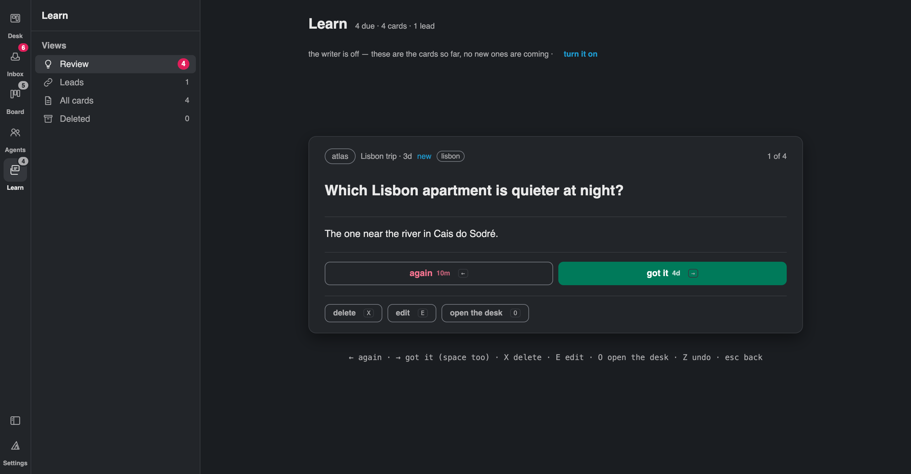
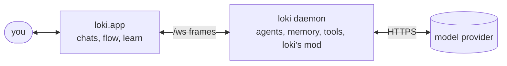

<p align="center">
  
</p>

<h1 align="center">loki</h1>

<p align="center">
  <b>Your own AI agents on your own machine.</b><br>
  Multiple conversations on macOS, with Windows and Linux in preview — Flow: one deck of everything waiting on you,
  suggestions an agent writes for your other chats, git-backed memory, flashcards from your conversations, and your phone as a remote.
</p>

<p align="center">
  <a href="https://github.com/AlmondLabs/loki/actions/workflows/ci.yml"></a>
  
  
  
</p>

> Not [Grafana Loki](https://grafana.com/oss/loki/), the log system.

Cloned the repo and want it running on a Mac? Three tools, then two commands (Windows and Linux: see
[Development](#development)):

```bash
xcode-select --install          # Xcode's command line tools (and git), once
brew install node               # Node 22.19 or newer: loki's daemon, Vite, the tests
brew install oven-sh/bun/bun    # bun: installs the packages and runs the scripts
bun install && bun run start
```

loki runs its agents in its own daemon, a Node process the window starts; the same Node runs Vite and the tests, and
bun installs the packages and starts the scripts. git keeps each agent's memory. The window is Electron, which
`bun install` brings, so there is nothing to compile; the first start builds the page, about fifteen seconds. The
window then asks for a model provider: an API key you already have with Anthropic, OpenAI, Google, OpenRouter, Ollama
for local models, or another provider, or signing in through the browser (ChatGPT, GitHub Copilot, OpenRouter and
others). loki checks the key with the provider and keeps it in your system's keychain; each turn costs whatever that
provider charges. Everything else, including the one-line install of the finished app, is under [Install](#install)
and [Development](#development).

## What you get

| | | |
|---|---|---|
| **Chats** | ⌘1 | One chat per conversation, with its transcript and any subagent workers it started. Chats sit in a Slack-style sidebar (Pinned, one section per agent, Archived) and open directly to **Messages** (plus **Workers** when the chat has helpers). ⌘K finds any chat, agent or page. |
| **Flow** | ⌘2 | Every chat you haven't archived, as cards, highest score first: blocked agents, then what's new, then the chats you have been working in, learned from what you do (a task you move on from fades on its own). Approve and reply inline; a reply keeps the card while the answer streams in. **Read** sets a card aside for a while, **Later** keeps it unread and brings it back in a day, and **Archive** is done. ⌥Space opens it from anywhere on the Mac. |
| **Agents** | ⌘4 | Your agents listed like Slack's direct messages, with live state and what waits on you. Each has a profile and model, its memory files as a tree, what it learned as a timeline of commits, its reflection settings, and its skills with one-click refresh from upstream. |
| **Learn** | ⌘5 | Spaced-repetition cards a background writer distils from quiet conversations — only concepts and knowledge that last, never the details of a task — and **leads**: concepts that went by without being understood, each one click from a `[Learn]` lesson the agent teaches in a chat of its own. Off until you switch it on; how many cards a day is yours to set. Deleting a card is the feedback. [How it works](docs/learn.md). |
| **Suggestions** | | When a piece of work fits another chat better — a side finding for your themed infra chat, a hand-off to another agent, a part to run in parallel in a new chat — the agent suggests a message for it. The suggestion waits in the chat screen until you send it now, save it as a draft in that chat's box, point it at another chat, or reject it; an agent never sends one. A one-line purpose you write on a chat tells agents what it is for. |
| **Phone** | | Flow, every chat, your agents and Learn on your phone, in Slack's mobile layout, over Wi‑Fi or Tailscale, nothing to install: scan a QR, add to the home screen. Viewed and read agree with the Mac. Mac only for now. |

Keys are written the Mac's way. On Windows and Linux ⌘ is Ctrl and ⌥ is Alt, and loki shows them that way; the
phone, ⌥Space, dictation and the menu-bar item are not there yet ([the manual](docs/manual.md#windows-and-linux)
lists what differs).

<p align="center">
  
</p>

## Install

One line in a terminal. On a Mac with Apple silicon, or on Linux:

```bash
curl -fsSL https://almondlabs.github.io/loki/install.sh | sh
```

On Windows, in PowerShell:

```powershell
irm https://almondlabs.github.io/loki/install.ps1 | iex
```

It downloads the latest release and opens loki: on a Mac in `/Applications` (or `~/Applications` when that folder
isn't yours to change), on Linux as an AppImage in `~/.local/share/loki` with a menu entry, on Windows for you alone,
with no administrator prompt. A Mac needs no `xattr` line this way: a file `curl` fetches carries no quarantine flag.
Run it again, with loki closed, to reinstall; your agents and chats in `~/.loki` stay. After that loki keeps itself up
to date: it checks on launch and every six hours, and installs what it downloaded when you quit
([Updates](docs/manual.md#updates)). Versions are dates and a count: `2026.1011.0` is the first stable of October 11
(UTC), `2026.1011.1` the second.

**Nightly**, if you want the newest `main` whenever the maintainer releases a nightly, between stables:

```bash
curl -fsSL https://almondlabs.github.io/loki/install.sh | sh -s -- --nightly
```

```powershell
$env:LOKI_CHANNEL = "nightly"; irm https://almondlabs.github.io/loki/install.ps1 | iex
```

One loki at a time, and either line installs the same app: Preferences › About moves it between **Stable** and
**Nightly** later. That channel replaces the `loki-nightly` cask, which is deprecated.

### Other ways in

**The `.dmg`** from the [latest release](https://github.com/AlmondLabs/loki/releases/latest): drag loki to
Applications, then clear the quarantine flag once. loki is not signed with an Apple Developer ID, and macOS calls an
unsigned download "damaged" until the flag is gone:

```bash
xattr -dr com.apple.quarantine /Applications/loki.app
```

**Homebrew**, which quarantines its downloads like a browser, so the same line follows:

```bash
brew install --cask almondlabs/loki/loki
xattr -dr com.apple.quarantine /Applications/loki.app
```

Either way, loki updates itself from then on.

**Windows and Linux by hand**, from the [releases page](https://github.com/AlmondLabs/loki/releases/latest). On
Windows (64-bit 10 or 11), `loki_<version>_x64-setup.exe`: SmartScreen says "Windows protected your PC" (an unknown
publisher), so choose **More info**, then **Run anyway**. On Linux (64-bit, built on Ubuntu 22.04 so it runs on newer
releases too), the AppImage, which needs its executable bit and FUSE 2 (`libfuse2`; on Ubuntu 24.04 the package is
`libfuse2t64`):

```bash
chmod +x loki_*_amd64.AppImage && ./loki_*_amd64.AppImage
```

Or, on Debian or Ubuntu, the `.deb`. It is the one file that does not update itself: the next version is another
download from the releases page, which Preferences › About links when it is out.

```bash
sudo apt install ./loki_*_amd64.deb
```

Both systems are built and tested in CI, not yet tried on real machines; please
[report what you find](https://github.com/AlmondLabs/loki/issues) ([what to try](docs/preview-checklist.md)). There is
no winget or Flatpak package.

**From source**: Node, bun and Xcode's command line tools, then `bun run start` to run the checkout, or
electron-builder for a `.app` and `.dmg` of your own ([Contributing](docs/CONTRIBUTING.md#setup) has the steps). A
build made on your own Mac never carries the flag.

### What you need

You need a Mac with Apple silicon and macOS 13.3 or later (Intel Macs are not supported), 64-bit Windows 10 or 11, or
a current 64-bit desktop Linux, and:

1. **Node 22.19 or newer**, which loki's daemon and agents run on. loki finds the one you have, wherever an
   installer put it; when there is none, Welcome offers **Install Node**, which runs nodejs.org's official installer
   on a Mac or Windows, and on Linux shows the commands to install it.
2. **git**, which keeps each agent's memory as a repo with history. On a Mac it comes with Apple's command line
   tools, which Welcome offers to install; on Windows loki fetches PortableGit when git is missing; on Linux, your
   distribution's package.

On first launch loki asks for a model provider: an API key (Anthropic, OpenAI, Google, OpenRouter, Ollama and
others) or signing in through the browser (ChatGPT, GitHub Copilot, OpenRouter and others). Anthropic's subscription sign-in is not offered; use an Anthropic API key. The
key is checked with the provider and kept in your system's keychain, and you pay that provider for what you use.
Then loki helps you name your first agent and start your first chat.

## How it works



Three parts, one repo. An **Electron shell** opens the window and keeps loki's **daemon** running: one process on
your machine's Node,
built on Earendil's Pi libraries (pi-durable for the agent loop, pi-ai for the models), that holds every agent's
chats in a SQLite store per agent, runs the tools under your permission mode, keeps memory as git repos, and saves
each step before it shows it, so a turn cut off by a crash picks up where it stopped. Inside the daemon runs
**loki's mod**, which owns suggestions, Learn and chat metadata and serves the **React app** over one WebSocket.
Your messages go to the provider you chose; [SECURITY.md](docs/SECURITY.md#what-leaves-the-machine) lists everything
else that reaches the network (web search, the update check, MCP servers, an ACP agent).
[docs/architecture.md](docs/architecture.md) has the long version.

## Layout

```text
daemon/         loki's daemon (Node): the agent stores on pi-durable, providers and keychain, approvals, tools, memory,
                reflection, skills, subagents, background and scheduled tasks, the mod registry, ACP agents, MCP
mod/            loki's own mod, run inside the daemon: suggestions, Learn, the sockets for app and phone;
                boot.ts re-bundles it on each change in a checkout (no manual build)
core/           chat scope helpers, the frame table, attention, recall — portable, no browser globals
app/            Vite + React: the desktop views and the phone
desktop/        the desktop shell (Electron, TypeScript; macOS, Windows, Linux): finds Node, starts and supervises
                the daemon, hosts the web app, updates the app
scripts/        dev (`bun run start`), build-desktop (the shell's bundle), build-mod (the daemon and mod bundles the app
                ships), trial (the timing trial), cask (Homebrew), release (date versions, notes)
test/           vitest tests, on Node; test-node/ the tests that need Node's own runner (SQLite stores, resuming after a crash)
docs/           the manual, learn (the mental model), architecture, design direction, dated plans and research; CONTRIBUTING, SECURITY and RELEASING
```

## Development

You need Node 22.19 or newer (`brew install node`: it runs Vite, the tests and loki's daemon), bun
(`brew install oven-sh/bun/bun`: it installs the packages and runs package.json's scripts, each on Node) and Xcode's
command line tools (`xcode-select --install`, for git). A development window runs the checkout's own daemon,
`daemon/main.ts`, which hosts the built-in mod directly.

```bash
bun install
bun run start                                     # the Electron window on the built page (app/dist); changes wait for update in the window; Ctrl-C stops it
bun run dev                                       # the same window on Vite with hot reload, and app/dist rebuilt for the phone as you edit
bun run dev:vite                                  # Vite alone, for a browser tab
bun run test && bun run typecheck && bun run lint # vitest (the shell's tests too), bun check (TypeScript 7), oxlint (typescript-eslint + React compiler rules) and eslint
bun run test:node                                 # the tests that need Node: SQLite stores, resuming after a crash, mod reloads
bun run build:mod                                 # the daemon and mod bundles the app ships
```

Both window commands bundle the shell (`desktop/`) with esbuild as they start, so a change to it shows at the next
start, with nothing to compile.

The app is built with the React Compiler, so memo boundaries hold without hand-written `useCallback`;
`LOKI_COMPILER_LOG=1 bun run build:app` lists what it declined to compile. In development, `?scan` on the dev
URL loads React Scan and outlines every needless re-render.

On **Windows** and **Linux** you need Node, bun and git, and nothing in place of Xcode's tools: Electron brings its
own Chromium. On Windows run the commands from Git Bash. [Contributing](docs/CONTRIBUTING.md) has the rest, the
release's files included.

## Read on

- [The manual](docs/manual.md): every view, every key, every file loki writes.
- [Learn](docs/learn.md): the mental model for the card writer, leads and lessons, and what a run costs.
- [Architecture](docs/architecture.md): the processes that run, what the daemon holds, and the journey of a message.
- [Design](docs/design.md): Slack's look on the desktop and the phone, and the token contract that keeps it so.
- [Contributing](docs/CONTRIBUTING.md), [Security](docs/SECURITY.md), [Releasing](docs/releasing.md).

One rule holds everywhere: no real money amounts on screen, in the repo or in recordings, ever (the usage page's
estimate of what your agents spent is the one exception, and its fixtures are made up). Treat agent actions like your own commands: an agent that may write files or run commands can touch anything you can.

## Licence

Apache-2.0. See [LICENSE](LICENSE).
