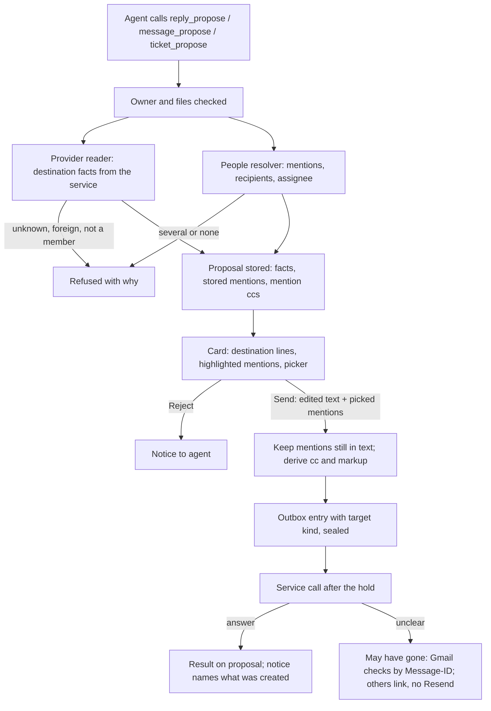
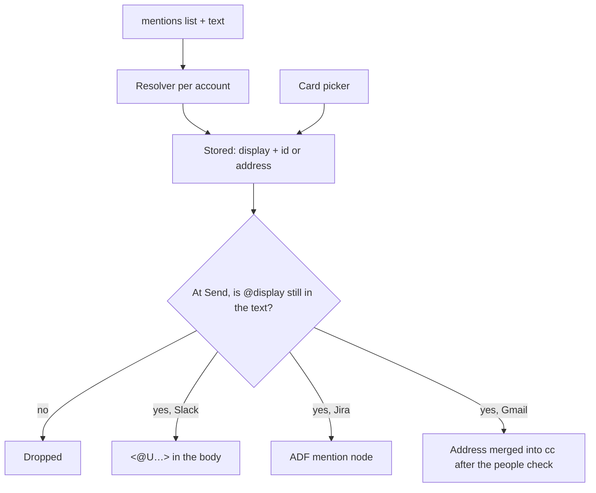

# An agent writes in any of its accounts - Plan

## Goal Capsule

- **Objective:** The person can ask an agent, from a chat, to say something in any account it owns (answer any existing thread, start a new email, DM or post, or open a Jira ticket, and tell named people about it) and know from the card, before pressing Send, exactly where it lands and who hears of it.
- **Means:** three propose tools over one proposal store, card and outbox, with one people resolver and stored mentions (KTD1, KTD3).
- **Product authority:** the person, in the sessions of 2026-11-14 that asked for this plan, brainstormed it and confirmed its planning.
- **Open blockers:** none.
- **Stop conditions:** stop and ask if Google refuses the contacts scopes on the shared app outright, or if a Jira Cloud site rejects ADF mention nodes in comments.
- **Execution profile:** a stack of three PRs on branches `feat/reply-any-thread` (U1–U6), `feat/new-conversations` (U7–U9) and `feat/new-tickets` (U10–U11), each merged into the one before it; the first carries this plan. The person merges.

---

## Product Contract

Product Contract preservation: changed: R17 (a ticket's title is editable words), the Jira scope boundary (loki now checks who can see a ticket), R5 and R6 (`#channel` and channel membership) — all confirmed by the person in planning; added R21–R24 from planning answers.

### Summary

An agent can propose a reply to any existing thread, a new email, a new Slack DM, a top-level Slack post, or a new Jira ticket, in any account it owns, with no Flow card needed first. Every proposal waits on a card for the person's Send, showing its destination as the service reports it. `@name` does what it does natively in each service: Gmail adds the person to cc, Slack and Jira notify them.

### Problem Frame

The person asked an agent to comment on FMOS-13190 and notify Vivek, and it failed: loki can comment only on a ticket that once had a card in Flow (R28 of `docs/plans/2026-11-10-1451-feat-jira-inbox-plan.md`), and FMOS-13190 never did. Even on a ticket that has one, `@Vivek` would go as plain text, since loki writes Jira comments and Gmail bodies without mentions. An agent also cannot start anything through a card: no new email, no new DM, no new ticket. So "tell these people this" jobs come back to the person to do by hand in each service, though the person already reviews and sends every proposal themselves.

### Key Decisions

- **No Flow card needed.** The person's Send is the gate, so what an agent may write to is bounded by the accounts it owns, not by what reached Flow. (session-settled: user-directed — chosen over keeping R28's card requirement: every proposal already waits for the person's Send, and the card's destination lines catch a wrong or injected target.) Governs R1, R4.
- **Mentions behave as each service does.** No separate list of who is notified; the mention itself shows the person, as the service would. (session-settled: user-directed — chosen over a card line that confirms each resolved person: the person wants @ to work as it does in Gmail, Slack and Jira.) Governs R11, R12, R23.
- **An unclear name is refused, and the agent asks.** (session-settled: user-directed — chosen over flagging it on the card for the person to fix, and over sending it as plain text.) Governs R13.
- **Gmail's @ searches the people Gmail's own @ does**, at the cost of a new read-only permission on each Gmail account. (session-settled: user-approved — chosen over full addresses only: most colleagues are in other contacts or the directory, not saved contacts.) Governs R14, R15.
- **One plan covers replies, new conversations and new tickets.** (session-settled: user-directed — chosen over planning replies first and the rest later.) It ships as a stack of PRs in that order, each carrying its part. (session-settled: user-approved — chosen over one PR for everything: the build is large and replies are useful alone.)
- **Common ticket fields only.** (session-settled: user-approved — chosen over any field on the project's create form, and over the bare minimum.) Governs R8.
- **On the card, only the words are edited.** Changing who, where, or a ticket's fields means Reject and ask again, as reply cards work today. (session-settled: user-approved — chosen over editing every field, and over editing text and people.) Governs R17.
- **Every agent email goes through a card.** The script send tool keeps only drafts. (session-settled: user-approved — chosen over removing the tool and over keeping direct sends: a second path without the card would undo the gate for new mail.) Governs R21.
- **A Slack mention of a non-member warns, and Send still works.** (session-settled: user-approved — chosen over refusing so the agent asks, and over inviting the person on Send.) Governs R22.
- **Flow is left as it was.** Proposing or sending never adds a card; answers come in through the usual sync. Governs R20.

### Requirements

**What an agent can propose**

- R1. A reply to any existing thread of an account the agent owns (a Gmail thread, a Slack thread, DM or channel conversation, a Jira ticket), whether or not it has ever had a card in Flow.
- R2. A new email from a Gmail account, to people found by R14 or named by full address.
- R3. A new Slack DM, one to one or with several people of the workspace.
- R4. A top-level post in a Slack channel or DM the account is a member of; posting in a channel without a message to reply to keeps working as it does today.
- R5. The agent may name an existing thread by what it has: a Gmail thread id, a Slack `channel:ts`, message link or `#channel`, a Jira key, id or ticket link.
- R6. A target the service does not know, one of another Jira site or Slack workspace, or a Slack channel the account is not a member of, is refused with why, and nothing is proposed.
- R7. A new Jira ticket in any project the account can create tickets in.
- R8. The agent may set a ticket's project, type, title, description, assignee, priority, labels and parent; a project that requires another field refuses the proposal, naming the field and saying the person can create that ticket in Jira.
- R21. The script tool that sent email directly now only creates drafts; it never sends.

**The card**

- R9. The card names the destination as read from the service when proposed, never only in the agent's words: Gmail the subject and every recipient; Slack the conversation by name (the DM partner by name, never "them") and, for a thread, its first line; Jira the ticket's key and title, or for a new ticket its project, type and every field set.
- R10. A reply in a thread with no card in Flow says so in a plain sentence; a Slack conversation shared with people outside the workspace says so; a Jira reply says who Jira usually tells (assignee, reporter, watcher count), and on a service-desk ticket that the customer sees it.
- R22. A Slack mention of someone who is not a member of the channel says on the card that they will not be notified.

**Mentions**

- R11. An `@name` the agent writes becomes the service's own: in Slack and Jira a mention that notifies the person, in Gmail the person added to cc with `@Full Name` left in the body.
- R12. The card draws each mention as the service would, by the person's full name, so the words show who is meant.
- R13. An `@name` that matches more than one person, or nobody, refuses the proposal, naming who matched, and the agent asks the person.
- R14. Gmail's `@` and new-email recipients search the account's contacts, other contacts, and, on a Workspace account, the organisation's directory; Slack searches the workspace; Jira searches the people who can see the ticket (for a new ticket, the project).
- R15. A Gmail account that has not granted the read-only contacts and directory access refuses an `@name` with a line saying to reconnect it; full addresses still work.
- R16. A ticket's assignee is matched by the same rules as a mention (R13, R14).
- R23. The person's own Slack reply box inserts a mention by the person's name, as the agent's do, rather than by handle.

**Editing on the card**

- R17. The person edits only the words of a proposal before Send: its text, and a new ticket's title.
- R18. Typing `@` in the card's editor opens a list of matching people from that account; the person picked becomes the mention, or the cc in Gmail.
- R19. Deleting a mention on a Gmail card takes that person off cc, unless they were already on the thread.

**After Send**

- R20. Proposing and sending put nothing in Flow; Send, Undo and the outcome work the same for every target, with or without a Flow card.
- R24. The notice that tells the agent its proposal went names what was created (the new thread, `channel:ts` or ticket key) and the mentions and cc as sent, after the person's edits.

### Acceptance Examples

- AE1. **Covers R1, R9, R10.** Given FMOS-13190, which never had a card in Flow, when the agent proposes a comment on `fmos-13190`, then the card shows the key and title read from Jira, says the ticket has no card in Flow, and names who Jira usually tells.
- AE2. **Covers R6.** Given the agent mistypes a key Jira does not have, then the proposal is refused with that reason and no card appears.
- AE3. **Covers R11, R12, R13.** Given the site has Vivek Rao and Vivek Shah, when the agent mentions `Vivek`, then the proposal is refused naming both with a token each; when it mentions `Vivek Rao`, the card shows the mention as Vivek Rao and Send notifies him in Jira.
- AE4. **Covers R11, R14, R19.** Given a Gmail reply where the agent mentions `Ana Ruiz`, found in other contacts, then Ana is on the card's cc line and `@Ana Ruiz` is in the body; deleting the mention on the card takes her off cc.
- AE5. **Covers R15.** Given a Gmail account that has not granted the new access, then a mention of `Ana` is refused with a line to reconnect the account, and `ana@example.com` works.
- AE6. **Covers R7, R8, R16.** Given a project that requires a "Team" field, when the agent proposes a ticket without it, then the proposal is refused naming "Team".
- AE7. **Covers R18.** Given a Slack card, when the person types `@gr` in the editor, then a list of matching workspace people opens and the one picked becomes a mention.
- AE8. **Covers R4, R20, R24.** Given a channel the account is in, when the person sends the agent's top-level post, then it is posted, the agent is told its `channel:ts`, and Flow shows no new card.

### Scope Boundaries

- Internal comments on Jira Service Management tickets.
- Ticket fields beyond R8's list, and editing anything on the card beyond R17's words.
- Gmail web links as references: their ids are not the API's thread ids.
- Changing a ticket after it is created (status, assignee, fields), and any other Jira write beyond comments, files and new tickets.
- Slack broadcast mentions (`@here`, `@channel`, `@everyone`) by an agent: they stay plain text.
- Inviting someone to a Slack channel so a mention reaches them (R22 warns instead).
- Considered and not built: keeping `google_gmail_send` as a refusing stub for a release (a removed tool fails visibly at once, and only owner-written scripts call it).
- Considered and not built: a rich-text editor with atomic mention pills (KTD9's highlight carries R12 at a fraction of the cost; revisit if people find partial edits confusing).

### Dependencies / Assumptions

- Google's People API gives other contacts and, on Workspace accounts, directory search, under read-only scopes the person grants when the account signs in again; directory search also needs the Workspace admin's external directory sharing on, so it can miss colleagues Gmail's own `@` shows.
- Gmail's own `@` may add the person to To rather than Cc; loki keeps the person's rule (R11, Cc).
- A Jira mention notifies only when the token owner has "Browse users and groups" and the mentioned person can see the ticket; without that permission Jira's user search returns nobody, so every `@name` and assignee on that site is refused.
- A Slack mention notifies only members of the channel (R22).
- Creating tickets ends the rule in `mod/jira.ts` (R20 of the Jira inbox plan) that loki writes nothing to Jira but comments and files; `docs/SECURITY.md` changes with it.

### Sources

- `mod/reply-proposals.ts` (`propose`, `where`, `ticketRecord`, `send`, `peopleChange`, the tool), `mod/outside-threads.ts` (`holdAgentReply`, `sendNow`, the people check), `mod/mail-outbox.ts` (`HeldReply`, `sealOf`), `mod/jira.ts`, `mod/jira-text.ts` (`textToAdf`), `mod/slack.ts` (`SLACK_METHODS`, `postReply`), `mod/slack-people.ts`, `mod/google-app.ts`, `mod/google-signin.ts`, `mod/google-tools/gmail.ts` (`google_gmail_send`), `app/src/item/proposal.tsx`, `app/src/desk/reply-proposal-card.tsx`, `app/src/desk/mentions.tsx`.
- `docs/plans/2026-11-10-1451-feat-jira-inbox-plan.md` (R20, R28), `docs/plans/2026-11-14-1134-feat-reply-sends-plan.md`, `docs/plans/2026-11-13-097-refactor-account-operations-plan.md`.
- People API: `people.searchContacts`, `otherContacts.search` (both need an empty warm-up query, page size at most 30), `people.searchDirectoryPeople`. Jira Cloud REST v3: ADF `mention` node (`attrs.id` required), `/user/viewissue/search`, `/user/assignable/search`, `/user/permission/search`, `issue/createmeta/{project}/issuetypes/{type}` (paginated), `POST /issue` (missing field is a 400 with `errors.{field}`). Slack: `conversations.open` (1–8 users), `users.conversations`, mentions notify channel members only.

---

## Planning Contract

### Key Technical Decisions

- KTD1. **Three tools, one pipeline.** `reply_propose` keeps existing conversations (any thread, or a top-level post in a conversation the account is in) and still takes no recipients; `message_propose` takes a new email (`to`, `cc`, `subject`) or a new Slack DM (`people`); `ticket_propose` takes R8's fields. All three write the same proposal store, card, outbox and notices. A single tool would need a kind switch with conditional required fields, and keeping recipients out of `reply_propose` narrows what a stranger's text can steer: the conversation must be one the account is already in. On Gmail its mentions can still add cc, so for those the card's cc line, which names each added address, is the gate. Governs R1–R8.
- KTD2. **The service is always read; a Flow record only lends names.** Each provider has a reader that turns the agent's reference into the destination facts R9 and R10 need; a failed read refuses the proposal and never falls back to the agent's words. Readers sit beside each provider's other reads in `mod/account-ops/`, picked by an exhaustive switch on the provider so a new provider fails to type-check without one. Replaces `where()` and `ticketRecord()`. Governs R1, R5, R6, R9.
- KTD3. **Mentions are a structured list, resolved once and stored.** Each tool takes `mentions: string[]` (a full name, an email, a Slack handle, or a token a refusal gave); only `@<entry>` substrings of the text matching a listed entry are mentions, so `@channel`, an address or `@types/node` stays text. The resolver stores each as a display name plus a provider id or address on the proposal, and rewrites each matched `@<entry>` in the text to `@<display>` before storing, so a mention written as a handle, address or token is shown and kept like one written by name; the card draws, and Send writes, only stored mentions, and drops any whose `@display` is no longer in the final text. Governs R11–R13, R19.
- KTD4. **One people resolver per account.** Slack matches the workspace (the cached `users.list` in `mod/slack-people.ts`); Jira matches `/user/viewissue/search` on an existing ticket, `/user/permission/search` with browse permission for a new ticket's project, and `/user/assignable/search` for an assignee; Gmail searches contacts, other contacts and the directory through the People API, each source only when its scope is granted, directory failure silent. A refusal lists up to eight matches, each with a token to write back (an address, a Jira account id, a Slack handle) and one telling detail. The card's picker and `people_find` use the same resolver, so they never disagree. Governs R13, R14, R16, R18.
- KTD5. **Gmail mention ccs live apart from the thread's people.** They are a separate list on the proposal, left out of the "people changed" check (`peopleChange`), and merged into cc after it at Send. Putting them in `cc` would make every mention reply look like a people change and refuse it. Governs R11, R19.
- KTD6. **The decide frame carries mentions.** Send sends the edited text plus any mentions picked in the editor (already resolved by the picker); the server keeps only those whose `@display` remains, then derives Gmail cc and Slack and Jira mention markup from them. Governs R17–R19.
- KTD7. **Google contacts is a grant apart from scripts' services.** The three read-only People API scopes join the sign-in scope list, but the account records them as a separate `contacts` grant rather than a `GoogleService`, so the Preferences row keeps saying which services scripts can use and adds one line when contacts is missing. Sign-in already asks for every scope with consent each time, so reconnecting from Preferences grants it. Governs R14, R15.
- KTD8. **Agent text never gets send-time handle mentions.** Today `sendNow` turns any known `@handle` in a Slack body into a notifying mention; for an agent's proposal it now uses only stored mentions, so a quoted stranger's `@handle` cannot notify anyone unseen. The person's own reply box moves to the same stored mentions. Governs R11, R23.
- KTD9. **Mentions show as highlighted text in the existing editors.** Both card editors keep their textarea, with an overlay that marks each stored `@display`; editing inside one turns it back to plain text, which the highlight shows. Governs R12.
- KTD10. **New conversations get their own outbox target kinds.** A held entry names its kind (reply, new email, new DM, top-level post, new ticket); the seal's field list grows by the same trailing, present-only rule it uses today, so entries written before this change keep their seal. A new email carries its own `Message-ID`, and "did it go" searches `rfc822msgid:`; a new DM, post or ticket that may have gone shows "may have gone" with a link and no Resend, so nothing is created twice. Governs R2, R3, R7, R20.
- KTD11. **The send result reaches the proposal.** `onSent` passes the service's answer (Gmail thread id, Slack `channel:ts`, Jira key), kept on the sent proposal and quoted in the agent's notice. Governs R24.
- KTD12. **A DM is opened at Send.** `conversations.open` joins the Slack allow-list and runs at Send, so a rejected proposal creates nothing; the card says "a DM with A and B" without claiming new or existing. Governs R3.
- KTD13. **Jira's write rule widens by one method.** `createIssue` joins `postComment` and `attachFiles` as the only non-GET requests; the lock test in `test/jira.test.ts` and `docs/SECURITY.md` change with it. Required fields come from `createmeta/{project}/issuetypes/{type}` (all pages), read at propose. Governs R7, R8.
- KTD14. **Discovery reads are script-only tools.** `people_find(account, query)`, `slack_conversations(account, query?)` and `jira_projects(account)` follow `mod/account-ops/script-tools.ts`'s `scriptTool` pattern: read-only, owner-checked, results capped and marked as stranger text. Refusals stay the safety net, not the only way to learn a name.
- KTD15. **No script path sends Gmail.** `google_gmail_send` is renamed `google_gmail_draft` and calls `drafts.create`; the generic `google_api` tool refuses Gmail's `messages/send` and `drafts/send` paths (upload variants included) with words naming `message_propose`. Governs R21.

### High-Level Technical Design

How a proposal travels, for every kind:

Mention data, from the agent's words to the service:

### Assumptions

- The People API's three scopes are sensitive, not restricted, so the shared Google app's consent screen needs at most Google's verification, not a security assessment.
- Slack `chat.postMessage` with a user token refuses a channel the user is not in, so R6's membership refusal matches what Slack would do.
- Gmail keeps a client-written `Message-ID`, so `rfc822msgid:` finds a new email after an interrupted send; checked once on a real account in U7, since the test fake cannot show it.

### Sequencing

U1–U6 are the first PR (replies with mentions), U7–U9 the second (new conversations), U10–U11 the third (tickets). Within the first PR, U1 and U2 can go in either order; U3 needs both; U4 needs U3; U5 needs U3 and U4; U6 closes the PR.

---

## Implementation Units

### U1. A reader per provider

- **Goal:** an existing thread named any way R5 allows becomes the destination facts R9 and R10 need, read from the service.
- **Requirements:** R1, R5, R6, R9, R10; KTD2.
- **Dependencies:** none.
- **Files:** `mod/account-ops/thread.ts` (the facts type and the reader signature), `mod/account-ops/gmail.ts`, `mod/account-ops/slack.ts`, `mod/account-ops/jira.ts` (new), `mod/jira.ts` (`ISSUE_FIELDS` gains `watches` and the project's `projectTypeKey`), `mod/slack.ts` (`users.conversations` and `conversations.members` join `SLACK_METHODS`; `SlackConversation` parses `is_ext_shared` and `is_member`), `mod/index.ts` (the `jira` arm of the reply client gets its client), `test/account-ops-reader.test.ts` (new).
- **Approach:**
  1. Move Gmail's reply-all reading out of `where()` unchanged.
  2. Slack reads the message at `ts` with `conversationsReplies`, the conversation with `conversationsInfo`, the DM partner and thread author with `usersInfo`; a `#name` resolves among the account's conversations; a link's host must match the workspace URL from `authTest`.
  3. Jira reads `issue`; a link's host must equal the secret's `site` or `link_host`; the proposal keeps the numeric id.
  4. Each reader sets "in Flow" from the thread record, which lends a DM name when the service has not answered.
- **Patterns to follow:** Gmail's 404 wording in `where()`; `jira_read` in `mod/account-ops/script-tools.ts` already reads any visible ticket.
- **Test scenarios:**
  - Covers AE1. A Jira key in any case, an id and a same-site link all give the numeric id, `KEY · title`, assignee, reporter, watcher count, and "not in Flow".
  - Covers AE2. Jira's 404 refuses with "no ticket OPS-990 on <site>".
  - A Jira link of another host is refused naming the account's site.
  - A Slack link with and without `thread_ts` gives `channel:ts` of the parent; a link of another workspace is refused.
  - A `#ops` the account is in resolves to its id; one it is not in is refused.
  - A Slack DM with no Flow record names its partner from `usersInfo`, never "them".
  - A Slack Connect channel is marked shared.
  - A recorded ticket is still read from Jira, and a key Jira no longer has is refused.
- **Verification:** the tests pass; adding a provider to `AccountProvider` without a reader fails `npm run typecheck`.

### U2. People resolver and Google contacts grant

- **Goal:** one search per account that the propose tools, the card's picker and `people_find` share.
- **Requirements:** R13, R14, R15, R16; KTD4, KTD7, KTD14.
- **Dependencies:** none.
- **Files:** `mod/people.ts` (new: the resolver and its refusal wording), `mod/google-people.ts` (new: People API client with the warm-up request), `mod/google-app.ts` (contacts scopes), `mod/google-signin.ts`, `mod/accounts.ts` (the `contacts` grant), `mod/jira.ts` (user search GETs), `mod/slack-people.ts` (name matching alongside handles), `mod/account-ops/script-tools.ts` (`people_find`), `app/src/settings/accounts.tsx` (the contacts line), `test/people.test.ts` (new), `test/google-people.test.ts` (new), `test/google-signin.test.ts`, `test/jira.test.ts` (method list).
- **Approach:**
  1. A match is exact on a full name, address, handle or token; a first name alone matches every person who has it.
  2. Gmail searches each granted source and merges by address; a missing grant refuses a name with "reconnect <account> in Preferences" while an address passes.
  3. Jira and Slack search per KTD4; Slack reuses the hour-long people cache.
  4. Refusals list up to eight matches with token and detail, then "and N more".
- **Patterns to follow:** `GoogleAuth`'s insufficient-scope handling in `mod/google-auth.ts`; `SlackPeople.search` ranking.
- **Test scenarios:**
  - Covers AE3. Two "Vivek" on a Jira site refuse with both account ids; "Vivek Rao" resolves to one.
  - Covers AE5. A Gmail account without the contacts grant refuses `Ana` with the reconnect line and resolves `ana@example.com`.
  - An address found nowhere still resolves as itself in Gmail.
  - Other contacts and directory results for one address merge into one person.
  - A personal Gmail account whose directory call fails still searches contacts, without error.
  - A Jira person who cannot see the ticket is refused as "cannot see FMOS-13190".
  - `people_find` returns at most its cap and marks names as stranger text.
  - The sign-in scope list holds the three new scopes; an account without them shows the Preferences line.
- **Verification:** the tests pass; the Preferences row reads correctly for an account with and without the grant.

### U3. Proposals on readers, with stored mentions

- **Goal:** `reply_propose` uses U1 and U2, stores mentions and mention ccs, and Send writes them per service.
- **Requirements:** R1, R6, R11, R13, R17, R19, R20, R24; KTD1, KTD3, KTD5, KTD6, KTD8, KTD11.
- **Dependencies:** U1, U2.
- **Files:** `mod/reply-proposals.ts` (drop `where` and `ticketRecord`; the `mentions` parameter; the description and prompt section lose "has had a card in Flow"), `core/frame-types.ts` (`ReplyProposal`: facts, stored mentions, mention ccs, in Flow, result), `core/frames.ts` (decide options carry mentions), `mod/outside-threads.ts` (mention ccs merged after `peopleChange`; Slack bodies from stored mentions only), `mod/jira-text.ts` (`textToAdf` writes mention nodes), `mod/mail-outbox.ts` (stored mentions sealed), `test/reply-proposals.test.ts`, `test/jira-text.test.ts`, `test/outside-threads.test.ts`.
- **Approach:**
  1. Stored proposals without the new fields parse as in Flow with no mentions, so old cards read as before.
  2. Each matched `@<entry>` is rewritten to `@<display>` at propose (KTD3).
  3. A Slack mention in a channel is checked against `conversations.members` (all pages) when resolved, at propose and for a mention picked on the card, and stored with a not-a-member flag for U4 (R22).
  4. The notices name the destination in the card's words and, after Send, the result and final mentions.
- **Patterns to follow:** every value read from a service that a notice quotes passes through `inert` from `mod/account-ops/fence.ts`, as today's notices do.
- **Execution note:** start by flipping the existing "never had a card in Flow" refusal test in `test/reply-proposals.test.ts` to AE1 and AE2.
- **Test scenarios:**
  - Covers AE1. A comment on a ticket with no record is proposed with Jira's key and title.
  - Covers AE3. Send of a Jira comment mentioning Vivek Rao posts an ADF mention node with his account id.
  - Covers AE4. A Gmail reply mentioning Ana passes the people check and goes with Ana in cc; with the mention deleted in the edited text, she is not in cc.
  - A mention given as a Jira account id and one given as a Slack handle are stored, shown and sent as `@Full Name` with their mentions.
  - A Slack mention of someone not in the channel is stored with the not-a-member flag and still sends.
  - Agent text with `@channel`, `@types/node` and an address, and no `mentions`, goes out unchanged.
  - A Slack agent reply quoting `@grace` with no listed mention does not notify Grace.
  - A mention picked on the card arrives through the decide options and is written like the agent's.
  - After Send the agent's notice names the mentions and cc as sent.
  - After propose and Send, Flow's thread list is unchanged.
  - A stored proposal from before this change parses and sends.
- **Verification:** the tests pass, including the outbox restart path with a sealed entry that holds mentions.

### U4. The card

- **Goal:** both cards show R9, R10 and R22 and highlight live mentions; the editor's `@` opens the account's picker.
- **Requirements:** R9, R10, R12, R17, R18, R22; KTD9.
- **Dependencies:** U3.
- **Files:** `app/src/item/proposal.tsx`, `app/src/desk/reply-proposal-card.tsx`, `app/src/desk/use-reply-card.ts`, `app/src/desk/mentions.tsx` (multi-word names and a provider-generic source), `core/frames.ts` and `mod/frames/accounts.ts` (people search keyed by account, not by outside card), `core/attention/chat-store.ts`, `test/item-proposal.test.ts`, `test/mentions.test.ts`.
- **Approach:** lines sit under the destination as sentences ("This ticket has no card in Flow.", "Jira usually tells Grace Lee (assignee), Ana Ruiz (reporter) and 3 watchers.", "The customer sees this comment.", "This conversation is shared with people outside your workspace.", "Grace Lee is not in #ops and will not be notified."). Text read from the service (a title, a first line, a subject) is one quoted, truncated line set apart from these, so a stranger's words cannot pass for loki's. A Gmail card's to and cc lines show each person the resolver added as "Full Name <address>", mention ccs included, and name an added address not already on the thread ("Adds Ana Ruiz (ana@example.com) to cc.").
  The picker on both cards:
  1. Stays open across spaces while at least one person matches the typed text, and closes on a keystroke that matches nobody or on Escape.
  2. Arrow keys move through it; Enter or Tab inserts the highlighted full name and a space.
  3. Shows one row while searching, one when nobody is found, one plain sentence when the search fails, and on a Gmail account without the contacts grant the reconnect line of R15 while still taking a full address.
- **Test scenarios:**
  - Each line shows only when its fact holds.
  - A mention cc resolved from other contacts shows its address on the cc line.
  - `@Grace L` narrows to Grace Lee; `@Grace is` closes the list.
  - A Gmail card without the contacts grant shows the reconnect line in the picker.
  - Covers AE7. Typing `@gr` opens matching workspace people on a Slack card; the pick inserts `@Grace Lee` and adds a stored mention.
  - Editing inside a highlighted mention removes its highlight and drops it from the Send payload.
  - A Gmail card's cc line follows mentions added and deleted.
  - The phone card shows the same lines and highlights.
- **Verification:** the tests pass; both cards checked by hand in light and dark on the regular daemon.

### U5. The person's own Slack reply box writes names

- **Goal:** a mention typed in the outside card's reply box is a stored mention by name, as the agent's are.
- **Requirements:** R23; KTD8.
- **Dependencies:** U3, U4.
- **Files:** `app/src/desk/outside-card.tsx` (the Slack pick inserts the name and records the mention), `mod/outside-threads.ts` (the person's send uses stored mentions), `core/frames.ts` (the outside reply frame carries mentions), `test/outside-threads.test.ts`, `test/mentions.test.ts`.
- **Test scenarios:**
  - Picking Grace in the reply box inserts `@Grace Lee` and sends `<@U…>`.
  - A hand-typed `@grace` with no pick goes as text.
- **Verification:** the tests pass; a reply with a mention checked by hand in a test channel.

### U6. Words for the first PR

- **Goal:** the manual, glossary and security doc match the first PR.
- **Requirements:** R1, R10–R15, R22, R23.
- **Dependencies:** U1–U5.
- **Files:** `docs/manual.md` ("You send an agent's reply from its card": any thread, the card's lines, mentions per service; the reply box's mention paragraph moves to names), `glossary.md` ("Reply proposal", the owner's tools), `docs/SECURITY.md` (Google scopes; the Slack methods `users.conversations` and `conversations.members`; an agent can name any thread of the account, and the card's lines read from the service are the gate; "What reaches the model" gains propose refusals and `people_find`, which return names, addresses and Jira account ids from contacts, the directory, Slack and Jira), `mod/mail-people.ts` (its doc comment about Contacts).
- **Test expectation:** none -- documentation only.
- **Verification:** `npm run format:check` passes.

### U7. Outbox for new conversations

- **Goal:** the outbox holds, seals, sends and reports new emails, DMs and posts as it does replies.
- **Requirements:** R2, R3, R4, R20, R24; KTD10, KTD11, KTD12.
- **Dependencies:** U3.
- **Files:** `mod/mail-outbox.ts` (target kind, seal tail), `mod/outside-threads.ts` (`sendNow` per kind, `wentOut` by `Message-ID`, `onSent` with result), `mod/gmail.ts` (new message with its `Message-ID`, `rfc822msgid:` search), `mod/slack.ts` (`conversations.open` allowed), `test/mail-reply.test.ts`, `test/outside-threads.test.ts`.
- **Test scenarios:**
  - An entry sealed before this change still verifies after restart.
  - A new email cut short is found by its `Message-ID` and not sent twice; one not found is offered Resend.
  - A new DM that may have gone shows "may have gone" with a link and no Resend.
  - A DM is opened only at Send; a rejected DM proposal makes no Slack call.
  - The sent result (thread id, `channel:ts`) is kept on the proposal.
- **Verification:** the tests pass.

### U8. `message_propose` and Slack discovery

- **Goal:** an agent proposes a new email or DM; `reply_propose` takes a top-level post; `slack_conversations` lists what the account is in.
- **Requirements:** R2, R3, R4, R5, R9, R24; KTD1, KTD14.
- **Dependencies:** U7.
- **Files:** `mod/reply-proposals.ts` (`message_propose`; the prompt section names all tools), `mod/account-ops/script-tools.ts` (`slack_conversations`), `app/src/item/proposal.tsx` and `app/src/desk/reply-proposal-card.tsx` (new-conversation headers), `docs/manual.md`, `docs/SECURITY.md` (`conversations.open`; the Accounts sentence covers new emails; Residual risks: mail can steer an owner to propose a new email, DM, post or ticket to anyone it resolves or any address it writes, and the card's recipient lines and Send are the gate), `test/reply-proposals.test.ts`, `test/account-script-tools.test.ts`.
- **Test scenarios:**
  - A new email to `Ana Ruiz` and `bo@example.com` shows both addresses read from the resolver, with subject.
  - A group DM to two workspace people shows "a DM with Grace Lee and Ravi Kumar".
  - Covers AE8. A top-level post to `#ops` sends to the channel and the notice gives `channel:ts`.
  - A follow-up `reply_propose` on the sent email's thread id works with no Flow card.
  - `slack_conversations` returns channel names marked as stranger text.
- **Verification:** the tests pass; a new email and a DM sent by hand to test recipients on the regular daemon.

### U9. The script send keeps drafts

- **Goal:** scripts can draft email but not send it.
- **Requirements:** R21; KTD15.
- **Dependencies:** U8.
- **Files:** `mod/google-tools/gmail.ts` (`google_gmail_draft`), `mod/google-tools/api.ts` (`google_api` refuses Gmail's send paths), `mod/gmail.ts` (`drafts.create`), `docs/manual.md` (the rename), `docs/SECURITY.md` ("only you send"), `test/google-tools.test.ts`.
- **Test scenarios:**
  - `google_gmail_draft` creates a draft and sends nothing.
  - `google_api` POST to `/gmail/v1/users/me/messages/send` and to `/gmail/v1/users/me/drafts/<id>/send` is refused and makes no request.
- **Verification:** the tests pass; no script tool, `google_api` included, can reach Gmail's send or drafts send.

### U10. Jira projects and create

- **Goal:** the Jira client can list where the account can create, read required fields, and create a ticket.
- **Requirements:** R7, R8; KTD13, KTD14.
- **Dependencies:** U2.
- **Files:** `mod/jira.ts` (`createIssue`, createmeta, projects with issue types and priorities; the header's write rule), `mod/account-ops/script-tools.ts` (`jira_projects`), `test/jira.test.ts` (the write lock allows `createIssue`), `docs/SECURITY.md`.
- **Test scenarios:**
  - The write lock test lists exactly `attachFiles`, `createIssue`, `postComment`.
  - All createmeta pages are read, and required fields without defaults are returned.
  - A 400 naming a missing field is turned into words naming it.
- **Verification:** the tests pass.

### U11. `ticket_propose`

- **Goal:** an agent proposes a ticket the person reviews and creates.
- **Requirements:** R7, R8, R9, R16, R17, R24; KTD1, KTD10, KTD11.
- **Dependencies:** U7, U10.
- **Files:** `mod/reply-proposals.ts` (`ticket_propose`), `core/frame-types.ts` (ticket fields on a proposal), `mod/outside-threads.ts` (create at Send, "may have gone" with no Resend), `app/src/item/proposal.tsx` and `app/src/desk/reply-proposal-card.tsx` (the ticket card, title editable), `docs/manual.md`, `test/reply-proposals.test.ts`, `test/item-proposal.test.ts`.
- **Test scenarios:**
  - Covers AE6. A project requiring "Team" refuses with "Team" and the line that the person can create it in Jira.
  - An assignee "Vivek" with two matches refuses with tokens; one match fills the card's assignee.
  - The card shows project, type and every field set, read from Jira's names.
  - Send creates the ticket and the notice gives its key; a follow-up `reply_propose` on that key works.
  - A create that may have gone shows a link to the project and no Resend.
- **Verification:** the tests pass; one ticket created by hand in a test project on the regular daemon, and one comment with a mention on a test ticket.

---

## Verification Contract

| Check | Command | Proves |
|---|---|---|
| Format, lint, types | `npm run format:check && npm run lint && npm run typecheck` | style, the exhaustive provider switch |
| Tests | `npm test && npm run test:node` | every unit's scenarios, AE1–AE8 |
| Builds | `npm run build:app && npm run build:mod && npm run smoke` | the app and mod build and start |
| Toolchain | the newest Node 22 with npm 10, `SHELL=/bin/bash` | CI's conditions, per `AGENTS.md` |
| By hand | on the regular daemon: a ticket with no Flow card, a mention refused then sent; a Gmail reply with a mention; a Slack DM; a post with a non-member mention; one test ticket | R9–R12, R22 on real data |

## Definition of Done

- Every requirement R1–R24 holds and AE1–AE8 each have a named test.
- `ticketRecord`, `where` and the Jira inbox plan's R28 refusal message are gone; no path requires a Flow record to propose.
- No agent text becomes a mention unless it is a stored mention (KTD3, KTD8).
- The manual, glossary and security doc change in the PR that changes the behaviour they describe.
- Each PR passes every Verification Contract check locally with CI's toolchain and in CI, Windows included.
- No abandoned-attempt code is left in the diff.
