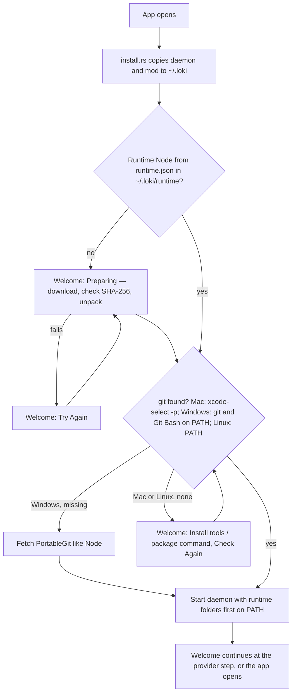
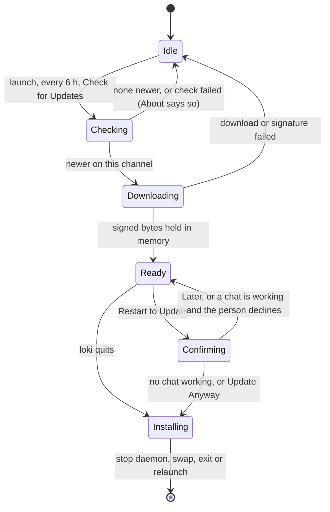
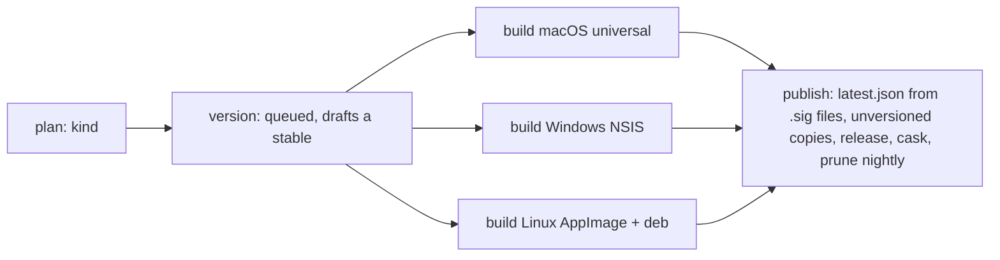

# One-line install and a self-updating app - Plan

---

## Goal Capsule

- **Objective:** Anyone on a Mac, Windows or Linux machine gets a working loki by pasting one line into a terminal,
  and never installs or upgrades it by hand again (the Linux `.deb` excepted, per Scope Boundaries).
- **Means:** an install script per system that fetches the latest release and opens it (KTD9); Tauri's signed
  updater, driven from the shell, for everything after (KTD1, KTD3); the shell fetching the Node its daemon runs on
  (KTD4).
- **Authority:** the Requirements win on product behaviour, the Key Technical Decisions on mechanism, then the units.
- **Stop conditions:** stop and ask if an update can't be applied without a signed app on some system, if the
  quarantine premise under Dependencies / Assumptions fails on a supported system, or before the PR carrying U4 merges
  when the update signing key isn't in the repository's secrets.
- **Execution profile:** deep, three stacked PRs, each carrying its part of the manual: U1–U3 (the runtime, carrying
  this plan), U4–U5 (updates), U6–U8 (releases, install scripts, docs).
- **Who finishes:** `ce-work`, on branches named `feat/<what-it-does>` in this session's worktree.
- **Open blockers:** none.

---

## Product Contract

### Summary

loki gets a one-line install: a shell script on the Mac and Linux, a PowerShell line on Windows. It downloads the
latest loki, puts it in place and opens it at Welcome. From then on the app keeps itself current. It downloads
quietly, installs on quit, follows the channel chosen in About, and fetches its own Node, however it was installed.

### Problem Frame

loki is not signed with an Apple Developer ID, so every way in today ends in the same ritual. Installing from Homebrew
or the `.dmg` means pasting `xattr -dr com.apple.quarantine /Applications/loki.app`, and so does every upgrade. The
recommended route assumes Homebrew, which many people loki is for don't have. The cask also brings Node, which the
daemon needs, and the manual promises "loki never downloads Node". Without Homebrew, Welcome stops at a Node screen.

Upgrades only happen when someone remembers them. The app already asks GitHub on launch and every six hours whether a
newer release exists, but all it can do is tell the person to run `brew upgrade` and clear the flag again. Windows
and Linux users download each new installer from the releases page by hand. Those builds ship only when a separate
Windows and Linux PR merges after a stable, and never as nightlies.

Hermes Agent (Nous Research) is the model for the fix. It leads with `curl … | bash` on Mac and Linux and
`irm … | iex` on Windows, and after that the installed thing updates itself. It keeps a `.dmg` and Homebrew entries
alongside the command without promoting them.

### Key Decisions

- **loki stays unsigned.** The one-liner removes the quarantine step anyway, because files fetched by `curl`,
  PowerShell or the app's updater carry no quarantine flag. (session-settled: user-directed — chosen over paying for
  an Apple Developer ID and notarizing, or building for signing to be switched on later: one command and self-update
  meet the goal without the yearly cost.) Governs R2, R18.
- **The app replaces itself.** Each release publishes a signed update for every platform. The app downloads the whole
  new version and swaps it in, with the daemon and mod still riding inside it. (session-settled: user-approved —
  chosen over a background loki manager installed by the command, Hermes's own shape, and over updating the daemon
  apart from the app: fewest new parts, and app and daemon can never be out of step.) Governs R10–R14.
- **The app owns Node.** Each release names the Node it was tested with. The app fetches that Node, checks it and keeps
  it in loki's folder, however loki arrived; the command only places and opens the app. (session-settled:
  user-directed — chosen over the command installing Node, which leaves .dmg users without it, and over keeping the
  machine's Node: one owner of Node, and no wall for people without it.) Governs R6, R7, R9.
- **Updates apply on quit, never by surprise.** (session-settled: user-approved — chosen over applying when agents are
  idle and over asking before each download: restarting the daemon stops any agent mid-turn, so only the person
  decides when that happens.) Governs R10, R11.
- **The channel is a choice in the app.** It replaces the separate nightly cask. (session-settled: user-approved —
  chosen over a command flag only and over no user-facing nightly.) Governs R5, R15–R17, R20.
- **Lead with the command; keep the .dmg and the cask.** (session-settled: user-directed — chosen over retiring the
  cask, or the cask and the .dmg: Hermes keeps both alongside its one-liner.) Governs R18, R19, R21.
- **Windows and Linux get the same treatment as the Mac.** That covers the command, self-update and nightlies.
  (session-settled: user-approved — chosen over stable-only Windows and Linux updates and over doing the Mac first.)
  Governs R3, R17, R22.

### Requirements

**The command**

- R1. One line, pasted into a terminal, installs the latest stable loki and opens it at Welcome: `curl … | sh` on
  macOS and Linux, a PowerShell `irm … | iex` line on Windows.
- R2. The installed app opens with no quarantine warning, and nobody pastes an `xattr` line.
- R3. On Linux the command installs the AppImage, the format that can update itself.
- R4. Running the command again on a machine that has loki updates it in place; agents, chats and settings are kept.
- R5. The command takes a channel option to install Nightly instead of Stable.

**What loki needs on the machine**

- R6. A fresh machine with no Homebrew, Node or developer tools reaches a working loki without the person installing
  anything by hand beyond approving the system's own prompts.
- R7. The app fetches the Node its release names into loki's folder, verifies it against a published checksum, and
  runs its daemon on it. This happens on first launch, and on any launch where that Node is missing or the release
  names another.
- R8. git, which agent memory and skills depend on, is in place before the first agent starts. On the Mac this goes
  through the system's command line tools prompt, on Windows through a portable Git the app fetches and checks, and
  on Linux through the system package with Welcome saying the command when it is missing.
- R9. Welcome shows what it is fetching and how far along it is, and offers Try Again when a download fails. The old
  "install Node yourself" step goes.

**Updates**

- R10. The app checks for updates on its channel on launch and every six hours. It downloads a newer version in the
  background and installs it the next time loki quits or relaunches.
- R11. A Restart to Update control appears once an update is ready. When an agent is mid-turn, it says that agent's
  turn will stop before restarting.
- R12. An update is installed only if its signature matches loki's update key. A failed check leaves the current
  version running and says so quietly in About.
- R13. Updates work the same whichever way loki was installed: the command, the `.dmg` or the cask.
- R14. An interrupted or failed update leaves the previous version working.

**Channels**

- R15. About offers Stable or Nightly; the choice takes effect at the next check.
- R16. Switching from Nightly to Stable never installs an older build. loki stays on its nightly until a stable newer
  than it ships, including the stable that nightly led up to.
- R17. Nightlies ship for the Mac, Windows and Linux from every merge to `main` that changes more than the docs.

**Other ways in, and people already on loki**

- R18. The README and site lead with the one-line command. The `.dmg` and the cask follow as other ways in, each
  noting the `xattr` line it still needs once.
- R19. The `loki` cask declares that the app updates itself, and stops depending on Homebrew's Node.
- R20. The `loki-nightly` cask is retired. Nightlies already installed through it keep updating themselves on the
  Nightly channel.
- R21. People on today's cask or `.dmg` reach the self-updating version with one last `brew upgrade` or download. No
  data move is needed.

**Releases and docs**

- R22. Every stable builds and publishes all three platforms in one release. The separate Windows and Linux PR goes
  away.
- R23. `docs/manual.md`, the README, the site, `docs/releasing.md` and `docs/SECURITY.md` describe the new install,
  updates, channels and what the app now downloads. The manual also gives uninstall steps for each system.

### Acceptance Examples

- AE1. **Covers R1, R2, R6, R7, R8.** **Given** a new Mac with no Homebrew, Node or Xcode tools, **when** the person
  pastes the command, **then** loki opens at Welcome, fetches its Node, and asks for Apple's command line tools. Once
  macOS has installed them, Welcome reaches the provider step. No `xattr` or quarantine warning appears.
- AE2. **Covers R7, R13.** **Given** someone drags loki in from the `.dmg` and clears the flag, **when** loki first
  opens, **then** Welcome fetches Node itself, as it does after the command.
- AE3. **Covers R10, R11.** **Given** an update has downloaded and an agent is mid-turn, **when** the person clicks
  Restart to Update, **then** loki says that agent's turn will stop and restarts only if they go ahead. **Given** they
  don't click, **when** they next quit loki, **then** the update installs and the next launch is the new version.
- AE4. **Covers R16.** **Given** someone on nightly `2026.1120.0-nightly.abc1234` switches to Stable, **when** stable
  `2026.1120.0` ships, **then** loki updates to it. Nothing installs before then, even though stable `2026.1119.2` is
  current.
- AE5. **Covers R12, R14.** **Given** a downloaded update whose signature doesn't match, or a download cut off
  halfway, **when** loki quits, **then** nothing is replaced, the current version opens next time, and About says the
  update failed.
- AE6. **Covers R4.** **Given** loki is installed and has agents, **when** the person runs the command again, **then**
  it installs the latest version in place and every agent, chat and setting is still there.

### Success Criteria

- A person who has never used a terminal beyond pasting one line gets from nothing to Welcome's provider step on any
  of the three systems.
- Within a day of a stable shipping, a loki that has been opened and quit is running it, with no action beyond
  quitting.

### Scope Boundaries

- Signing with an Apple Developer ID, notarizing, and Windows code signing. With loki unsigned, macOS may ask again for
  permissions such as the microphone (dictation) after an update, as it does today.
- Signing or checksumming the install script itself. It is served over HTTPS from loki's own GitHub, as Hermes does.
- Updating the daemon or mod apart from the app; every update is the whole app.
- A `loki` command left on the PATH for update, uninstall or doctor.
- Self-update for the Linux `.deb`, which stays a manual download from the releases page.
- winget, Flatpak, the Microsoft Store and other package managers.
- A background service that updates loki while it isn't running.

### Dependencies / Assumptions

- Files fetched by `curl`, PowerShell's `Invoke-WebRequest`/`irm` and Tauri's updater carry no quarantine or
  Mark-of-the-Web flag, so an unsigned app opens without a warning. This is the premise of R2. For `curl` it is
  confirmed (Apple's forums, Unit 42's write-up), and Zed's and Ollama's installers rely on it. The updater's source
  sets no flag. For PowerShell the evidence is indirect, so U7 checks it on Windows 10 and 11 before the scripts ship.
- The app can write to where it is installed, so it can replace itself. This holds on the Mac in `/Applications` for
  admin users (the updater falls back to an administrator prompt otherwise), in `~/Applications`, for the per-user
  NSIS install on Windows, and for an AppImage in the person's home.

**Product Contract preservation:** changed: AE1 — Welcome, not the command, asks for Apple's command line tools, so
loki opens first. The order changed (user-approved at the plan's scope check, so the `.dmg` path gets the same prompt);
the outcome did not.

### Sources / Research

- Today's install and update: `README.md` (Install), `docs/manual.md` (Requirements, Install, About),
  `docs/releasing.md`, `scripts/cask.ts`, `.github/workflows/release.yml`.
- The update check: `app/src/shell/use-loki-update.ts`; its Mac message in `app/src/shell/os-words.ts`. No Tauri
  updater is used anywhere today.
- Node lookup and Welcome's Node step: `src-tauri/src/node.rs`, `app/src/shell/welcome.tsx`.
- Daemon and mod copied from the app to `~/.loki` on launch: `src-tauri/src/install.rs`.
- git shell-outs: `mod/agents.ts`, `mod/skills.ts`, `mod/skill-sources.ts`, `daemon/memory.ts`,
  `daemon/memory-sync.ts`, `daemon/store/agents.ts`.
- Microphone and speech permissions live in the dictation helper: `native/listen/Sources/listen/Info.plist`.
- Earlier plans this revisits: `docs/plans/2026-09-07-005-chore-loki-open-source-plan.md`,
  `docs/plans/2026-09-17-011-feat-loki-release-channels-plan.md`,
  `docs/plans/2026-09-24-014-feat-loki-windows-linux-plan.md`.
- Hermes Agent: its install docs (hermes-agent.nousresearch.com/docs/getting-started/installation and /updating) and
  `scripts/install.sh` / `scripts/install.ps1` in github.com/NousResearch/hermes-agent. Homebrew carries a
  `hermes-desktop` cask and a `hermes-agent` formula that its docs don't mention.
- Tauri's updater: `tauri-plugin-updater` 2.x (`updater.rs`: `download()` and `install(bytes)` are separate; `install`
  swaps the macOS bundle in place and runs NSIS with `/UPDATE` then exits on Windows; endpoints and
  `version_comparator` are set from Rust). Its update files are `.app.tar.gz`, `-setup.exe` and `.AppImage`, each with
  a `.sig`.
- Node's official builds and `SHASUMS256.txt` at nodejs.org/dist; PortableGit from the git-for-windows releases. Zed's
  `install.sh` and Ollama's installer are the prior art for `curl | sh` installing a desktop app.

---

## Planning Contract

### Key Technical Decisions

- KTD1. **The shell owns updates, through `tauri-plugin-updater`'s Rust API.** The endpoint is chosen at run time from
  the channel: `releases/latest/download/latest.json` for Stable, `releases/download/nightly/latest.json` for
  Nightly. The plugin's default comparison (strictly newer by semver) is kept, and KTD2 makes it correct for both
  channels. The JavaScript plugin isn't exposed; the page talks to the shell through loki's own commands and
  `loki:update` events, as it does for the daemon. Choosing an endpoint at run time is Rust-only. Keeping checks in
  the shell also lets apply-on-quit run after the window is gone. Governs R10, R12, R13, R15.
- KTD2. **A nightly is `YYYY.MMDD.N-nightly.<run>`, where `<run>` is the release workflow's run number.** Today's
  `-nightly.<sha7>` doesn't order two nightlies of one day, and is invalid semver when the sha starts with `0`. With a
  run number, nightlies rise monotonically, a nightly sorts before the stable it leads up to, and switching to Stable
  never downgrades (R16, AE4). The commit moves into the release title and notes. `core/version.ts` adopts semver
  precedence (prerelease below release, numeric identifiers compared as numbers) so the page and `release.ts` agree
  with the updater.
- KTD3. **A ready update is held in memory and installed on quit.** On `ExitRequested`, the shell stops the daemon,
  then installs. On Windows the installer exits loki, so it is the last step. The plugin's `install` passes `/R`,
  which relaunches loki, so the quit path writes the verified bytes to a temporary `-setup.exe` and starts it with
  `/UPDATE /P` (no `/R`) before exiting. Restart to Update uses the plugin's `install` and relaunches. A crash or
  force-quit loses the download, and the next launch checks and downloads again. That is cheaper than keeping signed
  files on disk and re-checking them.
- KTD4. **Each release names its runtime in a manifest compiled into the shell.** `src-tauri/runtime.json` lists the
  Node version and, per target, the archive URL and SHA-256. It also lists PortableGit for Windows. The shell downloads
  through `reqwest`, checks the hash with `sha2`, and unpacks with `flate2`+`tar` (Node's `.tar.gz` on the Mac and
  Linux) or `zip` (Windows); PortableGit is a self-extracting archive, run with `-y -o<temporary folder>` after its hash
  check. Each runtime goes into `~/.loki/runtime/<name>-<version>-<target>/` through a temporary folder
  and a rename. Older versions are removed once the daemon has started on the new one. Release builds run only this
  Node. `LOKI_NODE_BIN` stays an override, and development builds keep today's lookup in `node.rs`. On the Mac the
  shell picks the archive for the architecture it is running on, so the universal app downloads one Node, not two.
  Governs R7.
- KTD5. **The daemon's PATH starts with the runtime's folders.** `harness.rs` prepends the runtime Node's `bin` (which
  also holds `npm` and `npx`, used by ACP agents) and, on Windows, PortableGit's `cmd` and `bin`. The daemon and
  everything it starts then find them without loki rewriting any call site.
- KTD6. **git: the machine's first, everywhere.** On the Mac the shell checks `xcode-select -p` and that its `git`
  exists. It never runs `/usr/bin/git`, which would raise the system's install dialog uninvited. Welcome's Install
  button runs `xcode-select --install`. On Windows, agents' shell commands run through Git Bash
  (`daemon/background.ts`), so PortableGit is fetched (KTD4) when either `git` or Git Bash (`Git\bin\bash.exe` under
  Program Files, or `bash.exe` on PATH) is missing. On Linux, Welcome names the package command. The install scripts
  don't touch git, so every way in meets the same step. Governs R8.
- KTD7. **The daemon starts after the runtime is ready, off the main thread.** `start_daemon` leaves `setup` for an
  async task. `DaemonStatus` gains a preparing state (what is being fetched, bytes done and total) and a missing-tools
  state. Progress goes out as `loki:runtime` events, and the page's existing poll remains the fallback. `welcomeFor`
  shows Welcome for these states as it does for errors today. Governs R9.
- KTD8. **The channel is the shell's to keep, in `~/.loki/updates.json`.** On first run it defaults to the running
  version's channel, so people who came from the nightly cask stay on Nightly (R20). About writes it through a
  command, and the next check uses it.
- KTD9. **The install scripts live in `site/public/` and GitHub Pages serves them**, at `/loki/install.sh` and
  `/loki/install.ps1`. Each release also carries unversioned copies of what they fetch:
  `loki-macos-universal.app.tar.gz` (the updater's own archive), `loki-windows-x64-setup.exe` and
  `loki-linux-x86_64.AppImage`. The scripts then download from `releases/latest/download/` or
  `releases/download/nightly/` without calling GitHub's API or parsing JSON in `sh`.
- KTD10. **One release workflow builds all three systems for every stable and nightly.** A `version` job after `plan`,
  in the one-at-a-time `build-${kind}` queue, decides the version once and, for a stable, creates the draft release
  at that number straight away, so a stable queued behind it takes the next number. It hands the version to a build
  job per system. A `publish` job collects the bundles and `.sig` files and has
  `release.ts` write `latest.json` itself. That keeps the format under loki's own tests rather than tied to one
  `tauri-action` version. The job then publishes the release, renders the cask, and prunes every versioned file of an
  older version from the rolling nightly. `latest.json` and the unversioned copies keep their names and are replaced
  with `--clobber`, never pruned. The update key comes from `TAURI_SIGNING_PRIVATE_KEY` and its password, and the
  public key sits in `tauri.conf.json`. The Windows and Linux PR, its branch and its jobs go away. Governs R17, R22.
- KTD11. **`LOKI_UPDATE_URL` overrides the endpoint**, so a person can check an update by hand against a `latest.json`
  on a throwaway prerelease (the updater accepts only HTTPS endpoints). Signatures are still checked against the
  compiled-in key, so the override can't install anything the key didn't sign.

### High-Level Technical Design

Launch, from opening the app to the daemon running (KTD4–KTD7):



An update, from check to the new version running (KTD1, KTD3; R10–R14):



A release run (KTD10):



### Deferred to Implementation

- How `tauri-action` v0.6.2 fits next to `npm run tauri -- build` on the Mac job, and whether the optional Apple
  signing step stays as it is.
- Exact command, event and field names, and the shape of `runtime.json`.

---

## Implementation Units

### U1. Nightlies that order, and semver ordering everywhere

**Goal:** Every version loki publishes sorts correctly under semver, so the updater's comparison is right on both
channels.

**Requirements:** R16, AE4; KTD2.

**Dependencies:** none.

**Files:**
- `scripts/release.ts` (nightly version from the run number; the commit in the title and notes)
- `core/version.ts` (semver precedence; `channelOf` and `nightlyVersionIn` for the new shape)
- `.github/workflows/release.yml` (pass the run number to `release -- version nightly`)
- `test/version.test.ts`, `test/release.test.ts`

**Approach:**
1. `nightlyVersion(nextStable, run)` gives `${nextStable}-nightly.${run}`. `release.ts version nightly` takes the run
   number in place of the sha, and the release title carries the short sha.
2. `parseVersion` keeps returning the three numbers. A new comparison applies semver precedence: a release ranks
   above its prereleases, and numeric identifiers compare as numbers. `isNewerVersion` and `byVersion` use it.
3. `nightlyVersionIn` accepts the new shape and the old `-nightly.<sha>` shape, so a page reading an older release
   title still works.

**Patterns to follow:** `release.ts`'s injected `gh` and today's `test/release.test.ts` cases for `plan` and
`version`.

**Test scenarios:**
- Covers AE4. `2026.1120.0` is newer than `2026.1120.0-nightly.4821`, and `2026.1119.2` is not.
- `2026.1120.0-nightly.4822` is newer than `2026.1120.0-nightly.4821`, and `-nightly.10000` is newer than
  `-nightly.9999`.
- A nightly of the next stable (`2026.1121.0-nightly.4900`) is newer than the current stable `2026.1120.0`.
- `nightlyVersionIn` finds both `loki 2026.1120.0-nightly.4821` and the old `loki 2026.1011.1-nightly.a96ee85`.
- `release.ts version nightly` with a run number prints the new shape, and the version fits NSIS's 16-bit parts.
- `byVersion` sorts a mixed list of stables and nightlies by precedence.

**Verification:** the version and release tests pass, and a dry `release -- version nightly` prints
`YYYY.MMDD.N-nightly.<run>`.

### U2. The shell fetches its own runtime

**Goal:** A release build downloads, checks and unpacks the Node its manifest names (and PortableGit on Windows when
git or Git Bash is missing), and runs only that Node.

**Requirements:** R6, R7; KTD4, KTD5.

**Dependencies:** none.

**Files:**
- `src-tauri/runtime.json` (new: the pinned Node and PortableGit, URL and SHA-256 per target)
- `src-tauri/src/runtime.rs` (new: resolve, download with progress, check, unpack, rename, prune)
- `src-tauri/src/node.rs` (release builds take the runtime Node; dev builds and `LOKI_NODE_BIN` unchanged)
- `src-tauri/src/harness.rs` (prepend the runtime folders to the daemon's PATH)
- `src-tauri/Cargo.toml` (`reqwest`, `sha2`, `flate2`, `tar`, `zip` as direct dependencies)

**Approach:**
1. `runtime.rs` takes an injected fetcher, file root and target, as `node.rs` takes its `Host`, so tests never touch
   the network or the real home.
2. Download to a temporary file and hash it while streaming, reporting bytes done and total. On a mismatch, delete
   the file and return an error naming what failed.
3. Unpack into a temporary folder beside the destination, then rename it into
   `~/.loki/runtime/node-<version>-<target>/`. A half-unpacked folder is never at the final path.
4. After the daemon has started on a runtime, remove `node-*` and `git-*` folders of other versions.
5. `harness.rs` builds the child's PATH from the runtime folders, then the inherited PATH.

**Patterns to follow:** `node.rs`'s injectable `Host` and its fake Node "whose file holds the version it would print";
temp homes with a per-process counter (`node.rs` tests); `install.rs`'s report of what was installed.

**Test scenarios:**
- A manifest Node not yet present is downloaded, its hash checked, and unpacked to `runtime/node-<version>-<target>/`,
  and the resolved program is the `node` inside it.
- A present, complete runtime is used without a download, and a runtime for another target (an Intel Node moved to
  Apple Silicon) counts as missing.
- A hash mismatch leaves nothing at the final path and returns an error naming the archive.
- A download cut off partway leaves nothing at the final path, and the next attempt starts clean.
- The target is chosen per system and architecture: darwin-arm64, darwin-x64, win-x64 and linux-x64 each pick their
  own entry, and an unknown target is an error, not a guess.
- Pruning after a start removes other versions and keeps the running one.
- On Windows with git or Git Bash missing, PortableGit is fetched and unpacked the same way, and with both present it
  is not.
- The daemon's PATH begins with the runtime Node's folder (and PortableGit's `cmd` and `bin` when fetched), then the
  inherited PATH.
- A dev build still finds Node through today's lookup, and `LOKI_NODE_BIN` wins in any build.

**Verification:** `cargo test` passes on all three CI systems. A release build started on a scratch home downloads
Node once and runs the daemon on it.

### U3. Welcome prepares the machine

**Goal:** Welcome shows the runtime being fetched and git being found, offers Try Again and the tools install, and
starts the daemon only when both are ready.

**Requirements:** R6, R8, R9, AE1, AE2; KTD6, KTD7.

**Dependencies:** U2.

**Files:**
- `src-tauri/src/lib.rs` (async start; `DaemonStatus` preparing and missing-tools states; `loki:runtime` events; an
  `install_tools` command for the Mac)
- `src-tauri/src/runtime.rs` (git detection per system)
- `app/src/shell/bootstrap.ts` (status types; listen to `loki:runtime`; drop `nodeHelp`)
- `app/src/shell/welcome.tsx` (Preparing and Tools steps replace `NodeNeeded`)
- `app/src/shell/shell.tsx` (`welcomeFor` covers the new states)
- `app/src/shell/os-words.ts` (the per-system tools words)
- `docs/manual.md` (Requirements and first launch: what loki downloads, the tools step)
- `test/welcome.test.ts`, `test/os-words.test.ts`

**Approach:**
1. `setup` spawns the start, so the window opens straight away. The order is: ensure runtime, check git, start the
   daemon.
2. A failed download sets the error with what failed. `retry_daemon` reruns the whole sequence.
3. On the Mac, the tools step's Install runs `xcode-select --install`. Check Again re-runs the git check.
4. Someone who has finished Welcome before sees only the Preparing step when a release names a new Node, and the
   app returns as soon as the daemon is up; the provider and agent steps come from the daemon's state, as today.
5. Words naming a system go through `os-words.ts`, as its test requires.

**Patterns to follow:** `retry_daemon`'s `spawn_blocking` and the `supervising` guard; event listeners with cleanup in
`use-window-chrome.ts`; `welcome.test.ts`'s static-markup rendering.

**Test scenarios:**
- Covers AE1. With no runtime and no git on the Mac, the status goes preparing, then missing tools, and Welcome shows
  the download progress and then Install Command Line Tools.
- Covers AE2. A first launch with no runtime shows Preparing whatever the install path, because the status doesn't
  depend on how loki arrived.
- A failed download shows the failure and Try Again, and Try Again restarts the sequence.
- On Linux with no git, Welcome shows the package command and Check Again.
- On Windows with git or Git Bash missing, Welcome shows PortableGit being fetched, not a tools step.
- A returning person with a provider and agents, after an update that names a new Node, sees only Preparing and then
  the app, never the provider step.
- Once the runtime and git are ready, Welcome moves to the provider step.
- No string naming a system appears outside `os-words.ts`.

**Verification:** Welcome renders each state in its tests. A release build on a scratch home goes from Preparing to
the provider step without the person installing Node.

### U4. The shell checks, downloads and applies updates

**Goal:** The shell checks its channel, downloads a newer signed version in the background, installs it on quit, and
can restart into it on request.

**Requirements:** R10, R12, R13, R14, R15, AE3, AE5; KTD1, KTD3, KTD8, KTD11.

**Dependencies:** U1.

**Files:**
- `src-tauri/Cargo.toml` (`tauri-plugin-updater`)
- `src-tauri/tauri.conf.json` (`plugins.updater.pubkey`; `bundle.createUpdaterArtifacts`)
- `src-tauri/src/update.rs` (new: channel file, check loop, download, ready state, install on quit, restart)
- `src-tauri/src/lib.rs` (register the plugin and commands; install in `RunEvent::ExitRequested` after `h.stop()`)
- `.github/workflows/release.yml` (the update key secrets reach today's Mac build step, since the bundler refuses to
  build updater files without the private key)

**Approach:**
1. The check loop runs at launch and every six hours in release builds only. A check is skipped while an update is
   downloading or ready.
2. Only a verified download moves to Ready. A failed check or download is reported as status and never shown as a
   dialog.
3. The page gets commands for status, check now, set channel, and restart to update. The shell has no daemon client,
   so the page decides whether a chat is working (U5) and calls `restart_to_update` only when none is or after
   Update Anyway.
4. On quit with an update Ready: stop the daemon, then install (KTD3). With no update, quit as today.
5. On Linux, checks run only when running as an AppImage (`APPIMAGE` set); a `.deb` install reports that it updates
   from the releases page.

**Patterns to follow:** `DaemonState` with `app.manage`; `stop_on_signals` and the `RunEvent` handler in `lib.rs`.

**Test scenarios:**
- The channel file is created with the running version's channel on first run, and a set channel survives a restart.
- Stable resolves to the `latest` endpoint, Nightly to the `nightly` one, and `LOKI_UPDATE_URL` overrides both.
- Covers AE5. A download whose signature doesn't verify never reaches Ready, and status says the update failed.
- On Windows the quit path starts the installer with `/UPDATE /P` and no `/R`, and Restart to Update relaunches.
- On Linux without `APPIMAGE`, no check runs and the status says so.
- A check during a download, or with an update Ready, does nothing.
- The quit path with an update Ready stops the daemon before installing, and without one installs nothing.

**Execution note:** the swap itself can't be unit tested. Check it by hand with two builds: upload version B's
updater archive, `.sig` and a `latest.json` to a throwaway draft prerelease that neither channel reads, point
`LOKI_UPDATE_URL` at it, and delete the prerelease afterwards. Do it on the Mac at least, and on Windows and Linux
where a machine is at hand.

**Verification:** a build of version A, pointed at a throwaway prerelease's `latest.json` for a signed version B,
downloads B, and the next launch after quitting is B. A tampered B is refused, and A keeps running.

### U5. Updates in the app

**Goal:** About shows the version, the channel picker and the update state; the menu checks for updates; and Restart
to Update appears when an update is ready.

**Requirements:** R10, R11, R15, AE3.

**Dependencies:** U4.

**Files:**
- `app/src/shell/use-loki-update.ts` (rewritten around the shell's status and `loki:update`; the GitHub API polling
  and skip-version storage go)
- `app/src/settings/settings.tsx` (`LokiVersionFact`: version, Stable/Nightly, state; `NodeFact` shows the runtime Node)
- `app/src/shell/restart-notice.tsx` (the Restart to Update notice: Restart to Update, Update Anyway when a chat is
  working, Later)
- `app/src/shell/shell.tsx`, `app/src/shell/keymap.ts` (Check for Updates… asks the shell to check now)
- `app/src/shell/os-words.ts` (drop `lokiUpgrade`)
- `docs/manual.md` (About, updates and channels)
- `test/update-check.test.ts`, `test/update-item.test.ts`, `test/settings-window.test.ts`

**Approach:**
1. The hook mirrors the shell's status type (snake_case from serde, as `use-harness-facts.ts` does) and listens for
   `loki:update` with cleanup.
2. About's channel control is a segmented choice, Stable or Nightly. The words say that Stable waits for the next
   stable when you're on a nightly (R16).
3. The notice reuses `restart-notice.tsx`'s Update / Update Anyway / Later shape and words, in title case. The page
   knows from its chat state whether a chat is working, and offers Update Anyway only then. The notice shows once per
   ready update, and Later hides it until the next launch; quitting still installs.
4. A failed update in About says in one sentence that the current version is still running and whether the download
   or the signature check failed, with a Check Again button that runs the same check as the menu item.

**Patterns to follow:** `use-harness-facts.ts` (invoke, cancel flag, cleanup); `restart-notice.tsx`; the HIG words
rules in `AGENTS.md`.

**Test scenarios:**
- About shows "Up to date", "Downloading…", "Ready — installs when you quit loki" and a failed download or signature
  check with Check Again, each from a status fixture.
- Choosing Nightly calls the set-channel command, and the picker shows the saved channel.
- Covers AE3. With an update ready and a chat working, the notice offers Update Anyway and calls the restart command
  only when it is chosen; with no chat working, Restart to Update calls it straight away.
- Later hides the notice for the rest of the launch, and a re-check of the same ready update doesn't bring it back.
- The menu item reads Check for Updates… and triggers a check, and with an update ready it reads Restart to Update….
- In a development build no update is offered.

**Verification:** the update tests render each state. By hand, a ready update shows the notice and About's state
matches.

### U6. Releases for all three systems, with update files

**Goal:** Every stable and nightly builds macOS, Windows and Linux, signs the update files, and publishes
`latest.json`, the unversioned copies and the casks from one run.

**Requirements:** R17, R19, R20, R21, R22; KTD9, KTD10.

**Dependencies:** U1, U4.

**Files:**
- `.github/workflows/release.yml` (plan → version → three builds → publish; update key secrets for all three
  builds; preview jobs removed)
- `scripts/release.ts` (`latest.json` from the `.sig` files; unversioned copies; prune older versioned nightly files;
  preview machinery removed)
- `scripts/cask.ts` (`auto_updates true`; no `depends_on formula: "node"`; the nightly cask deprecated)
- `docs/releasing.md` (one run for three systems; generating and storing the update key; the retired preview PR)
- `test/release.test.ts`, `test/workflows.test.ts`, `test/cask.test.ts`

**Approach:**
1. `plan` outputs the kind. The `version` job (KTD10) decides the number in the queue, and the three build jobs and
   `publish` read it from there. The workflow test's rule against reading a number decided before the build gives way
   to "the version is decided once, in the queued version job".
2. Each build uploads its bundle, the updater archive and its `.sig` as artifacts. `publish` downloads them all.
3. `release.ts latest-json` writes the version, notes, date and, per platform (`darwin-universal`, `darwin-aarch64`,
   `darwin-x86_64`, `windows-x86_64`, `linux-x86_64`), the URL and signature. `publish` uploads it with the
   unversioned copies with `--clobber`, after the versioned files are up.
4. Without `TAURI_SIGNING_PRIVATE_KEY` the run fails before publishing, so a release can never ship without updates.
5. The nightly prune removes only assets whose names carry a version other than the current one, never `latest.json`
   or the unversioned copies.
6. Only a push to `main` publishes the rolling `nightly` release. A manual or branch run never writes to that tag.
7. `loki-nightly.rb` keeps being pushed on every nightly, with `auto_updates true`, no node dependency and Homebrew's
   `deprecate!` pointing at the `loki` cask and the Nightly channel. One last `brew upgrade --cask loki-nightly` then
   delivers a self-updating nightly (R20, R21).

**Patterns to follow:** `release.ts`'s injected `gh`; the pinned-action and job-permission tests in
`test/workflows.test.ts`; `renderCask`'s validation.

**Test scenarios:**
- `latest-json` from fixture `.sig` files has every platform key, the matching URL and signature, and the version.
- A stable publish uploads the dmg, the three updater archives and signatures, `latest.json` and the three
  unversioned copies, then marks the release latest.
- A nightly publish prunes versioned assets of older versions, keeps the new ones, and leaves the just-uploaded
  `latest.json` and unversioned copies in place.
- A missing signature for one platform fails the publish with that platform named.
- The cask has `auto_updates true`, keeps the xattr caveat, and has no node dependency; the nightly cask also carries
  `deprecate!` and the new nightly version shape.
- The workflow has build jobs for macOS, Windows and Linux on both kinds and no preview job. The update key secrets
  reach only the build steps that sign, and a run that isn't a push to `main` never writes to the `nightly` tag.
- Two stables started close together get `.0` and `.1`, because the second version job sees the first one's draft.

**Verification:** the release and workflow tests pass, and the first nightly from `main` after the PR carrying U6
merges produces a release with all files and a `latest.json` that U4's check accepts.

### U7. The install scripts

**Goal:** One line installs the latest loki and opens it, on each system and either channel, and re-running it
updates in place.

**Requirements:** R1, R2, R3, R4, R5, AE6; KTD9.

**Dependencies:** U6.

**Files:**
- `site/public/install.sh` (new: macOS and Linux)
- `site/public/install.ps1` (new: Windows)
- `test-node/install-script.node-test.ts` (new: runs `install.sh` against a fake release on the test's system)

**Approach:**
1. `install.sh` on macOS:
   - Download the `.app.tar.gz` with `curl -fsSL`.
   - If loki is running, stop and say to quit loki and run the line again.
   - Unpack into `/Applications`, or `~/Applications` when `/Applications` isn't writable, saying which.
   - Open loki.
2. `install.sh` on Linux:
   - Put the AppImage at `~/.local/share/loki/loki.AppImage`, with a `.desktop` entry and icon.
   - If loki is running, stop as on the Mac.
   - When FUSE is missing, print the `libfuse2` command, say to run the line again afterwards, and exit non-zero
     without opening loki.
   - Otherwise open loki.
3. `install.ps1`:
   - Download the setup to a temporary file.
   - If loki is running, stop and say to quit loki and run the line again.
   - Run the installer silently (per-user) and start loki.
4. Both scripts:
   - Take a nightly option (`--nightly` / `-Nightly`, or `LOKI_CHANNEL=nightly`).
   - Take a base-URL override for tests.
   - Stop with a plain message on an unsupported system or architecture.
   - Print one plain sentence each for downloading, installing and done, and end every failure with one line on
     what to do next, in the words rules of `AGENTS.md`.

**Patterns to follow:** Zed's `install.sh` (hdiutil-free, no xattr) and Ollama's for structure; `test-node/` for tests
that spawn processes; `node:path` for every path.

**Test scenarios:**
- On the test machine's own system, `install.sh` with a file base URL and a scratch home places loki where expected
  and doesn't open it (an option the test passes).
- Covers AE6. A second run over an existing install replaces the app and leaves a marker file in the scratch `~/.loki`
  untouched.
- The nightly option fetches from the nightly path.
- An unsupported architecture stops with the message and changes nothing.
- With loki running, the script stops with the quit-first message and changes nothing.
- `install.ps1` parses with PowerShell on the Windows CI runner.

**Execution note:** before shipping, check by hand on Windows 10 and 11 that a setup fetched with `irm` runs with no
SmartScreen or Mark-of-the-Web prompt, including on a Windows 11 machine with Smart App Control on, which blocks
unsigned programs whatever their origin. If it doesn't, stop and ask (Goal Capsule).

**Verification:** a clean Mac and a clean Linux machine go from the one line to Welcome. Windows does the same with
the PowerShell line.

### U8. The docs and the site lead with the command

**Goal:** Every place that tells someone how to get loki leads with the one line, and the docs describe updates,
channels, what loki downloads and how to uninstall.

**Requirements:** R18, R23.

**Dependencies:** U7.

**Files:**
- `README.md` (Install: the command first, then the `.dmg` and cask with their xattr line; Requirements without Node)
- `site/src/site.tsx` (the install block shows the command per system)
- `docs/manual.md` (Install, uninstall per system, Windows and Linux no longer previews for updates)
- `docs/SECURITY.md` (what the app downloads and from where, how updates are verified, the install script's trust,
  and that a merge to `main` reaches Nightly installs within six hours with no step of theirs)
- `docs/architecture.md` (the runtime folder and the update path in the shell)

**Approach:** "loki never downloads Node" goes everywhere it appears. Uninstall is: quit loki, remove the app, and
optionally remove `~/.loki` and `~/.agents/skills/loki`, written per system.

**Patterns to follow:** `docs/style.md` §7; the cask's `zap` list for what uninstall removes.

**Test expectation:** none — docs and copy only; the site's existing build check covers `site.tsx`.

**Verification:** a search for "never downloads Node", "brew upgrade" and "xattr" finds only the `.dmg` and cask
notes, and the site shows the command.

---

## Risks

- **Microphone and speech permissions may reset with each update,** because an unsigned build's code signature
  changes. This was accepted with staying unsigned. A stable self-signed identity is the cheap fix if it bites.
- **macOS may ask once about stored keys when existing users move to loki's own Node,** because the keychain records
  which program stored them. Check by hand in U2 with keys stored under Homebrew's Node, and say so in the release
  notes if it happens.
- **PowerShell, Mark of the Web and Smart App Control:** evidence that `irm` adds no zone flag is indirect, and Smart
  App Control on a clean Windows 11 install blocks unsigned programs regardless. U7's execution note checks it
  on Windows 10 and 11, and the Goal Capsule's stop condition covers a failure.
- **The first release needs the update key.** U6 fails closed without it. Anyone on a build from before this plan
  reaches the updater only through one last `brew upgrade` or download (R21).
- **A nightly client can read a `latest.json` whose versioned file was just pruned.** It gets a 404, reports a failed
  check, and succeeds at the next check six hours later.

---

## Verification Contract

Run with CI's toolchain (the newest Node 22 and its npm 10, `SHELL=/bin/bash`) before each push:

```bash
npm run format:check && npm run lint && npm run typecheck && npm test && npm run test:node
npm run build:app && npm run build:mod && npm run smoke
cargo test --manifest-path src-tauri/Cargo.toml
cargo fmt --manifest-path src-tauri/Cargo.toml --check && cargo clippy --manifest-path src-tauri/Cargo.toml --all-targets -- -D warnings
```

Then read each PR's CI, the shell job on macOS, Ubuntu and Windows included. Checks by hand are on the regular daemon
and cleaned up afterwards:
- the two-build update swap (U4)
- a release build on a scratch home going from Preparing to the provider step (U2, U3)
- the install scripts on clean machines (U7)

---

## Definition of Done

- Every unit's test scenarios exist and pass, and the Verification Contract passes locally and in CI on all three
  systems.
- The first nightly from `main` after U6 has published a release with all three systems' files and a `latest.json`,
  and a build from before it updated to it through the updater.
- The manual, README, site, `docs/releasing.md`, `docs/SECURITY.md` and `docs/architecture.md` describe the new
  install, updates, channels, downloads and uninstall. Nothing promises that loki never downloads Node.
- No preview-PR code, skip-version storage, GitHub API update polling or dead code from abandoned attempts remains in
  the diff.
