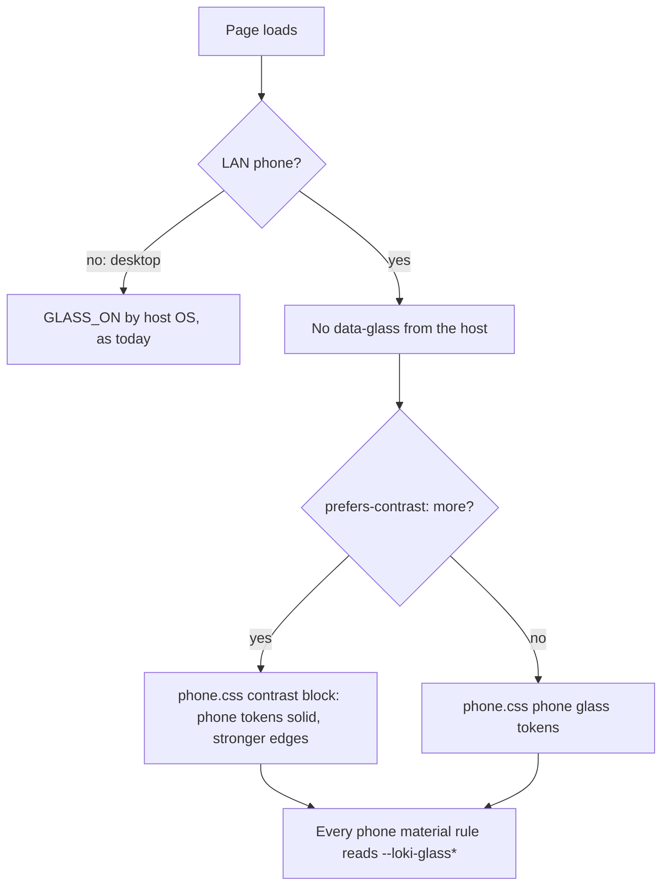

# The phone on Liquid Glass, second pass - Plan

---

## Goal Capsule

- **Objective:** On an iPhone, loki reads as an iOS 26 app beside Messages and Mail. Its tab bar, top bars, sheets and message box float as one glass material over solid content that scrolls beneath them. Every screen holds up against Apple's iOS guidelines, in day and night.
- **Means:** the phone takes the desktop's glass tokens with its own tuning, written in `phone.css` (KTD1, KTD2). Top bars become glass control groups over the screen's one scroller (KTD4).
- **Authority:** the Requirements, then the Key Technical Decisions, then the units. The origin plan's Product Contract (R1–R3, R6, R8, R15, R18) still governs where this plan is silent.
- **Stop conditions:** stop and ask if any of these happens:
  - Scrolling a long list or thread under the glass stutters on the person's iPhone where it did not before (origin R17's spirit on the phone).
  - A unit needs a screen's behaviour changed, not only its look.
  - The person has not approved the previous screen as rendered (R10).
- **Execution profile:** `app/src/phone/`, `app/src/theme.tsx`, `app/index.html`, a few shared chat parts the phone draws, docs and tests. Several small PRs, one per unit or pair of units, each approved on screen before the next merges.
- **Who finishes:** `ce-work` on a `feat/phone-glass-*` branch per PR. The person approves each screen in the iOS Simulator's Safari (or their iPhone), paired to their regular daemon.

---

## Product Contract

### Summary

The phone moves onto the desktop's glass material, with values tuned for iOS. Top bars become glass controls that content scrolls under, as the tab bar already does. Bottom sheets are glass on purpose instead of by accident, the conversation's header and message box float, and the last controls under 44 points grow. Each screen is checked by eye before the next one moves.

### Problem Frame

The first pass (plan 2026-11-12-1505, U9, commit `bf2d86a0`) glassed only three controls: the tab bar, the Search button and the compose button. They use their own `--phone-nav-*` colours and a hard-coded `blur(20px) saturate(180%)` (`app/src/phone/phone.css`). Every top bar is solid with a hairline, so lists stop at the header instead of passing under it. The phone's bottom sheets are glass only because a desktop rule in `app/src/components/components.css` happens to match them. That rule also gives them the Mac's colours, and its solid fallback resolves to the Mac's panel grey instead of the phone's. The phone's `data-glass` follows the paired computer's OS (`theme.tsx` reads `__LOKI__.os`), so an iPhone paired with a Linux machine draws solid while the prepaint in `index.html` says glass. A handful of controls are still under 44 points.

### Requirements

**Material**

- R1. Everything on the phone that floats and steers draws from one glass material shared with the desktop, with the phone's own values for day and night. This covers the tab bar, Search, compose, the top-bar controls, bottom sheets and the message box.
- R2. Under Increase Contrast, the same surfaces draw solid in the phone's own panel colour, with the same shapes and stronger edges.
- R3. The phone decides glass or solid from its own settings, never from the paired computer's OS.
- R4. Rows, cards, messages and pages stay solid (origin R1).

**Bars and scrolling**

- R5. A screen's top bar is its back and action buttons in glass capsules, with the title as plain text over the fade between them, floating over the list. The list scrolls under it, softened at the top edge, as it already scrolls under the tab bar (origin R2).
- R6. At rest, nothing is covered: the first row and the last row are fully visible below the top bar and above the tab bar or message box.

**Sheets and the conversation**

- R7. Bottom sheets are strong glass in the phone's values. Sheets that fill the screen (the model picker, the steps, a suggestion) stay solid, as iOS's large sheets are.
- R8. In a conversation, the header controls and the message box are glass and the thread scrolls under both.

**Touch and review**

- R9. Every control the finger can press has a 44 × 44 point target, a smaller face taking its area from an `::after`.
- R10. Each screen moves only after the person has seen it rendered on an iPhone-sized Safari in day and night and approved it (origin R18).

### Key Decisions

- **Glass only on what floats and steers; content solid.** Governs R1, R4. (session-settled: user-directed — chosen over glass everywhere, in the origin plan)
- **Solid look-alike follows the system, not an app switch; on the phone that means Increase Contrast only.** iPhone Safari does not support `prefers-reduced-transparency`, so Reduce Transparency cannot be followed from a web page. This is accepted as a known limit, not answered with a phone setting. Governs R2. (session-settled: user-directed — chosen over a Reduce Transparency switch in the phone's Preferences)
- **The phone stays a home-screen web app; glass is CSS backdrop blur.** Refraction, lensing and morphing are out of reach; the HIG treats them as Apple's rendering, not as requirements. Governs R1, R5. (session-settled: user-directed — chosen over a native iOS shell)
- **Titles are plain text over the fade, not in a capsule.** Apple's iOS 26 toolbars put a bare title between glass buttons; the conversation's agent name works the same way. Governs R5, R8. (session-settled: user-approved — chosen over the title in its own glass capsule)
- **A new plan for the second pass, linked to the origin plan.** The origin's U9 shipped; this plan finishes what it left. (session-settled: user-approved — chosen over reopening U9 in the origin plan)

### Scope Boundaries

- No screen changes what it does: routes, gestures, rows and sheets keep their behaviour and content.
- No large titles that collapse on scroll, no tab bar that minimizes on scroll, no Search button that morphs into a field. Each is motion iOS draws natively and the HIG does not require. Each needs a scroll-linked animation the phone does not have today. Considered and not built: evidence that would change the call is the person asking for one after seeing the static bars.
- No Reduce Transparency switch (Key Decisions).
- The desktop's look does not change. The desktop rule that matches phone sheets by accident keeps working for the desktop.

#### Deferred to Follow-Up Work

- A phone frame in the dev workbench (`app/src/dev/workbench.tsx`) so a screen can be approved without pairing. Worth it if pairing the Simulator proves slow during this plan's reviews.
- The phone's own thread, cards and approve/deny row that `02dfe394` left "for the phone's own plan": their content stays as it is here, since R4 keeps content solid.

### Sources

- Origin plan: `docs/plans/2026-11-12-1505-feat-apple-visual-language-plan.md` (R1–R3, R15, R17, R18; KTD3, KTD5, KTD6; U9).
- Apple HIG, read through the `apple-hig` skill: Materials ("Don't use Liquid Glass in the content layer"; regular variant; the scroll edge effect instead of solid fills under controls). Toolbars: items in separate glass groups, symbol-only Back and Close, no full-width bar background. Sheets: medium sheets inset and rounded, large sheets solid edge to edge. Buttons: 44 × 44 pt. Popovers: none in compact width.
- `docs/design.md` § Phone: tokens, the dock material, safe areas, one scroll owner.

---

## Planning Contract

### Key Technical Decisions

- KTD1. **The phone redeclares `--loki-glass*` on its own root in `phone.css`.** The glass tokens are declared only on `:root` (`app/src/kit/tokens.css`), so the phone inherits the Mac's values. Their solid fallback `var(--loki-panel)` resolves at `:root` to the Mac's panel. Redeclaring all five tokens in the night, day, contrast and solid blocks under `.loki-phone` fixes both. The values follow iOS's thinner bar material: the current `--phone-nav-surface` tints, with `--loki-glass-blur` at `blur(20px) saturate(180%)`. `--phone-nav-surface` and `--phone-nav-border` are retired; `--phone-nav-active` stays for the current tab's pill. `phone.css` already owns the phone's tokens (`docs/design.md` § Phone), so they stay there and not in `tokens.css`. (R1, R2)
- KTD2. **Phone rules read the tokens directly instead of using Tailwind's `glass` utilities.** The utilities live in `@layer utilities`, and `phone.css` is unlayered, so any phone background beats them whatever its specificity. One material rule per surface in `phone.css` reads `--loki-glass` or `--loki-glass-strong`, `--loki-glass-blur`, `-hi` and `-edge`, as `components.css` does on the desktop. No phone rule writes a literal `blur(`. (R1)
- KTD3. **On the phone, `data-glass` is never set from the host's OS.** `theme.tsx` skips the `GLASS_ON[platform]` solid branch when the page is the LAN phone (`inLan`, `app/src/desk/env.ts`). The prepaint in `app/index.html` keys on the viewer's own user agent: it already agrees on an iPhone, and it stops starting an Android phone solid (its Linux match skips `Android`). So nothing sets `data-glass` on a phone, and the phone's only solid trigger is `prefers-contrast: more` in `phone.css`. The existing `prefers-reduced-transparency` blocks stay, harmless, for the day WebKit supports the query. (R2, R3; Key Decisions: Increase Contrast only)
- KTD4. **Top bars overlay the screen's one scroller; the scroller pads itself.** The rule of one vertical scroller per screen stays (`docs/design.md` § One scroll owner).
  - **The overlay layer.** The bar moves from a flex row above the scroller to an absolutely placed layer over it. Everything that sat between the bar and the scroller joins that layer under the capsules: the page `banner` (the Mac-unreachable notice), the conversation's links row (`.loki-phone-links`), and TopBar's `progress` fill, which runs along the layer's bottom edge in place of the hairline.
  - **Clearance is per screen.** The layer publishes its measured height as `--phone-top-clearance` on its own screen's element through `useHeightVar` (`app/src/shared/use-height-var.ts`, with the name added to `HeightVar`), never on the shell. Home and Flow stay mounted while hidden, so a shell-wide variable would be overwritten by a hidden bar measuring 0. The scroller (`.loki-phone-scroll`, and Flow's `.loki-phone-deck`) pads its start by it once, as `.loki-phone-scroll::after` does for `--phone-nav-clearance` at the end.
  - **Capsules and the strip.** The bar has no full-width background. Back and actions sit in glass capsules (HIG Toolbars). Under them, a static scroll-edge strip keeps the title readable over moving rows. The strip is a masked gradient of `--loki-bg` with no `backdrop-filter`, as the desktop's `.loki-desk-pane > .loki-pane-header` softening is, because a blur under blurred capsules re-runs every frame for nothing.
  - (R5, R6)
- KTD5. **Bottom sheets glass, full-screen sheets solid.** `.loki-sheet-card.loki-phone-sheet` takes strong glass from the phone tokens explicitly, so it no longer depends on the desktop rule matching. The model, steps and suggestion sheets keep their solid `--loki-bg` (`phone.css`, the rule after `.loki-sheet-card.loki-phone-sheet.loki-suggestion-sheet`). The phone's one popover (`PhonePopover`, used by `chat/link-header.tsx`) takes strong glass too; turning it into a sheet is behaviour, out of scope. (R7)
- KTD6. **No morphs or lensing; cuts and fades.** Bars and sheets appear with the existing smooth spring and fade. Reduce Motion keeps `docs/design.md`'s rule (fade over 150 ms, no move). The scroll-edge strip never animates. (R5, R7)
- KTD7. **String assertions over `phone.css` go in a new `test/phone-look.test.ts`; markup and theme behaviour go in `test/phone.test.ts`.** The CSS file follows `test/shell-look.test.ts`'s pattern. `test/tokens.test.ts`'s phone block gains the glass tokens in its role check: drop `glass` from `DESKTOP_ONLY` and update its comment that says the phone inherits glass. Layout and blur cost cannot be proven in jsdom; the screen review (R10) covers them. (R1–R9)

### High-Level Technical Design

How the phone decides its glass state after this plan:

How a screen is layered after KTD4: the scroller fills the screen. The overlay layer (capsules, banner or links row, progress fill, scroll-edge strip) sits over its start, and the tab bar or the conversation's dock sits over its end. The scroller's padding is `--phone-top-clearance` at the start and `--phone-nav-clearance` (or `--loki-dock-height` in a conversation) at the end.

### Assumptions

- The person checks by hand on their regular daemon with the iOS Simulator's Safari paired over the LAN port (`docs/manual.md` § Phone), as earlier phone plans did. The sandbox daemon cannot pair.
- A 20px blur on four or five surfaces at once stays smooth on a current iPhone; the stop condition catches it if not.

### Risks

| Risk | Mitigation |
|---|---|
| Blur behind a sticky bar over a long, streaming thread costs frames on older iPhones | Lighter blur than the Mac (KTD1); one material rule per surface, no blur on the scroll-edge strip (KTD4); stop condition 1 |
| Moving the top bar out of the flex column covers rows at rest or under the keyboard | R6 checked on every screen, with the banner showing; `viewport.ts`'s keyboard variables already drive the shell, and each screen measures its own layer (KTD4) |
| The conversation's dock grows (several lines typed, an image, an approval) while the thread follows its newest message | `--loki-dock-height` already updates as the dock resizes; the review walk (U6) checks the last message stays above the dock as it grows |
| A desktop rule still matching phone markup overrides the phone's material | Phone material rules are written under `.loki-phone` with enough specificity to win, and `test/phone-look.test.ts` asserts each surface reads the phone tokens |
| Removing `--phone-nav-*` misses a user | `rg` for the names before deleting; `test/tokens.test.ts` fails on an undeclared role |

---

## Implementation Units

### U1. The phone's glass tokens and its own glass state

**Goal:** the phone has its own glass tokens and decides glass or solid itself; the tab bar, Search and compose read the tokens.

**Requirements:** R1, R2, R3

**Dependencies:** none

**Files:** `app/src/phone/phone.css`, `app/src/theme.tsx`, `app/index.html` (the prepaint's Linux match), `test/tokens.test.ts`, `test/phone-look.test.ts` (new), `test/phone.test.ts`, `test/shell-look.test.ts` (its prepaint assertion)

**Approach:**
1. Add `--loki-glass`, `--loki-glass-strong`, `--loki-glass-hi`, `--loki-glass-edge` and `--loki-glass-blur` to the `.loki-phone` and `:root[data-theme="light"] .loki-phone` blocks (KTD1).
2. Make the phone's contrast block (the reduced-transparency and contrast media block near the end of `phone.css`) set glass and strong to the phone's `--loki-panel` and the blur to `none`. It also sets `--loki-glass-edge` and `--loki-glass-hi` to the stronger edge the desktop's More contrast block in `app/src/kit/tokens.css` uses. No `data-glass` block is added, since nothing sets it on a phone (KTD3).
3. Point the tab bar, Search and compose rules at the tokens and drop their hard-coded blur (KTD2). Retire `--phone-nav-surface` and `--phone-nav-border`.
4. In `theme.tsx`, skip the host-keyed solid branch when `inLan`. In the `index.html` prepaint, keep Android out of the Linux match (KTD3).

**Patterns to follow:** the shadcn alias block in `app/src/kit/tokens.css` declared on `:root, .loki-phone` and its comment on why; `components.css`'s token-reading glass declarations.

**Test scenarios:**
- Night and day phone blocks each declare all five `--loki-glass*` tokens, and glass and strong are translucent (alpha below 1).
- The phone's contrast block sets `--loki-glass` and `--loki-glass-strong` to `var(--loki-panel)`, `--loki-glass-blur` to `none`, and `--loki-glass-edge` and `--loki-glass-hi` to the stronger edge (`test/phone-look.test.ts`).
- The tab bar, Search and compose rules contain `var(--loki-glass` and `var(--loki-glass-blur)` and no literal `blur(` (`test/phone-look.test.ts`).
- `--phone-nav-surface` and `--phone-nav-border` appear nowhere in `app/src`.
- With `inLan` true and `__LOKI__.os` set to `linux`, `applyTheme` leaves `data-glass` unset; with `inLan` false and `linux`, it sets `solid` as today (`test/phone.test.ts`).
- The prepaint's Linux match excludes an Android user agent and still matches desktop Linux (`test/shell-look.test.ts`).
- `test/tokens.test.ts`'s phone role check now requires the glass roles in both phone blocks.

**Verification:** the tab bar, Search and compose look the same as before in day and night on the Simulator, and turn solid with Settings › Accessibility › Display › Increase Contrast.

### U2. Sheets and the popover on the phone's strong glass

**Goal:** bottom sheets and the phone popover are deliberately strong glass in the phone's values; full-screen sheets stay solid.

**Requirements:** R1, R7

**Dependencies:** U1

**Files:** `app/src/phone/phone.css`, `test/phone-look.test.ts`

**Approach:** give `.loki-sheet-card.loki-phone-sheet` and the phone's `.loki-popover` an explicit strong-glass material from the phone tokens (KTD5). Leave the model, steps and suggestion sheets' solid rule in place and say why in its comment (iOS's large sheets are solid).

**Patterns to follow:** the desktop sheet rule in `app/src/components/components.css` (`.loki-sheet-card, .loki-popover`).

**Test scenarios:**
- `.loki-sheet-card.loki-phone-sheet` reads `var(--loki-glass-strong)` and `var(--loki-glass-blur)` from a rule under `.loki-phone`.
- The model, steps and suggestion sheet rule still sets `background: var(--loki-bg)`.
- The phone popover rule reads `--loki-glass-strong`.

**Verification:** the folder, labels, rename, lane and return-time sheets show the list through them, tinted for the phone, in day and night. Under Increase Contrast they are the phone's panel colour.

### U3. Glass top bars with content under them

**Goal:** every screen's top bar is glass controls over the list, which scrolls under it with a softened edge.

**Requirements:** R4, R5, R6

**Dependencies:** U1

**Files:** `app/src/phone/ui.tsx` (`TopBar`, `Scroll`, the page wrapper that renders `banner`), `app/src/shared/use-height-var.ts` (the new `HeightVar` name), `app/src/phone/phone.css`, `app/src/phone/home.tsx` (its own header), `app/src/phone/search.tsx` (its search bar), `app/src/phone/inbox.tsx` (the Flow title and its deck), `test/phone-look.test.ts`, `test/phone.test.ts`

**Approach:**
1. `TopBar` renders as the overlay layer (KTD4): back and actions in glass capsules, no full-width background, any `banner` below them, the `progress` fill on its bottom edge, and the scroll-edge strip beneath.
2. The layer publishes `--phone-top-clearance` on its own screen through `useHeightVar`. `Scroll` and Flow's `.loki-phone-deck` pad their start by it once.
3. Home's header, Search's bar and Flow's title move to the same overlay shape. Flow's card head stays inside the card, because it is content.
4. Pair stays as it is (no bar).

**Execution note:** land one screen (Agents, the simplest `TopBar` user) and get it approved before converting the rest (R10).

**Patterns to follow:** `useHeightVar` as the desktop pane uses it for `--loki-header-height`; `.loki-phone-scroll::after` consuming `--phone-nav-clearance`; the desktop's top-edge softening on `.loki-desk-pane > .loki-pane-header` in `components.css`.

**Test scenarios:**
- `TopBar` markup puts its back button and actions inside elements with the phone's glass group class, and has no solid background class (`test/phone.test.ts`).
- `TopBar` with a `banner` renders the banner inside the overlay layer; with `progress`, the fill is inside the layer (`test/phone.test.ts`).
- The top bar's capsule rule reads `--loki-glass` and no literal `blur(`.
- `.loki-phone-scroll` and `.loki-phone-deck` pad their start with `var(--phone-top-clearance)`; no other rule adds top space to a scroller.
- The scroll-edge strip has no `backdrop-filter`, `transition` or `animation`.
- A screen without a `TopBar` (Pair) has no top clearance.

**Verification:**
- On each tab screen and page, the first row (or Flow's top card) sits fully below the bar at rest, with and without the Mac-unreachable banner showing.
- Rows pass under the bar as you scroll, and the title stays readable over them.
- Switching between Home and Flow keeps each screen's own clearance.
- The keyboard opening on Search leaves the field and first result visible.

### U4. The conversation's header and message box float

**Goal:** in a conversation, the header circles and the message box are glass and the thread scrolls under both.

**Requirements:** R1, R5, R6, R8

**Dependencies:** U3

**Files:** `app/src/phone/conversation-screen.tsx`, `app/src/phone/phone.css` (`.loki-phone-convo-head`, `.loki-phone-circle`, `.loki-phone-links`, and the dock's box under `.loki-phone`), `test/phone-look.test.ts`

**Approach:**
1. The header follows U3's overlay shape, with the links row (`.loki-phone-links`) inside the layer under the circles (KTD4).
2. The floating layer at the foot is the shared `.loki-dock` from `app/src/chat/conversation.tsx`. It is already absolute at the bottom (the `.loki-dock` rule in `components.css`) and already publishes `--loki-dock-height` through `useHeightVar`. The phone adds a rule that pads `.loki-phone-convo-body [data-thread-scroll]`'s end by `var(--loki-dock-height)`, because the desktop's consuming rules are scoped to the desk pane and Flow card. It also adds a strong-glass rule for the dock's box (`.loki-phone .loki-dock [data-slot="input-group"]` / `.loki-composer-box`) from the phone tokens, keeping `--phone-safe-bottom` on the box as `docs/design.md` § Safe areas says.
3. The approve and deny row and questions keep their solid faces (they are decisions inside the dock, already 44 or more).

**Patterns to follow:** `.loki-desk-pane-messages`'s padding by `--loki-dock-height` in `components.css`; `app/src/shared/use-height-var.ts`.

**Test scenarios:**
- The phone's dock box rule reads `--loki-glass-strong` and `--loki-glass-blur` from a rule under `.loki-phone`.
- The conversation header's circles read `--loki-glass` from a rule under `.loki-phone`.
- The phone's thread scroller pads its end by `var(--loki-dock-height)` and its start by `var(--phone-top-clearance)`.

**Verification:**
- In a long conversation, the last message rests fully above the dock, including with an approval or question showing and with several lines typed.
- Messages pass under the dock and header while scrolling and streaming.
- With the keyboard up the box sits on it and the last message is still visible.

### U5. Every target 44 points

**Goal:** the controls still under 44 points get a 44 × 44 target.

**Requirements:** R9

**Dependencies:** none (can land beside U1)

**Files:** `app/src/phone/phone.css` (`.loki-model-tab`, `.loki-steps-line`, `.loki-steps-failure`, `.loki-chip.loki-suggestion-chip`, `.loki-file-chip-remove`, `.loki-file-chip`, `.loki-phone-search-clear` and the search input), `test/phone-look.test.ts`

**Approach:** raise each control's `min-height` to the phone's 44 touch size. Where the face should stay smaller (the file chip's remove button), keep the face and give it an `::after` target, as `.loki-composer-round` does.

**Patterns to follow:** `.loki-composer-round`'s `::after` with a negative inset; the `--phone-*` touch size token.

**Test scenarios:**
- Each listed selector has `min-height` of the touch token (or 44px) or an `::after` with an inset that brings its target to 44.
- No `button` rule under `.loki-phone` sets a `min-height` or `height` below 44 without an `::after` target, apart from an explicit allow-list of non-interactive faces (badges, dots).

**Verification:** each control is easy to hit with a thumb on the Simulator; nothing in a row or sheet changed height beyond the control itself.

### U6. Screen review and docs

**Goal:** every screen approved as rendered, and the docs describe the phone as it now is.

**Requirements:** R10, and R1–R9 as checked by eye

**Dependencies:** U1–U5

**Files:** `docs/design.md` (§ Phone: the dock material line, Safe areas, One scroll owner), `docs/manual.md` (§ Phone only if what the person sees or does changed in words), `CHANGELOG.md` if the repo's release flow asks for it

**Approach:**
1. Walk Home, Flow, Agents, More, a conversation, an agent page, Learn's views, Search, Preferences, Usage, Archive and Pair in day and night, and under Increase Contrast.
2. Screenshot each and get the person's approval.
3. Fix what the walk finds in the unit that owns it.
4. Update `docs/design.md` so "The dock is a material" becomes the phone's floating layer, and the scroll-owner and safe-area notes name `--phone-top-clearance`.

**Test expectation:** none -- the review and docs carry no new behaviour; U1–U5 own the tests.

**Verification:** the person has approved each screen; `docs/design.md` matches the code, with no mention of `--phone-nav-surface`.

---

## Verification Contract

| What | How |
|---|---|
| Formatting, lint, types, tests | `npm run format:check && npm run lint && npm run typecheck && npm test && npm run test:node`, with CI's toolchain (newest Node 22, npm 10, `SHELL=/bin/bash`) |
| Builds and smoke | `npm run build:app && npm run build:mod && npm run smoke` |
| While working | `npm run lint:fast` |
| New tests | `test/phone-look.test.ts` (U1–U5), new cases in `test/phone.test.ts` (U1, U3) and `test/shell-look.test.ts` (U1), and the updated phone block in `test/tokens.test.ts` |
| By eye | The iOS Simulator's Safari at iPhone size, paired to the regular daemon over the LAN port: day, night and Increase Contrast, each screen screenshotted for the person (R10) |
| PR titles | `feat(phone): …`, checked with `scripts/check-pr-title.ts` |

---

## Definition of Done

- Every unit's test scenarios exist and pass, and every check in the Verification Contract passes locally and on CI, Windows included.
- The person has approved every screen rendered in day and night (R10), and under Increase Contrast at least the tab bar, a sheet, a top bar and the message box.
- No phone rule writes a literal `blur(`; `--phone-nav-surface` and `--phone-nav-border` are gone.
- `docs/design.md` § Phone describes the floating layer, the top clearance and the contrast-only solid state, including that Reduce Transparency cannot be followed from Safari.
- No leftover experiments: abandoned rules, unused classes or debug outlines from trying approaches are removed from the diff.
