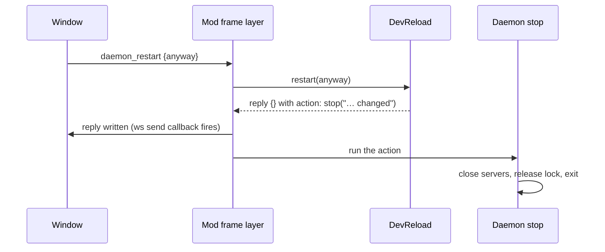

# Concurrency rules the code enforces - Plan

---

## Goal Capsule

- **Objective:** each place in the daemon, the mod and the shell that is safe today only because of statement order, a spare tick, a sleep or nobody calling twice at once holds its rule by construction, so an edit that breaks the rule fails to compile, fails a test or fails the build. Nothing a person sees, saves or sends changes, except where a unit proves a real race and fixes it.
- **Means:** eleven MUST KILL flags, one of them (the memory repos' queue) already held by a test, from the comment purge (AlmondLabs/loki#308) in the concurrency group (KTD1–KTD9), shipped as five pull requests (KTD10).
- **Authority:** the owner confirmed this scope on 2026-11-19 ("Confirm scope"), with the daemon lock left out. One theme per pull request, low risk first, carries over from the earlier batch. AGENTS.md and `docs/style.md` govern code style.
- **Stop conditions:** stop and ask if a change would alter a value saved under `~/.loki`, a frame between processes or Macs, the order in which passes, starts or stops run, or words on screen, beyond what a unit names.
- **Execution profile:** refactors that keep behaviour, plus fixes where a failing test first shows the race or crash is real. Existing tests pass unchanged except where a unit names an edit.
- **Finishes and ships:** an agent through `ce-work`, one pull request per phase, opened only when the owner asks.

---

## Product Contract

### Summary

Five small pull requests. The first puts the daemon's queues on rules the code keeps: the pass runner's drain and mod loading. It carries this plan. The second makes MCP and ACP restarts tell old work from new by construction. The third keeps the shell's start/stop count inside the lock that guards it. The fourth makes the mod's fire-and-forget peer work unable to end the daemon, and folds the pairing guard into one step. The fifth restarts the daemon after its reply has been written, not 200 ms later.

### Problem Frame

The comment purge deleted every comment that explained a surprise in loki's own code and flagged each surprise for a reshape. In this group the surprise is about time: a promise that clears itself only because of a leading `await Promise.resolve()`, a generation read between calling `stop()` and awaiting it, a module-level counter that doubles as every process's epoch, a sleep that hopes the window heard the reply. Each is correct today. Each breaks silently if someone moves one line, and the comment that warned them is gone.

Research traced the three cases the scoping flagged as possible bugs. Two quick MCP starts do not leak a connection today, concurrent wrong pairing codes do not pass the block today, and a shell stop that overtakes a start is caught today (`a_start_that_a_stop_overtook_ends_its_child_instead_of_keeping_it`). All three are reshapes. Two other spots may be real crashes and are proven first: a throw inside the mod's unawaited peer work rejects a promise nothing handles, which ends the daemon, and `ModRegistry.load` voids a `finally()` that rejects when a load rejects.

### Requirements

**Queues**

- R1. The pass runner's drain starts at most one loop at a time and lets the next call start a new one as soon as the loop ends, without depending on a tick before its first statement.
- R2. Loads of the same mod run one after another through `keyedQueue` (`core/serial.ts`); a load that fails does not leave an unhandled rejection.
- R3. The daemon and the mod share one git queue per memory repo, and a mod bundle that would carry its own copy of the queue fails `npm test`. This already holds: "leaves out the memory repos' queue, which it takes from its host" in `test/build-mod.test.ts` bundles the mod with esbuild's metafile and fails when `daemon/repo-queue.ts` is an input, indirect imports included. No unit changes it.
- R4. The google-auth test's bare `await Promise.resolve()` has a name that says it yields a turn.

**Restarts**

- R5. An MCP server's start takes its generation in the same step that retires the old one, so no ordering of statements in `start` can let two starts both connect.
- R6. An ACP process's epoch is unique across every process by construction, not by a shared counter.
- R7. The shell's harness keeps its stop count, its stopped flag and its running child under one lock.

**Peer work**

- R8. Work the mod runs without awaiting (opening a peer link, refreshing a Mac's chat list) cannot reject: it catches, logs, and goes on as a failed attempt does today.
- R9. A pairing request checks the wrong-code block and records its result in one step after its body is read, on both `/pair` and `/peer/pair`.

**Dev restart**

- R10. `daemon_restart` stops the daemon once its reply has been written to the window, with no fixed delay.

### Scope Boundaries

- No change to saved files, frames, the order passes run in, or words on screen.
- `daemon/lock.ts` keeps its hand-rolled stale-lock protocol. Node has no OS file lock without a native dependency, so replacing it is its own decision.
- The pass runner keeps its own queue rather than `serialQueue`, because `/doctor` is placed ahead of waiting passes (#330) and the queue tracks keys for de-duplication.

### Deferred to Follow-Up Work

- Replacing `daemon/lock.ts` with an OS advisory lock, in its own plan.
- A process-wide `unhandledRejection` report in the daemon. R8 fixes the two known callers; a safety net for unknown ones is a separate decision about whether loki should keep running after one.

---

## Planning Contract

### Key Technical Decisions

- KTD1. **The drain's busy flag is set before its loop and cleared at the end of it, in program order.** A `running` boolean is set synchronously before the loop starts and cleared in the loop's `finally`, and callers wait on the promise of the current loop. An empty queue then ends the loop synchronously with the flag already clear, so the next call starts a new loop. Rejected: `this.draining = loop().finally(clear)`, which clears a microtask late, so an item scheduled in that gap waits for the next tick of the timer.
- KTD2. **Hand-built per-key chains become `keyedQueue`.** `ModRegistry.loading` is the same pattern `core/serial.ts` already names, used by `daemon/credentials.ts`, `daemon/chat-backend.ts` and eight mod modules. `keyedQueue` swallows the tail's rejection itself, which removes the voided `finally()`.
- KTD3. **The existing bundle test holds the shared queue.** `test/build-mod.test.ts` already fails when the mod's bundle carries `daemon/repo-queue.ts`, through any import path; the mod receives the queue through `host.memory.serial` (`mod/index.ts`). Considered and not built: a second copy of that check in `scripts/build-mod.ts`, which adds a gate at `build:mod` that `npm test` already provides before every push, and an ESLint `no-restricted-imports` rule, which sees only direct imports.
- KTD4. **Retiring an MCP server's connection returns the new generation.** `stop` becomes a step that increments the generation, clears the retry and client, and returns `{ generation, closed }`. `start` takes its generation from that return, so there is no way to read it at the wrong moment. `configure`'s removal path uses the same step and ignores the generation.
- KTD5. **An ACP epoch is a fresh `symbol`.** `AcpProcess.epoch()` always returns a symbol: one made when the process is constructed, replaced at each start and at `close()` (which today bumps its counter). `Live.epoch` in `daemon/acp/chats.ts` stores it as `symbol | null`, `null` replacing today's `-1`. A `null` never equals a process's epoch, so a chat whose session never opened, or whose process closed, loads its session again, as today. Identity makes epochs unique across processes, including a process made anew after an edit in Settings, which is what `test/acp-process.test.ts` pins today. Rejected: a per-instance counter, which repeats across instances.
- KTD6. **The harness slot holds all start/stop state.** `slot: Mutex<Slot>` with `Slot { running: Option<Running>, stops: u64, stopped: bool }`. `spawn` reads `stops` under the lock before spawning and `install` compares it under the same lock, so the count cannot change without the lock held. The two atomics go away.
- KTD7. **Fire-and-forget work has a `void` signature and handles its own errors.** Each unawaited call site calls a method that returns `void`, catches inside and logs with `log` (`mod/log.ts`). `PeerLink`'s connect failure handling and `RemoteChats`' retry scheduling are unchanged, but every timer and caller that fires them without awaiting now calls the `void` method. The type then stops a caller from forgetting the catch, since there is nothing to await or void. `RemoteChats.refresh` keeps an awaitable form only for `relist` in `mod/peering.ts`, which awaits it. `PeerLink` also calls its status listener inside a `try` that logs, because status changes run from socket event handlers and the ping's callback, outside any promise `open` owns.
- KTD8. **One `Attempts` step per pairing request.** After the body is read, a single synchronous call checks the block, runs the code check and records the result: a wrong code counts, a right one clears, and a refusal that checked no code (a malformed body, or this Mac's own id) neither counts nor clears, as today. For `/peer/pair` the code is spent synchronously inside `Peers.accept` before its first `await`. That spend becomes the step `Attempts` wraps, and the keychain write runs after it. The cheap block check before reading the body stays, as an early refusal rather than the guard.
- KTD9. **The restart runs after the reply is written.** The frame layer's request outcome gains an optional action run once the reply has been handed to the socket (the `ws` send callback). `DevReload` returns the restart as that action instead of calling `stop` on a timer. The reply path is one write: `here()` in `mod/bridge.ts` turns the outcome into `client.send`, which reaches the single `ws.send` in `send` in `mod/server.ts`.
- KTD10. **One theme per pull request, low risk first.** (session-settled: user-approved — chosen over one pull request for the whole batch: smaller reviews, and a later theme can stop without undoing an earlier one.) The order is queues, restarts, shell, peer work, dev restart. The shell gets its own pull request because it alone needs the cargo checks.

### Sequencing

| Pull request | Units | Carries |
|---|---|---|
| 1. Queues | U1, U2, U4 | this plan |
| 2. Restarts | U5, U6 | |
| 3. Shell | U7 | |
| 4. Peer work | U8, U9 | |
| 5. Dev restart | U10 | |

### High-Level Technical Design

The dev restart (KTD9) is the one change whose order crosses a process boundary:

### Open Questions

- Can `ModRegistry.loadNow` reject today, or does it catch every failure? U2's first test settles whether R2's crash is real or only possible.

---

## Implementation Units

### U1. A drain that does not need a tick

- **Goal:** the pass runner's drain keeps its rule in program order.
- **Requirements:** R1.
- **Dependencies:** none.
- **Files:** `daemon/passes.ts`, `test/passes.test.ts`, `test/doctor.test.ts`.
- **Approach:** per KTD1:
  1. Replace `draining` and the `??=` async IIFE with a `running` flag and the current loop's promise.
  2. Keep `schedule`'s placement (FIFO among "next", ahead of "last") and the key bookkeeping in `finally`.
  3. Leave `tick`, `runNow`, `runAllNow` and `runDoctor` calling `drain()` as today.
- **Patterns to follow:** the queue and `schedule` from #330.
- **Test scenarios:**
  - A drain called on an empty queue resolves, and a pass scheduled right after it runs on the next `drain()` call, not later.
  - A pass scheduled while a loop runs is taken by that loop.
  - `/doctor` scheduled behind a running pass runs before passes queued earlier (the order test in `test/doctor.test.ts` passes unchanged).
- **Verification:** no `await Promise.resolve()` remains in `daemon/passes.ts`; existing pass tests pass unchanged.

### U2. Mod loads through `keyedQueue`

- **Goal:** loads of one mod run in order through the shared helper.
- **Requirements:** R2.
- **Dependencies:** none.
- **Files:** `daemon/mods/registry.ts`, `test/mod-registry.test.ts`.
- **Approach:** per KTD2, `loading` becomes `keyedQueue()` and `load` returns `this.loading(mod.name, () => this.loadNow(mod))`.
- **Execution note:** first write a test where a load rejects and check for an unhandled rejection, so the pull request says whether this fixed a crash.
- **Test scenarios:**
  - Two loads of one mod run one after the other: the second starts after the first settles.
  - Loads of two different mods do not wait for each other.
  - A load that rejects leaves no unhandled rejection, and the next load of that mod still runs.
- **Verification:** `ModRegistry` has no hand-built promise chain.

### U4. Name the yield in the google-auth test

- **Goal:** the bare `await Promise.resolve()` in `fakeApis` says what it is for.
- **Requirements:** R4.
- **Dependencies:** none.
- **Files:** `test/google-auth.test.ts`.
- **Approach:** a local `yieldTurn()` helper, called where the bare await is.
- **Test scenarios:** Test expectation: none -- a rename inside a test; the file passing unchanged is the proof.
- **Verification:** the token refresh tests pass unchanged.

### U5. MCP starts take their generation from the retire step

- **Goal:** two quick starts of one server cannot both connect, whatever order `start`'s statements take.
- **Requirements:** R5.
- **Dependencies:** none.
- **Files:** `daemon/mcp/servers.ts`, `test/mcp.test.ts`.
- **Approach:** per KTD4, `stop` becomes a retire step returning `{ generation, closed }`. `start` begins with `const { generation, closed } = this.retire(entry); await closed;`. `configure`'s removal calls the same step.
- **Test scenarios:**
  - Two starts of one server in a row, with a connector that resolves late, end with one connected client and the other closed.
  - A server removed while connecting closes the client it just made.
  - A retry timer from a failed start does nothing after a newer start.
- **Verification:** `generation` is never read from `entry` in `start` except to compare against the one it was given.

### U6. ACP epochs by identity

- **Goal:** an ACP process's epoch is unique by construction.
- **Requirements:** R6.
- **Dependencies:** none.
- **Files:** `daemon/acp/process.ts`, `daemon/acp/chats.ts`, `test/acp-process.test.ts`.
- **Approach:** per KTD5, drop the module-level `starts`. The constructor, each start and `close()` set a fresh `Symbol(config.name)`, and `epoch()` returns it. `Live.epoch` becomes `symbol | null`, starting at `null`. The `connection.closed` checks compare symbols.
- **Test scenarios:**
  - A process made anew never has an epoch an old one had (the existing test, unchanged in meaning).
  - A restarted process has a new epoch, so a chat loads its session again.
  - A process that never started has an epoch no chat holds, so a chat whose session never opened loads its session, and `setMode` on it is skipped as today.
  - A closed process has a new epoch, so a chat that held the old one loads its session again.
- **Verification:** no module-level mutable state remains in `daemon/acp/process.ts`.

### U7. The harness's start/stop state under one lock

- **Goal:** the shell's stop count changes only with the slot's lock held.
- **Requirements:** R7.
- **Dependencies:** none.
- **Files:** `src-tauri/src/harness.rs`.
- **Approach:** per KTD6:
  1. Add `Slot` holding the running child, the stop count and the stopped flag behind `Mutex<Slot>`.
  2. `spawn` locks briefly to read the count before spawning.
  3. `install` compares under the same lock.
  4. `stop` increments and takes the child under it.
  5. `was_stopped` and `exited` lock the slot.
- **Test scenarios:**
  - A start that a stop overtook ends its child and leaves the slot empty (the existing test, rewritten to read the count through the slot).
  - A stop marks the harness stopped, and a start after it clears the mark.
  - Stopping asks the daemon to go before it kills it (the existing test, unchanged).
- **Verification:** no atomics remain in `Harness`. The cargo checks in `docs/CONTRIBUTING.md#checks` pass.

### U8. Peer work that cannot end the daemon

- **Goal:** opening a peer link and refreshing a Mac's chats never leave an unhandled rejection.
- **Requirements:** R8.
- **Dependencies:** none.
- **Files:** `mod/peer-link.ts`, `mod/remote-chats.ts`, `mod/peering.ts`, `test/remote-chats.test.ts`, a new `test/peer-link.test.ts`.
- **Approach:** per KTD7:
  1. `PeerLink.start` and the retry timer call a `void` method that runs `open` and catches anything that escapes its own `catch`, such as a token lookup that throws. It logs and treats the attempt as failed, so the link retries.
  2. `PeerLink.setStatus` calls `onStatus` inside a `try` that logs, which covers the change to reachable (in the ping's callback) and to unreachable (in the socket's close handler).
  3. A public `void` method on `RemoteChats` catches, logs and schedules a retry. `setReachable`, `heard`'s timer, the retry timer and the two unawaited callers in `mod/peering.ts` (on `chat_left` and on a moved chat) call it.
- **Execution note:** start with tests where a listener (`onChange`, `onListed`, a status listener) throws, and confirm an unhandled rejection today, so the pull request says it fixed a crash.
- **Test scenarios:**
  - A `RemoteChats` whose `onChange` throws during a refresh started by `setReachable(mac, true)` leaves no unhandled rejection and tries again later.
  - A `PeerLink` whose token lookup throws reports the link unreachable and retries after the backoff.
  - A `PeerLink` whose status listener throws on the change to reachable, after the ping answers, leaves no unhandled rejection and stays reachable.
  - A `PeerLink` whose status listener throws on the change to unreachable, when the socket closes, leaves no uncaught exception and retries.
  - A refresh that succeeds still lists the Mac's desks and inbox (existing tests pass unchanged).
- **Verification:** no `void` of a `.open()` or `.refresh(` call on a `PeerLink` or `RemoteChats` remains under `mod/`; the unawaited callers call `void`-returning methods.

### U9. One pairing step

- **Goal:** the wrong-code block is checked and recorded in one step.
- **Requirements:** R9.
- **Dependencies:** none.
- **Files:** `mod/lan.ts`, `mod/peers.ts`, `test/lan.test.ts`, `test/peers.test.ts`.
- **Approach:** per KTD8:
  1. Add an `Attempts` method that takes the ip and a synchronous code check. The check answers wrong, right, or refused with a status and body. The method returns blocked without running the check, counts wrong, clears on right, and leaves the count alone on refused.
  2. `/pair` passes a check that refuses a body without a code (400) and otherwise redeems it.
  3. `/peer/pair` passes the synchronous part of `Peers.accept`, in today's order: parse (refused, 400), the invite lookup, the own-Mac refusal (refused, 409) before any code is spent, then the code spend. The keychain write and store add run only on right.
  4. The early pre-body check stays.
- **Test scenarios:**
  - Eleven concurrent wrong codes from one address, all read before any answers, give ten 404s and one 429.
  - A right code after nine wrong ones pairs and clears the count.
  - A right code from a blocked address is refused with 429.
  - A malformed body answers 400 and does not count as a wrong code.
  - After nine wrong codes from one address, a malformed request and a request with this Mac's own id each answer without changing the count, and the next wrong code answers 429.
  - A request with this Mac's own id and a valid code answers 409 and leaves the code unspent.
  - A Mac pairing by invite still pairs without spending a code (existing peer tests pass unchanged).
- **Verification:** `blocked` is not called after the body is read anywhere but inside the one step.

### U10. Restart after the reply

- **Goal:** `daemon_restart` stops the daemon once its reply is written, not on a timer.
- **Requirements:** R10.
- **Dependencies:** none.
- **Files:** `mod/frames/context.ts`, `mod/frames/daemon.ts`, `mod/frames/index.ts`, `mod/bridge.ts`, `mod/server.ts`, `daemon/dev-reload.ts`, `daemon/main.ts`, `mod/index.ts`, `test/dev-reload.test.ts`, a frame test in `test/`.
- **Approach:** per KTD9:
  1. Let a request outcome carry an action. `here()` in `mod/bridge.ts` passes it to `client.send` as a written callback.
  2. `send` in `mod/server.ts` runs the callback from `ws.send`'s callback, once, after the write. Its branches that drop the frame (socket not open) or end the socket (too much buffered) run it at once.
  3. `DevReload.restart` returns the restart rather than calling `opts.restart`.
  4. The frame handler returns it as that action.
  5. `daemon/main.ts` passes `stop` without `setTimeout`.
- **Test scenarios:**
  - A request outcome with an action runs it after its reply was sent, and only once.
  - When the client's socket is already closed, the action runs at once, since no reply will be written, so the restart still happens.
  - `DevReload` with nothing to restart returns no action; with a restart due it returns one carrying the reason.
  - A refused restart (a chat still working) returns the refusal and no action (existing tests pass unchanged).
- **Verification:** no fixed delay remains on the restart path.

---

## Verification Contract

| Check | When |
|---|---|
| `npm run lint:fast` and `npm run typecheck` | while working |
| `npm run format:check && npm run lint && npm run typecheck && npm test && npm run test:node` | before each push |
| `npm run build:app && npm run build:mod && npm run smoke` | before each push |
| the cargo lines in `docs/CONTRIBUTING.md#checks` | before pushing pull request 3 |
| CI on the pull request, Windows included | after each push |

Every check runs on CI's toolchain (the newest Node 22, npm 10, `SHELL=/bin/bash`). Tests inject clocks and connectors and never sleep. U10's timing comes from the send callback, not a wait.

---

## Definition of Done

- Each pull request's units meet their Verification lines, and every check above passes locally and in CI.
- Each rule named in R1–R10 is held by a type, a lock, a helper or a test, not by a comment or a statement's position.
- Pull requests 1 and 4 say whether their first tests showed a real unhandled rejection (U2, U8).
- No value saved under `~/.loki`, sent in a frame, or shown on screen differs from before.
- No new comment explains what the code now says itself.
