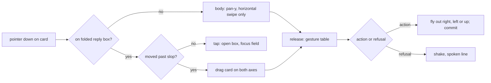

# A Flow card that is all message - Plan

## Goal Capsule

- **Objective:** On the phone, a Flow card of any type (chat, approval, Gmail, Slack, Jira) shows mostly the message, and the three things done most with it (Read, Later, Archive) take one drag.
- **Means:** the card's reply box doubles as its handle, and a ⋯ on the header holds everything else (Key Decisions).
- **Product authority:** the owner, in a brainstorm and planning session on 2026-11-19, from a real iPhone screenshot where about half the 844pt screen went to bars, buttons and padding. The Product Contract wins on behaviour; the Planning Contract's KTDs win on mechanism.
- **Stop conditions:** stop and ask if a requirement turns out to need the desktop Flow cards changed, or if the reply box can't tell a tap from a drag reliably in the preview.
- **Execution profile:** phone app (`app/src/phone`), the shared chat input behind a card-only prop, the mod's account layer behind a preview-only switch, and docs. One branch, one PR, carrying this plan.
- **Open blockers:** none.

---

## Product Contract

Product Contract preservation: changed after the brainstorm, by the owner during planning: R3, R5, R6, R7, R12 reworded (the reply box replaces swipe-up-from-the-card and the approval Undo), R11 narrowed (waits for a card that is not an approval); R20, R21 added.

### Summary

Flow cards on the phone lose their buttons. Dragging a card's reply box right marks it Read, left puts it off, up archives; a tap opens the box to type. On an approval, right approves and left denies. Swiping the card body sideways still works as today. A ⋯ on the card's header line lists every action the card has. The chrome around the card shrinks to one-line bars, one deck edge and a one-row reply box. The phone preview seeds Gmail, Slack and Jira cards so every type can be checked on screen.

### Problem Frame

The owner works through Flow on the phone mostly by triage: mark Read, leave for Later, and archive a lot of email. Replying is occasional and has no fixed pattern by card type. Yet a chat card on a real iPhone spends about half the screen on chrome: a two-line top bar, a centred two-line card header, three stacked deck edges and side margins, a two-row reply box with about 60pt of blank above it, a date pill, and three 60pt buttons (Later, Archive, Read). The message, which is what the owner reads to decide, gets what is left.

The buttons are there because `docs/design.md` requires every gesture to have a visible button. The swipes for Read and Later already exist; Archive, the action the owner uses most on email, has no gesture.

### Key Decisions

- **Gestures replace the buttons on Flow cards.** The owner triages by gesture and wants the space. (session-settled: user-directed — chosen over one slim icon row, and over a ⋯-only header: the owner wants the card bottom free.) Governs R1, R2.
- **The reply box is the handle.** Dragging it right, left or up does Read, Later, Archive; it adds no height and sits where the thumb rests. (session-settled: user-directed — chosen over swipe-up from the card, drop bins, a grabber, a three-part bar and a hairline grabber, all shown as sketches: the others cost room or fought muscle memory.) Governs R3, R4, R5.
- **Approvals are decided by gesture, sent at once.** (session-settled: user-directed — chosen over holding the answer through the 6 s Undo and over keeping Approve and Deny buttons, with the stray-swipe risk stated.) Governs R6, R7.
- **The ⋯ sits on the header line and lists every action.** It costs no height, and listing the gesture actions too makes it the one visible route to everything. (session-settled: user-directed — chosen over a long press on the header and the reply box's +, shown as sketches.) Governs R8, R9, R10.
- **The design rule gets a Flow exception, not a removal.** Elsewhere a gesture still has its button; on a Flow card the ⋯ stands in for it. Governs R12, R13.
- **The phone only.** The desktop Flow cards are separate code and keep their buttons.

### Requirements

**Gestures**

- R1. A Flow card on the phone shows no Later, Label, Archive, Read, Deny, Approve, Always Allow or Hand Off button.
- R2. Swiping a card's body sideways works as today: right marks it Read, left puts it off.
- R3. Dragging a card's reply box right marks it Read, left puts it off, and up archives it; a tap without a drag opens the box to type.
- R4. An archive on a card that cannot be archived (a main chat, a Jira ticket) is refused with the card's existing shake and a line saying why.
- R5. The thread inside a card only scrolls vertically; no gesture inside it archives.
- R6. On an approval, right (body swipe or box drag) approves and left denies; up is refused as in R4.
- R7. An approval decided by gesture is sent to the agent at once and offers no Undo.
- R20. While the reply box holds text (typed, kept, or an agent's proposed reply), Later and Archive still act and the text stays with the card; Read, Approve and Deny are refused with a line saying to send or clear the reply first.

**The ⋯**

- R8. Every Flow card has a ⋯ control on its header line, 44 × 44 as every phone target.
- R9. The ⋯ lists every action the card can take, including the gesture ones, each with its gesture named beside it, and leaves out what the card's type cannot do (no Archive on a main chat or Jira).
- R10. The ⋯ is the only home for Always Allow, Label (Gmail), Hand Off (Gmail, Slack, Jira), and Later on an approval.
- R21. The ⋯ acts only on the card it was opened for; if that card leaves the top while it is open, it closes.

**Finding the gestures**

- R11. The first time Flow shows a card that is not an approval after this change, a one-time hint shows the three box drags; it does not come back once dismissed.
- R12. VoiceOver reaches every action through the ⋯, which is labelled; the reply box's spoken label names its drags.
- R13. `docs/design.md` and `docs/manual.md` say Flow cards act by gesture and ⋯, and the design rule names Flow as its exception.

**Less chrome**

- R14. Flow's top bar is one line: the lane title with its ⌄ and the count beside it, and a smaller back control.
- R15. A card's header is one row (who, title, time, ⋯); Draft, labels and the suggestions link take a second line only when present.
- R16. The deck shows one edge behind the card instead of three, and the card's side margins are slimmer.
- R17. A card's reply box is one row until tapped, then opens to that type's extras: the model pill and + for a chat, the To line for email. The blank above it goes.
- R18. A card's thread shows no date pill.

**The preview**

- R19. `npm run phone-preview` also seeds at least one Gmail, one Slack and one Jira card, with made-up content, so each card type and its ⋯ can be seen on screen.

### Key Flows

- F1. Triage an email. **Trigger:** a Gmail card is on top. The owner reads it and drags the reply box up; the card leaves upward and the next slides in. Reading it later instead is a left drag or a left swipe. **Covers R3, R2.**
- F2. Decide an approval. **Trigger:** an agent asks to edit a file. The owner reads the request and swipes or drags right to approve, left to deny; the answer goes at once. To always allow the tool, or to put the request off, they open the ⋯. **Covers R6, R7, R9, R10.**
- F3. Reply. **Trigger:** the owner wants to answer. They tap the one-row reply box; it opens to the type's extras; they send. **Covers R3, R17.**

### Acceptance Examples

- AE1. A main chat's card, its box dragged up, shakes and says a main chat cannot be archived; its ⋯ has no Archive. **Covers R4, R9.**
- AE2. A long chat card: a vertical drag in the thread scrolls it; the same drag up on the reply box archives the card. **Covers R3, R5.**
- AE3. A Jira card's ⋯ lists Read, Later and Hand Off, and no Archive or Label. **Covers R9, R10.**
- AE4. A Gmail card with labels and a draft: the header's first row is who, title, time and ⋯; labels and Draft sit on a second row. A chat card with none of these has one row. **Covers R15.**
- AE5. A Gmail card where an agent proposed a reply: dragging the box up archives it and the proposed reply is still there on Undo; dragging right is refused with a line about the reply. **Covers R20.**
- AE6. The ⋯ is open on an approval when the Mac answers it: the ⋯ closes and the next card shows. **Covers R21.**

### Scope Boundaries

- The desktop Flow cards and their buttons are unchanged.
- No swipe-up anywhere but the reply box; no long swipes or swipe-and-hold.
- Messages keep their own long press (Copy, Select text); the card header gains none.
- No setting to bring the buttons back.
- The full-screen phone conversation keeps its current reply box.
- Fixing the shared `archivable` check in `core/attention` for the desktop is not part of this; the phone follows the rule the manual states.

### Dependencies / Assumptions

- Today the phone shows an Archive button on a main chat and then refuses it (`app/src/phone/inbox.tsx:570`); the pure rule `canCommit` (`app/src/phone/deck.ts`) already refuses it, and the manual says a main chat has no Archive.
- The phone is a Safari web app, so VoiceOver exposes no custom accessibility actions from ARIA; R12 is written to that.
- Chromium in the preview can't prove how the box drag feels against a tap; it needs a check on a real iPhone.

### Sources / Research

- Phone Flow card: `app/src/phone/inbox.tsx` (`Card`, `Decisions`, `OutsideBody`, `useSwipe`, `usePass`), rules in `app/src/phone/deck.ts`.
- Rule this changes: `docs/design.md` (Controls, "Gestures … always have a visible button"); refused-swipe shake: `docs/design.md` (motion).
- Per-type actions: `docs/manual.md` (Flow), `core/attention/model.ts` (`OUTSIDE_ENDS`, `archivable`).
- Preview: `scripts/phone-preview.ts`, plan `docs/plans/2026-11-18-2327-feat-phone-preview-plan.md`.

---

## Planning Contract

### Key Technical Decisions

- KTD1. **One gesture table, in `deck.ts`.** A pure function takes the card's kind (chat, main chat, outside by provider, approval), where the drag started (body or box), its direction, and whether the box holds text, and returns the action or a refusal reason. `canCommit` and the refusal copy read the same table, so the ⋯ list (R9), the gestures (R2–R6, R20) and the refusals (R4) cannot disagree. Tests stay node-only, as `test/deck.test.ts` does today.
- KTD2. **The box drag is a pointer gesture on the box's wrapper, not on the text field.** A drag past the existing `DRAG_SLOP` on the folded box captures the pointer and moves the card; a release without passing slop is a tap and focuses the field. The box is folded whenever its field is not focused, text or no text (a kept or proposed reply shows as one truncated line); blur or send folds it again. The box gets `touch-action: none` while folded, so iOS hands it vertical moves; while open for typing, drags on it are text handling and body swipes are the only gestures. The handle check runs before the `OWN_GESTURE` bail-out (whose selector starts with `textarea`), and the outside reply's `stopPointer` wrapper applies only while the box is open, so a folded box drags the same way on every card type. Governs R3, R5, R20.
- KTD3. **Body swipes keep `touch-action: pan-y` and stay horizontal.** Only the box can go up, so no thread-end detection or touch-event fallback is built.
- KTD4. **Fly-out gains an up direction.** `Leaving` carries an axis; Archive leaves upward on every path (box, ⋯), and the `Reveal` behind the card gains Archive (up) and Approve/Deny labels.
- KTD5. **The ⋯ is a bottom `Sheet` of `SheetRow`s**, as a row's ⋯ on Home is (`app/src/phone/home.tsx` `DeskActions`). The gesture name goes in `SheetRow`'s `aside`. An inline `PhonePopover` was rejected: the card's `overflow: hidden` clips it. The sheet holds the item's id and closes when the deck's top id changes (R21). Hand Off opens `HandoffPicker` in a second sheet; Label keeps `MailLabelsSheet`.
- KTD6. **Later on an approval goes through `canCommit`**, opened to `later` for approvals only when it comes from the ⋯; the gesture table never maps a gesture to it.
- KTD7. **The folded box is a prop the card passes**, through `CardConversation` to `Conversation`/`ChatInput` and to `OutsideReply`'s phone branch. The full-screen phone conversation and the desktop never pass it. It lands in U2, since the handle lives on it.
- KTD8. **The date pill hides by CSS in cards** (`.loki-phone-card .loki-msg-day-pill-wrap`), leaving the transcript's day grouping, its `aria-label` and `test/transcript-times.test.ts` untouched.
- KTD9. **The hint's seen flag is a `createSessionValue` under `loki.phone.flowHint`**, as `app/src/shared/active-lane.ts` stores the lane. It is per browser storage, so a Safari tab and the Home Screen app each show it once; the preview's fresh origin shows it every run.
- KTD10. **Preview outside cards come from a preview-only account switch in the mod.** `scripts/phone-preview.ts` writes `state/accounts.json` and `state/account-threads/*.json` for one Gmail, one Slack and one Jira account before the daemon starts, and sets a `LOKI_PREVIEW_ACCOUNTS` variable. The switch sits at `mod/index.ts`'s existing seams: with it set, the watcher gets no sync factory for the seeded accounts (so they stay connected), each provider registers a record-only `OutsideSource` (Read, Later, Archive change the records alone), and only the thread read in `mod/outside-threads.ts` branches to serve the records' own lines. Without the switch nothing changes. A plain write of the files was rejected: with no keychain the sync marks every account "Sign in" and the cards show stand-in threads, which defeats R19.

### High-Level Technical Design

The gesture table (KTD1). Rows are card kinds; each cell is what the gesture does, or the refusal shown.

| Card | Body or box → right | Body or box → left | Box ↑ | With text in the box |
|---|---|---|---|---|
| Chat | Read | Later | Archive | Read refused; Later, Archive act |
| Main chat | Read | Later | refused: a main chat can't be archived | Read refused |
| Gmail, Slack | Read | Later | Archive | Read refused; Later, Archive act |
| Jira | Read | Later | refused: Jira ends with Read | Read refused |
| Approval | Approve (sent at once) | Deny (sent at once) | refused: decide first | Approve, Deny refused |

### Assumptions

- `touch-action: none` on the folded box is enough for iOS Safari to deliver vertical pointer moves there; the iPhone check confirms it (Risks).
- Outside cards on the phone have no scroll container today (`OutsideBody` is a plain column inside a clipped card), so long outside threads may be cut off. U4 gives the outside card body a scroller, since R5 assumes a thread that scrolls.

### Sequencing

U1 first (the table everything reads). U2 and U3 both need it and touch different parts of `inbox.tsx`; land U2 before U3 to keep the diff readable. U4 can follow either. U5 needs U2 (it teaches the box drag). U6 is independent and can land any time; U7 last.

### Risks

- **The tap-versus-drag split on the box** may feel sticky or steal taps. The slop is the existing `DRAG_SLOP`; tune it in the preview and on the iPhone before merging.
- **A stray right gesture approves at once (R7).** Accepted by the owner. The drag commits only past `COMMIT_FRACTION`, as Read does today.
- **The preview switch lives in shipping mod code.** It is read once from the environment and gates every branch it adds; a test asserts that without it the account layer behaves exactly as before.

---

## Implementation Units

### U1. The gesture table

**Goal:** One pure source for what each gesture does on each card kind, and why it is refused.
**Requirements:** R2, R3, R4, R6, R9, R20; KTD1, KTD6.
**Dependencies:** none.
**Files:** `app/src/phone/deck.ts`, `test/deck.test.ts`.
**Approach:**
1. Add the table and a lookup taking card kind, origin (body or box), direction (right, left, up) and whether the box holds text.
2. Replace `swipeDecision`'s approval and `typed` bail-outs with the table, so approvals map to approve/deny and typed text refuses only Read, Approve and Deny.
3. Add a direction classifier: body drags stay horizontal (`isHorizontalDrag`); box drags pick the dominant axis, up only.
4. Widen `canCommit` so `later` is allowed on an approval when it comes from the ⋯.
5. Export a list of a card's actions with their gesture names, for the ⋯ (R9), taking the same has-text input: with text in the box, Read, Approve and Deny come back disabled with the refusal reason.
6. Move the refusal reasons here, worded without buttons ("Send or clear the reply first.", "Decide this one first.").
**Patterns to follow:** existing `swipeDecision`, `canCommit`, `releaseCommits` from `app/src/kit/let-go`.
**Test scenarios:**
- Each row and column of the gesture table above returns its action or refusal.
- Body drag up returns nothing (the thread scrolls).
- Box drag with mostly-vertical movement downward returns nothing.
- Covers AE1. Main chat, box up: refused with the main-chat reason.
- Covers AE5. Gmail with text, box up: Archive; right: refused with the reply reason.
- Approval with text, right: refused.
- `canCommit` allows `later` on an approval only from the ⋯ path; flips the expectation at the current approval-later test.
- The ⋯ action list for Jira is Read, Later, Hand Off; for Gmail it adds Archive and Label; for an approval it is Approve, Deny, Always Allow (when offered), Later.
- With text in the box, the list marks Read (and on an approval, Approve and Deny) disabled with the reply reason.
- Velocity alone past the commit speed commits in the drag's direction, as today.
**Verification:** the table and its tests pass; nothing in `inbox.tsx` decides a gesture outside it.

### U2. The reply box as handle; buttons gone

**Goal:** Cards act by body swipe and box drag, with no action buttons left.
**Requirements:** R1, R2, R3, R5, R6, R7, R17 (the fold), R20; KTD2, KTD3, KTD4, KTD7.
**Dependencies:** U1.
**Files:** `app/src/phone/inbox.tsx`, `app/src/phone/phone.css`, `app/src/chat/conversation.tsx`, `app/src/chat/chat-input.tsx`, `app/src/desk/outside-card.tsx`, `test/inbox-card.test.ts`, `test/phone-look.test.ts`.
**Approach:**
1. Remove `Decisions` from the card; Hand Off leaves `OutsideBody` (it moves to the ⋯ in U3).
2. Add the `folded` prop (KTD7) from `CardConversation` to `Conversation`/`ChatInput` and to `OutsideReply`'s phone branch, folded by the rule in KTD2.
3. Give the folded box's wrapper a handle role: pointer down records the start, checked before the `OWN_GESTURE` bail-out; past `DRAG_SLOP` it captures and drives the card's transform on both axes; under slop on release it opens and focuses the box.
4. Apply `OutsideBody`'s `stopPointer` wrapper only while the outside box is open, so a folded outside box reaches the card's gesture path.
5. Have `CardConversation` report whether its draft (`useDraft`) is non-empty through an `onTyped` callback from `Stack`, as `OutsideBody` does, so the Inbox's typed flag covers chat and approval cards.
6. Route a box release through U1's lookup with origin "box"; body swipes keep `useSwipe` with origin "body".
7. Add an axis to `Leaving` and an upward fly-out in `Stack`; extend `Reveal` with Archive (up) and Approve/Deny.
8. Approve and deny from a gesture call the existing approve path; Undo stays cleared for them, as today.
9. Refusals use U1's reasons through `flashRefused` and the live region.
10. The box's accessible name says "Reply. Drag right for Read, left for Later, up to Archive." (approval wording for approvals).
**Patterns to follow:** `useSwipe` and `usePass` in `app/src/phone/inbox.tsx`; `OutsideBody`'s `onTyped` for the draft report.
**Test scenarios:**
- A card's markup has no Later, Archive, Read, Approve, Deny or Always Allow button.
- A chat card with a saved draft reports typed, and a right drag on it is refused with the reply reason.
- A card's `ChatInput` renders folded (one row, no extras) and the full-screen conversation's does not.
- A folded outside box carries no `stopPointer` handlers; an open one does.
- The folded box's wrapper carries the drag label and `touch-action: none` (phone-look rule).
- The card body keeps `touch-action: pan-y` (phone-look rule).
- An outside card's markup has no Hand Off button.
- An approval card's box label names approve and deny.
**Verification:** in the preview at 390 × 844, dragging a chat card's box up archives it and it flies upward; a tap opens the box; dragging an approval right approves it at once. Checked again on the owner's iPhone before merge.

### U3. The card's ⋯

**Goal:** One labelled control per card listing every action, home of the rarer ones.
**Requirements:** R8, R9, R10, R12, R21; KTD5, KTD6.
**Dependencies:** U1, U2.
**Files:** `app/src/phone/inbox.tsx`, a new `app/src/phone/card-actions.tsx`, `app/src/phone/phone.css`, `test/inbox-card.test.ts`.
**Approach:**
1. Add a 44 × 44 ⋯ to the header row, labelled "Actions for <title>", `aria-haspopup="dialog"`.
2. It opens a bottom `Sheet` of `SheetRow`s built from U1's action list, the gesture in each row's `aside`.
3. Always Allow calls the approve path with `always`; Label opens `MailLabelsSheet`; Hand Off opens `HandoffPicker` in a sheet; Later on an approval commits `later` through the ⋯ path.
4. The sheet keeps the item id it opened for and closes when the deck's top id differs.
5. With text in the box, Read (and Approve, Deny) show as disabled rows with the reply reason as their secondary text (U1's list).
6. A disconnected outside account keeps today's behaviour per action (Hand Off disabled, moves allowed and bounced by the failed move).
**Patterns to follow:** `DeskActions` and `SheetRow` in `app/src/phone/home.tsx`; `ReturnTimeSheet`.
**Test scenarios:**
- Covers AE3. A Jira card's ⋯ sheet lists Read, Later, Hand Off and no Archive or Label.
- A Gmail card's sheet lists Read, Later, Archive, Label, Hand Off with gesture names.
- Covers AE1. A main chat's sheet has no Archive.
- An approval whose tool offers no Always Allow lists Approve, Deny, Later.
- Covers AE6. With the sheet open, changing the top item closes it and no action fires.
- The ⋯ button is 44 × 44 and named for its card.
**Verification:** in the preview, every card type's ⋯ opens with the right list and each row acts on that card; VoiceOver-style reading through the article reaches the ⋯ by name.

### U4. Less chrome

**Goal:** The card gets the space the bars, edges, margins and pill took.
**Requirements:** R14, R15, R16, R17, R18; KTD7, KTD8.
**Dependencies:** U2 (the box it folds is the handle).
**Files:** `app/src/phone/inbox.tsx`, `app/src/phone/ui.tsx`, `app/src/phone/lane-sheet.tsx`, `app/src/phone/deck.ts`, `app/src/phone/phone.css`, `app/src/chat/conversation.tsx`, `app/src/chat/chat-input.tsx`, `app/src/desk/outside-card.tsx`, `test/phone-look.test.ts`, `test/deck.test.ts`, `test/inbox-card.test.ts`.
**Approach:**
1. Give `TopBar` a one-line form used by Flow: title with ⌄, count beside it, Undo in the trailing slot, smaller back control.
2. Lay the card header out as one row; Draft, labels and the suggestions link render in a second row only when present.
3. `stackPose` and `cardsToDraw` draw one shell behind the top card; slim the card's side margin within the design scale.
4. When the folded box (U2) is tapped open, show the type's extras (the model pill and + for a chat, the To line for email); trim the dock's top padding and the card thread's bottom padding to the one-row box.
5. Give the outside card body a scroll container, as chat cards have `[data-thread-scroll]`.
6. Hide the date pill in cards with one CSS rule.
**Patterns to follow:** `useTopClearance` in `app/src/phone/ui.tsx`; `.loki-phone-card [data-thread-scroll]` rules in `phone.css`; spacing tokens in `docs/design.md`.
**Test scenarios:**
- `stackPose` and `cardsToDraw` give one shell (flips the current three-card expectation).
- Covers AE4. A Gmail card with labels and a draft renders two header rows; a plain chat card renders one.
- Flow's top bar renders the count on the title's line.
- An opened card box shows the model pill for a chat and the To line for a Gmail card.
- Phone-look: `.loki-phone-card .loki-msg-day-pill-wrap` is hidden; card spacing stays on the design scale (`test/tokens.test.ts` passes).
- A long outside card's body scrolls (has an overflow container).
**Verification:** a side-by-side screenshot in the preview against the owner's original iPhone screenshot shows the message taking most of the card.

### U5. The one-time hint

**Goal:** A newcomer learns the box drags once.
**Requirements:** R11; KTD9.
**Dependencies:** U2.
**Files:** a new `app/src/phone/flow-hint.tsx`, `app/src/phone/inbox.tsx`, `app/src/phone/phone.css`, a new `test/flow-hint.test.ts`.
**Approach:**
1. Store a seen flag with `createSessionValue` under `loki.phone.flowHint`, storage injected for tests.
2. Show the hint over the reply box on the first top card that is not an approval; dismiss on its close control or on the first gesture.
3. Words: Apple's sentence case, no exclamation marks ("Drag the reply box: right for Read, left for Later, up to Archive.").
**Patterns to follow:** `app/src/shared/active-lane.ts`, `app/src/shared/session-value.ts`.
**Test scenarios:**
- With no flag and a chat card on top, the hint shows.
- With an approval on top, it waits; when a chat card comes up, it shows.
- After dismissal the flag is set and the hint does not show again.
- Storage that throws: no hint and no crash.
**Verification:** the preview shows the hint once per fresh origin.

### U6. Gmail, Slack and Jira cards in the preview

**Goal:** Every card type can be seen and acted on in `npm run phone-preview`.
**Requirements:** R19; KTD10.
**Dependencies:** none.
**Files:** `scripts/phone-preview.ts`, `mod/index.ts`, `mod/outside-threads.ts`, `test/phone-preview.test.ts`, a new `test/preview-accounts.test.ts`.
**Approach:**
1. Add a pure `SEED_OUTSIDE` (one Gmail, one Slack, one Jira thread, made-up names and text) and a function that builds the `accounts.json` and `account-threads` file contents, owned by a seeded agent.
2. The preview writes them before the daemon starts and sets `LOKI_PREVIEW_ACCOUNTS=1` in `previewEnv`.
3. In `mod/index.ts`, read the switch once; with it on, pass no sync factory for the seeded accounts and register a record-only `OutsideSource` per provider; in `mod/outside-threads.ts`, serve the record's lines as the thread for those accounts.
4. Update CONTRIBUTING's preview paragraph, which says there are no Gmail, Slack or Jira cards.
**Patterns to follow:** `previewEnv`, `SEED` and the `state/lan.json` write in `scripts/phone-preview.ts`; record shapes in `mod/account-threads.ts` and `mod/accounts.ts`.
**Test scenarios:**
- `SEED_OUTSIDE` covers gmail, slack and jira, with made-up content (no real addresses).
- The built files parse with the mod's own `parseView` and record parser.
- `previewEnv` sets `LOKI_PREVIEW_ACCOUNTS` and still drops every inherited `LOKI_` value.
- With the switch off, the watcher syncs a connected account as before (no behaviour change).
- With the switch on, a preview account is reported connected, its read returns its lines, and Archive removes it from the rows without a network call.
**Verification:** the preview shows a Gmail, a Slack and a Jira card, connected, each acting on swipe and ⋯.

### U7. Docs

**Goal:** The manual and the design doc describe Flow as it now works.
**Requirements:** R13.
**Dependencies:** U2, U3, U4.
**Files:** `docs/design.md`, `docs/manual.md`, `docs/CONTRIBUTING.md`.
**Approach:**
1. `docs/design.md`: the gesture rule names Flow cards as the exception, with the ⋯ as their visible route.
2. `docs/manual.md`: the Flow section's gestures, the ⋯, the hint, and what each card type can do.
3. `docs/CONTRIBUTING.md`: the preview's outside cards (if not done in U6).
**Test expectation:** none — documentation.
**Verification:** each sentence about Flow's buttons in the manual is gone or rewritten.

---

## Verification Contract

With CI's toolchain (Node 22, npm 10, `SHELL=/bin/bash`):

- `npm run format:check`, `npm run lint`, `npm run typecheck`
- `npm test` (covers `test/deck.test.ts`, `test/inbox-card.test.ts`, `test/phone-look.test.ts`, `test/tokens.test.ts`, `test/phone-preview.test.ts`, `test/flow-hint.test.ts`, `test/preview-accounts.test.ts`), and `npm run test:node`
- `npm run build:app`, `npm run build:mod`, `npm run smoke`
- By hand: `npm run phone-preview` at 390 × 844, day and night, every card type: body swipes, box drags in three directions, a tap opening the box, refusals, the ⋯ for each type, the hint. Screenshots go in the PR.
- On the owner's iPhone: the box drag versus tap, and a vertical drag in a long thread scrolling, before merge.

## Definition of Done

- Every R in the Product Contract is met or, for R12's VoiceOver path and the iPhone feel, checked by hand and recorded in the PR.
- All checks in the Verification Contract pass, Windows CI included.
- No `Decisions` component or action button code is left unused; abandoned attempts are removed from the diff.
- This plan ships in the same PR.
