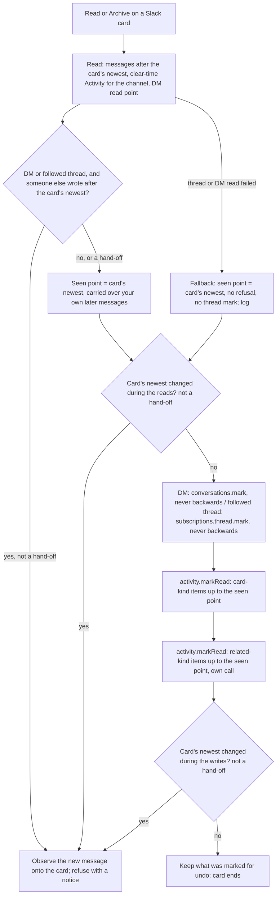

# Clearing a Slack card clears it in Slack - Plan

## Goal Capsule

- **Objective:** After you read or archive a Slack card in loki, opening Slack shows nothing unread for what that card covered, and nothing you have not seen is marked read.
- **Means:** at clear time loki reads the card's thread and its unread Activity fresh, then marks the Activity items and the thread itself read up to what you have seen (KTD1–KTD4).
- **Product authority:** the owner, in a session on 2026-11-20 that started from "my Slack activities are not getting marked as read". The Product Contract wins on behaviour; the Planning Contract's KTDs win on mechanism.
- **Stop conditions:** stop and ask if, in the hand check, Slack refuses `subscriptions.thread.mark` or the `channel_ids` filter on `activity.feed`, or accepts either and it has no effect (the thread stays unread in Slack's Threads view, or the read is not limited to the channel). Also stop if refusing a clear (R2) turns out to need app changes beyond the existing refusal notice.
- **Execution profile:** the mod's Slack client and sync (`mod/slack.ts`, `mod/slack-sync.ts`), their tests, and docs. One branch, one PR, carrying this plan.
- **Open blockers:** none.

---

## Product Contract

### Summary

Read and Archive on a Slack card now clear what that card covered in Slack. That means its Activity items (mentions and thread replies, plus reactions to your messages, highlight words and DM or app bundles there) and, for a channel thread you follow, the thread in Slack's Threads view. Your own later replies no longer stop an item from being marked. If someone else wrote after the card's newest message in a DM or a thread you follow, the clear is refused, and the card stays with the new message on it. Undo puts back what the clear marked. A thread inside a DM, and Activity about a whole channel, are left as they are.

### Problem Frame

The owner clears Slack cards in loki, then opens Slack and finds them still unread. Plan 092 (2026-11-11) made a clear mark the card's Activity items read, but three gaps remain, all silent (the live log on 2026-11-20 held no `slack:activity-mark-failed` line):

1. An Activity item newer than the card's newest message is skipped. A followed thread's item names its latest reply, so your own reply after the card's newest left the whole item unread.
2. Only the Activity entry is marked. The thread stays unread in Slack's Threads view.
3. loki reads only five Activity kinds (mentions, user-group, @channel, @everyone, thread replies), so reactions, highlight words and DM or app bundles on the same thread are never marked.

### Key Decisions

- **All three gaps are fixed.** (session-settled: user-approved — the agent laid out the three fixes with their limits and the owner chose "all three" over fixing only the first two.) Governs R1, R4, R5.
- **A channel's read point never moves.** Moving it marks read channel messages loki never showed. (session-settled: user-approved — recommended against marking the channel read when the three fixes were proposed; the owner took the three fixes on that basis.) Governs R6.
- **A newer message from someone else refuses the clear rather than marking around it.** You see the new message instead of losing it. Shown as a call-out in the scoping summary and confirmed. Governs R2.
- **Reactions to your messages in the cleared thread or DM are cleared too.** loki never shows them. Shown as a call-out and confirmed. Governs R5.

### Requirements

**What a clear marks**

- R1. Read or Archive on a Slack card marks read in Slack every unread Activity item of a card kind about the card's thread or DM whose message is at or before the seen point. The seen point is the card's newest message, carried forward over any of your own messages that follow it.
- R4. On a card for a channel thread you follow, the thread is marked read in Slack's Threads view up to the seen point.
- R5. Unread Activity items of the related kinds (reactions, highlight words, DM and app bundles) about the card's thread or DM, at or before the seen point, are marked read too.
- R6. No clear moves a channel's read point, and no clear moves any read point (a DM's or a thread's) back from where Slack has it.

**When a clear is refused**

- R2. If a DM, or a channel thread you follow, has a message from someone else (a bot included) after the card's newest, the clear is refused. Slack is left unchanged, the card stays open showing the new message, and the app brings it back with a notice that a new reply came in.
- R3. If the card gets a new message while the clear runs, the clear is refused the same way. Any marks already sent stay, since they stop at the seen point.
- R9. A hand-off is never refused, by R2 or R3. It marks what R1, R4 and R5 cover up to the seen point and leaves the rest unread.

**Failures and undo**

- R7. A Slack refusal of any mark in R1, R4 or R5 never stops the card from ending in loki. The other marks still go out, and loki logs what Slack refused. If loki cannot read the thread or DM at clear time, the clear goes ahead as before this change: up to the card's newest, with no refusal and no thread mark, and the fallback is logged.
- R8. Undo marks unread again in Slack what the clear marked: the Activity items, and the thread back to its earlier read point. A DM still cannot be marked unread, as today.
- R10. Cards still come only from the five card kinds, and each minute's Activity read is unchanged.

### Acceptance Examples

- AE1. Covers R1. A followed-thread card shows Ana's reply at 10:00. You replied at 10:05 in Slack. Clearing it marks the thread's Activity item read.
- AE2. Covers R2. Same card, but Ben replied at 10:07. The clear is refused, Slack is unchanged, and the card now shows Ben's reply.
- AE3. Covers R5. Someone reacted to your 10:05 reply. Clearing the card in AE1 also marks the reaction item read.
- AE4. Covers R6. You read the thread in Slack up to 10:20, then cleared an older card for it in loki. The thread's read point stays at 10:20.
- AE5. Covers R2. An @channel card's thread, which you don't follow, has a reply from Cara after the card. The clear goes ahead, and Cara's reply is neither marked nor brought onto the card.

### Scope Boundaries

Considered and not built:

- **Undo after loki restarts or reconnects Slack.** What a clear marked lives in memory, as plan 092 chose, so such an undo only reopens the card in loki. Carrying it on `OutsideChange` would change a frame for a rare case. Revisit if undo after a restart is reported.
- **A clear from a stale card view.** The frame names the thread, not the message the card showed, so the daemon clears up to its own newest message. That is unchanged here. R3 covers the race this change lengthens. Revisit if a phone view is found lagging the daemon.
- **Letting your own reply, observed by a tick mid-clear, through R3.** R3 refuses on any new message, yours included, so you may see one needless refusal and clear again. Ending the card instead would mean changing `AccountThreads.write`'s keep-open rule. Revisit if the notice shows up in practice.
- **Channel-level kinds** (the `channel` bundle, invites, reminders, lists). They are not about one thread, and marking `channel` would move toward the channel read point that R6 forbids.

### Sources / Research

- Plan 092 (`docs/plans/2026-11-11-092-feat-slack-activity-mark-read-plan.md`) built the Activity mark this extends.
- Slack documents none of these calls. Public clients and a datamine of Slack's web app (2026-11-20) give `subscriptions.thread.mark` as form fields `channel`, `thread_ts`, `ts` (some clients add `read`), with errors `channel_not_found`, `invalid_timestamp`, `message_not_found`, `not_in_channel`. Marking a thread unread again is sent by third-party clients but not proven server-side: gammons/slk, 0xdeafcafe/loafer `docs/slack-webapp-methods.md`, 3kh0/slack-datamine.
- `activity.feed` needs an explicit `types` list, and the web client filters by channel with `channel_ids`. Item shapes: `item.message {ts, channel, thread_ts}` for mentions, `keyword` and `message_reaction` (plus `item.reaction`); `bundle_info.payload.dm_entry.latest_message` for `dm`; `bundle_info.payload.message` for `bot_dm_bundle`. Sources: the same, plus 3kh0/super-platinum `docs/notification-presentation-protocol.md`.

---

## Planning Contract

### Key Technical Decisions

- KTD1. **A refusal is a thrown, worded error from `SlackSync.archive`.** The app already brings a card back with a notice on any error (`docs/manual.md`, "A move that loki or Gmail refuses"). The daemon's `AccountThreads.write` already keeps a card open when its newest message changed during the call. Returning `ended: false` was the alternative, but `ChatStore.archiveOutside` drops a card on any answer that is not an error, so that would need app changes. The archive path tells a hand-off by the record's state at the start (`handed_off`), so R9 needs no new argument. Governs R2, R3, R9.
- KTD2. **Activity is read fresh at clear time, for the card's channel only, and merged with what the tick remembered.** The read is one `activity.feed` call with `channel_ids` set to the card's channel, unread only, with the card kinds and the related kinds (`keyword`, `message_reaction`, `dm`, `bot_dm_bundle`), filtered to the card's thread or DM. The tick's remembered card-kind items for the thread are merged in by key, so one page can never mark less than plan 092 did. When the read is held or fails, the remembered items alone stand in, so the move never fails on it, and the fallback is logged (`slack:activity-read-held`). Each tick stays on the five card kinds: adding reactions there would crowd new mentions out of the 50-item first page and lengthen the 15-minute walk against Slack's rate limit. Governs R1, R5, R10.
- KTD3. **The thread is marked by plan 2026-11-20-0826's `markThreads`, merged in while this was built (AlmondLabs/loki#351).** It uses `subscriptions.thread.mark` the way emacs-slack does (`channel`, `thread_ts`, `ts`), only on a thread whose root says `subscribed` with a `last_read`, never backwards, and on a DM card also for the followed threads its Activity names. Undo marks the thread back to its earlier `last_read`. This plan only changes the point it marks to, from the card's newest to the seen point, and reads `subscribed` the same way for R2's followed test. Failures are logged as `slack:thread-mark-failed`. Governs R4, R6, R8.
- KTD4. **Every read comes before any write.**
  1. A clear reads the thread replies or DM history after the card's newest, paging `conversations.replies` (or `conversations.history`) from there to the end. It also reads the clear-time Activity, and the DM's read point.
  2. It decides whether to refuse (R2), then checks R3 against the live record.
  3. Only then does it write: `conversations.mark` or the thread mark, the card-kind Activity marks, then the related-kind marks in a call of their own, so one refused kind does not take the others with it.
  4. After the writes it checks R3 once more.

  A thread or DM read that fails with anything but an account error takes R7's fallback. A followed thread's root `last_read` is also what tells R2 to apply. Governs R2, R3, R7.

### High-Level Technical Design

### Assumptions

- `channel_ids` on `activity.feed` filters as the web client uses it. The hand check confirms it, or the stop condition applies.
- A message is yours when `SlackMessage.user` is your id (the account id's third segment, as `SlackSync.message` reads it). Anything else is someone else's, bot posts with no `user` included.

### Risks

- Marking a thread back to an earlier point is unproven. Undo may leave the thread read in Slack. If the hand check shows that, the manual names it as a gap. Unlike marking read, it does not stop the work.
- A clear now makes up to five Slack calls on a channel thread and six on a DM, where it made one or two. The clear-time read shares `activity.feed`'s rate-limit hold with each tick. A burst of clears can pause Slack card updates for the hold, and those clears take the remembered-items path, which skips R5. The `slack:activity-read-held` log line shows when that happens.

---

## Implementation Units

### U1. Slack client: thread mark, channel-filtered feed, more item shapes

**Goal:** the client can mark one thread read or unread, read Activity for one channel, and parse `dm` and `bot_dm_bundle` items.
**Requirements:** R4, R5, R8 (KTD2, KTD3).
**Dependencies:** none.
**Files:** `mod/slack.ts`, `test/slack.test.ts`.
**Approach:**
1. The thread mark itself came with AlmondLabs/loki#351 (`markThread`, `followedThreadLastRead`), so this unit keeps it as it is.
2. `activityFeed` takes an optional channel list, sent as `channel_ids`.
3. Name the related kinds beside `SLACK_ACTIVITY_TYPES`.
4. `parseActivity` reads `bundle_info.payload.dm_entry.latest_message` and `bundle_info.payload.message` for channel and ts when `item.message` is absent.
**Patterns to follow:** `markActivity` and `markDm` in `mod/slack.ts`. Their tests in `test/slack.test.ts`, including its list of every path the client calls.
**Test scenarios:**
- A Slack error on the thread mark comes back as a `SlackError` carrying Slack's code.
- `activityFeed` with a channel sends `channel_ids`, and without one sends no such field.
- A `message_reaction` item parses channel, ts and thread_ts from `item.message`.
- A `dm` item and a `bot_dm_bundle` item parse channel and ts from their bundle payloads.
**Verification:** the client tests pass, and the method list test names the new method.

### U2. The seen point and the refusal

**Goal:** a clear works out what you have seen, and refuses when someone else wrote after the card in a DM or followed thread, or when the card moved during the clear.
**Requirements:** R1, R2, R3, R7, R9 (KTD1, KTD4).
**Dependencies:** none.
**Files:** `mod/slack-sync.ts`, `test/slack-sync.test.ts`.
**Approach:**
1. In `SlackSync.archive`, before any write, read the messages after the card's newest as KTD4 says. Don't use `threadUpTo` for this: it stops at the page that holds its limit.
2. Carry the seen point forward over your own messages. In a DM or followed thread, at the first message from someone else, unless the clear started from a `handed_off` record, pass the newer messages through `threads.observe` and throw a worded refusal. The observed message keeps the record's `reach` and `place`, since `AccountThreads.observe` clears missing ones.
3. If the read fails with anything but an account error, log it and take R7's fallback.
4. Before the first write and after the last, compare the live record's newest with the one the clear started from, and refuse if they differ, unless the clear started from a `handed_off` record.
5. Replace the "not newer than the card" filter with "not newer than the seen point".
**Patterns to follow:** `SlackSync.message` for reading a thread and telling your messages from others'. `slackOutsideSource` stays the entry.
**Test scenarios:**
- Covers AE1. A thread item whose latest reply is your own, after the card's newest, is marked.
- Covers AE2. In a followed thread, a reply from someone else after the card's newest refuses the clear. No mark is sent, and the card's record now has that reply with its reach and place kept.
- Covers AE5. In an unfollowed thread, a reply from someone else after the card's newest does not refuse, and is not marked.
- A bot's message after the card's newest in a DM refuses like a person's.
- A new message observed by a tick before the writes refuses the clear, with nothing marked.
- A new message observed by a tick between the Activity marks refuses the clear after the writes.
- A hand-off with a newer reply from someone else, and one where a tick observes a new message mid-clear, both mark up to the seen point and do not throw.
- A rate-limited `conversations.replies` still ends the card, marks its items up to the card's newest, sends no thread mark, and logs.
- A card with nothing after its newest clears as before.
**Verification:** the slack-sync tests pass, and no write call appears in the fake's log for a clear refused before the writes.

### U3. Clear-time Activity read and related kinds

**Goal:** a clear marks the card's Activity from a fresh read, including reactions, highlight words and DM or app bundles about the same thread or DM.
**Requirements:** R1, R5, R7, R10 (KTD2, KTD4).
**Dependencies:** U1, U2.
**Files:** `mod/slack-sync.ts`, `test/slack-sync.test.ts`.
**Approach:**
1. Read unread Activity for the card's channel with the card kinds and the related kinds.
2. Keep the items whose thread or DM is the card's and whose message is at or before the seen point. Merge in the remembered card-kind items for the thread by key.
3. Fall back to the remembered items alone when the read is held or fails, logging `slack:activity-read-held`.
4. Mark the card-kind items, then the related-kind items in a second call, logging each refusal as `slack:activity-mark-failed`.
**Patterns to follow:** `remember` and `unreadActivity` for keys and filtering. The fake workspace in `test/slack-sync.test.ts`, whose `activity.feed` today ignores `types`, needs to honour `types` and `channel_ids`.
**Test scenarios:**
- Covers AE3. A reaction to your reply in the cleared thread is marked read in a second call.
- A highlight-word item in another thread of the same channel is not marked.
- A highlight-word item after the seen point is not marked.
- When the clear-time read omits a remembered mention, the mention is still marked.
- When the clear-time read is rate-limited, the remembered items are marked, the card ends, and the fallback is logged.
- A refusal of the related-kind call still ends the card, leaves the card-kind marks done, and logs.
- Each tick's `activity.feed` call still asks for the five card kinds only (R10).
**Verification:** the slack-sync tests pass, and a tick's request is unchanged.

### U4. Mark the thread, and never move a read point back

**Goal:** a followed channel thread is marked read in the Threads view, and no DM or thread read point moves backwards.
**Requirements:** R4, R6, R7 (KTD3).
**Dependencies:** U1, U2.
**Files:** `mod/slack-sync.ts`, `test/slack-sync.test.ts`.
**Approach:**
1. From the thread read in U2, take the root's `last_read`.
2. Send the thread mark to the seen point only when `last_read` exists and is before the seen point.
3. For a DM, skip `conversations.mark` when the DM's `last_read` (already fetched by `markDm`'s info call) is at or past the seen point.
4. Log a refused thread mark and carry on.
**Patterns to follow:** `SlackClient.markDm`'s guard that refuses anything but a DM.
**Test scenarios:**
- A followed thread is marked read to the seen point.
- A thread with no `last_read` (not followed), and a top-level mention card, send no thread mark.
- Covers AE4. A thread whose `last_read` is past the seen point sends no thread mark.
- A DM whose `last_read` is past the seen point sends no `conversations.mark`.
- A refused thread mark is logged, and the Activity marks still go out and the card ends.
- No clear ever sends `conversations.mark` for a channel.
**Verification:** the slack-sync tests pass.

### U5. Undo

**Goal:** undo marks unread again what the clear marked.
**Requirements:** R8.
**Dependencies:** U3, U4.
**Files:** `mod/slack-sync.ts`, `test/slack-sync.test.ts`.
**Approach:**
1. Keep, per thread, the marked items of both calls and, when a thread mark went out, the earlier `last_read`.
2. `restore` marks the items unread and, as #351 does, marks the thread back to its earlier `last_read`, logging refusals.
**Patterns to follow:** today's `marked` map and `restore`.
**Test scenarios:**
- Undo after a clear marks the card-kind and related-kind items unread.
- Undo after a thread mark marks the thread back to the earlier `last_read`.
- Undo after a clear that sent no thread mark sends none.
- A second clear after undo marks everything again.
**Verification:** the slack-sync tests pass.

### U6. Docs

**Goal:** the manual, the security notes and the architecture doc say what a Slack clear now does.
**Requirements:** R1–R10.
**Dependencies:** U2–U5.
**Files:** `docs/manual.md`, `docs/SECURITY.md`, `docs/architecture.md`.
**Approach:**
1. In the manual's Slack part of "Ranking, read, later and archive", describe the seen point, the refusal, the thread and related marks, and undo. Also name the gaps that remain: a DM's undo, undo after a restart, and a thread's undo if the hand check shows it fails.
2. In `docs/SECURITY.md`, add the thread mark and the channel-filtered Activity read to "What loki calls in Slack".
3. Correct the stale line in `docs/architecture.md` that says Slack's `markRead` and `archive` are only the DM mark.
**Test expectation:** none — docs only.
**Verification:** the three docs agree with the code and with each other.

---

## Verification Contract

| Gate | Command or check |
|---|---|
| Format, lint, types | `bun run format:check && bun run lint && bun run typecheck` |
| Tests | `bun run test && bun run test:node`, with CI's toolchain (Node 22, bun 1.4.4, `SHELL=/bin/bash`) |
| Builds | `bun run build:app && bun run build:mod && bun run smoke` |
| By hand, owner's Slack | On the regular daemon, check each of these: • Clear a followed-thread card whose latest reply is yours, and see Slack's Activity and Threads view both clear. • Undo, and see both come back unread. • Clear a card while someone else's newer reply waits, and see the refusal notice. • React-to-your-reply items in that thread clear too. |

## Definition of Done

- R1–R10 hold, each with the tests named in its units passing.
- The by-hand check in the owner's Slack is done. Marking a thread read and the `channel_ids` filter work. A failure of a thread's undo alone is recorded in the manual as a known gap.
- The manual, `docs/SECURITY.md` and `docs/architecture.md` describe the new behaviour.
- No code from abandoned approaches is left in the diff.
