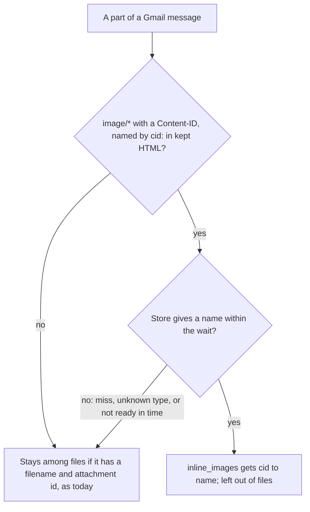

# Pictures pasted into a mail show on its card - Plan

## Goal Capsule

- **Objective:** A screenshot or picture someone pasted into a Gmail mail shows on that mail's card in loki, where the sender put it, as it does in Gmail, on the Mac and on the phone.
- **Means:** while reading a thread for its card, the daemon fetches each pasted picture once into the chat-images store and names it per message, waiting a few seconds at most (KTD1, KTD2, KTD4, KTD7). The app reads those pictures and turns them into `data:` images inside the mail before drawing it (KTD3).
- **Product authority:** the owner, in a session on 2026-11-20 that started from "Why are images not loading sometimes on email", with a screenshot of a mail whose `image.png` showed as a broken icon. The Product Contract wins on behaviour; the Planning Contract's KTDs win on mechanism.
- **Stop conditions:** stop and ask if Gmail's thread read does not carry a `Content-ID` header on the pasted picture's part in the owner's mail. Also stop if keeping the daemon's token out of the mail (R6) turns out to need a change to the mail frame's policy.
- **Execution profile:** the Gmail read in the mod (`mod/account-ops/gmail.ts`, `mod/index.ts`, `mod/outside-threads.ts`), one optional frame field (`core/frame-types.ts`), one header on the picture route (`mod/chat-images.ts`), the mail frame and its three callers in the app, their tests, and docs. One branch (`fix/mail-inline-images`), one PR, carrying this plan. Commit scope `inbox`.
- **Open blockers:** none.

---

## Product Contract

### Summary

A picture pasted into a Gmail mail now shows in the mail on its card, in place, on the Mac, on the phone and on another paired Mac. loki fetches each picture from Gmail once and keeps it with your chats' pictures. A picture that shows in the mail no longer counts as one of the mail's files. A picture loki cannot show still shows as a broken icon with its name, as now, and stays among the files.

### Problem Frame

When someone pastes a screenshot into Gmail, the picture travels inside the mail as a hidden attachment. The mail's HTML points to it with `src="cid:…"`, not a web address. loki draws the HTML as Gmail sends it (`mailParts` in `mod/account-ops/gmail.ts`), and nothing turns a `cid:` link into the picture. So the frame shows the picture's name and a broken icon. Pictures a mail links on the web load, which is why it happens only sometimes. Work mail is full of pasted screenshots (bug reports, portal errors), so the card often loses the one thing the mail was sent to show. The header's "1 file" in that case is the pasted picture itself.

### Key Decisions

- **Each picture is kept on disk, like Slack and Jira previews.** (session-settled: user-approved — the owner confirmed it over sending pictures inside the mail's HTML: it keeps a card light on the phone, at the cost of a mail's first open waiting for its pictures.) Governs R7.
- **Only the formats the picture store knows show: PNG, JPEG, GIF, WebP and HEIC.** (session-settled: user-approved.) Anything else, SVG included, keeps showing its name. Governs R3.
- **A picture that shows in the mail stops counting as a file, as in Gmail.** (session-settled: user-approved.) Real attachments still count. Governs R4.

### Requirements

**What shows**

- R1. A picture whose part carries a `Content-ID` that the mail's HTML names as `cid:` in an `` shows in that image's place when the mail is drawn.
- R2. It shows wherever the mail is drawn: the card on the Mac, the phone's card, and a Mac that reaches the account through a paired Mac.
- R3. A picture of another format, one Gmail would not give or refused, or one not ready within the read's picture wait (KTD7) shows as today: the broken icon and its name.

**Files**

- R4. A picture that shows in the mail (R1) is not among the mail's file chips or in the header's file count. One that does not show (R3) stays among them.
- R5. Forwarding a mail still attaches every file it carried, pasted pictures included.

**Safety and cost**

- R6. The daemon's token never appears in the mail's drawn document, and the mail frame's policy is unchanged.
- R7. Each picture is fetched from Gmail once and kept in `~/.loki/chat-images/`. Once kept, opening the mail again, or after a restart, fetches nothing for it. A picture that missed is tried again after its 30-minute miss expires, or after a restart.
- R8. A picture failing, being slow, or being named by a malformed link never stops the mail from opening or being drawn. Handing a thread to an agent fetches no pictures.

### Acceptance Examples

- AE1. **Covers R1, R4.** Given a reply whose HTML holds `` and an `image/png` part named `image.png` with `Content-ID: <ii_abc>`, when its card opens, the picture shows in place and the header shows no file.
- AE2. **Covers R3, R4.** Given the same mail with an `image/svg+xml` part, when its card opens, the icon and `image.png` show as today, and the header still says "1 file".
- AE3. **Covers R4, R5.** Given a mail with one pasted picture and one PDF, the card shows only the PDF chip, and a forward of that mail attaches both.

### Scope Boundaries

- Gmail only: Slack and Jira mail-like views have no `cid:` links, and only Gmail mail is drawn as HTML.
- Only ``. A `cid:` in a `background` attribute or a style's `url()` is left alone; pasted pictures in Gmail, Outlook and Apple Mail use ``.
- A part named only by `Content-Location`, with no `Content-ID`, is not matched.
- Mail whose HTML is over the 512 KB limit (`MAIL_HTML_MAX`) still shows as text.
- Considered, not built: **a size limit on a pasted picture.** Gmail caps a whole mail at 25 MB, the read's picture wait (KTD7) bounds how long a big picture can hold a card, and a failed fetch is only a broken icon (R3, R8). What would change the call: pictures that routinely miss the wait on first open.
- Considered, not built: **a limit on how many pictures one open fetches at once.** A sender could paste hundreds of pictures, but the effect is a brief rate-limit refusal on that account, which ends in remembered misses (R3). What would change the call: a real mail that does this, or rate-limit refusals in `outside:preview-failed` lines that affect the inbox poll.
- Considered, not built: **holding the frame until its pictures arrive.** It draws at once and redraws once when they settle (KTD5). What would change the call: the redraw's jump being noticeable on real mail.

### Deferred to Follow-Up Work

- A reply or forward that quotes a mail's HTML (`mailBody` in `mod/mail-compose.ts`) carries its `cid:` links without the pictures, so the recipient may see broken icons. That is how loki already sends, and it is separate from reading.

### Sources / Research

- The read path: `gmailThread` is the only producer of a mail's `html` (`mod/account-ops/gmail.ts`), and `OutsideThreads.read` copies it to the `account_thread` reply for Gmail only (`mod/outside-threads.ts`, around the `account.provider === "gmail"` spreads). The HTML is never stored or pushed.
- The hand-off shares `threadText.gmail` (`mod/handoff.ts`, the `threadText[account.provider]` call), so pictures fetched there would be fetched on every hand-off.
- Jira's picture wiring to copy: `jiraCardView`'s `preview` parameter, and `previews.preview(\`jira:…\`, …)` in `mod/index.ts`. Tests: `test/outside-previews.test.ts`, `test/jira-view.test.ts` (the `withPreviews` block).
- The store and route: `OutsidePreviews` (`mod/outside-previews.ts`), named to match `IMAGE_NAME` (`daemon/chat-images.ts`), served at `/chat-images/` on loopback with `?t=<token>` and on LAN by the device cookie. A Mac without the file asks its paired Macs (`macs.chatImage` in `mod/peering.ts`).
- Part headers (`Content-ID`) are already kept per part (`parsePart` in `mod/gmail.ts`). `GmailClient.attachment` returns decoded bytes and no type.
- Forwarding reads `mailAttachments` directly (`forwarded` in `mod/outside-threads.ts`; `test/mail-reply.test.ts` expects `screen.png` forwarded).
- The frame's own comment in `mailDocument` (`app/src/desk/mail-html.tsx`) already guards the token from image hosts. It is the reason for KTD3.

---

## Planning Contract

### Key Technical Decisions

- KTD1. **Gmail gets a card view; the thread text stays as it is.** A `gmailCardView` built like `jiraCardView` reads the thread through `gmailThread` with a picture fetcher and answers `window: null`. `OutsideThreads.read` already prefers `cardView` over `threadText`. The hand-off and previews wiring keep `gmailThreadText`, which fetches no pictures. The alternative, a fetcher inside `gmailThreadText`, would fetch on every hand-off. Governs R8.
- KTD2. **The daemon names pictures; the app places them.** Each `ThreadMessage` and `OutsideMessage` gains an optional `inline_images`, which maps a `Content-ID` (angle brackets removed) to its chat-images file name. The daemon does not rewrite the HTML: it does not know each viewer's address (loopback, LAN, a paired Mac), and a rewrite would change the HTML's length checked against `MAIL_HTML_MAX`. The `account_thread` reply is not checked field by field, so an older app ignores the field. The field gets the frame types' usual doc comment ("absent … from an older loki"). Governs R1, R2.
- KTD3. **The app draws each picture as a `data:` image.** The app fetches each named picture by `chatImageUrl` from its own page, not from inside the mail, and puts it in the mail as a `data:` URL. A `chatImageUrl` written into the mail would carry `?t=<token>` on the Mac. The mail's own CSS can read an `` through attribute selectors and load a background from its own server once per guessed character, which would leak the token. `data:` is already allowed by `MAIL_POLICY`. A `blob:` URL would need the policy changed. In the Mac app the page's origin is the app's own scheme, so reading a picture's bytes from loopback is cross-origin, where an `` load was not. The loopback `/chat-images/` route therefore answers with `access-control-allow-origin: *`, as `/uploads` (`mod/uploads.ts`) and the profile picture route (`mod/server.ts`) already do. The token or device cookie still gates it. The LAN page is same-origin and needs no header. Governs R1, R6.
- KTD4. **A picture is cached by message and `Content-ID`, and fetched only when it would show.** The store key is `gmail:<account>:<message id>:<content id>`, not the attachment id, because Gmail is not known to keep an attachment id the same between reads. The daemon fetches a part only when all of these hold:
  1. its type starts with `image/`
  2. it has a `Content-ID`
  3. the message's HTML was kept (within `MAIL_HTML_MAX`)
  4. that HTML names it as `cid:` (percent-decoded, exact match). An id whose percent escapes do not decode is compared as written, with the decode guarded as `dec` in `app/src/phone/router.ts` guards it, because a sender controls the HTML and an unguarded `decodeURIComponent` throws.

  The bytes come from `attachment(messageId, attachmentId)`, or from the part's own `body.data` when Gmail sent it inline. The type comes from `part.mimeType`, which `OutsidePreviews` checks against its formats. A fetch error or a refused type is `OutsidePreviews`'s remembered miss, so the read still answers. Governs R1, R3, R7, R8.
- KTD5. **The frame draws at once and redraws once.** `MailHtml` builds the document with whatever pictures it holds. It loads the mail's pictures together, then redraws once when all have arrived or failed. The load is an effect on the outside world, so it cancels on unmount or when the mail changes. Loading is a separate function that takes the fetcher, so tests inject it. Governs R1, R3.
- KTD7. **A card read waits a few seconds for its pictures, not for the slowest one.** The read answers its mail when all pictures are named or the wait runs out, whichever comes first. The wait is about 5 seconds, well under the app's 30-second read limit. `getThread` and each `attachment` call may each take up to 20 seconds (`GOOGLE_TIMEOUT_MS`), so an unbounded wait could fail the whole card. A picture not ready in time answers as not shown for this read and stays among the files. Its `OutsidePreviews` fetch keeps running, so the next open shows it. The wait's timer is injected, so tests need no sleeps. Governs R3, R8.
- KTD6. **Files drop only what shows.** `gmailThread` leaves a part out of `files` only when its `Content-ID` resolved to a picture name (R4). `mailAttachments` stays as it is, so forwards keep every file (R5). Governs R4, R5.

### High-Level Technical Design

The read, from a card opening to the picture drawn:

```mermaid
sequenceDiagram
  participant App as App (Mac or phone)
  participant Read as OutsideThreads.read
  participant View as gmailCardView
  participant Gmail as Gmail API
  participant Store as OutsidePreviews (~/.loki/chat-images)
  App->>Read: account_thread_read
  Read->>View: cardView.gmail
  View->>Gmail: getThread (full)
  loop each image part with a Content-ID named by cid: in kept HTML, all at once, waiting at most ~5 s in all
    View->>Store: preview(gmail:account:message:cid)
    alt kept already
      Store-->>View: name
    else
      Store->>Gmail: attachments.get (or the part's own data)
      Store-->>View: name, or null on miss
    end
  end
  View-->>Read: messages with html, inline_images, files minus shown pictures
  Read-->>App: account_thread with inline_images
  App->>App: draw the mail at once
  App->>Store: GET /chat-images/name (token or device cookie; CORS allowed on loopback)
  App->>App: data: URL per cid, rewrite img src, redraw once
```

Which part goes where:



### Assumptions

- Gmail's `full` thread read keeps each part's `Content-ID` header, as `parsePart` assumes. The by-hand check on the owner's mail confirms it, or the stop condition applies.
- The chat-images route serves a name from `OutsidePreviews` on every surface: loopback, LAN, and a paired Mac (`mod/lan.ts`, `mod/peering.ts`). This is already true for Slack and Jira previews.

### Risks

- A mail with many pasted pictures makes one Gmail call each on its first open, all at once. A rate-limit refusal is a remembered miss, so that picture stays broken for 30 minutes (`MISS_MS`). The `outside:preview-failed` log line shows it.
- A mail's first open waits for its pictures, up to the wait in KTD7. A slow Gmail answer delays the card by up to that much, and the picture then shows on the next open.
- Gmail replies may carry the earlier mail's pasted pictures again as parts of each reply, named inside the folded quote. A long thread under one screenshot would then fetch one copy per reply on its first open. This is unverified: the by-hand check on a multi-reply thread shows it in the log. If it holds, it is a follow-up, not a blocker, because KTD7 bounds the wait.

---

## Implementation Units

### U1. Pasted pictures in the Gmail read

**Goal:** `gmailThread` can fetch and name each pasted picture, and leaves the ones it names out of `files`.
**Requirements:** R1, R3, R4, R5, R7, R8; KTD4, KTD6, KTD7.
**Dependencies:** none.
**Files:** `mod/account-ops/gmail.ts`, `mod/account-ops/thread.ts`, `test/account-ops.test.ts`.
**Approach:**
1. Add an optional fetcher parameter to `gmailThread`, with a default that names nothing, as `jiraCardView`'s `preview` does. The fetcher takes the account, message id and `Content-ID`, plus a way to get the bytes and type.
2. Walk each message's parts for image parts with a `Content-ID` (read from the part's own headers, angle brackets trimmed). Keep only those the kept HTML names as `cid:`.
3. Resolve them together per thread, bounded by the wait in KTD7 through an injected timer. Put the ones named in time in `ThreadMessage.inline_images` (new optional field in `thread.ts`). The `cid:` decode is guarded (KTD4).
4. Build `files` from `mailAttachments` minus the parts that resolved. Leave `mailAttachments` itself unchanged.
5. The client type widens from `getThread` to `getThread` and `attachment`. `gmailThreadText` passes no fetcher.
**Patterns to follow:** `fileOf` in `mod/jira-view.ts` (await the preview, add it to the file); the hand-built `GmailMessage` helpers at the top of `test/account-ops.test.ts`; the `multipart/mixed` payload in `test/mail-thread.test.ts`.
**Test scenarios:**
- Covers AE1. A `multipart/related` message with HTML `` and an `image/png` part `Content-ID: <ii_abc>`, `filename: image.png`, `attachmentId: a1`: the fetcher is asked once with key parts (account, message id, `ii_abc`). The message gets `inline_images: { ii_abc: <name> }` and no `files`.
- The fetcher's byte source uses `attachment(messageId, "a1")` for a part with an attachment id, and the part's `body.data` for one without.
- Covers AE2. The fetcher answers null (unknown type or miss): there is no `inline_images`, and `files` still lists `image.png`.
- A `cid:` written percent-encoded in the HTML (`cid:ii%5Fabc`) matches `Content-ID: <ii_abc>`.
- An image part with a `Content-ID` that the HTML does not name is not fetched, and stays in `files`.
- A message whose HTML is over `MAIL_HTML_MAX`: nothing is fetched, and `files` is unchanged.
- Covers AE3. A message with one pasted picture and one PDF attachment: `files` lists only the PDF. `mailAttachments` on the same message still lists both.
- The fetcher throws for one picture: the read still answers, the other picture still resolves, and the failed one stays in `files`.
- The fetcher never settles for one picture: when the injected timer fires the wait, the read answers, the other picture still resolves, and the slow one stays in `files`.
- HTML holding `` beside a valid pasted picture: the read still answers, and the valid picture still resolves.
- `gmailThreadText` on the same thread fetches nothing and keeps today's `files`.
**Verification:** `gmailThread` names pasted pictures and trims `files`, and the hand-off path is unchanged.

### U2. Gmail card view, wiring and the frame field

**Goal:** a Gmail card read fetches pictures through `OutsidePreviews`, and their names reach the app.
**Requirements:** R1, R2, R7, R8; KTD1, KTD2, KTD4.
**Dependencies:** U1.
**Files:** `mod/account-ops/gmail.ts` (or a sibling view file, at the implementer's choice), `mod/index.ts`, `mod/outside-threads.ts`, `core/frame-types.ts`, `test/outside-threads.test.ts`.
**Approach:**
1. Add `gmailCardView(client, fetcher)`, returning `gmailThread`'s messages with `window: null`.
2. In `mod/index.ts`, wire `cardView.gmail` with a fetcher that calls `previews.preview("gmail:<account>:<message>:<cid>", …)`. That reads the bytes through `gmailClient(accountId)` and returns them with the part's type. `threadText.gmail` stays `gmailThreadText(gmailClient)`.
3. In `OutsideThreads.read`, copy `inline_images` to the outgoing message for Gmail only, beside `html` and `files`.
4. Add `inline_images?: Record<string, string>` to `OutsideMessage`, with a doc comment: what it maps, that the name is served at `/chat-images/<name>`, and that it is absent for Slack and Jira, for a mail without pasted pictures, and from an older loki.
**Patterns to follow:** the `jira:` line in `mod/index.ts`'s `cardView`; how `read()` spreads Gmail-only fields; the `html` and `files` doc comments on `OutsideMessage`.
**Test scenarios:**
- A read of a Gmail thread with a `cardView.gmail` that names `ii_abc`: the `OutsideMessage` carries `inline_images: { ii_abc: <name> }` alongside `html`.
- Covers R8. A hand-off of the same thread calls `threadText.gmail`, not the card view, and no picture is fetched.
- A Slack thread's messages never carry `inline_images`.
- With a real `OutsidePreviews` on a temp folder and a counting fake Gmail client, two reads of the same thread fetch the picture once (R7).
**Verification:** a card read answers with `inline_images`, and the picture file exists under the store's folder.

### U3. The mail frame places pictures

**Goal:** the mail frame shows each named picture as a `data:` image in place of its `cid:` link, on all three surfaces that draw mail.
**Requirements:** R1, R2, R3, R6, R8; KTD3, KTD5.
**Dependencies:** U2 (the field). It can be built against the type before U2's wiring lands.
**Files:** `app/src/desk/mail-html.tsx`, `app/src/item/item-view.ts`, `app/src/item/content-parts.tsx`, `app/src/desk/mail-thread.tsx`, `app/src/desk/outside-card.tsx`, `mod/chat-images.ts`, `test/mail-html.test.ts`, `test/chat-images.test.ts`.
**Approach:**
1. `mailDocument` takes an optional map from `Content-ID` to an image URL. It rewrites `src` on `` tags whose value is `cid:` plus a known id, quoted or not, matching the `cid:` scheme in any case and percent-decoding the id with the guard in KTD4. Unknown ids are left as they are.
2. A loader function takes the `inline_images` map and an injected fetcher. It fetches each name by `chatImageUrl` and returns a map of `Content-ID` to `data:` URL, leaving out any that failed.
3. `MailHtml` takes an optional `images` prop (the `inline_images` map). It runs the loader in an effect that cancels on unmount or change, and passes the result to `mailDocument` (KTD5).
4. `ItemPart`'s `html` kind carries the message's `inline_images`, so `ItemMailThread`'s `MailHtml` gets it. `MailThread` and the phone's `MessageRow` pass `m.inline_images` too.
5. `chatImageRoute`'s successful answers on loopback carry `access-control-allow-origin: *` (KTD3), including the answer served from a paired Mac's copy.
**Patterns to follow:** the `mailDocument` tests in `test/mail-html.test.ts`; the `OutsideThread` render there (`renderToStaticMarkup`, sandbox checks); `chatImageUrl` in `app/src/desk/env.ts`.
**Test scenarios:**
- `mailDocument` with `{ ii_abc: "data:image/png;base64,AAAA" }` turns `` into that `data:` URL, and keeps `alt`.
- Single-quoted, unquoted and `CID:` upper-case forms are rewritten. A percent-encoded `cid:ii%5Fabc` matches `ii_abc`.
- A `cid:` with no entry in the map stays as it is.
- A `cid:` outside an `` (a `background` attribute, a link's `href`) stays as it is.
- Covers R6. The rewritten document holds no `chatImageUrl` address and no `?t=`, and its `Content-Security-Policy` meta still equals `MAIL_POLICY`.
- The loader with a fetcher that answers bytes for one name and fails for another returns one `data:` entry. The failed id is absent.
- `mailDocument` with a malformed `cid:%` link returns the document with that link unchanged and does not throw.
- `partsOf` for a message with `html` and `inline_images` gives an `html` part carrying the map.
- A GET of a kept picture on the loopback chat-images route answers with `access-control-allow-origin: *`. A GET without the token is still refused.
**Verification:** on a card whose message has `inline_images`, the frame's document shows `data:` images where the `cid:` links were, and nothing else in the mail changes.

### U4. Docs

**Goal:** the manual and security notes say pasted pictures now show, and how.
**Requirements:** R1–R8.
**Dependencies:** U1–U3.
**Files:** `docs/manual.md`, `docs/SECURITY.md`.
**Approach:**
1. In the manual's "Email, Slack and Jira" (the paragraph that says a mail with an HTML part is drawn as its sender designed it), add that pictures pasted into a mail show too. loki fetches each from Gmail once and keeps it with your chats' pictures. Word it like the Slack preview sentence nearby.
2. In "How an email card reads", note that a picture shown in the mail is not among its files.
3. In `docs/SECURITY.md`'s "A mail drawn on its card", add that pasted pictures are fetched once by the daemon and kept in `~/.loki/chat-images/`. Also say they are drawn from inside the app's page as `data:` images, so the daemon's token never enters the mail. Say that the loopback picture route now allows cross-origin reads, as `/uploads` does, still behind the token.
**Test expectation:** none — docs only.
**Verification:** both docs agree with the code and with each other.

---

## Verification Contract

| Gate | Command or check |
|---|---|
| Format, lint, types | `bun run format:check && bun run lint && bun run typecheck` |
| Tests | `bun run test && bun run test:node`, with CI's toolchain (newest Node 22, the bun in `packageManager`, `SHELL=/bin/bash`) |
| Builds | `bun run build:app && bun run build:mod && bun run smoke` |
| By hand, owner's Gmail | On the regular daemon, check each of these:<br>• In the Mac app (not a browser tab, since the app's cross-origin read is what is being checked), open the "Details Required for GST Developer Portal Registration" card, and see the pasted screenshot in place with no "1 file".<br>• Close and reopen it, and see no new Gmail fetch in the log.<br>• Open the same card on the phone paired to the regular daemon, or on the regular daemon's LAN page at 390x844, and see the picture. The phone preview runs on made-up accounts and cannot show this mail.<br>• Forward that mail to yourself, and see the screenshot attached.<br>• Open a thread of several replies under one screenshot, and note in the log how many pictures its first open fetched (the reply-copies risk). |

## Definition of Done

- R1–R8 hold, each with the tests named in its units passing.
- The by-hand check in the owner's Gmail is done, and the `Content-ID` assumption held.
- `docs/manual.md` and `docs/SECURITY.md` describe the new behaviour.
- No code from abandoned approaches is left in the diff.
