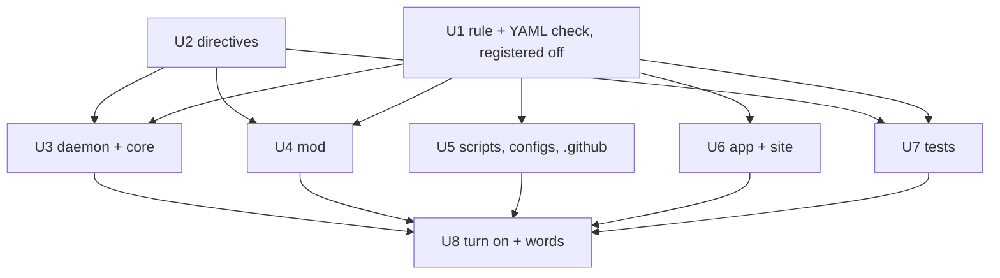

# A lint rule for comments - Plan

---

## Goal Capsule

- **Objective:** a plain comment that docs/style.md §5 does not allow cannot reach `main`. Neither can a doc comment in code that has no boundary to document, nor a comment in a CI workflow. The code stays readable without narration, and the comment purge (AlmondLabs/loki#308) does not have to be redone. Whether a doc comment in boundary code states a real contract stays a review judgment.
- **Means:**
  - An ESLint rule that accepts only the comment kinds that can be recognised mechanically (KTD1).
  - The same check for `.github` YAML (KTD6).
  - Every comment the purge kept is tagged with a marker naming what outside loki forces it, from a closed list (KTD2).
  - Every other comment is rewritten as code or deleted first, so both checks start green (KTD3).
- **Authority:**
  - The owner asked for the rule on 2026-11-22.
  - They chose to tag every kept comment and fail on any untagged one, over a check of new lines only or a ceiling on the count.
  - In review, they also chose to check doc comments outside boundary code and to add `.github` YAML.
  - AGENTS.md and docs/style.md govern style; this plan amends §5 to name the marker.
- **Stop conditions:** stop and ask if clearing a comment would change behaviour, or delete a comment that states an outside constraint the code cannot carry. A comment whose clearing needs a rename of an export another area imports is left in place and listed in the PR. It does not stop the run.
- **Execution profile:** behaviour-neutral. Existing tests pass with only these edits: comments, file-local renames, and extracted code that keeps behaviour. New tests cover only the two checks.
- **Finishes and ships:** an agent through `ce-work`, in one pull request carrying this plan, opened only when the owner asks.

---

## Product Contract

### Summary

ESLint gets a project rule, `loki/comments`, that fails on any comment outside the keep list. A small script gives `.github` workflow YAML the same check. To let both start green, every comment they cover is sorted first:

- a gotcha forced by something outside loki keeps its words behind an `Outside (<what>):` marker, where `<what>` comes from a closed list;
- one that explains loki's own code becomes a better name, an extracted function or a type, or is deleted;
- narration is deleted.

`oxlint` suppressions give a reason. `prettier-ignore`, `@vite-ignore`, `@ts-expect-error` and `react-doctor` directives are accepted as their tools write them. The shadcn components under `app/src/ui` stay untouched, as the purge left them.

### Problem Frame

The purge on 2026-11-16 left about 315 comment groups (416 lines in 175 files) that it judged were forced by something outside loki. In the days since, comments that explain loki's own code have crept back, against the rule:

- about 38 `//` lines and about 39 `/** */` comments, 13 of those in `scripts/`, which has no boundary to document;
- CI workflow comments, which went from 23 to 54 lines.

The rule lives only in AGENTS.md and docs/style.md, and a breach is caught only by a close read. Nothing tells a kept gotcha from creep, so a mechanical check needs the kept ones marked.

### Requirements

**The rule**

- R1. `bun run lint` (and so `lint:fast`, `lint:pr`, the pre-push hook and CI) fails on a comment in a TypeScript or JavaScript file that is none of these:
  - an `oxlint-disable…` directive with a `-- reason`;
  - a `react-doctor-disable…` directive;
  - a `@ts-expect-error`, whose description oxlint's `ban-ts-comment` already enforces;
  - `prettier-ignore` or `@vite-ignore`;
  - a `/** … */` doc comment in `core/**`, `daemon/**`, `mod/**` or `app/src/**`;
  - a comment carrying an `http(s)://` link;
  - a licence header: a comment group above a file's first statement that contains `License`, `Copyright` or `SPDX-License-Identifier`;
  - a comment whose first line starts with `Outside (<what>): `, where `<what>` is on the rule's list.
- R2. Adjacent `//` lines form one comment, and only its first line needs the marker.
- R3. The rule's message first says to rename, extract or type. Then it lists the accepted forms and points to docs/style.md §5. A marker with a name not on the list fails, with a message saying a new name is added to the list in review.
- R4. `app/src/ui/**`, the shadcn code, is outside the rule.
- R9. `bun run lint` also fails on a `#` comment in `.github/**/*.yml` that is none of these:
  - a `# vX.Y.Z` label after a SHA-pinned action, which the purge kept;
  - a comment carrying a link;
  - an `Outside (<what>): ` marker from the same list.

**The tree**

- R5. Every comment the purge kept as an outside-forced gotcha carries the marker. Its words are kept, or shortened where they narrate.
- R6. Every other comment the checks cover is replaced by a name, an extraction or a type, or is deleted. Behaviour does not change.
- R7. Each oxlint suppression names oxlint's rule and gives a reason. The 5 `eslint-disable-next-line @typescript-eslint/consistent-type-definitions` lines become `oxlint-disable-next-line typescript/consistent-type-definitions`, keeping their reasons. The `eslint-disable-next-line @typescript-eslint/no-empty-function` in `test/phone-session.test.ts` becomes `oxlint-disable-next-line no-empty-function` and gains a reason.

**The words**

- R8. docs/style.md §5 and AGENTS.md name the marker and its list. They say that the lint enforces the keep list, and that whether a doc comment in boundary code states a contract stays a review judgment.

### Key Decisions

- **Tag every kept comment and fail on any unmarked one** (session-settled: user-directed — chosen over checking only the lines a branch adds, or failing when the count rises: covers the whole tree for good and says which comment is wrong). Governs R1, R5, R6.
- **Check doc comments outside boundary code** (session-settled: user-approved — chosen over accepting every `/** */`: `scripts/`, tests and `site/` have no frame, `~/.loki` file, mod API, tool argument or Tauri command to document). Governs R1, R6.
- **Add `.github` YAML** (session-settled: user-approved — chosen over leaving workflows unchecked: their comments grew from 23 to 54 lines since the purge). Governs R9, R6.

### Scope Boundaries

- Rust, CSS, Swift and shell comments are outside the checks. Considered and not built: none has crept since the purge. Revisit if one does.
- Whether a `/** */` comment in `core/`, `daemon/`, `mod/` or `app/src/` really states a cross-boundary contract is not checked mechanically. It stays with `ce-code-review`'s project-standards lens.
- Moving lint to `bun lint` is tracked by the session that moved formatting to `bun fmt` (#360). The rule is written so it can be ported there.

---

## Planning Contract

### Key Technical Decisions

- KTD1. **A local ESLint rule, in an `.mjs` file beside `eslint.config.mjs`.**
  - ESLint already hosts loki's own rules that oxlint lacks (`naming-convention`, the `no-restricted-syntax` patterns), and an `.mjs` file loads without a TypeScript step.
  - The rule walks `sourceCode.getAllComments()`, joins adjacent line comments into groups, and reports a group whose first comment matches no allowed form (R1, R2).
  - U1 registers it as plugin `loki`, rule `loki/comments`, but leaves it off. Each sweep checks its own files with `node node_modules/eslint/bin/eslint.js --rule 'loki/comments: error' <files>`.
  - A sibling `eslint-comments.d.mts` types the import for the test, following `test/fixtures/fake-mcp.d.mts`.
- KTD2. **The marker is `Outside (<what>): `, and `<what>` comes from a closed list.**
  - The marker goes at the start of the comment's first line. `<what>` names the thing outside loki, such as `WebKit`, `React`, `Windows`, `pi-durable`, `Slack`, `oxlint` or `Node`.
  - The list lives in `eslint-comments.mjs`, seeded from the names U3–U7 use, and the YAML check imports it. Adding a name is a deliberate, reviewed edit, so a coding agent can't silence the rule by inventing an outside cause.
  - A comment that only needs a link may carry the link instead.
- KTD3. **The checks turn on last.** The sweeps make the tree green with both checks written but off. U8 turns them on, so every commit passes `bun run lint`.
- KTD4. **The sweep runs by area, on disjoint files.**
  - The areas are daemon and core, mod, scripts and configs with `.github`, app with `site`, and tests.
  - A sweep changes only its own files. It may rename a local or a non-exported symbol, or extract code within its file.
  - An export another area imports is left alone. If a comment can't go without such a rename, it stays and is listed in the PR (Goal Capsule stop conditions).
- KTD5. **`lint:pr` relints the whole tree when a check changes.** `eslint-comments.mjs` and the YAML check script join the `SETUP` pattern in `scripts/lint-pr.ts`, and their paths join its test. A PR that tightens a check then lints everything, not just the changed files.
- KTD6. **The YAML check is a few lines in `scripts/lint.ts`.** It reads `.github/**/*.yml`, takes each `#` comment that isn't inside a string, and applies R9. It runs in `bun run lint` beside oxlint and ESLint, and in `lint:pr` when a workflow or the check changes.

### Sequencing

U2 edits directive lines in files that U3, U4 and U7 own, so it lands first. U1 edits `eslint.config.mjs` and `scripts/lint*.ts` before U5 sweeps them. After that, U3 through U7 touch disjoint files and can run at the same time.

---

## Implementation Units

### U1. The checks

- **Goal:** R1–R4 and R9, written but off (KTD1, KTD2, KTD5, KTD6).
- **Files:**
  - `eslint-comments.mjs` (new) and `eslint-comments.d.mts` (new);
  - `eslint.config.mjs`, which registers plugin `loki` with the rule off;
  - `scripts/lint.ts`, which gets the YAML check, off;
  - `scripts/lint-pr.ts` and `test/lint-pr.test.ts`, for `SETUP`;
  - `test/comment-rule.test.ts` (new) and `test/yaml-comments.test.ts` (new).
- **Test scenarios:**
  - **These pass:**
    - `oxlint-disable-next-line x -- why`;
    - a bare `react-doctor-disable-next-line x`;
    - `@ts-expect-error` with or without text;
    - `prettier-ignore` and `/* @vite-ignore */`;
    - `/** doc */` in a file under `daemon/`;
    - `// see https://…`;
    - a comment above the first statement containing `Copyright`;
    - `// Outside (WebKit): …` with `WebKit` on the list.
  - A two-line `//` group passes when its first line has a listed marker.
  - **These fail:**
    - a plain `// note` and a plain `/* note */`;
    - `oxlint-disable-next-line x` with no reason;
    - `/** doc */` in a file under `scripts/` or `test/`;
    - a narration comment above the first statement;
    - `// Outside (Gremlins): …`, whose name is not on the list;
    - a two-line group whose marker is on the second line.
  - The failure message starts with the rename, extract or type advice.
  - **YAML:** `uses: actions/x@<sha> # v4.1.0` passes, a link passes, a listed marker passes, and a plain `# note` fails.
  - `lint:pr` reports a full lint when `eslint-comments.mjs` changes.
- **Verification:** the tests pass, and `bun run lint` stays green with both checks off.

### U2. Directives

- **Goal:** R7.
- **Files:** `core/frame-types.ts`, `daemon/approvals.ts`, `daemon/kernel/index.ts`, `test/phone-session.test.ts`.
- **Approach:** rename the 5 `consistent-type-definitions` lines to oxlint's rule, keeping their reasons. Rename the `no-empty-function` line and give it a reason.
- **Verification:** `bun run lint` reports nothing new, which shows oxlint honours the renamed directives.

### U3. Daemon and core

- **Goal:** R5, R6 for `daemon/**` and `core/**` (about 51 comments).
- **Approach:** per KTD4. Each kept gotcha gets KTD2's marker, with a listed name or a new one added to the list. Each comment about loki's own code becomes a name or a type, or goes.
- **Test expectation:** none. The edits are comments and file-local renames, and the existing tests cover behaviour.
- **Verification:** `bun run typecheck` and `bun run test` pass, and so does KTD1's command on these files.

### U4. Mod

- **Goal:** R5, R6 for `mod/**` (about 94 comments). The licence headers in `mod/slack*.ts` stay as they are.
- **Approach, test expectation and verification:** as U3.

### U5. Scripts, configs and workflows

- **Goal:** R5, R6 for `scripts/**`, the root configs (`eslint.config.mjs`, `vitest.config.ts`, `app/vite.config.ts` and the rest) and `.github/**/*.yml`. That's about 64 line comments, the doc comments in `scripts/`, and about 54 YAML comment lines. Most of the post-purge creep is here.
- **Approach, test expectation and verification:** as U3. For YAML, the check from U1 is run on the workflow files.

### U6. App and site

- **Goal:** R5, R6 for `app/src/**` except `app/src/ui/**` (about 93 comments), and for `site/src/**`, including its doc comments.
- **Approach, test expectation and verification:** as U3. The same React or browser quirk may appear in several files; give it the same `<what>` each time.

### U7. Tests

- **Goal:** R5, R6 for `test/**` and `test-node/**`: about 120 line comments plus their doc comments.
- **Approach:** as U3. A comment explaining what a test checks becomes the test's name or a named helper.
- **Verification:** `bun run test` and `bun run test:node` pass, and so does KTD1's command on these files.

### U8. Turn the checks on, and the words

- **Goal:** R1, R8, R9 (KTD3).
- **Files:** `eslint.config.mjs`, `scripts/lint.ts`, `docs/style.md`, `AGENTS.md`.
- **Approach:**
  1. Turn `loki/comments` on for every file in the existing ESLint scope, with `app/src/ui/**` excluded.
  2. Turn the YAML check on.
  3. Amend §5 and the AGENTS.md bullet: the marker and its list, the checks that enforce the keep list, and doc comments outside boundary code.
- **Verification:**
  - `bun run lint` passes on the whole tree.
  - A scratch plain comment added to a covered file makes it fail, and so does one added to a workflow.

---

## Verification Contract

| Check | When |
|---|---|
| `bun run lint:fast`, `bun run typecheck`, and KTD1's command on the area being swept | while working |
| `bun run format:check && bun run lint && bun run typecheck && bun run test && bun run test:node` | before pushing |
| `bun run build:app && bun run build:mod && bun run smoke` | before pushing |
| `bun run doctor` reports no new finding | before pushing |
| A plain comment added on purpose to a `.ts` file and to a workflow fails `bun run lint`, and removing it passes again | by hand, before pushing |
| CI on the pull request, Windows included | after pushing |

---

## Definition of Done

- Every unit's verification holds, and every check above passes.
- Outside `app/src/ui/**`, every comment left in TypeScript, JavaScript and `.github` YAML is one of the accepted forms.
- No behaviour changed. The existing tests pass with only comments, file-local renames and behaviour-keeping extractions edited.
- Any comment left because clearing it needed a shared export renamed is listed in the PR.
- The pull request carries this plan.
