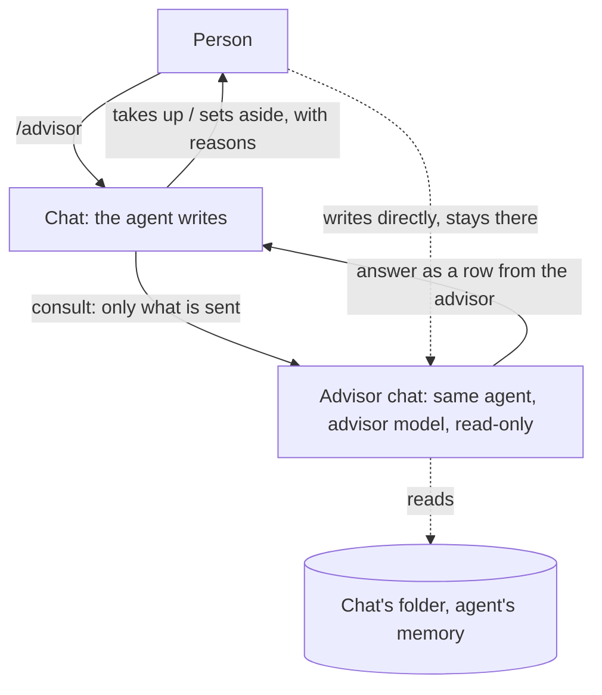
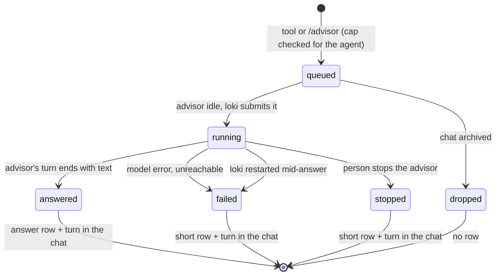
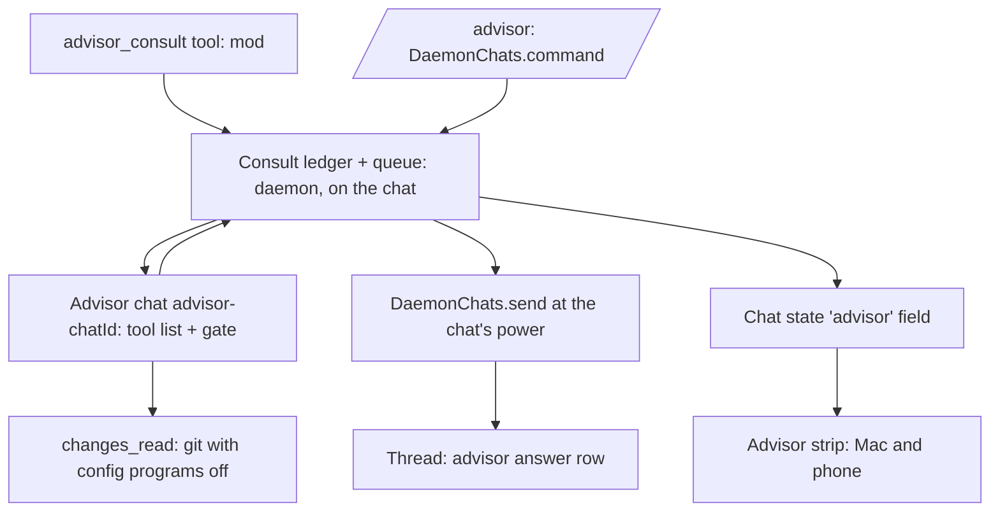

# A chat's own advisor - Plan

## Goal Capsule

- **Objective:** an agent working in a chat can get a second opinion from another model that has not inherited the chat's framing, and the person sees what the agent took from it and what it set aside.
- **Means:** each chat can have one advisor chat of its own: the chat's agent on the agent's advisor model, reading but never changing anything, knowing only what it is sent (KTD1, KTD2, KTD6).
- **Authority:** the owner, in the brainstorm and planning of 2026-11-22. AGENTS.md and `docs/style.md` govern the code; the words on screen follow Apple's Human Interface Guidelines; `docs/design.md` governs styles.
- **Stop conditions:** stop and ask if neither KTD7's preferred shape nor its fallback keeps an answer row through a Stop of the chat's turn, or if the advisor's tool gate cannot refuse a call without an approval card on loki's engine (R21). Stop if any change would let a chat other than an advisor skip a card it asks today.
- **Execution profile:** Deep, cross-cutting: daemon, mod, core, the Mac app and the phone. Proof is unit tests on injected clocks and faux providers, node tests for two Macs, and a check by hand on the regular daemon.
- **Finishes and ships:** an agent through `ce-work`; one pull request that carries this plan and the manual's part, opened when the owner asks.

---

## Product Contract

Product Contract preservation: changed R5, R7, R8, R9, R11, R19, R25, AE2, AE6 and Dependencies, and added R24–R27, after the owner chose in planning to run advisors on loki's own models first, to keep the advisor moving with its chat, to read changes through an advisor-only tool, to hold a move until the advisor has answered, and to count failed consults toward the cap. Other IDs unchanged.

### Summary

Each chat can have an advisor chat, one to one and never shared. The agent consults it when a second opinion is worth having, and the person can too with `/advisor` or by writing to it. The advisor's answer comes back into the chat as a row from the advisor, and the agent says what it takes up, what it sets aside and why. The advisor lives behind its chat, opened from a strip in the chat's header.

### Problem Frame

An agent that has worked in a chat for hours reads its own changes through the framing it built up: the person's instructions, its earlier choices, a long context. Nothing in loki gives it a second look today. `subagent` hands a task to a helper on the same model and returns the helper's answer, but the agent writes the helper's brief, so what the helper knows is up to the agent, and the person sees only a step. Chat links let two chats talk, but only along a link the person opens, and with no idea of review.

Cognition's account of what works with several agents ("Multi-Agents: What's Actually Working", 2026-04-22) found two patterns that pay off now: a reviewer that starts without the coder's context catches what the coder misses, and a second frontier model consulted as a "smart friend" helps most on the hardest cases. Both keep a single writer. Both depend on the coder sorting the second agent's advice against what the person asked, or the pair loops, drifts or overrules the person.

No specific loki incident started this; it rests on Cognition's findings and on loki already reaching several vendors' models.

---

### Actors

- A1. The person: reads the chat, may start a consult, may read and write to the advisor chat.
- A2. The agent in the chat: the single writer. Consults the advisor and decides what to do with its answers.
- A3. The advisor: the same agent on the advisor model, in the chat's advisor chat. Reads, answers, never changes anything.

---

### Key Decisions

- **One advisor chat per chat, kept for the chat's life.** It builds its own picture of one piece of work across consults, and nothing from other chats reaches it. (session-settled: user-directed — chosen over a hidden reviewer run by `/review`, a review skill and automatic review: the person proposed a dedicated advisor chat, then one per chat over a shared one.) Governs R1, R2.
- **The advisor sees only what it is sent.** Independence from the chat's framing is what makes a second opinion catch things. (session-settled: user-approved — chosen over letting it read the chat's history on request, or handing it the whole thread: both make it inherit the chat's blind spots.) Governs R4, R13, R26.
- **A per-agent advisor model.** A second vendor's strengths are part of the value. (session-settled: user-approved — chosen over the chat's own model and over picking a model at first consult.) Governs R7, R8.
- **Advisors run on loki's own models first.** loki's providers already reach a second vendor; an advisor on Claude Code or Cursor needs a third kind of ACP session and loses what it knew on a folder change. (session-settled: user-approved — chosen over every engine now: about a third more work and the riskiest part.) Governs R5, R9.
- **The agent and the person both start consults; nothing runs on its own.** (session-settled: user-approved — chosen over the person only, and over automatic review after code turns.) Governs R10, R11, R12.
- **`/advisor` is the command.** (session-settled: user-directed — chosen over `/review`: the command names the chat it opens onto, not one use of it.) Governs R11.
- **The answer is a row the agent must triage.** The agent holds the person's instructions; the advisor does not, so the agent filters, in view. (session-settled: user-approved — chosen over an answer inside the agent's turn, and over an answer that waits for the person.) Governs R16, R17, R24.
- **The advisor lives behind its chat.** Its answers already reach the person through the chat. (session-settled: user-approved — chosen over a side pane and over a row in the Chats list.) Governs R22, R23.
- **The advisor is the agent, with memory it can only read.** It knows the person's taste and the project's rules, and what it learns while advising does not steer the agent through memory. (session-settled: user-approved — chosen over a plain reviewer with no memory, and over read-write memory.) Governs R3.
- **Another look at the fixes is the agent's call.** (session-settled: user-approved — chosen over one round only, and over looping until the advisor is satisfied.) Governs R18.
- **The advisor moves with its chat.** It stays one continuous chat across Macs. (session-settled: user-approved — chosen over a fresh advisor on the new Mac: simpler, but the advisor's picture is lost on every move.) Governs R2, R25.
- **The advisor reads changes through a tool of its own.** git can run programs a folder's own config names, so git stays off the commands every chat runs without asking. (session-settled: user-approved — chosen over adding git to the read-only commands for every chat.) Governs R11, R27.
- **A move waits for the advisor's answer, then goes.** (session-settled: user-directed — chosen over refusing the move with a reason: the person should not have to come back and move it again.) Governs R25.
- **Failed consults count toward the cap.** A down provider cannot make the agent loop. (session-settled: user-approved — chosen over counting only answered consults.) Governs R19.
- **The advisor reads, never writes.** One writer per chat keeps decisions from splitting, as Cognition found for parallel writers. Governs R5.

---

### Requirements

**The advisor chat**

- R1. A chat can have one advisor chat, its own; no other chat consults it.
- R2. The advisor chat is made at the chat's first consult, on the chat's home Mac, and moves, archives, comes back and is deleted with its chat.
- R3. The advisor runs as the chat's agent: it reads the agent's memory, its skills and the folder's AGENTS.md or CLAUDE.md, and never writes memory. Reflection, Learn and the memory review leave its chat alone.
- R4. The advisor never reads the chat's thread. It knows the consults it was sent, what the person writes to it, and what it reads itself.
- R5. The advisor can read but never change anything: it reads and searches files, runs only commands that read, reads changes (R27) and searches the web. It writes no files or memory and runs no scripts, helpers, suggestions, chat messages, questions or schedules. Advisors run on loki's own engine in this version.
- R6. The advisor works in its chat's folder, and follows the chat when it changes folder.
- R26. The advisor cannot read loki's own data folder, where the chat's thread is kept.
- R27. The advisor reads a folder's changes (status, diffs, log, a commit) through a tool that never runs a program the folder's git config names.

**The advisor model**

- R7. Each agent has an advisor model, with its effort, set in Agents › Profile. Until one is set, the advisor runs on the agent's own model when that is one of loki's; otherwise a consult is refused with a note to set one.
- R8. A new advisor chat starts on the agent's advisor model; a later change in Profile applies to advisors made after it. The person can change one advisor chat's model as they change any chat's, and that change leaves the agent's usual model alone.
- R9. Only loki's own models are offered as advisor models.

**Consulting**

- R10. The agent consults its advisor with a tool, when it judges a second opinion is worth having: before a risky step, after a change, when stuck. The tool returns at once; the answer comes later (R16).
- R11. `/advisor` followed by text sends that text as a consult from the person, on the Mac and the phone. `/advisor` alone asks the advisor to review what changed: loki lists the changed files in the consult, uncommitted changes first, otherwise the branch's commits not on its upstream. With no folder, no git checkout or nothing changed, a row says so and no consult goes.
- R12. The person can open the advisor chat and write to it directly. Those exchanges stay in the advisor chat and send nothing back to the chat.
- R13. Each consult tells the advisor who sent it, the agent or the person, and carries only what the sender wrote, plus the change list for `/advisor` alone.
- R14. Chats on Claude Code, Cursor and other ACP agents consult the same way: the tool through loki's tool server, and `/advisor` on loki's side.
- R15. A consult sent while the advisor is answering another waits its turn.

**The answer**

- R16. The advisor's answer lands in the chat as a row of its own, from the advisor, naming who asked, with a link to the advisor chat; never as the person's message. It starts the agent's turn, or waits for the running one.
- R17. The agent is told the row comes from its advisor and that the person's instructions win. It answers by saying which points it takes up, which it sets aside, and why.
- R18. The agent may send its fixes back for another look when it judges it useful, and stops when the advisor raises nothing new.
- R24. A consult that ends without an answer still lands a short row saying why: the advisor failed, was stopped, could not reach its model, or loki restarted while it worked. The row starts the agent's turn as an answer does.

**Limits and cost**

- R19. The agent may start at most 6 consults an hour per chat, answered or not. Past that the tool is refused and the agent is told to wait or tell the person. Consults the person starts do not count.
- R20. The advisor's model calls show on the Usage page under an origin of their own.
- R21. The advisor never shows an approval card: what it may do only reads, and what is not on that list is refused.
- R25. Archiving a chat stops its advisor and drops the consults waiting for it; unarchiving brings both chats back but not the dropped consults. A move to another Mac asked while the advisor is answering waits, says so, and goes on its own when that answer ends, even across a restart.

**Where it shows**

- R22. The advisor chat is not in the Chats list, in Flow, or in `chat_list`.
- R23. Once a chat has an advisor, the chat's header shows an advisor strip, on the Mac and the phone. It says when the advisor is working and when it last failed, and opens the advisor chat, where the person reads and writes as in any chat and can go back to the chat.

---

### Key Flows

- F1. The agent asks for a second opinion
  - **Trigger:** the agent finishes a change it judges worth a look.
  - **Actors:** A2, A3
  - **Steps:** the agent consults with a short message ("review what I changed in the sync code"); its turn goes on or ends. The advisor reads the folder and answers. The answer lands in the chat and starts the agent's turn. The agent replies with what it takes up and sets aside, fixes what it took up, and may send the fixes back.
  - **Covered by:** R10, R13, R16, R17, R18

- F2. The person asks with `/advisor`
  - **Trigger:** the person types `/advisor` in the chat, alone or with a question.
  - **Actors:** A1, A2, A3
  - **Steps:** the advisor chat is made if there is none. The consult goes to it as from the person. The answer lands in the chat, and the agent triages it as in F1.
  - **Covered by:** R2, R11, R13, R16, R17

- F3. The person talks to the advisor
  - **Trigger:** the person opens the advisor strip.
  - **Actors:** A1, A3
  - **Steps:** the advisor chat opens with every consult and answer so far. The person writes; the advisor answers there. Nothing goes back to the chat.
  - **Covered by:** R12, R23

---

### Acceptance Examples

- AE1. **Covers R10, R16, R17.** Given a chat on loki's engine whose agent just changed a file, when the agent consults and the advisor finds a missing null check and a naming nit, then a row from the advisor lands in the chat, and the agent's next reply says it fixed the null check and left the nit because the person asked to keep the file's names.
- AE2. **Covers R11.** Given a folder with no changes, or one that is not a git checkout, when the person types `/advisor` alone, then a row in the chat says there is nothing to review and no consult goes to the advisor.
- AE3. **Covers R19.** Given an agent that has started 6 consults in the last hour, when it consults again, then the tool is refused with the reason and the agent tells the person or waits; `/advisor` from the person still goes.
- AE4. **Covers R12.** Given an open advisor chat, when the person writes to it, then the advisor answers in the advisor chat and no row appears in the chat.
- AE5. **Covers R7, R8.** Given an agent on one of loki's models with no advisor model set, when its chat first consults, then the advisor chat starts on the agent's own model.
- AE6. **Covers R7, R9.** Given an agent whose own model is on Claude Code and no advisor model set, when its chat consults, then the consult is refused with a note to set an advisor model in Agents › Profile, which lists only loki's models.
- AE7. **Covers R2, R25.** Given a chat with an advisor and a consult waiting, when the person archives the chat, then the advisor chat is archived with it and the waiting consult is dropped; both chats come back together on unarchive.
- AE8. **Covers R24.** Given a consult the advisor is answering, when loki restarts, then after the restart a row in the chat says the advisor stopped when loki restarted, and the agent's turn starts.

---

### Scope Boundaries

**Deferred for later**

- Advisors on Claude Code, Cursor and other ACP agents.
- Automatic review when a turn ends with changes in a git folder (a setting on top of R10, once triage has proven trustworthy).
- The person's MCP servers' tools for the advisor.
- An advisor that writes, or takes over a piece of the work.
- One advisor shared by several chats, or an advisor agent with a persona and memory of its own.
- An advisor that speaks without being consulted.
- A model choice on `subagent`.

**Outside this product's identity**

- Several agents writing in one chat or folder at once.

---

### Dependencies / Assumptions

- An unset advisor model falls back to the agent's own loki model (R7): the person still gets an independent context, without a second vendor.
- The person has a loki provider set up for the advisor model; an agent that runs only on Claude Code needs one before its chats can consult (AE6).

---

### Sources / Research

- Cognition, "Multi-Agents: What's Actually Working", Walden Yan, 2026-04-22: https://cognition.com/blog/multi-agents-working

---

## Planning Contract

### Key Technical Decisions

- KTD1. **The advisor chat is a hidden chat in the agent's store with the id `advisor-<chat id>` and an `advisor_for` marker naming its chat.** It is made through the store as pass chats are, never through `DaemonChats.create`, which puts the person's usual model on top. The deterministic id makes creation single-flight per chat and gives usage its marker (KTD13). Every advisor rule keys on `advisor_for`, never on the chat's mode, so a moved or reconfigured advisor cannot become a full-power chat. Governs R1, R2, R7, R22.
- KTD2. **The advisor's tools are a list by name, held by a refusal gate.** loki counts `memory_write`, `chat_message`, `suggestion_create` and `subagent` as reads, so a filter on read-only kinds would let them through. The list is `read`, `ls`, `find`, `grep`, `bash`, `web_search`, `memory_read`, `history_search`, `history_read` and `changes_read`; skills stay as a prompt section. `ls`, `find`, `grep` and the two history tools are script-only today (`callers: SCRIPTS_ONLY` in `daemon/tools.ts`, `daemon/history-tools.ts`) and the advisor runs no scripts, so the advisor gets model-callable registrations of them, and its compaction note does not say "in a script". A settings `tools` array makes mods leave the chat alone (`daemon/mods/registry.ts`). The advisor chat runs in standard mode so reads never ask. Governs R5, R21, R26.
  - An approvals `beforeTool` gate on chats with `advisor_for` refuses, with a reason and no card: any tool off the list; `bash` unless `isReadOnlyCommand` passes; and any path inside loki's data folder.
  - Paths are realpath-resolved. For `bash`, every word is treated as a path after `~` expansion. For `read`, `ls`, `find` and `grep`, the working folder counts as the path when none is given. A path that is an ancestor of the data folder is refused for recursive reads (`find`, `grep`, `rg`, `grep -r`, `ls -R`), since a chat with no folder works in the home folder.
  - Two folders inside the data folder stay readable: the agent's own memory root (R3: memory and skills) and the advisor chat's own `tool-results` folder, where long output is saved. The chat stores, where threads live, stay refused.
- KTD3. **`changes_read` is an advisor-only daemon tool that runs git itself.** It offers status, a diff (staged, unstaged or a range), a log and one commit, and switches off every way a folder's config runs a program: fsmonitor, external diff, textconv, pagers, hooks (including `post-index-change` from optional index writes), signature checks (`gpg.program`), and every filter driver the folder's config names. Its options are an allowlist per kind, never a denylist, so `--no-index`, `--git-dir` and `--work-tree` cannot reach other files. It is registered as a deferred tool that only the advisor's tool list offers, so no other chat gets git without a card. Its output is cut and saved as `bash` output is. The same runner builds the change list for `/advisor` alone. (session-settled: user-approved — chosen over adding git to the read-only commands for every chat: a hostile folder's git config could run a program without a card.) Governs R11, R27.
- KTD4. **`advisor_consult` is a mod tool**, beside `chat_message` in `mod/tools.ts`, so ACP chats reach it through loki's tool server. Its one argument, `text`, is optional; left out it means `/advisor` alone. It never asks, is refused in advisor and pass chats, and its result names the advisor's model, the consults ahead and the consults left this hour, in `chat_message`'s style. Governs R10, R14, R19.
- KTD5. **`/advisor` is a loki-run command beside `/reflect` and `/doctor`.** The daemon handles it in `DaemonChats.command` for both engines; the command tables learn it (`core/attention/commands.ts`, the advertised list in `core/attention/chat-client.ts`, the ACP filter), and the phone's composer routes a leading `/advisor` to `chat_command`. Governs R11, R14.
- KTD6. **loki owns the consult queue and keeps a ledger on the chat.** The chat's info holds its consults (id, sender, first line, state, time); states run queued → running → answered, failed, stopped or dropped. loki submits a consult only when the advisor is idle. The person's own messages to the advisor go into the same queue: a send to a chat with `advisor_for` never steers a running turn (the client treats it as `queue`, and the daemon ignores `steer` for it), so a direct message never shares a run with a consult. An answer is the advisor's last assistant text after the consult's input and before the next input. pi-durable resumes interrupted runs when a store reopens, so on daemon start loki re-attaches to a running consult whose run is live and settles it when the run ends; only a consult whose run is gone with no answer, or parked by the restart limit, ends as "loki restarted" (R24). Governs R15, R24, R25.
- KTD7. **The answer reaches the chat at the chat's own power, and survives a Stop.** It goes through a `DaemonChats` entry point that does what `send` does (clears an idle chat's `turn_cap`, then `engine.send` with context and `send_id` set to the consult id) but leaves the chat's saved draft alone, since `send` clears it as if the person had sent. It never goes through the chat-link path, which would hold the agent's triage turn to the read-only advisor's power. The answer travels in a `<loki-advisor-answer>` block that the thread shows as a row, with a system reminder carrying the triage rules (R17). Stopping the chat's turn must not lose the row: the preferred shape records the row apart from the input that starts the turn; the fallback is the ledger re-delivering a withdrawn answer as a row that does not start a turn. Either way, after a Stop the agent reads the row with the person's next message. Governs R16, R17, R24.
- KTD8. **The cap counts the agent's consults in the ledger over the last hour, whatever their end, on an injected clock.** It follows `sentInHour` in `core/chat-links.ts`; the number lives on R19. Governs R19.
- KTD9. **Two prompt changes.** The advisor's chat gets its own sections: a read-only memory wording, no replies, canvas, suggestion or script lines, and an advisor section (it never sees the chat; it reads, never changes; it says what it could not check; findings by severity with file and line; "Not asked, but noticed"; "Could not check"; a closing `Nothing new.` line when it raises nothing). Every other chat gets a mod prompt section on consulting (when, what to send, that the answer comes later, the cap, `Nothing new.` ends a loop), skipped in advisor and pass chats. Governs R3, R5, R17, R18.
- KTD10. **The strip reads a whole-value `advisor` field on the chat's state**, pushed as one event kind as chat links' `links` are. It carries whether an advisor exists, its model, idle, working with how many are waiting, or the last failure. The daemon forwards the advisor chat's busy state to its chat's field. Governs R23.
- KTD11. **The advisor chat opens by its runtime id, not by desk scope**, which hidden chats never get. On the Mac it replaces the chat's pane with a back control; on the phone it pushes a conversation page. Peering counts an advisor chat as held when the chat its `advisor_for` names is held on this Mac, so another Mac and a phone on another Mac reach it, and the hidden copy a move leaves behind does not answer. Governs R12, R22, R23.
- KTD12. **A move carries the advisor inside the chat's moved record**, with its marker, model, history and ledger. A move asked while a consult is running is held on the chat (its target Mac saved in the chat's info) and starts when that consult ends; on daemon start a held move with no consult running starts at once. Queued consults travel in the ledger and run on the new Mac. Automatic hand-over skips a chat with a consult running. Import re-applies the advisor's configuration (KTD2's tool list, the advisor sections, standard mode), which the moved record does not carry, and keeps the moved model. Governs R2, R25.
- KTD13. **Usage marks advisor calls by the `advisor-` chat id and an `advisor:` request id**, adding an `advisor` origin. The ledger caches a conversation's origin at first sight, so only an id prefix works. Governs R20.
- KTD14. **The agent record gains `advisor_model` and `advisor_reasoning_effort`**, synced to other Macs and edited through `chat_agent_update`. Profile's field lists loki's models only. A model picked inside an advisor chat does not record the agent's usual model. Governs R7, R8, R9.
- KTD15. **The advisor follows its chat's folder at the next consult**, never under a running answer. Governs R6.

### High-Level Technical Design

A consult's life, as loki holds it (KTD6, KTD7):

Who holds what (KTD1, KTD4, KTD5, KTD10):

### Assumptions

- pi-durable lets the daemon find a consult's input entry and the assistant entries after it in the advisor's conversation, as passes read their answers today.
- An answer delivered to an ACP chat queues behind its running prompt, as chat-link messages do today.

### Sequencing

U1 and U2 first, in either order; then U3, the advisor itself; then U4, the consult core. U5, U6, U7 and U9 build on U4 and can go in any order; U8 needs U7. U10 can land any time after U3. U11 last.

---

## Implementation Units

| U-ID | Title | Key files | Depends on |
|---|---|---|---|
| U1 | The agent's advisor model | `core/frame-types.ts`, `daemon/store/agent-sync.ts`, `app/src/agents/profile-page.tsx` | — |
| U2 | `changes_read` | `daemon/changes.ts`, `daemon/extensions.ts` | — |
| U3 | The advisor chat | `daemon/advisor.ts`, `daemon/approvals.ts` | U1, U2 |
| U4 | Consult ledger, queue and answer | `daemon/advisor.ts`, `daemon/chat-backend.ts`, `core/advisor.ts` | U3 |
| U5 | The consult tool and its prompt | `mod/tools.ts`, `mod/advisor.ts` | U4 |
| U6 | `/advisor` | `core/attention/commands.ts`, `daemon/chat-backend.ts`, `app/src/phone/conversation-screen.tsx` | U4 |
| U7 | The answer row | `core/harness.ts`, `core/attention/thread.ts`, `app/src/chat/transcript.tsx` | U4 |
| U8 | The advisor strip and view | `app/src/chat/advisor-header.tsx`, `mod/peering.ts` | U4, U7 |
| U9 | Archive, move, folder | `daemon/chat-backend.ts`, `daemon/chat-move.ts`, `mod/chat-moves.ts` | U4 |
| U10 | Usage origin | `core/usage.ts`, `daemon/usage.ts`, `daemon/telemetry.ts` | U3 |
| U11 | Manual, architecture, glossary | `docs/manual.md`, `docs/architecture.md`, `glossary.md` | all |

### U1. The agent's advisor model

**Goal:** an agent carries an advisor model and effort that the person sets in Agents › Profile and every paired Mac sees.

**Requirements:** R7, R8, R9; KTD14.

**Dependencies:** none.

**Files:**
- `core/frame-types.ts` (`LocalAgent` gains `advisor_model`, `advisor_reasoning_effort`)
- `core/frames.ts` (`chat_agent_update` accepts them)
- `daemon/store/agent-sync.ts` (`SYNCED_FIELDS`)
- `daemon/chat-backend.ts` (`updateAgent`)
- `app/src/agents/types.ts`, `app/src/agents/profile-page.tsx`, `app/src/agents/agents.tsx`
- `mod/frames/chat.ts` (no usual-model record for an advisor chat's pick)
- Tests: `test/agent-sync.test.ts`, `test/frames-agents.test.ts`, `test/agents.test.ts`

**Approach:**
- An **Advisor Model** field in Profile, under the agent's model, lists loki's models only, with its effort, and a footnote that it applies to new advisors.
- Leaving it empty clears it (R7's fallback applies).
- `chat_model` on a chat with `advisor_for` changes that chat only and skips the usual-model record.

**Patterns to follow:** the `model` field's path end to end; `model_settings.reasoning_effort`.

**Test scenarios:**
- Setting an advisor model on Mac A syncs it to Mac B's record.
- `chat_agent_update` with an `acp:` handle as advisor model is refused with the reason.
- Clearing the field removes both fields.
- A `chat_model` pick in an advisor chat leaves the agent's usual models unchanged; the same pick in a normal chat still records it.

**Verification:** Profile shows and saves the field; the record carries it on both Macs.

### U2. `changes_read`

**Goal:** a tool and a runner that read a folder's git changes without running anything the folder's config names.

**Requirements:** R11, R27; KTD3.

**Dependencies:** none.

**Files:**
- `daemon/changes.ts` (new: runner with an injected `execFile`, the tool, the change-list builder)
- `daemon/extensions.ts` (register the tool as deferred, offered only through the advisor's list)
- Tests: `test/changes.test.ts`, `test-node/changes.node-test.ts`

**Approach:**
1. One runner makes every git call with KTD3's switches:
   - `--no-optional-locks` and `GIT_OPTIONAL_LOCKS=0`, so `status` writes no index and fires no index hook;
   - `-c core.hooksPath=/dev/null`, empty fsmonitor, external diff, textconv and pager, `-c log.showSignature=false` and an empty `gpg.program`, with `--no-ext-diff`, `--no-textconv` and `--no-show-signature` where they apply;
   - an empty `filter.<name>.clean`, `.smudge` and `.process` for every driver that reading the folder's config (`git config --list --includes`, which runs nothing) names;
   - `GIT_CONFIG_NOSYSTEM=1`, and the person's global config kept out.
2. The tool takes a kind (`status`, `diff`, `log`, `show`) and an allowlist of options per kind (for example `--staged`, `--stat`, `--name-only`, `-U<n>` for `diff`; `-n<n>`, `--oneline`, `--stat` for `log`). Revisions and ranges may not start with `-`; paths go after `--` and pass KTD2's path gate.
3. Output past the budget is cut and saved like `bash`'s (`daemon/tool-results.ts`), in the advisor's own `tool-results` folder.
4. The change-list builder returns: no folder, not a checkout, uncommitted files with stats, else commits on the branch not on its upstream with files, else nothing changed (a branch with no upstream counts as nothing changed); at most 200 files, then "and N more".

**Execution note:** test-first on the argument checks and the override list; they are the security boundary.

**Patterns to follow:** `daemon/read-only-command.ts` for argument checks; `daemon/background.ts` for `execFile` use.

**Test scenarios:**
- Every git call the runner makes carries the switches (asserted on the injected runner's argv and env), including a blank for each filter driver the folder's config names.
- `diff --output=x`, `-c core.pager=x`, `diff --no-index /dev/null x`, `--git-dir=x`, `--work-tree=x`, `--ext-diff` and `--textconv` are each refused with a reason.
- Node test on a real temporary repo whose fsmonitor, clean filter, `post-index-change` hook and `gpg.program` (with `log.showSignature` and a signed commit) each write a marker file: after `status`, `diff`, `log` and `show`, no marker exists.
- A normal chat's resolved tools do not contain `changes_read`.
- The change list for a dirty tree lists the files with stats; for a clean tree with two unpushed commits lists those commits; for a clean, pushed tree says nothing changed.
- A folder that is not a checkout, and a chat with no folder, each return their own result.
- 250 changed files list 200 and "and 50 more".

**Verification:** the tool's output and refusals match the scenarios; nothing in the folder's config runs.

### U3. The advisor chat

**Goal:** loki can make, configure and run a chat's advisor that reads but never changes anything and never asks.

**Requirements:** R1, R3, R4, R5, R7, R9, R21, R22, R26; KTD1, KTD2, KTD9 (advisor side).

**Dependencies:** U1, U2.

**Files:**
- `daemon/advisor.ts` (new: create or get `advisor-<chat id>`, model choice, tool list, advisor sections)
- `daemon/approvals.ts` (the `beforeTool` gate for `advisor_for` chats)
- `daemon/kernel/index.ts` (`advisor_for` on the chat doc and index)
- `daemon/tools.ts`, `daemon/history-tools.ts` (model-callable registrations of `ls`, `find`, `grep`, `history_search`, `history_read` for the advisor's list; an advisor wording of the compaction note)
- `daemon/memory.ts` (a read-only memory wording)
- `daemon/passes.ts` (skip `advisor-` chats with hidden ones; check)
- Tests: `test/advisor.test.ts`, `test/approvals.test.ts`

**Approach:**
1. Get-or-create is single-flight per chat id; it reads the advisor model at that moment (R7 fallback; refusal reason when neither is a loki model reachable on this Mac).
2. The chat is hidden, in standard mode, in the chat's folder, with the tool list from KTD2 and the advisor's sections in place of replies, canvas and the writable memory wording.
3. The gate resolves the data folder through the injected file root, so tests never touch home.

**Patterns to follow:** `daemon/passes.ts` (`createChat` with `tools` and `instructions`); `daemon/approvals.ts` script refusals ("A script may not call …").

**Test scenarios:**
- Two concurrent get-or-create calls for one chat make one advisor chat.
- The advisor chat's tools contain none of `write`, `edit`, `memory_write`, `memory_edit`, `memory_delete`, `subagent`, `chat_message`, `suggestion_create`, `user_ask`, `codemode`, `schedule_create`, `background_run`; the test fails if one is added by kind.
- A scripted advisor turn calling `write` is refused with a reason and pushes no approval event.
- `bash` with `cat a.ts` runs; `bash` with `rm a.ts` or `git status` is refused.
- `read` of a chat store under the injected loki data folder is refused; `read` of a file in the chat's folder works.
- `bash cat ~/.loki/<file>`, `bash grep -r x ~`, the `grep` tool with no path in an advisor of a chat with no folder (home as working folder), `find ~`, and `read` through a symlink in the chat's folder that points into the data folder are each refused with a reason and no card.
- `read` of one of the agent's own skills' SKILL.md works; `read` of the advisor's own saved long output works; `read` of another chat's saved output is refused.
- `ls`, `find`, `grep`, `history_search` and `history_read` are callable by the advisor's model directly.
- An agent with no advisor model on a loki model gets an advisor on that model (Covers AE5); one on `acp:claude/…` gets a refusal naming Agents › Profile (Covers AE6).
- Reflection's sweep over the agent's chats skips the advisor chat.
- The advisor's prompt contains the advisor section and the read-only memory wording, and no replies or suggestion lines.

**Verification:** an advisor chat exists with the right tools, model and sections, and every off-list call is refused without a card.

### U4. Consult ledger, queue and answer

**Goal:** a consult goes into the ledger, runs when the advisor is free, and always comes back to the chat as an answer or a short row.

**Requirements:** R10, R13, R15, R16, R17, R19, R24; KTD6, KTD7, KTD8.

**Dependencies:** U3.

**Files:**
- `core/advisor.ts` (new: ledger types, states, the cap constant, consult and answer block helpers, the strip state type)
- `daemon/advisor.ts` (consult, queue pump, answer attribution, delivery, start-up settling)
- `daemon/chat-backend.ts` (a `consult` entry point; delivery through `send` with `send_id`)
- `daemon/main.ts` (wire the advisor service; settle on start)
- Tests: `test/advisor-consult.test.ts`, `test/chat-backend.test.ts`

**Approach:**
1. `consult(chat, from, text)`: refuses in advisor and pass chats; counts the cap for `from: "agent"`; records `queued`; pumps.
2. The pump submits the oldest queued consult, wrapped in `<loki-advisor-consult from=…>` with an `advisor:` request id, only when the advisor chat is idle and has no other queued input.
3. When the advisor's turn settles, attribution picks the last assistant text between the consult's input and the next input; a run error or abort maps to `failed` or `stopped`.
4. Delivery sends the answer or the short reason (R24) into the chat at its own power with `send_id = consult id`, plus the triage reminder as context, through the draft-keeping entry point (KTD7); the ledger moves to its end state only after the send is accepted.
5. On start, a `running` consult whose advisor run is live after `resume()` stays `running` and settles when that run ends; one whose run is gone is settled (answer found, or "loki restarted"). Queued ones are pumped again.
6. A person's send to the advisor chat joins the queue instead of steering (KTD6), on the daemon and in the client's send mode.
7. Turn-starting with a Stop: implement KTD7's preferred shape if pi-durable allows a row recorded apart from its input; otherwise the fallback.

**Execution note:** start with a failing test for attribution when the person writes to the advisor during a consult; it decides the queue design.

**Patterns to follow:** `mod/chat-links.ts` `receive` (reminder context, the hourly count); `daemon/passes.ts` reading a run's answer.

**Test scenarios:**
- Happy path: an agent consult is answered and the chat receives one input carrying the answer block and the reminder, at the chat's own mode (an `acceptEdits` chat stays `acceptEdits`).
- Two consults in a row are answered in order; the second's tool result said one was ahead.
- The person's direct message to the advisor during a consult, sent with the client's steer flag, runs after the consult, is never attributed to it, and its answer never reaches the chat (Covers AE4).
- A chat with a saved draft keeps it after an answer row lands.
- The 7th agent consult in an hour is refused; a `/advisor` consult at that point still goes; an hour later on the injected clock the agent may consult again (Covers AE3).
- A consult whose advisor run errors delivers "the advisor couldn't answer: <reason>" and counts toward the cap.
- A consult whose advisor run does not resume after a restart on the same store is delivered as "loki restarted" (Covers AE8); one whose run resumes delivers its answer once when the run ends; one whose run had finished before the restart delivers its answer once.
- Settling twice delivers once (`send_id`).
- Stopping the chat's turn while an answer waits keeps the answer row in the thread.
- A consult into an ACP chat is delivered through the ACP engine's send.

**Verification:** every consult in the ledger ends in an end state with exactly one row in the chat, except dropped ones.

### U5. The consult tool and its prompt

**Goal:** agents on both engines consult with `advisor_consult` and know how and when to.

**Requirements:** R10, R13, R14, R17, R18, R19; KTD4, KTD9 (consulting side).

**Dependencies:** U4.

**Files:**
- `mod/tools.ts` (the tool beside `chat_message`)
- `mod/advisor.ts` (new: the consulting prompt section, the frame plumbing to the daemon's `consult`)
- `daemon/approvals.ts` (`NEVER_ASK`)
- `daemon/acp/loki-tools.ts` (check the tool reaches ACP chats with the mod tools)
- Tests: `test/mod-tools.test.ts`, `test/acp-loki-tools.test.ts`

**Approach:** the tool forwards to the chat's home Mac like `chat_message`; its description and results follow agent-native wording (when to consult, send what to look at and the person's constraints but not your reasoning, the answer comes later, do not poll). The prompt section is skipped for chats with `advisor_for` and pass chats.

**Patterns to follow:** `chat_message` in `mod/tools.ts`; mod prompt sections through `api.prompt.section`.

**Test scenarios:**
- A loki-engine chat calling `advisor_consult` with text queues a consult and gets the house-style result.
- With no `text`, the consult carries the change list (U2).
- Called from an advisor chat or a pass chat, it is refused with the reason.
- An ACP chat's tool server lists `advisor_consult`, and a call through it queues a consult (Covers R14).
- The consulting section appears in a normal chat's prompt and not in the advisor's.

**Verification:** both engines can consult; no approval card ever shows for the tool.

### U6. `/advisor`

**Goal:** the person consults with `/advisor` on the Mac and the phone, in any chat.

**Requirements:** R11, R13, R14; KTD5.

**Dependencies:** U4.

**Files:**
- `core/attention/commands.ts` (the command, in the ACP filter too)
- `core/attention/chat-client.ts` (the advertised list)
- `daemon/chat-backend.ts` (`command` handles `advisor` before the engine)
- `app/src/phone/conversation-screen.tsx` (route a leading `/advisor`)
- Tests: `test/commands.test.ts`, `test/chat-backend.test.ts`

**Approach:** text after `/advisor` is the consult; alone, the daemon builds the change list (U2) and, for no folder, no checkout or nothing changed, adds an event row saying so and sends nothing (AE2). A `/advisor` refused for want of a model the advisor can run on (R7) adds an event row of the same kind naming Agents › Profile, and queues nothing. The slash palette's description reads "Ask this chat's advisor".

**Patterns to follow:** `/reflect` and `/doctor` handling in `DaemonChats.command`.

**Test scenarios:**
- `/advisor is this migration safe?` queues a person consult with that text.
- `/advisor` alone in a dirty checkout queues a consult listing the changed files.
- `/advisor` alone in a clean, pushed checkout adds a "nothing to review" row and queues nothing (Covers AE2); the same for a non-git folder.
- `/advisor` in a chat whose agent runs only on Claude Code and has no advisor model adds a row naming Agents › Profile and queues nothing (Covers AE6).
- The palette for an ACP chat lists `/advisor`.
- On the phone, sending `/advisor` goes as `chat_command`, not as a message.

**Verification:** `/advisor` behaves the same on the Mac, the phone and an ACP chat.

### U7. The answer row

**Goal:** the thread shows an advisor answer, or a short failure, as its own row from the advisor, with who asked and a link to the advisor chat.

**Requirements:** R16, R24; KTD7.

**Dependencies:** U4.

**Files:**
- `core/harness.ts` (parse and strip `<loki-advisor-answer>`)
- `core/attention/thread.ts` (the event row)
- `app/src/chat/transcript.tsx`, `app/src/phone/thread-parts.tsx` (a clickable row that opens the advisor chat)
- Tests: `test/harness.test.ts`

**Approach:** the row reads "from the advisor · you asked" or "· the agent asked", collapsed to its first lines, expanding to the full answer; a failure row shows the reason. Clicking opens the advisor chat (U8).

**Patterns to follow:** the `<loki-chat-message>` row and the clickable `SUGGESTED` row.

**Test scenarios:**
- An input carrying an answer block yields one event row with sender, body and link, and the user bubble shows no markup.
- A failure block yields a row with the reason.
- An input with both the person's text and an answer block shows each in its place.

**Verification:** the row renders the same on the Mac and the phone and opens the advisor chat.

### U8. The advisor strip and view

**Goal:** the chat's header shows the advisor's state, and the person can open, read and write to the advisor chat from any Mac or phone.

**Requirements:** R12, R22, R23; KTD10, KTD11.

**Dependencies:** U4, U7.

**Files:**
- `core/frames.ts` (`ChatState.advisor`, its event kind)
- `core/attention/model.ts`, `core/attention/chat-client.ts` (apply the event)
- `daemon/advisor.ts` (push the state on ledger and busy changes)
- `app/src/chat/advisor-header.tsx` (new), `app/src/chat/chat-window.tsx`, `app/src/desk/desk-pane.tsx`, `app/src/phone/conversation-screen.tsx`
- `app/src/shell/shell.tsx`, `app/src/phone/router.ts` (open by runtime, with back)
- `mod/peering.ts`, `mod/chat-router.ts` (advisor chats count as held)
- Tests: `test/advisor-header.test.ts`, `test-node/remote-chat.node-test.ts`

**Approach:** the strip sits with the link strip: "Advisor · <model>", "Advisor is answering · 2 waiting", or "Advisor couldn't answer". It opens the advisor chat in place with a back control titled with the chat's name. Inside the advisor chat, a message the person sends while a consult runs shows as waiting until the advisor gets to it (KTD6). Words follow the HIG; styles stay on `docs/design.md` scales.

**Patterns to follow:** `app/src/chat/link-header.tsx` and its `links` state path.

**Test scenarios:**
- A chat with no advisor renders no strip; with one, the idle strip with the model.
- Working with two queued shows "2 waiting"; a failure shows the failure until the next answer.
- From a second Mac, opening the advisor chat of a chat homed on the first Mac reads its thread and can send (node test).
- The advisor chat stays out of the Chats list, Flow and `chat_list` (Covers R22).
- A person's message in the advisor chat during a consult shows as waiting, then as sent when the advisor takes it.

**Verification:** by hand on both Macs and the phone: the strip, opening, writing and going back.

### U9. Archive, move, folder

**Goal:** the advisor follows its chat through archive, unarchive, a move to another Mac and a folder change.

**Requirements:** R2, R6, R25; KTD12, KTD15.

**Dependencies:** U4.

**Files:**
- `daemon/chat-backend.ts` (`update` cascades archive; `exportChat`, `importChat`, `finishMove` carry the advisor; busy includes consults out)
- `daemon/chat-move.ts` (the moved record carries the advisor)
- `mod/chat-moves.ts` (refusal wording)
- `daemon/advisor.ts` (folder at the next consult)
- Tests: `test/chat-move.test.ts`, `test/chat-moves.test.ts`, `test/advisor.test.ts`, `test-node/remote-chat.node-test.ts`

**Approach:** archive stops the advisor, marks queued consults dropped (no row) and archives the advisor chat; unarchive restores it. A move asked while a consult runs is held (KTD12) and the person is told "The chat moves to <Mac> when the advisor has answered." Import re-applies the advisor's configuration (KTD12). loki has no per-chat delete: chats go only with their agent's whole store, so the advisor goes with them and needs no code.

**Test scenarios:**
- Archiving with one consult waiting archives both chats and drops the consult without a row; unarchive brings both back (Covers AE7).
- Moving a chat with an advisor lands both on the new Mac, the advisor hidden, marked and on its model, with its history; the old Mac hides both.
- A moved advisor's resolved tools equal KTD2's list and its prompt has the advisor section.
- After a move, only the new Mac answers held for `advisor-<chat id>` (node test).
- A move asked with a consult running is held with the waiting notice, and goes when the answer lands; a held move whose consult ended while loki was closed goes at the next start; queued consults arrive with the chat and run on the new Mac.
- A folder change while a consult runs leaves that run alone; the next consult runs in the new folder.

**Verification:** after each lifecycle step the advisor is where its chat is, with its marker and limits.

### U10. Usage origin

**Goal:** advisor calls show under their own origin on the Usage page.

**Requirements:** R20; KTD13.

**Dependencies:** U3.

**Files:**
- `core/usage.ts`, `daemon/usage.ts`, `daemon/telemetry.ts`, `core/analytics.ts`, `app/src/shared/usage-words.ts`
- Tests: `test/usage-ledger.test.ts`, `test/telemetry.test.ts`

**Test scenarios:**
- A model call in `advisor-<id>` is ledgered as `advisor`, including its compaction.
- A turn with an `advisor:` request id has the `advisor` turn origin, and counts as unattended.
- The Usage page lists "Advisor" by origin.

**Verification:** a consult's cost shows under Advisor on the Mac and the phone.

### U11. Manual, architecture, glossary

**Goal:** the docs say what the advisor is and how it works.

**Requirements:** all.

**Dependencies:** U1–U10.

**Files:** `docs/manual.md` (a new "Advisor" section near Chat links; the slash list; Agents › Profile; Usage), `docs/architecture.md` (items for subagents, passes, the usage ledger and mod chat links), `glossary.md` (Advisor, Consult).

**Test expectation:** none -- documentation.

**Verification:** the manual covers each requirement a person sees, in the manual's voice.

---

## Verification Contract

| Gate | Command | Proves |
|---|---|---|
| Format | `bun run format:check` | layout |
| Lint | `bun run lint` (uncached, before push) | rules, doc comments, no `any` |
| Types | `bun run typecheck` | the whole project |
| Unit | `bun run test` | U1–U10 scenarios |
| Node | `bun run test:node` | two-Mac reach and move, the hostile git repo |
| Builds | `bun run build:app && bun run build:mod && bun run smoke` | the app, the mod, the daemon starts |
| By hand | the regular daemon on `~/.loki` with a test agent | AE1 behaviour: the agent's reply names what it took up and set aside; the strip, view and phone path |

Run with CI's toolchain (newest Node 22, the bun in `packageManager`, `SHELL=/bin/bash`).

---

## Definition of Done

- Every unit's test scenarios pass, and every gate above passes.
- AE1–AE8 each have a passing test or, for AE1's judgement, a by-hand check recorded in the PR.
- No chat other than an advisor runs a command or tool without a card that it asks for today.
- The manual has its part; the PR has screenshots of the strip and the view on the Mac and the phone.
- No dead-end or experimental code from abandoned attempts is left in the diff.

---

## Risks

| Risk | Mitigation |
|---|---|
| An answer starts a full-power turn after the advisor read web pages | The triage reminder frames it as a reviewer's comments, not instructions (KTD7); the same exposure as a `subagent` result today |
| A tool added later counts as a read and reaches the advisor | The list is by name and the gate refuses anything off it; U3's test fails on an added tool |
| Agent and advisor loop | The cap (R19), `Nothing new.` (KTD9) and the consulting prompt |
| pi-durable cannot keep a row through a Stop | KTD7's fallback; a stop condition if neither works |
| A folder's git config runs a program through `changes_read` | KTD3's switches and option allowlist; U2's node test plants each known route and asserts none runs |
| The advisor reaches the chat's thread on disk | KTD2's realpath gate on every path, `bash` word and recursive root; U3's tests for each route |
