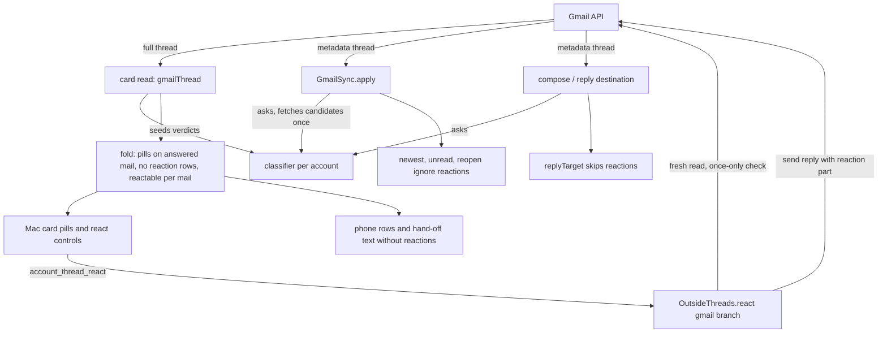

# Reactions on mail cards, like Slack's - Plan

## Goal Capsule

- **Objective:** on the Mac, a Gmail card handles reactions the way a Slack card does. You see who reacted to which mail, and you react with one press, without reaction mails cluttering the card or pulling it back into Flow.
- **Means:** recognise Gmail's reaction mails by their reaction part (KTD1, KTD2), fold them into pills in the mod, and send new ones as reaction mails through the Gmail API (KTD6).
- **Product authority:** the owner, on 2026-11-22 ("a similar reaction experience on slack, mail and jira") and 2026-11-23, narrowing this round to mail first. Jira and the phone are not active scope (see How This Work Fits Together).
- **Execution profile:** two PRs on two branches, each carrying its manual part (KTD9). The first, on `feat/reactions-mail-jira`, carries this plan and U1–U5: showing reactions. The second, stacked on it, carries U6–U7: sending.
- **Stop conditions:** before U1, read one real Gmail reaction mail `full` and record its MIME tree; stop and ask if the reaction part is missing or sits inside an attached or forwarded mail, since KTD1 rests on it. Stop the second PR, and ship showing alone, if the live check shows a reaction sent by loki as a plain mail in Gmail (R12).
- **Open blockers:** none.

---

## Product Contract

Product Contract preservation: unchanged. Its four Deferred to Planning questions are answered in KTD4, KTD5, KTD6 and KTD8 and removed from Outstanding Questions.

### Summary

Gmail reactions on a mail card show as pills under the mail they answer, the way Slack reactions do, rather than as separate mails. You react from the same hover bar, picker and ⌘⇧\ as on Slack, and loki sends a real Gmail reaction. A mail reaction can't be taken back, and a reaction never brings a card back.

### Problem Frame

Slack cards show reactions as pills and let you add or remove one (#361 made them refresh and explain refusals). Gmail has its own emoji reactions: each one is an ordinary mail in the thread with a reaction part that names the emoji and the mail it answers. loki doesn't recognise that part, so a colleague's 👍 shows on the card as a mail of its own. It can mark the card new and bring it back after you archived it. You also can't react from loki, so acknowledging a mail means writing a reply or opening Gmail. product.md asks for one interaction vocabulary across chats, inbox, settings and phone; today mail and Slack disagree.

### Key Decisions

- **Mail first; Jira and the phone come later.** (session-settled: user-directed — chosen over doing mail, Jira and the phone together: Jira has no public reactions API and needs its own product decision.)
- **Show and send.** Received reactions become pills, and you can add one as on Slack. (session-settled: user-approved — chosen over showing received reactions only: reacting is half of what Slack offers.) Governs R1, R5, R6.
- **A sent mail reaction is final.** Your pill does nothing when pressed, and its tooltip says why. (session-settled: user-approved — chosen over sending a second mail to "remove" it: Gmail has no unsend, so a removal would only add clutter.) Governs R8.
- **Their reaction is a pill, never a card event.** (session-settled: user-approved — chosen over treating a reaction like a reply: a 👍 asks nothing of you.) Governs R3.
- **Where Gmail refuses reactions, loki hides the control silently.** (session-settled: user-directed — chosen over a disabled control with an explanation.) Governs R10.
- **One vocabulary with Slack.** Mail reuses Slack's pills, hover bar, quick choices, picker and shortcut, rather than a mail-only look. Governs R1, R5, R7.

### Requirements

**Seeing reactions**

- R1. Everywhere the Mac shows Slack reactions on a card, a Gmail card shows each received Gmail reaction as a pill under the mail it answers, counted and grouped by emoji like a Slack pill.
- R2. A reaction mail, received or sent, never shows as its own message row on any screen, the phone included.
- R3. A reaction mail never counts as a card's newest mail, never marks a card new or unread, never brings back a read or archived card, and never makes a card on its own.
- R4. A pill is marked as yours when one of its reactions came from one of your Gmail addresses.

**Reacting**

- R5. You react to any mail on a Gmail card as on Slack: the hover bar with quick choices and the picker, and ⌘⇧\ on the main mail. Pressing someone else's pill adds your reaction with that emoji.
- R6. loki sends the reaction as a Gmail reaction in that thread, answering the chosen mail, so Gmail readers see it as a reaction.
- R7. The mail picker offers standard emoji only, with the same five quick choices as Slack; a Slack workspace's own emoji never appear.
- R8. Pressing your own mail pill, or choosing an emoji you already sent to that mail, does nothing; the pill's tooltip says a mail reaction can't be taken back.
- R9. Sending a reaction leaves the card where it is, as on Slack.
- R10. No react control shows on a mail Gmail won't take a reaction for: list mail, more than 20 To and Cc recipients, mail where you are only in Bcc, client-side-encrypted mail, or a mail you have already sent 20 reactions to.
- R11. If the send fails or Gmail refuses it, the pill is taken back and the card says why, as a refused Slack reaction does.

**Rollout**

- R12. Sending ships only after a reaction sent by loki shows as a reaction in Gmail on a real account. If it shows as a plain mail, sending stays off and R1–R4 ship alone.

### Acceptance Examples

- AE1. Covers R1, R2, R4.
  - **Given:** Ana's mail on a card, then Ben's 👍 reaction mail and yours answering it.
  - **Then:** Ana's mail shows one 👍 2 pill marked as yours, and the card shows no row for either reaction mail.
- AE2. Covers R3.
  - **Given:** you archived a card.
  - **When:** Ben's 👍 reaction to its last mail arrives.
  - **Then:** the card stays archived; opened later from history, the mail shows the pill. A reaction to a mail of yours with no card makes no card.
- AE3. Covers R5, R8, R9.
  - **When:** you choose 👍 from the hover bar on Ana's mail.
  - **Then:** the pill appears marked as yours and the card stays in Flow. Pressing it, or choosing 👍 again, does nothing, and its tooltip says a mail reaction can't be taken back.
- AE4. Covers R10.
  - **Given:** a mail sent to a Google Groups list, or with 25 recipients in To and Cc.
  - **Then:** its hover bar has no react control and ⌘⇧\ does nothing; received reactions on it still show (R1).
- AE5. Covers R11.
  - **When:** Gmail refuses the send.
  - **Then:** the pill disappears and the card says why.

### Dependencies / Assumptions

- Gmail's reaction format is documented (developers.google.com/workspace/gmail/reactions/format). Sending one through the Gmail API's send call is not, which R12 guards.
- A Workspace admin can turn reactions off, and loki can't tell. There, a reaction from loki reaches people as a plain mail saying you reacted. Accepted.
- loki already sends Gmail replies in a thread (`mod/gmail.ts`), so no new Google permission is expected.

### Scope Boundaries

- Not built: taking back a mail reaction (Gmail can't, R8).
- Not built: Outlook's and other clients' own reactions, which reach Gmail as plain mails and stay plain mails.
- Not built: reactions on the phone, for mail or Slack; the phone only hides reaction mails (R2).
- Not built: Jira.
- Not built: the agent's Gmail tools (`mod/google-tools/gmail.ts`) still read reaction mails as plain mails. They read Gmail directly, not a card. Evidence that would change it: an agent replying to a reaction.
- Not built: archiving in Gmail a reaction that arrives after you archived the card. loki leaves Gmail's inbox alone until you act on the card (KTD5). Evidence that would change it: the live check showing Gmail puts received reactions in the inbox unread, and that bothering the owner.
- Not built: a reaction appearing on a card while it stays open. A mail card re-reads when its newest mail changes, and a reaction doesn't change it, so the pill shows the next time the card opens. Evidence that would change it: the owner wanting Slack's one-minute refresh on mail too.
- Not built: a persisted classifier cache. After a restart loki reads again the few mails it needs (KTD3).

### Outstanding Questions

None block planning or the build. What only a real account can answer is listed in the Verification Contract's live check.

<!-- ce-section: work-relationships -->
### How This Work Fits Together

This plan covers reactions on Gmail cards on the Mac. The rest of "a similar reaction experience on Slack, mail and Jira" is the current understanding, not a committed roadmap:

- Reactions on the phone, for Slack and mail cards.
  - Shares the pills and picker this plan uses on the Mac.
  - Can proceed independently of this plan once R2 hides reaction mails there.
- Reactions on Jira cards.
  - Still to decide: Jira Cloud has comment reactions but no public API (JRACLOUD-78153), so loki can only offer a stand-in, such as a comment carrying the emoji or a mark kept in loki.

### Sources / Research

- Gmail reaction format: developers.google.com/workspace/gmail/reactions/format.
- Slack reactions today: `app/src/desk/slack-reactions.tsx`, `app/src/item/reactions.tsx`, `app/src/desk/outside-card.tsx`, `app/src/desk/slack-thread.tsx`, the `account_thread_react` and `account_emoji_search` frames in `core/frames.ts`, `mod/outside-threads.ts` (which refuses non-Slack reactions today).
- Gmail cards strip reactions in `app/src/item/item-view.ts` (`outsideMessageEntry`); `mod/account-ops/gmail.ts` reads only text parts of each mail; `mod/gmail.ts` sends replies.
- Slack reaction fixes: `docs/plans/2026-11-22-1200-fix-slack-reactions-plan.md` (#361).

---

## Planning Contract

### Key Technical Decisions

- KTD1. **A mail is a reaction when its own body carries a valid reaction part, and nothing else decides it.** The part has type `text/vnd.google.email-reaction+json`, is not an attachment, does not sit inside a `message/rfc822` part, and holds JSON with `version: 1` and an `emoji` string; Google's format page allows it at any depth of the mail's own multipart tree. Whether the answered mail is on the card never decides it, so sync and the card agree: an orphaned reaction is still a reaction (never newest, never a row), and a mail that forwards or attaches a reaction mail stays a mail. `partOf` descends into every part, forwarded mails included, so the predicate gets its own walk. Governs R2, R3.
- KTD2. **One classifier per Gmail account, shared by every reader, remembers each verdict by Gmail message id.** A message never changes, so a verdict holds for the daemon's life. A `full` read seeds it for free. A `metadata` read asks it, and it fetches the message `full` (`getMessage`) only for a candidate: a message whose headers show a top-level `multipart/alternative` with `In-Reply-To`; anything else is a mail without a fetch. On a fetch failure: 404 means the message is gone; 429, 5xx and a 403 whose reason is in sync's `RATE_LIMITS` throw, so sync keeps its cursor and retries; any other refusal counts the message as a mail for that read only (never hides mail, may wake a card once). Only a verdict from a successful read is remembered. The memory is capped (oldest verdicts dropped first). Sync, the card read, the hand-off text, compose, send and the reply destination all take it from where `mod/index.ts` builds each account's client. Governs R2, R3.
- KTD3. **Sync classifies only what it acts on.** `GmailSync.apply` walks back from the newest inbox mail to the first real one, then asks about the unread inbox mails and the preview lines it keeps; other messages are never fetched. After a restart or a rebuild this costs at most a few reads per thread. Governs R3.
- KTD4. **Reactions fold into the answered mail in the mod, before anything leaves it.** `gmailThread` maps each reaction's `In-Reply-To` to the mail with that `Message-ID` and puts `reactions` on it; a reaction whose mail isn't in the thread is dropped. A pill groups by drawn emoji and counts distinct senders, so your own reaction sent twice counts once. `mine` compares against all your addresses (account plus send-as), not only the account address. Folding in the mod covers the Mac card, the phone and hand-off text at once (R2). The name on a pill is the emoji's iamcal short name, the one Slack uses, so the frame's name check and `reactionEmoji` work unchanged; an emoji with no short name gets a reversible code-point name. Emoji are compared with U+FE0F removed, as the app's `drawn` does, so Gmail's bare ✅ and the data's ✅ with U+FE0F are one emoji for naming, grouping and KTD7's check. Governs R1, R2, R4.
- KTD5. **Every reader that picks "the newest mail" skips reaction mails; Archive and Read also clear the reaction mails present.** `replyTarget` takes the classifier's verdicts, so compose, send and the reply destination answer the newest real mail; today a reply after a reaction answers the reaction and addresses only the person who reacted. `gmailOutsideSource`'s archive and read add the thread's reaction mails to the messages they act on, so Gmail's inbox doesn't keep a thread that holds only reactions; a classifier failure skips that addition, never the archive. Undo puts them back with the rest. Sync's people list skips messages the classifier already knows are reactions, and never fetches to decide. Governs R2, R3.
- KTD6. **A reaction is sent from the account's main address to everyone on the mail, with no hold and no change to the card.** The mod builds an ordinary reply to the chosen mail (`In-Reply-To`, `References`, the thread id, reply-all recipients through `replyAllOf`) whose `multipart/alternative` is text/plain, the reaction part, then text/html, as Google's format page lays it out; `rfc2822` gains one optional field for the reaction part. The main address avoids Gmail's alias refusal, so the R10 list stays as written. It bypasses the mail outbox's 10-second hold, `markDealt` and `follow` (R9). Mail's quick choices are always 👀 ✅ 👍 🙏 🙌 (the hover bar shows the first three), since Gmail has no "most used" list; mail's emoji search returns standard emoji only (`searchEmoji(query, {})`). Governs R5, R6, R7, R9.
- KTD7. **A reaction is sent at most once.** Before sending, the mod reads the thread fresh: if it already holds a reaction of yours with that emoji to that mail, or one is being sent right now on this daemon, the call does nothing and succeeds. Every Mac sends through the account's home daemon (the frame is `BY_HOME`), so the in-flight memory covers a fast double press and the other Mac; the fresh read covers a retry after an unclear failure and a reaction made in Gmail. A sent reaction can't be taken back, so a duplicate would be permanent in everyone's inbox. Governs R8.
- KTD8. **The mod decides whether a mail takes reactions, and tells the app per mail.** `OutsideMessage` gains `reactable` (a cross-process field with a doc comment). It is false for list mail (`mailTraits`' `list`), for more than 20 people in To and Cc, for a mail from someone else that names none of your addresses in To or Cc, for an encrypted mail (top-level `multipart/encrypted` or `application/pkcs7-mime`), and for a mail you have reacted to 20 times. The mod refuses a send to such a mail too, and refuses `on: false` for mail. Governs R8, R10.
- KTD9. **Sending ships in a second PR, merged only after the live check.** The first PR (U1–U5) shows reactions and makes reaction mails harmless; it is useful alone. The second (U6–U7) opens the send path and merges only after the owner's live check passes on the regular daemon. If it fails, the second PR is closed and the first stands. Governs R12.

### Assumptions

- A `full` Gmail API read hands back the reaction part as its own MIME part. The format page says reactions are ordinary MIME mails, and Gmail's API returns ordinary parts; the live check records a real one.
- Gmail sends its own reactions to the same people as Reply All. The live check records the recipients of a reaction made in Gmail web; if they differ, U6's recipients follow what Gmail does.

### High-Level Technical Design

Directional: who reads the classifier's verdicts, and what each does with them.

### Risks

- Google may change how an API-sent reaction renders, since it is undocumented. KTD9 keeps the showing side independent of it.
- A reaction made in Gmail after loki's fresh read and before loki's send isn't seen by KTD7, so two reactions with the same emoji can go out in that window. They count once on the card (KTD4).
- The classifier's extra reads count against Gmail's quota. KTD3 keeps them to a few per changed thread; a 429 retries through sync's existing wait.

---

## Implementation Units

Units U1–U5 are the first PR; U6–U7 the second (KTD9).

### U1. Recognise a reaction mail and name its emoji (mod)

**Goal:** one predicate that says whether a `full` Gmail message is a reaction and which emoji it carries, and a name for every emoji.

**Requirements:** R1, R2, R3, R7; KTD1, KTD4.

**Dependencies:** none.

**Execution note:** start by reading one real reaction mail `full` from the owner's account (Goal Capsule stop condition) and build the test fixture from its recorded MIME tree.

**Files:** `mod/mail-reactions.ts` (new), `mod/slack-markup.ts`, `test/mail-reactions.test.ts` (new), `test/slack-markup.test.ts`.

**Approach:**
1. The predicate walks only the root and the direct children of a root `multipart/alternative` (KTD1), decodes the part with the existing base64url helper, and parses its JSON as `unknown`, narrowing to `version: 1` and a non-empty `emoji` string.
2. `mod/slack-markup.ts` gains a character-to-name lookup built from the same emojibase data as its name-to-character map, with skin tones and keyed without U+FE0F, and the code-point fallback name that `reactionEmoji` reads back (KTD4).

**Patterns to follow:** `partOf` and `decoded` in `mod/account-ops/gmail.ts`; `STANDARD` and `reactionEmoji` in `mod/slack-markup.ts`.

**Test scenarios:**
- A mail whose alternative is text/plain, a reaction part `{"emoji":"👍","version":1}`, then text/html is a reaction with 👍.
- A mail with the reaction part inside a `multipart/mixed` around the alternative is a reaction.
- A mail that attaches a reaction mail as `message/rfc822` is not a reaction.
- A reaction part with `version: 2`, invalid JSON, or an empty emoji is not a reaction.
- A plain text mail and an HTML-only mail are not reactions.
- 👍 names as `+1`; 👍🏽 names as `+1::skin-tone-4`; both read back through `reactionEmoji` to the same character.
- An emoji absent from the iamcal data gets a code-point name that reads back to the same character.
- A bare ✅ and ✅ with U+FE0F both name `white_check_mark`.

**Verification:** the predicate and the naming pass their tests and nothing else in the mod uses them yet.

### U2. A classifier per Gmail account (mod)

**Goal:** every Gmail reader can ask whether a message is a reaction, with at most one `full` fetch per message.

**Requirements:** R2, R3; KTD2, KTD3.

**Dependencies:** U1.

**Files:** `mod/mail-reactions.ts`, `mod/index.ts`, `test/mail-reactions.test.ts`.

**Approach:**
1. A per-account object holds verdicts by Gmail id, capped, takes verdicts from `full` messages it is shown, and for a `metadata` message answers from memory, from headers (not a candidate), or by one `getMessage` (KTD2's candidate rule and failure rules).
2. `mod/index.ts` builds one per account beside the account's Gmail client and passes it wherever that client goes to a Gmail reader (sync, outside source, card view, hand-off text, outside threads, reply destination). Tests inject a fake.

**Patterns to follow:** how `mod/index.ts` hands each account's client factory to `GmailSync`, `gmailOutsideSource` and `OutsideThreads`; the cache-with-cap style in `GmailClient.sendAs`.

**Test scenarios:**
- A message seen `full` is answered without a fetch.
- A metadata message without `In-Reply-To` is a mail with no fetch.
- A candidate is fetched once; a second question is answered from memory.
- A 404 answers "gone"; a 429, a 500 and a 403 `rateLimitExceeded` throw; a 403 with another reason answers "mail" and is asked again next time.
- Past the cap, the oldest verdict is dropped and asked again on demand.

**Verification:** with the fake client, the fetch count matches the scenarios.

### U3. Fold reactions into the card (mod and frame type)

**Goal:** a Gmail card's messages carry reactions and `reactable`, and reaction mails leave no row.

**Requirements:** R1, R2, R4, R10; KTD4, KTD8.

**Dependencies:** U1, U2.

**Files:** `mod/account-ops/gmail.ts`, `mod/account-ops/thread.ts`, `core/frame-types.ts`, `mod/outside-threads.ts`, `test/account-ops.test.ts`, `test/outside-threads.test.ts`.

**Approach:**
1. `gmailThread` reads each message's `Message-ID` and `In-Reply-To`, sets reaction messages aside with U1's predicate, and folds them per KTD4 before building rows; it seeds U2's classifier.
2. `gmailCardView`'s client gains `sendAs` so `mine` covers every own address (R4).
3. Each mail gets `reactable` per KTD8, using `mailTraits` and the header people helpers in `core/mail-header.ts`.
4. `OutsideMessage` gains `reactable?: boolean` with its doc comment; the `reactions` doc comment stops saying Slack only. `OutsideThreads.read` passes `reactable` for mail.

**Patterns to follow:** the Slack fold in `mod/slack-view.ts`; `mailTraits` in `core/mail-filter.ts`.

**Test scenarios:**
- Covers AE1. Ana's mail, Ben's 👍 and your 👍 answering it: one row for Ana with 👍 2 marked mine, and no row for either reaction.
- Your 👍 sent from a send-as alias is marked mine.
- Two reactions of yours with 👍 to one mail count once.
- A 👍 and a 👍🏽 to one mail are two pills.
- A reaction whose answered mail isn't in the thread leaves no row and no pill.
- A forwarded reaction mail stays a row.
- `reactable` is false for a mail with `List-Id`, for 21 people in To and Cc, for a mail from someone else naming none of your addresses, for a top-level `multipart/encrypted` mail, and for a mail you reacted to 20 times; true for your own mail and an ordinary mail to you.
- `gmailThreadText` has no line for a reaction mail.

**Verification:** a Gmail card read through `OutsideThreads.read` carries reactions and `reactable`, and the reaction mails are gone from its messages.

### U4. Reactions never move a card; replies skip them (mod)

**Goal:** a reaction mail never makes, wakes, reopens or marks a card, and every "newest mail" choice skips it.

**Requirements:** R2, R3; KTD3, KTD5.

**Dependencies:** U2.

**Files:** `mod/gmail-sync.ts`, `mod/reply-addressing.ts`, `mod/outside-threads.ts`, `mod/account-ops/gmail.ts`, `test/gmail-sync.test.ts`, `test/fixtures/gmail-mailbox.ts`, `test/outside-threads.test.ts`, `test/account-ops.test.ts`.

**Approach:**
1. `GmailSync.apply` takes reaction mails out of the inbox, incoming, unread and preview sets before choosing the newest (KTD3), and `syncThread`'s reopen check ignores them. A thread holding only reactions in the inbox falls to the existing gone-out-there path. A thread with no card whose newest inbox mail is a reaction is not observed, so a reaction never makes a card. People seen skip known reactions only (KTD5).
2. `replyTarget` takes the verdicts and skips reactions; compose, `sendMail` and `gmailReplyDestination` pass them.
3. `gmailOutsideSource`'s archive and read add the thread's reaction mails (KTD5).
4. The fake mailbox learns `format` and part trees, so sync tests can deliver a reaction mail.

**Patterns to follow:** the own-mail rule in `GmailSync.apply` ("own mail never becomes newest" in `test/gmail-sync.test.ts`); `seenOf` in `mod/gmail-sync.ts`.

**Test scenarios:**
- Covers AE2. An archived card stays archived when a reaction to its last mail arrives.
- A reaction to your own sent mail, with no card, makes no card.
- A reaction to an older inbox thread with no card (past sync's newest 20) makes no card.
- An open card's newest mail and new mark don't change when a reaction arrives.
- An unread reaction mail doesn't mark the card unread.
- After a reaction's answered mail is deleted, the thread's re-sync doesn't reopen or wake the card.
- A thread whose only inbox mail is a reaction closes as gone out there.
- A 429 from the classifier keeps sync's cursor; the next tick retries.
- Compose after your own reaction answers the newest real mail, with its recipients, and `sendMail` quotes and answers that mail.
- Archive sends the reaction mails after the newest mail to Gmail with the rest; undo puts them back.
- Archive still archives when the classifier fails, without the reaction mails.

**Verification:** sync tests with reaction mails pass beside the existing ones, unchanged.

### U5. Pills on the Mac mail card, and the manual (app, docs)

**Goal:** the Mac Gmail card draws reaction pills under each mail, folded mails included, with no way to react yet.

**Requirements:** R1, R4; AE1.

**Dependencies:** U3.

**Files:** `app/src/item/item-view.ts`, `app/src/item/outside-rows.tsx`, `app/src/item/reactions.tsx`, `docs/manual.md`, `test/item-view.test.ts`, `test/item-outside.test.ts`.

**Approach:**
1. `outsideMessageEntry` passes reactions for Gmail too.
2. `ItemMail` draws the pills as on Slack rows; a folded mail's line shows its pills, display-only.
3. With no controls the pills can't be pressed, as today for Slack without controls.
4. A mail pill's tooltip is the emoji itself, never its short name, so `+1::skin-tone-4` or a code-point name never shows.
5. The manual says a mail card shows Gmail reactions as pills, that they show when the card opens, and that a reaction never brings a card back (`docs/manual.md` near "How an email card reads." and the line saying reactions are Slack only).

**Patterns to follow:** `itemSlackRow` in `app/src/item/outside-rows.tsx`; `Reactions` in `app/src/item/reactions.tsx`.

**Test scenarios:**
- An email entry with reactions carries them (replacing the "an email never carries reactions" test).
- An unfolded mail draws its 👍 2 pill marked mine.
- A folded mail's line draws its pills and no buttons inside them respond.
- A `+1::skin-tone-4` pill and a code-point-named pill both have their emoji as tooltip.

**Verification:** the first PR's checks pass, and on the regular daemon a thread with a Gmail reaction shows a pill and no reaction row.

### U6. Send a mail reaction (mod, core)

**Goal:** `account_thread_react` on a Gmail card sends one Gmail reaction mail, or refuses with a reason.

**Requirements:** R5, R6, R7, R8, R9, R10, R11; KTD6, KTD7, KTD8.

**Dependencies:** U3, U4.

**Files:** `mod/gmail.ts`, `mod/outside-threads.ts`, `mod/preview-accounts.ts`, `core/attention/chat-store.ts`, `core/frames.ts`, `test/gmail.test.ts`, `test/outside-threads.test.ts`, `test/frames.test.ts`.

**Approach:**
1. `rfc2822` gains an optional reaction field that adds the reaction part between the plain and HTML parts (KTD6). The plain and HTML text say you reacted with the emoji, for clients without reactions.
2. `OutsideThreads.react` branches by provider: for Gmail it reads the thread `full`, finds the mail by Gmail id, refuses `on: false` and an unreactable mail (KTD8), applies KTD7, then sends with `sendReply` from the main address to reply-all recipients, and logs `outside:reacted` with provider `gmail`.
3. `searchEmoji` for Gmail returns standard emoji only (KTD6).
4. `ChatStore.reactOutside` and `searchEmoji` stop refusing Gmail; Jira still refused. The two frames' descriptions stop saying Slack only.
5. `recordOnlyMail` in `mod/preview-accounts.ts` follows any change to `SendGmail`.

**Patterns to follow:** `OutsideThreads.sendMail` for the full read, `sendAs`, `In-Reply-To` and `References`; the raw-MIME assertions in `test/gmail.test.ts`; the Slack reaction suite in `test/outside-threads.test.ts`.

**Test scenarios:**
- The raw mail has In-Reply-To and References of the chosen mail, the thread id, the main address as From, reply-all recipients, and a `multipart/alternative` of text/plain, the reaction part `{"emoji":"👍","version":1}`, then text/html.
- Reacting to an earlier mail answers that mail, not the newest.
- `on: false` for a mail is refused; nothing is sent (replaces "a mail takes no reaction").
- A list mail and a mail you reacted to 20 times are refused; nothing is sent.
- A second identical reaction, after the first is in the thread, sends nothing and succeeds.
- Two identical reactions at once send one mail.
- A send Gmail refuses throws with Gmail's reason.
- The card's record is unchanged after a reaction: not dealt, not followed, not held in the outbox.
- Mail emoji search for "thumbs" returns standard emoji and no workspace emoji; an empty query returns none.
- A Jira card still refuses a reaction.

**Verification:** a reaction mail built by the mod decodes to the layout above, and the frame works end to end against the fake Gmail.

### U7. React from the Mac mail card, and the manual (app, docs)

**Goal:** the Mac Gmail card reacts like a Slack card: hover bar, picker, ⌘⇧\ and pill press, within R8 and R10.

**Requirements:** R5, R7, R8, R9, R10, R11; AE3, AE4, AE5.

**Dependencies:** U5, U6.

**Files:** `app/src/desk/outside-card.tsx`, `app/src/item/outside-rows.tsx`, `app/src/item/reactions.tsx`, `app/src/desk/slack-reactions.tsx`, `app/src/desk/slack-thread.tsx`, `app/src/shell/keymap.ts`, `docs/manual.md`, `test/item-outside.test.ts`, `test/keymap.test.ts`.

**Approach:**
1. `useOutsideThread` gives a Gmail card its react controls even though it has no window; the quick list for mail is the fixed five (KTD6).
2. `ItemMail` gets the hover bar, the picker and the refusal line, from the pieces `slack-thread.tsx` already exports, only on a mail with `reactable` true.
3. On mail, your own pill and a pick of an emoji already yours do nothing and send no frame; that pill's tooltip says a mail reaction can't be taken back (`aria-disabled`, not `disabled`, so the tooltip shows). Pills on an unreactable mail are display-only.
4. ⌘⇧\ opens the picker on the main mail only when it is reactable.
5. The keymap entry stops saying Slack.
6. The manual mirrors the Slack reactions paragraph for mail: how to react, that it can't be taken back, and where Gmail doesn't take one.

**Patterns to follow:** `useReactControls` and its refusal line in `app/src/desk/outside-card.tsx`; `itemSlackRow`, `HoverBar`, `ReactionRefused` and `useReacting`.

**Test scenarios:**
- Covers AE3. A reactable mail's row has the hover bar with 👀 ✅ 👍 and the picker button.
- Covers AE3. Your own 👍 pill on a mail has the can't-be-taken-back tooltip, and pressing it sends no frame.
- Covers AE4. A mail with `reactable` false has no hover bar, its pills don't respond, and ⌘⇧\ opens nothing.
- Covers AE5. A refused reaction removes the optimistic pill and shows the refusal under that mail.
- Pressing Ben's 👍 pill sends `on: true` with `+1`.
- The keymap entry for ⌘⇧\ no longer names Slack.

**Verification:** the second PR's checks pass, and the live check below passes on the regular daemon.

---

## Verification Contract

| Gate | Command or check |
|---|---|
| Format, lint, types | `bun run format:check && bun run lint && bun run typecheck` |
| Tests | `bun run test && bun run test:node`, with CI's toolchain (newest Node 22, the bun in `packageManager`, `SHELL=/bin/bash`) |
| Builds | `bun run build:app && bun run build:mod && bun run smoke` |
| PR title | `node --experimental-strip-types scripts/check-pr-title.ts`, scope `inbox` |
| By hand, first PR | Before U1: the recorded `full` read of a real reaction mail (Goal Capsule). On the regular daemon: a thread where someone reacted in Gmail shows the pill on the right mail and no reaction row; archiving the card, then getting a reaction to it, leaves it archived; Reply after a reaction answers the real mail. |
| Live check, second PR (R12, owner's account) | First react 👍 in Gmail web to a mail with several people in To and Cc and record the To and Cc of the reaction mail Gmail makes; U6's recipients match them before merge. Then send 👍 from loki to a mail from a colleague and record: the colleague's Gmail, not only yours, shows it as a reaction on that mail (else close the second PR); whether a received reaction lands in Gmail's inbox and unread; that a `full` API read of it carries the reaction part; that reacting to your own mail works; that a second press sends nothing. |

## Definition of Done

- First PR: R1–R4 hold with tests for U1–U5, the manual says so, every gate passes, and the first PR's by-hand check is listed as owed in its report.
- Second PR: R5–R11 hold with tests for U6–U7, the manual says so, every gate passes, and it merges only after the live check passes (R12).
- No unused code from abandoned approaches is left in either diff.
