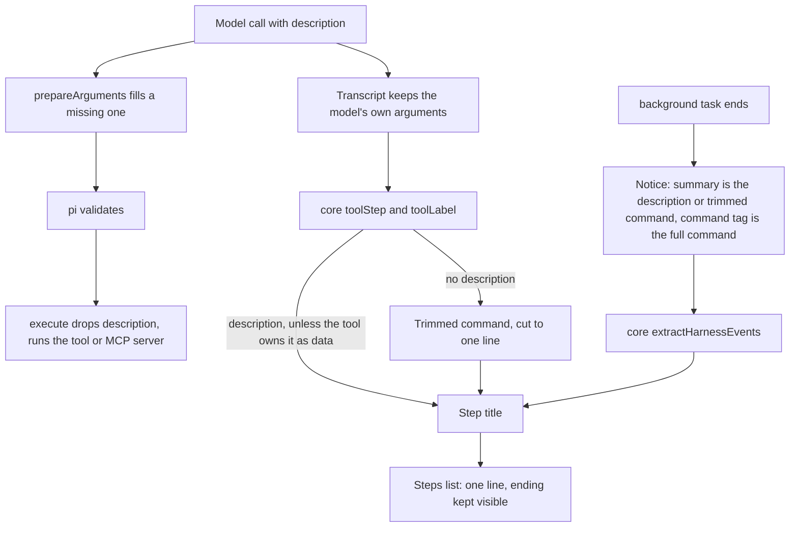

# Steps titled by what they do - Plan

## Goal Capsule

- **Objective:** the steps list under an agent's reply reads as a list of what the agent did, a few words a line, with the full command or script one click away, so a person can scan a long turn without wading through shell wrapping.
- **Means:** native-harness tools whose input doesn't read as a title ask the model for a short description, and the step shows that description (KTD1–KTD4). A step that has none gets a trimmed one-line title from its command (KTD6, KTD8).
- **Product authority:** the owner, in the session that looked at a GPT-6.1 Sol turn whose steps were 400-character commands. The owner's choices: a description only on the unclear tools; the scope confirmed as written in Key Decisions.
- **Stop conditions:** stop and ask if pi refuses a call whose description is missing even with the argument repair in place, or if a strict MCP server rejects a call after loki strips the field.
- **Execution profile:** the daemon's tool definitions (`daemon/background.ts`, `daemon/subagents.ts`, `daemon/extensions.ts`, `daemon/scripts.ts`, `daemon/mcp/index.ts`, a new shared helper), core's step naming (`core/harness.ts`, `core/attention/transcript.ts`), the steps list (`app/src/item/work.tsx`, `app/src/ui/ai-elements/task.tsx`, `app/src/shared/tool-steps.ts`, `app/src/chat/tool-steps.tsx`), tests and the manual. Branch `feat/step-descriptions`, commit scope `chat`.
- **Open blockers:** none.

---

## Product Contract

### Summary

On the native harness, `bash`, `background_run`, `background_watch`, `subagent`, scripts and loaded MCP tools ask the model for a few words saying what the call does, and the step list shows those words as the step's title. A step without them, from an older chat, an ACP agent or a model that skipped the field, shows its command with the `cd`, `env` and redirect wrapping trimmed, on one line. Opening a step shows the full command, script or prompt once.

### Problem Frame

GPT-6.1 Sol on the native harness wraps every command in its own scaffolding (`cd <worktree> && env -i HOME=… PATH=… VAR=… <the command> > /tmp/x.log 2>&1; result=$?; tail -12 /tmp/x.log; exit $result`). loki titles a step by its input, so the steps list shows that scaffolding. Native `bash` rows are cut to 80 characters, which here is mostly the `cd` path. The "background task finished" notices keep the whole command and wrap it across five lines, and opening one repeats it in a centred button. "Waited on a command" and scripts ("Used codemode") say nothing about what they did. The person reading the turn can't tell what happened without opening every step.

### Requirements

**Descriptions from the model**

- R1. `bash`, `background_run`, `background_watch`, `subagent` and every loaded MCP tool ask the model for a short description, presented to the model as required. The script tool asks for one in its text, as a comment line, since its input is raw JavaScript (KTD4).
- R2. A call without a description still runs exactly as before, and what the tool or MCP server receives is unchanged by the new field.
- R3. A tool whose own data is called `description` keeps it as data, and loki adds no field to it. `ticket_propose`'s ticket body never titles its step. An MCP tool whose schema already has `description` keeps titling its step by that text, as today (Scope Boundaries).

**The steps list**

- R4. A step that has a description is titled by it, on desktop and phone.
- R5. A step without one is titled by its command with the shell wrapping trimmed: a leading `cd …&&`, `env [-i] VAR=…` and bare `VAR=…` assignments, and a trailing `result=$?`, `tail …` and `exit …`. A trailing output redirect is trimmed only when it goes to `/dev/null` or to a file the same command reads back with `tail` or `cat`; any other redirect stays, so a step that writes a file still says so. Older chats get this on their next load.
- R6. Every step title on desktop stays on one line, and its "· failed" or "· waiting on you" ending stays visible. The collapsed "… failed" line does too, on desktop and phone.
- R7. A background task's finished notice is titled by the description it was started with, or by its trimmed command when it has none. Opened, it shows the full command once, then the output.
- R8. An opened sub-agent step shows the prompt the agent was given.
- R9. A one-step stretch's summary line reads as one phrase: the step's description, not a verb in front of it ("Run the CRM tests", not "Ran Run the CRM tests").
- R10. ACP agents' own step titles and descriptions title their steps as today.

### Key Decisions

- **A description only where the input doesn't read as a title.** `read`, `write`, `edit`, `web_search` and the memory tools keep their path or query titles, and tools only scripts can call get nothing. (session-settled: user-directed — chosen over requiring it on every tool the model calls: the path and query tools already read well, and every extra field costs output tokens on every call.) Governs R1.
- **A missing description never refuses the call.** (session-settled: user-approved — chosen over refusing calls without one: a refusal costs a model turn for a display field.) Governs R2.
- **The display fallback ships in the same change.** (session-settled: user-approved — chosen over descriptions alone: old chats and ACP agents will never send one.) Governs R5, R6.

### Scope Boundaries

- ACP agents' tools (Claude Code, Codex, any ACP agent) are not changed; loki doesn't define them. Their rows keep the descriptions they already send (R10) and get the display fallback (R5, R6) when they send none.
- Considered, not built: recognising `ticket_propose` on an ACP row named by the agent's own title, by its argument shape. Such a row may show the ticket body's first line as its title; that is display only, visible at once, and fixable later in core because rows are rebuilt on load. The name test covers native and `mcp__loki__` rows.
- The approval card keeps showing the call's whole input, description included; it is not retitled.
- Considered, not built: naming the command a `background_watch` row waited on from its `task_id` for older rows, by matching it to the `background_run` that returned that id. A required description on `background_watch` (R1) covers new rows; build the match only if old rows turn out to matter.
- Considered, not built: telling a server's own `description` apart from loki's on MCP rows. An MCP tool whose schema has its own `description` (Notion's `notion-create-database`) shows the first line of that text as its title, as it does today. Fixing it means recording, per row, which tools loki added the field to; revisit if those titles read badly in practice.

### Sources / Research

- Long titles today: `toolLabel` caps a row's label at 80 characters (`core/harness.ts`), `extractHarnessEvents` keeps a notice's `
` whole (`core/harness.ts`), and `daemon/background.ts` puts the raw command in it. `stepTarget` returns that summary (`app/src/shared/tool-steps.ts`), and `StepOpened` repeats it as the `TaskTrigger` title (`app/src/item/work.tsx`).
- pi validates arguments before `execute` and refuses a missing required one (`node_modules/@earendil-works/pi-durable/dist/harness/tool.js`). `prepareArguments` runs first and its result is what is validated (`pi-durable/dist/harness/types.d.ts`). The transcript keeps the model's own arguments.
- pi's `bash` reads only `command` and `timeout`, and its schema allows extra keys (`pi-durable/dist/tools/bash.js`). Some MCP servers set `additionalProperties: false`.
- The script grammar accepts any comment line, but `parseCodemodeSource` refuses a `// @options:` line that isn't first (`node_modules/@earendil-works/pi-codemode/dist/source.js`). loki already rewrites that first line in `withTimeLimit` (`daemon/scripts.ts`).
- An ACP row's name is the agent's title, and its description reaches the step only because `toolStep` reads `description` from every tool (`daemon/acp/chats.ts`, `core/harness.ts`). `ARG_KEYS` falls back to `description` for a row's input and label.
- Rows are rebuilt from stored arguments on every load (`core/attention/thread.ts`), so title rules in core reach old chats.

---

## Planning Contract

### Key Technical Decisions

- KTD1. **Required in the schema, filled in before validation.** One daemon helper takes a tool and returns it with a `description` string property (explained to the model), `description` in `required`, a `prepareArguments` that fills `""` when it is missing, and, for tools that don't read it (wrapped `bash`, MCP tools), an `execute` that drops it before the tool runs. loki's own tools receive it and read it themselves. pi checks `required` before `execute`, so the repair is the only way a model sees the field as required while a call without it still runs. pi validates a second time after `beforeTool` hooks without repairing, so the mods registry's `beforeTool` bridge carries the call's `description` into arguments a mod returns without one. (session-settled: user-approved — chosen over refusing calls without one: a refusal costs a model turn for a display field.) Governs R1, R2.
- KTD2. **`bash` is wrapped, not forked.** A loki extension listed after `createCodingTools` wraps `bash` by name through `wrapTool`, the pattern `daemon/scripts.ts` uses for the script tool. loki owns `background_run`, `background_watch` and `subagent`, so they take the helper directly.
- KTD3. **MCP tools get the field only when their schema lacks one.** loki's copy of each tool's schema gains `description` unless `inputSchema.properties.description` exists, or the schema has no top-level `properties` (a top-level `oneOf`, `anyOf` or `allOf` could refuse the extra key). The field is stripped before `servers.call`. The server's own schema stays as stored, for the token count and Settings. (session-settled: user-approved — chosen over leaving MCP tools without a description: loki adds the field and removes it before the call, so a strict server never sees it.) Governs R2, R3.
- KTD4. **A script's description is a comment line.** The script tool's input is raw JavaScript, so the model writes `// @description: …` on the line after any `// @options:` line, as `SCRIPT_DESCRIPTION` will say. loki's script wrapper moves a description line it finds above the options line below it, so the options line stays first. Core reads the line from the call's `code` for the tool named `codemode`. Nothing can make it required, so the tool's text asks for it. (session-settled: user-approved — chosen over a JSON field: a script's input is raw JavaScript, not JSON.) Governs R1.
- KTD5. **Core still reads `description` from any tool, except tools that own it as data.** That keeps ACP titles (R10). `ticket_propose` is recognised by name (`ticket_propose`, `mcp__loki__ticket_propose`). For it, `description` is neither the step's description nor its input or label fallback (R3). For every other tool, when `description` becomes the step's description, `toolInput` and `toolLabel` skip it in the `ARG_KEYS` fallback, and the input falls back to the JSON of the remaining arguments (`task_id` for `background_watch`, `owner` and `repo` for an MCP call). Otherwise an MCP call whose arguments have no `ARG_KEYS` key would show its description as its input and lose it as its description.
- KTD6. **The shell trim runs in core, on the whole command.** The app only sees a label already cut to 80 characters, and a worktree `cd` alone runs past that. So `toolLabel` trims before it cuts, and `extractHarnessEvents` trims an old notice's summary. One pure helper owns the trim rule of R5. When trimming would leave nothing, it keeps the original.
- KTD7. **A finished notice carries its command separately.** A background task keeps its description. The notice's `
` is that description, or the trimmed command, and a new `<command>` tag holds the full command, so the model still sees it. `extractHarnessEvents` reads the tag into a new optional `command` field on the event row, which the opened view shows. A notice without the tag is one from before this change: its summary is the raw command, so its title is trimmed and its opened view shows the summary in full (R7). Tasks end when the daemon restarts, so no task started before the change finishes after it.
- KTD8. **The one-line clamp truncates the title, not its ending.** The title truncates inside its own element and the "· failed" or "· waiting on you" ending sits outside it, so the ending stays visible. The running title (`Shimmer`, an inline block) truncates the same way, so a step doesn't change height when it finishes (R6).
- KTD9. **A described single step summarises as its description.** `workSummary` for a one-step stretch uses the description as it is, plus "· failed" when it failed, for any kind of step (R9).

### High-Level Technical Design

Where a step's title comes from, after this change:

### Sequencing

U1 and U5 first, in either order: the daemon units use U1's helper, and U3 uses U5's trim. U2 and U4 follow U1. U3 follows U1 and U5. U6 follows U3 and U5. U7 comes last.

---

## Implementation Units

### U1. A shared, forgiving description field on loki's own tools

- **Goal:** `background_run`, `background_watch` and `subagent` ask for a description the model sees as required, and still run without one.
- **Requirements:** R1, R2. KTD1.
- **Dependencies:** none.
- **Files:** a new `daemon/step-description.ts`; `daemon/background.ts`; `daemon/subagents.ts`; `test/background-schedule.test.ts`; `test/extensions.test.ts`.
- **Approach:**
  1. Build the KTD1 helper, with dropping the field before `execute` as an option for tools that don't read it. Its property text tells the model what the description is for: a few words saying what the call does, shown to the person as the step's title, with an example.
  2. Apply it to `background_run`, `background_watch` and `subagent`, replacing their own optional `description` properties. These keep the field in their arguments.
  3. `background_run` stores the description on its task, ready for U3.
- **Patterns to follow:** the plain JSON-schema tool definitions in `daemon/background.ts`; tests that call a tool's `execute` with a stub `api` in `test/background-schedule.test.ts`.
- **Test scenarios:**
  - `background_run`, `background_watch` and `subagent` schemas list `description` as a string property in `required`.
  - Preparing `{ command: "ls" }` for `background_run` gives `description: ""`, and the result passes the tool's schema.
  - Preparing `{ command: "ls", description: "List files" }` leaves it as given.
  - `background_run` started with a description keeps it on the task; one started without keeps an empty one.
  - `subagent` executed with a description passes only the prompt on to the sub-agent run.
- **Verification:** the three tools show the field as required, and a call without it runs.

### U2. `bash` asks for a description

- **Goal:** pi's `bash` gains the description field through a loki wrapper.
- **Requirements:** R1, R2. KTD1, KTD2.
- **Dependencies:** U1.
- **Files:** `daemon/extensions.ts`; `daemon/step-description.ts`; `daemon/mods/registry.ts`; `test/extensions.test.ts`; a harness-level test beside the faux-provider tests in `test/mcp.test.ts`, or a new `test/step-description.test.ts` on the same pattern.
- **Approach:**
  1. Add a `loki.descriptions` extension after `createCodingTools` in `builtinExtensions`, wrapping `bash` with the U1 helper, dropping the field before `execute`.
  2. Keep `builtinKinds` and the approvals' read-only check on `bash` working; they key by name and read `args.command`.
  3. The mods registry's `beforeTool` bridge carries the call's `description` into replacement arguments that lack one (KTD1).
- **Patterns to follow:** `wrapTool` in `daemon/scripts.ts`.
- **Test scenarios:**
  - The resolved `bash` tool (with wraps applied) lists `description` in `required`.
  - Through the harness with a faux model, a `bash` call with only `command` runs and returns the command's output.
  - A `bash` call with a description runs the same command, and `execute` never receives the description.
  - `ls` with a description is still judged read-only by the approvals.
  - A mod whose `beforeTool` returns `{ args: { command: "ls" } }` for a described `bash` call runs `ls`.
- **Verification:** a native chat's `bash` calls carry descriptions, and the approval gate behaves as before.

### U3. Background notices titled by their description

- **Goal:** a finished background task's notice is titled by its description and still carries the full command.
- **Requirements:** R7. KTD6, KTD7.
- **Dependencies:** U1, U5.
- **Files:** `daemon/background.ts`; `core/harness.ts`; `core/attention/transcript.ts`; `test/background-schedule.test.ts`; `test/harness.test.ts`.
- **Approach:**
  1. The notice's `
` becomes the task's description, or the trimmed command (U5's helper) when it has none, and a new `<command>` tag carries the full command.
  2. `extractHarnessEvents` reads `<command>` into a new optional `command` field on the event row. Without the tag, the row's summary is trimmed for display, and the raw summary stays in `command` so the opened view can still show it.
  3. The doc comment on the notice's markup states the new tag, since the notice crosses into the model's context.
- **Patterns to follow:** the existing tag parsing in `extractHarnessEvents`.
- **Test scenarios:**
  - A task started with "Run the CRM tests" ends with a notice whose summary is "Run the CRM tests" and whose command tag holds the full command.
  - A task started without a description ends with a summary of the trimmed command.
  - Parsing a new notice gives a row whose summary is the description and whose `command` is the full command.
  - Parsing an old notice (no command tag, summary `cd /x && env -i A=1 bun run build > /tmp/b.log 2>&1; exit $r`) gives the summary `bun run build` and `command` holding the original.
  - Entities in the command (`&&`, `<`, `>`) round-trip through the notice's escaping.
- **Verification:** the screenshot's two background rows read "Build the web app"-style titles on a new run, and as `bun --no-env-file run build`-style titles on the old chat.

### U4. Scripts and MCP tools ask for a description

- **Goal:** the script tool and loaded MCP tools carry a description that titles their steps.
- **Requirements:** R1, R2, R3. KTD3, KTD4.
- **Dependencies:** U1.
- **Files:** `daemon/scripts.ts`; `daemon/mcp/index.ts`; `core/harness.ts`; `test/scripts.test.ts`; `test/mcp.test.ts`; `test/tool-steps.test.ts`.
- **Approach:**
  1. `SCRIPT_DESCRIPTION` asks for a `// @description:` line after any `// @options:` line.
  2. The script wrapper moves a description line found above the options line below it, before `withTimeLimit` rewrites the options line.
  3. `toolStep` reads that line from the `code` argument of a `codemode` call and uses it as the description.
  4. `callTool` builds each MCP tool's schema with the U1 helper unless the server's schema already has `description`, and strips the field before `servers.call`.
- **Patterns to follow:** `withTimeLimit` and its unit tests; the "loki.mcp in a chat" faux-provider setup in `test/mcp.test.ts`.
- **Test scenarios:**
  - A script with `// @options: {...}` then `// @description: Count open PRs` runs with the options applied.
  - A script whose description line comes before its options line runs with the options applied, not refused.
  - A script with no description line runs as today.
  - `toolStep("codemode", { code: "// @description: Count open PRs\nreturn 1" })` has the description "Count open PRs".
  - An MCP tool without `description` in its schema shows it as required to the model, and the server receives the call without it.
  - An MCP tool on a server with `additionalProperties: false` accepts a call that carried a description.
  - An MCP tool whose schema has its own `description` gets no added field, and the server receives that `description` untouched.
  - An MCP call without a description runs.
  - An MCP tool whose schema has a top-level `oneOf` and no top-level `properties` gets no added field.
- **Verification:** a script step and an MCP step in a native chat show the model's few words as their title.

### U5. Core names steps from descriptions and trimmed commands

- **Goal:** core gives every row the right title source: a description where the tool sends one and doesn't own the field, otherwise a trimmed command.
- **Requirements:** R3, R5, R10. KTD5, KTD6.
- **Dependencies:** none (U3 and U4 use its helper and field rules).
- **Files:** `core/harness.ts`; a new pure helper beside it if `core/harness.ts` grows past reading (for example `core/shell-title.ts`); `test/tool-steps.test.ts`; `test/acp-chats.test.ts`.
- **Approach:**
  1. The trim helper owns R5's rule and keeps the original when trimming leaves nothing.
  2. `toolLabel` trims a `command` before cutting it to 80 characters.
  3. `toolStep` and the `ARG_KEYS` fallback skip `description` for `ticket_propose` rows (KTD5's name test).
  4. Where `description` becomes the step's description, the input and label skip it and use the remaining arguments (KTD5).
- **Patterns to follow:** the pure-function tests in `test/tool-steps.test.ts`; `rawInput` rows in `test/fixtures/fake-acp.mjs`.
- **Test scenarios:**
  - `cd /Users/x/worktrees/crm && env -i HOME=/h PATH=/p A=1 uv run pytest -q tests/a.py > /tmp/l 2>&1; result=$?; tail -12 /tmp/l; exit $result` trims to `uv run pytest -q tests/a.py`.
  - `PATH=/p bun run build` trims to `bun run build`.
  - `npm test` stays `npm test`.
  - `echo x > config.json` keeps its redirect.
  - `bun run build > /dev/null 2>&1` trims to `bun run build`.
  - `cd /x` alone stays `cd /x`.
  - A command with a quoted `&&` inside an argument (`echo "a && b"`) keeps its quoted text.
  - `toolLabel("bash", …)` on the long command above gives `bash · uv run pytest -q tests/a.py`.
  - `ticket_propose` with a multi-line `description` has no step description, and its label uses its `title`.
  - `mcp__loki__ticket_propose` with a `description` has no step description.
  - A Claude Code ACP `Bash` row with `rawInput.description` "List files" still has the description "List files".
  - `background_watch` with `task_id` and a description has the input `task_id`'s value and the description as its description.
  - `mcp__github__list_prs` with `{ owner, repo, description: "List open PRs" }` has the description "List open PRs" and an input holding the owner and repo JSON.
- **Verification:** reloading the chat from the screenshot shows its `bash` rows as their trimmed commands.

### U6. The steps list shows one-line titles and the full input once

- **Goal:** desktop and phone steps read as one line each, and opening a step shows its full command, script or prompt once.
- **Requirements:** R4, R6, R7, R8, R9. KTD7, KTD8, KTD9.
- **Dependencies:** U3, U5.
- **Files:** `app/src/item/work.tsx`; `app/src/ui/ai-elements/task.tsx`; `app/src/shared/tool-steps.ts`; `app/src/chat/tool-steps.tsx`; `test/item-work.test.ts`; `test/tool-steps.test.ts`.
- **Approach:**
  1. `Step`'s label truncates its title in its own element with the ending outside it, for finished, running and waiting steps (KTD8). The desktop "… failed" line does the same.
  2. The phone's `StepText` and failure line keep "Failed" visible next to a truncated target.
  3. An opened background or agent step's `TaskTrigger` title is the short title, left-aligned and truncated. Its content shows the background notice's `command` under "Command" and the sub-agent's prompt under "Asked", then the result.
  4. On the phone, `EventResult` and `ToolDetail` show the same: the notice's `command` under a "Command" heading and the sub-agent's prompt under an "Asked" heading, each once, before the result, in the existing `loki-steps-heading` and `loki-steps-code` styles.
  5. `workSummary` follows KTD9.
- **Patterns to follow:** `loki-truncate` on the phone (`app/src/components/components.css`); `renderToStaticMarkup` tests in `test/item-work.test.ts`; on-screen words per `docs/style.md`.
- **Test scenarios:**
  - A finished `bash` step with the description "Run the CRM tests" renders that title in a truncating element.
  - A failed step renders "· failed" outside the truncating element.
  - A running step's shimmer title is inside a truncating element.
  - An opened background notice with `command` renders the full command once and the title once.
  - An opened old background notice (no `command`) renders its trimmed title once and its raw summary once.
  - An opened `subagent` step with a description and a prompt renders the prompt under "Asked".
  - On the phone, an opened background notice with `command` renders it once under "Command", then its result.
  - On the phone, an opened `subagent` step renders its prompt once under "Asked".
  - `workSummary` for one MCP step described "List open PRs" is "List open PRs".
  - `workSummary` for one `background_run` step described "Start the dev server" is "Start the dev server".
  - `workSummary` for one failed `codemode` step described "Count open PRs" is "Count open PRs · failed".
  - `workSummary` for one undescribed `bash` step is unchanged from today.
- **Verification:** the chat from the screenshot shows one line per step on desktop at a narrow window width, with no repeated or centred command when a step is opened.

### U7. The manual and the glossary

- **Goal:** the manual says how steps are titled, and the script section shows the description line.
- **Requirements:** R1, R4, R5.
- **Dependencies:** U1–U6.
- **Files:** `docs/manual.md` (the steps paragraphs around the desktop and phone thread sections, the scripts section, the MCP section, the background-task notice); `glossary.md` ("Step", if its wording names the title).
- **Approach:** describe the behaviour in the manual's own voice: what titles a step, what shows when the agent gave no description, and the script line.
- **Test expectation:** none -- documentation only.
- **Verification:** the manual matches what U1–U6 built.

---

## Verification Contract

| Gate | Command or check | Applies to |
|---|---|---|
| Format, lint, types | `bun run format:check && bun run lint && bun run typecheck` | all units |
| Tests | `bun run test && bun run test:node` | U1–U6 |
| Builds and smoke | `bun run build:app && bun run build:mod && bun run smoke` | all units |
| CI toolchain | Newest Node 22, the bun in `package.json`'s `packageManager`, `SHELL=/bin/bash` | before push |
| By hand | A native chat on GPT-6.1 Sol runs a long `bash`, a `background_run`, a script and an MCP call; each step shows a few words, opening each shows the full input once, and an older chat shows trimmed one-line titles | U1–U6 |
| PR title | `PR_TITLE="feat(chat): …" node --experimental-strip-types scripts/check-pr-title.ts` | the PR |

---

## Definition of Done

- Every requirement R1–R10 has a passing test or a by-hand check from the Verification Contract.
- All checks in the Verification Contract pass with CI's toolchain, and the PR's CI, Windows included, is green.
- The by-hand check is done on the regular daemon against `~/.loki`, with a screenshot of the steps list before and after in the PR.
- No code from abandoned approaches is left in the diff, and no comment outside the allowed kinds in AGENTS.md.
- This plan ships in the PR that builds it.
