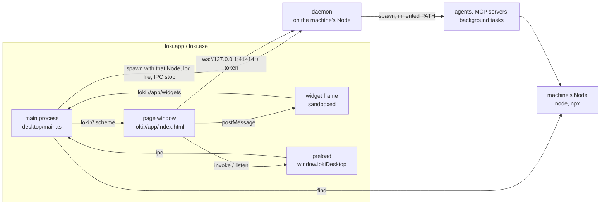
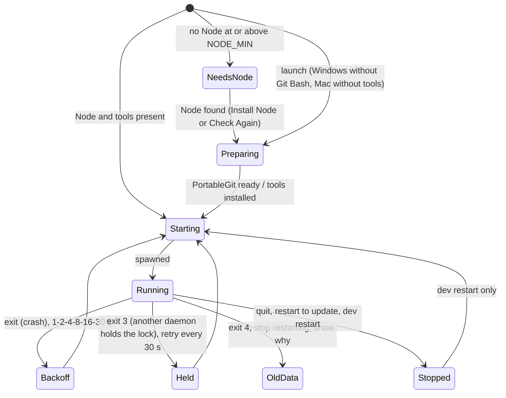
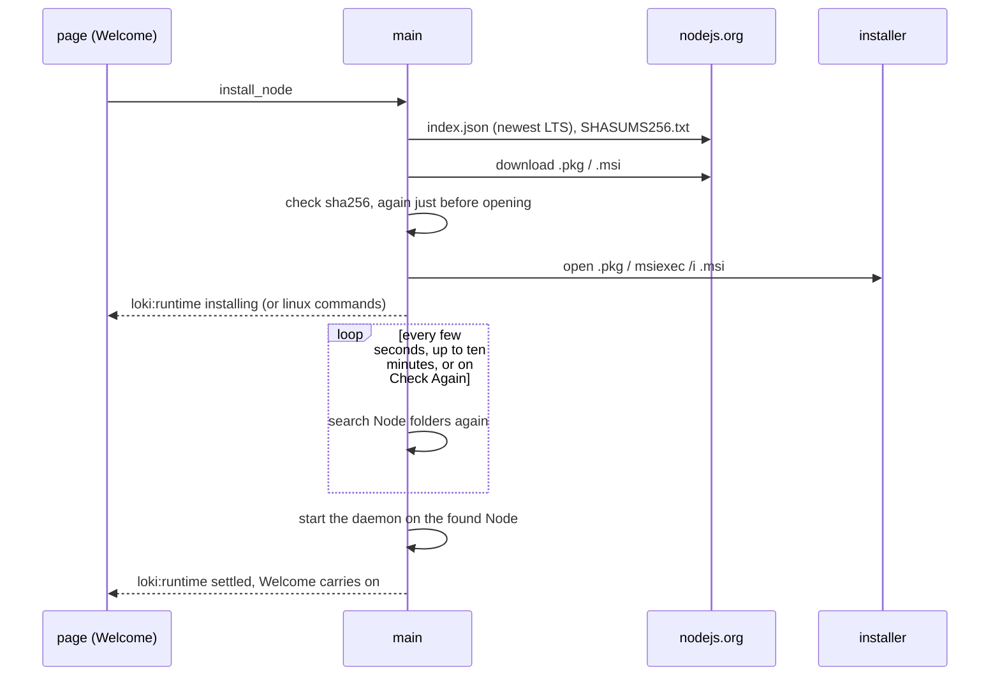
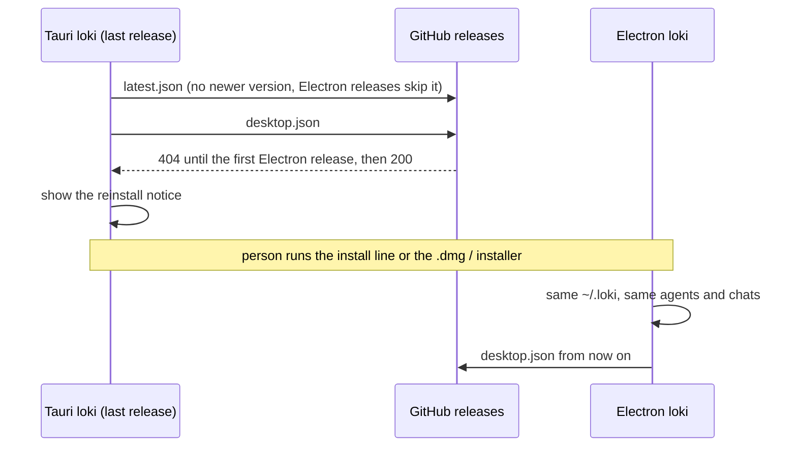

# The desktop app on Electron - Plan

---

## Goal Capsule

- **Objective:** Someone working on loki sees a change to the desktop shell in a running window without compiling native code, and the desktop window renders on Chromium, while people using loki keep everything the app does today on Mac, Windows and Linux.
- **Means:** Electron replaces Tauri as loki's desktop shell, on all three systems in one release (KTD1).
- **Authority:** the Requirements win on product behaviour, the Key Technical Decisions on mechanism, then the units.
- **Stop conditions:** stop and ask if a sandboxed widget frame cannot load module code from the `loki://` scheme (U5's spike); if the unsigned Mac app cannot replace itself on update (U11); or before the stack merges when the last Tauri release (U1) has not shipped on Stable.
- **Execution profile:** deep; a stack of four PRs, each carrying its docs: U1 (the notice, carrying this plan), U4 (daemon changes that work under Tauri too), U2, U3 and U5–U10 (the Electron shell), U11–U13 (updates, releases, Tauri removal, docs).
- **Who finishes:** `ce-work`, on branches named `refactor/<what-it-does>` in this session's worktree.
- **Open blockers:** none.

---

## Product Contract

### Summary

loki's desktop app moves from Tauri to Electron on Mac, Windows and Linux at once, and Rust leaves the repository. The shell keeps every feature it has today and adds none. loki stops downloading Node: the daemon and every agent run on the machine's Node, and Welcome offers to install it when none is found. People on the Tauri version reinstall once.

### Problem Frame

Iterating on loki is slower than it should be. The shell is a Rust program, and every fresh worktree compiles it before a window opens (`scripts/dev.ts` treats a missing `src-tauri/target` as a first build); with many sessions each in its own worktree, that compile is paid again and again. Changes to the shell itself also wait on cargo.

The desktop window runs on WebKit, and its quirks keep costing work. The code carries `Outside (WebKit)` workarounds for trackpad pinch arriving as gesture events (`app/src/desk/viewport.tsx`), links inside the mail frame (`app/src/desk/mail-html.tsx`), CSP refusals that skip `console.error` (`app/src/desk/env.ts`) and scroll offsets pulled back while the chat box grows (`app/src/chat/chat-input.tsx`), and the agents building loki have had to fight others. Overall performance in the window does not feel good, though no single moment stands out.

Tauri was chosen in the first plan (`docs/plans/2026-09-06-001-feat-loki-tauri-plan.md`) without a recorded size, memory or speed reason. The rest of loki is TypeScript on Node, and Electron is the mature ecosystem for that stack.

### Key Decisions

- **Electron replaces Tauri on all three systems at once.** (session-settled: user-directed — chosen over shipping the Mac first with the Windows and Linux previews paused, and over keeping the previews on Tauri until ported: one shell to maintain and no Rust from the day it lands.) Governs R1.
- **The daemon stays its own process.** (session-settled: user-approved — chosen over running it inside Electron's main process: a crashing tool, MCP server or `process.exit` must not take the window down, synchronous SQLite must not freeze the window, and the daemon must be able to restart, step aside for another daemon and stop for an update while the app keeps running.) Governs R5, R6.
- **The daemon runs on the machine's Node, on every system.** (session-settled: user-directed — chosen over Electron's built-in Node and over signing the Mac app with a self-signed certificate: the daemon reads the keychain, and inside loki's ad hoc-signed app the Mac would ask again for every stored key after every update, while the machine's Node keeps one identity; chosen over doing it on the Mac only: one launch path.) Governs R5, R8, R9.
- **Node is the machine's, installed on request.** (session-settled: user-directed — chosen over keeping the Node download, and over bundling the Claude Code adapter to run on Electron's Node: Electron ships no npm and no `node` command.) This replaces "The app owns Node" from `docs/plans/2026-11-15-2319-feat-self-updating-install-plan.md`. Governs R8, R9, R10, R11, R12.
- **Welcome installs Node when it is missing.** (session-settled: user-directed — chosen over installing it from the Claude Code tab when first needed, once the daemon itself needed Node.) Governs R8, R11, R13.
- **People on the Tauri version reinstall once.** (session-settled: user-directed — chosen over one last Tauri update that installs the Electron app: simpler to build, at the cost of everyone acting once.) Governs R16.
- **loki stays unsigned.** Carried from the self-updating install plan, where it was chosen over an Apple Developer ID. Electron's standard Mac updater only updates signed apps, so loki keeps an updater of its own. Governs R14.
- **Parity, not new features.** The move changes the shell's platform, not what it does; anything new waits for its own plan. Governs R2.

### Requirements

**The window**

- R1. loki's desktop app runs on Electron on macOS 13.3 or later on Apple silicon, 64-bit Windows 10 and 11, and current 64-bit desktop Linux, replacing Tauri in one release; no Tauri or Rust code remains in the repository.
- R2. Everything the Tauri shell does today keeps working as it does now: the main window with the traffic lights over a hidden title bar and the sidebar material on the Mac, loki's title strip on Windows and Linux, the settings window, the tray, the dock badge, the global shortcut, the native menu bar and pop-up menus on the Mac, opening links, revealing files, the file dialog, and one loki per user.
- R3. Module widgets load as they do today from `~/.loki/widgets` through loki's own scheme, and the main window and the widget frame keep today's content security limits.
- R4. The page reaches the shell through one bridge and tells the desktop app apart from a browser tab and the phone as it does today; the browser tab and the phone behave exactly as now.

**The daemon**

- R5. The shell starts the daemon as its own process on the machine's Node (R8) and supervises it as `docs/architecture.md` describes today: restart with backoff, stop a leftover from an earlier loki, leave a daemon holding `~/.loki/daemon.lock` serving, stop restarting on old data, and stop the daemon on quit.
- R6. The daemon still dies with loki: its whole tree ends when loki exits on Windows and Linux, and a leftover from a crash on the Mac is found and stopped at the next launch.
- R7. The daemon's output is still appended to `~/.loki/logs/daemon.log`, and the launch-time install of the mod, the skill and the phone canvas, and a development build's links into the checkout, work as today.

**Node and tools**

- R8. loki needs a Node new enough on the machine, found on PATH and in the folders installers put it, as `src-tauri/src/node.rs` searches today; the daemon, Claude Code chats, and any agent or MCP server the person adds that runs `node` or `npx` all use it.
- R9. loki never downloads a Node runtime of its own, and the runtime folder's Node is no longer used; the only Node download is nodejs.org's installer when the person chooses Install Node (R11).
- R10. A Node opened from Finder, the Start menu or a desktop launcher is found even when it lives only in a version manager's folder (nvm, fnm, Volta) or Homebrew, without the person changing PATH.
- R11. When no Node new enough is found, Welcome offers **Install Node**: on the Mac and Windows it runs nodejs.org's official LTS installer, which asks for the admin password itself, and on Linux it shows the install command for the common package managers; once Node is installed, Welcome finds it and carries on without a restart.
- R12. loki never updates or removes a Node it installed.
- R13. Welcome no longer downloads a Node of loki's own; on the Mac it still asks for Apple's command line tools, and on Windows it still fetches PortableGit when git or Git Bash is missing.

**Updates and releases**

- R14. The Electron app updates itself as the Tauri app does today, without a signed app: it checks on launch and every six hours, follows the Stable or Nightly channel chosen in About, verifies each download's signature, and installs on quit or on Restart to Update.
- R15. Each release publishes the Mac `.dmg`, the Windows installer, the Linux AppImage and `.deb`, and update files for the Mac, Windows and AppImage builds, on both channels; the install scripts and the Homebrew cask install the Electron app.
- R16. The last Tauri release, on Stable and on Nightly, tells people that the next loki needs one reinstall and how to do it; after the reinstall their agents, chats and everything in `~/.loki` carry on unchanged.
- R17. The version scheme, the app identifier `app.loki.desktop` and the app's name stay as they are.

**Working on loki**

- R18. `bun run start` and `bun run dev` open the Electron window from a fresh worktree on a machine with no Rust toolchain, and a change to the shell takes effect on the next launch without compiling native code.
- R19. The checks in `AGENTS.md` cover the shell, the smoke test opens the desktop window, and CI drops its cargo jobs.
- R20. `docs/architecture.md`, `docs/manual.md`, `docs/CONTRIBUTING.md`, `docs/releasing.md` and `README.md` describe the Electron shell and the new Node behaviour.

### Acceptance Examples

- AE1. **Covers R11, R13.** **Given** a new Mac with no Node and no Homebrew, **when** the person installs loki and opens it, **then** Welcome offers Install Node; after the official installer finishes, Welcome carries on to the provider step without restarting loki, and a chat on one of loki's models answers.
- AE2. **Covers R8.** **Given** a Mac where Welcome found Node, **when** the person starts a Claude Code chat, **then** it starts through that Node's `npx` with nothing else to install.
- AE3. **Covers R11.** **Given** a Linux machine with no Node, **when** loki opens, **then** Welcome shows the install commands for the common package managers rather than running an installer, and Check Again carries on once Node is there.
- AE4. **Covers R10.** **Given** a Mac with Node from nvm only, **when** loki is opened from Finder, **then** the daemon starts on that Node and Claude Code chats find `npx`, without the person changing PATH.
- AE5. **Covers R5.** **Given** a running loki, **when** the daemon crashes, **then** the window stays open and the daemon is started again with backoff.
- AE6. **Covers R14.** **Given** an unsigned Electron loki on Nightly, **when** a newer nightly is published, **then** it downloads, its signature is checked, and it installs when the person quits.
- AE7. **Covers R16.** **Given** a Tauri loki on Stable running the last Tauri release, **when** the first Electron release has been published, **then** loki tells the person that the next version needs a reinstall and how; after reinstalling, the same agents and chats are there.
- AE8. **Covers R18.** **Given** a fresh worktree on a machine without cargo, **when** a contributor runs `bun run start`, **then** the loki window opens.

### Success Criteria

- The move is done when every Requirement holds; there are no speed targets beyond the desktop window feeling no worse than today.
- A larger app (roughly 100 MB rather than about 10 MB) and Chromium's extra memory are the accepted price.

### Scope Boundaries

- Intel Macs stay unsupported.
- Code signing on any system stays deferred.
- The phone is unchanged and stays on WebKit, since every iOS browser is; WebKit workarounds the phone needs stay.
- No new shell features, and no UI performance work beyond what the switch itself brings.
- Updating or removing the Node loki installs.

### Dependencies / Assumptions

- The machine's Node at or above `NODE_MIN` (22.19, pi-durable's `engines`) carries `node:sqlite` without a flag and loads `@napi-rs/keyring`, as the downloaded Node does today.
- The Claude Code adapter (`@agentclientprotocol/claude-agent-acp`, started through `npx` in `daemon/acp/agents.ts`) runs on the current Node LTS that R11 installs.
- nodejs.org publishes official installers for the Mac (`.pkg`) and Windows (`.msi`), listed in `https://nodejs.org/dist/index.json` with checksums in each release's `SHASUMS256.txt`.

### Outstanding Questions

#### Deferred to Implementation

- How a sandboxed `srcdoc`-free widget frame loads module code from the `loki://` scheme in practice; U9 proves it before the Tauri scheme goes.

### Sources / Research

- `docs/architecture.md`: the processes, the daemon's supervision and lock, finding Node, and the updater as built on Tauri.
- `docs/plans/2026-11-15-2319-feat-self-updating-install-plan.md`: the runtime download, the update channels and the unsigned-app decision this plan partly replaces.
- `docs/plans/2026-09-06-001-feat-loki-tauri-plan.md`: the original choice of Tauri.
- `daemon/acp/agents.ts` and `daemon/acp/catalog.ts`: Claude Code started through `npx`, and the existing "install Node" message.
- `app/src/desk/env.ts`: `inTauri`, the gate every Tauri call in the page sits behind.

---

## Planning Contract

Product Contract preservation: changed: R5, R8, R10, R11, R13 and AE1–AE4 — after plan review showed the Mac keychain would ask again after every update with the daemon inside loki's ad hoc-signed app, the user moved the daemon onto the machine's Node on every system, which makes Node a Welcome step. R9, R15 and AE7 reworded to match R11, KTD10 and KTD11 without changing scope.

### Key Technical Decisions

- KTD1. **Electron 45 with electron-builder 26.** Electron 45.5 is current stable and embeds Node 24.22.3; pin the exact version and keep it at 43 or later. electron-builder is the one tool that makes the `.dmg`, the NSIS installer, the AppImage and the `.deb`; Forge has no AppImage or NSIS maker. Governs R1, R15.
- KTD2. **The shell lives in `desktop/`, TypeScript bundled by esbuild.** `app/src/shell/` is already the page's shell code, so the Electron main process and preload take a new top-level folder. esbuild bundles them in well under a second, so `bun run start` and `bun run dev` rebuild them on every launch (R18). Main-process modules take Electron's API as an injected parameter, so vitest tests them without Electron.
- KTD3. **The daemon is a child process of main on the machine's Node, launched as `harness.rs` does today.** Main spawns `node <entry> --loki-daemon --dir --mod --token-file --parent-pid` with stdout and stderr opened on `~/.loki/logs/daemon.log` (10 MB rotation), an IPC channel for the stop message, PATH starting with that Node's folder (and PortableGit's on Windows), and no `ELECTRON_*` or `NODE_OPTIONS` in its environment. The fuses that make Electron act as plain Node (`RunAsNode`, `NODE_OPTIONS`, `--inspect`) are switched off; nothing needs them. Governs R5, R7, R8.
- KTD4. **The daemon ends itself when loki goes.** The Job Object and parent-death signal go with Rust. Main stops the daemon with a `stop` message on its IPC channel, waits up to three seconds for it to exit, and only then kills it, because a kill on Windows skips `stop()`. The daemon is also told loki's pid and stops through its existing `stop()` when that pid is gone. Its children start in their own process group on the Mac and Linux and are ended as a group; on Windows they end with `taskkill /T`. Writes to a closed log pipe are ignored so `stop()` still runs. A leftover is the pid in `~/.loki/daemon.lock` whose command line carries `--loki-daemon` and whose loki is gone, as `procs.rs` checks today; a pid that fails the check is never killed. Governs R6.
- KTD5. **Main finds the machine's Node with `node.rs`'s search, ported.** The search runs before each daemon start and on Welcome's Check Again, never caching a miss, so a Node installed while loki runs is found without a restart. The daemon inherits a PATH with that Node first, so agents, MCP servers and background tasks find `node` and `npx` with no change in the daemon. Governs R8, R10.
- KTD6. **Install Node is a shell command Welcome calls.** Without Node there is no daemon, so main does it: it reads the current LTS from `nodejs.org/dist/index.json`, downloads the `.pkg` or `.msi` into a new private folder, checks it against that release's `SHASUMS256.txt` again just before opening it (`open` on the Mac, `msiexec /i` on Windows), and reports progress as `daemon_status` does. Linux answers with package-manager commands. Governs R11, R12.
- KTD7. **The page talks to the shell through one preload bridge with today's names.** The preload exposes `window.lokiDesktop` with `invoke`, `listen` and a few window calls, and sets `window.__LOKI__` for the top frame only. Command names, event names and payloads stay exactly as the Tauri ones (`daemon_status`, `loki:update`, camelCase `DaemonStatus`, snake_case `UpdateStatus`), so page tests change little. `inTauri` becomes `inDesktop`. Context isolation and the renderer sandbox stay on, and main checks the sending frame on every call. The preload asks main for the `__LOKI__` values over that checked IPC, never through `additionalArguments`, the URL or the environment, so the token stays off every command line. Links leave loki only for `http`, `https`, `mailto` and `tel`, as Tauri's opener scope allows today; anything else opens nothing. Governs R4.
- KTD8. **One privileged `loki://` scheme serves the page and the widgets.** `loki://app/` serves `app/dist` with the page's CSP as a response header, and `loki://app/widgets/` compiles widgets. One origin replaces Tauri's three spellings (`tauri://localhost`, `http://tauri.localhost`, `http://loki.localhost`). The widget frame keeps its sandbox and its own meta CSP. Governs R3.
- KTD9. **Widgets compile with esbuild, shared with the Vite tab.** `app/vite.config.ts` already compiles widgets with esbuild plus `app/src/frame/rewrite.ts`, the same logic as `widgets.rs`. That function moves to one module both use, and the packaged app ships esbuild's binary unpacked from the asar. Governs R3.
- KTD10. **Updates are a TypeScript port of `update.rs`.** Squirrel.Mac, and electron-updater on the Mac with it, only update signed apps. A port keeps one mechanism on all three systems, together with its 20 state-machine tests, the channels, `updates.json`, the six-hour check and the failed-install memory. The minisign key stays and Node's Ed25519 verifies it. The Mac swaps the `.app` in place, as Tauri's updater does today. Windows runs the new NSIS installer silently and quits. Linux replaces the AppImage, and `.deb` stays unsupported. Governs R14.
- KTD11. **Electron releases publish a new manifest, `desktop.json`, and freeze `latest.json`.** Each Electron release, on both channels, re-uploads the last Tauri `latest.json` unchanged, so Tauri apps see no update and never apply an Electron build; without it their About would show a failed check every six hours. The nightly prune keeps the files that frozen manifest names. The last Tauri release's page checks for `desktop.json` and shows the reinstall notice once it exists. A release uploads its files first and `desktop.json` last, so the notice never points at a missing file. Governs R16.
- KTD12. **The Windows installer is per-user and removes a Tauri install.** electron-builder's NSIS keys upgrades on a GUID from `appId`, so it does not see Tauri's install. A custom NSIS include closes a running Tauri loki and runs Tauri's uninstaller silently when its uninstall key is present, leaving `~/.loki` alone. Per-user keeps updates free of UAC prompts. Governs R16, R17.
- KTD13. **One install at a time, and the newest Node wins.** Main keeps one Install Node in flight. When several Nodes are found, the newest at or above `NODE_MIN` wins, and the downloaded runtime under `~/.loki/runtime` is never considered, so an old Tauri-era Node cannot shadow the person's own. Governs R8, R11.

### High-Level Technical Design

Processes after the move. Main owns windows, the scheme, menus, updates, finding and installing Node, and the daemon's life. The daemon owns everything it owns today.

The daemon's life under main, ported from `supervise_daemon` and `harness.rs`:

Install Node, from Welcome:

The handover from Tauri:

### Assumptions

- The user's "write the plan and start implementing" stands in for the plan-time scope confirmation; the call-outs were posted in chat when the plan was written.
- The current LTS from `index.json` is the right Node to install, rather than a version loki pins; the daemon needs only `NODE_MIN`, and the Claude Code adapter tracks current Node.
- Losing the Tauri window's local storage (collapsed panes and similar page state) is acceptable; agents, chats, settings and keys live in `~/.loki` and the keychain.
- On the Mac, the keychain asks again when the program reading an item changes. The daemon reads it through the machine's Node rather than loki's ad hoc-signed app, so loki updates never cause a prompt; a person whose Node differs from the downloaded one may be asked once per item after the move, and the notice says so.
- `~/.loki/runtime` is left where it is after the move; PortableGit still lives there on Windows.

### Considered and not built

- Electron's own updater (electron-updater) on Windows and Linux: a second mechanism beside KTD10's port for no gain; reconsider if signing ever arrives.
- A global shortcut under Wayland, which Electron does not support; Linux keeps X11 by default (U10).
- Delta updates, and running an older Tauri loki against data the Electron loki wrote; the daemon's old-data exit already guards the latter.
- A watcher that reloads the main process on change; the next launch picks changes up (R18).
- On Ubuntu 24.04 and later, the `.deb` ships an AppArmor profile so Chromium's sandbox runs; the AppImage's behaviour there is checked in U12 and documented rather than worked around with `--no-sandbox`.

---

## Implementation Units

| U-ID | Title | Key files | Depends on |
|---|---|---|---|
| U1 | Reinstall notice in the Tauri app | `app/src/shell/move-notice.tsx` | none |
| U2 | Main finds the machine's Node | `desktop/node-search.ts` | U5 |
| U3 | Install Node from Welcome | `desktop/node-install.ts`, `app/src/shell/welcome.tsx` | U2, U6 |
| U4 | The daemon stops cleanly whoever starts it | `daemon/main.ts`, `daemon/parent-watch.ts` | none |
| U5 | Electron skeleton, dev loop and scheme spike | `desktop/main.ts`, `scripts/dev.ts`, `scripts/build-desktop.ts` | none |
| U6 | Daemon supervision, launch install and tools | `desktop/daemon.ts`, `desktop/procs.ts`, `desktop/install.ts` | U2, U4, U5 |
| U7 | The page's desktop bridge | `desktop/preload.ts`, `app/src/shell/desktop.ts`, `app/src/desk/env.ts` | U5 |
| U8 | Mac menus, tray, badge and shortcut | `desktop/menus.ts`, `desktop/tray.ts` | U7 |
| U9 | The `loki://` scheme, CSP and widgets | `desktop/scheme.ts`, `app/widget-module.ts` | U5 |
| U10 | Windows, title bars and one loki per user | `desktop/windows.ts` | U7 |
| U11 | Self-update | `desktop/update/*.ts` | U6 |
| U12 | Packaging, releases, install scripts and CI | `electron-builder.yml`, `scripts/release.ts`, `.github/workflows/release.yml` | U11 |
| U13 | Tauri removed, docs updated | `src-tauri/`, `docs/*.md` | U12 |

### U1. Reinstall notice in the Tauri app

**Goal:** the last Tauri release tells its users to reinstall once an Electron release exists.

**Requirements:** R16; KTD11.

**Dependencies:** none. Ships, and is released on Stable and Nightly, before the stack merges.

**Files:**
- `src-tauri/src/update.rs` (the check, beside the `latest.json` fetch)
- `app/src/shell/move-notice.tsx` (new)
- `app/src/shell/use-loki-update.ts` (status carries the move), `app/src/shell/shell.tsx` (mount point)
- `app/src/shell/os-words.ts` (the install line per system)
- `test/move-notice.test.ts` (new), `test/update-status.test.ts`

**Approach:**
1. The Tauri shell's `update.rs`, not the page, fetches `desktop.json` beside `latest.json` for the chosen channel, from the same endpoint (`LOKI_UPDATE_URL` included), on launch and on the six-hour check; GitHub's downloads answer without CORS headers, so a page fetch would always fail. The result rides on the update status the page already follows.
2. On a 200, show a notice in the update notice's place: the next loki needs one reinstall, the install line or download link for this system (`brew reinstall --cask loki` for cask installs), that agents and chats stay, and on the Mac that the keychain may ask once.
3. A 404 or a network error shows nothing.

**Patterns to follow:** `app/src/shell/update-notice.tsx` and `use-loki-update.ts` (injected `fetch` and clock as in `test/update-status.test.ts`).

**Test scenarios:**
- Covers AE7. An update status saying the move is available shows the notice with the Mac install line.
- A status without it shows nothing.
- A browser tab and the phone never show the notice.
- In `update.rs`: a 200 for `desktop.json` sets the move on the status, a 404 or a network error leaves it unset, and a Nightly build checks the nightly path.

**Verification:** a Tauri build pointed at a test `desktop.json` shows the notice; without one it shows nothing.

### U2. Main finds the machine's Node

**Goal:** main finds the newest usable Node on PATH or in the folders installers use, each time it starts the daemon.

**Requirements:** R8, R10; KTD5, KTD13. Covers AE2, AE4.

**Dependencies:** U5.

**Files:**
- `desktop/node-search.ts` (new: port of `src-tauri/src/node.rs` `bin_dirs_for`, `parse_version`, `NODE_MIN`, `find_node_for`)
- `test/desktop-node-search.test.ts` (new: port of `node.rs`'s 10 tests)

**Approach:**
1. Port the search with an injected host (os, home, env, a `version` reader and an `exists` check), as `node.rs`'s `Host` does.
2. Return the newest Node at or above `NODE_MIN` with `npx` beside it, its folder, and the newest too-old one when none qualifies.
3. Never cache a miss; Welcome's Check Again and every daemon start search again.

**Patterns to follow:** `src-tauri/src/node.rs` and its tests (fake home, version stub).

**Test scenarios:**
- Covers AE4. A Mac home with only `~/.nvm/versions/node/v24.1.0/bin/node` and a PATH of `/usr/bin:/bin` finds that Node.
- Homebrew's `/opt/homebrew/bin` and nvm both present: the newer version wins.
- A Node older than `NODE_MIN` counts as missing, and the newest too-old version is reported.
- Windows folders: `%ProgramFiles%\nodejs`, `%APPDATA%\npm`, scoop, Volta, fnm, all through `node:path`.
- `LOKI_NODE_BIN` wins in every build.
- A Node under `~/.loki/runtime` is never chosen.
- A `node` without `npx` beside it is skipped for one that has both.
- After a miss, a Node that appears is found on the next search.

**Verification:** with the downloaded runtime absent, loki opened from Finder on an nvm-only Mac starts its daemon.

### U3. Install Node from Welcome

**Goal:** Welcome offers Install Node when no usable Node is found, and carries on once one is.

**Requirements:** R11, R12, R13; KTD6, KTD13. Covers AE1, AE3.

**Dependencies:** U2, U6.

**Files:**
- `desktop/node-install.ts` (new: resolve, download, check, open)
- `desktop/daemon.ts` (a `needs_node` status before the daemon starts; the `install_node` command)
- `app/src/shell/bootstrap.ts` (`DaemonStatus` carries the missing or too-old Node and the install's progress)
- `app/src/shell/welcome.tsx`, `app/src/shell/os-words.ts` (the Node step: Install Node, progress, Check Again, Linux commands)
- `test/desktop-node-install.test.ts` (new), `test/welcome.test.ts`

**Approach:**
1. Before starting the daemon, main runs U2's search; with no usable Node the status is `needs_node` (naming a too-old one when found) and Welcome shows the Node step.
2. Install Node: read `index.json`, take the first entry with `lts` set, fetch the `.pkg` (Mac) or `x64.msi` (Windows) and that release's `SHASUMS256.txt`, compare, write to a new private folder, compare again, open it.
3. The Mac's Installer runs on its own, so main searches again every few seconds for up to ten minutes and starts the daemon when Node appears; Check Again searches at once, and closing the installer leaves the button with no error. On Windows `msiexec`'s exit code answers directly: 0 or 3010 installed, 1602 cancelled, anything else failed.
4. Linux shows the commands for apt, dnf and pacman and a link to nodejs.org, with Check Again.

**Patterns to follow:** the PortableGit fetch in `src-tauri/src/runtime.rs` (fetch, hash, temp folder); `welcome.tsx`'s `Preparation` and `Tools` steps.

**Test scenarios:**
- Covers AE1. With no Node found, the status is `needs_node` and Welcome shows Install Node; once the search finds Node, the daemon starts and Welcome moves on.
- `index.json` with v26 LTS first and a newer Current release picks the v26 `.pkg` on the Mac and the `x64.msi` on Windows.
- A checksum mismatch, before or just before opening, deletes the file, opens nothing, and shows an error.
- A failed download shows an error and leaves the button.
- Covers AE3. On Linux the step shows the command list, and nothing is downloaded.
- A second Install Node while one is running joins the first.
- `msiexec` exit 1602 returns to Install Node with no error; 1603 shows the failure.
- A Node older than `NODE_MIN` shows its version in the step.

**Verification:** on a Mac without Node, Welcome's button opens the official installer, and Welcome carries on after it finishes without restarting loki.

### U4. The daemon stops cleanly whoever starts it

**Goal:** the daemon and everything it started end on a stop message, on SIGTERM, or when loki's process is gone.

**Requirements:** R5, R6; KTD4.

**Dependencies:** none (works under Tauri too).

**Files:**
- `daemon/main.ts` (a `--parent-pid` argument; a `stop` message on the IPC channel calls `stop()`)
- `daemon/parent-watch.ts` (new)
- `daemon/acp/process.ts`, `daemon/mcp/index.ts`, `daemon/background.ts` (children in their own process group; tree kill on Windows)
- `test/parent-watch.test.ts` (new), `test-node/parent-death.node-test.ts` (new)

**Approach:**
1. With `--parent-pid`, the daemon checks that pid every two seconds through an injected `alive` check and calls `stop()` when it is gone; under Tauri the flag is absent and nothing changes.
2. A `stop` message on `process.on("message")` calls `stop()`.
3. ACP agents, MCP servers and background tasks start in their own process group on the Mac and Linux, and `stop()` ends each group; on Windows it ends each tree with `taskkill /T /F`.
4. Errors writing to stdout or stderr are swallowed so `stop()` finishes.

**Patterns to follow:** `daemon/awake.ts` and `test/awake.test.ts` (injected pid, timers); `test-node/crash-child.ts`.

**Test scenarios:**
- With an injected clock, a parent that stays alive never triggers `stop()`.
- A parent that dies triggers `stop()` once, on the next tick.
- Without `--parent-pid` no watch runs.
- A `stop` message triggers `stop()` once.
- Integration (test-node): a daemon child started with `--parent-pid` of a process that is then killed exits within five seconds, and its spawned sleeper child and that child's own child are gone too.
- A write to a closed stdout during `stop()` does not throw, and the lock is released.

**Verification:** killing the process named by `--parent-pid` stops the daemon and its children on Mac, Windows and Linux CI runners.

### U5. Electron skeleton, dev loop and scheme spike

**Goal:** `bun run start` opens loki's page in an Electron window from a fresh worktree without cargo.

**Requirements:** R1, R18; KTD1, KTD2. Covers AE8.

**Dependencies:** none.

**Files:**
- `package.json` (`electron`, `electron-builder` dev dependencies; `start`, `dev` keep their names)
- `desktop/main.ts`, `desktop/env.ts` (home, `~/.loki`, token, `__LOKI__` values) (new)
- `scripts/build-desktop.ts` (new: esbuild bundles `desktop/` to `desktop/dist/`)
- `scripts/dev.ts` (launches Electron instead of the Tauri CLI; drops the Rust and Xcode checks)
- `tsconfig.json`, `scripts/select-tests.ts`, `.gitignore`, `eslint-comments.mjs` (`Electron` in `OUTSIDE`)
- `test/desktop-env.test.ts` (new: port of `lib.rs`'s token and home tests)

**Approach:**
1. `scripts/dev.ts` keeps its Vite start, page build, mod health wait and phone watch, and spawns the `electron` binary on `desktop/dist/main.js`. When a development build serves `app/dist` (`bun run start`), main watches `app/dist/index.html` and reloads the page windows when it is replaced, as the Tauri CLI's server did for the daemon's page build.
2. Main makes the token as `lib.rs` does (create-new, 0600, never replaced) and opens one window on the dev URL or `app/dist`. A development launch uses its own Electron user-data folder, so two worktrees' windows never collide on the single-instance lock.
3. Spike, before U9 goes further: a sandboxed frame on the Mac, Windows and Linux loads a module from a privileged `loki://` scheme, and main can make a `blake2b512` hash (U11's prehashed signatures need it; if Electron's crypto lacks it, U11 carries a TypeScript BLAKE2b).

**Execution note:** the spike is the first proof; stop and ask if the frame cannot load from the scheme (Goal Capsule).

**Patterns to follow:** `scripts/dev.ts` (its children cleanup and `--check` output); `lib.rs` tests for the token file.

**Test scenarios:**
- The token file is created 0600 in a 0700 folder, never replaced when present, 32 lowercase hex characters.
- Home is `USERPROFILE` on Windows and `HOME` elsewhere, and never `/`.
- `__LOKI__` carries `token`, `modPort`, `desk` and `os` in one of three words, and `window: "settings"` with a page name only for the settings window.
- `scripts/dev.ts --check` names Electron and no longer mentions cargo.
- The page window's command line carries no token.
- Under `bun run start`, replacing `app/dist/index.html` reloads the page windows once.

**Verification:** a fresh worktree on a machine without cargo runs `bun run start` and the window opens.

### U6. Daemon supervision, launch install and tools

**Goal:** main starts, watches, restarts and stops the daemon on the machine's Node as `docs/architecture.md` describes, installs the bundles on launch, and prepares git.

**Requirements:** R5, R6, R7, R9, R13; KTD3, KTD4. Covers AE5.

**Dependencies:** U2, U4, U5.

**Files:**
- `desktop/daemon.ts` (new: port of `harness.rs` and `lib.rs`'s `start_daemon`, `supervise_daemon`, `DaemonState`)
- `desktop/procs.ts` (new: port of `procs.rs`, reading the process list with `ps` and PowerShell)
- `desktop/daemon-log.ts` (new: open, append and rotate)
- `desktop/install.ts` (new: port of `install.rs`)
- `desktop/tools.ts` (new: PortableGit fetch and the git and tools checks from `runtime.rs`; no Node)
- `app/src/shell/bootstrap.ts`, `app/src/shell/welcome.tsx` (no Node download step)
- `test/desktop-daemon.test.ts`, `test/desktop-procs.test.ts`, `test/desktop-install.test.ts`, `test/desktop-tools.test.ts` (new: ports of the Rust tests), `test/welcome.test.ts`

**Approach:**
1. Port the supervisor with its delays, crash-loop note, old-data stop, held retry and the generation counter that stops a start racing a stop.
2. Spawn per KTD3 with U2's Node, the checkout's `.ts` entry and `--experimental-strip-types` in a development build as today.
3. Leftover (KTD4): a daemon whose loki is gone, Tauri-era included, is stopped before starting; one whose loki is still running is left serving, and the status says another loki is running.
4. Quit, Restart to Update and dev restart stop the daemon with the `stop` message (KTD4), holding `before-quit` until it exits or three seconds pass. A quitting flag tells a dev-reload restart (exit 0, restart) from a quit (exit 0, final); an uncaught error in main stops the daemon before main exits.
5. Port `install.rs` against `process.resourcesPath`, with the dev checkout links unchanged.
6. Keep PortableGit and the Mac and Linux tools checks; drop the Node download and `runtime.json`'s Node entries.

**Patterns to follow:** the Rust tests named in the files list; `test/harness.test.ts`.

**Test scenarios:**
- Restart delays run 1, 2, 4, 8, 16, 30 seconds with exits inside a minute, and reset after a quiet minute.
- Covers AE5. A daemon exit while the window is open schedules a restart and publishes the status.
- Exit 3 holds and retries every 30 seconds; exit 4 stops restarting and publishes the old-data note.
- A stop during a start kills the new child.
- The log rotates to `daemon.log.1` past 10 MB.
- The daemon's environment has U2's Node folder first on PATH and no `ELECTRON_*` or `NODE_OPTIONS`.
- A lock whose pid is dead is left to the daemon's own takeover; a live pid without `--loki-daemon` is never killed.
- A `node … --loki-daemon` process whose loki is gone is stopped; the same process with a live loki parent is left, and the status names the other loki.
- Exit 0 after a dev restart starts the daemon again; exit 0 while quitting does not.
- A quit sends the `stop` message before any kill, and kills only after three seconds without an exit.
- Install: first write is `installed`, an identical bundle is `current`, a changed one `updated`, an unmarked skill folder `custom`.
- Windows without Git Bash fetches PortableGit, checks its hash, and a mismatch leaves nothing at the final path.

**Verification:** the window survives a daemon crash, and quitting leaves no daemon or agent process on any system.

### U7. The page's desktop bridge

**Goal:** the page reaches the shell through `window.lokiDesktop` with today's commands and events, and no `@tauri-apps` import remains.

**Requirements:** R2, R4; KTD7.

**Dependencies:** U5.

**Files:**
- `desktop/preload.ts`, `desktop/ipc.ts` (new: preload and main-side handlers with sender checks)
- `app/src/shell/desktop.ts` (new: typed `invoke`, `listen`, window calls, `openUrl`, `revealItemInDir`, `openDialog`)
- `app/src/desk/env.ts` (`inTauri` becomes `inDesktop`), `app/index.html`
- every file importing `@tauri-apps/*` (`theme.tsx`, `desk/use-reply-card.ts`, `desk/use-desk.ts`, `desk/new-desk.tsx`, `shell/native-menu.ts`, `shell/open-settings.ts`, `shell/sidebar.tsx`, `shell/use-loki-update.ts`, `chat/transcript.tsx`, `shell/use-window-chrome.ts`, `shell/use-global-shortcut.ts`, `shell/use-shell-keys.ts`, `shell/use-harness-facts.ts`, `shell/settings-window.tsx`, `frame/main.tsx`, `shell/bootstrap.ts`, `item/message-entry.tsx`)
- `data-tauri-drag-region` uses (`sidebar.tsx`, `content-list.tsx`, `components/index.tsx`, `settings/settings.tsx`) become an app-region class
- `app/src/shell/keymap.ts` (`tauriAccelerator` becomes Electron's accelerator form)
- tests: `test/update-status.test.ts`, `test/title-strip.test.ts`, `test/list-column-look.test.ts`, `test/keymap.test.ts`, `test/core-portability.test.ts`, `test/desktop-ipc.test.ts` (new)

**Approach:**
1. Main registers one handler per command and checks that the sender is a top frame on `loki://app` (or the dev URL).
2. Events go to the window that should hear them: `loki:settings-page` to the settings window only.
3. `frame/main.tsx` keeps deleting `__LOKI__` and drops the Tauri globals it removed.

**Patterns to follow:** `test/update-status.test.ts`'s fake shell; the `InvokeShell` shape in `use-loki-update.ts`.

**Test scenarios:**
- The bridge forwards `daemon_status` and returns the camelCase status unchanged.
- An `invoke` from a subframe or another origin is refused.
- `listen("loki:update")` receives a status and its unlisten stops delivery.
- `open` with `directory: true` returns one path or null.
- `openUrl` with a `file:`, `smb:` or custom-scheme URL opens nothing; `https:` and `mailto:` open.
- Accelerators: `cmd+]` becomes `CommandOrControl+]`, `cmd+0` `CommandOrControl+0`.
- A drag region renders the app-region class and buttons inside it opt out.
- `core` still imports nothing from the desktop bridge.

**Verification:** a grep finds no `@tauri-apps` or `__TAURI` in `app/`, and every shell action works in the Electron window.

### U8. Mac menus, tray, badge and shortcut

**Goal:** the Mac's native menu bar, pop-up menus, tray, dock badge and global shortcut work as with Tauri.

**Requirements:** R2.

**Dependencies:** U7.

**Files:**
- `desktop/menus.ts` (new: `set_menu` and `popup_menu` from `menu.rs` and `popup.rs`)
- `desktop/tray.ts` (new: tray, `set_waiting`, dock badge, `set_global_shortcut`, `loki:catch-up`)
- `desktop/assets/tray-template.png` (moved from `src-tauri/icons/`)
- `test/desktop-menus.test.ts` (new), `test/native-menu.test.ts` (no longer reads Rust)

**Approach:**
1. Build the app menu, Edit and Window from Electron roles, with the page's menus between, each item emitting `loki:menu` with its id.
2. A pop-up answers the clicked item's depth-first index, separators not counted, or null when closed.
3. The tray title and tooltip read `loki · N waiting`, and the dock badge shows N.
4. Alt+Space shows the window and emits `loki:catch-up`, and can be switched off.

**Test scenarios:**
- A menu spec with a separator and a submenu maps to a template whose ids match the page's.
- A pop-up of `[item, separator, submenu[item, item]]` answers 2 for the submenu's second item, and null on close.
- `set_waiting(0)` clears the badge and the tray title; `set_waiting(3)` sets both.
- A shortcut already taken by another app answers an error the page shows.

**Verification:** on a Mac, the menu bar, a right-click menu, the tray click, the badge and Alt+Space behave as in the Tauri app.

### U9. The `loki://` scheme, CSP and widgets

**Goal:** the page and module widgets load from `loki://app/` with the same limits as today.

**Requirements:** R3; KTD8, KTD9.

**Dependencies:** U5.

**Files:**
- `desktop/scheme.ts` (new: serves `app/dist` with the CSP header and `widgets/`)
- `desktop/csp.ts` (new: the page CSP, moved from `tauri.conf.json`, release and development)
- `app/widget-module.ts` (new: the compile and rewrite now in `app/vite.config.ts`)
- `app/vite.config.ts`, `app/src/desk/widget-bridge.ts` (one URL form), `app/src/frame/build.ts` (frame CSP's script source)
- `test/widget-frame.test.ts`, `test/markdown-image.test.ts`, `test/desktop-scheme.test.ts` (new)

**Approach:**
1. Register `loki` as standard, secure, fetch-capable and CORS-enabled before ready; handle `loki://app/` with path guards ported from `widgets.rs`.
2. Widgets: `.js` maps to the `.tsx` or `.jsx` under the widgets folder, compiled by the shared module, served with `cache-control: no-store` and `access-control-allow-origin: *`; a compile error is a module that throws, as today.
3. The frame's `script-src` names `loki:` only; `frame-src` names `loki://app/widget-frame.html`.

**Test scenarios:**
- `loki://app/widgets/a/b.js` serves `a/b.tsx` compiled with the automatic JSX runtime and shared imports rewritten.
- `..`, a leading `/`, `\` and `:` in the path answer 404.
- A widget with a syntax error answers a module that throws its file name and message.
- `index.html` carries the release CSP header with no `tauri:` or `ipc:` source.
- Integration: a sandboxed widget frame loads a widget module from the scheme and renders it.

**Verification:** a desk with a module widget renders in the Electron window, and editing the widget file updates it.

### U10. Windows, title bars and one loki per user

**Goal:** the main and settings windows look and behave as today on each system.

**Requirements:** R2, R17.

**Dependencies:** U7.

**Files:**
- `desktop/windows.ts` (new: main window 1440x900, min 900x600; settings 820x600, min 680x460)
- `desktop/main.ts` (single-instance lock; external links to the browser; navigation guard)
- `test/shell-look.test.ts`, `test/settings-window.test.ts`, `test/tokens.test.ts` (read `desktop/` instead of Rust)

**Approach:**
1. Mac: hidden inset title bar, the sidebar vibrancy following the window's active state, a transparent background, traffic lights placed where `traffic_lights` reports them, App Nap off.
2. Windows and Linux: frameless with loki's own title strip, background `#1c1c1e`.
3. `nativeTheme.themeSource` follows the page's `setTheme`.
4. A second launch focuses the first window.
5. Linux runs on X11 unless the person chose otherwise, as `GDK_BACKEND=x11` does today.

**Test scenarios:**
- The window background constant equals the dark `--loki-bg` token.
- `traffic_lights` answers `{left, right, middle}` on the Mac and null elsewhere.
- A `window.open` to `https://` opens the browser and creates no window; one to `file:` or a custom scheme opens nothing; navigation away from `loki://app` is refused.

**Verification:** side by side with the Tauri app, the Mac window's title bar, lights and sidebar material match, and Windows and Linux show the title strip.

### U11. Self-update

**Goal:** the Electron app updates itself on both channels without a signed app.

**Requirements:** R14; KTD10, KTD11. Covers AE6.

**Dependencies:** U6.

**Files:**
- `desktop/update/updates.ts` (new: the state machine from `update.rs`)
- `desktop/update/remote.ts` (new: fetch `desktop.json`, download with progress)
- `desktop/update/minisign.ts` (new: verify, sharing parsing with `scripts/check-update-key.ts`)
- `desktop/update/install.ts` (new: Mac `.app` swap, Windows installer, Linux AppImage)
- `test/desktop-updates.test.ts`, `test/desktop-minisign.test.ts` (new: ports of `update.rs`'s 20 tests), `test/update-check.test.ts`

**Approach:**
1. Port `Updates` with injected remote, clock and file system, keeping the `LOKI_UPDATE_URL` override; the page-facing status and commands stay as KTD7 names them.
2. Verify the minisign signature (Ed25519, prehashed when the algorithm says so), and that its trusted comment's `version:` matches the version `desktop.json` announces, before anything is installed.
3. Mac: unpack the `.app.tar.gz` next to the app, swap it on quit or on Restart to Update, keep the old one until the swap succeeds, refuse to download when the app's folder is not writable.
4. Windows: stop the daemon, run the installer with `/S --updated`, quit.
5. Linux: replace the file at `$APPIMAGE`; `.deb` and development builds report unsupported.

**Test scenarios:**
- A check finds a newer version on the chosen channel, downloads it, verifies it and reaches ready.
- A bad signature fails at the signature stage and installs nothing.
- A signature from another key fails the same way.
- A valid signature whose trusted comment names an older version than `desktop.json` fails at the signature stage.
- Nightly to Stable never offers an older version.
- Covers AE6. On quit with an update ready, the install runs once; a failure is remembered in `updates.json` and shown at the next launch.
- An unwritable app folder reports the problem without downloading.
- Checks run on launch and when six hours of wall clock have passed, counting sleep.

**Verification:** before the stack merges, two consecutive branch builds' files and `desktop.json` go to a throwaway tag, `LOKI_UPDATE_URL` points at it, and the first build updates itself to the second on Mac, Windows and Linux. This clears or fires the Goal Capsule's self-update stop condition.

### U12. Packaging, releases, install scripts and CI

**Goal:** releases build, sign ad hoc, publish and install the Electron app on every system, and CI proves the packaged app starts its daemon.

**Requirements:** R1, R15, R16, R17, R19; KTD1, KTD11, KTD12.

**Dependencies:** U11.

**Files:**
- `electron-builder.yml` (new: `appId: app.loki.desktop`, `productName: loki`, mac `identity: "-"`, `asarUnpack` for `.node` files and esbuild, `extraResources` for the daemon, mod, skill and phone canvas, fuses, `NSAppSleepDisabled`)
- `desktop/nsis/remove-tauri.nsh` (new)
- `scripts/release.ts`, `scripts/cask.ts`, `scripts/check-update-key.ts`, `scripts/smoke.ts`, `scripts/build-mod.ts`
- `site/public/install.sh`, `site/public/install.ps1`
- `.github/workflows/release.yml`, `.github/workflows/ci.yml`
- `test/release.test.ts`, `test/workflows.test.ts`, `test/check-update-key.test.ts`, `test-node/install-script.node-test.ts`

**Approach:**
1. Build per system on its own runner, keeping today's file names (`loki-macos-arm64.app.tar.gz`, `loki_<v>_aarch64.dmg`, `loki-windows-x64-setup.exe`, `loki-linux-x86_64.AppImage`, the `.deb`).
2. `scripts/sign-update.ts` (new) signs each update file with the minisign key, with a trusted comment carrying `version:<v>` and the file name. It runs in one workflow step that alone receives the key secret, replacing the signing `tauri-action` did.
3. `release.ts` writes `desktop.json` from those signatures, re-uploads the last Tauri `latest.json` unchanged (KTD11), keeps that manifest's files out of the nightly prune, and publishes `desktop.json` after every other file.
3. The NSIS include closes a running Tauri loki, finds Tauri's uninstall entry and runs its uninstaller silently before installing (KTD12).
4. `install.sh` replaces a Tauri `loki.app` and asks the person to quit a running loki first; `install.ps1` checks the new install folder and uninstall key.
5. The `.deb` carries an AppArmor profile for Chromium's sandbox.
6. Smoke: launch the built app headless with a smoke flag that starts the daemon on the runner's Node from the installed bundle, waits for its health check, and exits 0; Linux runs it under xvfb.
7. CI: the smoke job runs on all three systems, and the merge queue's required checks change with it; the cargo workflow goes in U13.

**Execution note:** mostly packaging; prove each step with the smoke run and a by-hand install on each system rather than unit tests alone.

**Test scenarios:**
- `release.ts` names the five files per version and writes `desktop.json` with three platforms and their signatures.
- `release.ts` re-uploads the given Tauri `latest.json` byte for byte, and orders `desktop.json` last.
- Pruning after an Electron nightly leaves every file the re-uploaded `latest.json` names.
- `sign-update.ts` writes a signature whose trusted comment carries the release version, and it verifies against the public key.
- The built Mac app's `Info.plist` carries `NSAppSleepDisabled`, and its `.node` files and esbuild binary sit outside the asar.
- `check-update-key.ts` checks the key against the updater's public key in its new home.
- The install script on a fake Mac unpacks `loki.app` and opens it; on Linux it places `loki.AppImage`.
- The cask points at the new `.dmg` name and keeps the quarantine caveat.
- The workflow test locks the electron-builder steps and the smoke run per system.

**Verification:** a nightly release installs through the install line on each system, and the Mac app opens after the quarantine step.

### U13. Tauri removed, docs updated

**Goal:** no Tauri or Rust remains, and the docs describe the Electron shell.

**Requirements:** R1, R19, R20.

**Dependencies:** U12.

**Files:**
- delete `src-tauri/`, `.github/workflows/shell.yml`
- `package.json` (drop `@tauri-apps/*`, `tauri`, `desktop:dev`, `desktop:build`)
- `.oxlintrc.json`, `eslint.config.mjs`, `.oxfmtrc.json`, `doctor.config.json`, `.gitignore` (drop `src-tauri` entries; add `desktop/dist`)
- `eslint-comments.mjs` (drop `Tauri` once unused)
- `daemon/main.ts`, `mod/boot.ts`, `daemon/page-build.ts`, `core/version.ts` (comments that cite Rust files)
- `docs/architecture.md`, `docs/manual.md`, `docs/CONTRIBUTING.md`, `docs/SECURITY.md`, `docs/releasing.md`, `docs/style.md`, `docs/design.md`, `README.md`, `AGENTS.md` (the cargo line), `glossary.md`
- `test/style.test.ts`, `test/workflows.test.ts`

**Approach:** remove, then search the repo for `tauri`, `cargo`, `src-tauri` and `.rs` and resolve each hit; write the manual's install, Welcome and Claude Code parts for R8–R13 and the reinstall for R16.

**Test expectation:** none beyond the updated existing tests -- removal and docs.

**Verification:** the search finds only history (`CHANGELOG.md`, dated plans), and the full check list passes.

---

## Verification Contract

| When | Command | Proves |
|---|---|---|
| Every unit | `bun run format:check && bun run lint && bun run typecheck && bun run test && bun run test:node` | format, lint, types, unit and node tests |
| U5 onward | `bun run build:app && bun run build:mod && bun run smoke` | page and bundles build; from U12 the smoke run launches the packaged Electron app and waits for its daemon |
| U5, U6, U10 | `bun run start` on a fresh worktree without cargo | AE8 and the window as a whole |
| U11, U12 | two branch builds on a throwaway tag with `LOKI_UPDATE_URL` pointed at it, installed and updated on Mac, Windows and Linux (U11's verification) | R14, R15, AE6 |
| After merge | the first Electron nightly, with a Tauri nightly running the last Tauri build | R16, AE7 |
| Before push | the checks above with CI's toolchain (Node 22, bun from `packageManager`, `SHELL=/bin/bash`) | AGENTS.md's push rule |

By hand, on the regular daemon: AE1, AE2 and AE4 on a Mac (Node absent, then installed; nvm only), AE3 on Linux, the reinstall from a Tauri build (AE7), and the Windows install over a Tauri install.

## Definition of Done

- Every Requirement holds and every AE has passed, by test or by hand as the Verification Contract says.
- The full check list and CI pass on Mac, Windows and Linux, and a nightly has updated itself once on each.
- The last Tauri release, carrying U1, shipped on Stable before the stack merged.
- No `@tauri-apps`, `src-tauri`, cargo step or Rust file remains outside history.
- `docs/architecture.md`, `docs/manual.md`, `docs/CONTRIBUTING.md`, `docs/SECURITY.md` and `docs/releasing.md` describe what shipped.
- Code from abandoned attempts, the spike's scratch included, is gone from the diff.
