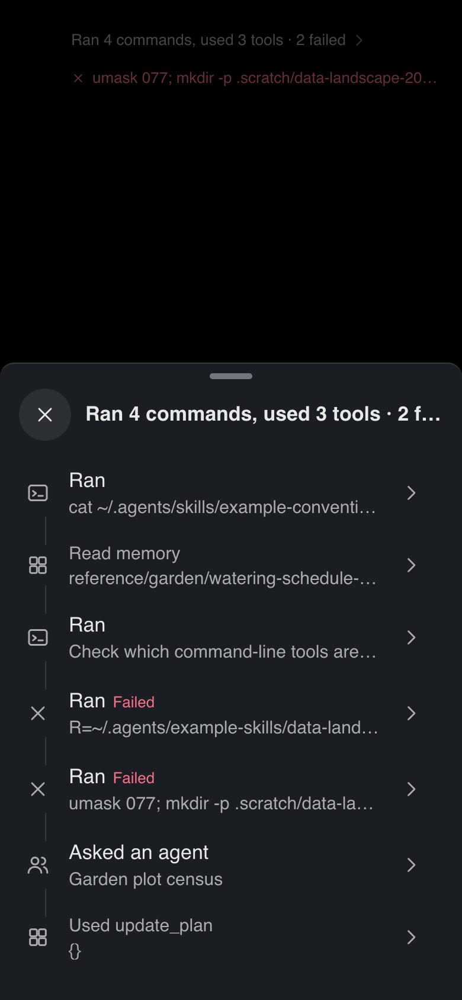
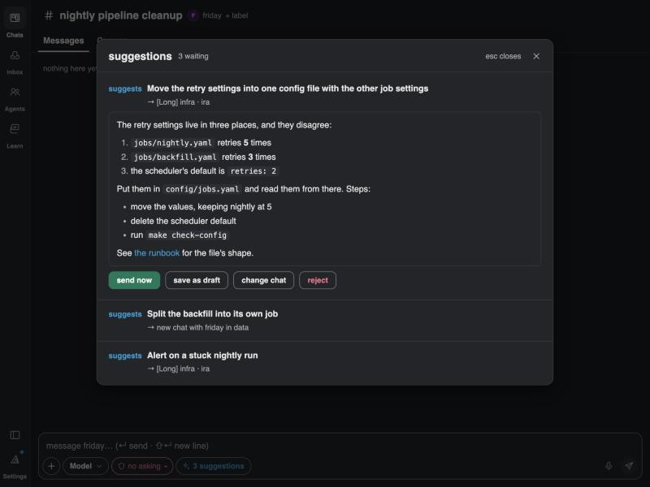

# The loki manual

Everything the README leaves out: every view, every key, every file loki writes. The README is the
tour; this is the reference. Paths are the defaults; Preferences › About shows yours, under "Where loki keeps things".

## Requirements

- **macOS 13 or later.** The shell uses the traffic lights over a hidden title bar, the dock badge and a global
  shortcut.
- **Or, as a preview, 64-bit Windows 10 or 11, or a current 64-bit desktop Linux** (the `.deb` for Debian and
  Ubuntu, the AppImage elsewhere). Built and tested in CI, not yet tried on real machines; what differs is under
  [Windows and Linux](#windows-and-linux).
- **Node 22.19 or newer.** loki runs your agents in its own daemon, a Node process the window starts and keeps
  running (see [docs/architecture.md](architecture.md)). The Homebrew cask brings Node with it. The shell looks
  where installers put it: `LOKI_NODE_BIN`, PATH, then `/opt/homebrew/bin`, `/usr/local/bin`, volta, bun, npm's
  global bin, `~/.local/bin`, nvm and fnm. On Linux the list swaps Homebrew for `/usr/local/bin`, `/usr/bin` and
  Linuxbrew; on Windows it is npm's global folder under `%APPDATA%`, the nodejs.org installer's, volta,
  nvm-windows, fnm, scoop and bun. loki never downloads Node: with none new enough, Welcome says so, names the
  usual command (`brew install node`, `winget install OpenJS.NodeJS.LTS`, or `sudo apt install nodejs npm` /
  `sudo dnf install nodejs`), links nodejs.org, and has **check again**, which looks afresh.

## Install

**Homebrew**, the recommended way:

```bash
brew install --cask almondlabs/loki/loki
xattr -dr com.apple.quarantine /Applications/loki.app
```

The second line matters. loki is not signed with an Apple Developer ID, and macOS refuses to open an unsigned
download as "damaged"; Homebrew quarantines cask downloads like a browser would, and Homebrew 7 no longer has
a flag to skip that (`--no-quarantine` is gone), so the flag is cleared by hand once per install. The cask's
own caveat says the same. Upgrades are `brew upgrade --cask loki`, then the `xattr` line again; the cask
follows each release. Versions are the UTC day and that day's count: `2026.1011.0` is the first stable of October 11, `2026.1011.1` the second (before October 2026, `2026.9.28` was simply the day).

**Nightly**: `brew install --cask almondlabs/loki/loki-nightly` is every merge to `main` that changes more than the docs, built about twenty
minutes after it lands, versioned `2026.1011.1-nightly.a96ee85` after the stable it leads up to and the commit. The two casks
conflict — both builds share `~/.loki`, the daemon and the mod's ports — so switching channels is an uninstall
and an install. Preferences › About shows which channel a build is on and names the right cask in its upgrade line. How releases are cut: [docs/releasing.md](releasing.md).

**The `.dmg`** from the latest release: drag loki to Applications, then clear the quarantine flag once (right-click →
Open is not enough for an unsigned app on macOS 14 and later):

```bash
xattr -dr com.apple.quarantine /Applications/loki.app
```

Or open it, dismiss the dialog, and allow it under System Settings › Privacy & Security.

**From source**: Node, Rust and Xcode's command line tools, then `npm start` to run the checkout or
`npm run desktop:build` for a `.app` (see the README). A build made on your own Mac never carries the flag.

**Windows (preview)**: `loki_<version>_x64-setup.exe` from a stable release, an unsigned NSIS installer. SmartScreen
stops it as an unknown publisher; **More info**, then **Run anyway**, once.

**Linux (preview)**: `loki_<version>_amd64.deb` (`sudo apt install ./loki_*_amd64.deb`) or
`loki_<version>_amd64.AppImage`, which needs `chmod +x` and FUSE 2 (`libfuse2`, `libfuse2t64` on Ubuntu 24.04).
Both are built on Ubuntu 22.04.

Windows and Linux files come on stable releases only, published on their own before or after the `.dmg` of the
same version, so take them from the newest release that has them; nightlies are Mac-only. An upgrade is the next
such release's file; Preferences › About links it when one is out. No package manager carries them yet.

Whichever way, the cask brings Node; the `.dmg`, source, Windows and Linux routes need a Node 22.19 or newer
(Requirements). Then:

1. Open loki. On every launch it puts its daemon, its mod and the phone's canvas under `~/.loki`, and the agent's
   skill at `~/.agents/skills/loki/`, writing only what changed; Preferences › About shows what happened, under "What launch installed".
   Then it finds Node and starts the daemon, which hosts the mod.
2. The first launch shows **Welcome** over the empty window: connect a model provider (paste a key, or sign in in
   the browser, for Anthropic, OpenAI, Google, OpenRouter, Ollama for local models and more; a key is checked with
   the provider, then kept in your system's keychain; every turn is billed by that provider), then name your first
   agent, with a description, a persona and a model. You land on its main chat, on Messages, with the message box
   focused.
3. Ask your agent to put something on the canvas.

Updates are a new release (`brew upgrade --cask loki`, or `--cask loki-nightly`, or the next `.dmg`); the app
re-installs its daemon and mod on launch when the bundle changed. It never overwrites a skill folder it did not
write, so a checkout wired up for development (below) keeps working.

An update can change how a chat store (`~/.loki/stores/<agent>.sqlite`) is laid out, for good: the update to pi 1.4
in October 2026 did. Before the first start rewrites a store, loki copies it whole to
`~/.loki/stores/backup-schema-<version>-<date>/`. An older loki cannot open the rewritten store, so those copies are the
way back to it; delete them once you are happy. Each Mac copies and rewrites its own stores on its own first start.

Saved chats are kept in the shapes loki writes now, so an old chat reads and resumes like a new one. When a store
first opens on a loki that changed those shapes, its saved entries are rewritten once, after a whole copy of the store
to `~/.loki/stores/backup-letta-<date>/` (only when something changes); `~/.loki/stores/migrations.json` notes how far
each store has come, and the older `tool-names.json` is deleted. There are three steps so far. The first takes loki's
new tool names: in October 2026 `ask_user` became `user_ask`, `desk_state` and `desk_camera` became `canvas_read` and
`canvas_focus`, `tasks` became `task_create`, `task_list`, `task_comment` and `task_close`, and `view_image` became
`image_view`. Tasks and its four tools went later that month, replaced by [suggestions](#suggestions); old chats that
called them still read as they did. In November 2026 `image_view`, `ls`, `find`, `grep`, `skill`, `suggestion_list`,
`suggestion_withdraw`, `reply_list` and `reply_withdraw` went too, since another tool or the chat itself already does
what each did (see [Scripts](#scripts) for where `ls`, `find` and `grep` remain); old chats show their calls as they
were. Older names from before then (`Agent`, `Skill`, `bash_background`,
`TaskOutput`, `loki_camera` and the like) take today's names the same way, and so does the "always allow" list; the
whole map is `RENAMED_TOOLS` in `daemon/tool-kinds.ts`. The second rewrites what chats imported from Letta still carried: its tool
arguments, notices and paths. The third, also in November 2026, folds the background task's tools into two:
`background_output`, `background_write` and `background_stop` calls become `background_watch` calls (a read with no
wait, one that types its `input` first, one with `stop`). An "always allow" for `background_write` or `background_stop`
carries to `background_watch`; one for `background_output` does not, since it was only ever a read. A chat on Claude
Code, Cursor or another ACP agent is left as it is, with its agent's own tool names.

Leaving Letta behind also changed a few things once on each Mac (noted in `~/.loki/state/migrations.json`): agent
records take pi-ai's name for ChatGPT's provider and keep their effort as `reasoning_effort`, memory files that named
`~/.letta/loki` name `~/.loki` in a commit by loki, chats run on pi-ai's model names in folders under `~/.loki`, and
Learn's chats from Letta are hidden; a helper agent Letta made is moved to `~/.loki/backend/backup-letta-<date>/`.
loki no longer moves or links `~/.letta/loki`, and it never deletes `~/.letta`, which is Letta's.

## The window

The native title bar is hidden: the traffic lights sit over the rail, and a thin strip along the top drags the
window (double-click zooms). The window title still names what shows — the chat's name, "Flow · n waiting",
"Agents", "Preferences" — for the Window menu and Mission Control. On the left, a rail of five sections, each icon
with its label under it, a red count on what needs you and a quiet count of the cards due on Learn; beside it, for Chats, Agents and Learn, a **sidebar** listing
that section's items; the chosen item fills the rest. ⌘⇧D (or the rail's sidebar button) shows or hides the
sidebar (in Flow, which has none, ⌘⇧D is Deny); drag its edge (or focus it and use the arrows) for a
width between 220 and 420. A window under 1100 wide starts with it hidden. ⌘⇧W hides loki. On Windows and
Linux the strip is loki's own, with ☰ and the window buttons (see [Windows and Linux](#windows-and-linux)).

- **Chats** (⌘1): the sidebar lists your chats — **Pinned** first, then one section per agent (each folds, each
  with its face, the Mac it lives on and a "+" for a new chat with that agent), then **Archived**, folded. Each chat
  is one line, its name alone, the main chat included; the phone's Home draws it the same. A chat's name goes bold
  when its agent wrote since you looked. On the right of each row, one thing: a red badge when it waits on you, else a
  green dot that breathes while its agent is working, else when it last spoke ("5m", "3h", "2d"). Opening a chat (or having it open, the window in front, when a
  message arrives) marks it **viewed**, which clears the bold: the list shows what is new to you, nothing more. The
  Flow keeps the chat until it is **read**: what Flow's → does, a reply, an approval or an answer; by hand
  it is **Mark as read** (⌘⇧↵ on the open chat, or the row's right-click menu), and **Mark as unread** in the
  same menu puts it back in Flow. None of these is done: a chat is done only when it is archived. Viewed
  and read are kept by the mod, so the phone and the Mac agree on both. "Find a
  chat…" at the top filters by chat or agent name (↓ into the list, ↑↓ between chats, ↵ opens the first match).
  Hover a row for pin and archive, right-click it for the same with open, rename, change folder and restore. **Rename…** opens a small dialog with the name selected: ↵ saves, esc cancels, and a name is at
  most 80 characters. Its second line is the chat's **purpose**, one line on what the chat is for, which agents read
  (see [Suggestions](#suggestions)). An agent's main chat is named after the agent and cannot be renamed. A rename, an archive, a label or a purpose shows at once in every other window, on the phone and on a paired Mac. When a chat that waits on
  you is scrolled out of sight, a red "Needs you" pill at the top or bottom edge scrolls to it. The sidebar keeps
  its scroll and folds across restarts.
  **Labels** gather related chats across agents (`infra`, `client-x`): a chat carries up to eight, each a lowercase
  word with its own colour. Add them from the row's **Labels…**, from **+ label** in the chat's header (**edit labels** once it has some), or with
  `/label infra` in the message box (`/label` alone opens the picker); in the picker, type to find a label, ↵ takes
  the first match or makes the label when none matches. A chat's header and its card in Flow show its labels as chips;
  the sidebar rows leave them out, since a chat can carry several. Click a header chip, or type `label:infra` in "Find a chat…", to list that label's chats
  (`label:infra label:billing` wants both); ⌘K finds labels too. On the phone, **Labels** is in a chat's actions, and Home's menu lists every label: a tap filters Home to it, as
  `label:` does on the Mac, and a second tap takes it off.
  The agent is told a chat's labels with your next message (and again when they change), so it knows what you
  file the chat under; only you set them.
  Opening a chat — from the sidebar, ⌘K, Flow, Agents or Learn — shows it like a Slack channel: a header
  with its name, its purpose line under it, its agent and what the agent is doing (on the Canvas tab, a ⋯ menu to arrange, fit and toggle the
  chat; the chat's own actions are the sidebar row's, model and mode are under the message box, find is ⌘F), then two tabs. **Messages** is the
  conversation, the message box focused: each message with the author's face, name and time, a pill for each
  day, a red **New** line before what came since you last looked (it stays put while the chat is open, as
  Slack's does, and moves on the next open), a copy button on hover, and a line each time the agent
  adds, changes or removes a widget ("friday added Revenue chart"). Click that line and the **Canvas** tab opens
  framed on the widget. The Canvas tab is the sheet edge to edge with the chat over it, the sidebar hidden, the
  rail kept: the chat on the left, centred and wider, or on the right (⌘← and ⌘→ move it, ⌥⌘ from inside a text
  box, ⌘/ toggles it, ⌘W closes it; ⌘0 fits all widgets, ⌘⇧0 is 1:1, ⌘= ⌘- zoom, ⌘⇧A arranges, ⌘Z undoes a widget
  move). A side chat is a viewport inset: fit-all, focus and camera glides frame widgets in the uncovered part,
  and opening or closing a left chat slides the sheet so nothing ends up under it. Esc (outside a text box) or
  the Messages tab goes back to the conversation where you left it. Both tabs are the same conversation with the
  same draft. ⌘L focuses the message box and ⌘F finds in the transcript, on whichever tab shows. A long thread
  opens on its newest 60 rows (back to the New line when that is older) and loads older ones 20 at a time
  as you scroll up, keeping your place; find reaches the older ones too, and ↓ latest folds it back. Under the message
  box sit two chips for the conversation: its **permission mode** (strict, standard, accept edits, unrestricted;
  ⌘⇧P; a chat with no mode set runs unrestricted, and its chip reads "no asking"; a shell command made only of
  `ls`, `find`, `rg`, `grep`, `cat`, `head`, `tail`, `wc` and `pwd` counts as a read, so it asks only in strict) and its **model** (⌘⇧M). Select model has three steps: the harness as tabs at the top (loki, Claude Code,
  any agent added in Preferences › Engines; ←→ move between them), that harness's models (loki's lately used and
  featured ones, then **More models**, where you can type to filter), and under them the model's effort levels when it
  has more than one (for loki's models, the levels the model takes, from **No reasoning** up; a chat with none
  chosen runs with no reasoning, and says so). The pill names the harness only when it isn't loki ("Claude Code · Sonnet · High"). Both apply
  per conversation; a main chat's model is the agent's. Cards in Flow carry the same chips in their actions row. When a tool call asks, its card
  offers **approve**, **deny** and **always allow**: the last allows that tool from then on, in every chat and every
  mode but strict, until you take it back in Preferences › Chat › Always allowed. ⌘[ and ⌘] step through live chats,
  each on the tab you left it on.
- **Flow** (⌘2, or ⌥Space from anywhere on the Mac; ⌥Space has no binding on Windows or Linux): the deck as a full view, see below. The rail icon carries
  the waiting count, the same number the tray title and dock badge show.
- **Agents** (⌘4): the sidebar lists your agents like Slack's direct messages — face, name, a green dot while
  one works, the last thing it said, a red count of what waits on you — and the chosen agent fills the pane with
  a tab per page (a first visit lands on Memory); the "+" at the top of the sidebar makes a new agent. **Profile**: face, name, description and model
  (editable), effort and context, "★ favourite" when it is one, where it is working (its live chats, each a
  link, then **main chat** and **chats**), and delete at the bottom. **Memory**: the files as a tree on the left, the one you picked on the right, with "ask <agent> to update
  this". **Changes**: what it learned as a timeline of memory commits, newest first, the diff on the right; a commit by
  reflection or by a memory review (`/doctor`) is marked so. **revert** on the diff undoes that commit with a new one,
  as yours (so a revert can be reverted too); git refuses when a later commit changed the same lines, and says so. **Reflection**: whether loki keeps its agents' memory up to date in the background — on by default and for
  every agent at once: once chats have been quiet for half an hour, the agent reads what was said in them since it
  last looked, several chats together (at most every two hours), and keeps in memory what will matter in later
  chats, counting what recurs across them, the tool calls that failed included, each with the try that fixed it, so a
  mistake the agent keeps making becomes a note on what to do instead (and reads a chat right after its context is
  compacted) — with the last change reflection made; `/reflect` in a chat does it now. Every chat has the agent's core notes (`system/`) in full, and reflection keeps them under 12 KB by moving what not every chat needs into other notes. Those are listed by their one-line description, and the agent reads one when it fits the work; the skills are listed with descriptions cut to 200 characters, under the folder each group is in, and the agent reads a skill's `SKILL.md` with `read` for the rest. **Skills**:
  one line each in two groups — **self**, the ones the agent (or you) wrote ("write" adds one here, "install" takes a
  source: `owner/repo/path` on GitHub, a GitHub or git URL, or a folder on this Mac), and
  **other**, installed from somewhere named on the row (a checkout linked into `~/.agents/skills`, a repo the `skills`
  CLI recorded, a source you typed once). Pick a skill and it opens on the right with its origin, whether the agent has
  edited its copy, and **refresh**: the latest is pulled from the source and compared; an untouched copy is replaced
  and committed; a copy the agent edited is not overwritten — upstream is staged and the agent's main chat opens with a
  request to reconcile, keeping what it learned and taking what upstream improved; a copy that matches is reported
  current. A skill nobody recorded a source for asks for one the first time. **remove** takes a skill out of the
  agent's memory. The page is remembered for the window.
- **Preferences** (⌘, or ⌘6, or the rail's gear): opens over the whole window: six groups down the
  left, and the chosen group's pages as tabs across its top, the last page remembered for the window. A filter over
  the groups finds a page by its name or what it holds ("pair" finds Your devices; Enter opens the first page that
  matched, Esc clears it). ⌘, closes Preferences again, Esc closes it, ⌘1, ⌘2, ⌘4 and ⌘5 close it and go to that section. ↑↓, Home
  and End in the list move between groups, ←→ in the tabs between a group's pages, and ⌘[ and ⌘] step every page in
  order. Each page is the same: settings in rows, the name and a line of help on the left, the control on the right; a
  switch for on and off, a segmented control for a few choices, one green button for the page's main action, red only
  for what removes something. The groups and their pages:
  1. **General**
     1. **Appearance**: system, light or dark (system follows macOS as it changes), and the palette, loki or tokyo
        night; kept per device.
     2. **Chat**: where the panel sits on the Canvas tab (left, centre, right), its width at the side (narrow,
        wide), and the tools that are **always allowed**, each with take back.
     3. **Keyboard shortcuts**: the switch for ⌥Space — the one system-wide key, off if Raycast, Alfred or the
        input-source switcher wants it (Mac only) — and every key loki has, with a search by what a key does, its keys
        or where it works.
  2. **Models and tools**
     1. **Providers**: the providers you have connected, each opening into its key or sign-in; **add a provider**
        opens a search over every provider loki knows, the usual ones first. A key is checked with the provider, then
        kept in the keychain; a sign-in opens the browser, and if the browser does not come back you can paste the
        address it ended on.
     2. **Engines**: what a chat can run on besides loki's own models (see "Chat through Claude Code"): Claude Code and
        Cursor, built in, and any agent you add by the command that starts it, kept in `~/.loki/state/acp.json`. Each shows
        whether it is ready, not found (its command is not on loki's PATH), needs signing in (from its last failure),
        has not been tried yet, starts, or failed; **details** shows the command, **try** starts it now, **edit**
        changes how it starts, **reset** puts a built-in agent back as loki ships it, and **remove** takes out one you
        added. "Any agent that speaks ACP", under the list, adds one by the command that starts it.
     3. **MCP servers**: the servers in `~/.loki/mcp.json`, see "MCP servers".
     4. **Skills**: the global skills in `~/.agents/skills` that every agent reads, each with disable, and a field to
        enable a folder holding a `SKILL.md`; an agent's own skills are on its Agents page.
  3. **Your devices**
     1. **Macs**: this Mac, the Macs paired with it, and pairing another (see "Your other Macs").
     2. **Phone**: the switch that lets phones reach this Mac, the route (Tailscale or this Wi‑Fi), pairing a phone
        (its QR and code) and the paired phones. Mac only for now.
  4. **Flow and Learn**
     1. **Flow**: **Accounts**, each Gmail mailbox, Slack workspace and Jira site connected on this Mac with its
        service, owner and state, **move to** and **disconnect** on each, **reconnect gmail**, **reconnect slack**
        or **reconnect jira** when it needs it, and **sign in again for …** on a Google account that has not allowed
        every service scripts use; **Connect an account**, where you choose the owner, then **connect
        gmail**, **connect slack** or **connect jira** (a form for the site, your email and an API token), with **Use
        your own Google app** folded below it (see "Email, Slack and Jira"); what read, later, archive, label and a
        reply do, a Jira card included (read ends it; archive and label do not apply); **Read rests a card for**, for
        chats and for email, and **Later brings a card back after**, for chats, email, Slack and Jira, on every device
        (see "Return times"); and, under "How the
        order works", what each card's score is made of (see "The order").
     2. **Learn**: the card writer's switch (off until you turn it on), cards a day (a ceiling, five by default, per
        calendar day; once it is reached nothing more is read until tomorrow), run now (every conversation with
        something new, at once), and the last run.
  5. **Labels**: every label on your chats with its colour and how many chats carry it; **rename** (on every chat
     that has it), **colour** (one of eight) and **delete** (asks first, naming how many chats; the chats stay).
  6. **loki**
     1. **About**: loki's own version and whether a newer release is out (asked of GitHub on launch and every six
        hours; `brew upgrade --cask loki` is the way up, or on Windows and Linux a link to that system's file, with
        the preview note), the system it runs on, how the app reaches the mod, requirements
        (the daemon's Node), and, folded, "What launch installed" and "Where loki keeps things".
     2. **Usage**: what your agents spent over the past 24 hours, 7, 30 or 90 days (remembered per device): the
        estimated cost and its tokens, a bar a day (an hour for 24 hours), tokens and cost by type with what the
        cache saved, and what each origin (your chats, helpers, reflection, Learn, the memory review), agent and
        model spent. Choosing a line narrows the page to it. The figures are estimates at each provider's API
        prices, from pi-ai's model table; a subscription sign-in (ChatGPT, say) is billed by its plan, not by these,
        and a model with no known price counts its tokens but not a cost. The daemon keeps the record in
        `~/.loki/state/usage.json`, by hour, for 400 days, whether analytics is on or off; history from before it
        began comes once from `events.jsonl`, with its cost not split by token type.

**⌘K** opens search from anywhere: chats, agents, what waits on you in Flow, and the app's pages (each
section, each Preferences page). It finds names, not message text, and says so. With nothing typed it lists the
places you visited last; ↑↓ move, ↵ opens the top result (a chat on Messages), Esc or ⌘K again closes it. `/chats`
in a message box opens it too. ⌘K used to open the chats tree; the sidebar holds that list now. Typing "desk", the old word, still finds chats.

`?` (outside a text box) opens a sheet of the keys that work in the view showing, its own first, then the ones
that work everywhere (less any the view takes for itself, such as ⌘⇧D in Flow; Preferences › Keyboard shortcuts says so); `?` or
Esc closes it. ⌘[ and ⌘] step through whatever the section showing is made of: chats in Chats, cards in Flow
(where ⌘] reads the card and ⌘[ puts it off for later), views in Learn, agents in Agents, pages in Preferences — the
same two keys everywhere, never a jump back to Chats. Esc peels one layer: a sheet or menu, then the Canvas tab back to Messages, then a view back to Chats. Every shortcut lives in one table
(`app/src/shell/keymap.ts`) that drives the key handler, Preferences › Keyboard shortcuts, and the native menu bar (the ☰ menu
on Windows and Linux: **Go** holds Search, New Chat…, Previous and Next Chat and Mark as Read; **View** holds Arrange
Widgets and Undo Widget Move among the rest), so the menus double as the cheat sheet. Rule of the table: plain letters work where nothing has focus (the
sheet); where a text box has focus (Flow, the chat) the same actions are ⌘ chords, and chords the text
itself uses (⌘Z, ⌘⌫, ⌘←, ⌘→) are never taken.

## Windows and Linux

A preview: built and tested in CI, not yet tried on real machines; problems go to the repository's issues, which
Preferences › About links. Chats, Flow, Agents, Learn, Preferences, search and the mod are the Mac's. What
differs:

1. **The window.** No system title bar: loki draws a 32px strip with ☰ at the left and minimise, maximise (restore
   while maximised) and close at the right, as Slack does there. The strip drags the window and a double click
   maximises; the edges resize. ☰ opens the menus the Mac's menu bar has, with the same items and keys, by mouse or
   by keyboard. The strip stays usable over a dialog. A second launch brings the running window forward instead
   of starting another loki.
2. **Keys.** ⌘ is Ctrl, ⌥ Alt, ⇧ Shift, ↵ Enter, ⌫ Backspace, and every menu, tooltip, the keys sheet and
   Preferences › Keyboard shortcuts write them so. Move Chat Left and Right are Ctrl ← and Ctrl → or Ctrl Shift [ and Ctrl Shift ],
   since Ctrl Alt arrows are the system's there. Hide loki (Ctrl Shift W) is **Minimise loki**: with no tray or
   dock, a hidden window could not come back. In the packaged app the webview's own keys (reload, print, view
   source, devtools, F5, F12) do nothing; Ctrl F is loki's find.
3. **Not there yet.** The tray item and its count, the dock badge, the system-wide ⌥Space, the native menu bar,
   dictation (and its key), phone pairing and Tailscale. Where one would show, loki says it isn't on Windows (or
   Linux) yet.
4. **Folders.** **browse…** in the new-chat sheet opens the system's own folder dialog; folder completion takes
   drive paths and `~\`.
5. **The daemon.** On Windows loki starts it with no console window, in a Job Object that ends it when loki
   exits; on Linux the daemon carries the parent-death signal, so it ends with loki too.
6. **Files.** `~` is your profile folder on Windows (`%USERPROFILE%`), so everything is under
   `%USERPROFILE%\.loki`; the skill link is a junction where Windows refuses a symlink.
7. **Linux** runs loki through XWayland: the shell sets `GDK_BACKEND=x11` unless you set it yourself, since an
   undecorated window on native Wayland still has open resize and button bugs.

Testers: [docs/preview-checklist.md](preview-checklist.md) lists what to try on a real machine.

## Phone

Flow and your chats, on your phone, with nothing installed. Preferences › Phone → switch on "Phones can
reach this Mac" → "pair a phone" → scan the QR with the phone's camera → in Safari, Share → Add to Home Screen → open
the new icon and type the six-character code once (a home-screen app has its own cookie jar, so the code shown in
Preferences is asked for one more time; it stays valid ten minutes). From then on the icon opens on Home. Four tabs
float in a capsule at the bottom — Home, Flow, Agents, More, Flow carrying the waiting count — with a round
Search button beside them:

1. **Home**: the loki header (its menu holds the filter, every label as a chip to filter by, **Refresh chats** and
   **Archived chats**; what filters the list shows as pills over it, each clearing itself), a row of
   shortcuts with their counts (Flow, Learn, Agents, Archive), **Needs your attention** — the head of the
   Flow queue — then **Chats**, pinned first. A long press on a chat (or its actions button) opens its actions sheet: pin,
   **Rename** or archive. The round compose button at the bottom right starts a new chat: pick the agent, a name if
   you like, and the folder, from the folders that agent has worked in on the Mac (its most recent to begin with,
   the full path under the chips). An agent that has never worked in a folder starts its first chat on the Mac.
2. **Flow**: the same cards as Flow on the Mac, in the same order (highest score first, see "The order"), one at a
   time. The card is the conversation: read the thread, reply, attach an image, answer a question; its head opens
   the conversation full screen. Every card, a chat, an email or a Slack message, moves the same way. Swipe right
   (or **Read**) to mark it read, in Gmail or Slack too: a chat or an email rests a while, longer each time (see
   "The order"), and a Slack message is done. Swipe left (or **Later**) to leave it unread and have it back in a day;
   the second Later in a row asks when, in a sheet: later today, tomorrow, in 3 days, next week or a date of your
   own, and closing the sheet leaves the card where it was. **Archive** is a button only (a main chat has none). An
   email card also has **Label**, a sheet of the account's Gmail labels; the card stays for its next move. On a mail
   or Slack card, **Send** sends your reply and marks the thread read; while the reply box holds text a swipe springs
   back, so nothing goes by accident. A mail card's box has its recipients line, where you can add someone to To or
   Cc. A mail reply waits 10 seconds with **Undo** beside it (see "Replying to mail as Gmail does"). Once only resting cards are left Flow says how many and offers **Go
   through them**. An approval leaves only by its decision: the buttons become **Deny** and **Approve**, and it
   refuses both swipes. Undo sits in the top bar for six seconds after Read, Later or Archive, and puts the thread
   in Gmail or Slack back as it was; a move that fails brings the card back with the reason. The top bar reads "n
   need you" (or "n chats" when nothing does). Once you have been past every chat it says "You've been through every
   chat", what this visit did ("2 read · 1 later · 1 archived"), how many still need you, and **Go through again**.
3. **Agents**: a list like Slack's direct messages (All, Running, Waiting on you); an agent opens a readable
   profile with its memory, changes and skills in one scroll.
4. **More**: the paired Mac, then Agents, Learn, Archived chats, Preferences (appearance) and Usage (what the agents
   spent, as on the Mac), then Updates,
   About loki and the connection details.
5. **Search**: chat titles, agents, waiting items and pages the phone already holds — not message text — with
   recent searches and places before you type.

**Learn** (from Home or More) is the same deck, thumb-sized: review, delete and undo; the writer's switch and
knobs stay on the Mac. A tap on a chat or a card opens the conversation: the transcript, the approval or
question card, and a reply box. Opening a conversation marks it viewed, not read, as on the Mac: a chat's name
on Home stops being bold but keeps its dot, the card stays in Flow, and the red New line sits before what
came since your last look on either device. The conversation's actions sheet has **Mark as read** and, once
read, **Mark as unread**, and pin. A chat's suggestions wait behind a chip in its reply box as on the Mac, with the
same four actions (see [Suggestions](#suggestions)), and **Rename** in the actions sheet takes the purpose line too.

The phone's text follows the size you set in iOS (Settings › Display & Brightness › Text Size, or Larger Text in
Accessibility), up to about half again the default; the tab bar stays its own size, as iOS's does. Reduce
Transparency makes the floating tab bar solid, and Increase Contrast makes it and every divider stronger.

The QR and the bookmark carry the Mac's Bonjour name (`my-macbook-pro.local:41415`, from System Settings
› General › Sharing › local hostname), not its address, so the same icon keeps working at home and at the office
when the Mac gets a new address. The phone talks to the Mac directly over the local network (port 41415), so
both must be on the same Wi‑Fi and the Mac must be awake with loki running; some office networks isolate
clients from each other, and then the phone cannot reach the Mac at all — Tailscale (its address appears in
Preferences › Phone too) is the way around that; when it is not, the phone says "Mac unreachable · last seen …" and
reconnects by itself. Each paired phone is listed in Preferences › Phone with when it was last seen; "forget"
locks it out. The rail shows a green dot on the settings icon while the switch is on (a blue one when a newer loki is out). If the icon opens on
"loki did not load", the phone could not reach the Mac (wrong network, Tailscale off, the Mac asleep) or launched from a
cached copy of the page; "try again" reloads, and a page from an older build reloads itself once the Mac answers. Read [SECURITY.md](SECURITY.md)
before switching it on somewhere you do not trust the network.

**Phone, anywhere.** Install [Tailscale](https://tailscale.com/download) on the Mac and on the phone and sign in to
the same account. Preferences › Phone then shows two routes under "route", Tailscale and this Wi‑Fi, each with the
address a phone uses for it; the lit one is what the QR carries, and switching it redraws the QR at once. Over
Tailscale (`my-macbook-pro.tail1234.ts.net`) the phone reaches the Mac from any network — the office, mobile
data, a café — without a thought about which Wi‑Fi either is on. Each paired phone in the list says which route its
last request came in by ("via Tailscale", "via Wi‑Fi"), so there is never a question of which way you are connected.
The small "https on the tailnet" switch runs `tailscale serve` in front of the listener so the phone gets an
`https://<name>` origin; it needs HTTPS certificates enabled for your tailnet (Tailscale admin console › DNS) and
stays inside the tailnet — loki never uses Funnel. Whichever way you switch, the address the phone bookmarked has
changed, so it pairs once more.

**The agent's work on the phone.** A run of tool calls is one line in the chat ("Ran 4 commands, used 3 tools · 2
failed"). Tapping it opens a sheet, as in Claude's app: each step is what kind it was ("Ran", "Read memory", "Asked an
agent") over what it was for on one line, and a step opens to its description, command and output under the tool's
name. A chat's history arrives without each step's command and output, which were most of its size, and without a
background task's or loaded skill's result longer than 1,000 characters; opening a step or that line asks the Mac the
chat lives on for them ("Loading this step…"), on the phone and the desktop alike. Find in a chat does not search what
has not been opened yet.



## Your Macs

loki on more than one Mac is one set of agents. Friday is the same agent on your MacBook and your Mac mini: one
name, one memory, every chat of hers listed on both. Each chat runs on one Mac, its **home**, with that Mac's files
and tools; from the other Mac you open it, read it and write in it as if you sat at its home.

**Pairing.** Install [Tailscale](https://tailscale.com/download) on both Macs and sign in to the same account; Macs
reach each other over your tailnet only, never the Wi‑Fi or the internet. On one Mac open Preferences › Macs and press
**show a code**: it shows six characters and that Mac's tailnet address, for ten minutes. A code pairs one Mac; show
another for the next. On the other Mac, in
Preferences › Macs, pick that Mac in the list of computers on your tailnet (which fills in its address, or type
the address yourself), type the code and press **pair**. Each Mac now lists the other, with **connected**
or when it was last seen, and **forget** on either side unpairs both. A Mac running another version of loki shows
"needs an update": it stays paired, but nothing syncs until both run the same release. A third Mac needs one code:
pair it with any Mac of yours, and it joins the others by itself, introduced by the Mac they share (each Mac must be
paired with every other, since a chat is reached on the Mac it lives on). A Mac you **forget** stays forgotten: it is
not joined again until you pair it by code. While any Mac is paired,
loki keeps the Mac from sleeping when it is idle on power, so a MacBook on its charger with the lid open stays
reachable; a closed lid still sleeps.

**Where things live.**

1. **Agents have a home Mac.** An agent lives on the Mac that made it; change it on the agent's profile ("lives
   on"). A new chat starts on its agent's home, and the new chat dialog says so under **Lives on**: pick this Mac
   instead and the chat runs here, with this Mac's files, for good. If the agent's home is out of reach, the chat
   starts here and stays here. The folders the dialog offers are the home's, and it says what that Mac lacks for the
   agent (a provider sign-in, an MCP server needing a sign-in) before you start.
2. **Every list shows both Macs' chats.** Each agent's section in the sidebar names the Mac it lives on; a chat
   living on another Mac than its agent's has a small laptop icon (hover it for "on Mac mini"). The switcher marks
   every chat on the other Mac, and the phone's Home draws the same laptop and names each agent's Mac. While a Mac is asleep or off, its chats stay listed
   with a moon, "waiting for Mac mini": they do not open and take no message until it is back. Nothing is queued.
   Opening a chat that lives on the other Mac says "loading from Mac mini…" until its messages come; if they do not
   come within half a minute, it says "could not load this chat from Mac mini" with **try again**, rather than
   showing an empty chat.
3. **The first pairing hands chats over.** When a Mac first pairs, it takes over the chats of the agents that live
   on it from the other Mac: pair the mini, and Ira's chats move to it, with their history, folder, labels,
   schedules and canvas. A chat with a turn running moves once it is idle; a chat on Claude Code or another ACP
   agent stays where its session is. Files attached to a moved chat stay on the Mac they were attached on. Setting
   an agent's home later moves its chats the same way.
4. **Move one chat by hand.** Right-click a chat in the sidebar and pick **Move to Mac mini** (or the MacBook): it
   moves with everything above, and works the same in both directions, so you can bring a chat back. A chat you
   moved, or started on a Mac other than its agent's home, stays where you put it: moving its agent's home later
   leaves it. The chat keeps a quiet "moved to Mac mini" line where it moved, and the agent is told with your next
   message there (which Mac it now runs on, and any attached files or folder that did not come along); nothing runs
   just to tell it. A chat mid-answer or waiting for you says so and stays. An agent's main chat is not moved by hand: there
   is one, on the agent's home, and it moves when you change the agent's "lives on".
5. **Memory is one.** An agent's memory is a git repo on each Mac, merged between them as you work. When both Macs
   changed the same lines apart, the note keeps the home Mac's text and the other side goes to
   `conflicts/sync.md` in the agent's memory; its next reflection folds it in. Reflection and Learn read each chat
   on the Mac it lives on, so a Friday chat on the mini still teaches Friday, and a moved chat is not read twice.
6. **What is yours syncs.** Read, unread and viewed marks (the later one wins), Flow's focus (both Macs'
   engagement adds up) and its rests, pins, label colours, Learn's cards and reviews, your MCP servers and your mods. Provider sign-ins, the
   "always allow" list, usage and the shared skills folder stay on each Mac: sign in on each Mac you run chats
   on.

**The phone** reaches every chat on every paired Mac through the Mac it is paired with; if that Mac is off, the
phone waits for it.

## What the mod does

loki's mod runs inside the daemon and owns the canvas and the sockets the app connects to:

- owns geometry and gesture state per chat (`~/.loki/state/<desk>.json`, `<desk>` being the chat's id); places new widgets in the first free spot using sizes the tab reports back, and can tidy a canvas into a grid (the `arrange` button or ⌘⇧A)
- watches `~/.loki/widgets/`, syntax-checks `.tsx` with esbuild, tells the tab what changed
- appends what the user did on the canvas to their next turn (`turn_start`)
- carries each chat between the app and the daemon over its socket (`/ws` on 127.0.0.1:41414): the chat's
  conversation and Flow cards are one model (`core/attention`), streaming token by token
- lists every open conversation for Flow (`inbox_list`): main chats included, however old, with who spoke
  last; a conversation leaves Flow by being archived
- keeps the recall cards (`recall_*`); the daemon's Learn pass writes them: once a conversation has been quiet for half an
  hour it reads the new stretch, asks the agent in its hidden "recall" conversation, and writes cards up to the day's
  cap; the deleted pile goes back into every prompt as what not to write
- serves each conversation's full transcript (`history_get`), which survives compaction, and keeps the read
  (`seen_mark`), viewed (`viewed_mark`) and focus marks Flow and the sidebar need
- keeps each chat's widget change log (`~/.loki/state/widget-log/<desk>.json`, the last 200 rows), sent live
  to every tab and with each chat's history, so the conversation can show who added, changed or removed a widget
- keeps pins in `~/.loki/state/pins.json`
- tools: `canvas_read`, `canvas_focus` (one widget, or several framed together, with an optional dwell). Rendering and authoring are file writes.
- keeps each chat's suggestions on its record and carries out what you do with them; tools: `chat_list` and
  `suggestion_create` (see [Suggestions](#suggestions))

## Install (development)

You need Node 22.19 or newer, Rust (stable, from rustup) and Xcode's command line tools. Node runs npm, Vite, the
Tauri CLI, the tests and loki's daemon. Then:

```bash
npm install
npm start
```

`npm start` checks three things first and stops with the fix when one is missing: `cargo` — on PATH, or in
`~/.cargo/bin` where rustup just put it (Tauri's own message is a bare "No such file or directory") — Xcode's
command line tools (`xcode-select -p`; without them the build fails later with an `xcrun` or linker error), and
that nothing else answers on port 5173, which the window would otherwise show. It then builds the page into
`app/dist` when one of its sources is newer (about fifteen seconds), and starts `tauri dev`, which bundles the mod,
serves `app/dist` on 127.0.0.1:5173 and opens the window (the first build compiles the shell, a few minutes). The
window finds Node and starts the daemon from the checkout (`daemon/main.ts`, hosting `mod/boot.ts`). The script
waits for the mod: if nothing answers on its port after a minute and a half, it says so and names the daemon's
log, `~/.loki/logs/daemon.log`. Ctrl-C stops all of it.

`npm start` puts you in control of when the checkout's changes arrive, after a `git pull` or an edit. The mod reloads
in place when `mod/` or `core/` changes. A change to `app/`, `daemon/` or `core/` waits: the window shows "loki's code
changed" with **update** and **later**, and loki never updates by itself. **update** builds the page if it changed
(the window and the phone reload on the new build) and restarts the daemon if its code changed (the window reconnects
a second later). A page that does not build stays as it was, and the notice says what failed. While a chat is working
or waiting for you, a restart would cut it off: **update** says so and offers **update anyway**.

`npm run dev` hot-reloads instead: the window runs Vite on 127.0.0.1:5173 and shows a change to `app/` as you save,
and a watching build keeps `app/dist` current for the phone. The mod reloads as above, and a change to `daemon/` or
`core/` still waits for **update**. It costs more while it runs: Vite and the watching build hold well over a
gigabyte, and React's development build keeps a timing record for every render, so the window's memory grows for as
long as it stays open. `npm start -- --check` and `npm run dev -- --check` report what each would do without starting
anything.

Or run the pieces yourself: `npm run dev:vite` (Vite alone, for a browser tab) and `npm run desktop:dev` (the window
against a Vite already running, in a second terminal).

A development window installs nothing from its bundle (`LOKI_INSTALL=1` makes it), and its daemon runs the
checkout's code either way (`LOKI_NO_INSTALL=1` runs the installed bundles instead). It links the agent's skill, `~/.agents/skills/loki`, to the checkout's `skills/loki` when nothing is there
yet; whatever is already there stays, and Preferences › About says which, under "What launch installed". The data is the same `~/.loki` the
app uses, and only one daemon serves it (`~/.loki/daemon.lock`): with the installed app running, a development
window leaves that app's daemon serving and tries again every 30 seconds, so quit the app to run your checkout's.

When something does not come up:

1. **The window opens but the app never links** (Vite prints `ws proxy error … 41414`): the daemon is not
   running, or its mod failed. `~/.loki/logs/daemon.log` has the daemon's output, its error at start included,
   and `~/.loki/mod.log` the mod's.
2. **Welcome shows the Node step**: no Node 22.19 or newer anywhere loki looks. It names the command for your
   system (`brew install node`, `winget install OpenJS.NodeJS.LTS`, the distribution's package); install it,
   then **check again**. `LOKI_NODE_BIN` points loki at one it does not find.
3. **The installed app is running**: its daemon holds `~/.loki`, so yours waits (`daemon.log` says it exited with
   code 3). Quit the app.

## Install as an app (Chrome)

The canvas ships a web app manifest, so Chrome can install it: open the canvas
tab, then menu → Save and share → Install page as app. It opens in its own
window with the loki icon. The tab remembers its token and last chat in
localStorage, so the installed app resumes where you left off even though its
launch URL carries no parameters. It still needs loki running: the mod in its daemon serves the app; the page
comes from Vite in a browser tab, or from the loki app itself.

Vim-key extensions (Vimium, Surfingkeys) run inside installed apps too and bind
plain `r` to reload, which also swallows loki's own shortcuts. Exclude the canvas
in the extension's options, e.g. Vimium → Excluded URLs: `http://127.0.0.1:5173*`.

## New chat

Press ⌘N, or the "+" at the top of the Chats sidebar or beside an agent's section (that agent is then
chosen for you). The sheet asks for the agent (chips),
the folder (defaults to that agent's most recent one; recents, typed paths with
completion, or **browse…** for the system's folder dialog; the git branch shows when the
folder is a checkout) and an optional name. **start** creates the conversation
and opens the empty chat on Messages with the message box focused.

**Change folder.** A chat can move to another folder later: **Change folder…** in the chat's right-click menu in the sidebar opens
the same folder field, starting on the chat's folder (recents, completion, **browse…**); **move** needs a folder that
exists and differs. On the phone it is **Change folder** in the chat's actions sheet, with chips of the folders
that agent has worked in. The daemon moves the chat, and its commands and file tools work in the new folder from
the next turn.

**Sending while the agent works.** A message you send while the agent works goes out at once and joins the turn:
once the tool running now finishes, the agent reads it before its next step, so "use pnpm, not npm" changes what
it does next. If the agent is only writing its answer, with no tool running, your message waits for that answer and
starts the next turn. If the turn fails instead (the model could not be reached, say), a message that was waiting for it
starts the next turn on its own. A message that joined a turn cannot be taken back; **stop** still ends a turn going
the wrong way.

**Chat through Claude Code.** Any agent's chat can run through Claude Code instead of one of loki's models, signed
in with your own Claude plan. In a new chat, before you send anything, choose the **Claude Code** tab in the model picker
and one of its models (the others show once it has run once). From the first message the chat stays on Claude
Code: the other tabs are greyed out, and a new chat is how you go back to loki's. loki starts Claude
Code itself, always through `npx` at the adapter version this loki pins (npx fetches it the first time), so it needs
Node and a `claude` that is signed in (`claude /login` in a terminal). In such a chat:

- the replies, tool calls and their diffs show as in any chat, and stay in loki's history and Flow;
- when Claude Code asks before a tool, the card is loki's, on the Mac and the phone; **always allow** goes to Claude
  Code's own list, not loki's;
- the mode chip shows Claude Code's own modes (default, accept edits, plan, bypass permissions);
- the slash palette offers Claude Code's commands, beside loki's own and **/reflect** and **/doctor**, which still
  run on loki's side;
- the picker's effort row offers the levels Claude Code gives the model you're on (low to max, depending on the
  model). loki starts Claude Code as soon as you pick it, so they show a moment later, before you send anything,
  and they're kept for next time;
- Stop cancels the turn, or the session Claude Code is still opening. If Claude Code doesn't answer within three
  seconds, loki ends the turn anyway and says so, and the messages queued behind it go. What Claude Code writes to
  its error output goes to `~/.loki/logs/daemon.log`. After loki restarts, the chat picks up the same Claude Code
  session;
- a message sent while Claude Code works waits for the turn to end, shown as queued, and until then **take back**
  removes it: Claude Code takes one message at a time;
- the agent stays itself: loki adds its persona, its memory and its skills to Claude Code's prompt when the session
  starts, beside Claude Code's own `CLAUDE.md`. Reflection, Learn and /doctor keep the memory up to date from these
  chats as from any other, on the agent's own model in loki. With no provider set up in loki, they run on the agent
  its newest Claude Code or Cursor chat uses instead, in hidden chats of their own with only the memory tools (Learn
  with none), in the agent's memory folder, and with every permission Claude Code asks for refused; each run spends
  a little of that allowance. **Agents › Reflection › Without a provider** turns this off (**wait**), and they then
  wait until a provider is set up;
- the agent has loki's own tools, as the **loki** MCP server: its memory (read, write, edit and delete, each change
  committed as in loki's chats), schedules, questions in loki's card, the canvas, `chat_list` and the suggestion
  tools, and any your mods add. Claude Code's own tools cover files, commands, web search and subagents;
- Claude Code compacts its context by its own rules, and `/compact` is Claude Code's. Every turn stays in loki's
  history all the same, and the agent can search the whole chat (`history_search`) and read any part of it back
  (`history_read`), so what a compaction dropped, or a session that couldn't be picked up again, isn't lost to it;
- every MCP server the agent has on in loki (Agents › Profile) is there too, under its own name: loki hands Claude
  Code each one's settings and Claude Code connects to it. A server that signs in (Notion, say) asks once, the first
  time a Claude Code chat uses it: a card in the chat asks to open its sign-in page, and **allow** opens it in this
  Mac's browser. Claude Code keeps that sign-in for every later chat; loki's own sign-in stays for loki's chats. A
  local server you gave its own folder can't be handed over and stays out (the daemon's log says so). Servers you set
  up in Claude Code itself load as well;
- tools that only read, and loki's memory, history, question and suggestion tools, run without a card, as they do in
  loki's own chats; anything else asks as Claude Code's mode says.

Whether your Claude plan allows use through another app is between you and Anthropic; read your plan's terms.

**Chat through Cursor.** A chat can also run through Cursor's CLI, signed in with your own Cursor plan, and use the
models Cursor offers. Install Cursor's CLI and run `cursor-agent login` once in a terminal. The **Cursor** tab then
shows in the model picker; it stays hidden until the CLI is installed. It works as Claude Code does above (cards, Stop,
queued messages, loki's tools), with these differences:

- the mode chip shows Cursor's modes: agent, plan and ask;
- loki asks Cursor to use your CLI login each time it starts Cursor, which takes a few seconds. If you're signed out,
  Preferences › Engines says to run `cursor-agent login`;
- Cursor loads the MCP servers set up in Cursor itself (a project's `.cursor/mcp.json`). It may not load the ones
  loki hands it.

Any other agent that speaks ACP and needs the same sign-in step can be added in `~/.loki/state/acp.json` with an
`auth_method`: the method id it lists when it starts (`grok.com` for Grok Build, for example). A `login` field, there
or on any agent, is the sign-in command loki shows when the agent says you are signed out.

## Questions from the agent

When an agent calls `user_ask`, the conversation (on either tab) and the card in Flow show
a question card instead of a permission block: each question with its options (pick one, or pick many), and, when
there are several questions, an "or your own…" field under each. **answer** sends everything back in one go. With a
single question, the message box is the way to answer in your own words: what you type there is treated as the
answer.

## Quick replies

When an agent's turn ends on a choice you are likely to make from a few clear options, it may offer them as quick
replies: two to four buttons under its last reply, in the chat and on its card in Flow, on the Mac and the phone. A
button's words are the message: a click sends them as yours, as if you had typed them, and the agent acts on them. On
the Mac, **1** to **4** send the matching option while the message box is empty and has focus; each button shows its
number. The buttons belong to the last reply only: once you send anything, clicked or typed, or the agent starts
another turn, they go. Agents are told to offer them only at a real fork, to ask with a question card when they cannot
go on without an answer, and to make a [suggestion](#suggestions) for work that belongs in another chat. Every agent
learns of them, loki's own and those on Claude Code or another ACP agent.

The agent writes them at the end of its reply as a `<loki-replies>` block of `- ` lines, which the thread never shows
as words. A block that is not the reply's last thing, or has one option, more than four, a repeat or a line over 80
characters, shows no buttons. An older paired loki shows the block as written.

## Images and files

Attach with "+", paste (⌘V), or drop onto any message box, on the Mac or the phone.

- **Images** (PNG, JPEG, GIF, WebP, HEIC, HEIF, BMP, TIFF) show as a thumbnail above the box, with × to remove; send puts them
  inside the message as base64 image parts, so the agent sees them at once. Large images are shrunk to 1600px on
  the long edge before sending. The picture shows on your message in every window, after a reload too, on the Mac
  the chat lives on and the phone: the daemon keeps a copy of each in `~/.loki/chat-images/`, named by its content,
  and a Mac showing a chat that lives on another asks that Mac for its pictures.
- **Images the agent looks at** with its `read` tool are shrunk the same way on a Mac (over 300 KB: 1600px on
  the long edge, as JPEG, by macOS's `sips`), since each is kept in the chat's history for good; a GIF and a small
  file go as they are, and so does every image on Windows and Linux. Images an agent looked at before this shrink
  are still whole in the history: quit loki and run `npm run shrink-images` to see what shrinking them would save, then
  `npm run shrink-images -- --apply` to do it. It copies each store it changes to `~/.loki/stores/backup-<date>/`
  first (delete the copies once you are happy), shrinks only images in tool results, leaves your own pasted images as
  they are, and refuses while loki is running. Each chat it touched writes its prompt cache once more on its next turn.
- **Any other file** (a PDF, a spreadsheet, a log, an SVG) is uploaded to the Mac as soon as you add it, into
  `~/.loki/uploads/<yyyy-mm-dd>/` under its own name (a number is added when the name is taken). A chip shows
  its name and the upload's progress; send waits until it is there. × before sending deletes it again. The message
  carries only where it is, in an attachment tag
  (`<attachment kind="file" local_path=… name=… mime_type=… size_bytes=… />`); the agent reads it with its own tools.
  The chat hides the tag and shows the file as a chip on your message; in the desktop app a click shows it in its
  folder. 25 MB per file.
- Text, code, CSV, JSON and Markdown the agent reads directly; a PDF, Word or Excel file needs a command-line tool on
  the Mac (`pdftotext` from `brew install poppler`, or Python), which the agent runs itself.
- Uploads stay until you delete them; archiving or deleting a chat leaves them.

## Dictation

The mic in any message box (or ⌘D while it is focused, on the Mac; ⌘M stays macOS's minimise) dictates through the
browser's Web Speech API. It shows on the Mac and on the phone, where the browser has speech recognition; not on
Windows or Linux yet. Recognition stops by itself when you pause; Enter
sends. Chrome may send the audio to Google's speech service unless on-device
recognition is available, so treat it like any other cloud dictation.

## Flow

A chat is not done until it is archived. Flow holds every chat you have not archived, except one whose agent
is mid-turn, where there is nothing to do yet. Mail and Slack threads addressed to you, and the Jira tickets you
watch, are cards in it too, once you connect those accounts (see "Email, Slack and Jira" below). Flow's icon on the
rail counts what needs you; click it, press
⌘2, or ⌥Space from anywhere for a Slack-style deck, one conversation per card with the recent thread inside it (newest at the bottom,
tool calls as muted markers), highest score first (see "The order" below).

Every card, a chat, an email, a Slack message or a Jira ticket, stays until it is done, and the same keys move each of
them:

1. **Read**, → or ⌘] (the card's **read**), marks the card read: a chat is seen, an email is marked read in Gmail,
   a Slack message is marked read in Slack, and a Jira ticket is read in loki only. A chat or an email then rests and
   comes back in an hour, longer each time while nothing new comes (see "Read sets a card down" below), and at once if
   something new arrives. A Slack message or a Jira ticket is done once read.
2. **Later**, ← or ⌘[ (the card's **later**), keeps the card unread, in loki and in Gmail, and brings it back in a
   day, or sooner if something new arrives. From the second later in a row on the same card, loki asks when it should come back:
   later today, tomorrow, in 3 days, next week, or a date up to about a month on; Esc closes the question with nothing
   scheduled. Once the thread gets something new, or you read the card, the next later counts as a first one again.
3. **Archive**, E or ⌘E (the card's **archive**), is done for a chat or an email: the chat is archived, the thread is
   archived in Gmail, and either leaves Flow. On a Slack card archive marks the message read, which is its end
   too. A main chat cannot be archived, so it always stays, and the card springs back saying "main chats stay". A
   Jira card has no archive: the key leaves it where it is and says "a jira card ends with read".
4. **Label**, L, on an email card only, opens the account's Gmail labels; the one you pick is added to the thread and
   the card stays for your next key, so "label and archive" is two moves. On a Jira card it does nothing.
5. **Undo**, Z or ⌘Z, takes back the last move on any card, a rest, a chat's read mark or archive, or what a move did
   in Gmail (the thread comes back unread or in the inbox, as it was). The ⌘ forms work while you type a reply.

A move that loki or Gmail refuses brings the card back on top with the reason. Approval and question cards never
rest: an approval leaves only by Approve or Deny, and read or later on it only moves past it for this visit. Once
only resting cards are left, Flow says "You're caught up", how many rest, and **go through them**. A or ⌘↵
approves, D or ⌘⇧D denies, R focuses the reply box, O or ⌘O opens that chat on Messages with the message box focused,
Esc returns to Chats. Preferences › Flow lists these keys and sets the return times for each kind of card (see
"Return times" below).
The header reads "n need you" and "m chats", counting the lane you are in (see "Lanes" below). Once you have been
past every chat the deck says "You've been through
every chat." with what this visit did ("5 moved past · 2 archived · 1 approved · 1 reply"). Closing Flow
ends a visit; opening it again starts a fresh one.
Flow runs in the browser. Its list is the mod's: every open conversation of your agents (`inbox_list`), main
chats included, with who spoke last — nothing is windowed by age or capped by count, so a conversation only leaves
Flow when it is archived (main chats are never archived, so they always stay). The live half — streaming,
approvals, answers — comes over the same socket. The read (`seen`), viewed and focus marks live in
`~/.loki/state/attention.json`, so the phone and the Mac share them.

Slash commands work in the message box, and in the reply box of a card in Flow: type `/` and a palette lists what the
box can run — loki's own (`/model`, `/mode`, `/suggestions`, `/flow` (`/inbox`, its old name, still works), `/label [label]`, `/chats` for ⌘K search) and the daemon's:

- `/compact [instructions]` summarises the conversation so far; `/clear` starts the agent afresh in the same chat (the
  thread stays). A summary, yours or the one the agent makes when its context fills, loses nothing: every turn stays
  stored, and the agent can search the whole chat (`history_search`) and read any part of it back (`history_read`),
  by the same row numbers the thread has. Each summary leaves one quiet "chat compacted" row where it was written:
  below it the agent has every turn word for word, above it only the summary, which opening the row shows. While a
  summary holds the turn up the row reads "compacting the chat", and a summary that fails says "compaction failed"
  and why.
- `/remember [what]` asks the agent to save something to its memory; `/reflect` runs reflection on this chat now.
- `/doctor` reviews the agent's whole memory and cleans it up. It tidies (merges what says the
  same thing, splits or merges files by subject and size, drops one-off details of past tasks) and makes judgement
  calls (facts whose date has passed, contradictions, where the newer or more specific one wins, a persona that drifted
  from the rest of memory). It also keeps the core notes (`system/`) under their 12 KB, moving what not every chat
  needs into described notes, all in one review where reflection takes a few runs. It edits directly, each change a commit by "Doctor"; the command's row shows its report,
  one line per change, and Agents › Changes lists the commits, each with revert. It runs in the agent's hidden
  `doctor-<agent>` chat, in the same queue as reflection and Learn, and only when you ask.

↑↓ move, ↵ runs (or fills in a command that takes arguments), ⇥ fills in, esc puts the palette away. A command lands
in the transcript as one quiet row: the command line, then its outcome. `core/attention/commands.ts` is the table. Every bubble has a copy button under its outer corner (shown on hover, or when it has focus) that puts the
message on the clipboard as the markdown it was written in, not the rendering.

### Learn (⌘5)

The mental model — what the writer reads, asks, writes and costs, and how leads become lessons — is
[docs/learn.md](learn.md); this section is the reference for the keys and the files.

Spaced-repetition cards, for keeping what the conversations taught you. **Off until you switch it on**: the
writer spends your provider budget in the background, so the section's first visit explains what it does and
offers the switch (Preferences › Learn has it too, with the knobs). Nothing about the cards happens in
chat: the daemon's Learn pass, one of its background passes, watches for conversations that have gone quiet, hands their new stretches of
transcript to the agent together — one question per agent, the stretches most worth reading first, up to a
budget; what does not fit waits for the next tick — and writes whatever comes back: one fact per card, a
question that stands alone, an answer in a line or two, up to a daily cap (five by default) shared
across the stretches. Reading them side by side, the model writes one card for a fact that came up twice and
a revision, not a second card, for a later correction; a card the person keeps failing brings the tail of the
conversation it came from along as a marked replay, for the rewrite only. You meet the cards only here: the front, space (or ↵ or ↓) for the answer, then one of two answers — ← again or → got it
(1 and 2 do the same; space then stands for got it; either arrow shows the answer first) — that schedules the next sight of it with FSRS,
the scheduler modern Anki uses.
The sidebar lists four views, each with its count: **Review** (the deck), **Leads**, **All cards** and
**Deleted**; ⌘[ and ⌘] step through them. New cards come first with a mark, because the first look is also the moment to throw one out: **deleting a
card (X or ⌫) is the signal.** Deleted cards move to a pile the worker reads before writing, as examples of what
not to write, so a rejected card never comes back reworded; a card deleted after many failed reviews reads
as "badly written", one deleted unseen as "not wanted". Cards you keep failing are offered back to the worker
for a rewrite. E edits in place, O or ⌘O opens the chat it came from, Z undoes a delete, ⌘R refreshes. **All cards** lists every
card with search and holds the writer's knobs — on/off, cards a day, run now — and an
export in Anki's plain-text import format. Everything is files: `~/.loki/recall/{cards,schedule,rejected}/<id>.json`,
content and review history kept apart so the writer's edits never touch your schedule. The writer asks each agent in a
hidden conversation of the agent's own, cleared before each run and with no tools, and only for concepts,
principles and knowledge of your field that will still be true in months — never a detail of the task at hand;
most conversations give no card. Reflection never reads that conversation, so the writer's digests of your
conversations are never turned into the agent's memory.

**Leads.** In the same call, the writer names up to two things per conversation the person could learn
properly: a concept they asked about, an explanation they took on trust, an acronym that went by. Each is a
lead — a title, one line quoting the moment, a depth (a primer in one sitting, or a course) — listed in the
**Leads** view, newest first, at most twelve open. Clicking a lead creates a `[Learn] · <title>` conversation
with the agent that was there, puts an info card with the lead on its canvas, opens the chat on Messages and sends
the brief as your first message: open with why this matters to you, furnish the canvas with the outline as a list you
can tick, ask before telling, one idea at a time, a cold quiz at the end. A lesson whose brief never arrived (the
conversation is still empty) is listed under "lessons under way" with **send the brief**.
**not this** moves the lead to a dismissed pile the writer reads before proposing again (restore under
**Deleted**, with the deleted cards). Learn conversations are chats in the sidebar and never cards in Flow. Files: `~/.loki/recall/{leads,leads-dismissed,lessons}/`.
The plan is `docs/plans/2026-09-12-008-feat-loki-learn-plan.md`.

Every chat row, chat header, message and card in Flow shows the face of the agent that owns the conversation (its
`profile.png` from memory, or a coloured initial), so multi-agent setups stay legible.

### Lanes

A lane is a part of your work you choose to see on its own: the chats of all your agents or of the ones you pick (or
none), and the mail and Slack of all your accounts or of the ones you pick (or none). "Chats only", "Ada's chats" and
"everything Ada owns but her chats" are each a lane. A lane set to all agents or all accounts takes in the ones you add
later; a picked one does not. Deleting an agent or an account takes it out of every lane.

**Making one.** Preferences › Flow lists your lanes above the return times; **new lane** opens the editor: a name, then
chats from all agents, picked agents or none, then mail and Slack from all accounts, picked accounts or none. Each
account shows the agent that owns it, and the Mac it lives on when that is a paired Mac. Names must be there and differ.
Lanes are made and edited on a Mac; your paired Macs and the phone get them as you save.

**Switching.** Flow's title names the lane you are in ("flow · work" on the desktop, "Work" on the phone); click or tap
it for the switcher: **everything**, your lanes, then a lane for each agent with cards waiting (its chats and the
accounts it owns), busiest first. The desktop menu also has **new lane…**, which opens Preferences › Flow. Each device
keeps its own lane until you switch, so the Mac can sit in Work while the phone stays in Everything; a new device starts
in Everything.

**What a lane changes.** The deck holds only the lane's cards, in the usual order. Nothing from another lane breaks
through, approvals and questions included; a quiet line says "4 waiting in other lanes" instead. That device's badges
count only the lane: the rail, the window title ("Flow · Work · 3 waiting"), the tray and dock, the phone's Flow tab and
Home's "Needs your attention". The chat list, ⌘K and Search still show everything. An empty lane says you're caught up,
with the count from other lanes and **back to everything**; an agent's lane stays on when it empties and leaves the
switcher once you move on.

**What a switch keeps.** Switching moves no card: rests, laters and unread marks stay as they were, and a card the lane
hides is not read. The card on top stays on top when the new lane holds it. Undo takes back only moves on cards in the
lane you are in; switch back to undo one made elsewhere. A mail or Slack reply you were typing is kept for the session,
so it is still there when its card comes back. Proposed replies and suggestions belong to the owning agent's chat card,
so a lane shows them through its chats, not through an account.

### The order

The deck is a scheduler's ready queue: one score per card, one list, no sections. Every chat you have not archived
is in it, with the mail, Slack and Jira cards, except one whose agent is mid-turn and one read or later has rested (below). The score is
`blocked ? 100 : 0` (an approval or a question — an agent is stopped until you answer; a reply that only reads like
a question, ending in "?" or "let me know", counts until you have looked at it) `+ new ? 10 : 0` (the
agent said something since you last looked) `+ 15 × focus`
(the chat's share of what you have been doing lately) `− 0.1` an hour since the last message (`+ 0.1` for a
blocked card, so the agent waiting longest comes first). A failed turn is not blocked: nothing waits on you,
so it ranks like any other card. The badges (the rail's Flow count, the phone's tab, Home's **Needs your
attention**, search's waiting group) count only what needs you: an approval, a question, a failed turn, or
something new.

**Focus is learned, never set.** Every chat keeps a weight that your actions add to — a message you send
(from the Mac, the phone, Flow or the terminal) adds 1, answering a question 1, approving or denying ½,
opening and reading the chat ¼ (at most once every half hour) — and that halves every 12 hours. A chat's
focus is its weight over everyone's weight plus 2. Work a task hard and its chat rises; start another task and
the old one gives up its share as soon as you engage elsewhere, then fades in a day or two, with nothing to
park. After a quiet week every share is near 0 and cards rank by age alone. The agent's own turns and
scheduled prompts never add focus, so a busy cron cannot talk its way up. The Mac's loki process keeps the
weights (`focus` in `state/attention.json`), so the Mac and the phone rank alike.

**Read sets a card down.** Read (⌘] or →, a right swipe on the phone) rests a chat or an email card for an hour, so
the card you set aside stays aside while you finish the one in front of you, instead of coming back half-loaded. A
card with nothing new (no new message, no approval, no question) climbs: each further read on it rests it three times
longer, 1 hour, 3, 9, 1d3h, 3d9h, up to a week. A chat that has already been quiet longer rests at least that long
again, so a chat quiet for two days stays away two more; an email starts at the first rest however old it is. A card
with something new rests the first rest and does not climb, and so does a read straight after replying to a chat on
the same card: when the answer lands, the card is back. A Slack message or a Jira ticket does not rest: read is its
end. An approval
or a question never rests. Anything new in the thread ends the rest and starts the ladder over: the agent's next
message, question or approval (an idle agent speaks up only when a background task finishes or a schedule fires),
whatever you send into the chat (from the card, the chat or the phone), which starts a turn, or new mail in an email
thread. Opening a chat, or reading the mail in Gmail, does not: a card you read and set aside keeps resting.

**Later puts a card off.** Later (⌘[ or ←, a left swipe on the phone) keeps the card unread and rests it for a day,
whatever rung it was on; anything new in the thread brings it back sooner. From the second press in a row on the same
card, later asks when the card should come back instead (see "Flow" above). A read, or anything new in the
thread, starts that count over.

**Return times.** Preferences › Flow sets them for each kind of card, on every device, the phone included:

1. **Read rests a card for**: the first rest after read, for chats and for email apart: 10 min, 30 min, 1 hour (the
   default) or 3 hours. The ladder above climbs from it.
2. **Later brings a card back after**: the later return, for chats, email, Slack and Jira apart: 3 hours, 1 day (the
   default), 2 days or 1 week. A Mac still on a loki from before Jira's row puts a Jira card off for Slack's
   time, and keeps Jira's when you change another.

A rest keeps the time it was given, so a change counts from the next press on. How fast the ladder climbs, and the
question the second later asks, are not settings. Undo puts the card back at once, on the rung it had. Once only
resting cards are left, Flow says how many and offers to go through them. The Mac's loki process keeps the rests
and the return times beside the focus weights (`rests` and `return_times` in `state/attention.json`), and paired Macs and the phone share
them; `npm run analytics` reports how often a card back from a rest is acted on, by rung.

Each card says `in focus` after its time when focus is worth 3 points or more (blocked cards say it with their
badge). The order is recomputed on every event — an approval or reply on the card in front of you, a turn
finishing or blocking anywhere, the half-minute clock — and again whenever a card is popped, but the card in
front of you never moves until you act on it; whatever arrives lands behind it. `core/attention/priority.ts`
is the score, `core/attention/focus.ts` the focus, `core/attention/rest.ts` the rest.

**What Flow is tuned for: finished work.** Engagement counts every reply as a win, a shallow one too, and it
rose the more you hopped between chats. So `npm run analytics` leads with finished work: chats archived, and a day;
the messages a finished chat took (median, counting chats you messaged in the period); and how often, coming back to
a chat within three hours, you had messaged none, 1, 2 or 3+ other chats in between. Engagement stays beside it for
comparison. Every card that comes to the top is logged (`inbox_card_shown`),
and every decision on it (`inbox_card_decided`: what you did and how — a key, a click, a swipe or a tap — which
chat, where the card stood, its score, focus and reason, whether it was new, how long the chat had been quiet and
how long the card was on top, counting only the time loki's window was visible and focused). `npm run analytics`
reports how often you engage with a card (reply, answer, approve, deny or open it) rather than move past or
archive it — a read straight after acting on the same card is moving on, not a skip, and is left out — how often that card was the one on top, the median
rank of the cards you engaged with, how many distinct chats that was, the engaged share by the rank a card was
shown at, how many moves you took back, and how long a finished turn waits for you. The weights
above are the starting point.

**A reply on a chat card keeps the card.** Send a reply (or answer a question) and you stay where you are: the answer streams
into the card, and a follow-up typed then goes out while the conversation's prompt is still cached. Moving on
is yours (→ or ⌘]); if you do, the answer brings the card back in this visit by score — higher now, since your reply added to
its chat's focus — behind whatever you are reading then. A reply on an email or Slack card goes with a key instead
(see "Reply from the card" below), and a comment on a Jira card goes alone (see "Jira tickets" below).

### Email, Slack and Jira

Mail and Slack messages addressed to you, and what others do on the Jira tickets you watch, arrive in the same deck as
your chats, one card per thread or ticket, so you need not open Gmail, Slack or Jira to find what waits on you. Connect
them in Preferences › Accounts. A Gmail mailbox, a Slack workspace or a Jira site is an **account**, and you can connect
as many as you like.

**Each account belongs to one agent.** Under **Connect an account**, press **connect gmail**, **connect slack** or
**connect jira**; the account goes to the agent under **Goes to**, which starts on your first agent: the agent that gets the account's
hand-offs and is the only agent with tools for it. No account is ever connected without one. The owner picker on an
account's row gives it, and its tools, to another agent at any time; **disconnect** asks once (**disconnect
…** or **keep it**), then stops watching it, deletes its sign-in from the keychain, and its cards leave Flow.
Deleting an agent that owns accounts lists them on its Agents page and asks you to move each to another agent or
disconnect it first. An account lives on the Mac it was connected on: only that Mac watches it, a paired Mac refuses
to connect it a second time, and its cards reach the phone and your paired Macs the way that Mac's chat cards do.

**Connecting Gmail.** **connect gmail** opens Google's sign-in in your browser; sign in and allow, and the mailbox
shows on the page once Google sends you back. loki signs in with one shared Google app it ships, so there is nothing
to set up in Google Cloud. That app is not verified by Google, which has two effects: Google shows a warning screen
first ("Google hasn't verified this app"; choose Advanced, then go on to loki), and the shared app can sign in at most
100 people over its whole life. A Google Workspace admin may also block unverified apps or the Gmail API for their
people. In either case, fold open **Use your own Google app**, fill in the client id and secret of an OAuth client of
your own in Google Cloud (a desktop app), and **connect gmail** signs in with it instead; its id and secret are kept
in the keychain with the account. One sign-in asks Google for five services: Gmail, Drive, Sheets, Docs and Calendar,
for the owner's scripts (see Scripts). Google's page may let you untick some; loki keeps what you allowed, and the
row says which services scripts cannot use yet, with **sign in again for …** to add them. A mailbox connected before
loki asked for more than Gmail shows that line too. Signing in again keeps the account's owner and its cards, must be
the same Google account, and leaves the old sign-in working if you cancel or untick Gmail. Full Drive access is a
scope Google treats as sensitive, so its warning screen says more than it did for Gmail alone.

**Connecting Slack.** **connect slack** reads the workspaces signed in to the Slack desktop app on this Mac and lists
them; **connect** on one connects it, and each workspace is its own account. There is no Slack app to create and no
admin to ask. The first time, macOS asks whether loki may use "Slack Safe Storage", the key Slack keeps its sign-in
under; allow it. loki calls Slack as you, through that session, and keeps the session in memory only. Slack is Mac
only for now, since the desktop app keeps its session differently on Windows and Linux. Some workspaces' rules forbid
using the desktop session this way, and Enterprise Grid may notice it; check yours before connecting.

**Connecting Jira.** **connect jira** opens a form for three things: the site's address (as in `acme.atlassian.net`; a
whole web address from the site works too), the email of your Atlassian account, and an API token. Make the token in
your Atlassian account settings, under Security › API tokens: a classic token, with no scopes to choose. Atlassian
tokens expire, after a year at most, so you will make a new one now and then (see "When an account stops working").
Press **connect**. loki first asks the address where the site's API lives, without the token, and sends the token only
there, so a site on its own domain works and its cards link to that domain. A wrong address or a token Jira does not
accept is refused with the reason, and nothing is kept. The token lives only in the keychain. Jira works on every
system, Windows and Linux included, and Jira Cloud is the only kind it connects to.

Before or after you connect a site, do two things in Jira and Slack, or each event on a ticket reaches you two or three
times, as a Jira card, as mail and as a Slack message:

1. Remove the Jira app from Slack.
2. Switch off Jira's email notifications, in the email notification settings of your Jira profile.

**What becomes a card.** loki watches each account itself, once a minute, with fixed rules; no model reads your mail
or messages to decide.

1. Gmail: every thread in your inbox becomes a card, read or unread, newsletters, receipts and notifications
   included, so loki's Flow and the Gmail inbox hold the same threads. The card follows Gmail's read state: read the
   mail in Gmail and the card stays, as read; archive it there and the card ends at the next check. loki notes what kind of mail each one is (to you or not, a list, sent by a machine, and Gmail's tab),
   read from the message's headers and labels, and keeps that beside what you do with it (below).
2. Slack: a DM or group DM with unread messages, and each unread Activity item: an @mention of you, a reply in a
   thread you are in, an @channel or @here, and a mention of a user group you belong to. Mentions and replies inside
   threads arrive as Slack's Activity lists them; loki does not search for them. Slack allows few reads of Activity a
   minute, so each minute loki reads only its newest page and walks the whole list every 15 minutes: an item read in
   Slack leaves its card within 15 minutes, and a long list is walked a few pages at a time when Slack asks loki to
   wait. Opening a card while Slack asks loki to wait half a minute or less shows the thread once the wait is over.
3. Jira: a ticket you watch (Jira's own watcher list, which you join with the eye on a ticket, and which Jira often
   joins you to when you create or comment on one), once someone else comments on it, changes its status or edits any
   of its fields, the sprint and the rank included. What you do yourself never brings a card or counts as new, and
   editing a comment that is already there is not an event. A ticket that is assigned to you or mentions you but that
   you do not watch brings no card. Jira's search can trail a change by a little, so a card may come a minute or two
   after its event.

A card is one thread: a new message in it updates its card rather than adding another, and brings back the card of
a thread you archived, as does moving an archived thread back to the inbox in Gmail; a Jira ticket's later events join
its card the same way. A message you wrote yourself
never counts as new, so your own reply does not bring a card back. Every card in the Mac's Flow, a chat's
too, has the same two-line header: a face (the sender's Slack photo, a mail sender's initial, a chat's agent) with a
small `#` for Slack or an envelope for mail in its corner; who wrote on the first line; then where or what and when: a
Slack channel ("#crm-support") or "direct message", a mail's subject, a chat's title. The workspace or mailbox is named
only when you have more than one of that service connected. A tag at the end says **how directly the card is meant for
you**, most direct first: **direct** (a Slack DM), **to you** (a mail with you in To or Cc), or a chat that asked you
or needs approval, marked with the red dot; **mentioned you**; **your thread**, or a chat that finished or failed;
**your group** (a Slack user group you are in) or **not to you** (a mail you were not addressed in); **@channel** or
**list**, and **automated** (a mail sent by a machine), both in muted ink. A mail from a machine or a list reads as
that even when it is addressed to you. The phone keeps its own header for now. A card files under its owner's tab in
Flow, with your chats with that agent. Opening it reads the **whole thread** from its account: every message, oldest
first, with who wrote it and when, and yours marked **you**; mail loses the earlier thread its client quoted under
each reply ("On … wrote:"); on a mail drawn as designed, **•••** under it shows that thread. A forward reads open, with
or without a note above it, and a mail that is all quote shows it. A mail with an HTML part is drawn as its sender designed it, on a light page: its
layout, its images and its links, which open in your browser. Images load as they do in Gmail, so a sender can tell
you opened the mail. Nothing in a mail runs: no script, no form, no frame. A plain mail, or a Slack message, keeps its
text, with its web addresses made into links. **A Slack card opens on what brought it**: the messages that brought it
into your Flow, with 5 messages before and 5 after, drawn as a chat draws messages, with faces, day pills, @channel
marked, and Slack's red **New** line before the first new one; the card opens on that line. What brought it, a mention,
an @channel, a group mention or a reply in a thread you follow, has Slack's yellow mention look; a DM's unread messages
have the New line alone. When everything new is a reply in one thread, the card shows that thread alone, its first
message pinned on top; otherwise it shows the channel or DM, where a post's replies (saying how many are new, when some are) open its
whole thread, every reply in it, with a way back. While a thread you opened is showing, the reply box says "reply in
the thread" and what you send goes into that thread, as in Slack; back in the conversation it goes where it did.
**load earlier** and **load later** each bring 20 more; in a thread they say how many replies
are left. New means new since you last dealt with the card in loki (archived it, read it, replied from it or handed it
off; later does not count), so a mention you already handled shows as an ordinary message when it comes back, even
though Slack still lists it unread. While you read, a new message, your own reply too, is added at the end without moving anything above it: an open thread stays open, and what you loaded stays. The card scrolls down to a new message only when you were already at the bottom, or when it is yours, as Slack does. What you loaded is gone when you leave the card. Each message is drawn as Slack draws it: emoji (the workspace's own too), links,
@mentions, bold, italic, code, quotes, and what an app attached under its message. Day pills follow the channel; a
reply from a later day shows that day beside its time. **Reactions** show under each message as Slack shows them,
with their counts and yours outlined; press one to add or take back yours. Hovering over a message shows Slack's bar
on it: your three most-used emoji in Slack, one press each, and the add-reaction face, which opens a picker (⌘⇧\
opens it on the card's main message: what brought it, else its newest). In the picker 1 to 5 pick your five most
used (👀 ✅ 👍 🙏 🙌 when Slack keeps none), and typing searches every emoji, the workspace's own too. A reaction tells the sender you saw it without a reply; the
card stays until you read, put off or archive it. **Files** shared in a Slack message show as chips under it, with
their name, kind and size; press one to open it in Slack, which holds the file. A picture shows as itself, up to 360
by 240, with its name under it: the Mac that holds the account fetches Slack's small copy once and keeps it with your
chats' pictures. A file deleted since says so, and a
message of only a file names the file on its card. A hand-off still sends the thread alone, now with each link's
address and what apps attached. In a mail thread, each mail before the newest starts folded to its
sender, time and first line, as a mail client shows it; press one to open it. While the thread is read, or if it cannot be, the card shows its last few lines. **Your Gmail inbox is the list of email cards**: every thread in it, read or unread, in every tab, is a card until
you archive it, here or in Gmail. Connecting brings the newest of them, and while the account has fewer than 20 open
cards waiting on you (not resting after read or later), the rest of the inbox fills it up to 20, newest first;
closing cards makes room for more, so the whole inbox comes in time. A Slack workspace fills the same way from its
DMs and what its Activity lists, a week back, then two, then a month, then a month more each time. A Jira site fills
the same way with the watched tickets someone else has done something on, the most recently updated first, however
long ago. Anything new comes at once, even past 20.

**Ranking, read, later and archive.** An outside card ranks like a chat with something new, and gains focus as you
work with that thread, or for mail that sender; an agent waiting on you still comes first. An email card already read
in Gmail has nothing new, so it ranks below unread mail and the badges do not count it; a read backlog never buries new
mail.
Every move writes back to Gmail or Slack, and touches messages up to the card's newest only, so mail that came since
loki last looked stays unread:

1. Read (⌘]): Gmail marks the thread read and the card rests on the same ladder as a chat card, from the first rest
   for email (see "Read sets a card down"). Slack marks a DM or group DM read up to the card's last message, and the
   card is done.
2. Later (⌘[): Gmail marks the thread's newest incoming message unread, and the card comes back after email's later
   time. Slack is left as it is, still unread, and the card comes back after Slack's later time.
3. Archive (⌘E): Gmail archives the thread and the card is done. On Slack, archive marks the message read, as read
   does.
4. Label (L, email only): Gmail adds the label to the thread, and leaves it in the inbox and as read or unread as it
   was.
5. Undo (⌘Z): the card comes back, and Gmail puts back exactly the labels the move changed, so the thread is unread or
   in the inbox again as it was.

The other way round works too: archive a thread in Gmail, or read a Slack message in Slack, and its card ends at the
next check. loki never moves a Slack channel's read marker, so reading a mention in a busy channel leaves that
channel's other messages unread. Read or archive on a Slack mention or thread card marks its items in Slack's
Activity read, up to the newest message the card showed; undo marks them unread again. Slack does not document how
its Activity is marked, so if Slack refuses it one day, the card still ends in loki, Slack shows the item unread, and
loki's log says `slack:activity-mark-failed`. One gap is known: undo cannot mark a Slack DM unread again in Slack. The
card comes back in loki, and Slack keeps the DM read.

A Jira card's moves write nothing to Jira, and Jira's read state does not reach loki: see "Jira tickets" below.

**Reply from the card.** Under the thread is a box for your own reply. It takes focus when the card comes up, as a
chat card's does (R focuses it again, Esc gives the keys back or closes the deck when it is empty), and sends it as
you. On a Slack card, Enter or **send** sends it (Shift-Enter starts a new line), in the DM or in the thread for an
Activity item. On an email card, ⌘Enter or **send** sends it and Enter starts a new line, as in Gmail. Either way the
reply goes alone: the card stays where it is until you make the next move yourself, your reply shows at the end of
the thread at once, and on email Z stops the reply while it waits its 10 seconds and takes it back out of the thread.
A move key pressed with text in the box sends it first, then makes its own move, and the moves work from inside the
box:

1. ⌘] sends the reply and the card rests as read.
2. ⌘[ sends it and keeps the card: it comes back when they answer, or after the later time if they stay quiet. A
   Slack card waits the same way, whatever Slack's own read mark says meanwhile.
3. ⌘E sends it and archives the thread (on Slack, marks it read), and the card ends.

The box clears once the reply is sent. If the move after it fails, the card says so and the reply is not sent again
when you press the key once more. A send that fails keeps your text, moves nothing, and says why. Undo after a reply
takes back the move only; the reply stays sent. On the phone, **Send** sends the reply alone too, and the card waits for
your swipe. Only you send this way: no agent can, and an agent's own reply still becomes a draft once you approve it.

**Mention people.** Type @ and a few letters in the reply box to see the people who match; ↑ and ↓ move, Enter or Tab
takes one, and Esc puts the list away. On a Slack card the list is your workspace's people, and a pick writes their
handle (`@ravi.kumar`): when the reply goes, each handle of someone in the workspace becomes a Slack mention, so Slack
tells them. On an email card the list is the people you have mail with, as Gmail's is: a pick writes their name and
adds them to To when they are not already on the reply. Both work on the phone too.

**How an email card reads.** On the Mac an email card is laid out the way Gmail lays out a thread. The subject is
the card's title. With more than one mailbox connected, the header ends with the one it came to ("in
you@work.example"). Each mail has its own header line with the sender's face, name and address, whom it went to ("to
you, cc Dev Patel") and when it came. The mails before the newest fold to one line each, and a press opens one. A
mail's files show as chips with their size under it; open them from Gmail. The reply box sits at the end of the thread,
under the newest mail. It holds the recipients line, your text, your signature and the quote, then **send** and
**discard**, which clears the text and puts the recipients back. The card's moves (hand off, label, archive, later,
read) stay in the row at the bottom. The phone keeps its own layout.

**Replying to mail as Gmail does.** An email card's reply works like Gmail's:

1. **Who it goes to.** A line above the box says it: "to Pinku Kumar, cc 2 others". Press it, or ⌘⇧C in the box,
   to open To, Cc and Bcc. Type a name or an address to add someone. Suggestions come from the people in that
   mailbox's mail that loki has read, and the people you send to come first after that. Press a chip to take that
   person off. A whole address typed by hand works too, even for someone loki has never seen.
2. **Reply, reply all or forward.** The menu at the start of the line chooses. Reply all is where it starts. Reply
   goes to the sender alone, or to the address the mail asks replies to go to. Forward starts with nobody, puts
   "Fwd:" before the subject, and carries the mail's files. ⇧R (reply to the sender) and F (forward) switch the card
   on top. Switching keeps what you typed.
3. **From.** When you send from more than one address in Gmail, the open line has a From menu. It starts on the
   address the mail came to.
4. **Your signature.** It comes from Gmail's settings for the address you send from, shows greyed under the box,
   and **remove** leaves it off this one reply.
5. **The earlier mail.** The mail you answer goes quoted under your reply ("On … wrote:"), in plain text and in
   HTML, so Gmail folds it into "•••" for the people reading. A forward sets it out under its headers instead.
   **•••** under the box shows it.
6. **Undo send.** A mail reply waits 10 seconds before it goes. The card moves on at once and says
   "sending · z undo". Z (or ⌘Z) in that time stops it, and the card comes back with your words and recipients.
   After that, Z takes back the key's move as usual. The waiting reply is kept in `~/.loki/state/outbox.json` on the
   account's Mac, so if loki stops meanwhile it goes when loki starts again. If it fails, the card comes back with
   your words and the reason. On the phone, **Undo** shows beside **Sending…** for those 10 seconds. The phone's
   recipients line has To and Cc. The mode, From and Bcc are on the Mac.

**Jira tickets.** A Jira card is one ticket, drawn as the ticket reads in Jira. Its header names the ticket's key, type
and project ("◆ OPS-7 · Task · Operations") over its summary, which is the card's title; its tag says why it is there,
the most direct that applies: **mentioned you**, **assigned to you** or **watching**, and **open in jira** opens the
ticket in your browser. Under the header, in order:

1. The fields, on a quiet plate: status (as a small pill), assignee, reporter, priority, sprint and labels, each only
   when the ticket has it. A field someone else changed since you last read the card is marked **new**, with what it
   was, who changed it and when under it ("was In progress · Ada Lovelace · 2h"); a changed summary, type or project
   marks the header new.
2. One quiet line for the fields the card does not show that someone else changed, by who and when ("also changed:
   Rank, Story points · Ada Lovelace · 2h").
3. **Description**, as plain text, folded after six lines with **show more**; an edit to it is marked new under its
   heading ("edited · Ada Lovelace · 1h").
4. **Comments** with their count, oldest first: Slack's red **New** line sits before the first comment you have not
   read, **load earlier** brings older ones, and the comment box comes last. Field changes are not lines here. On the
   Mac the comments look like a Slack card's messages: each author's Jira picture and name over a run of their
   comments, the time beside the name and Slack's day pills, Jira's formatting (bold, lists, quotes, code, links by
   their words), mentions as pills, and a comment that mentions you on Slack's mention wash; there are no reactions.
   A comment's **files** show under it as chips with their kind and size, and a picture as itself, as on a Slack card;
   press one to open it on your Jira site, where your own Jira sign-in reaches it. The Mac that holds the account fetches
   a picture's small copy once and keeps it with your chats' pictures. A file loki cannot match to one of the ticket's
   attachments by its name opens the ticket instead. On the phone, and in a hand-off, a file reads as `file: <name>`.

The phone shows the same parts in the same order, in sentence case and with no tag, as no card there has one. When the
Jira site lives on a paired Mac still on an older loki, or an app on an older loki shows a card from this Mac, the card
shows the older log, the ticket's events as one list of comments and field changes, until both are updated. So does a
card whose ticket's fields Jira would not give this time: its comments and changes still show. A Jira card's moves
differ from mail's and Slack's:

1. Read (⌘], a right swipe on the phone) is the only move that ends the card. It comes back when the ticket gets a new
   event, with only that event marked new. Undo brings it back at once.
2. Later (⌘[, a left swipe) keeps it unread and brings it back after Jira's later time (see "Return times").
3. Archive (⌘E) and label (L) do nothing, and the card shows no archive or label control: archive says "a jira card
   ends with read", and the phone says "A Jira card ends only with Read."
4. Hand off sends the owner the whole ticket, and the card stays (see "Hand-off" below).

Jira keeps no read mark for a ticket, so reading the ticket in Jira itself does not end its card, and nothing loki does
changes the ticket except a comment you send. **To comment**, type in the card's box and press Enter (**Send** on the
phone): the comment is posted on the ticket as you, in plain text, and the card stays, unread, with its events still
marked new, so you choose the next move. Your comment shows on the card as yours. ⌘] or ⌘[ with text in the box posts
it first, then makes its move. A comment that fails is not sent again on its own: your text stays in the box and the
card says why. There is no @ list of people on a Jira card.

**What loki keeps of your moves.** Each read, later, archive, label, reply, hand-off and undo on an outside card is
written to `~/.loki/state/inbox-ledger.jsonl` on the Mac the account lives on. Each line holds:

1. the move, and whether you made it by key, click, swipe or tap;
2. when its rest brings the card back, the labels it added, the time you picked when later asked, or, after a reply,
   which key followed it;
3. how long the card was on top first;
4. who wrote the thread and its subject;
5. for mail, what kind it was; for Slack, whether it was a DM or a thread; for Jira, nothing more.

Nothing reads the ledger yet. It is what loki will learn your preferences from (which senders and kinds of mail you
archive unread, which you answer) and, later, act on for you. It never leaves that Mac. The analytics events stay free
of senders and subjects.

**Hand-off.** **hand off** on a card gives the whole thread to the account's owner. loki proposes a chat: the one the
thread went to before ("went here before"), or else a new chat with the owner titled by the subject ("new chat"); pick
it or another of the owner's chats. The chat receives the whole thread as one message, each message marked as content
from its sender rather than instructions, and the card is done: the thread is archived in Gmail, or marked read in
Slack, up to the message handed. If a newer message came while the hand-off ran, the thread is left as it is and the
card stays open for it. If Gmail or Slack refuses, the chat still has the thread and the card still ends; the refusal
goes to the log. A Jira hand-off sends the whole ticket, every comment and change on it, each marked as content
from its author, and the card stays where it is, unread; handing it off again after new events sends the ticket as it
then stands. A hand-off cannot be undone. When someone writes in that thread again, it comes back as a new card
that names the chat it went to ("went to …"), and you hand it to that chat, another, or archive it. Hand off is off
while the account is disconnected.

**What the owner can do.** In any of its chats, the owning agent has three tools for its accounts that read:
`account_list` (its accounts and the threads waiting in each, with no message text; a Jira site's open tickets with
their key and title), `account_read` (a whole thread, or a Jira ticket by its key or id, oldest first) and
`account_search` (a mailbox, in Gmail's search syntax; Slack and Jira cannot be searched yet). No other agent has them,
and each call checks the account is still the caller's, so a chat with a different agent cannot read or draft there
even if you ask it to. For a Google account the owner's scripts can do more, sending included (see Scripts).

**Replies are drafts.** The owner may propose a reply in any thread of its accounts: one you handed to its chat, or
one it found with `account_search` or read with `account_read`, so you can simply ask it to draft a reply in a chat.
The reply always asks you first, in every permission
mode: it shows in its chat and as a card in Flow, and you can edit it before you approve. Approved, loki writes it as a
draft in Gmail or Slack, in the same thread and to that thread's own people; you send it from there. A reply card
never sends; an owner's script may send mail and calendar invites from a Google account (see Scripts).
When a Slack thread already holds a draft, loki asks before replacing it ("a draft is already there: replace it?").
On a Jira ticket the proposal is a comment, and Jira has no drafts: once you approve it, the text waits in the ticket
card's comment box (a card that had ended comes back, unread) until you send it yourself; nothing is posted on
approval. The owner can propose a comment only on a ticket that has had a card in Flow. The agent cannot take a
proposal back: you reject the card, or clear an approved comment from the ticket card's box.

**When an account stops working.** Its row in Preferences turns red and its cards say why, in one of these lines:

1. "Gmail wants a new sign-in": the sign-in expired or was revoked; **reconnect gmail** signs in again.
2. "a workspace admin blocks loki in Gmail" (or Slack): ask the admin, or use your own Google app, then connect again.
3. "the Slack app signed out": sign in to that workspace in the Slack desktop app, then **reconnect slack**.
4. "Jira wants a new API token: Preferences › Accounts": the token expired or was revoked. Make a new one, and
   **reconnect jira** on the site's row takes it; a token of another Atlassian account is refused. Meanwhile the site's
   open cards stay and can still be read.
5. "… keeps failing for now": loki tries again on its own; nothing to do.

**What reaches your model provider.** Only what you hand off, what the owner reads with its tools, and what its
scripts read and return. Showing a card, ranking it and archiving it send nothing to any model.

## Scripts

An agent on loki's own engine can write a short JavaScript program and run it with its `codemode` tool, when it has
tools only scripts may call: today, the Google tools for the Google accounts it owns on this Mac. A script runs in a
sandbox with no files, network or programs of its own; it reaches anything only by calling those tools and loki's
file tools (`read`, `write`, `edit`, and `ls`, `find` and `grep`, which only scripts have: the model uses `bash`), never
`bash`. So one script can page through every Drive
file, move forty attachments into a folder, or write a formula and read the cell back, in one step and without a
browser. Claude Code and other ACP agents do not get scripts.

1. **Asking first.** A script asks as a command does, in the chat's permission mode, and its card shows the script.
   What it does inside does not ask again, except in strict mode, which asks for each call. "always allow" is never
   offered for a script: each one is new code.
2. **Limits.** A script runs for at most 10 minutes and 64 MB, four at once across every chat; the agent is told which
   limit it reached. A chat runs one script at a time. Output past the budget is cut, with the whole of it in a file.
3. **What it can do with Google.** Read, label, archive and send mail, and save attachments; list, download, upload,
   move, copy, trash and delete Drive files; read and write Sheets; read Docs and edit them; list, create, change and
   delete Calendar events and invite guests. Changes happen at once; the agent reads them back. Downloads and uploads
   use the chat's folder, and transfers report a checksum. Every call checks that the account is the agent's, on this
   Mac, connected, and allowed that service.
4. **Flow.** A script's Gmail changes reach Flow as changes made in Gmail do: the card follows, and nothing a script
   does counts as your own pick. A reply a script sends does not mark its card as waiting.
5. **A restart.** A script cut off by a restart carries on from where it was, without repeating the calls it finished;
   a change that was under way fails in the script with that reason, for it to check and retry.

## Scheduled tasks

An agent sets a scheduled task with its `schedule_create` tool: a prompt that arrives in a chat on a cron schedule,
in a timezone, once or again and again (`schedule_list` and `schedule_delete` show and remove them). The prompt
begins "Scheduled task", so Flow knows it is not yours, and a slot missed while loki was closed fires once at the
next start.

A run that cannot reach the model (the Mac had no network, the provider was down) tries again after 5, 15 and 60
minutes, its prompt saying it is another try. A turn that got through, or ended any other way, is not tried again, and
the next slot due replaces a try still waiting. Any chat whose model could not be reached says so in its thread, with
the provider's message ("the model could not be reached · 4 tries"), after a reload too.

The agent has no clock: the app tells it the time in a hidden note on what you send. Everything loki sends a chat
itself carries the Mac's local time too, after its text and hidden in the thread like yours: a scheduled task's
prompt, a background task's notice, and the prompt of a reflection, learn or doctor pass. A chat a schedule wakes after
days of quiet knows the day.

## Suggestions

A suggestion is a message an agent writes for another chat, for you to send. Agents make them on their own whenever a
piece of work would be done better somewhere else: a side finding that belongs in a themed chat (a weak password
noticed in passing, for your infra chat), a hand-off to another agent, or a part of the current work to run in a new
chat in parallel. They never suggest work they can do in the chat they are in, and they never send a suggestion
themselves: every one waits for you. Any agent may suggest for any chat, its own or another agent's, open or new.

**Where they show.** A suggestion waits in the chat screen of the chat it was made in, never as a row in the thread:
while any wait, the message box's bottom row shows a **3 suggestions** chip after the model and mode pills (on the
phone, the spark icon and the count). The chip opens them, in a modal over the window on the Mac and a sheet on the
phone; so do **⌘⇧S** and `/suggestions` in the box. Inside, they list newest first, each its title and, under it, the chat it is for; the newest
starts open, showing its message, written in markdown as an agent's reply is, and four actions. Esc, a click outside
or close shuts it. On a card in Flow, the header says **3 suggestions** beside *draft*, and pressing it opens them for
that card's chat. A suggestion stays until you act on it; nothing reminds you of it. A new suggestion in an archived chat brings the chat back into the
Flow, so it has a screen to show in.



**The four actions.**

1. **send now** sends the message to its chat as yours. When that chat's agent is mid-turn, it waits in the queue
   like a message you typed there and goes when the turn ends. In the chat it lands in, it carries a "suggested in
   another chat" chip that opens the chat it came from, and the agent there is told it came from a suggestion. A
   suggestion for a new chat makes that chat on the Mac its agent lives on, as any new chat is; when that Mac is out
   of reach, no chat is made and the suggestion stays with the reason. Sending again after a failure never makes a
   second chat or sends twice.
2. **save as draft** puts the message in its chat's message box, ready to edit and send, on the Mac and the phone, and
   it survives reloads and restarts. It never replaces what you typed: while the box holds your own text, the draft
   waits under it and shows once the box is empty. The chat's card in Flow says **draft** (on the phone, **Draft**). The
   next message sent from that chat, or emptying its box, clears the draft. A chat holds one saved draft at a time: a
   second is refused until the first is sent, or goes to another chat. A new chat holding only a draft is listed in
   Flow and rests after read like any other card.
3. **change chat** points the suggestion somewhere else before you send or save it: type to find a chat or an agent,
   and pick an agent for a new chat with it, then give the new chat's folder.
4. **reject** drops it.

**When an action is refused.** When the chat a suggestion is for has been archived or deleted, or its agent is gone,
the card says so and offers only **change chat** and **reject**: nothing is dropped without you. The first action on a suggestion
wins: open on the Mac and the phone, a send from the phone and then a reject on the Mac tells the Mac "already sent
from the phone" and changes nothing. An action that cannot reach the Macs involved leaves the suggestion as it was,
with the reason on the card; the phone's buttons are off while its Mac is out of reach. A suggestion lives with the
chat it was made in, on the Mac that chat lives on, which carries out every action, so it moves when the chat moves.

**The purpose line.** A chat can carry one line saying what it is for ("infra: servers, certificates, backups"). Write
it in the chat's **Rename…** dialog, under the name (on the phone, **Rename** in the chat's actions); an empty line
clears it. It shows under the chat's name in its header. Agents read it through `chat_list`, and only you write it.

**The agent's tools.** None of them asks for approval, in any permission mode, on loki's engine or Claude Code: a
suggestion is already yours to decide.

- `chat_list` lists your agents (with the Mac each lives on and whether it is in reach) and the open chats on this Mac
  and your paired Macs, one line each: name, agent, folder, labels, pinned, last active and purpose line. Archived
  chats are left out. An agent calls it when it needs to pick a chat; the list never rides along in its context.
- `suggestion_create` makes a suggestion for an open chat or for a new chat with an agent in a folder; a target that
  is not in `chat_list` is refused with the valid choices.

Reflection and Learn cannot suggest: a background pass has no chat screen to show a suggestion in.

**What happened to Tasks.** The shared task list (Tasks, ⌘3, backed by beads) was removed in October 2026, with its
views, assigning, task chips, Add task and the `task_*` tools. On the first start of the version without it, each
open task became a suggestion in the chat it was filed from, for a new chat with the same agent in the same folder,
and an archived source chat came back into Flow. Each task moves once (noted in `~/.loki/state/migrations.json`);
one that cannot move yet, because `bd` is missing or its chat's Mac is out of reach, is tried again at the next start
and when a paired Mac comes into reach, and one that names no chat it was filed from stays where it is; the daemon's
log names each. loki only reads the beads store (`~/.loki/tasks`) for this and leaves it on disk as it was; `bd` is
needed for nothing else. Old chats that used Tasks still read cleanly.

## Chat links

An agent can message another open chat's agent with `chat_message`, to work on something together: ask it a
question, hand it a piece of the work and hear back. It goes only along a link you opened, and only for as long as you
said.

**The link card.** The first time an agent messages a chat this chat has no link to, its turn stops on a card where a
question card would be, in the chat and on its card in Flow, on the Mac and the phone. It names the other chat (with its
agent, and its Mac when that is another) and shows the message. You pick:

1. **direction**: **one way**, so this chat may message that one, or **both ways**, so each may message the other;
2. **for**: **1 hour**, **1 day** or **until I close it**, starting on the default you set in Preferences › Chat ›
   Chat links (1 hour until you change it);
3. **allow** opens the link and sends the message; **deny** sends nothing, and the agent is told you refused.

The card asks in every permission mode, unrestricted included, and **always allow** never covers `chat_message`: a
link is opened only on this card. While a link is open, messages along it go without asking.

**What the other chat gets.** The message lands as a row of its own, **from** the chat that sent it, with a link back;
never as your message. It starts a turn there, or waits for the running one to end, as a message you typed would. That
agent is told the message comes from another agent, that it may decline, and whether it may answer: along a link that
runs both ways it answers with `chat_message`, and along a one-way link it cannot. The sending chat shows the call as
a step, with its text.

**No borrowed power.** A turn another chat's message starts runs in the stricter of the two chats' permission modes: a
chat in standard mode cannot get an unrestricted chat to run what it would have had to ask you for. The hold stays on
the chat until you next message it while it is idle, so the rest of that turn and anything queued behind it keep it,
and a message the held chat sends on passes the hold along. A chat on Claude Code or another ACP agent keeps its own
mode, which loki cannot lower for one turn, so a message to one whose mode has more power than the sender's is refused
with the reason.

**A cap.** A link carries at most 20 messages an hour into each of its chats. Past that, `chat_message` is refused and
the agent is told to wait or tell you, so two agents answering each other cannot run on without end.

**Seeing and closing links.** A chat with a live link shows it under its name in the header: an arrow for the way
messages go (→ out, ← in, ⇄ both), the other chat's name and the time left, and **×** to close it at once. The phone
shows the same strip under the chat's header. Preferences › Chat › Chat links lists the live links of this Mac's chats
with their direction and time left, each with **close**, and sets the duration the card starts on. A closed or ended
link asks again on the next message.

**Chats on two Macs.** A link may join chats on two paired Macs. Each chat's Mac keeps the link, and the Mac a message
lands on checks its own copy before it delivers: a Mac with no link for it refuses the message whatever the sending Mac
says. Closing a link on either Mac closes it on both.

`chat_list` names the calling chat's links and which way each goes. Reflection, Learn and the memory review cannot
message chats: a background pass has no chat screen for the card. For work you should weigh yourself, or for a new
chat, agents still make a [suggestion](#suggestions).

## MCP servers

loki connects your agents to MCP (Model Context Protocol) servers listed in `~/.loki/mcp.json`, in the same
`mcpServers` shape Claude Code, Claude Desktop and Cursor use, so an entry copies across as it is:

```json
{
  "mcpServers": {
    "github": { "command": "github-mcp-server", "args": ["stdio"], "env": { "GITHUB_PERSONAL_ACCESS_TOKEN": "…" } },
    "linear": { "url": "https://mcp.linear.app/mcp", "headers": { "Authorization": "Bearer …" }, "alwaysLoad": ["list_issues"] }
  }
}
```

**Preferences › MCP servers** shows every server: its state (connected, starting, or down with its last error), its tools with
their read-only and destructive marks, and what loading each tool, and all of them, would cost in tokens. Add, edit
(rename too), restart and remove servers there; check the few tools to load always. "keep … values in this computer's keychain" (environment values for a local
server, header values for a remote one) stores each environment or header value in the keychain and writes `${keychain:<server>.<name>}` in the file
in its place, filled in only when the server starts. Edits keep whatever else the file holds. **Agents › Profile ›
MCP servers** switches a server off (or on again) for one agent: its chats stop seeing it from their next message,
and switched back on, a chat searches again for what it needs.

A **local** server (`command`, `args`, `env`, `cwd`) is a program loki starts with the daemon and starts again, after
a growing pause, when it exits; its `env` adds to the usual environment (PATH, HOME…). A **remote** server (`url`,
`headers`) is reached over Streamable HTTP, with a token in its headers if you give it one. `"disabled": true` skips
an entry. loki reads the file again when it changes and reconnects only the servers whose entry changed.

**Signing in (OAuth).** A remote server with no `Authorization` header of its own signs in the way MCP's
authorization spec describes, if it asks to. Its row in Preferences › MCP servers says **needs sign-in**; **sign in to …** opens the
server's own sign-in page in your browser, and when you approve there, the browser comes back to loki
(`http://127.0.0.1:41414/mcp/oauth/callback`, on this computer only), loki finishes the sign-in and the server
connects. loki registers itself with the server's authorization server the first time (when the server allows that),
keeps the tokens in the system keychain, never in `mcp.json`, and renews them when they expire. **sign out** forgets the
tokens; the server then asks again. While a server waits for a sign-in, agents see that in their server list and none
of its tools.

**Tools wait until they are needed.** Every agent sees one short list: each server, what it is for, and the names of
its tools. None of the tools themselves is in the agent's context until it asks for them with `mcp_search` (a
description of what it wants, or `select:server.tool` for exact ones); the few best matches are loaded, as ordinary
tools named `mcp__<server>__<tool>`, from its next step, and stay for the rest of the chat. `/clear` and a compaction
unload them. A server's `alwaysLoad` tools skip the search. So adding servers costs a line or two each, not their
tools' full definitions on every turn (the approach Claude Code and Cursor took after many MCP tools crowded out the
work).

**Permissions** follow the tools' own hints: one marked read-only runs freely in standard mode; any other is a
command and asks, as a shell command does.

**Big results** (past 50,000 characters, about 12,500 tokens) are saved whole to `~/.loki/tool-results/<chat>/`;
the agent gets the path, the size and the start, and reads more with its file tools when it needs to. An error keeps
its first and last 5,000 characters. A shell command's output goes to the same folder once it passes 50KB or 2,000
lines; the agent sees its last part and the file's path.

A server that cannot start, or stops, shows as down (with its last error output) in the list the agent sees, and is
tried again. `mcp_search` and `mcp_call` are counted in the local analytics.

## Widget frame controls

Each frame has three buttons: **focus** (front, centre, zoomed in), **minimise** (to the tray at the bottom-left; the file stays), and **trash** (deletes the file after a confirm). The agent hears about all three on your next turn.

## Analytics

loki keeps product analytics on itself — which views you open, which chats get turns, how a visit to Flow went,
what you send from where, which models and modes you pick — as events in `~/.loki/logs/events.jsonl`, one
per line in PostHog's shape: `{ event, timestamp, distinct_id, properties }`. Nothing involves PostHog: the mod
writes the file, nothing sends it anywhere, and `npm run analytics` on this machine is the only reader. The
`distinct_id` is one random id per install (`state/analytics.json`); properties carry `$device_type` (mac, windows,
linux, phone, or mod for turns and tools), a `$session_id` cut on a thirty-minute gap per device, the `$screen` on show when
a client sent the event, `$app_version`, and the event's own fields — ids and counts (a chat's scope, a model's
handle), never message text, titles or folder paths. Event names are `object_verb`: `view_opened`,
`message_sent`, `inbox_pass_completed` (one per visit to Flow: how many next, archive, approve, deny and replies),
`inbox_card_shown`, `inbox_card_decided` (action next, archive, approve, deny, reply, answer or open),
`inbox_card_undone`, `turn_finished` (a turn's end and length, from the mod; any ACP chat's turn too, Claude Code's or Cursor's, with its
harness version `acp:<agent>` and without the model and tool times those agents don't report), `approval_requested` (reported by
every window that saw it and written once), `chat_archived` and `chat_restored` (where from); `core/analytics.ts`
lists them all with their properties. The file rotates
at 20 MB to `events.jsonl.1`, about two years. `LOKI_ANALYTICS=0` in the daemon's environment turns it off.

`npm run analytics` (or `npm run analytics -- --days 7`) prints the report: sessions by device and their median
length, every event with its count and how many sessions it fired in, a breakdown of each event by its key
property (views by name, turns by chat, sends by origin, models picked), the visits to Flow and their decision
split, the engagement numbers above, the hours and weekdays loki is used, and the events that never fired in the
period.

## Environment variables

`LOKI_DIR` (everything loki keeps, default `~/.loki`: for tests and a second loki), `LOKI_PORT` (the mod's socket,
default 41414), `LOKI_LAN_PORT` (the phone listener, default 41415),
`LOKI_WIDGETS_DIR` (default `~/.loki/widgets`), `LOKI_SKILLS_DIR` (the global skills, default `~/.agents/skills`),
`LOKI_NODE_BIN` / `LOKI_TAILSCALE_BIN` (binaries), `LOKI_BD` (the `bd` that the one-time move of open tasks reads
with), `LOKI_INSTALL=1` (make a dev build install its bundles and skill into `~/.loki` as a release does, instead of
linking the checkout's skill; its daemon still runs the checkout), `LOKI_NO_INSTALL=1` (stop a release build from
installing, and make a dev build link nothing and run the bundles already installed), `LOKI_ANALYTICS=0` (no analytics), `LOKI_KEYCHAIN=0` (secrets kept in memory for the daemon's life,
never the system keychain: for tests and scratch runs). A few move one folder or file on its own, mostly for tests:
`LOKI_UPLOADS_DIR`, `LOKI_RECALL_DIR`, `LOKI_STATE_DIR`, `LOKI_TASKS_DIR` (the beads store the move of open tasks
reads) and `LOKI_EVENTS_PATH` (the file `npm run analytics` reads). On Linux the shell sets `GDK_BACKEND=x11` unless it is
already set. The mod runs under Node, inside loki's daemon; `mod.log`'s `activate` line names the Node.

Logs: `~/.loki/logs/daemon.log` (the daemon's output), `~/.loki/mod.log`, `~/.loki/logs/events.jsonl` (product
analytics on loki itself; see "Analytics").

## Hard rules

- No real money amounts of yours on screen, in the repo, or in recordings. Ever. The one exception is what your
  agents spent, on the usage page, and only when you open it; fixtures and screenshots of it use made-up numbers.
- Widget code runs with the page's full trust. This is your machine and your agent; it is not a sandbox
  (see [SECURITY.md](SECURITY.md)).
