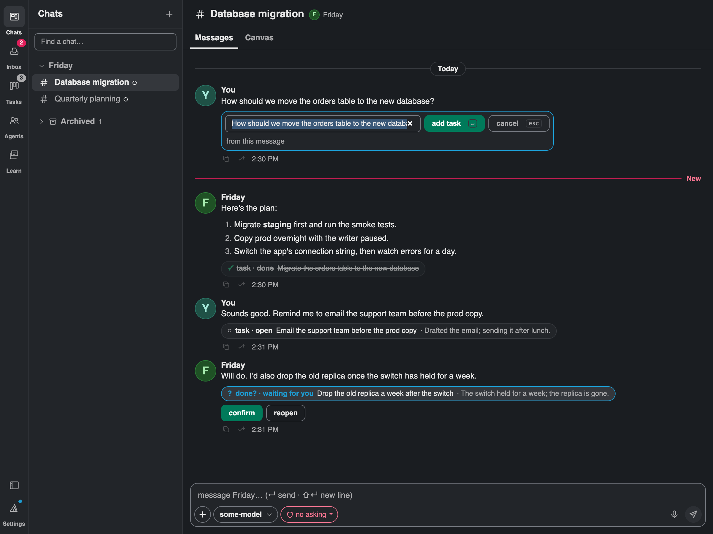

# The loki manual

Everything the README leaves out: every view, every key, every file loki writes. The README is the
tour; this is the reference. Paths are the defaults; the Files page in Settings shows yours.

## Requirements

- **macOS 13 or later.** The shell uses the traffic lights over a hidden title bar, the dock badge and a global
  shortcut.
- **Or, as a preview, 64-bit Windows 10 or 11, or a current 64-bit desktop Linux** (the `.deb` for Debian and
  Ubuntu, the AppImage elsewhere). Built and tested in CI, not yet tried on real machines; what differs is under
  [Windows and Linux](#windows-and-linux).
- **Node 22.19 or newer.** loki runs your agents in its own daemon, a Node process the window starts and keeps
  running (see [docs/architecture.md](architecture.md)). The Homebrew cask brings Node with it. The shell looks
  where installers put it: `LOKI_NODE_BIN`, PATH, then `/opt/homebrew/bin`, `/usr/local/bin`, volta, bun, npm's
  global bin, `~/.local/bin`, nvm and fnm. On Linux the list swaps Homebrew for `/usr/local/bin`, `/usr/bin` and
  Linuxbrew; on Windows it is npm's global folder under `%APPDATA%`, the nodejs.org installer's, volta,
  nvm-windows, fnm, scoop and bun. loki never downloads Node: with none new enough, Welcome says so, names the
  usual command (`brew install node`, `winget install OpenJS.NodeJS.LTS`, or `sudo apt install nodejs npm` /
  `sudo dnf install nodejs`), links nodejs.org, and has **check again**, which looks afresh.
- **beads** (`brew install beads`, or `npm install -g @beads/bd` on Windows and Linux) for Tasks. Optional;
  everything else works without it.

## Install

**Homebrew**, the recommended way:

```bash
brew install --cask almondlabs/loki/loki
xattr -dr com.apple.quarantine /Applications/loki.app
```

The second line matters. loki is not signed with an Apple Developer ID, and macOS refuses to open an unsigned
download as "damaged"; Homebrew quarantines cask downloads like a browser would, and Homebrew 7 no longer has
a flag to skip that (`--no-quarantine` is gone), so the flag is cleared by hand once per install. The cask's
own caveat says the same. Upgrades are `brew upgrade --cask loki`, then the `xattr` line again; the cask
follows each release. Versions are the UTC day and that day's count: `2026.1011.0` is the first stable of October 11, `2026.1011.1` the second (before October 2026, `2026.9.28` was simply the day).

**Nightly**: `brew install --cask almondlabs/loki/loki-nightly` is every merge to `main`, built about twenty
minutes after it lands, versioned `2026.1011.1-nightly.a96ee85` after the stable it leads up to and the commit. The two casks
conflict — both builds share `~/.loki`, the daemon and the mod's ports — so switching channels is an uninstall
and an install. Settings › loki shows which channel a build is on and names the right cask in its upgrade line. How releases are cut: [docs/releasing.md](releasing.md).

**The `.dmg`** from the latest release: drag loki to Applications, then clear the quarantine flag once (right-click →
Open is not enough for an unsigned app on macOS 14 and later):

```bash
xattr -dr com.apple.quarantine /Applications/loki.app
```

Or open it, dismiss the dialog, and allow it under System Settings › Privacy & Security.

**From source**: Node, Rust and Xcode's command line tools, then `npm start` to run the checkout or
`npm run desktop:build` for a `.app` (see the README). A build made on your own Mac never carries the flag.

**Windows (preview)**: `loki_<version>_x64-setup.exe` from a stable release, an unsigned NSIS installer. SmartScreen
stops it as an unknown publisher; **More info**, then **Run anyway**, once.

**Linux (preview)**: `loki_<version>_amd64.deb` (`sudo apt install ./loki_*_amd64.deb`) or
`loki_<version>_amd64.AppImage`, which needs `chmod +x` and FUSE 2 (`libfuse2`, `libfuse2t64` on Ubuntu 24.04).
Both are built on Ubuntu 22.04.

Windows and Linux files come on stable releases only, published on their own before or after the `.dmg` of the
same version, so take them from the newest release that has them; nightlies are Mac-only. An upgrade is the next
such release's file; Settings › loki links it when one is out. No package manager carries them yet.

Whichever way, the cask brings Node; the `.dmg`, source, Windows and Linux routes need a Node 22.19 or newer
(Requirements). Then:

1. Open loki. On every launch it puts its daemon, its mod and the phone's canvas under `~/.loki`, and the agent's
   skill at `~/.agents/skills/loki/`, writing only what changed; Settings › loki › Install shows what happened.
   Then it finds Node and starts the daemon, which hosts the mod.
2. If you used Letta Code before, loki imports it on the first start: your agents, their memory, chats, keys,
   pins and schedules come over from `~/.letta`, which is only read, never changed. It waits while Letta is
   running; Settings › loki › Import runs it again.
3. The first launch shows **Welcome** over the empty window: connect a model provider (paste a key, or sign in in
   the browser, for Anthropic, OpenAI, Google, OpenRouter, Ollama for local models and more; a key is checked with
   the provider, then kept in your system's keychain; every turn is billed by that provider), then name your first
   agent, with a description, a persona and a model. You land on its main chat, on Messages, with the message box
   focused.
4. Ask your agent to put something on the canvas.

Updates are a new release (`brew upgrade --cask loki`, or `--cask loki-nightly`, or the next `.dmg`); the app
re-installs its daemon and mod on launch when the bundle changed. It never overwrites a skill folder it did not
write, so a checkout wired up for development (below) keeps working.

## The window

The native title bar is hidden: the traffic lights sit over the rail, and a thin strip along the top drags the
window (double-click zooms). The window title still names what shows — the chat's name, "Inbox · n waiting",
"Tasks · n open", "Agents", "Settings" — for the Window menu and Mission Control. On the left, a rail of six
sections with a red count on what needs you; beside it, for Chats, Tasks, Agents and Learn, a **sidebar** listing
that section's items; the chosen item fills the rest. ⌘⇧D (or the rail's sidebar button) shows or hides the
sidebar (in the Inbox, which has none, ⌘⇧D is Deny); drag its edge (or focus it and use the arrows) for a
width between 220 and 420. A window under 1100 wide starts with it hidden. ⌘⇧W hides loki. On Windows and
Linux the strip is loki's own, with ☰ and the window buttons (see [Windows and Linux](#windows-and-linux)).

- **Chats** (⌘1): the sidebar lists your chats — **Pinned** first, then one section per agent (each folds, each
  with a "+" for a new chat with that agent), then **Archived**, folded. A chat's name goes bold when its agent
  wrote since you looked. On the right of each row, one mark at most: a red badge when it waits on you, else a green
  dot that breathes while its agent is working. Opening a chat (or having it open, the window in front, when a
  message arrives) marks it **viewed**, which clears the bold: the list shows what is new to you, nothing more. The
  Inbox keeps the chat until it is **read**: what the Inbox's → does, a reply, an approval or an answer; by hand
  it is **Mark as read** (⌘⇧↵ on the open chat, or the row's right-click menu), and **Mark as unread** in the
  same menu puts it back in the Inbox. None of these is done: a chat is done only when it is archived. Viewed
  and read are kept by the mod, so the phone and the Mac agree on both. "Find a
  chat…" at the top filters by chat or agent name (↓ into the list, ↑↓ between chats, ↵ opens the first match).
  Hover a row for pin and archive, right-click it for the same with open, rename, change folder and restore. **Rename…** opens a small dialog with the name selected: ↵ saves, esc cancels, and a name is at
  most 80 characters. An agent's main chat is named after the agent and cannot be renamed. When a chat that waits on
  you is scrolled out of sight, a red "Needs you" pill at the top or bottom edge scrolls to it. The sidebar keeps
  its scroll and folds across restarts.
  **Labels** gather related chats across agents (`infra`, `client-x`): a chat carries up to eight, each a lowercase
  word with its own colour. Add them from the row's **Labels…**, from **+ label** in the chat's header, or with
  `/label infra` in the message box (`/label` alone opens the picker); in the picker, type to find a label, ↵ takes
  the first match or makes the label when none matches. A chat's header and its Inbox card show its labels as chips;
  the sidebar rows leave them out, since a chat can carry several. Click a header chip, or type `label:infra` in "Find a chat…", to list that label's chats
  (`label:infra label:billing` wants both); ⌘K finds labels too. On the phone, **Labels** is in a chat's actions.
  The agent is told a chat's labels with your next message (and again when they change), so it knows what you
  file the chat under; only you set them.
  Opening a chat — from the sidebar, ⌘K, the Inbox, Agents or Learn — shows it like a Slack channel: a header
  with its name, its agent and what the agent is doing (on the Canvas tab, a ⋯ menu to arrange, fit and toggle the
  chat; the chat's own actions are the sidebar row's, model and mode are under the message box, find is ⌘F), then two tabs. **Messages** is the
  conversation, the message box focused: each message with the author's face, name and time, a pill for each
  day, a red **New** line before what came since you last looked (it stays put while the chat is open, as
  Slack's does, and moves on the next open), a copy button on hover, and a line each time the agent
  adds, changes or removes a widget ("friday added Revenue chart"). Click that line and the **Canvas** tab opens
  framed on the widget. The Canvas tab is the sheet edge to edge with the chat over it, the sidebar hidden, the
  rail kept: the chat on the left, centred and wider, or on the right (⌘← and ⌘→ move it, ⌥⌘ from inside a text
  box, ⌘/ toggles it, ⌘W closes it; ⌘0 fits all widgets, ⌘⇧0 is 1:1, ⌘= ⌘- zoom, ⌘⇧A arranges, ⌘Z undoes a widget
  move). A side chat is a viewport inset: fit-all, focus and camera glides frame widgets in the uncovered part,
  and opening or closing a left chat slides the sheet so nothing ends up under it. Esc (outside a text box) or
  the Messages tab goes back to the conversation where you left it. Both tabs are the same conversation with the
  same draft. ⌘L focuses the message box and ⌘F finds in the transcript, on whichever tab shows. A long thread
  opens on its newest 60 rows (back to the New line when that is older) and loads older ones 20 at a time
  as you scroll up, keeping your place; find reaches the older ones too, and ↓ latest folds it back. Under the message
  box sit two chips for the conversation: its **permission mode** (strict, standard, accept edits, unrestricted;
  ⌘⇧P) and its **model** (⌘⇧M). Select model has three steps: the harness as tabs at the top (loki, Claude Code,
  any agent added in Settings › engines; ←→ move between them), that harness's models (loki's lately used and
  featured ones, then **More models**, where you can type to filter), and under them the model's effort levels when it
  has more than one (for loki's models, the levels the model takes, from **No reasoning** up; a chat with none
  chosen runs with no reasoning, and says so). The pill names the harness only when it isn't loki ("Claude Code · Sonnet · High"). Both apply
  per conversation; a main chat's model is the agent's. Inbox cards carry the same chips in their actions row. When a tool call asks, its card
  offers **approve**, **deny** and **always allow**: the last allows that tool from then on, in every chat and every
  mode but strict, until you take it back in Settings › Chat › Always allowed. ⌘[ and ⌘] step through live chats,
  each on the tab you left it on.
- **Inbox** (⌘2, or ⌥Space from anywhere on the Mac): Catch Up as a full view, see below. The rail icon carries
  the waiting count, the same number the tray title and dock badge show.
- **Tasks** (⌘3): the shared task list, see below.
- **Agents** (⌘4): the sidebar lists your agents like Slack's direct messages — face, name, a green dot while
  one works, the last thing it said, a red count of what waits on you — and the chosen agent fills the pane with
  a tab per page (a first visit lands on memory); the "+" at the top of the sidebar makes a new agent. **profile**: face, name, description and model
  (editable), effort and context, where it is working (its live chats, each a link, and its open tasks), and delete at
  the bottom. **memory**: the files as a tree on the left, the one you picked on the right, with "ask <agent> to update
  this". **changes**: what it learned as a timeline of memory commits, newest first, the diff on the right; a commit by
  reflection or by a memory review (`/doctor`) is marked so. **revert** on the diff undoes that commit with a new one,
  as yours (so a revert can be reverted too); git refuses when a later commit changed the same lines, and says so. **reflection**: whether loki keeps its agents' memory up to date in the background — on by default and for
  every agent at once: once chats have been quiet for half an hour, the agent reads what was said in them since it
  last looked, several chats together (at most every two hours), and keeps in memory what will matter in later
  chats, counting what recurs across them (and reads a chat right after its context is compacted) — with the last change reflection made; `/reflect` in a chat does it now. **skills**:
  one line each in two groups — **self**, the ones the agent (or you) wrote ("write" adds one here, "install" takes a
  source the CLI knows: `owner/repo/path`, `official/<path>`, `clawhub/<slug>`, a GitHub or SKILL.md URL), and
  **other**, installed from somewhere named on the row (a checkout linked into `~/.agents/skills`, a repo the `skills`
  CLI recorded, a source you typed once). Pick a skill and it opens on the right with its origin, whether the agent has
  edited its copy, and **refresh**: the latest is pulled from the source and compared; an untouched copy is replaced
  and committed; a copy the agent edited is not overwritten — upstream is staged and the agent's main chat opens with a
  request to reconcile, keeping what it learned and taking what upstream improved; a copy that matches is reported
  current. A skill nobody recorded a source for asks for one the first time. The page is remembered for the window.
- **Settings** (⌘, or ⌘6, or the rail's gear): opens **Preferences** over the whole window, twelve pages down the
  left, one showing at a time, the last one remembered for the window. ⌘, closes it again, ⌘[ and ⌘] step its
  pages, ⌘1-5 close it and go to that section, Esc closes it. In the page list, ↑↓, Home and End move between
  pages. The pages, in order:
  1. **loki**: loki's own version and whether a newer release is out (asked of GitHub on launch and every six
     hours; `brew upgrade --cask loki` is the way up, or on Windows and Linux a link to that system's file, with
     the preview note), importing from Letta, how the app reaches the mod, requirements (the daemon's Node, beads)
     and what the last install put in place.
  2. **usage**: what your agents spent over the past 24 hours, 7, 30 or 90 days (remembered per device): the
     estimated cost and its tokens, a bar a day (an hour for 24 hours), tokens and cost by type with what the cache
     saved, and what each origin (your chats, helpers, reflection, Learn, the memory review), agent and model spent.
     Choosing a line narrows the page to it. The figures are estimates at each provider's API prices, from pi-ai's
     model table; a subscription sign-in (ChatGPT, say) is billed by its plan, not by these, and a model with no
     known price counts its tokens but not a cost. The daemon keeps the record in `~/.loki/state/usage.json`, by
     hour, for 400 days, whether analytics is on or off; history from before it began comes once from
     `events.jsonl`, with its cost not split by token type.
  3. **inbox**: how the deck orders its cards (see "The order") and what Next and Archive do.
  4. **providers**: every provider loki knows, connected first; a row opens into the fields it needs. A key is
     checked with the provider, then kept in the keychain; a sign-in opens the browser, and if the browser does not
     come back you can paste the address it ended on.
  5. **engines**: what a chat can run on besides loki's own models (see "Chat through Claude Code"): Claude Code,
     built in, and any agent you add by the command that starts it, kept in `~/.loki/state/acp.json`. Each shows
     whether it is ready, not found (its command is not on loki's PATH), needs signing in (from its last failure), or
     has not been tried; **try** starts it now, **edit** changes how it starts, and **reset** puts Claude Code back as
     loki ships it.
  6. **mcp**: the MCP servers in `~/.loki/mcp.json`, see "MCP servers".
  7. **phone**: the LAN switch, the route (Tailscale or this Wi‑Fi), the pairing QR and code, paired phones.
     Mac only for now.
  8. **skills**: the global skills in `~/.agents/skills` that every agent reads, each with disable, and a field
     to enable a folder holding a `SKILL.md`; an agent's own skills are on its Agents page.
  9. **learn**: the card writer's switch (off until you turn it on), cards a day (a ceiling, five by default, per
     calendar day; once it is reached nothing more is read until tomorrow), run now (every conversation with
     something new, at once), and the last run.
  10. **appearance**: system, light or dark (system follows macOS as it changes), and the palette, loki or
     tokyo night; kept per device.
  11. **chat**: where the panel sits on the Canvas tab (left, centre, right) and its side width (narrow, wide).
  12. **labels**: every label on your chats with its colour and how many chats carry it; **rename** (on every chat
      that has it), **colour** (one of eight) and **delete** (asks first, naming how many chats; the chats stay).
  13. **files**: where everything lives.
  14. **keys**: the complete keymap, and the switch for ⌥Space — the one system-wide key, off if Raycast,
      Alfred or the input-source switcher wants it (Mac only).

**⌘K** opens search from anywhere: chats, agents, what waits on you in the Inbox, and the app's pages (each
section, each Preferences page). It finds names, not message text, and says so. With nothing typed it lists the
places you visited last; ↑↓ move, ↵ opens the top result (a chat on Messages), Esc or ⌘K again closes it. `/chats`
in a message box opens it too. ⌘K used to open the chats tree; the sidebar holds that list now. Typing "desk", the old word, still finds chats.

`?` (outside a text box) opens a sheet of the keys that work in the view showing, its own first, then the ones
that work everywhere (less any the view takes for itself, such as ⌘⇧D in the Inbox; Settings › keys says so); `?` or
Esc closes it. ⌘[ and ⌘] step through whatever the section showing is made of: chats in Chats, cards in the inbox, columns
in Tasks, views in Learn, agents in Agents, pages in Preferences — the same two keys everywhere, never a jump
back to Chats. Esc peels one layer: a sheet or menu, then the Canvas tab back to Messages, then a view back to Chats. Every shortcut lives in one table
(`app/src/shell/keymap.ts`) that drives the key handler, the Settings page, and the native menu bar (the ☰ menu
on Windows and Linux: **Go** holds Search, New Chat…, Previous and Next Chat and Mark as Read; **View** holds Arrange
Widgets and Undo Widget Move among the rest), so the menus double as the cheat sheet. Rule of the table: plain letters work where nothing has focus (Tasks, the
sheet); where a text box has focus (the inbox, the chat) the same actions are ⌘ chords, and chords the text
itself uses (⌘Z, ⌘⌫, ⌘←, ⌘→) are never taken.

## Windows and Linux

A preview: built and tested in CI, not yet tried on real machines; problems go to the repository's issues, which
Settings › loki links. Chats, Inbox, Tasks, Agents, Learn, Preferences, search and the mod are the Mac's. What
differs:

1. **The window.** No system title bar: loki draws a 32px strip with ☰ at the left and minimise, maximise (restore
   while maximised) and close at the right, as Slack does there. The strip drags the window and a double click
   maximises; the edges resize. ☰ opens the menus the Mac's menu bar has, with the same items and keys, by mouse or
   by keyboard. The strip stays usable over a dialog. A second launch brings the running window forward instead
   of starting another loki.
2. **Keys.** ⌘ is Ctrl, ⌥ Alt, ⇧ Shift, ↵ Enter, ⌫ Backspace, and every menu, tooltip, the keys sheet and
   Settings › keys write them so. Move Chat Left and Right are Ctrl ← and Ctrl → or Ctrl Shift [ and Ctrl Shift ],
   since Ctrl Alt arrows are the system's there. Hide loki (Ctrl Shift W) is **Minimise loki**: with no tray or
   dock, a hidden window could not come back. In the packaged app the webview's own keys (reload, print, view
   source, devtools, F5, F12) do nothing; Ctrl F is loki's find.
3. **Not there yet.** The tray item and its count, the dock badge, the system-wide ⌥Space, the native menu bar,
   dictation (and its key), phone pairing and Tailscale. Where one would show, loki says it isn't on Windows (or
   Linux) yet.
4. **Folders.** Browse… in the new-chat sheet opens the system's own folder dialog; folder completion takes
   drive paths and `~\`.
5. **The daemon.** On Windows loki starts it with no console window, in a Job Object that ends it when loki
   exits; on Linux the daemon carries the parent-death signal, so it ends with loki too.
6. **Files.** `~` is your profile folder on Windows (`%USERPROFILE%`), so everything is under
   `%USERPROFILE%\.loki`; the skill link is a junction where Windows refuses a symlink.
7. **Linux** runs loki through XWayland: the shell sets `GDK_BACKEND=x11` unless you set it yourself, since an
   undecorated window on native Wayland still has open resize and button bugs.

Testers: [docs/preview-checklist.md](preview-checklist.md) lists what to try on a real machine.

## Phone

The inbox and your chats, on your phone, with nothing installed. Settings › phone → switch on "reachable on
this Wi‑Fi" → "pair a phone" → scan the QR with the phone's camera → in Safari, Share → Add to Home Screen → open
the new icon and type the six-character code once (a home-screen app has its own cookie jar, so the code shown in
Settings is asked for one more time; it stays valid ten minutes). From then on the icon opens on Home. Four tabs
float in a capsule at the bottom — Home, Inbox, Agents, More, the Inbox carrying the waiting count — with a round
Search button beside them:

1. **Home**: the loki header (its menu holds the filter, **Refresh chats** and **Archived chats**), a row of
   shortcuts with their counts (Inbox, Learn, Agents, Archive), **Needs your attention** — the head of the
   Inbox queue — then **Chats**, pinned first. A long press on a chat (or its actions button) opens its actions sheet: pin,
   **Rename** or archive. The round compose button at the bottom right starts a new chat: pick the agent, a name if
   you like, and the folder, from the folders that agent has worked in on the Mac (its most recent to begin with,
   the full path under the chips). An agent that has never worked in a folder starts its first chat on the Mac.
2. **Inbox**: the same cards as Catch Up in the same order (highest score first, see "The order"), one at a
   time. The card is the conversation: read the thread, reply, attach an image, answer a question. Under it,
   **Open chat** and **Next**; swipe right for next (a left swipe does nothing). Next reads the chat and moves on;
   it comes back on your next visit. Open chat opens the conversation full screen, whose actions sheet has
   **Change folder** and **Archive** (done: the chat leaves the inbox; a main chat has none). An approval leaves only by its decision:
   the two buttons become **Deny** and **Approve**. Undo sits in the top bar for six seconds after Next. The top bar reads "n need you" (or "n chats" when nothing does). Once you have
   been past every chat it says "You've been through every chat", how many still need you, and **Go through
   again**.
3. **Agents**: a list like Slack's direct messages (All, Running, Waiting on you); an agent opens a readable
   profile with its memory, changes and skills in one scroll.
4. **More**: the paired Mac, then Agents, Learn, Archived chats, Preferences (appearance) and Usage (what the agents
   spent, as on the Mac), then Updates,
   About loki and the connection details.
5. **Search**: chat titles, agents, waiting items and pages the phone already holds — not message text — with
   recent searches and places before you type.

**Learn** (from Home or More) is the same deck, thumb-sized: review, delete and undo; the writer's switch and
knobs stay on the Mac. A tap on a chat or a card opens the conversation: the transcript, the approval or
question card, and a reply box. Opening a conversation marks it viewed, not read, as on the Mac: a chat's name
on Home stops being bold but keeps its dot, the card stays in the inbox, and the red New line sits before what
came since your last look on either device. The conversation's actions sheet has **Mark as read** and, once
read, **Mark as unread**, and pin. No Tasks segment on the phone, but a long press on a message offers **Add task**
(below), and a message that has a task shows its chip.

The phone's text follows the size you set in iOS (Settings › Display & Brightness › Text Size, or Larger Text in
Accessibility), up to about half again the default; the tab bar stays its own size, as iOS's does. Reduce
Transparency makes the floating tab bar solid, and Increase Contrast makes it and every divider stronger.

The QR and the bookmark carry the Mac's Bonjour name (`my-macbook-pro.local:41415`, from System Settings
› General › Sharing › local hostname), not its address, so the same icon keeps working at home and at the office
when the Mac gets a new address. The phone talks to the Mac directly over the local network (port 41415), so
both must be on the same Wi‑Fi and the Mac must be awake with loki running; some office networks isolate
clients from each other, and then the phone cannot reach the Mac at all — Tailscale (its address appears in
Settings › phone too) is the way around that; when it is not, the phone says "Mac unreachable, last seen …" and
reconnects by itself. Each paired phone is listed in Settings › phone with when it was last seen; "forget"
locks it out. The rail shows a green dot on the settings icon while the switch is on (a blue one when a newer loki is out). If the icon opens on
"loki did not load", the phone could not reach the Mac (wrong network, Tailscale off, the Mac asleep) or launched from a
cached copy of the page; "try again" reloads, and a page from an older build reloads itself once the Mac answers. Read [SECURITY.md](SECURITY.md)
before switching it on somewhere you do not trust the network.

**Phone, anywhere.** Install [Tailscale](https://tailscale.com/download) on the Mac and on the phone and sign in to
the same account. Settings › phone then shows two routes under "route", Tailscale and this Wi‑Fi, each with the
address a phone uses for it; the lit one is what the QR carries, and switching it redraws the QR at once. Over
Tailscale (`my-macbook-pro.tail1234.ts.net`) the phone reaches the Mac from any network — the office, mobile
data, a café — without a thought about which Wi‑Fi either is on. Each paired phone in the list says which route its
last request came in by ("via Tailscale", "via Wi‑Fi"), so there is never a question of which way you are connected.
The small "https on the tailnet" switch runs `tailscale serve` in front of the listener so the phone gets an
`https://<name>` origin; it needs HTTPS certificates enabled for your tailnet (Tailscale admin console › DNS) and
stays inside the tailnet — loki never uses Funnel. Whichever way you switch, the address the phone bookmarked has
changed, so it pairs once more.

## Your Macs

loki on more than one Mac is one set of agents. Friday is the same agent on your MacBook and your Mac mini: one
name, one memory, every chat of hers listed on both. Each chat runs on one Mac, its **home**, with that Mac's files
and tools; from the other Mac you open it, read it and write in it as if you sat at its home.

**Pairing.** Install [Tailscale](https://tailscale.com/download) on both Macs and sign in to the same account; Macs
reach each other over your tailnet only, never the Wi‑Fi or the internet. On one Mac open Settings › Macs and press
**show a code**: it shows six characters and that Mac's tailnet address, for ten minutes. On the other Mac, in
Settings › Macs, type the address and the code and press **pair**. Each Mac now lists the other, with **connected**
or when it was last seen, and **forget** on either side unpairs both. A Mac running another version of loki shows
"needs an update": it stays paired, but nothing syncs until both run the same release. A third Mac needs one code:
pair it with any Mac of yours, and it joins the others by itself, introduced by the Mac they share (each Mac must be
paired with every other, since a chat is reached on the Mac it lives on). A Mac you **forget** stays forgotten: it is
not joined again until you pair it by code. While any Mac is paired,
loki keeps the Mac from sleeping when it is idle on power, so a MacBook on its charger with the lid open stays
reachable; a closed lid still sleeps.

**Where things live.**

1. **Agents have a home Mac.** An agent lives on the Mac that made it; change it on the agent's profile ("lives
   on"). A new chat starts on its agent's home, and the new chat dialog says so under **Lives on**: pick this Mac
   instead and the chat runs here, with this Mac's files, for good. If the agent's home is out of reach, the chat
   starts here and stays here. The folders the dialog offers are the home's, and it says what that Mac lacks for the
   agent (a provider sign-in, an MCP server needing a sign-in) before you start.
2. **Every list shows both Macs' chats.** Each agent's section in the sidebar names the Mac it lives on; a chat
   living on another Mac than its agent's has a small laptop icon (hover it for "on Mac mini"). The switcher marks
   every chat on the other Mac, and the phone says "on Mac mini". While a Mac is asleep or off, its chats stay listed
   with a moon, "waiting for Mac mini": they do not open and take no message until it is back. Nothing is queued.
3. **The first pairing hands chats over.** When a Mac first pairs, it takes over the chats of the agents that live
   on it from the other Mac: pair the mini, and Ira's chats move to it, with their history, folder, labels,
   schedules and canvas. A chat with a turn running moves once it is idle; a chat on Claude Code or another ACP
   agent stays where its session is. Files attached to a moved chat stay on the Mac they were attached on. Setting
   an agent's home later moves its chats the same way.
4. **Move one chat by hand.** Right-click a chat in the sidebar and pick **Move to Mac mini** (or the MacBook): it
   moves with everything above, and works the same in both directions, so you can bring a chat back. A chat you
   moved, or started on a Mac other than its agent's home, stays where you put it: moving its agent's home later
   leaves it. The chat keeps a quiet "moved to Mac mini" line where it moved, and the agent is told with your next
   message there (which Mac it now runs on, and any attached files or folder that did not come along); nothing runs
   just to tell it. A chat mid-answer or waiting for you says so and stays. An agent's main chat is not moved by hand: there
   is one, on the agent's home, and it moves when you change the agent's "lives on".
5. **Memory is one.** An agent's memory is a git repo on each Mac, merged between them as you work. When both Macs
   changed the same lines apart, the note keeps the home Mac's text and the other side goes to
   `conflicts/sync.md` in the agent's memory; its next reflection folds it in. Reflection and Learn read each chat
   on the Mac it lives on, so a Friday chat on the mini still teaches Friday, and a moved chat is not read twice.
6. **What is yours syncs.** Done and not-done marks (the later one wins), the Inbox's focus (both Macs' engagement
   adds up), pins, label colours, Learn's cards and reviews, your MCP servers and your mods. Provider sign-ins, the
   "always allow" list, Tasks, usage and the shared skills folder stay on each Mac: sign in on each Mac you run chats
   on.

**The phone** reaches every chat on every paired Mac through the Mac it is paired with; if that Mac is off, the
phone waits for it.

## What the mod does

loki's mod runs inside the daemon and owns the canvas and the sockets the app connects to:

- owns geometry and gesture state per chat (`~/.loki/state/<desk>.json`, `<desk>` being the chat's id); places new widgets in the first free spot using sizes the tab reports back, and can tidy a canvas into a grid (the `arrange` button or ⌘⇧A)
- watches `~/.loki/widgets/`, syntax-checks `.tsx` with esbuild, tells the tab what changed
- appends what the user did on the canvas to their next turn (`turn_start`)
- carries each chat between the app and the daemon over its socket (`/ws` on 127.0.0.1:41414): the chat's
  conversation and Catch Up cards are one model (`core/attention`), streaming token by token
- lists every open conversation for the inbox (`inbox_list`): main chats included, however old, with who spoke
  last; a conversation leaves the inbox by being archived
- keeps the recall cards (`recall_*`); the daemon's Learn pass writes them: once a conversation has been quiet for half an
  hour it reads the new stretch, asks the agent in its hidden "recall" conversation, and writes cards up to the day's
  cap; the deleted pile goes back into every prompt as what not to write
- serves each conversation's full transcript (`history_get`), which survives compaction, and keeps the read
  (`seen_mark`), viewed (`viewed_mark`) and focus marks the inbox and the sidebar need
- keeps each chat's widget change log (`~/.loki/state/widget-log/<desk>.json`, the last 200 rows), sent live
  to every tab and with each chat's history, so the conversation can show who added, changed or removed a widget
- keeps pins in `~/.loki/state/pins.json`
- tools: `desk_state`, `desk_camera` (one widget, or several framed together, with an optional dwell). Rendering and authoring are file writes.

## Install (development)

You need Node 22.19 or newer, Rust (stable, from rustup) and Xcode's command line tools. Node runs npm, Vite, the
Tauri CLI, the tests and loki's daemon. Then:

```bash
npm install
npm start
```

`npm start` checks three things first and stops with the fix when one is missing: `cargo` — on PATH, or in
`~/.cargo/bin` where rustup just put it (Tauri's own message is a bare "No such file or directory") — Xcode's
command line tools (`xcode-select -p`; without them the build fails later with an `xcrun` or linker error), and
that whatever answers on port 5173 is loki's own Vite and not another project's dev server, which the window
would otherwise show. It then starts Vite on 127.0.0.1:5173, a watching build of `app/dist` for the phone, and
`tauri dev`, which bundles the mod and opens the window (the first build compiles the shell, a few minutes). The
window finds Node and starts the daemon from the checkout (`daemon/main.ts`, hosting `mod/boot.ts`). The script
waits for the mod: if nothing answers on its port after a minute and a half, it says so and names the daemon's
log, `~/.loki/logs/daemon.log`, instead of leaving you Vite's proxy errors. Ctrl-C stops all of it.

It keeps up with the checkout after a `git pull`: the window reloads when `app/` changes and the mod reloads in place
when `mod/` or `core/` changes. A change to `daemon/` or `core/` needs the daemon restarted, which loki never does by
itself: the window shows "loki's code changed" with **restart** and **later**. While a chat is working or waiting for
you, **restart** says so and offers **restart anyway**, which cuts it off. The window reconnects a second later.
`npm start --check` reports all of it without starting anything.

Or run the pieces yourself: `npm run dev` (Vite alone, for a browser tab) and `npm run desktop:dev` (the window
against a Vite already running, in a second terminal).

A development window installs nothing from its bundle (`LOKI_INSTALL=1` makes it); the daemon runs the checkout's
code. It links the agent's skill, `~/.agents/skills/loki`, to the checkout's `skills/loki` when nothing is there
yet; whatever is already there stays, and Settings › loki › Install says which. The data is the same `~/.loki` the
app uses, and only one daemon serves it (`~/.loki/daemon.lock`): with the installed app running, a development
window leaves that app's daemon serving and tries again every 30 seconds, so quit the app to run your checkout's.

When something does not come up:

1. **The window opens but the app never links** (Vite prints `ws proxy error … 41414`): the daemon is not
   running, or its mod failed. `~/.loki/logs/daemon.log` has the daemon's output, its error at start included,
   and `~/.loki/mod.log` the mod's.
2. **Welcome shows the Node step**: no Node 22.19 or newer anywhere loki looks. It names the command for your
   system (`brew install node`, `winget install OpenJS.NodeJS.LTS`, the distribution's package); install it,
   then **check again**. `LOKI_NODE_BIN` points loki at one it does not find.
3. **The installed app is running**: its daemon holds `~/.loki`, so yours waits (`daemon.log` says it exited with
   code 3). Quit the app.

## Install as an app (Chrome)

The canvas ships a web app manifest, so Chrome can install it: open the canvas
tab, then menu → Save and share → Install page as app. It opens in its own
window with the loki icon. The tab remembers its token and last chat in
localStorage, so the installed app resumes where you left off even though its
launch URL carries no parameters. It still needs loki running: the mod in its daemon serves the app; the page
comes from Vite in a browser tab, or from the loki app itself.

Vim-key extensions (Vimium, Surfingkeys) run inside installed apps too and bind
plain `r` to reload, which also swallows loki's own shortcuts. Exclude the canvas
in the extension's options, e.g. Vimium → Excluded URLs: `http://127.0.0.1:5173*`.

## New chat

Press ⌘N, or the "+" at the top of the Chats sidebar or beside an agent's section (that agent is then
chosen for you). The sheet asks for the agent (chips),
the folder (defaults to that agent's most recent one; recents, typed paths with
completion, or Browse… for the system's folder dialog; the git branch shows when the
folder is a checkout) and an optional name. Start creates the conversation
and opens the empty chat on Messages with the message box focused.

**Change folder.** A chat can move to another folder later: **Change folder…** in the chat's right-click menu in the sidebar opens
the same folder field, starting on the chat's folder (recents, completion, Browse…); Move needs a folder that
exists and differs. On the phone it is **Change folder** in the chat's actions sheet, with chips of the folders
that agent has worked in. The daemon moves the chat, and its commands and file tools work in the new folder from
the next turn.

**Sending while the agent works.** A message you send while the agent works goes out at once and joins the turn:
once the tool running now finishes, the agent reads it before its next step, so "use pnpm, not npm" changes what
it does next. If the agent is only writing its answer, with no tool running, your message waits for that answer and
starts the next turn. A message that joined a turn cannot be taken back; **stop** still ends a turn going the wrong way.

**Chat through Claude Code.** Any agent's chat can run through Claude Code instead of one of loki's models, signed
in with your own Claude plan. In a new chat, before you send anything, choose the **Claude Code** tab in the model picker
and one of its models (the others show once it has run once). From the first message the chat stays on Claude
Code: the other tabs are greyed out, and a new chat is how you go back to loki's. loki starts Claude
Code itself, the first time through `npx`, so it needs Node and a `claude` that is signed in (`claude /login` in a
terminal). In such a chat:

- the replies, tool calls and their diffs show as in any chat, and stay in loki's history and the Inbox;
- when Claude Code asks before a tool, the card is loki's, on the Mac and the phone; **always allow** goes to Claude
  Code's own list, not loki's;
- the mode chip shows Claude Code's own modes (default, accept edits, plan, bypass permissions);
- the slash palette offers Claude Code's commands, beside loki's own and **/reflect** and **/doctor**, which still
  run on loki's side;
- the picker's effort row offers the levels Claude Code gives the model you're on (low to max, depending on the
  model). loki starts Claude Code as soon as you pick it, so they show a moment later, before you send anything,
  and they're kept for next time;
- Stop cancels the turn; after loki restarts, the chat picks up the same Claude Code session;
- a message sent while Claude Code works waits for the turn to end, shown as queued, and until then **take back**
  removes it: Claude Code takes one message at a time;
- the agent stays itself: loki adds its persona, its memory and its skills to Claude Code's prompt when the session
  starts, beside Claude Code's own `CLAUDE.md`. Claude Code can read the memory files and is asked not to change them;
  Reflection, Learn and /doctor keep them up to date from these chats as from any other, on the agent's own model in
  loki. With no provider set up in loki, they wait until there is one.

Whether your Claude plan allows use through another app is between you and Anthropic; read your plan's terms.

## Questions from the agent

When an agent calls `ask_user`, the conversation (on either tab) and the inbox card show
a question card instead of a permission block: each question with its options
(pick one, or pick many), and an "or answer in your own words" line. Answer
sends everything back in one go. A typed reply in the message box while a
single question is open is treated as the answer.

## Images and files

Attach with "+", paste (⌘V), or drop onto any message box, on the Mac or the phone.

- **Images** (PNG, JPEG, GIF, WebP, HEIC) show as a thumbnail above the box, with × to remove; send puts them
  inside the message as base64 image parts, so the agent sees them at once. Large images are shrunk to 1600px on
  the long edge before sending.
- **Any other file** (a PDF, a spreadsheet, a log, an SVG) is uploaded to the Mac as soon as you add it, into
  `~/.loki/uploads/<yyyy-mm-dd>/` under its own name (a number is added when the name is taken). A chip shows
  its name and the upload's progress; send waits until it is there. × before sending deletes it again. The message
  carries only where it is, in an attachment tag
  (`<attachment kind="file" local_path=… name=… mime_type=… size_bytes=… />`); the agent reads it with its own tools.
  The chat hides the tag and shows the file as a chip on your message; in the desktop app a click shows it in its
  folder. 25 MB per file.
- Text, code, CSV, JSON and Markdown the agent reads directly; a PDF, Word or Excel file needs a command-line tool on
  the Mac (`pdftotext` from `brew install poppler`, or Python), which the agent runs itself.
- Uploads stay until you delete them; archiving or deleting a chat leaves them.

## Dictation

The mic in any message box (or ⌘D while it is focused; ⌘M stays macOS's minimise) dictates through the
browser's Web Speech API. Mac only for now. Recognition stops by itself when you pause; Enter
sends. Chrome may send the audio to Google's speech service unless on-device
recognition is available, so treat it like any other cloud dictation.

## Inbox (Catch Up)

A chat is not done until it is archived. The inbox holds every chat you have not archived, except one whose agent
is mid-turn, where there is nothing to do yet. The inbox icon on the rail counts what needs you; click it, press
⌘2, or ⌥Space from anywhere for a Slack-style deck, one conversation per card with the recent thread inside it (newest at the bottom,
tool calls as muted markers), highest score first (see "The order" below). → or ⌘] (the card's **next →**) reads the chat and moves on: it stays in the inbox and comes back on your next visit in its place by score, or sooner in this visit if the agent says something new. E or ⌘E (the card's **archive**) is done: the chat is archived and leaves the inbox. A main chat cannot be archived, so it always stays, and an approval leaves only by Approve or Deny. A or ⌘↵ approves, D or ⌘⇧D denies, R focuses the reply box, O or ⌘O opens that chat on Messages with the message box focused, Z or ⌘Z undoes the last decision (an archive included; the ⌘ forms work while typing a reply), Esc returns to Chats.
The header reads "n need you · m chats". Once you have been past every chat the deck says "You've been through
every chat." with what this visit did ("5 moved past · 2 archived · 1 approved · 1 reply"). Closing the inbox
ends a visit; opening it again starts a fresh one.
Catch Up runs in the browser. Its list is the mod's: every open conversation of your agents (`inbox_list`), main
chats included, with who spoke last — nothing is windowed by age or capped by count, so a conversation only leaves
the inbox when it is archived (main chats are never archived, so they always stay). The live half — streaming,
approvals, answers — comes over the same socket. The read (`seen`), viewed and focus marks live in
`~/.loki/state/attention.json`, so the phone and the Mac share them.

Slash commands work in the message box, and in the reply box of an inbox card: type `/` and a palette lists what the
box can run — loki's own (`/model`, `/mode`, `/inbox`, `/chats` for ⌘K search) and the daemon's:

- `/compact [instructions]` summarises the conversation so far; `/clear` starts the agent afresh in the same chat (the
  thread stays).
- `/remember [what]` asks the agent to save something to its memory; `/reflect` runs reflection on this chat now.
- `/doctor` reviews the agent's whole memory and cleans it up, after Letta Code's command of the same name. It tidies (merges what says the
  same thing, splits or merges files by subject and size, drops one-off details of past tasks) and makes judgement
  calls (facts whose date has passed, contradictions, where the newer or more specific one wins, a persona that drifted
  from the rest of memory). It edits directly, each change a commit by "Doctor"; the command's row shows its report,
  one line per change, and Agents › changes lists the commits, each with revert. It runs in the agent's hidden
  `doctor-<agent>` chat, in the same queue as reflection and Learn, and only when you ask.

↑↓ move, ↵ runs (or fills in a command that takes arguments), ⇥ fills in, esc puts the palette away. A command lands
in the transcript as one quiet row: the command line, then its outcome. `core/attention/commands.ts` is the table. Every bubble has a copy button under its outer corner (shown on hover, or when it has focus) that puts the
message on the clipboard as the markdown it was written in, not the rendering.

### Learn (⌘5)

The mental model — what the writer reads, asks, writes and costs, and how leads become lessons — is
[docs/learn.md](learn.md); this section is the reference for the keys and the files.

Spaced-repetition cards, for keeping what the conversations taught you. **Off until you switch it on**: the
writer spends your provider budget in the background, so the section's first visit explains what it does and
offers the switch (Settings › learn has it too, with the knobs). Nothing about the cards happens in
chat: a worker in the mod watches for conversations that have gone quiet, hands their new stretches of
transcript to the agent together — one question per agent, the stretches most worth reading first, up to a
budget; what does not fit waits for the next tick — and writes whatever comes back: one fact per card, a
question that stands alone, an answer in a line or two, up to a daily cap (twenty-five by default) shared
across the stretches. Reading them side by side, the model writes one card for a fact that came up twice and
a revision, not a second card, for a later correction; a card the person keeps failing brings the tail of the
conversation it came from along as a marked replay, for the rewrite only. You meet the cards only here: the front, space (or ↵ or ↓) for the answer, then one of two answers — ← again or → got it
(1 and 2 do the same; space then stands for got it; either arrow shows the answer first) — that schedules the next sight of it with FSRS,
the scheduler modern Anki uses.
The sidebar lists four views, each with its count: **Review** (the deck), **Leads**, **All cards** and
**Deleted**; ⌘[ and ⌘] step through them. New cards come first with a mark, because the first look is also the moment to throw one out: **deleting a
card (X or ⌫) is the signal.** Deleted cards move to a pile the worker reads before writing, as examples of what
not to write, so a rejected card never comes back reworded; a card deleted after many failed reviews reads
as "badly written", one deleted unseen as "not wanted". Cards you keep failing are offered back to the worker
for a rewrite. E edits in place, O or ⌘O opens the chat it came from, Z undoes a delete, ⌘R refreshes. **All cards** lists every
card with search and holds the writer's knobs — on/off, cards a day, run now — and an
export in Anki's plain-text import format. Everything is files: `~/.loki/recall/{cards,schedule,rejected}/<id>.json`,
content and review history kept apart so the writer's edits never touch your schedule. The writer asks each agent in a
hidden conversation of the agent's own, cleared before each run and with no tools, and only for concepts,
principles and knowledge of your field that will still be true in months — never a detail of the task at hand;
most conversations give no card. Reflection never reads that conversation, so the writer's digests of your
conversations are never turned into the agent's memory.

**Leads.** In the same call, the writer names up to two things per conversation the person could learn
properly: a concept they asked about, an explanation they took on trust, an acronym that went by. Each is a
lead — a title, one line quoting the moment, a depth (a primer in one sitting, or a course) — listed in the
**Leads** view, newest first, at most twelve open. Clicking a lead creates a `[Learn] · <title>` conversation
with the agent that was there, puts an info card with the lead on its canvas, opens the chat on Messages and sends
the brief as your first message: open with why this matters to you, furnish the canvas with the outline as a list you
can tick, ask before telling, one idea at a time, a cold quiz at the end. A lesson whose brief never arrived (the
conversation is still empty) is listed under "lessons under way" with **send the brief**.
**not this** moves the lead to a dismissed pile the writer reads before proposing again (restore under
**Deleted**, with the deleted cards). Learn conversations are chats in the sidebar and never inbox cards. Files: `~/.loki/recall/{leads,leads-dismissed,lessons}/`.
The plan is `docs/plans/2026-09-12-008-feat-loki-learn-plan.md`.

Every chat row, chat header, message and inbox card shows the face of the agent that owns the conversation (its
`profile.png` from memory, or a coloured initial), so multi-agent setups stay legible.

### The order

The deck is a scheduler's ready queue: one score per card, one list, no sections. Every chat you have not archived
is in it, except one whose agent is mid-turn. The score is
`blocked ? 100 : 0` (an approval or a question — an agent is stopped until you answer; a reply that only reads like
a question, ending in "?" or "let me know", counts until you have looked at it) `+ new ? 10 : 0` (the
agent said something since you last looked) `+ 15 × focus`
(the chat's share of what you have been doing lately) `− 0.1` an hour since the last message (`+ 0.1` for a
blocked card, so the agent waiting longest comes first). A failed turn is not blocked: nothing waits on you,
so it ranks like any other card. The badges (the rail's Inbox count, the phone's tab, Home's **Needs your
attention**, search's waiting group) count only what needs you: an approval, a question, a failed turn, or
something new.

**Focus is learned, never set.** Every chat keeps a weight that your actions add to — a message you send
(from the Mac, the phone, the Inbox or the terminal) adds 1, answering a question 1, approving or denying ½,
opening and reading the chat ¼ (at most once every half hour) — and that halves every 12 hours. A chat's
focus is its weight over everyone's weight plus 2. Work a task hard and its chat rises; start another task and
the old one gives up its share as soon as you engage elsewhere, then fades in a day or two, with nothing to
park. **Next** on a card that is there for its focus (it says `in focus`) halves that chat's weight: you have said
it is not what you are on now, so it gives way after a skip or two. A Next straight after replying on the same
card is moving on, not a skip, and leaves it alone. After a quiet week every share is near 0 and cards rank by age alone. The agent's own turns and
scheduled prompts never add focus, so a busy cron cannot talk its way up. The Mac's loki process keeps the
weights (`focus` in `state/attention.json`), so the Mac and the phone rank alike.

Each card says `in focus` after its time when focus is worth 3 points or more (blocked cards say it with their
badge). The order is recomputed on every event — an approval or reply on the card in front of you, a turn
finishing or blocking anywhere, the half-minute clock — and again whenever a card is popped, but the card in
front of you never moves until you act on it; whatever arrives lands behind it. `core/attention/priority.ts`
is the score, `core/attention/focus.ts` the focus.

**What the ranking is tuned for: engagement.** Every card that comes to the top is logged (`inbox_card_shown`),
and every decision on it (`inbox_card_decided`: what you did and how — a key, a click, a swipe or a tap — which
chat, where the card stood, its score, focus and reason, whether it was new, how long the chat had been quiet and
how long the card was on top, counting only the time loki's window was visible and focused). `npm run analytics`
reports how often you engage with a card (reply, answer, approve, deny or open it) rather than move past or
archive it — a Next straight after acting on the same card is moving on, not a skip, and is left out — how often that card was the one on top, the median
rank of the cards you engaged with, how many distinct chats that was, the engaged share by the rank a card was
shown at, how many Nexts and Archives you took back, and how long a finished turn waits for you. The weights
above are the starting point.

**A reply keeps the card.** Send a reply (or answer a question) and you stay where you are: the answer streams
into the card, and a follow-up typed then goes out while the conversation's prompt is still cached. Moving on
is yours (→ or ⌘]); if you do, the answer brings the card back in this visit by score — higher now, since your reply added to
its chat's focus — behind whatever you are reading then.

## Tasks

One task list shared by you and every agent, backed by
[beads](https://github.com/steveyegge/beads) (`bd`, embedded Dolt) at `~/.loki/tasks`. (Tasks was called the Board
until October 2026; its list in `~/.loki/board` moves to `~/.loki/tasks` the first time the new version starts, and
stays where it is if it cannot move.) A task is work to be done: you do it yourself, or hand it to an agent. Agents
file tasks only when asked, through the `tasks` tool, which stamps the source chat and its folder; you file them
from the "+" in Tasks or ⌘T anywhere.

**Views.** The Tasks segment (⌘3) lists its built-in views in the sidebar, each with its count:

- **All**: every open task, and the ones done in the last week.
- **Mine**: tasks you filed that no chat has been assigned: yours to do.
- **Waiting for you**: tasks you filed that an agent says are done (below).
- **One per agent**: the tasks assigned to that agent's chats. A remembered agent view whose agent has no tasks left
  says so ("<agent> isn't here any more — pick an agent") and lists the agents to pick again.

**Layouts.** Each view shows as a **Board** (columns) or a **Table** (L switches; each view remembers its own). The
Board groups by **status** (Open, In progress, Blocked, Done · 7d), **assignee** or **folder** (G cycles). The Table has
a column each for the title, status, assignee, who filed it, the chat it came from, its folder and when it last moved;
click a column's name to sort by it, again to reverse.

**Moving tasks.** Select tasks (X or space, ⇧X or ⇧-click for a range) and press ⏎ to **assign** them to a chat: the
agent becomes the assignee and the tasks ride along inside `<loki-tasks>` on your next message in that conversation,
and again only when that chat's list changes (hidden in the chat, shown as a quiet "assigned tasks" row); nothing is
sent. ⌘⏎ **dispatches** instead: assigns, then posts the tasks so the agent starts now. New chat is a target too.
⌫ marks done, ⇧⌫ toggles blocked, R reopens, ⌘R refreshes, / filters.

**Add task from a message.** Every message in a chat, yours or the agent's, has an **Add task** button (a tick with a
plus) beside Copy; on the phone it is in the message's long press. To file part of a message, select the words and
press ⌘⇧T. An editor opens under the message with a title taken from the message's first line (or the selection):
edit it, ⏎ files the task, esc cancels. The task is yours (it lands in **Mine** until you assign it), its description
quotes the message or the selection, and it remembers the message: in Tasks, the quote under its title opens that
chat scrolled to the message. The message shows the task as a chip: **task · open** with the agent's newest progress
note, **done? · waiting for you** with Confirm and Reopen, or ticked and faded once done. Clicking the chip opens the
task in Tasks.



**Only you close your tasks.** An agent comments on a task as it makes progress and closes it when the whole task is
done, but only on its own chat's tasks: those assigned to it, or filed from it and not assigned elsewhere. When the
task is one *you* filed, the agent's close does not close it: the task shows **done? · waiting for you** with the
agent's one-line reason, in Waiting for you and on its card. **Confirm** (or ⌫) closes it; **Reopen** (or R) takes the
agent's word back and the task stays open. Tasks an agent filed for itself close when it closes them.

Setup: `brew install beads`. The mod creates the list (`bd init --prefix lk`) the first time it is used.

## MCP servers

loki connects your agents to MCP (Model Context Protocol) servers listed in `~/.loki/mcp.json`, in the same
`mcpServers` shape Claude Code, Claude Desktop and Cursor use, so an entry copies across as it is:

```json
{
  "mcpServers": {
    "github": { "command": "github-mcp-server", "args": ["stdio"], "env": { "GITHUB_PERSONAL_ACCESS_TOKEN": "…" } },
    "linear": { "url": "https://mcp.linear.app/mcp", "headers": { "Authorization": "Bearer …" }, "alwaysLoad": ["list_issues"] }
  }
}
```

**Settings › MCP** shows every server: its state (connected, starting, or down with its last error), its tools with
their read-only and destructive marks, and what loading each tool, and all of them, would cost in tokens. Add, edit
(rename too), restart and remove servers there; check the few tools to load always. "Keep values in this computer's
keychain" stores each environment or header value in the keychain and writes `${keychain:<server>.<name>}` in the file
in its place, filled in only when the server starts. Edits keep whatever else the file holds. **Agents › Profile ›
MCP servers** switches a server off (or on again) for one agent: its chats stop seeing it from their next message,
and switched back on, a chat searches again for what it needs.

A **local** server (`command`, `args`, `env`, `cwd`) is a program loki starts with the daemon and starts again, after
a growing pause, when it exits; its `env` adds to the usual environment (PATH, HOME…). A **remote** server (`url`,
`headers`) is reached over Streamable HTTP, with a token in its headers if you give it one. `"disabled": true` skips
an entry. loki reads the file again when it changes and reconnects only the servers whose entry changed.

**Signing in (OAuth).** A remote server with no `Authorization` header of its own signs in the way MCP's
authorization spec describes, if it asks to. Its row in Settings › MCP says **needs sign-in**; **sign in to …** opens the
server's own sign-in page in your browser, and when you approve there, the browser comes back to loki
(`http://127.0.0.1:41414/mcp/oauth/callback`, on this computer only), loki finishes the sign-in and the server
connects. loki registers itself with the server's authorization server the first time (when the server allows that),
keeps the tokens in the system keychain, never in `mcp.json`, and renews them when they expire. **sign out** forgets the
tokens; the server then asks again. While a server waits for a sign-in, agents see that in their server list and none
of its tools.

**Tools wait until they are needed.** Every agent sees one short list: each server, what it is for, and the names of
its tools. None of the tools themselves is in the agent's context until it asks for them with `mcp_search` (a
description of what it wants, or `select:server.tool` for exact ones); the few best matches are loaded, as ordinary
tools named `mcp__<server>__<tool>`, from its next step, and stay for the rest of the chat. `/clear` and a compaction
unload them. A server's `alwaysLoad` tools skip the search. So adding servers costs a line or two each, not their
tools' full definitions on every turn (the approach Claude Code and Cursor took after many MCP tools crowded out the
work).

**Permissions** follow the tools' own hints: one marked read-only runs freely in standard mode; any other is a
command and asks, as a shell command does.

**Big results** (past 50,000 characters, about 12,500 tokens) are saved whole to `~/.loki/tool-results/<chat>/`;
the agent gets the path, the size and the start, and reads more with its file tools when it needs to. An error keeps
its first and last 5,000 characters. A shell command's output goes to the same folder once it passes 50KB or 2,000
lines; the agent sees its last part and the file's path.

A server that cannot start, or stops, shows as down (with its last error output) in the list the agent sees, and is
tried again. `mcp_search` and `mcp_call` are counted in the local analytics.

## Widget frame controls

Each frame has three buttons: **focus** (front, centre, zoomed in), **minimise** (to the tray at the bottom-left; the file stays), and **trash** (deletes the file after a confirm). The agent hears about all three on your next turn.

## Analytics

loki keeps product analytics on itself — which views you open, which chats get turns, how an inbox visit went,
what you send from where, which models and modes you pick — as events in `~/.loki/logs/events.jsonl`, one
per line in PostHog's shape: `{ event, timestamp, distinct_id, properties }`. Nothing involves PostHog: the mod
writes the file, nothing sends it anywhere, and `npm run analytics` on this machine is the only reader. The
`distinct_id` is one random id per install (`state/analytics.json`); properties carry `$device_type` (mac, phone,
or mod for turns and tools), a `$session_id` cut on a thirty-minute gap per device, the `$screen` on show when
a client sent the event, `$app_version`, and the event's own fields — ids and counts (a chat's scope, a model's
handle), never message text, titles or folder paths. Event names are `object_verb`: `view_opened`,
`message_sent`, `inbox_pass_completed` (one per inbox visit: how many next, archive, approve, deny and replies),
`inbox_card_shown`, `inbox_card_decided` (action next, archive, approve, deny, reply, answer or open),
`inbox_card_undone`, `turn_finished` (a turn's end and length, from the mod; a Claude Code turn's too, with its harness version
`acp:claude-code` and without the model and tool times Claude Code doesn't report), `approval_requested` (reported by
every window that saw it and written once), `chat_archived` and `chat_restored` (where from); `core/analytics.ts`
lists them all with their properties. The file rotates
at 20 MB to `events.jsonl.1`, about two years. `LOKI_ANALYTICS=0` in the daemon's environment turns it off.

`npm run analytics` (or `npm run analytics -- --days 7`) prints the report: sessions by device and their median
length, every event with its count and how many sessions it fired in, a breakdown of each event by its key
property (views by name, turns by chat, sends by origin, models picked), the inbox visits and their decision
split, the engagement numbers above, the hours and weekdays loki is used, and the events that never fired in the
period.

## Environment variables

`LOKI_PORT` (the mod's socket, default 41414), `LOKI_LAN_PORT` (the phone listener, default 41415),
`LOKI_WIDGETS_DIR` (default `~/.loki/widgets`), `LOKI_SKILLS_DIR` (the global skills, default `~/.agents/skills`),
`LOKI_NODE_BIN` / `LOKI_BD` / `LOKI_TAILSCALE_BIN` (binaries), `LOKI_INSTALL=1` (make a dev build install its
bundle instead of linking the checkout), `LOKI_NO_INSTALL=1` (stop a release build from installing, and a dev build
from linking), `LOKI_ANALYTICS=0` (no analytics), `LOKI_KEYCHAIN=0` (secrets kept in memory for the daemon's life,
never the system keychain: for tests and scratch runs). On Linux the shell sets `GDK_BACKEND=x11` unless it is
already set. The mod runs under Node, inside loki's daemon; `mod.log`'s `activate` line names the Node.

Logs: `~/.loki/logs/daemon.log` (the daemon's output), `~/.loki/mod.log`, `~/.loki/logs/events.jsonl` (product
analytics on loki itself; see "Analytics").

## Hard rules

- No real money amounts of yours on screen, in the repo, or in recordings. Ever. The one exception is what your
  agents spent, on the usage page, and only when you open it; fixtures and screenshots of it use made-up numbers.
- Widget code runs with the page's full trust. This is your machine and your agent; it is not a sandbox
  (see [SECURITY.md](SECURITY.md)).
