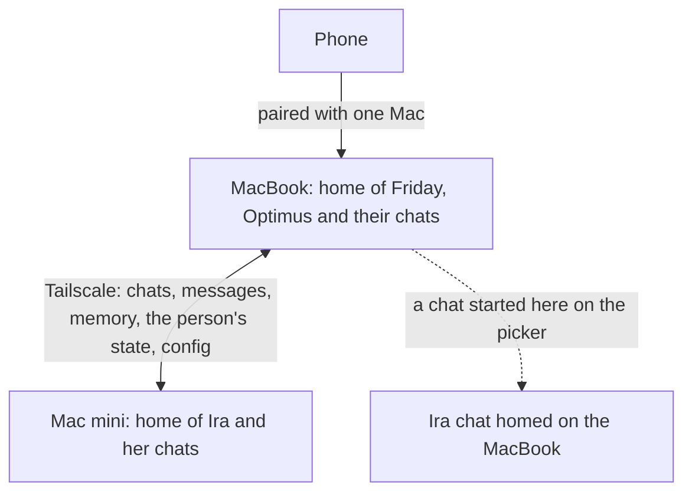
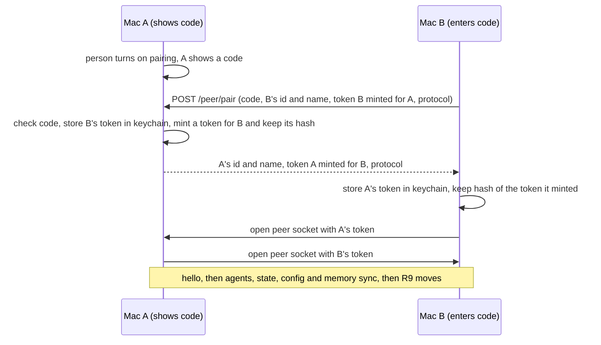
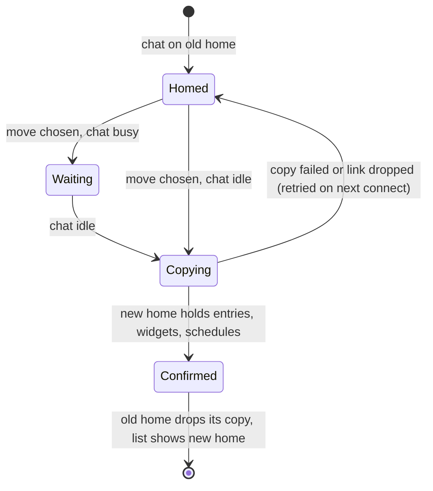
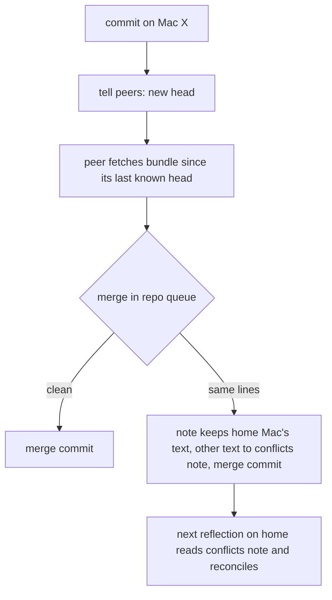

# loki on Several Macs - Plan

## Goal Capsule

- **Objective:** The person's agents are each one agent across all their Macs. From any Mac, or the phone paired with
  one, they can open and continue any chat, while each chat's work runs on the Mac it belongs to. Nothing leaves the
  person's Macs.
- **Means:** daemons that pair over Tailscale, each chat answered by its home Mac and reached through the local mod
  (KTD1, KTD3).
- **Product authority:** the Product Contract below, decided with the person on 2026-10-18; it wins on behaviour. The
  Key Technical Decisions win on mechanism within it. `PRODUCT.md`'s "agents, memory, chats and tools stay on the
  person's machine" widens to "on the person's Macs"; no server, no account, no cost.
- **Stop conditions:** stop and ask if a unit would send anything to a host outside the tailnet, if two Macs could
  ever write the same pi-durable store, or if a memory merge could leave conflict markers in a note.
- **Execution profile:** one branch for the whole plan on the person's current branch, a commit per unit, every check
  in the Verification Contract run on CI's toolchain before each push; no push or PR unless the person asks.
- **Open blockers:** none.

---

## Product Contract

Product Contract preservation: changed R19 (focus and Learn review history merge rather than taking the latest
change; label colours, not chat labels, are the person's state), confirmed with the person at the plan's scope check.
Added the Tasks key decision and scope line, answered during planning. Everything else unchanged.

### Summary

Macs running loki pair with each other over Tailscale. Every agent has a home Mac and every chat has a home, which
runs it; every Mac lists every chat and passes messages to the chat's home. Agent memory merges between the Macs with
git, the person's own state (Inbox marks, label colours, pins, Learn) syncs item by item, and loki's own config syncs
while keys and skills stay per Mac.

### Problem Frame

The person runs loki on a MacBook (work) and a Mac mini (personal), one at a time. Each Mac has its own separate copy
of Friday, Ira and Optimus, with different ids, chats and memory, so Friday on the mini knows nothing of what Friday
did on the MacBook, and a chat on one Mac cannot be opened from the other. When the person is at the mini and needs
Friday, the MacBook is beside them or on charge with its lid open, but loki gives them no way to reach it.

Two constraints shaped the design. The mini sometimes loses power, so it cannot be the one place every agent lives.
And the person wants nothing to leave their Macs and nothing to pay for, which rules out a hosted database or a
Cloudflare Durable Object. Today's loki assumes one daemon per Mac and has no notion of another Mac: agent ids are
random per install (`daemon/store/agents.ts`), memory repos only add and commit (`daemon/memory.ts`), and the only
link off the Mac is the phone's LAN listener (`mod/lan.ts`).

### Key Decisions

- **One being per agent, one home per chat, no cloud.** Every agent is one agent on all Macs; each chat lives on, and
  is written by, exactly one Mac; the Macs talk to each other directly over Tailscale. Governs R3, R6, R11.
  (session-settled: user-directed — chosen over a Cloudflare Durable Object holding agent state (about $5 a month) and
  over making the mini the only home: nothing should leave the Macs or cost money, and the mini loses power.)
- **Agents have a home Mac; new chats default to it, with a picker.** Friday and Optimus live on the MacBook, Ira on
  the mini. Governs R5, R7. (session-settled: user-directed — chosen over "a chat lives where it starts" and over
  "always the agent's home": the agent's work belongs on its Mac, with room to run a chat where the person sits.)
- **The first version is pairing, identity, reaching every chat, memory and the person's state.** Copies of chats
  for reading while their home is down, an outbox, and moving a chat's home are later. (session-settled:
  user-directed — chosen over adding read-only copies or moves to the first version: with the MacBook usually awake
  on the desk, the live path covers daily use, and the mini's chats waiting for it to return is acceptable.)
- **A joining Mac takes over its agents' chats once.** Ira's existing chats on the MacBook move to the mini when the
  mini first pairs. Governs R9. (session-settled: user-directed — chosen over leaving them homed on the MacBook.)
- **Memory merges with git.** Git merges edits to different parts of one note on its own and keeps history; a plain
  file sync would leave "note 2.md" copies the agent reads as separate notes. Governs R15, R16. (session-settled:
  user-approved — chosen over syncing memory files like the rest.)
- **The person's state: the latest change to each item wins, except where that loses engagement.** Marks, label
  colours and pins are small independent values any Mac may change; focus and Learn reviews accumulate. Governs R19.
  (session-settled: user-approved — proposed with the alternatives of merging or one Mac owning them; the focus and
  review exception approved at the plan's scope check.)
- **Config syncs, keys and the shared skills folder do not.** `~/.agents/skills` is shared with Claude Code, Codex
  and other tools, so loki leaves it alone. Governs R20, R21. (session-settled: user-directed — chosen over syncing
  provider keys, and over syncing the skills folder or agent files.)
- **The phone reaches everything through the Mac it is paired with.** Governs R13. (session-settled: user-approved —
  chosen over pairing the phone with every Mac.)
- **Tasks stay per Mac.** Each Mac keeps its own Tasks list; a task that links to a chat on another Mac opens it
  there. (session-settled: user-approved — chosen over one Tasks list synced through the tracker's own sync.)
- **Background passes run only on an agent's home.** Reflection on one Mac at a time keeps memory edits from two
  Macs rare. Governs R17.
- **A Mac on power stays awake while loki runs.** An idle MacBook with its lid open would otherwise sleep and leave
  Friday unreachable from the mini. Governs R14.

### How the Macs relate



Each chat is written by its home only. Every Mac lists every chat and passes a message to the chat's home; memory
merges both ways; the person's state and loki's config sync both ways.

### Requirements

**Pairing and identity**

- R1. Two or more Macs running loki pair with each other over Tailscale, approved on both Macs, the way the phone
  pairs; a Mac that is not paired gets nothing.
- R2. Each Mac has a stable identity and the Mac's own name, shown wherever loki says where a chat or agent lives.
- R3. An agent is one agent on every paired Mac: one id, one record (name, persona, model, settings) and one memory.
- R4. Unpairing a Mac stops all sync with it, and its chats leave the other Macs' lists.

**Homes**

- R5. Each agent has a home Mac the person can set; an agent created on a Mac starts with that Mac as its home.
- R6. Each chat has one home Mac, which alone writes the chat and runs its turns, tools, files, canvas, background
  tasks and schedules.
- R7. A new chat's home is its agent's home, unless the person picks the Mac they are at when starting it; when the
  agent's home is unreachable, the Mac they are at is the default.
- R8. A chat's home does not change after the chat starts, apart from R9.
- R9. When a Mac first pairs, the chats of agents whose home it is move to it once, with their schedules.

**Reaching every chat**

- R10. Every Mac lists every chat on every paired Mac, and marks a chat that lives on another Mac with that Mac's
  name.
- R11. From any Mac, the person can open, read and message a chat whose home is reachable; the home runs the turn,
  and every Mac following the chat sees the reply, tool steps, approvals and canvas as they happen.
- R12. A chat whose home is unreachable stays in the list as unavailable and names the Mac it waits on; its history
  does not open and it takes no messages.
- R13. The paired phone lists and messages every chat on every paired Mac through its own Mac, with the phone's
  existing limits on what it may do.
- R14. While loki runs on a Mac that is on power, the Mac does not sleep when idle; a closed lid still sleeps, and no
  system setting changes.

**Memory**

- R15. Each agent's memory merges between paired Macs with its history kept; edits to different notes, or to
  different parts of one note, merge without the person.
- R16. When two Macs changed the same lines, both versions are kept and the agent's next reflection on its home
  reconciles them; no edit is silently lost.
- R17. Reflection and the other background passes for an agent run only on its home Mac.
- R18. A memory change reaches the other paired Macs soon after it is committed while they are connected, and
  catches up when they reconnect.

**The person's state and config**

- R19. Inbox done and viewed marks, label colours, pins and Learn's cards are shared by all paired Macs, the latest
  change to each item winning; Inbox focus and Learn's review history combine every Mac's contribution.
- R20. loki's own config (MCP servers and mods) syncs between paired Macs; provider sign-ins and keys, agent files,
  browser profiles and the shared skills folder stay per Mac.
- R21. Before a chat runs on a Mac, loki shows what that Mac lacks for the chat's agent (a provider sign-in, an MCP
  server's sign-in, a skill) instead of failing mid-turn.

### Key Flows

- F1. The mini joins
  - **Trigger:** The person turns on pairing on the MacBook and enters its code on the mini.
  - **Steps:** Both Macs approve the pairing; the mini takes on the shared agents (Friday, Ira, Optimus) and their
    memory; Ira's existing chats and schedules move to the mini; config and the person's state arrive.
  - **Outcome:** Both Macs list all chats; Ira's run on the mini, Friday's and Optimus's on the MacBook.
  - **Covers:** R1, R2, R3, R9, R10, R19, R20
- F2. Friday from the mini
  - **Trigger:** At the mini, the person opens a Friday chat (marked as living on the MacBook) and sends a message.
  - **Steps:** The message goes to the MacBook; Friday runs there with the MacBook's files and tools; the reply,
    tool steps and any approval card appear on the mini as they happen.
  - **Outcome:** The person works with Friday from the mini as if at the MacBook.
  - **Covers:** R6, R11, R14
- F3. Ira while the mini is down
  - **Trigger:** The mini has lost power; the person is at the MacBook.
  - **Steps:** Ira's mini chats show as unavailable, waiting on the mini; the person starts a new Ira chat, which
    defaults to the MacBook because the mini is unreachable; Ira answers with her synced memory.
  - **Outcome:** Ira keeps working; the new chat lives on the MacBook from then on.
  - **Covers:** R7, R8, R12, R15

### Acceptance Examples

- AE1. **Covers R7.** Given the mini is reachable, when the person starts an Ira chat at the MacBook without touching
  the picker, the chat lives on the mini; when they pick "this Mac", it lives on the MacBook.
- AE2. **Covers R12.** Given the MacBook is asleep, when the person opens a Friday chat at the mini, it stays in the
  list but its history does not open, it takes no message, and it says it is waiting for the MacBook.
- AE3. **Covers R16.** Given both Macs changed the same line of Friday's note while they could not reach each other,
  when they reconnect, both versions are kept and Friday's next reflection on the MacBook leaves one reconciled note.
- AE4. **Covers R19.** Given the person marks a chat done on the mini at 10:00 and not done on the MacBook at 10:01,
  when the Macs sync, the chat is not done on both.
- AE5. **Covers R21.** Given the mini has no sign-in for Friday's model provider, when the person picks the mini for
  a new Friday chat, loki says the mini needs that sign-in before the chat runs.

### Success Criteria

- From the mini, a reply in a Friday chat starts as quickly as on the MacBook, give or take the network.
- A mark, label colour or pin changed on one Mac shows on the other within seconds while both are connected.
- Over a week of use, Friday and Ira each read as one agent: neither Mac's copy of an agent has learned something the
  other's lacks once they have synced.

### Scope Boundaries

**Deferred for later**

- Read-only copies of a chat on other Macs, for reading it while its home is down.
- An outbox holding messages for a chat whose home is down.
- Moving a chat's home after it starts (teleport), beyond the one-time move in R9.
- Loops, as their own plan, with the mini as their default home.
- The phone reaching chats when the Mac it is paired with is down.
- One Tasks list across Macs.

**Outside this work**

- Any server, hosted database or cloud account.
- Syncing provider keys, agent files, browser profiles or the shared skills folder.
- Running one chat on two Macs at once.

**Considered and not built**

- Queueing a tap on an approval card whose home dropped: the home keeps waiting and takes the first answer that
  reaches it; a queue is the deferred outbox in disguise. Revisit with the outbox.
- Merging a joining Mac's agents into shared ones by name: the mini has been barely used, so it would merge nothing
  of value. Revisit if a second well-used Mac joins.
- Partial compatibility between loki releases: a version mismatch syncs nothing (KTD12). Revisit if releases on the
  two Macs drift often.

### Dependencies / Assumptions

- Tailscale is installed on every Mac and they share one tailnet; loki detects it and never installs it.
- The MacBook's agents become the shared ones: the mini has been barely used, so no two copies of an agent need
  merging when it joins.
- Usage stats, logs and "always allow" permissions stay per Mac.

### Sources

- `docs/architecture.md`: one daemon per folder, where things live on disk, the two ports and Tailscale.
- `docs/plans/2026-10-09-017-refactor-loki-pi-harness-plan.md`: the daemon these Macs each run.
- Letta's remote environments (docs.letta.com/letta-code/remote-mobile): agent state in one place, machines as
  places where tools run; the shape this plan follows without a cloud.

---

## Planning Contract

### Key Technical Decisions

- KTD1. **Macs reach each other through the existing LAN listener, with a peer token and only over the tailnet.** A
  paired Mac holds a bearer token the other Mac minted, stored in the keychain through `daemon/credentials.ts`; the
  minting Mac keeps only its sha256 in `state/peers.json`, as `mod/devices.ts` does for phones. Peer routes and peer
  sockets on 41415 accept only tailnet addresses (`requestVia` in `mod/lan.ts`), and the listener stays on while any
  Mac is paired, whatever the phone switch says. A second port would add a second thing to guard for no gain.
- KTD2. **A Mac's identity is the install id loki already keeps.** `state/device-id` (`daemon/providers.ts`) is a
  random UUID minted on first use; its name is the Mac's computer name, read the way `mod/lan.ts` reads the Bonjour
  name.
- KTD3. **The local mod routes every chat frame to the chat's home; the app keeps one socket.** A routing chat
  backend wraps `DaemonChats` behind the same interface `mod/frames/chat.ts` uses: a chat homed here goes to
  `DaemonChats`, a chat homed on a peer goes over that peer's link and its `chat_event` pushes are re-broadcast
  locally. History pages, approvals, answers, labels, folder and model changes, uploads and desk-scoped canvas frames
  route the same way. The app and the phone keep talking only to their own Mac.
- KTD4. **The phone's limits are checked at the phone's own Mac.** The bridge's `PHONE_FRAMES` check
  (`mod/bridge.ts`) runs before routing, so a frame that reaches a peer on a phone's behalf was already allowed. A
  peer socket has its own allow-list (a `peer` flag in `core/frames.ts`), never the pairing or device frames.
- KTD5. **Existing agent ids are kept; a joining Mac adopts the other Mac's agents by id.** Ids are random UUIDs, so
  none collide and nothing is re-keyed. The joining Mac's own agents become shared agents homed on it. An agent's
  main chat (`default`) is created only on its home Mac; a non-home Mac never makes one.
- KTD6. **The agent record syncs per field, latest change winning; deleting an agent is a tombstone.** Each field
  (name, model, settings, home, archived) carries the time and Mac of its last change. A delete is refused while the
  agent has chats homed on an unreachable Mac, and otherwise wins over any later field change from the other side.
  The persona is a memory file and merges with memory (R15).
- KTD7. **Memory travels as git bundles over the peer link, inside the repo's existing queue.** Each Mac fetches the
  peer's new commits as a bundle and merges them within `serial(root, …)` in `daemon/memory.ts`. On a conflict the
  note keeps the agent's home Mac's text and the other side's text goes to one conflicts note the reflection prompt
  reads; a note never holds conflict markers. A Mac new to an agent clones the repo from a full bundle. The git calls
  in `mod/skill-sources.ts` move under the same queue so a merge and a skill pull never race.
- KTD8. **Passes run on the agent's home and read remote chats over the peer link.** `PassRunner` (`daemon/passes.ts`)
  skips agents homed elsewhere; for this agent's chats homed on a peer it asks the peer for the transcript slice since
  its cursor. A chat whose home is unreachable waits for the next sweep. Pass cursors stay on the agent's home.
- KTD9. **The person's state syncs as one store of timestamped items.** Each item is `{value or removed, at, mac}`;
  a Mac sends a snapshot on connect and each change as it happens; the later `at` wins and a removal is a tombstone.
  Focus keeps one decaying entry per Mac and the Inbox sums them (`core/attention/focus.ts`). Learn's review history
  is a union of reviews with the schedule recomputed, and the daily Learn cap sums every Mac's count
  (`daemon/passes-state.ts`). (session-settled: user-approved — chosen over latest-change-wins for every item: focus
  and reviews are additive, and overwriting loses engagement.)
- KTD10. **Config syncs per entry; permissions do not.** `mcp.json` syncs per server entry, latest change winning;
  `mods/` syncs per file. Secrets stay `${keychain:…}` references, so a synced server whose secret is missing is
  R21's case. `state/approvals.json` stays per Mac, since a command allowed on one Mac's files is not allowed on
  another's.
- KTD11. **A chat moves by copying its entries into the new home's store, one idle chat at a time.** The new home
  creates the chat under the same loki id and imports the old home's entries with `importEntries`
  (`daemon/kernel/index.ts`), then its widgets, uploads, desk row, schedules and pass cursors. The old home keeps the
  chat, read-only and marked "moving", until the new home confirms; a busy chat (turn running, approval waiting,
  background task alive) moves when it next goes idle. ACP chats stay where they are, since their session belongs to
  that Mac's ACP agent.
- KTD12. **Peers exchange a protocol number on connect; a mismatch syncs nothing.** The peer hello carries the build
  and a `peer_protocol` integer; Macs whose numbers differ stay paired, show each other as needing an update, and
  list each other's chats as unavailable.
- KTD13. **Staying awake is a `caffeinate -s -w <daemon pid>` child.** The daemon starts it on macOS while any Mac is
  paired; `-s` holds off idle sleep on power only, a closed lid still sleeps, and `-w` ends it with the daemon.

### High-Level Technical Design

Where each piece lives, on one Mac of a pair:

```mermaid
flowchart TB
  App[App window, tab or phone] -->|one socket| Bridge[mod bridge: phone check, routing]
  Bridge --> Router[routing chat backend]
  Router -->|chat homed here| DC[DaemonChats and its store]
  Router -->|chat homed on peer| Link[peer link]
  Link <-->|tailnet, peer token| PeerBridge[peer's mod bridge]
  Sync[sync: agents, state, config] <--> Link
  Mem[memory sync in the repo queue] <-->|git bundles| Link
  Remote[remote chats cache] <-- list and change pushes --- Link
  Bridge --> Lists[chat list and Inbox: local plus remote]
  Remote --> Lists
```

Pairing, as two Macs approve each other:



A chat's home during the one-time move (KTD11):



Memory sync for one agent (KTD7):



### Assumptions

- Both Macs are signed in as the same person on one tailnet, and a tailnet address is trusted only as far as the
  peer token it presents.
- Node's `ws` client and `git bundle` are available wherever loki runs; git is already required for memory.
- The person's Learn data is small enough to send as a snapshot on connect.

### Sequencing

U1 and U2 open the link; U3 makes agents shared; U4 and U5 make every chat reachable; U6 adds the picker; U7, U8 and
U10 sync memory, state and config; U9 does the one-time move once the routing and stores are in place; U11 is
independent after U1; U12 documents the whole.

---

## Implementation Units

| U-ID | Title | Key files | Depends on |
| --- | --- | --- | --- |
| U1 | Mac identity and pairing | `mod/peers.ts`, `mod/lan.ts`, `app/src/settings/macs.tsx` | — |
| U2 | Peer link | `mod/peer-link.ts`, `mod/bridge.ts`, `core/frames.ts` | U1 |
| U3 | Shared agents | `daemon/store/agents.ts`, `mod/peer-agents.ts`, `daemon/chat-backend.ts` | U2 |
| U4 | Remote chats in every list | `mod/remote-chats.ts`, `mod/index.ts`, `app/src/shell/desk-tree.tsx` | U2, U3 |
| U5 | Routing chats to their home | `mod/chat-router.ts`, `mod/frames/chat.ts`, `mod/uploads.ts` | U4 |
| U6 | Choosing a new chat's home | `app/src/desk/new-desk.tsx`, `core/frames.ts`, `mod/chat-router.ts` | U5 |
| U7 | Memory sync | `daemon/memory.ts`, `daemon/memory-sync.ts`, `daemon/passes.ts` | U3 |
| U8 | The person's state | `mod/synced-state.ts`, `mod/seen.ts`, `mod/pins.ts`, `mod/recall.ts` | U2 |
| U9 | Moving an agent's chats on first pairing | `daemon/chat-move.ts`, `daemon/kernel/index.ts`, `daemon/schedule.ts` | U5, U7 |
| U10 | Config sync and missing prerequisites | `daemon/config-sync.ts`, `daemon/mcp/index.ts`, `app/src/desk/new-desk.tsx` | U2, U6 |
| U11 | Staying awake on power | `daemon/awake.ts`, `daemon/main.ts` | U1 |
| U12 | Documentation | `docs/manual.md`, `docs/architecture.md`, `PRODUCT.md`, `glossary.md` | U1–U11 |

### U1. Mac identity and pairing

**Goal:** Two Macs pair over the tailnet with a code, each approving the other, and either can unpair.

**Requirements:** R1, R2, R4; KTD1, KTD2, KTD12.

**Dependencies:** none.

**Files:**
- Create: `mod/peers.ts`, `mod/frames/peers.ts`, `app/src/settings/macs.tsx`, `test/peers.test.ts`,
  `test-node/peer-pair.node-test.ts`
- Modify: `mod/lan.ts`, `mod/server.ts`, `mod/paths.ts`, `mod/index.ts`, `mod/frames/index.ts`, `core/frames.ts`,
  `core/frame-types.ts`, `daemon/credentials.ts`, `daemon/providers.ts`, `app/src/settings/settings.tsx`,
  `app/src/settings/pages.ts`

**Approach:**
1. `PeerStore` in `mod/peers.ts` mirrors `DeviceStore`: `state/peers.json` (mode 0600) of `{mac_id, name,
   token_hash, paired_at, last_seen_at, protocol}`, with the outbound token for each peer kept in the keychain.
2. Pairing reuses `mod/pairing.ts` codes. `POST /peer/pair` and `GET /peer/hello` join the LAN listener's routes and
   refuse any request that `requestVia` does not mark as tailscale.
3. `authorize` in `mod/lan.ts` recognises a peer token and returns `{ok, peerId}`; `Client` in `mod/server.ts` gains
   `peerId` beside `deviceId`.
4. The listener stays on while `PeerStore` is non-empty, independent of `state/lan.json`.
5. Settings › Macs lists paired Macs with name, last seen, reachability and a version note, plus "pair a Mac" (show a
   code, or enter one with the other Mac's tailnet name) and "unpair". Unpairing forgets the peer here and tells the
   other side at next contact, which forgets this Mac too.

**Patterns to follow:** `mod/devices.ts` (hashed tokens, debounced last-seen writes), `mod/frames/lan.ts` and
`app/src/settings/phone.tsx` (the phone pairing page), `mod/tailscale.ts` (tailnet name, injected `exec`).

**Test scenarios:**
- A code shown on Mac A and entered on Mac B pairs them: each `peers.json` holds the other's id and a token hash, and
  each keychain holds the other's token.
- A wrong or expired code is refused and nothing is stored on either side.
- `POST /peer/pair` from a non-tailnet address is refused even with a valid code.
- A peer token presented on a phone route, or a phone cookie presented on a peer route, is refused.
- The desktop token is refused on peer routes.
- Unpairing on A removes B from A at once; when B next connects, its token is refused and B forgets A.
- The listener stays on with a peer paired after the phone switch is turned off.
- The hello reports `peer_protocol`; a peer with a different number shows as needing an update.

**Verification:** two daemons in one test process pair and reconnect with the stored tokens; Settings › Macs shows the
other Mac by name.

### U2. Peer link

**Goal:** Each daemon keeps one authenticated socket to every paired Mac, with request/reply, pushes and a live
reachability status.

**Requirements:** R1, R11, R12, R13; KTD1, KTD4, KTD12.

**Dependencies:** U1.

**Files:**
- Create: `mod/peer-link.ts`, `test-node/peer-link.node-test.ts`
- Modify: `mod/bridge.ts`, `core/frames.ts`, `mod/index.ts`, `test/bridge.test.ts`, `test/frames.test.ts`

**Approach:**
1. `PeerLink` opens a `ws` client to the peer's `/ws` with its bearer token, reconnects with the shell's backoff shape
   (1 s doubling to 30 s), and exposes `request(frame)`, `onPush(handler)` and `status`
   (`reachable | unreachable | outdated`).
2. A `peer` flag joins each frame-table entry a Mac may send to another; the bridge refuses any other frame from a
   peer client, and refuses pairing and device frames always.
3. The bridge's phone check stays first and unchanged (KTD4).
4. Status changes push a `peers` frame so the app and the lists update at once.

**Patterns to follow:** `FrameChatClient` in `core/attention/chat-client.ts` (request ids, replies), the phone check
in `mod/bridge.ts`, `test-node/lan-ws.node-test.ts` (real listener on port 0 with a `ws` client).

**Test scenarios:**
- A request over the link gets its reply matched by `request_id`, with two requests in flight at once.
- A push from the peer reaches `onPush` handlers.
- Closing the peer's listener flips status to unreachable within one backoff step; restarting it reconnects.
- A peer sending a frame without the `peer` flag gets `error` and nothing runs.
- A phone frame outside `PHONE_FRAMES` is refused at the phone's Mac and never reaches the link.
- A peer with a different `peer_protocol` is `outdated` and no request is sent to it.

**Verification:** two daemons exchange requests and pushes over real sockets; the bridge table test covers the `peer`
flag.

### U3. Shared agents

**Goal:** Every paired Mac holds the same agents with the same ids and records, each with a home Mac.

**Requirements:** R3, R5; KTD5, KTD6.

**Dependencies:** U2.

**Files:**
- Create: `mod/peer-agents.ts`, `test/peer-agents.test.ts`
- Modify: `daemon/store/agents.ts`, `mod/agents.ts`, `daemon/chat-backend.ts`, `mod/frames/agents.ts`,
  `app/src/agents/profile-page.tsx`, `app/src/agents/new-agent.tsx`

**Approach:**
1. The agent record gains `home_mac` and a per-field `changed` map of `{at, mac}`; a record without them reads as homed
   on this Mac.
2. On connect and on every change, a Mac sends its records; the receiver merges per field (KTD6), creates records it
   lacks, and applies tombstones.
3. A record new to this Mac waits for its memory repo from U7 before the agent appears in lists.
4. `DaemonChats` creates an agent's `default` chat only when this Mac is its home.
5. The agent's profile page shows its home and lets the person change it; new chats follow the new home (R8).

**Patterns to follow:** `writeRecord` (temp file and rename) in `daemon/store/agents.ts`, the `agents_changed` push in
`mod/frames/chat.ts`.

**Test scenarios:**
- A Mac that pairs with an empty backend receives every agent record with its original id and home.
- A rename on A and a model change on B while apart both survive the next sync.
- Two changes to the same field keep the later one; equal times break by Mac id, the same way on both Macs.
- Deleting an agent with no chats on an unreachable Mac removes it on both Macs and a later rename from the other side
  does not bring it back.
- Deleting an agent whose chats live on an unreachable Mac is refused with the Mac's name.
- A Mac that is not the agent's home does not create its `default` chat.
- An agent created on B is homed on B and appears on A after sync.

**Verification:** after pairing, both Macs list Friday, Ira and Optimus under the same ids with the same homes.

### U4. Remote chats in every list

**Goal:** Every chat list, the Inbox and the phone show chats from all paired Macs, marked by home and reachability.

**Requirements:** R2, R10, R12; F3, AE2.

**Dependencies:** U2, U3.

**Files:**
- Create: `mod/remote-chats.ts`, `test/remote-chats.test.ts`
- Modify: `mod/chat-source.ts`, `mod/index.ts`, `core/frame-types.ts`, `daemon/chat-backend.ts`,
  `app/src/shell/desk-tree.tsx`, `app/src/desk/catch-up.tsx`, `app/src/phone/rows.tsx`, `app/src/phone/inbox.tsx`,
  `test/desk-tree.test.ts`, `test/inbox-card.test.ts`

**Approach:**
1. `RemoteChats` keeps each peer's chat list, infos and digests, filled on connect and kept current from the peer's
   change pushes, so `listDesks` and `listInbox` stay synchronous.
2. `DeskSummary`, `InboxRow` and `ChatInfo` gain `home`, `home_name` and `reachable`.
3. When a peer becomes unreachable its cached rows stay, marked unreachable (R12); unpairing drops them (R4).
4. Label counts merge local and remote chats.
5. Rows for a chat on another Mac show the Mac's name; an unreachable one is dimmed with "waiting for <Mac>".

**Patterns to follow:** `ChatProjection` (`daemon/chats.ts`) for the list shape, `DeskSummary` rows in
`mod/index.ts`, existing row tests.

**Test scenarios:**
- With a peer reachable, `listDesks` includes its chats with `home_name` set and `reachable: true`.
- When the peer drops, its rows stay with `reachable: false`; when it returns they flip back without a full reload.
- Unpairing removes the peer's rows.
- A remote chat's title change on the peer shows in the local list after its push.
- `Covers AE2.` An unreachable remote chat's row reads "waiting for MacBook" and opening it does not request history.
- The Inbox shows a remote chat that waits on the person with its home's name.

**Verification:** the desktop sidebar, the Inbox and the phone list chats from both Macs in one list.

### U5. Routing chats to their home

**Goal:** Opening, reading, messaging and answering a chat works the same whichever Mac it lives on.

**Requirements:** R6, R11, R12, R13; F2; KTD3, KTD4.

**Dependencies:** U4.

**Files:**
- Create: `mod/chat-router.ts`, `test/chat-router.test.ts`, `test-node/remote-chat.node-test.ts`
- Modify: `mod/frames/chat.ts`, `mod/frames/history.ts`, `mod/frames/desks.ts`, `mod/index.ts`, `mod/uploads.ts`,
  `mod/widget-log.ts`

**Approach:**
1. `ChatRouter` implements the chat backend interface: it looks up the chat's home in `RemoteChats` and either calls
   `DaemonChats` or forwards the frame over the peer link.
2. The home's `chat_event` pushes for chats this Mac follows are re-broadcast to local clients unchanged.
3. Attachments sent with a message to a remote chat travel with the frame and are written to the home's uploads.
4. Desk-scoped canvas frames (state, widgets, gestures) for a remote chat's scope route to its home; widget files are
   served from the home through the link.
5. A frame for an unreachable home fails with a reply naming the Mac; an open approval card on a follower is marked
   waiting when the link drops, and a tap then is refused, not queued.

**Patterns to follow:** `mod/frames/chat.ts` handlers, the `host.chat` seam in `mod/index.ts`, approvals' first
answer wins in `daemon/approvals.ts`.

**Test scenarios:**
- `chat_send` to a chat homed on the peer runs the turn on the peer; the local client receives its `chat_event`s in
  order.
- `history_get` for a remote chat returns the home's page.
- An approval raised on the home appears on both Macs; answering on the follower resolves it, and the home's own
  client gets the withdrawal.
- Answering on both Macs: the first answer wins and the second gets the usual already-answered reply.
- An image attached on the follower is readable by the agent on the home by path.
- A phone paired to Mac A messages a chat homed on Mac B and sees the reply; a phone frame outside `PHONE_FRAMES` is
  refused at A.
- `chat_send` to an unreachable home fails naming the Mac and nothing is queued.
- The link drops mid-turn: the follower marks the chat unavailable; when it returns, history shows the turn the home
  finished.
- A widget written by the agent on the home appears on the follower's canvas.

**Verification:** from one daemon in a two-daemon test, a full turn with a tool approval completes on the other.

### U6. Choosing a new chat's home

**Goal:** A new chat lives on its agent's home unless the person picks the Mac they are at.

**Requirements:** R7, R8; AE1, F3.

**Dependencies:** U5.

**Files:**
- Modify: `core/frames.ts` (`chat_create` gains `home`), `mod/chat-router.ts`, `app/src/desk/new-desk.tsx`,
  `app/src/phone/home.tsx`, `test/chat-router.test.ts`, `test/new-chat-folders.test.ts`

**Approach:**
1. The new-chat composer shows where the chat will live ("on MacBook"), defaulting per R7, with "this Mac" as the
   other choice; its folder list comes from that Mac.
2. The home is decided when the chat is created. If the chosen remote home fails at that moment, the chat is not
   created and the composer says so; it never falls back silently, since the home is permanent (R8).

**Patterns to follow:** the folder picker in `app/src/desk/new-desk.tsx` and `app/src/phone/new-chat-folders.ts`.

**Test scenarios:**
- `Covers AE1.` With the mini reachable, a new Ira chat from the MacBook with no choice made is created on the mini.
- `Covers AE1.` Picking "this Mac" creates it on the MacBook.
- With the mini unreachable, the default is the MacBook and the composer says so.
- The mini drops between opening the composer and creating: creation fails with the mini's name and no chat exists
  anywhere.
- The folder list shows the home's recent folders, not the local Mac's, when the home is remote.

**Verification:** the desktop and phone composers show the chosen home and create the chat there.

### U7. Memory sync

**Goal:** Each agent's memory converges on every paired Mac without markers in notes, and reflection on the home
reconciles clashes.

**Requirements:** R15, R16, R17, R18; AE3; KTD7, KTD8.

**Dependencies:** U3.

**Files:**
- Create: `daemon/memory-sync.ts`, `test/memory-sync.test.ts`
- Modify: `daemon/memory.ts`, `daemon/reflection.ts`, `daemon/passes.ts`, `mod/skill-sources.ts`,
  `test/passes.test.ts`, `test/reflection-pass.test.ts`

**Approach:**
1. After each commit, `memory.ts` tells peers the repo's new head; a peer that lacks it requests a bundle of commits
   since its last known head of that Mac, and on reconnect each side does the same for every agent.
2. Merging runs inside `serial(root, …)`. On conflict, each conflicted note takes the agent's home Mac's text and the
   other text is appended to the conflicts note with the note's path, Mac and time, all in one merge commit by
   "Sync".
3. The reflection prompt reads the conflicts note first and clears it once reconciled.
4. A Mac new to an agent clones from a full bundle before the agent appears (U3).
5. `PassRunner` skips agents homed elsewhere and reads this agent's remote chats' slices over the link (KTD8).
6. `mod/skill-sources.ts` runs its git calls through the same per-repo queue.

**Patterns to follow:** `git()` and `serial()` in `daemon/memory.ts`, real git in `test/memory.test.ts`.

**Test scenarios:**
- A commit on A reaches B's repo with the same commit id.
- Edits to different notes on A and B while apart both survive in one merge.
- Edits to different paragraphs of one note on A and B both survive without conflict.
- `Covers AE3.` Edits to the same line on A and B: the note holds the home's text, the conflicts note holds the
  other, no file contains conflict markers, and a reflection on the home empties the conflicts note.
- A merge and a skill pull on the same repo at once both complete with no `index.lock` error.
- A Mac pairing for the first time clones every agent's repo before listing the agent.
- `PassRunner` on the non-home Mac never starts a reflection for the agent.
- A chat homed on the non-home Mac contributes its slice to reflection on the home; while that Mac is unreachable the
  chat is skipped and picked up on the next sweep.

**Verification:** both Macs show the same memory history for each agent after a round of edits on each.

### U8. The person's state

**Goal:** Inbox marks, focus, label colours, pins and Learn are the same on every paired Mac.

**Requirements:** R19; AE4; KTD9.

**Dependencies:** U2.

**Files:**
- Create: `mod/synced-state.ts`, `test/synced-state.test.ts`
- Modify: `mod/seen.ts`, `mod/pins.ts`, `daemon/labels.ts`, `mod/recall.ts`, `daemon/passes-state.ts`,
  `core/attention/focus.ts`, `mod/frames/seen.ts`, `test/frames-seen.test.ts`, `test/pins.test.ts`,
  `test/focus.test.ts`, `test/recall.test.ts`

**Approach:**
1. `SyncedState` holds items keyed by kind and id, each `{value | removed, at, mac}`, persisted beside the files it
   replaces and read through by `SeenStore`, pins and label colours.
2. Unmarking and unpinning write a removed item instead of deleting the key.
3. On connect each Mac sends a snapshot; afterwards each change goes out as it happens; received items apply when
   newer and end in the same pushes (`seen`, `desks`, `labels`) the local change would.
4. Focus keeps one entry per Mac per chat and the Inbox sums their decayed weights; Next's halving applies to each.
5. Learn cards, leads, lessons and dismissals are items; review logs merge as a union and the FSRS schedule is
   recomputed; the daily cap reads the sum of each Mac's count.

**Patterns to follow:** `SeenStore` (debounced atomic writes, injected `now`), `core/attention/focus.ts` decay.

**Test scenarios:**
- `Covers AE4.` Done on the mini at 10:00 and not done on the MacBook at 10:01: both Macs show not done.
- A pin added on A while B is off appears on B after reconnect.
- Unpinning on A beats an older pin from B.
- Focus added on both Macs between syncs sums on both, and Next halves both entries.
- A review on each Mac of the same card while apart: both reviews are in the history and the next due date reflects
  both.
- The Learn cap with three cards written on each Mac counts six.
- Equal times break by Mac id the same way on both Macs.

**Verification:** marking, pinning and reviewing on one Mac shows on the other within seconds.

### U9. Moving an agent's chats on first pairing

**Goal:** When a Mac first pairs, chats of agents homed on it move to it once, safely.

**Requirements:** R8, R9; F1; KTD11.

**Dependencies:** U5, U7.

**Files:**
- Create: `daemon/chat-move.ts`, `test/chat-move.test.ts`, `test-node/chat-move.node-test.ts`
- Modify: `daemon/kernel/index.ts`, `daemon/chat-backend.ts`, `daemon/schedule.ts`, `daemon/passes-state.ts`,
  `mod/desks.ts`, `mod/widget-log.ts`, `mod/remote-chats.ts`

**Approach:**
1. After agents and memory sync on first pairing, the old home lists chats of agents now homed on the new Mac, skipping
   ACP chats.
2. For each chat in turn the new home pulls its entries, chat doc fields, usage, widgets, widget log, uploads, desk
   row, schedules (with `last_fired_at`) and pass cursors, and writes them through `createChat` and `importEntries`
   under the same loki id.
3. The old home marks the chat "moving" and read-only from the start, waits for it to go idle if busy, and drops its
   copy, schedules included, only after the new home confirms.
4. Progress is recorded per chat on the old home, so an interrupted move resumes on the next connect without
   duplicating a chat.

**Patterns to follow:** `importEntries` as used by `daemon/import/letta.ts`, `entries()` in `daemon/kernel/index.ts`,
the crash-resume test in `test-node/resume.node-test.ts`.

**Test scenarios:**
- An idle Ira chat moves: the mini lists it as homed on the mini with the same id and full history; the MacBook no
  longer holds it.
- A chat with a turn running moves only after the turn ends, and the MacBook takes no new message for it meanwhile.
- A chat with a pending approval waits; answering the approval lets it move.
- A schedule due during the move fires once, on whichever Mac holds the chat at that moment.
- The link drops after the copy and before confirmation: on reconnect the chat ends on the mini once, not twice.
- An ACP chat stays on the MacBook and keeps working.
- Widgets and uploads of a moved chat open on the mini.

**Verification:** in a two-daemon test, every chat of an agent homed on the joining daemon ends there exactly once.

### U10. Config sync and missing prerequisites

**Goal:** loki's MCP servers and mods are the same on every paired Mac, and a Mac says what it lacks before a chat runs
there.

**Requirements:** R20, R21; AE5; KTD10.

**Dependencies:** U2, U6.

**Files:**
- Create: `daemon/config-sync.ts`, `test/config-sync.test.ts`
- Modify: `daemon/mcp/index.ts`, `daemon/mcp/config.ts`, `daemon/mods/files.ts`, `mod/frames/agents.ts`,
  `app/src/desk/new-desk.tsx`, `app/src/settings/mcp.tsx`

**Approach:**
1. `mcp.json` server entries and `mods/` files become synced items (KTD9's store), written to disk so the existing
   watchers reload them.
2. A `chat_requirements` request asks a Mac what it lacks for an agent: provider sign-in for its model, secrets behind
   `${keychain:…}` references, an MCP server's command or OAuth sign-in, and skills the agent's memory names.
3. The composer shows the missing items for the chosen home before creating the chat.

**Patterns to follow:** the `mcp.json` watcher in `daemon/mcp/index.ts`, `${keychain:…}` resolution in
`daemon/mcp/config.ts`, the provider list in `daemon/providers.ts`.

**Test scenarios:**
- An MCP server added on A appears in B's `mcp.json` and B's MCP host starts it.
- Removing a server on A removes it on B; an older add from B does not revive it.
- A mod file changed on A is reloaded on B.
- `Covers AE5.` With no sign-in on the mini for Friday's provider, choosing the mini shows that sign-in as missing.
- A synced server whose `${keychain:…}` secret is absent on B is listed as missing on B and not started.
- `state/approvals.json` is never sent to a peer.

**Verification:** Settings › MCP on both Macs lists the same servers; the composer names what the chosen Mac lacks.

### U11. Staying awake on power

**Goal:** A paired Mac on power does not idle-sleep while loki runs.

**Requirements:** R14; KTD13.

**Dependencies:** U1.

**Files:**
- Create: `daemon/awake.ts`, `test/awake.test.ts`
- Modify: `daemon/main.ts`

**Approach:** on macOS, while `PeerStore` holds any Mac, the daemon runs `/usr/bin/caffeinate -s -w <pid>` through an
injected spawner, starting it on the first pairing and stopping it when the last Mac is unpaired.

**Patterns to follow:** injected runners in `mod/tailscale.ts`.

**Test scenarios:**
- Pairing the first Mac starts the assertion with `-s` and the daemon's pid.
- Unpairing the last Mac stops it.
- On Linux and Windows nothing is started.

**Verification:** with a Mac paired, `pmset -g assertions` on the Mac lists loki's assertion.

### U12. Documentation

**Goal:** The manual, architecture and product docs describe loki on several Macs.

**Requirements:** R1–R21.

**Dependencies:** U1–U11.

**Files:**
- Modify: `docs/manual.md`, `docs/architecture.md`, `PRODUCT.md`, `glossary.md`, `docs/SECURITY.md`

**Approach:** the manual gains "Your Macs" (pairing, homes, the picker, what syncs and what does not, unavailable
chats); architecture gains the peer link, routing and sync; `PRODUCT.md` says "the person's Macs"; the glossary adds
Mac, home, peer link and synced item; SECURITY.md covers peer tokens and the tailnet-only rule.

**Test expectation:** none -- documentation only.

**Verification:** a reader of the manual can pair two Macs and predict where a new chat will live.

---

## Verification Contract

| Gate | Command | Applies to |
| --- | --- | --- |
| Format | `npm run format:check` | every unit |
| Lint | `npm run lint` | every unit |
| Types | `npm run typecheck` | every unit |
| Unit tests | `npm test` | every unit with tests |
| Node tests | `npm run test:node` | U1, U2, U5, U9 (two-daemon socket tests) |
| Builds | `npm run build:app && npm run build:mod` | U1, U4, U5, U6, U10 (app and mod change) |
| Smoke | `npm run smoke` | after U5 and at the end |

Run with CI's toolchain (Node 22.23.3, npm 10.9.9, `SHELL=/bin/bash`). Tests inject the clock, file roots, the
keychain, spawners and Tailscale's `exec`; no real tailnet, home folder or keychain; two daemons run in one process on
port 0. By hand at the end: pair the MacBook and the mini, message Friday from the mini, and start an Ira chat on the
MacBook with the mini off.

## Definition of Done

- Every R1–R21 is covered by a unit's tests or its by-hand check, and AE1–AE5 each have a test marked `Covers`.
- Every gate in the Verification Contract passes on CI's toolchain, Windows included.
- No frame reaches a peer except over a peer-token socket from a tailnet address, and no note in any memory repo
  contains conflict markers after the U7 tests.
- The manual, architecture, product and security docs describe the shipped behaviour (U12).
- Code from abandoned approaches is removed from the diff; every new export has a doc comment, per AGENTS.md.

---

## Addendum, 2026-10-18: chats away from their agent's home

Using two paired Macs showed that an agent's home is a default, not a rule for every chat: Friday lives on the MacBook,
but one Friday chat may belong on the mini, and a chat started on the mini with the "lives on" picker should stay
there. This addendum lifts R8's "a chat's home does not change" and narrows R17. Teleport, deferred above, comes in
this form; the outbox and reading a chat while its home is down stay deferred.

- **A1. Move one chat.** `chat_move` (`agent_id`, `conversation_id`, `to`) goes, like every chat frame, to the Mac the
  chat lives on (U5). That Mac asks `to` over its peer link to take the chat (`peer_chat_take`), and `to` pulls it as
  U9 pulls a chat: copy out, write in under the same id with its canvas files, then the old Mac lets go. One path
  serves "move it there" and "bring it here". A chat mid-turn or waiting on an approval says so and does not move. The
  chat row's menu in the sidebar offers "Move to <Mac>" for every other Mac, greyed while it is out of reach. An
  agent's main chat is not offered: there is one per agent (made with the agent, on the Mac that made it, and shown
  on the others as a remote chat), it lives on the agent's home, and U9's hand-over moves it when that home changes.
- **A2. A chat placed on purpose stays put.** A chat moved by A1, or started on a Mac other than its agent's home with
  the picker, is marked `placed` in its ChatInfo, and the mark travels with it. U9's hand-over (at first pairing, or
  when an agent's home is set) skips placed chats, so it never pulls back a chat the person put somewhere.
- **A3. Passes read a chat where it lives.** R17 becomes: reflection and Learn read each chat on the Mac it lives on.
  Their cursors already travel with a moved chat (U9), so no chat is read twice. Two Macs can then write one agent's
  memory; U7 already merges memory both ways and keeps the home's text on a clash, with the other side in
  `conflicts/sync.md` for reflection to settle, so no new mechanism is needed. Chosen over sending an away chat's
  transcript to the home to be read there, which would need the home in reach and a second copy of every log.
- **A4. Moving back.** A Mac that let a chat go keeps a hidden copy. When the chat comes back, that copy is retired
  under a new key (still hidden, its usage still counted) and the chat is written in fresh.

- **A5. A move is marked, for the person and the agent.** The Mac a chat arrives on writes one `loki.branch` entry
  (shown, never sent to the model, as the import from Letta's off-path messages are) whose message is only
  `<loki-moved from to/>`; the thread draws it as a quiet event row, "moved to Mac mini", where the move happened. The
  agent is told once, on the person's next message there: a `<system-reminder>` naming both Macs, and what did not
  come along (files attached before the move; the chat's folder, when it is missing on this Mac). The reminder is
  stripped from the person's bubble like any other. It waits in ChatInfo (`moved`) until that message, so no turn runs
  only to tell the agent, and the person's own messages are never changed in what they show.

Tests: the sweep skips a placed chat; a chat moved there and back arrives whole both times; a moved chat is read by
the passes on its new Mac from its old cursor; `chat_move` from a tab on either Mac reaches the chat's Mac (node test).

---

## Addendum B, 2026-10-19: the chat directory

An architecture review of Mac-to-Mac traffic found that "where does this chat live" was inferred from the cached
lists (`RemoteChats.homeOf`), so a stale or leftover row misrouted frames and dropped the new home's events: the
leftover-desk, rename and duplicate-row bugs of 2026-10-18 all came from it. loki is already actor-shaped (a chat is a
single writer at its home, frames are its messages, the peer link carries them one hop); the piece it lacked is the
address registry. No actor framework is adopted: it would wrap what is there without changing it.

- **B1. Each home is the authority on its own chats.** The chat directory knows this Mac's chats exactly (from its
  store, `holds`) and each paired Mac's word about its own. Nothing is inferred from what a list shows.
- **B2. An unknown chat is asked for.** Not here and claimed by no Mac: the directory asks each paired Mac in reach
  (`peer_where`), keeps the answer, and says "no such chat" when none holds it.
- **B3. A Mac that let a chat go redirects.** It keeps a forwarding note and tells the paired Macs (`chat_left`, with
  where it went). A frame that still reaches it is answered with an error carrying `moved_to`; the asking Mac records
  it and sends once more, to the new home. Frames stay one hop. With no note (after a restart), the answer is "not
  here" and the asking Mac asks the Macs (B2).
- **B4. Nothing new on disk.** Own chats come from the store; paired Macs' chats are learned again when a link opens;
  forwarding notes live in memory, since B2 covers a lost one.
- **B5. Addresses and lists are split.** The remote chats keep what the lists show and hand each paired Mac's chat
  ids to the directory; routing and relaying ask only the directory. A chat event is relayed when it comes from the
  Mac the directory has for that chat.
- **B6. Interface.** `locate(chat)` (routing; may ask), `peek(chat or scope)` (relay and lists; never asks),
  `heard(mac, frame)` (a paired Mac's word: its chat ids, `chat_left`, a `peer_where` answer, a redirect), and
  `left(chat, to)` (this Mac let it go). Tests: two directories joined in memory: a move then a stale frame redirected
  once; the new home's events relayed at once after a move; a chat just made elsewhere found by asking; a restarted
  Mac with no notes still finds a moved chat.

---

## Addendum C, 2026-10-19: each frame's Mac-to-Mac meaning in the frame table

The frame table said only whether a paired Mac may send a frame. What a frame means across Macs (routed by the chat
or desk it names or by the Mac a new chat will live on, how long it may take there, whether it re-reads that Mac's
chats, whether a push is relayed and whether it changes the lists) lived in eight string sets across the router, the
remote chats and the mod's wiring, and drifted: `chat_move` alone was in four. Behaviour does not change.

- **C1.** A request's or send's `peer` is `null` (another Mac may not send it) or its peer meaning: `route`
  (`"chat"`, `"scope"`, `"home"`, `"new-chat"`, or absent for a frame only Macs send each other), `relists`, and
  `timeout_ms`. `PEER_FRAMES` and the router's routed, re-listed and timeout rules are derived from it.
- **C2.** A push's `peer` says how it crosses: `relay` (`"chat"` or `"scope"`, the Mac that holds the chat or desk
  passes it on) and `lists` (`true`, or the chat event kinds that change how a chat is listed). The router's relayed
  pushes and the remote chats' list refresh are derived from it.
- **C3.** Out of scope: which pushes wake the syncers (agents, memory, state) stays in the mod's wiring until each
  syncer declares its own triggers.
- **C4.** One test reads the catalog's rules over every frame: a routed frame is one a paired Mac may send, a frame
  routed by chat parses a `conversation_id`, a relayed push names a chat or a desk.

---

## Addendum D, 2026-10-19: a third Mac joins the group, and deleting an agent with a Mac asleep

Chat frames go one hop to a chat's home, so every Mac must be paired with every other. Pairing was by code, pair by
pair: a third Mac paired with the MacBook could not reach the mini's chats until the person paired it with the mini
too. And deleting an agent was refused whenever any paired Mac was out of reach, which three Macs make common.

- **D1. The group fills in by itself.** When a peer link opens, and when a Mac's paired Macs change
  (`group_changed`), each Mac asks the other for the Macs it is paired with (`peer_group_get`) and joins any it does
  not know: it asks the Mac between them for an introduction (`peer_introduce`), which asks the third Mac for an
  invite (`peer_invite_get`); the joining Mac then pairs with the third Mac directly, over the tailnet, by the usual
  `POST /peer/pair` with the invite in place of a code. Each side mints its own token as in any pairing.
- **D2. One pairing per pair.** Of two Macs that learn of each other at once, only the one with the lower Mac id
  joins; the other waits to be joined. Two crossing pairings would leave each side with the other's tokens mismatched.
- **D3. An unpaired Mac stays unpaired.** A Mac this one forgot on purpose is remembered (`state/peers-forgotten.json`),
  and neither joined nor invited again; pairing it again by code clears that.
- **D4. Threat model.** An invite is 32 random bytes, bound to the joining Mac's id, single use, valid for two minutes,
  kept in memory only, and minted only when a Mac already paired with this one asks for it, for a Mac it is itself
  paired with. So a paired Mac vouches for another: the same trust a paired Mac already has (it can read and drive
  every chat here). An invite travels only over peer links (tokens, tailnet addresses only) and is redeemed only on
  the tailnet listener. Someone on the tailnet without a paired Mac gains nothing; a Mac you unpaired is not let back.
- **D5. Deleting an agent.** Refused only while a Mac out of reach holds chats of that agent, as its last list said:
  those chats would be left behind. A Mac out of reach holding none of them does not block; the tombstone reaches it
  when it is back.

Tests: three Macs in one process, B paired with A and with C: C ends paired with A without a code; only one of A and
C joins; a forgotten Mac is neither joined nor invited; an invite for another Mac id, used twice or expired, is
refused. The delete guard: an out-of-reach Mac with the agent's chats blocks, one without does not.
