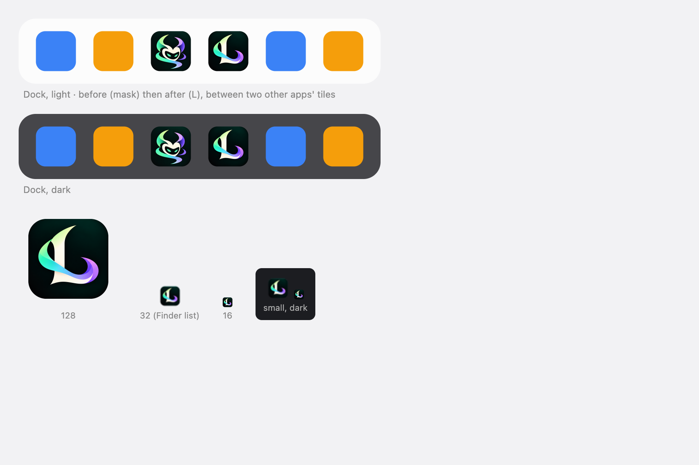

# loki's icon, and its L for small places

## Why

loki had a placeholder icon (a dark tile with a grid of dots) and an "L" in a circle where its mark goes on the phone.
The person brought two images on 2026-10-20: a horned trickster mask, green and violet on a dark tile, for the app
icon; and an L in the same ribbon and colours, for small icons. They chose to keep the green and the violet as they
are.

## What changes

1. **The mask is the icon wherever it is shown large**: the Mac's `icon.icns` and `icon.png`, Windows' larger sizes,
   the phone's home screen (`apple-touch-icon.png`, full-bleed, the phone rounds it), the web app's 192 and 512 px
   icons, and the maskable icon (its edges fading into the tile, so a circle crop keeps it whole).
2. **The L is the icon wherever it is small**: Windows' 16, 24 and 32 px (in `icon.ico`, `32x32.png`) and its 30 and
   44 px tiles, the browser tab (`icon.svg`, a 64 px L), and loki's mark in the app: the phone's Home header and
   pairing page, and the Mac's welcome sheet (`app/public/mark.png`). At 32 px and under the mask's thin tails are
   lost; the L stays an L.
3. **The menu bar has its own icon** (`src-tauri/icons/tray-template.png`): the L's silhouette in black on clear, which
   macOS tints for a light or a dark bar. It used the window icon before, which a template draws as a solid square.
4. **The masters stay in the repo** (`src-tauri/icons/source/`, 1024 px, transparent): `npx tauri icon` makes the set
   again from `mask-1024.png`, and the small sizes and the mark come from `l-1024.png`.

Both are cuts of generated images, a little soft at the edges; a vector version can replace them later.

## Changed 2026-10-26: the Mac's icon is the L

The person chose the L for the Dock. The Mac's icon (`icon.icns`, every size from 16 to 1,024) and the window icons
the Mac and Linux read (`icon.png`, `128x128.png`, `128x128@2x.png`) now come from `l-1024.png`, which already sits on
macOS's grid (an 824 px tile in 1,024). A small size is the L too, so Finder's lists show an L, not a blur. The phone's
home screen, the web app's icons, Windows' icon and tiles keep the mask.

`npx tauri icon` makes every file from one master, so run it on `mask-1024.png` for the others, then make the Mac's
from `l-1024.png`: an iconset of its ten sizes with `sips -z`, joined by `iconutil -c icns`, and the three PNGs with
`sips -z`.

## Tests

By hand on a demo Mac and phone: the welcome sheet, the phone's Home header and pairing page, and every icon at its
size on one sheet. `cargo check` for the menu bar's icon.
