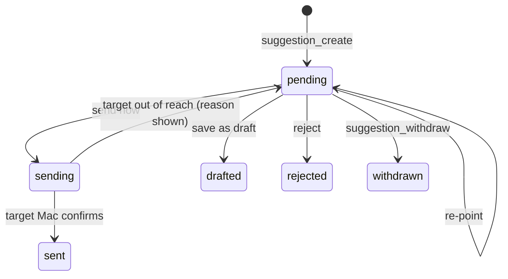
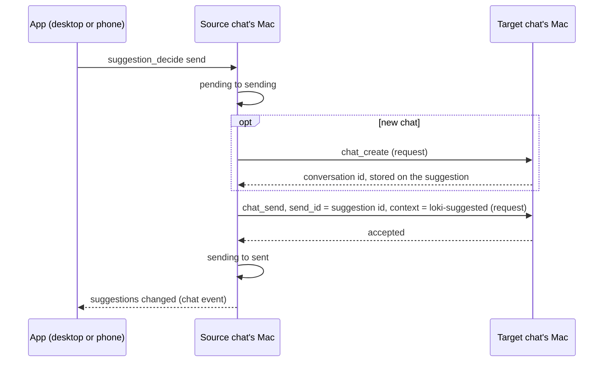

# Suggestions in Place of Tasks - Plan

## Goal Capsule

- **Objective:** Work an agent comes across mid-chat that belongs elsewhere (a side finding, a hand-off, a part to run in parallel) reaches the person as one decision, in the chat where it surfaced, and gets done in the chat best suited to it instead of being lost.
- **Means:** Agents suggest messages for any chat; the person sends, saves as a draft, or rejects each one. Suggestions replace Tasks.
- **Product authority:** The person (sole user of loki), in the brainstorm of 2026-10-28.
- **Open blockers:** None.

---

## Product Contract

### Summary

Agents make **suggestions**: a message written for a chat, either a new chat with any agent or any existing chat, such as a long-running themed one. A suggestion shows as a notification in the chat screen where it was made, where the person sends it now, saves it as a draft in its target chat, or rejects it. Agents pick targets through a read-only `chat_list` tool and an optional purpose line the person writes on a chat. Tasks, and its beads dependency, go away.

### Problem Frame

Small findings come up while the person works with an agent: a weak password noticed in passing, a cache key missing a model id, a cost worth investigating. Tasks was built on 2026-09-06 to hold them, and agents filed 11 in seven weeks, all of which the person wanted kept. None was ever assigned or done: three were closed as superseded or filed in error, and eight sat open for 29 to 52 days. The person never opened the list. Findings were missed, or bigger work crowded them out.

The person works from the Inbox and from chats, one thing at a time. "Later" means "not now", with no time attached. Some findings belong in a new chat, and some belong in a long-running chat about one theme, where the context is already strong. A separate list fits none of this.

### Key Decisions

- **Suggestions replace Tasks.** (session-settled: user-directed — chosen over keeping findings as Inbox cards one at a time: the person preferred a message aimed at a chat to a note held for later.) Governs R13, R14.
- **A suggestion is a message for any chat, new or existing.** (session-settled: user-approved — chosen over drafts being new chats only: themed long-running chats are where some findings fit best.) Governs R1, R5.
- **The person decides every suggestion; agents never send.** (session-settled: user-directed — chosen over agents sending when asked or on their own judgement.) Governs R3.
- **Suggestions live in the chat screen, outside the transcript.** (session-settled: user-directed — chosen over cards in the transcript and over Inbox cards.) Governs R6, R7.
- **Any agent may suggest for any chat.** (session-settled: user-approved — chosen over own-agent or same-folder only: the person approves every suggestion, so nothing crosses without them.) Governs R1.
- **Agents suggest on their own initiative, with no cap.** (session-settled: user-approved — chosen over only-when-asked, as Tasks was, and over a per-chat cap.) Governs R2.
- **An agent suggests whenever another chat fits the work better, not only for side findings.** (session-settled: user-directed — chosen over findings outside the current task only, and over any time the agent judges useful: hand-offs, spin-offs and themed chats are uses the person named.) Governs R2.
- **A saved draft waits in the target chat's message box, and the Inbox shows it.** (session-settled: user-approved — chosen over the box alone, and over drafts kept among the notifications.) Governs R8, R9.
- **Agents read the chat list through a tool, not their context.** (session-settled: user-approved — chosen over the list riding in every turn: a list of dozens of chats would add tokens to every message and break the prompt cache whenever any chat moves.) Governs R10.
- **A person-written purpose line tells agents what a chat is for.** (session-settled: user-directed — chosen over the sidebar's facts alone, and over agents reading other chats' messages.) Governs R10, R11.

### Requirements

**Suggesting**

- R1. An agent can suggest a message for a new chat (an agent and a folder) or for any existing chat, of any agent.
- R2. An agent suggests on its own whenever a piece of work, a side finding or part of the current task, would be done better in another chat (a themed chat, another agent, or a parallel new chat), and never for work it can do in the chat it is in.
- R3. A suggestion is never sent by the agent: the person sends it now, saves it as a draft, or rejects it.
- R4. Before acting, the person can point a suggestion at a different chat.
- R5. A sent suggestion goes as the person's message, waits in the queue when its target is mid-turn, and carries a link back to the chat it came from.

**Where suggestions show**

- R6. A suggestion shows as a notification in the chat screen of the chat it was made in, never as a row in the transcript, on the desktop and on the phone.
- R7. A suggestion stays in that chat screen until the person acts on it; nothing else brings it back.
- R15. A new suggestion in an archived chat brings that chat back into the Inbox, so the suggestion has a screen to show in.
- R16. When a suggestion's target chat is archived, deleted, or its agent is gone, the card asks the person to pick another chat; nothing is dropped silently.
- R17. The first action on a suggestion wins: a second action from another device is told what already happened, and an action that cannot reach the Macs involved leaves the suggestion as it was, with the reason shown.

**Drafts**

- R8. Saving as a draft puts the message in the target chat's message box, ready to edit and send, and it survives reloads, restarts and the move to the phone; it never replaces text already typed there.
- R9. A chat holding a saved draft says so on its Inbox card; a new chat holding only a draft is listed in the Inbox and rests under Next like any other card.

**Finding the right chat**

- R10. Agents have a read-only `chat_list` tool giving each chat's name, agent, folder, labels, pinned state, last activity and purpose line; it is called when needed and never added to a chat's context.
- R11. The person can write an optional one-line purpose on any chat; agents read it and never write it.
- R12. A new chat made from a suggestion lives on the Mac its agent lives on, by the rule new chats already follow.

**Retiring Tasks**

- R13. Tasks is removed: the section and its views, assigning and dispatching, the assigned-tasks block in chats, task chips and Add task on messages, the `task_*` tools, the beads dependency, and their documentation.
- R14. Each open task becomes a suggestion in the chat it was filed from, which comes back into the Inbox if it was archived; the beads store is left on disk untouched.

### Key Flows

- F1. A finding, sent now
  - **Trigger:** Mid-work, an agent notices something outside the current task.
  - **Steps:** The agent calls `chat_list`, picks a target (the person's themed infra chat), and makes a suggestion. The chat screen shows it. The person sends it now. It goes into the infra chat as the person's message, with a link back.
  - **Outcome:** The infra chat's agent works on it; its reply reaches the person through the Inbox like any chat.
  - **Covered by:** R1, R2, R3, R5, R6, R10
- F2. A finding, saved for later
  - **Trigger:** A suggestion appears while the person is busy.
  - **Steps:** The person saves it as a draft. The target chat's message box holds it, and its Inbox card shows the draft. Later, the person opens that chat, edits the draft and sends it.
  - **Outcome:** Nothing was sent until the person chose to.
  - **Covered by:** R3, R8, R9
- F3. Tasks retired
  - **Trigger:** The first start of the version without Tasks.
  - **Steps:** Each of the 8 open tasks becomes a suggestion in its source chat.
  - **Outcome:** The person decides each one where it came from; no task is lost.
  - **Covered by:** R13, R14

### Acceptance Examples

- AE1. **Covers R5.** **Given** the infra chat is mid-turn, **when** the person sends a suggestion to it, **then** the message waits in the queue like a typed one and goes out when the turn ends.
- AE2. **Covers R4.** **Given** friday suggests a message for a new chat with friday, **when** the person points it at ira's existing chat instead and sends it, **then** it goes to ira's chat.
- AE3. **Covers R14, R7.** **Given** an open task's source chat is archived, **when** Tasks is retired, **then** that chat comes back into the Inbox so its suggestion can be seen.
- AE4. **Covers R12.** **Given** a suggestion targets a new chat with an agent whose Mac is out of reach, **when** the person sends it, **then** no chat is made, the suggestion stays, and the chat screen says why.
- AE6. **Covers R17.** **Given** a suggestion is open on the desktop and the phone, **when** the person sends it from the phone and then presses reject on the desktop, **then** the desktop is told it was already sent from the phone and nothing changes.
- AE7. **Covers R16.** **Given** a suggestion targets a chat that has since been deleted, **when** the person opens the card, **then** it asks for another chat instead of offering send.
- AE8. **Covers R8.** **Given** the target chat's box already holds typed text, **when** the person saves a suggestion there as a draft, **then** the typed text stays and the draft waits until the box is empty.
- AE5. **Covers R9.** **Given** a new chat holds only a saved draft, **when** the person presses Next on its Inbox card, **then** it rests on the same ladder as any other card.

### Success Criteria

- Within a month of shipping, most suggestions are sent or saved rather than left undecided, and at least some findings are done, where Tasks finished none in seven weeks.

### Scope Boundaries

- A "suggest from this message" button for the person is deferred; the person asks an agent to suggest instead.
- Reminders for undecided suggestions are left out (R7).
- Agents reading other chats' messages to choose a target is left out.
- A cap on suggestions per chat is left out (R2); revisit if the noise is real.
- Exporting a suggestion to Jira is not built in; an agent with Jira access can be sent one.

### Outstanding Questions

**Deferred to Planning**

None remain; the Planning Contract settles each of them.

### Sources / Research

- docs/plans/2026-09-06-003-feat-loki-board-plan.md: why Tasks (then the Board) was built.
- docs/plans/2026-10-20-026-feat-inbox-rest-plan.md: Next and the rest ladder that drafts follow (R9).
- The `chat_create` frame (core/frames.ts) already makes an empty chat with a home and no first message; mod/chat-router.ts decides where a new chat lives (R12).
- app/src/shared/drafts.ts keeps message-box drafts in memory only, so R8 needs storage that does not exist yet.
- mod/tools.ts registers the `task_*` tools; mod/tasks.ts builds the assigned-tasks block; app/src/tasks/ holds the Tasks UI (R13).
- daemon/agent-migration.ts and `state/migrations.json`: the one-time move pattern of plan 045 that the task move follows.
- daemon/ask.ts and daemon/approvals.ts (`user_ask` in `NEVER_ASK`): the precedent for an agent tool whose result is the person's decision.

**Product Contract preservation:** changed: R2 widened from side findings to any work another chat fits better, Objective reworded to match (the person chose this during planning); R8 gained "never replaces typed text"; R15, R16 and R17 added from edge cases confirmed in the planning synthesis; AE6 to AE8 added.

---

## Planning Contract

### Key Technical Decisions

- KTD1. **Suggestions live on the source chat's record, on the Mac the chat lives on.** They are a field of the chat's info in its pi-durable store, so they persist with no new file, reach clients the way approvals do, and move with the chat once the move copies them. Covers R6, R7, R15.
- KTD2. **The source chat's Mac carries out every action.** Clients send a decision frame routed to that Mac; the mod there changes the status in one step (pending, then sending, then sent, drafted, rejected or withdrawn) and refuses a second action with what already happened. Desktop and phone behave the same because neither does the work. Covers R3, R17.
- KTD3. **A send to another Mac is a request that waits for its reply.** Today `router.forward` sends `chat_send` without a reply; a suggestion is marked sent only when the target's Mac confirms, and returns to pending with the reason otherwise. The `send_id` is the suggestion id, and a new chat's id is stored on the suggestion before its first message goes, so a retry never sends twice or makes a second chat. Covers R5, R12, R17, AE4.
- KTD4. **The four agent tools are mod tools marked read-only, as `user_ask` is.** A suggestion is already the person's decision, so no permission mode shows an approval card for making one, and ACP agents run them without a prompt. Covers R1, R3, R10.
- KTD5. **The rule for when to suggest lives in the tool description, with one line in the ACP agent prompt.** ACP agents never see mod prompt sections, and Claude Code may defer tool descriptions, so the description carries R2 and `agentPrompt` names `suggestion_create`. Covers R2.
- KTD6. **The link back rides in `chat_send`'s existing `context` field as a `<loki-suggested/>` marker.** Both engines already prepend it; the transcript strips it and draws a chip, the way `<loki-moved/>` is drawn. The suggestion text itself must stand alone (absolute paths), since a re-point can change agent and folder. Covers R5.
- KTD7. **A saved draft is a field on the target chat's record.** It seeds the shared message-box draft store only when the box is empty, is cleared when the chat next sends or the person empties the box, and marks the Inbox row. Typing is never written to the store; only the saved suggestion is. Covers R8, R9, AE8.
- KTD8. **The purpose line is a field on the chat's record, edited in the rename dialog on the desktop and the rename sheet on the phone, and shown under the chat's name in its header.** It follows `labels` through `chat_update`, the listing and the move. Covers R11.
- KTD9. **`chat_list` is built in the mod from the chat listing (this Mac and paired Macs) plus the agent list.** Rows are one compact line each; archived chats are left out; each agent row says its Mac and whether it is in reach, so a new-chat target is possible for an agent with few chats. The peer rows gain the folder and purpose they lack today. Covers R1, R10.
- KTD10. **The task move is per task and retried at each start until done.** It keeps a read-only beads reader just for the move, writes each suggestion through the router to its source chat's Mac, records moved task ids in `state/migrations.json`, and leaves a task for the next start when `bd` is missing or its chat's Mac is off. A task whose source chat no longer exists stays in the beads store, reported in the daemon log. Covers R14, AE3.
- KTD11. **Old history keeps rendering.** The `<loki-tasks>` strip in `core/harness.ts` and the `task_*` rename tables in `daemon/tool-kinds.ts` stay, so chats from before this change read cleanly. Covers R13.
- KTD12. **Background passes cannot suggest.** A call from a pass chat (reflection, Learn) fails with a plain error, since a pass has no chat screen. Covers R6.

### High-Level Technical Design

A suggestion's life, owned by the source chat's Mac (KTD2):

Send now, when the app, the source chat and the target chat are on three different Macs (KTD3):

### Assumptions

- The person's 11 tasks all carry a source chat, as every agent-filed task does; a task with none would stay in the beads store.
- Counting suggestions made, sent, saved and rejected in loki's existing analytics events is enough to judge the success criterion and the noise.

---

## Implementation Units

### U1. Chat record fields: purpose, saved draft, suggestions

- **Goal:** The chat record holds a purpose line, a saved draft and its suggestions, and all three reach the listing, the Inbox and survive a move between Macs.
- **Requirements:** R8, R9, R11, R15; KTD1, KTD7, KTD8, KTD9.
- **Dependencies:** none.
- **Files:** daemon/kernel/index.ts, daemon/chat-backend.ts, daemon/chats.ts, daemon/chat-move.ts, core/frames.ts, core/frame-types.ts, mod/chat-listing.ts, mod/desks.ts, mod/remote-chats.ts, core/attention/model.ts; tests test/chat-purpose.test.ts (new), test/chat-move.test.ts, test/frames.test.ts.
- **Approach:**
  1. Add optional `purpose`, `draft` and `suggestions` to `ChatInfo` and to the fields `updateChat` may change; optional fields need no store migration.
  2. Parse `purpose` and `draft` in `chat_update`; it is already routed to the chat's home Mac and relisted.
  3. Carry `purpose`, a `has_draft` flag and the folder through `ChatProjection.info`, `DeskSummary` and `InboxRow`, as `labels` is carried.
  4. Add the three fields to `MovedChat.info` so a move keeps them.
- **Patterns to follow:** plan 022's `labels` field end to end; test/chat-labels.test.ts for a daemon chat backend in a temp dir.
- **Test scenarios:**
  - Setting a purpose through `chat_update` shows it in the desk list and the Inbox row.
  - An empty purpose clears it.
  - A saved draft sets `has_draft` on the Inbox row, and clearing it unsets the flag.
  - Moving a chat to another Mac keeps its purpose, draft and suggestions.
  - A chat with no new fields reads as before (no purpose, no draft, no suggestions).
  - `chat_update` with a non-string purpose is rejected at the frame edge.
- **Verification:** the listing and Inbox carry the new fields on this Mac and from a paired Mac's rows.

### U2. Suggestion store and actions on the source chat's Mac

- **Goal:** The mod keeps each chat's suggestions, carries out send, save as draft, re-point and reject on the Mac the source chat lives on, and tells every client.
- **Requirements:** R3, R4, R5, R7, R8, R12, R15, R16, R17; KTD1, KTD2, KTD3, KTD6, KTD7; AE1, AE2, AE4, AE6, AE7.
- **Dependencies:** U1.
- **Files:** mod/suggestions.ts (new), mod/frames/suggestions.ts (new), mod/frames/index.ts, mod/index.ts, mod/chat-router.ts, core/frames.ts, core/frame-types.ts, core/attention/model.ts, core/attention/chat-client.ts, core/analytics.ts; tests test/suggestions.test.ts (new), test/chat-router.test.ts, test/frames.test.ts.
- **Approach:**
  1. A suggestion holds its id, title, text, target (an existing chat, or a new chat's agent and folder), status, the reason of a failed action, and the new chat's id once made.
  2. `suggestion_decide` (send, draft, reject) and `suggestion_retarget` are frames routed to the source chat's home Mac and allowed on the phone.
  3. The status moves in one step per KTD2; a second action returns the current status and who set it.
  4. Send resolves the target when sent, not when made; a missing target or agent sets the R16 reason instead of sending.
  5. Cross-Mac `chat_create` and `chat_send` go as requests with replies (KTD3); a new chat's id is written to the suggestion before the send.
  6. Save as draft writes the target's `draft` through `chat_update`; when the target already holds a saved draft, the new one is refused with that reason.
  7. A new suggestion in an archived chat un-archives it (R15).
  8. `ChatState` gains the pending suggestions and a `suggestions` chat event carries changes, both relayed for remote chats like approvals.
  9. Analytics records suggestions made and each decision.
- **Patterns to follow:** approvals' "false when already answered" in daemon/approvals.ts; `ChatState` replay in core/attention/chat-client.ts; `router.target` and `forward` in mod/chat-router.ts.
- **Test scenarios:**
  - Covers AE1. Sending to a chat that is mid-turn sends `chat_send` without steer, and the suggestion becomes sent.
  - Covers AE2. Re-pointing a new-chat suggestion to an existing chat of another agent, then sending, delivers it there.
  - Covers AE4. Sending to a new chat whose agent's Mac is out of reach leaves it pending with the out-of-reach reason, and no chat is made.
  - Sending to an existing chat on a Mac that does not answer leaves it pending with that reason.
  - A retry after the chat was made but the send failed reuses the stored chat id and the same `send_id`.
  - Covers AE6. A reject after a send returns "already sent" and changes nothing.
  - A withdraw after sending began is refused.
  - Covers AE7. A target that was deleted gives the pick-another-chat reason, and nothing is sent.
  - Save as draft writes the target's draft and marks the suggestion drafted.
  - Save as draft onto a target that already holds a saved draft is refused with that reason.
  - A suggestion added to an archived chat un-archives it.
  - The sent message carries the `<loki-suggested/>` context, and the transcript strips it into a chip row.
  - Opening a chat replays its pending suggestions; a decision on one pushes the change to every client, including a paired Mac's.
- **Verification:** the state machine in the High-Level Technical Design holds under the tests, including the three-Mac send.

### U3. Agent tools: chat_list and suggestion_create, _list, _withdraw

- **Goal:** Agents on both engines can find chats and suggest, list and withdraw their own suggestions, with no approval card in any mode.
- **Requirements:** R1, R2, R10; KTD4, KTD5, KTD9, KTD12.
- **Dependencies:** U1, U2.
- **Files:** mod/tools.ts, mod/index.ts, daemon/acp/prompt.ts, skills/loki/SKILL.md; tests test/tools.test.ts, test/acp-loki-tools.test.ts, test/approvals.test.ts, test/tool-names.test.ts.
- **Approach:**
  1. `chat_list` returns agents (id, name, Mac, in reach) and open chats (ids, name, agent, folder, labels, pinned, last active, purpose, and which row is the calling chat), one line each, with an optional text filter.
  2. `suggestion_create` takes a title, self-contained text, and either an existing chat or a new chat's agent and folder; it validates the target against the listing, returns the suggestion id at once, and errors with the valid choices on a bad target.
  3. `suggestion_list` shows this chat's suggestions with status and final target, so an agent avoids repeats.
  4. `suggestion_withdraw` works only on this chat's pending suggestions.
  5. All four are marked read-only (KTD4). A call from a pass chat fails (KTD12).
  6. The `suggestion_create` description states R2's rule and asks the agent to name the suggestion in one line of its reply; `agentPrompt` names the tool for ACP agents.
- **Patterns to follow:** the fake mod API in test/tools.test.ts; `schedule_*` in daemon/schedule.ts for create, list and delete scoped to the caller.
- **Test scenarios:**
  - `chat_list` lists chats from this Mac and a paired Mac, leaves out archived chats, and marks the calling chat.
  - `chat_list` lists an agent with no chats, with its Mac and whether it is in reach.
  - `suggestion_create` for an existing chat stores a pending suggestion on the calling chat and returns its id.
  - `suggestion_create` for an unknown agent, chat or folder errors with the valid choices and stores nothing.
  - `suggestion_list` shows a suggestion re-pointed by the person with its final target.
  - `suggestion_withdraw` of another chat's suggestion fails; of a decided one, fails with its status.
  - A call from a pass chat fails.
  - Under `strict`, `standard` and `acceptEdits`, none of the four shows an approval card.
  - Through the ACP loopback tool server, the same `suggestion_create` call stores the same suggestion.
  - The ACP agent prompt names `suggestion_create`.
  - Tool names pass the `<subject>_<verb>` check.
- **Verification:** both engines see the same four tools, and making a suggestion never stops a turn.

### U4. The suggestion card

- **Goal:** Suggestions show in the chat screen, outside the transcript, on the desktop and the phone, with send now, save as draft, change chat and reject.
- **Requirements:** R3, R4, R6, R7, R16, R17; AE6, AE7.
- **Dependencies:** U2.
- **Files:** app/src/chat/suggestion-card.tsx (new), app/src/chat/conversation.tsx, app/src/desk/desk-pane.tsx, app/src/desk/catch-up.tsx, app/src/phone/conversation-screen.tsx, app/src/phone/inbox.tsx, app/src/chat/transcript.tsx, app/src/chat/chat.css; tests test/suggestion-card.test.ts (new), test/desk-pane.test.ts.
- **Approach:**
  1. `Conversation` draws pending suggestions in the slot beside the approval and question cards, only in the visible view, as those cards are.
  2. Several suggestions stack, newest first, each one line until opened.
  3. Change chat reuses the chat search the sidebar's search sheet uses, plus "new chat with" an agent.
  4. A refused action shows its reason on the card; on the phone the buttons are disabled while the Mac is out of reach.
  5. Copy follows the words-on-screen rule: desktop lowercase, phone sentence case.
- **Patterns to follow:** app/src/chat/approval-card.tsx and question-card.tsx; the phone's `.loki-phone-notice`; the `<loki-moved/>` chip row in transcript.tsx.
- **Test scenarios:**
  - A chat with two pending suggestions draws two cards in the desk pane and on the phone.
  - A hidden view (`composer={false}`) draws none.
  - Each action sends the matching frame with the suggestion id.
  - Covers AE6. A refused action shows "already sent from the phone".
  - Covers AE7. A suggestion whose target is gone offers change chat and no send.
  - On the phone, actions are disabled while the Mac is out of reach.
  - A sent suggestion's message shows the chip linking to the source chat.
- **Verification:** the cards render on both surfaces with the design scales `test/tokens.test.ts` checks; screenshots go in the PR from the demo Macs.

### U5. Saved drafts in the box, the Inbox mark, and the purpose line

- **Goal:** A saved draft appears in its target chat's message box on every surface and marks its Inbox card, and the person can write a chat's purpose.
- **Requirements:** R8, R9, R11; KTD7, KTD8; AE5, AE8.
- **Dependencies:** U1.
- **Files:** app/src/shared/drafts.ts, app/src/chat/use-draft.ts, app/src/desk/catch-up.tsx, app/src/phone/inbox.tsx, app/src/desk/rename-desk.tsx, app/src/phone/rename-sheet.tsx, app/src/chat/conversation.tsx (header subtitle), daemon/chat-backend.ts (clear on send); tests test/drafts.test.ts (new or extended), test/rename-desk.test.ts.
- **Approach:**
  1. When a chat with a saved draft opens and its box is empty, the shared draft store is seeded from it; text already typed wins.
  2. The desktop Inbox deck uses the shared draft store, as the desk pane and the phone do.
  3. The chat's next send clears the saved draft on the daemon; emptying a seeded box clears it too.
  4. The Inbox card shows a quiet "draft" mark from `has_draft`.
  5. The rename dialog and sheet gain a one-line purpose field; the chat header shows it under the name.
- **Patterns to follow:** `draftKey` and `useSyncExternalStore` in app/src/shared/drafts.ts; the labels UI for per-chat fields.
- **Test scenarios:**
  - Opening a chat with a saved draft and an empty box fills the box.
  - Covers AE8. Opening it with typed text keeps the typed text.
  - Sending from the chat clears the saved draft and the Inbox mark.
  - Emptying a seeded box clears the saved draft.
  - The desktop Inbox deck and the desk pane show the same draft for one chat.
  - Covers AE5. A new chat holding only a draft is an Inbox card and rests under Next like any other.
  - Saving a purpose in the rename dialog shows it in the header and in `chat_list`.
- **Verification:** a draft saved on the desktop shows in the phone's box after a reload, and the reverse.

### U7. Move open tasks into suggestions

- **Goal:** Each open task becomes a suggestion in the chat it came from, once, before Tasks' code goes.
- **Requirements:** R14; KTD10; F3, AE3.
- **Dependencies:** U2.
- **Files:** mod/task-migration.ts (new, holding the read-only beads reader taken from mod/tasks.ts), mod/index.ts; tests test/task-migration.test.ts (new).
- **Approach:**
  1. At mod start, read open tasks through the read-only reader with an injected `bd` runner.
  2. For each task not yet in `state/migrations.json`, add a suggestion to its source chat through the router: the task's title and description become the text, the target is a new chat with the same agent and folder.
  3. Record each moved task id; a task whose chat's Mac is off, or every task when `bd` is missing, waits for the next start.
  4. A task whose source chat no longer exists is logged and left in the beads store.
- **Patterns to follow:** daemon/agent-migration.ts and its test, run twice to prove it happens once.
- **Test scenarios:**
  - Covers AE3. An open task from an archived chat becomes a suggestion there and un-archives the chat.
  - A second start moves nothing new.
  - With `bd` missing, nothing is moved or recorded, and a later start with `bd` moves them all.
  - A task whose chat lives on a Mac that is off is retried at the next start; the others move.
  - A closed task is not moved.
  - A task whose source chat is gone is logged and not recorded.
- **Verification:** the person's 8 open tasks appear as suggestions in their chats, and the beads store is unchanged on disk.

### U6. Retire Tasks

- **Goal:** Tasks is gone from the app, the phone, the tools, the frames and the install checks, while old chats still read cleanly.
- **Requirements:** R13; KTD11.
- **Dependencies:** U3, U4, U7 (U7 keeps the only beads reader still needed).
- **Files:** app/src/tasks/ (removed), app/src/shell/ (use-tasks.ts, shell.tsx, views.tsx, column.ts, keymap.ts, shortcuts.ts, use-shell-keys.ts, sidebar.tsx, search-model.ts, os-words.ts, use-harness-facts.ts, use-window-chrome.ts), app/src/settings/settings.tsx, app/src/desk/ (use-desk.ts, use-desk-socket.ts, desk-pane.tsx), app/src/chat/ (conversation.tsx, transcript.tsx, chat.css), app/src/phone/ (conversation-screen.tsx, use-message-actions.tsx, phone.tsx), mod/tasks.ts (removed), mod/frames/tasks.ts (removed), mod/frames/index.ts, mod/index.ts, mod/tools.ts, mod/programs.ts, core/frames.ts, core/frame-types.ts, core/task-source.ts (removed), core/snake-keys.ts, core/analytics.ts, src-tauri/src/install.rs; tests removed: test/tasks.test.ts, test/frames-tasks.test.ts, test/task-from-message.test.ts, test/task-metadata-migration.test.ts, test/tasks-view.test.ts; tests updated: test/frames.test.ts, test/tools.test.ts, test/desk-pane.test.ts, test/desktop-search.test.ts, test/keymap.test.ts, test/os-words.test.ts, test/shell-column.test.ts, test/analytics.test.ts, test/preferences.test.ts, test/title-strip.test.ts, test/tool-names.test.ts.
- **Approach:**
  1. Remove the Tasks section, its shortcut (⌘3) and views, assign and dispatch, task chips and Add task on desktop and phone, and the `<loki-tasks>` block the mod adds to sends.
  2. Remove the `task_*` tools, frames and replies, and the `bd` install detection.
  3. Keep the `<loki-tasks>` strip and the rename tables (KTD11).
  4. Renumber nothing users rely on beyond the freed ⌘3; the remaining sections keep their shortcuts.
- **Patterns to follow:** plan 045's removal of Letta, which kept history readable while deleting the live path.
- **Test scenarios:**
  - No `task_*` tool is registered on either engine.
  - The phone frame catalog no longer lists task frames.
  - A transcript holding an old `<loki-tasks>` block and `task_create` call renders without raw markup.
  - The sidebar rail no longer shows Tasks, and ⌘3 does nothing.
- **Verification:** the full test suite passes with the Tasks tests removed, and no file outside the kept history code mentions beads.

### U8. Documentation

- **Goal:** The manual, architecture, glossary, README, security notes and the loki skill describe suggestions and no longer describe Tasks.
- **Requirements:** R13; the AGENTS.md rule that a change to what loki does updates the manual in the same PR.
- **Dependencies:** U3, U4, U5, U6.
- **Files:** docs/manual.md, docs/architecture.md, docs/SECURITY.md, glossary.md, README.md, skills/loki/SKILL.md, AGENTS.md (the "task metadata" example), CHANGELOG.md.
- **Approach:**
  1. Replace the manual's Tasks section with Suggestions, covering R1 to R17 in the reader's words.
  2. Add "suggestion" and "purpose line" to the glossary; drop Tasks.
  3. Drop beads from the install lines.
- **Test expectation:** none -- documentation only; `npm run format:check` covers the files.
- **Verification:** no doc mentions Tasks as a current feature.

---

## Verification Contract

| Check | When | Proves |
| --- | --- | --- |
| `npm run format:check` | every unit | Prettier layout |
| `npm run lint` | every unit | the rules in AGENTS.md (no `any`, no floating promises) |
| `npm run typecheck` | every unit | types across core, mod, daemon and app |
| `npm test` | every unit | the unit test scenarios above |
| `npm run test:node` | U1, U2, U7 | store and child-process behaviour |
| `npm run build:app` and `npm run build:mod` | U4, U5, U6 | the desktop and phone bundles and the mod bundle build |
| `npm run smoke` | before the PR | the bundle starts and answers |

Run every check with CI's toolchain (Node 22.23.3, npm 10.9.9, `SHELL=/bin/bash`). By hand, on the two demo Macs: a suggestion sent across Macs, a draft saved on the desktop and seen on the phone, and an agent on each engine making a suggestion for a planted unrelated bug and none when nothing belongs elsewhere.

---

## Definition of Done

- Every requirement R1 to R17 is met and its acceptance examples pass as tests.
- The checks in the Verification Contract pass, and the PR's CI passes on every platform, Windows included.
- The person's 8 open tasks are suggestions in their chats, and the beads store is untouched.
- The manual describes suggestions in the same PR.
- No code from abandoned approaches is left in the diff.
