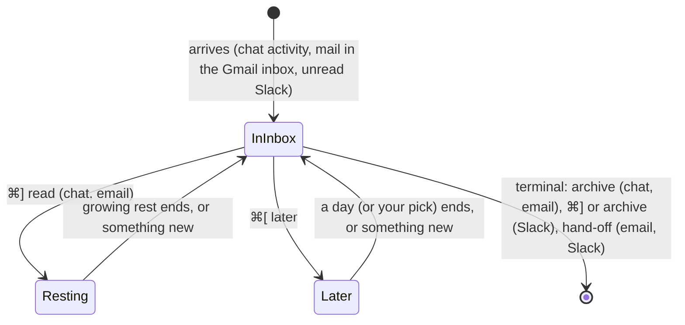
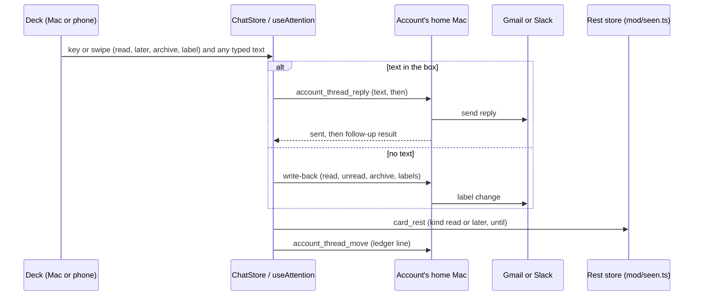
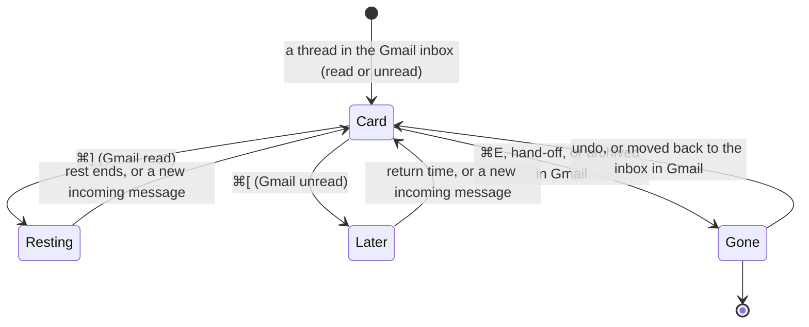

# Inbox Cards Until Their Terminal State - Plan

2026-11-05 · follows [plan 067](2026-11-04-067-feat-unified-inbox-plan.md), [plan 068](2026-11-05-068-feat-inbox-thread-reply-plan.md) and [plan 069](2026-11-05-069-feat-inbox-everything-and-ledger-plan.md)

## Goal Capsule

- **Objective:** Every Inbox card, whether a chat, an email or a Slack message, stays until the person has truly finished with it. The same two keys and swipes put any card off with a clear time to come back, so nothing that needs the person slips away unnoticed.
- **Product authority:** the person, in the brainstorm of 2026-11-05. This plan covers how a card is finished. Unsubscribe and spam, "everything like this" rules, and loki acting on its own are not active scope.
- **Open blockers:** none.
- **Means:** the existing rest record gains a "later" kind and the outside-card write-backs gain read, unread, unarchive and label (KTD1, KTD3).
- **Stop conditions:** stop and ask if Slack's read marker cannot be kept from ending a waiting reply (KTD7), or if a Gmail write needed by R5, R6 or R14 is refused under `gmail.modify`.
- **Who finishes:** `ce-work` implements on branch `feat/inbox-endings`; the person checks it on real Gmail and Slack before merging.

---

## Product Contract

### Summary

Each kind of card has one terminal state: a chat or an email ends when archived, a Slack message when read. Until then it stays in the Inbox.

Two keys, the same on every card, put a card off and set when it comes back:
- **⌘] read** marks it read and brings it back after a rest that starts at an hour and grows.
- **⌘[ later** keeps it unread and brings it back in a day; the second time, the person picks when.

On email and Slack cards, a typed reply is sent by whichever key is pressed. **⌘E** stays archive. **L** adds Gmail labels.

### Problem Frame

The Inbox lets things slip away before the person is done with them. An email card disappears once the mail is read, even if it still needs work. A reply that expects an answer is archived, and nothing brings the thread back if the other side goes quiet. The keys also mean different things on different cards:
- ⌘] rests a chat;
- ⌘] leaves an email unread;
- the phone's right swipe rests a card;
- the left swipe does nothing.

The person reads most mail and archives it at once. Otherwise they answer it at once, or mark it unread to come back to it. They expect a card to stay until they have actually finished it.

### Key Decisions

- **A card lasts until its kind's terminal state.** Archived for a chat or an email, read for a Slack message. (session-settled: user-directed, chosen over a card leaving once its mail is read: the Inbox should hold what is unfinished.) Governs R1, R2, R3.
- **⌘] and ⌘[ mean the same on every card; ⌘E stays archive.** (session-settled: user-directed, chosen over ⌘] archiving chats or archiving email, and over keeping today's keys: one vocabulary across chats, email and Slack, as PRODUCT.md asks.) Governs R5, R6, R9.
- **⌘] never archives.** It only marks read. (session-settled: user-directed, chosen over ⌘] archiving email: read and archived are different states.) Governs R5.
- **The return time follows the key, not the kind of card.** (session-settled: user-approved, chosen over one return rule per kind of card: what each key means stays predictable.) Governs R5, R6.
- **⌘[ brings a card back in a day; the second time, the person picks.** (session-settled: user-directed, chosen over a fixed three days and over picking every time.) The same rule covers a reply that waits for an answer. (session-settled: user-approved.) Governs R6, R7, R8.
- **A read chat still comes back after a rest.** (session-settled: user-directed, chosen over returning only when something new happens.) Governs R5.
- **Swipe right is read and swipe left is later, on every card.** (session-settled: user-directed, chosen over today's right swipe as Next and no left swipe: right means done, left means parked.) Governs R10.
- **Every mail in the Gmail inbox becomes a card, read or not.** (session-settled: user-directed, chosen over unread mail only: loki's Inbox and the Gmail inbox match.) Governs R2, R4.
- **Labels are in this work.** A label picker on email cards. (session-settled: user-directed, chosen over leaving labels to Gmail or to the rules work.) Governs R12.
- **Return times are settings, one set per kind of card.** (session-settled: user-directed, chosen over one set for all cards and over rebindable keys.) Governs R15.
- **Later comes back.** It reverses commit fc2a82e (2026-09-27), which removed snooze and Later and the phone's left swipe; the glossary's "Avoid: snooze, later" and the keymap test that forbids an Inbox ⌘[ change with it. (session-settled: user-directed — chosen over keeping Later removed: ⌘[ now means "keep it unread and bring it back", which the person's habit needs.) Governs R6, R7, R10.
- **Label is not an ending.** It adds labels and the card waits for the next key, so "label and archive" is two moves. Governs R12.
- **Hand-off is terminal for email and Slack.** The thread lives in the agent's chat from then on, and that chat follows the chat rules. Governs R13.

### Requirements

**What a card is and when it ends**

- R1. A chat card stays in the Inbox until the chat is archived.
- R2. An email card stays until its thread leaves the Gmail inbox, archived from loki or in Gmail. Reading it in Gmail does not end the card.
- R3. A Slack card stays until it is read, from loki or in Slack.
- R4. Every thread in the Gmail inbox, read or unread, becomes a card. Older mail comes in the same batches going back in time as today (plan 067, KTD13).

**The keys and what they schedule**

- R5. ⌘] (and →) marks the card read: a chat is seen, an email is marked read in Gmail, a Slack message is marked read in Slack. A chat or email card then rests and comes back after the growing rest, and sooner if something new arrives. A Slack card has reached its terminal state.
- R6. ⌘[ (and ←) leaves the card unread in loki and in Gmail or Slack. The card comes back in a day, or sooner if something new arrives.
- R7. The second time the person presses ⌘[ on the same card, loki asks when the card should come back.
- R8. The second-push count starts over once the card's thread gets something new.
- R9. ⌘E and E archive. A chat is archived; a main chat cannot be, and springs back saying so, as today. An email thread is archived in Gmail. A Slack message is marked read.

- R10. On the phone, a right swipe is ⌘] and a left swipe is ⌘[, on every kind of card. Archive stays a button, and approval cards still refuse both swipes.

**Replies**

- R11. On an email or Slack card, text in the reply box is sent by the key the person presses, before that key's own action. With ⌘] or Enter, the reply is sent and the card rests as read. With ⌘[, it is sent and the card comes back when they answer or after a day. With ⌘E, it is sent and the thread is archived (Slack: read). On a chat card, Enter sends to the agent and the card stays, as today.

**Labels, hand-off and undo**

- R12. On an email card, L opens a picker of the account's Gmail labels. The chosen labels are added to the thread, and the card stays for the next key. On the phone, the picker is in the card's actions sheet.
- R13. Hand-off on an email card archives the thread in Gmail; on a Slack card, it marks the thread read. Either way the card ends there.
- R14. ⌘Z (on the phone, the top bar's undo) takes back the last move on any card. For email this includes putting the Gmail thread back as it was, unread or in the inbox.

**Settings**

- R15. Preferences › Inbox sets the return times for each kind of card.
  - ⌘]'s first rest for chats and for email: 10 min, 30 min, 1 hour or 3 hours. The default is 1 hour, and today's Next rest setting carries over.
  - ⌘['s return time for chats, email and Slack: 3 hours, 1 day, 2 days or 1 week. The default is 1 day.
  - The growth of the ⌘] rest and the second-push question are not settings.

**The ledger**

- R16. Every key press, its scheduled return, any labels added and any pick from the second-push question go to the Inbox ledger (plan 069) for outside cards.

### Card lifecycle

### Acceptance Examples

- AE1. **Covers R2, R5.**
  - **Given:** an unread newsletter card.
  - **When:** the person presses ⌘].
  - **Then:** the mail is read in Gmail and still in the inbox, and the card returns in an hour. Pressed again on its return, the card returns after a longer rest. After ⌘E it is gone.
- AE2. **Covers R6, R7, R8.**
  - **Given:** an email card the person has pressed ⌘[ on once.
  - **When:** it returns a day later and they press ⌘[ again.
  - **Then:** loki asks when it should come back. If a new message had arrived before the second press, the press would count as a first one again.
- AE3. **Covers R11.**
  - **Given:** an email card with "Can you send the deck by Friday?" typed in the box.
  - **When:** the person presses ⌘[.
  - **Then:** the reply is sent, and the card comes back when they answer or after a day of silence.
- AE4. **Covers R11.**
  - **Given:** the same card and text.
  - **When:** the person presses ⌘E.
  - **Then:** the reply is sent, the thread is archived, and the card ends.
- AE5. **Covers R3, R5.**
  - **Given:** a Slack DM card.
  - **When:** the person presses ⌘].
  - **Then:** the DM is marked read in Slack and the card ends until someone writes again.
- AE6. **Covers R1, R5, R9.**
  - **Given:** a chat card.
  - **When:** the person presses ⌘].
  - **Then:** the chat is seen and returns after the growing rest. ⌘E archives it, and on a main chat it springs back with "main chats stay".
- AE7. **Covers R2.**
  - **Given:** an email card.
  - **When:** the person reads the mail in the Gmail app.
  - **Then:** the card stays, shown as read. When they archive it in Gmail, the card ends at the next check.
- AE8. **Covers R12.**
  - **Given:** an email card.
  - **When:** the person presses L and picks "Clients".
  - **Then:** the thread gains the label and the card stays, waiting for ⌘], ⌘[ or ⌘E.

### Scope Boundaries

- Unsubscribe and spam (a "drop this sender" move).
- "Do this to everything like it" rules, and loki finishing cards on the person's behalf.
- Reply to sender only, editing recipients, and forward.
- Rebinding the keys.
- Archiving by swipe.

### Dependencies / Assumptions

- Marking a single Slack Activity item read is still not available. ⌘] or ⌘E on an Activity card ends it in loki while Slack still shows it unread, as today (plan 067). It is a known gap, not something this plan fixes.
- Adding labels and marking read in Gmail are within the access loki already has (`gmail.modify`). No new sign-in is needed.

### Outstanding Questions

**Deferred to Planning**

- What the second-push question offers. A short list such as later today, tomorrow, next week and a date is assumed; the exact choices are planning's call.
- How an email card shows "read but still in your inbox", and how a returning waiting reply shows it was waiting for an answer.
- How the change of meaning for ⌘], → and the phone swipes is introduced to the person, if at all.

### Sources / Research

- `app/src/shell/keymap.ts` (Inbox keys today), `app/src/desk/use-deck-actions.ts` (Next, archive, undo), `app/src/phone/deck.ts` (right swipe only; archive kept off swipes), `core/attention/rest.ts` (the growing rest), `mod/gmail-sync.ts` (cards only for unread inbox mail; archive removes INBOX and UNREAD), `mod/handoff.ts` (hand-off leaves Gmail as it was), `mod/gmail.ts` (removes labels only).
- `PRODUCT.md` design principle: one interaction vocabulary across chats, inbox, settings and phone.

---

## Planning Contract

**Product Contract preservation:** changed: added the "Later comes back" Key Decision, which the person chose during planning after being shown that it reverses fc2a82e. Requirements and examples unchanged.

### Key Technical Decisions

- KTD1. **⌘[ is a rest of kind "later" on the existing rest record, not a new store.** The `Rest` in `core/attention/rest.ts` gains an optional `kind` (`read` or `later`), and it travels on the same `card_rest` frame and `mod/seen.ts` store, so paired Macs and the phone already sync it, and `isRest` stays readable by older Macs. `rungOf` already restarts the count when the card's stamp changes, which is R8. Governs R6, R7, R8.
- KTD2. **An email card is built from the thread's newest incoming message in the inbox, read or not, and carries Gmail's read state.** The thread record and `OutsideFacts` gain `unread_out_there`, and the card's unread follows it. Messages the person wrote never become the newest, so their own reply cannot reset a waiting card. A card ends only when no message in the thread is in the inbox. Governs R2, R4, R5.
- KTD3. **Each provider write-back is one method on `OutsideSource`, and each records what it changed.** `archive` exists; this adds `markRead`, `markUnread`, `restore` (puts back exactly the labels a move removed, for undo) and `addLabels`. Gmail writes touch messages up to the card's newest only, as archive does today, so mail that came since the poll stays unread. Slack's `markRead` and `archive` are the same DM mark. Governs R5, R6, R9, R12, R14.
- KTD4. **`AccountThreads` gains an explicit reopen.** A thread that is back in the inbox, through undo or the person moving it back in Gmail (seen as an INBOX `labelsAdded` in history), reopens as the same card without the "newer message" check. It reopens only when Gmail shows the thread in the inbox, so a rebuild still keeps truly archived threads out. Governs R4, R14.
- KTD5. **Older mail is paced by unread cards only.** The next older batch waits while the account has unread cards in the Inbox; resting, later and read cards no longer hold it back. Each batch brings every unread thread in its window plus at most 20 read ones. At upgrade, records marked archived only because they were read are checked once against the inbox and reopened through these batches. Governs R4.
- KTD6. **The reply frame carries the key's move, and the send is reported apart from it.** `account_thread_reply` gains `then` (`read`, `later` or `archive`) and answers whether the reply was sent and, separately, any error in the move that followed. The box clears as soon as the reply is sent, so a failed follow-up can be retried without sending twice. Governs R11.
- KTD7. **A waiting reply keeps a Slack card despite Slack's read marker.** After a reply with ⌘[, the record is marked as waiting, and SlackSync does not end it for being read until the other side writes or the day passes. Whether posting moves Slack's read marker is checked first; if it does not, this needs nothing. Governs R3, R11.
- KTD8. **Return times live on the daemon, beside the rests.** The per-kind times are stored with the rests in `mod/seen.ts` and reach every device in the seen list. The Mac's current `loki.restFirst` value moves there once. A press stores an absolute return time, so changing a setting affects later presses only. Governs R15.
- KTD9. **The deck owns the reply text, and its keys work from inside the box.** The text moves from `OutsideReply`'s own state up to the card, so ⌘], ⌘[ and ⌘E can send it. The box lets those chords through to the deck instead of stopping every key. Governs R11.
- KTD10. **The rest for ⌘] on an outside card starts at the first rest, without the quiet-time term.** Chats keep today's ladder, which also grows with how long the chat has been quiet. Mail starts at an hour even when it is old. Governs R5.
- KTD11. **The ledger gains the new moves rather than a second record.** `OutsideMove` adds `read`, `later`, `label` and `undo`, with the scheduled return, any labels, the second-press pick and the key that followed a reply. Governs R16.

### High-Level Technical Design

How a move travels. The deck decides the move, the home Mac of the account writes it back, and the rest record schedules the return.

The email card's states. A Slack card follows the same picture with "read" as its end.

### Assumptions

- Gmail accepts `addLabelIds` with `gmail.modify` for INBOX, UNREAD and user labels, as its documentation says; the fake mailbox models it.
- Approval and question cards cannot rest, so on the desktop ⌘] and ⌘[ on them move past for this visit only, as ⌘] does today, with no return time and no second-press count.
- Hand-off cannot be undone. Undo after one flashes that it was handed off, as an outside archive does today.
- The Inbox badge counts unread cards in the Inbox only. Resting, later and read cards never count.
- Within the same score, unread cards come ahead of read ones, so a read backlog never buries new mail.

---

## Implementation Units

| U-ID | Title | Key files | Depends on |
|---|---|---|---|
| U1 | Gmail client writes and labels | `mod/gmail.ts`, `test/fixtures/gmail-mailbox.ts` | – |
| U2 | Email card rule: every inbox thread | `mod/gmail-sync.ts`, `mod/account-threads.ts`, `core/account-refill.ts` | U1 |
| U3 | Write-backs and reopen | `mod/account-threads.ts`, `mod/gmail-sync.ts`, `mod/slack-sync.ts`, `mod/frames/accounts.ts`, `core/frames.ts` | U1, U2 |
| U4 | Later rests and return times | `core/attention/rest.ts`, `mod/seen.ts`, `core/frames.ts` | – |
| U5 | Reply with a follow-up move | `mod/outside-threads.ts`, `core/frames.ts`, `core/attention/chat-store.ts` | U3, U4 |
| U6 | Client moves and undo | `core/attention/use-attention.ts`, `core/attention/chat-store.ts`, `core/attention/chat-client.ts` | U3, U4, U5 |
| U7 | Desktop deck keys, pickers and words | `app/src/shell/keymap.ts`, `app/src/desk/*` | U6 |
| U8 | Phone swipes, sheets and undo | `app/src/phone/deck.ts`, `app/src/phone/inbox.tsx` | U6 |
| U9 | Hand-off ends the thread out there | `mod/handoff.ts` | U3 |
| U10 | Ledger moves | `core/frame-types.ts`, `core/frames.ts`, `mod/inbox-ledger.ts` | U6 |
| U11 | Settings page and docs | `app/src/settings/settings.tsx`, `docs/manual.md`, `glossary.md` | U4, U7, U8 |

### U1. Gmail client writes and labels

- **Goal:** the Gmail client can add labels as well as remove them, and can list the account's labels.
- **Requirements:** R5, R6, R12, R14.
- **Dependencies:** none.
- **Files:** `mod/gmail.ts`, `test/fixtures/gmail-mailbox.ts`, `test/gmail.test.ts`.
- **Approach:**
  1. `batchModify` takes both `addLabels` and `removeLabels`, and sends `addLabelIds` and `removeLabelIds`.
  2. A labels call lists the account's labels with their id, name and type.
  3. The fake mailbox applies `addLabelIds`, records `labelsAdded` in its history, and serves the labels list.
- **Patterns to follow:** the existing `batchModify` and `call("GET", …)` in `mod/gmail.ts`. The send-surface test in `test/gmail.test.ts` stays green; nothing new reaches a send endpoint.
- **Test scenarios:**
  - Adding INBOX and UNREAD to two messages sends one batchModify with `addLabelIds` and no `removeLabelIds`.
  - A call that both adds and removes sends both lists in one request.
  - The labels call returns user labels and system labels with their types; the fake mailbox's history shows a `labelsAdded` entry after an add.
  - The client's send-surface test still finds `sendReply` as its only send.
- **Verification:** the client tests pass against the fake mailbox with both directions of label change.

### U2. Email card rule: every inbox thread

- **Goal:** every thread in the Gmail inbox is a card, read or unread, carrying Gmail's read state; older mail keeps arriving.
- **Requirements:** R2, R4; KTD2, KTD5.
- **Dependencies:** U1.
- **Files:** `mod/gmail-sync.ts`, `mod/account-threads.ts`, `core/account-refill.ts`, `core/frame-types.ts`, `core/attention/model.ts`, `test/gmail-sync.test.ts`, `test/account-threads.test.ts`, `test/account-refill.test.ts`.
- **Approach:**
  1. The queries and the per-thread check move from "unread in inbox" to "in inbox". The newest incoming message, not one the person wrote, becomes the card's stamp.
  2. The record and `OutsideFacts` gain `unread_out_there`, filled from UNREAD on the thread's inbox messages. Losing UNREAD updates it, and only leaving the inbox ends the card.
  3. `refillWindow` counts only unread open cards, and each batch takes every unread thread plus at most 20 read ones.
  4. A one-time pass reconciles records archived only because they were read: each is checked against the inbox, and those still there reopen through the batches (U3's reopen).
  5. The email card's unread in the item model follows `unread_out_there`.
- **Patterns to follow:** `syncThread`, `rebuild` and `readWindow` in `mod/gmail-sync.ts`; `observe` in `mod/account-threads.ts`; the cursor version field for the one-time pass.
- **Test scenarios:**
  - Covers AE7. A card's mail is read in Gmail: the card stays with `unread_out_there` false. The thread is archived in Gmail: the card ends at the next tick.
  - A thread whose only messages are read but in the inbox becomes a card on first sync.
  - The person's own sent reply in a thread does not become the card's newest message.
  - With three read cards resting and no unread cards, the next older batch is read; with one unread card open, it waits.
  - A window holding 30 read threads and 5 unread ones yields all 5 unread plus 20 read.
  - After upgrade, a record archived because it was read and still in the inbox reopens; one truly archived stays out.
- **Verification:** the sync tests describe the new rule; the old "a list, an automated mail … are cards" tests still pass.

### U3. Write-backs and reopen

- **Goal:** each move writes back to Gmail or Slack and can be put back; a thread back in the inbox reopens its card.
- **Requirements:** R5, R6, R9, R12, R14; KTD3, KTD4.
- **Dependencies:** U1, U2.
- **Files:** `mod/account-threads.ts`, `mod/gmail-sync.ts`, `mod/slack-sync.ts`, `mod/frames/accounts.ts`, `core/frames.ts`, `core/frame-types.ts`, `test/account-threads.test.ts`, `test/gmail-sync.test.ts`, `test/slack-sync.test.ts`, `test/frames.test.ts`.
- **Approach:**
  1. `OutsideSource` adds `markRead`, `markUnread`, `addLabels` and `restore`. Each returns the message ids and labels it changed, so `restore` can put back exactly those.
  2. Gmail implements all four on the `archive` pattern. `markUnread` sets UNREAD on the newest incoming message.
  3. Slack implements `markRead` as its DM mark. `markUnread` keeps loki's record unread and writes nothing to Slack.
  4. `AccountThreads.reopen` returns a record to open without the "newer" check; `touched()` re-reads threads whose INBOX label was added.
  5. Home-routed frames carry each write-back and the labels list, with the same error words as archive's, and are marked phone-safe like their `account_thread_*` siblings.
- **Patterns to follow:** `gmailOutsideSource.archive`, `AccountThreads.archive` (keyed queue, missed-message check), `account_thread_archive` in `core/frames.ts` and `mod/frames/accounts.ts`.
- **Test scenarios:**
  - Mark read removes UNREAD from messages up to the card's newest only; a message that came after stays unread.
  - Mark unread on a read thread sets UNREAD on its newest incoming message.
  - Restore after an archive puts INBOX and UNREAD back on exactly the messages archive changed, and the card reopens.
  - The person moves an archived thread back to the inbox in Gmail: the next tick reopens its card.
  - A rebuild after history expired does not reopen a thread that has left the inbox.
  - Adding the label "Clients" adds it to the thread's messages and leaves INBOX and UNREAD alone.
  - A Gmail refusal answers the reason in words, and the record is unchanged.
  - Slack mark read on a DM marks it read up to the card's last message; on an Activity item it ends the card in loki and logs the gap, as archive does.
  - The frame catalog lists each new frame as home-routed and phone-safe.
- **Verification:** write-back, reopen and frame tests pass with the fake mailbox and fake Slack.

### U4. Later rests and return times

- **Goal:** a card can rest as "read" or "later", the second later asks when, and return times are per-kind settings on the daemon.
- **Requirements:** R5, R6, R7, R8, R15; KTD1, KTD8, KTD10.
- **Dependencies:** none.
- **Files:** `core/attention/rest.ts`, `mod/seen.ts`, `mod/frames/seen.ts`, `core/frames.ts`, `app/src/shared/rest-first.ts`, `test/rest.test.ts`, `test/seen.test.ts`, `test/seen-sync.test.ts`, `test/frames-seen.test.ts`.
- **Approach:**
  1. `Rest` gains an optional `kind`. A later rest's `n` counts later presses on the same stamp. The second press on an unchanged stamp is flagged so the deck asks when (R7), and any ⌘] or new stamp starts the count over.
  2. A read rest on an outside card starts at the first rest without the quiet term (KTD10). Chats keep `restAfterNext`.
  3. The seen store keeps the per-kind times (⌘]'s first rest for chat and email, ⌘['s return for chat, email and Slack) and sends them in the seen list. A frame sets them, and the Mac's stored value moves there once.
  4. A pick may be up to a month away; the store keeps a rest until its `until`, not only for 30 days.
- **Patterns to follow:** `restAfterNext`, `rungOf`, `isRest` and `REST_FIRST_CHOICES` in `core/attention/rest.ts`; `SeenStore.rest` and `applyRemote` in `mod/seen.ts`.
- **Test scenarios:**
  - Covers AE2. A later press rests a day; a second press on the same stamp is flagged to ask; a new message in between makes it a first press again.
  - A ⌘] between two ⌘[ presses starts the later count over.
  - Covers AE1. ⌘] on a week-old read newsletter rests an hour; the next ⌘] on its return rests longer.
  - A chat's ⌘] still rests by today's ladder, quiet term included.
  - Setting email's later return to two days changes the next press only; a card already resting keeps its time.
  - A later rest picked three weeks out survives the store's cleanup and syncs to a paired Mac.
  - An older paired Mac reading a later rest still sees a valid rest.
- **Verification:** rest and seen tests pass; the old rest-first setting's value appears as the chat and email ⌘] rest after the move.

### U5. Reply with a follow-up move

- **Goal:** a typed reply is sent and then followed by the key's move, and a sent reply is never sent again.
- **Requirements:** R11; KTD6, KTD7.
- **Dependencies:** U3, U4.
- **Files:** `mod/outside-threads.ts`, `mod/frames/accounts.ts`, `mod/slack-sync.ts`, `core/frames.ts`, `core/attention/chat-client.ts`, `test/outside-threads.test.ts`, `test/slack-sync.test.ts`.
- **Approach:**
  1. `OutsideThreads.reply` takes `then` (`read`, `later` or `archive`). It sends, then runs that write-back, and reports the send and the follow-up apart.
  2. For `later`, the home marks the record waiting. SlackSync does not end a waiting record for being read until the other side writes or its return time passes.
  3. The frame answers a new reply type with `sent` and `then_error`. The "agents never send" guard still finds only this module calling the send methods.
- **Patterns to follow:** today's `reply` and its frame; the single-caller test in `test/outside-threads.test.ts`.
- **Test scenarios:**
  - Covers AE3. Reply with `later` sends, leaves the Gmail thread unread on its newest incoming message, and answers sent with no error.
  - Covers AE4. Reply with `archive` sends and archives.
  - Reply with `read` sends and marks the thread read, and the card stays.
  - The send succeeds and the archive fails: the answer says sent, with the archive's reason, and nothing is sent twice when the move is retried without text.
  - A Slack DM reply with `later` keeps the card through a tick that sees the DM read, and ends it when the other side writes.
  - The send itself fails: nothing is archived or marked, and the answer carries the reason.
- **Verification:** reply tests pass, including the single-caller guard.

### U6. Client moves and undo

- **Goal:** the shared client turns read, later, archive and label into the right write-back, rest, ledger line and undo on any card.
- **Requirements:** R5, R6, R9, R11, R12, R14; KTD1, KTD6.
- **Dependencies:** U3, U4, U5.
- **Files:** `core/attention/use-attention.ts`, `core/attention/chat-store.ts`, `core/attention/chat-client.ts`, `core/attention/queue.ts`, `test/chat-store.test.ts`, `test/attention.test.ts`.
- **Approach:**
  1. `CardAction` and `Decision.action` gain `later` and `label`.
  2. `decided` sets a read or later rest, and for chats `later` keeps the chat unseen (`unmarkSeen` when it was read).
  3. ChatStore gains the write-back calls and `restore`. A failed write-back returns the reason and the card comes back on top, as archive does.
  4. Undo reverses the last move: the rest, the chat mark, or the Gmail change through `restore`. After a reply it takes back the move only, and hand-off is not undone.
  5. On blocked cards, read and later move past for the visit with no rest.
- **Patterns to follow:** `decided`, `undone` and `restAfterNext` in `use-attention.ts`; `archiveOutside` and `replyOutside` in `chat-store.ts`.
- **Test scenarios:**
  - ⌘] on an email card marks it read out there and rests it; undo marks it unread again and clears the rest.
  - ⌘E on an email card archives it; undo restores it and the card is back in the list.
  - ⌘[ on a read chat marks it unseen and rests it a day; undo marks it seen again.
  - A failed mark-read brings the card back on top with "not marked read:" and the reason, and sets no rest.
  - Undo after a reply with `archive` restores the thread to the inbox and leaves the sent reply alone.
  - ⌘[ on a card waiting for approval moves past for the visit and sets no rest.
- **Verification:** the store and hook tests cover each move and its undo.

### U7. Desktop deck keys, pickers and words

- **Goal:** ⌘] and → read, ⌘[ and ← later, ⌘E and E archive, L labels, and the second ⌘[ asks when, all from inside the reply box too.
- **Requirements:** R5, R6, R7, R9, R11, R12; KTD9.
- **Dependencies:** U6.
- **Files:** `app/src/shell/keymap.ts`, `app/src/desk/use-deck-keys.ts`, `app/src/desk/use-deck-actions.ts`, `app/src/desk/outside-card.tsx`, `app/src/desk/catch-up.tsx`, `app/src/desk/catch-up-parts.tsx`, a new return-time picker and label picker beside `app/src/desk/handoff-picker.tsx`, `test/keymap.test.ts`, `test/deck-keys.test.ts`, `test/outside-threads.test.ts`.
- **Approach:**
  1. The keymap adds `inbox.later` (⌘[ and ←) and `inbox.label` (L, email cards only); → stays with `inbox.next`, now labelled read. The test that says the Inbox has no previous key changes.
  2. The reply text is held by the card. ⌘], ⌘[ and ⌘E pass through the box to the deck, and the deck sends any text with the key's move (U5).
  3. The second ⌘[ opens a return-time picker in the card's picker slot. Esc closes it with nothing scheduled.
  4. L opens a label picker of the account's labels; choosing applies them and the card stays.
  5. The card's buttons and hint line name read, later, archive and label, lowercase, and the reply button's title no longer says it archives.
- **Patterns to follow:** `handoff-picker.tsx` and the picker prop; `act()` and `registerActions` in `use-deck-keys.ts`.
- **Test scenarios:**
  - ⌘[ on a chat card calls the later move; ← does the same.
  - ⌘] typed inside the reply box with text sends the reply with `read` and clears the box.
  - Enter in the box sends with `read`; Shift-Enter starts a line.
  - The second ⌘[ on the same card opens the picker; picking "tomorrow" rests it until tomorrow.
  - Covers AE8. L on an email card opens the labels, picking "Clients" adds it and the card stays; L on a chat card does nothing.
  - Covers AE6. ⌘E on a main chat springs back with "main chats stay".
  - No key symbol is hard-coded in the new words (the tokens test).
- **Verification:** keymap and deck-key tests pass; the deck shows the new buttons on chat, email and Slack cards.

### U8. Phone swipes, sheets and undo

- **Goal:** on the phone a right swipe reads and a left swipe parks for later, on every card, with the same picker and labels in sheets.
- **Requirements:** R7, R10, R12, R14.
- **Dependencies:** U6.
- **Files:** `app/src/phone/deck.ts`, `app/src/phone/inbox.tsx`, `app/src/phone/phone.tsx`, a return-time sheet and a label sheet beside `app/src/phone/labels-sheet.tsx`, `test/deck.test.ts`, `test/inbox-card.test.ts`.
- **Approach:**
  1. `swipeDecision` returns `later` for a left swipe past the threshold and `seen` for a right one; approval cards still refuse both.
  2. While the reply box holds text, a swipe springs back and sends nothing; Send and the move buttons are the way.
  3. The pass summary counts later moves. Undo in the top bar covers later and outside moves through U6.
  4. Archive stays a button. Label and the return-time question open sheets.
- **Patterns to follow:** `swipeDecision`, `usePass` `commit` and `undoLast`, `labels-sheet.tsx`.
- **Test scenarios:**
  - A left swipe past the threshold decides later; a short one springs back.
  - A right swipe on an email card marks it read out there.
  - A swipe with text in the reply box springs back and sends nothing.
  - Approval cards refuse both swipes.
  - Undo within six seconds of a later swipe brings the card back unread.
  - The pass summary reads, for example, "2 read · 1 later · 1 archived".
- **Verification:** phone deck tests pass; the phone shows Read and Later buttons and the sheets.

### U9. Hand-off ends the thread out there

- **Goal:** a hand-off archives the email thread in Gmail and marks a Slack thread read, after the chat has the thread.
- **Requirements:** R13.
- **Dependencies:** U3.
- **Files:** `mod/handoff.ts`, `mod/index.ts`, `test/handoff.test.ts`.
- **Approach:**
  1. After `threads.handedOff`, the hand-off calls the account's archive write-back, touching messages up to the handed one.
  2. When a newer message arrived during the hand-off, the write-back is skipped and the card stays open as today.
  3. A failed write-back does not undo the hand-off; it is logged and the card still ends in loki.
- **Patterns to follow:** the missed-message check in `AccountThreads.archive` and `handedOff`.
- **Test scenarios:**
  - A Gmail hand-off archives the thread's messages up to the handed one.
  - A Slack DM hand-off marks it read.
  - A message arriving mid-hand-off leaves the thread unarchived and the card open.
  - Gmail refusing the archive still leaves the chat with the thread and the card ended, with the failure logged.
- **Verification:** hand-off tests pass; the module doc no longer says nothing is marked out there.

### U10. Ledger moves

- **Goal:** the ledger records read, later, label and undo moves with their return times, labels and picks.
- **Requirements:** R16; KTD11.
- **Dependencies:** U6.
- **Files:** `core/frame-types.ts`, `core/frames.ts`, `core/analytics.ts`, `mod/inbox-ledger.ts`, `core/attention/use-attention.ts`, `test/inbox-ledger.test.ts`.
- **Approach:**
  1. `OutsideMove` and the frame's checks add the new actions and the optional fields; the refusal text lists them.
  2. The ledger line carries them; analytics' `inbox_card_decided` gains `later` and `label` but still no sender or subject.
- **Patterns to follow:** the existing move frame and `InboxLedger.record`.
- **Test scenarios:**
  - A later move with a picked return time is one line with `action: later`, the return time and the pick.
  - A label move records the label names.
  - A reply followed by ⌘E records the reply and which key followed it.
  - An unknown action is refused with the new list in the message.
- **Verification:** ledger and frame tests pass.

### U11. Settings page and docs

- **Goal:** Preferences › Inbox sets the return times for each kind of card, and the manual, glossary and architecture describe the new moves.
- **Requirements:** R15.
- **Dependencies:** U4, U7, U8.
- **Files:** `app/src/settings/settings.tsx`, `docs/manual.md`, `glossary.md`, `docs/architecture.md`, `test/preferences.test.ts`.
- **Approach:**
  1. The Inbox page shows two rows, ⌘]'s first rest (chat, email) and ⌘['s return (chat, email, Slack), using the existing segmented control and the daemon's values.
  2. The manual's Inbox, phone and outside-card sections describe read, later, archive, label, replies with a key, undo and the terminal states.
  3. The glossary's Rest entry drops "Avoid: later" and gains a Later entry and the terminal state; architecture names the write-backs.
- **Patterns to follow:** the rest-first row in `settings.tsx`; the manual's existing Inbox sections.
- **Test scenarios:**
  - The Inbox page lists both rows with their choices and the defaults of 1 hour and 1 day.
  - Changing email's later return sends the new value to the daemon.
  - The preferences catalog test lists the new rows.
- **Verification:** preferences tests pass; the manual and glossary read consistently with the Product Contract.

---

## Verification Contract

| Check | Command | Applies |
|---|---|---|
| Formatting | `npm run format:check` | every unit |
| Lint | `npm run lint` | every unit |
| Types | `npm run typecheck` | every unit |
| Unit tests | `npm test` | every unit |
| Node tests | `npm run test:node` | every unit |
| App and mod builds | `npm run build:app` and `npm run build:mod` | U7, U8, U11 and before push |
| Bundle smoke | `npm run smoke` | before push |
| PR title | `PR_TITLE="feat(inbox): …" node --experimental-strip-types scripts/check-pr-title.ts` | before the PR |

Tests use the fake mailbox, fake Google and fake Slack only, with the clock and file root injected, per AGENTS.md. Run them with CI's toolchain: the newest Node 22, its npm 10, and `SHELL=/bin/bash`.

By hand, after the checks, on the person's own accounts:
1. Check whether a Slack DM reply moves the read marker (KTD7).
2. In Gmail, check read, later, archive, label and undo on a real thread, and moving a thread back into the inbox.
3. On the phone, check both swipes and a swipe with text in the box.

---

## Definition of Done

- Every unit's verification holds, and every check in the Verification Contract passes.
- AE1 through AE8 each have a test that covers them.
- `docs/manual.md`, `glossary.md` and `docs/architecture.md` match the new behaviour, and the glossary no longer says "Avoid: later".
- The "agents never send" guard still finds one caller of the send methods.
- No code from abandoned attempts is left in the diff, and nothing is commented out.
- The by-hand checks are done or listed as still open in the PR body.
