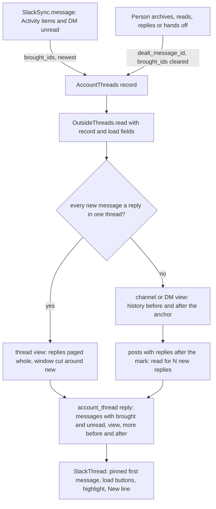

# A Slack Card Opens on What Brought It - Plan

2026-11-08 · follows [plan 074](2026-11-06-074-feat-slack-card-body-plan.md) and [plan 075](2026-11-06-075-fix-slack-message-parsing-plan.md)

## Goal Capsule

- **Objective:** Opening a Slack card on the Mac shows at once which messages brought it to the Inbox, with just enough of the conversation around them to act, and lets the person pull in more of that conversation only when they need it. In a thread, the person stays inside the thread.
- **Product authority:** the person, in the brainstorm of 2026-11-08. The phone's Slack-style view, keyboard keys for loading, reactions and files are not active scope.
- **Open blockers:** none.
- **Means:** each card keeps the message the person last dealt with and the messages that brought it (KTD1, KTD2); the mod reads a window around them, and loads more, through the existing thread-read frame (KTD3, KTD4, KTD5).
- **Stop conditions:** stop and ask if Slack refuses the extra reads for "N new replies" under its rate limits in normal use (KTD6), or if a real Activity item's message cannot be told apart from the context around it.
- **Who finishes:** `ce-work` implements on branch `feat/slack-card-window`; the person checks it on their own Slack before merging.

---

## Product Contract

Product Contract preservation: Product Contract unchanged, except that its Outstanding Questions were answered in planning (KTD1, KTD2, KTD4) and removed.

### Summary

Each Slack card opens on a window around its new messages: 5 before, the new ones, 5 after, with buttons to load 20 more either way.
A card whose new messages are all thread replies opens as the thread, its first message pinned on top; any other opens as the channel or DM.
The messages that brought the card in carry Slack's mention highlight, so they stand apart from the context around them.

### Problem Frame

A Slack card today shows a fixed slice, not the part that matters.
A thread card draws 5 channel messages, the whole thread (up to 200 replies) and 5 more channel messages; a DM card draws its last 50 messages.
In a long thread the reply that mentioned the person is somewhere in the middle, and the only marker is the New line, which comes from Slack's read marker.
loki never moves that marker for a thread or channel card, because no call for marking one Activity item read is verified ([mod/slack-sync.ts](../../mod/slack-sync.ts)).
So after the person deals with a card in loki and a new reply arrives, Slack still lists the old mentions unread and the New line sits above messages already handled.

### Key Decisions

- **The window is built around every message that brought the card in, not only the newest.** With one message it is that message plus 5 either side. (session-settled: user-approved — chosen over the newest or the first message alone: a card often stands for several messages and none should hide behind "load".) Governs R1, R2.
- **"New" is loki's own: what arrived after the person last dealt with the card.** (session-settled: user-approved — chosen over whatever Slack still lists unread: Slack's feed keeps items unread that the person already handled in loki.) Governs R5, R6, R7.
- **A thread card pins the thread's first message and has no way out to the channel.** (session-settled: user-approved — chosen over a "show in channel" link and over replies only: the person rarely needs to leave a thread, and the first message is the thread's subject.) Governs R8, R9.
- **The view follows where the new messages are.** (session-settled: user-approved — chosen over "thread view whenever the card has a thread" and "always the channel window".) Governs R10, R11.
- **5 either side, 20 per press.** (session-settled: user-approved — chosen over 3 and 10, and over 10 and 50: 5 matches plan 074's channel view.) Governs R1, R3.
- **Only the messages that brought the card in are highlighted.** (session-settled: user-approved — chosen over the New line alone and over tinting every new message: a reply that mentions the person must stand apart from one that is only new.) Governs R12, R13.
- **Mac only for the load buttons and highlight.** (session-settled: user-approved — chosen over doing the phone now: the phone has no Slack-style view yet.) Governs R16.

### Requirements

**The window**

- R1. A Slack card opens showing up to 5 messages before the first new message, every new message, and up to 5 messages after the last new one.
- R2. The new messages are the messages that brought the card into the Inbox since the person last dealt with it (R5): for a DM, its unread messages; for a channel or thread card, the mentions, @channel or @here, group mentions and thread replies Slack's Activity feed named.
- R3. "load earlier" above the window and "load later" below it each add up to 20 messages on that side, and each says how many more there are when Slack tells loki.
- R4. A button is not shown when there is nothing more on its side: the start of the thread or conversation above, the newest message below.

**What counts as new**

- R5. loki remembers, per card, the newest message at the moment the person last dealt with it: archived it, marked it read (⌘]), sent a reply from it, or handed it off. Putting it off with later (⌘[) does not count.
- R6. When a card comes back, only messages after that remembered message count as new; earlier ones, including mentions Slack still lists unread, are drawn as context.
- R7. The New line sits above the first new message (R6), for every Slack card. For a DM this agrees with Slack, since archiving a DM moves Slack's read marker.

**Thread view and channel view**

- R8. A thread card shows the thread's first message pinned on top, then the window of replies (R1) below it, with "load earlier" between them while replies are hidden.
- R9. A thread card shows only the thread: no channel messages around it and no way out to the channel.
- R10. A card opens in the thread view when every new message is a reply in one thread, and in the channel or DM view otherwise.
- R11. In the channel or DM view, a post with new replies shows "N new replies" under it; pressing it switches the card to that thread's view, and the thread view has a way back to the channel or DM view it came from.

**Highlight**

- R12. A message that brought the card in, and is new by R6, carries Slack's mention look: a tinted background with a bar on its left edge.
- R13. DM messages are not highlighted; their unread run is marked by the New line alone (R7).

**Opening and leaving**

- R14. The card opens scrolled to its New line, as today, without moving anything outside the card.
- R15. Loaded messages are not kept: leaving the card and coming back shows the window of R1 again.

**Elsewhere**

- R16. The phone's Slack card shows the same window (R1, R8, R10) in its plain rows, with no load buttons and no highlight.
- R17. A hand-off still sends the thread alone, as plan 074 decided, not the window the person has loaded.

### Acceptance Examples

- AE1. **Covers R1, R12.** Given a thread of 40 replies where reply 22 mentions the person and nothing else is new, when the card opens, it shows the first message, "load earlier", replies 17 to 27 with 22 highlighted under the New line, and "load later".
- AE2. **Covers R5, R6, R7, R12.** Given the person archived a thread card after mentions at replies 8 and 12, when reply 30 mentions them, the card comes back with the New line above reply 30, which is highlighted; replies 8 and 12 are plain if a load brings them in.
- AE3. **Covers R10, R11.** Given a channel post that mentions the person and later gets 3 replies, when the person has not dealt with the card, it opens in the channel view with the post highlighted and "3 new replies" under it; when the person has dealt with it and only replies are new, it opens in the thread view.
- AE4. **Covers R1, R7, R13.** Given a DM with 4 unread messages after 30 read ones, when the card opens, it shows 5 read messages, the New line, the 4 unread messages with no highlight, and no "load later".
- AE5. **Covers R3, R4.** Given a thread card with 7 replies above the window, when the person presses "load earlier", the 7 replies and the gap close, and "load earlier" goes away.
- AE6. **Covers R5.** Given a card the person put off with ⌘[, when it comes back with a new reply, the New line still sits above the first message that was new before it was put off.

### Scope Boundaries

- Keyboard keys for loading earlier or later.
- Reactions, files, images and edits, as plan 075 left them.
- Leaving a thread card for its channel.
- The phone's Slack-style view, its load buttons and its highlight.
- Moving Slack's own read marker for an Activity item.
- Considered and not built: a cache of loaded messages across opens. R15 drops them on purpose, and each load is one or two Slack calls.
- Considered and not built: a version bump of the saved card records. New fields get defaults when read, as `unread_out_there` and `reach` did (KTD1).

### Sources / Research

- [mod/slack-sync.ts](../../mod/slack-sync.ts): how DMs (`client.counts`) and Activity items become cards, one per thread, and why archive leaves Activity items unread in Slack.
- [mod/slack-view.ts](../../mod/slack-view.ts): today's window, `VIEW_BEFORE`, `VIEW_AFTER`, `VIEW_DM` and the paging after a thread.
- [mod/account-threads.ts](../../mod/account-threads.ts): one record per thread, reopened by a newer message.
- [app/src/desk/slack-thread.tsx](../../app/src/desk/slack-thread.tsx): the Slack-style rows, day pills and New line the window draws with.

---

## Planning Contract

### Key Technical Decisions

- KTD1. **The card record keeps `dealt_message_id`, the newest message id when the person last dealt with the card.** It is set where the moves already land in [mod/account-threads.ts](../../mod/account-threads.ts): `write` when a Slack card ends (archive, ⌘]), `handedOff`, and a sent reply in `OutsideThreads.reply` ([mod/outside-threads.ts](../../mod/outside-threads.ts)) whatever key follows it. `markUnread` (⌘[) leaves it alone. `observe` rebuilds the record on a newer message, so it copies the field across as it copies `handoff_conversation_id`. `parseRecord` reads a missing field as `null`. Implements R5.
- KTD2. **The record keeps `brought_ids`, the messages that brought the card since `dealt_message_id`.** `SlackSync.message` already holds each Activity item's own `ts`; it passes them on `ObservedMessage` instead of dropping them. A mention, @channel, @here or group-mention item adds its own `ts`. A `thread_v2` item names only the newest reply of a bundle, so it adds every reply by someone else after the mark (`dealt_message_id`, else the thread's `last_read`) up to that reply, from the replies `message` already reads. A DM adds nothing (R13). `observe` merges the new ids with the previous ones after the mark, keeps the newest 50, and dealing with the card clears them. Implements R2, R12.
- KTD3. **The window is read through `account_thread_read`, with optional fields for a load; no new frame.** The request may add `view` (`thread` or `channel`), `thread_ts`, `direction` (`before` or `after`) and `from` (a message ts). The reply adds `view`, `thread_ts` and the counts or flags for more before and after. The frame validator builds its output from the fields it knows, so a home Mac without this change ignores the new fields and answers with today's whole view, which the card draws with no buttons. Implements R1, R3, R11.
- KTD4. **A thread is read whole and the window is cut from it.** `conversations.replies` comes parent first and has no `latest`, so the mod pages it with `cursor`, up to 5 pages of 200, and slices locally. Counts on a thread's buttons are then exact from `reply_count`, and a load is one paged read. A thread longer than 1,000 replies loads earlier messages only as far back as the first 1,000. Implements R3, R8.
- KTD5. **A channel or DM window reads `conversations.history` either side of the anchor.** Before: `latest` = the first new message, `inclusive: false`, `limit` 5 (or 20 on a load), with `has_more` deciding "load earlier". After: Slack returns the newest first, so the read pages back from `oldest` = the last new message as `afterThread` does today, at most 3 pages of 100, and keeps the oldest 5 (or 20). Slack gives no count here, so these buttons carry none (R3's "when Slack tells loki"). Implements R1, R3, R4.
- KTD6. **"N new replies" reads each post's thread in the window whose `latest_reply` is after the mark.** That is usually none or one post, read in parallel with the window. A rate limit on one of them drops its count to "new replies" rather than failing the card. Implements R11.
- KTD7. **The anchor and the view are decided in the mod, from the record.** New = `brought_ids` and messages after `dealt_message_id`; without a mark (cards from before this change) the view falls back to Slack's `last_read` as today, and without either to `newest_message_id`. Thread view when every new message is a reply in one thread (R10); a `<channel>:<ts>` card whose own post is new opens in the channel view. Implements R6, R7, R10.
- KTD8. **The highlight is two new colour tokens, `--loki-mention` and `--loki-mention-bar`**, Slack's mention wash and bar, in both themes, added to [docs/design.md](../../docs/design.md) so `test/tokens.test.ts` accepts them. Implements R12.
- KTD9. **The card keeps loaded messages in component state, keyed by the card's read key**, so a new card or a newer message resets them (R15). Loading earlier keeps the row being read in place with `keepReading` from [app/src/chat/use-transcript-scroll.ts](../../app/src/chat/use-transcript-scroll.ts), since WebKit has no scroll anchoring. Implements R3, R14, R15.

### High-Level Technical Design

How a card's window is decided and read:

### Assumptions

- Slack's Activity item `ts` for a mention is the mentioning message's own `ts`, as [mod/slack-sync.ts](../../mod/slack-sync.ts) already uses it to fetch that message.
- A thread's first message carries `reply_count` and, for a channel post, `latest_reply`, as `conversations.history` returns today.

---

## Implementation Units

### U1. The card remembers what the person dealt with and what brought it

**Goal:** Each Slack card record carries `dealt_message_id` and `brought_ids`.

**Requirements:** R2, R5, R6; KTD1, KTD2.

**Dependencies:** none.

**Files:**
- `mod/account-threads.ts`
- `mod/outside-threads.ts`
- `mod/slack-sync.ts`
- `test/account-threads.test.ts`
- `test/slack-sync.test.ts`

**Approach:**
1. Add both fields to `ThreadRecord` and `ObservedMessage`, with `parseRecord` defaults of `null` and `[]`.
2. Set `dealt_message_id` and clear `brought_ids` in `write` when the card ends, in `handedOff` when no newer message was missed, and after a sent reply.
3. In `observe`, copy `dealt_message_id` across and merge `brought_ids` per KTD2.
4. In `SlackSync.message`, collect the ids per KTD2 and pass them on the observed message.

**Patterns to follow:** `handoff_conversation_id` carried through `observe`; the migration test "a record from before read state was kept reads as unread out there" in `test/account-threads.test.ts`.

**Test scenarios:**
- Archiving an open Slack card sets `dealt_message_id` to its newest message and empties `brought_ids`.
- ⌘] (read) sets the mark the same way; ⌘[ (later) leaves the mark and `brought_ids` unchanged. Covers AE6.
- Sending a reply with each of the three follow-up keys sets the mark.
- A hand-off sets the mark; one that missed a newer message does not.
- A newer observed message keeps the mark and adds its ids to `brought_ids`.
- A record file without either field reads as `null` and `[]`.
- A tick with two mention items in one thread records both mentions' ids, not the replies between them.
- A `thread_v2` item records every reply by someone else after the mark, and none by the person.
- A DM candidate records no ids.
- After the person archives a card with mentions at replies 8 and 12, a new mention at reply 30 leaves `brought_ids` holding only reply 30. Covers AE2.

**Verification:** the record tests and the sync tests pass with the new fields, and old record files still load.

### U2. The mod reads a window around what is new

**Goal:** `slackChannelView` returns the window of R1 in the right view, and the next 20 on a load.

**Requirements:** R1, R3, R4, R6, R7, R8, R9, R10, R11, R13; KTD4, KTD5, KTD6, KTD7.

**Dependencies:** U1.

**Files:**
- `mod/slack-view.ts`
- `mod/handoff.ts` (the `ThreadMessage` type only)
- `test/slack-view.test.ts`

**Approach:**
1. Widen the card-view reader to take the record's mark, `brought_ids` and newest id, plus the optional load fields of KTD3.
2. Decide the view and the anchor per KTD7.
3. Thread view: page the replies per KTD4, cut 5 either side of the new run, and always include the first message.
4. Channel or DM view: read either side per KTD5, and count new replies per KTD6.
5. Mark each message `unread` by the mark (falling back to Slack's `last_read`) and `brought` by `brought_ids`, never in a DM.
6. Return the view, its `thread_ts`, and more-before and more-after as a count or a flag.

**Patterns to follow:** `afterThread` and `byTime` in `mod/slack-view.ts`; `fakeSlack` in `test/slack-view.test.ts`, extended so its replies honour `cursor` and `limit`.

**Test scenarios:**
- A 40-reply thread with reply 22 brought opens as the thread view with the first message, replies 17 to 27, 16 earlier and 13 later. Covers AE1.
- The same thread after a mark at reply 12 marks only replies after 12 as unread, and reply 8 is neither unread nor brought. Covers AE2.
- A channel post that is itself brought, with 3 replies after the mark, opens in the channel view with `new_replies` 3 on the post. Covers AE3.
- The same card after the mark, with only replies new, opens in the thread view. Covers AE3.
- A DM with 4 unread after 30 read returns 5 read, 4 unread, none brought, and nothing more after. Covers AE4.
- A load before the oldest shown message returns up to 20 earlier messages and whether more remain. Covers AE5.
- A load after in a channel pages back from the newest and returns the 20 right after the given message.
- A thread of 1,200 replies stops paging at 1,000.
- A card with no mark and no `brought_ids` (from before this change) falls back to Slack's `last_read` for unread.
- A rate limit on a "new replies" read leaves that post with new replies but no count, and the window still returns.

**Verification:** the view tests pass, and each Slack call the window makes is one the fake records.

### U3. The thread-read frame carries the window

**Goal:** The app can ask for a load and learn the view and what remains, through `account_thread_read`.

**Requirements:** R3, R11, R16, R17; KTD3.

**Dependencies:** U2.

**Files:**
- `core/frames.ts`
- `core/frame-types.ts`
- `core/attention/chat-client.ts`
- `core/attention/chat-store.ts`
- `core/attention/use-attention.ts`
- `mod/frames/accounts.ts`
- `mod/outside-threads.ts`
- `test/outside-threads.test.ts`
- `test/frames.test.ts`

**Approach:**
1. Extend the `account_thread_read` validator with the optional load fields, and the `account_thread` reply with `view`, `thread_ts` and more-before and more-after.
2. Add `brought` and `new_replies` to `OutsideMessage` and to the field map in `OutsideThreads.read`.
3. `OutsideThreads.read` looks up the card's record and passes it, and the load fields, to the reader. The ≤30 s rate-limit wait applies to loads too.
4. `readOutside` on the client, store and `OutsideSource` takes the optional load and returns the reply's window facts beside the messages.
5. Hand-off keeps its own `slackThreadText` read and is not touched (R17).

**Patterns to follow:** `account_labels_list` and `account_thread_read` in `core/frames.ts`; the routing assertions in `test/outside-threads.test.ts`.

**Test scenarios:**
- A read without load fields returns the opening window with its view and more-before and more-after.
- A read with `direction: before` and `from` reaches the reader with both, and its answer is passed back unchanged.
- A read for a thread switch (`view: thread`, `thread_ts`) reaches the reader with both.
- The validator drops unknown fields and rejects a `direction` that is neither `before` nor `after`.
- A phone's read reaches the home Mac and returns the same window. Covers R16.
- A hand-off after a load still sends the whole thread. Covers R17.

**Verification:** the frame and outside-thread tests pass, and the frame list tests still match.

### U4. The card draws the window, the buttons and the highlight

**Goal:** On the Mac, the Slack card draws the pinned first message, the load buttons, "N new replies" with its way back, and the highlight.

**Requirements:** R3, R4, R8, R11, R12, R14, R15; KTD8, KTD9.

**Dependencies:** U3.

**Files:**
- `app/src/desk/outside-card.tsx`
- `app/src/desk/slack-thread.tsx`
- `app/src/chat/chat.css`
- `app/src/styles.css`
- `docs/design.md`
- `test/slack-view.test.ts`

**Approach:**
1. `useOutsideThread` keeps the opening window plus loaded pages in state keyed by the read key, and resets on a new key.
2. `SlackThread` draws the first message pinned in the thread view, then "load earlier" or "N earlier replies", the rows, then "load later"; a button shows only while more remains (R4).
3. A post with `new_replies` shows "N new replies"; pressing it reads that thread's view; the thread view then shows a way back to the channel or DM view.
4. A `brought` row gets the mention class, coloured by the KTD8 tokens.
5. A load before keeps the row being read in place (KTD9); the opening scroll stays on the New line through `scrollWithin`.
6. The phone keeps its plain rows and draws the window it receives, with no buttons (R16).

**Patterns to follow:** `planSlackRows` and the day pills in `app/src/desk/slack-thread.tsx`; `keepReading` in `app/src/chat/use-transcript-scroll.ts`; lowercase desktop controls per AGENTS.md.

**Test scenarios:**
- A thread-view window renders the first message, then "16 earlier replies", then the rows. Covers AE1.
- A brought row renders with the mention class and an unbrought new row without it. Covers AE2.
- A DM window renders no mention class. Covers AE4.
- With nothing more before, no "load earlier" renders. Covers AE5.
- A post with `new_replies` 3 renders "3 new replies". Covers AE3.
- A channel or DM window renders "load earlier" with no count.
- `test/tokens.test.ts` accepts the new mention tokens and the class.

**Verification:** the render tests and the token test pass, and the card is checked by hand in the app (Verification Contract).

### U5. The manual and the screenshots

**Goal:** The manual describes the window, and the PR shows it drawn with made-up data.

**Requirements:** R1, R3, R8, R10, R11, R12.

**Dependencies:** U4.

**Files:**
- `docs/manual.md`
- `docs/images/slack-card-window-dark.jpg`
- `docs/images/slack-card-window-light.jpg`

**Approach:**
1. Rewrite the "A Slack card reads like its channel" paragraph for the window, the two views, the buttons, the highlight and loki's own New line.
2. Draw the screenshots from a throwaway preview with made-up data, as plan 075's were; the repo is public.

**Test expectation:** none -- documentation and images.

**Verification:** the manual paragraph matches R1 to R17, and the screenshots hold no real names or messages.

---

## Verification Contract

| Check | Command | Applies |
|---|---|---|
| Formatting | `npm run format:check` | every unit |
| Lint | `npm run lint` | every unit |
| Types | `npm run typecheck` | every unit |
| Unit tests | `npm test` | every unit |
| Node tests | `npm run test:node` | every unit |
| App and mod builds | `npm run build:app` and `npm run build:mod` | U3, U4 and before push |
| Bundle smoke | `npm run smoke` | before push |
| PR title | `PR_TITLE="feat(inbox): …" node --experimental-strip-types scripts/check-pr-title.ts` | before the PR |

Tests use the fake Slack and fake workspace only, with the clock and file root injected, per AGENTS.md. Run them with CI's toolchain: the newest Node 22, its npm 10, and `SHELL=/bin/bash`.

By hand, on the person's own Slack, after the checks:
1. Open a long thread card where one reply mentions you: check the pinned first message, the highlight, and both load buttons.
2. Archive it, get mentioned again in the same thread, and check that only the new mention is new and highlighted.
3. Open a DM card and a channel post card with new replies, and use "N new replies" and the way back.

---

## Definition of Done

- Every unit's test scenarios exist and pass, and every check in the Verification Contract passes.
- AE1 to AE6 each have a test that covers them.
- Cards saved before this change still load and draw as before until the person acts on them.
- The manual paragraph and the made-up screenshots are in.
- No code from abandoned attempts is left in the diff.
