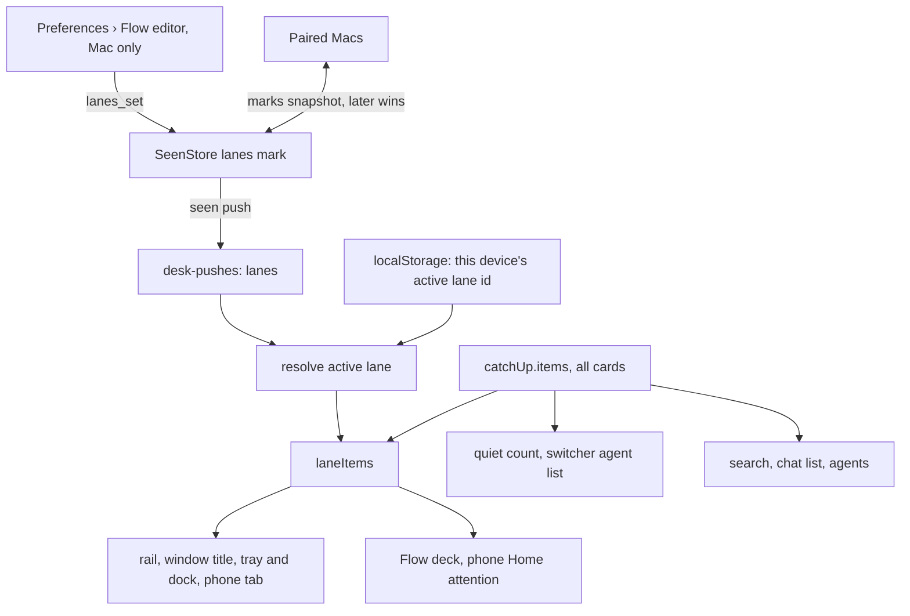

# Flow and lanes - Plan

## Goal Capsule

- **Objective:** The person can choose which part of their work reaches them right now (some agents' chats, some Gmail and Slack accounts) and work in that slice without other cards or badges pulling at them, then return to everything in one move. The Inbox is called Flow on screen.
- **Means:** lanes ride on the shared marks store beside return times (KTD1), and one pure filter feeds Flow and the badges on each device (KTD3).
- **Product authority:** This Product Contract, then the Planning Contract's KTDs. The rename and lanes ship as one piece of work; automatic lane switching is not active scope.
- **Stop conditions:** Stop and ask if a change would rename an internal identifier, frame, stored file or analytics event (R4), make lanes narrow the chat list or search (R16), or let a card from another lane break through (R14).
- **Execution profile:** One branch, units in the order below, every check in the Verification Contract green before pushing. The person raises and merges the PR.
- **Open blockers:** None.

---

## Product Contract

Product Contract preservation: restructured, no scope change. R1 now names the `/inbox` slash command and the account error text among the renamed words; the Outstanding Questions are answered by KTD1, KTD4, KTD9, KTD10 and KTD11 and removed.

### Summary

The Inbox becomes **Flow** on screen, and Flow gains **lanes**: saved sets of sources (agents' chats and Gmail or Slack accounts) that the person switches between in Flow's header. Lane definitions are shared by every device; each device keeps its own active lane. Built-in per-agent lanes replace the agent pills. Lanes are stored with the marks every device already shares, and one filter decides what each device's Flow and badges show.

### Problem Frame

Flow gathers everything that waits on the person into one deck: every agent's chats, every thread in each Gmail inbox, every unread Slack DM and Activity item. That is the point of it, and also what gets in the way when the person sits down to work on one thing: the next card may come from any part of their life.

The only way to narrow the deck today is the row of agent pills on the desktop. A pill shows one agent's cards for the current visit and resets when the person leaves. The phone has no pills at all, and the red badges on the rail, dock, tray and phone tab always count everything.

The person wants to define cohorts of work once and step into one for a stretch of time. Their examples: chats only; chats only for one agent; no chats but everything else one agent owns (its mail and Slack).

### Key Decisions

- **The word is "lane", not "focus" or "mode".** Flow already ranks cards by a learned "focus" ("Focus is learned, never set"), and "mode" already means a chat's permission mode. (session-settled: user-directed — chosen over "flow states": "state" is vague on screen and everywhere in the code.) Governs R1, R5.
- **The rename changes words, not internals.** It follows the precedent of Recall → Learn and Catch Up → Inbox: on-screen and agent-read words change; code names, frames, stored files and analytics names keep "inbox". Governs R1–R4.
- **A lane is one list of sources.** Each side is either "all" or a hand-picked set: agents' chats on one side, Gmail and Slack accounts on the other. This covers every example without separate kind or agent rules. (session-settled: user-directed — chosen over kinds-only and over label-based lanes: an agent can own both a work and a personal Gmail.) Governs R5–R7.
- **New agents and accounts follow the lane's "all" or "picked" choice.** (session-settled: user-approved — chosen over "never join" and "always join".) Governs R7.
- **Cards outside the lane are hidden, with a quiet count.** Nothing breaks through, not even an approval. (session-settled: user-approved — chosen over letting blocked cards break through, hiding without a count, and showing outside cards last.) Governs R13, R14.
- **The active lane is per device; definitions are shared.** (session-settled: user-directed — chosen over one active lane everywhere: the phone may sit in Home while the Mac sits in Work.) Governs R8, R10, R15.
- **A lane reaches Flow and its badges only.** The chat list and search ignore lanes. (session-settled: user-approved — chosen over also narrowing the chat list.) Governs R15, R16.
- **Lanes replace the agent pills, and each agent gets a built-in lane.** This removes a control the person designed on purpose: the per-visit pill. (session-settled: user-directed — chosen over keeping pills inside a lane.) The built-in lanes keep the one-click agent filter. (session-settled: user-approved — chosen over only person-made lanes.) Governs R18–R20.
- **The switcher lives in Flow's title.** It is a menu on the desktop and a sheet on the phone; the lane is named wherever Flow's title shows. (session-settled: user-directed — chosen over a chip row where the pills were, and over lanes as rail sections with per-lane counts, which would undo the quiet count.) Governs R11.
- **The editor is two lists, each all, pick or none.** It mirrors R5 directly. (session-settled: user-approved — chosen over an agent-by-agent table and a one-line sentence with pickers.) Governs R9.
- **Switching is by hand only in this version.** (session-settled: user-directed — chosen over time-of-day, network and location triggers: lanes should prove themselves first.)

### Requirements

**The rename**

- R1. Every place the person reads "Inbox" for loki's own deck says "Flow" instead: the rail, the window title ("Flow · 3 waiting"), the native menu, the keys sheet, ⌘K, the `/inbox` slash command (now `/flow`), Preferences (the page and its group), account error text, the phone tab, phone Home and Search, help and empty-state copy, the site, and the manual and glossary.
- R2. Text that agents read about loki's deck says "Flow": tool descriptions and the hand-off reminder.
- R3. Wording about Gmail's own inbox keeps "inbox", because it names Gmail's label, not loki's deck.
- R4. ⌘K, Search and the slash commands still find Flow when the person types "inbox", the way they still find old words after earlier renames. Internal identifiers, frames, stored files and analytics event names are unchanged.

**What a lane is**

- R5. A lane has a name and two sides: chats, either from all agents or from picked agents, and accounts, either all Gmail and Slack accounts or picked ones. Either side may be empty, so "chats only" and "no chats" are both lanes.
- R6. A card belongs to a lane when its source is on one of the lane's sides: a chat by its agent, an outside card by its account.
- R7. A side set to "all" includes agents or accounts added later; a picked side does not. Deleting an agent or account removes it from every lane that picked it.
- R8. The person creates, renames, edits and deletes lanes in Preferences › Flow on the Mac. Lane definitions are shared by the person's paired Macs and the phone.
- R9. Preferences › Flow lists the person's lanes beside one lane's editor: its name, then chats from all agents, picked agents or none, then mail and Slack from all accounts, picked accounts or none. Each picked account shows its owner agent.

**Switching lanes**

- R10. Each device has its own active lane, kept until the person switches. A new device starts in Everything.
- R11. Flow's title names the active lane ("flow · work" on the desktop, "Work" on the phone), and the title opens the switcher: a menu on the desktop, a sheet on the phone. The switcher lists Everything, then the person's lanes, then a built-in lane for each agent with cards waiting.
- R12. Everything shows every card, as Flow does today.

**What an active lane changes**

- R13. Only cards in the active lane are in the deck. Within the lane, the order is Flow's usual order.
- R14. While a lane other than Everything is active, Flow shows how many cards wait in other lanes as a quiet line, never as a red badge. No card from outside the lane breaks through, including approvals and questions.
- R15. That device's badges count only the active lane: the rail, the window title, the dock and tray on the Mac, and the Flow tab on the phone. Phone Home's "Needs your attention" also follows the phone's active lane.
- R16. The chat list, search and every other surface outside Flow ignore lanes.
- R17. Switching lanes changes nothing about the cards: rests, laters, unread marks and focus stay as they were, and a hidden card is never marked read.

**Built-in agent lanes and the pills**

- R18. Each agent's built-in lane holds that agent's chats and the accounts it owns. It cannot be edited or deleted, and it is listed only while the agent has cards waiting.
- R19. The agent pills over the desktop deck are removed; the built-in agent lanes take their place. A built-in agent lane, once chosen, persists like any lane (R10).
- R20. When the active lane empties, Flow shows its usual caught-up state together with the count from R14 and a way back to Everything. A built-in agent lane that empties stays active until the person switches, even though R18 drops it from the list.

### Key Flows

- F1. Making a lane
  - **Trigger:** The person wants a "Work" lane: chats from two agents, plus the work Gmail.
  - **Steps:** Preferences › Flow → new lane → name it → chats: pick two agents → accounts: pick the work Gmail → save. The lane appears in the switcher on every device.
  - **Covered by:** R5, R6, R8, R9, R11
- F2. Working in a lane
  - **Trigger:** The person sits down for a work block on the Mac.
  - **Steps:** Flow → header switcher → Work. The deck narrows to Work's cards; the dock badge counts Work only; a quiet line reads "5 waiting in other lanes". The phone, still in Everything, keeps counting everything.
  - **Covered by:** R10, R13, R14, R15
- F3. Coming back
  - **Trigger:** The block ends.
  - **Steps:** Header switcher → Everything. Every card is back in the usual order, rests and marks untouched.
  - **Covered by:** R12, R17

### Acceptance Examples

- AE1. **Covers R5, R6.** Given a lane with chats from no agents and accounts picked as agent Ada's Gmail and Slack, when it is active, the deck holds only Ada's mail and Slack cards and none of Ada's chats.
- AE2. **Covers R7.** Given lane "Chats" with chats set to all agents and no accounts, when the person adds a new agent, that agent's chats appear in "Chats". Given lane "Work" with two picked agents, the new agent's chats do not appear in "Work".
- AE3. **Covers R14.** Given the Mac is in "Work" and an agent outside Work asks for approval, the deck and dock badge do not show it; the quiet count goes up by one.
- AE4. **Covers R10, R15.** Given the Mac is in "Work" and the phone is in Everything, the phone's Flow tab badge counts every waiting card and the Mac's dock badge counts only Work's.
- AE5. **Covers R17.** Given a card resting after read in Everything, when the person switches to a lane that hides it and back, it is still resting with the same return time.
- AE6. **Covers R18, R20.** Given the person picks agent Ada's built-in lane and clears every card in it, Flow shows the caught-up state with the outside count and a way back to Everything; Ada's lane leaves the list once the person switches away.

### Scope Boundaries

**Deferred for later**

- Switching lanes automatically by time of day, network (Wi-Fi or IP) or location.
- Lanes built from chat labels.
- Lanes that also narrow the chat list, like Apple's home screens.
- Exceptions that let a card through from outside the lane (for example approvals, or a named sender).
- Creating or editing lanes from the phone.
- A keyboard shortcut for switching lanes (KTD10).

**Outside this work**

- Changes to Flow's ranking, rests or what counts as done.
- Renaming internal code, frames, stored files or analytics events from "inbox".
- Moving reply proposals and suggestions from the owner's chat card onto the outside card they answer (KTD8).

**Considered and not built**

- Per-lane merge between Macs, so two Macs editing lanes in the same minute both keep their edits. Lanes are edited rarely and only on a Mac; the whole list with the later edit winning (KTD1) loses at most one edit in that window. Evidence that people edit lanes on two Macs at once would change this.
- Blocking a lane switch while a reply box holds text. Keeping the text (KTD7) closes the same gap without narrowing switching.

### Dependencies / Assumptions

- Each Gmail or Slack account has exactly one owner agent, so "an agent's accounts" is well defined (`core/attention/model.ts` `ownerAgentOf`).
- Success is assumed, not measured: the person can work through a two-hour block in one lane without an out-of-lane card or badge pulling at them, and gets back to Everything in one move.

### Sources / Research

- Current deck and pills: `app/src/desk/catch-up.tsx`, `app/src/desk/catch-up-parts.tsx` (`AgentPills`, `agentPills`); phone deck `app/src/phone/inbox.tsx`.
- Badge and Home counts come from one queue: `core/attention/queue.ts` (`NEEDS_YOU`, `catchUpQueue`), `app/src/shell/shell.tsx`, `app/src/phone/phone.tsx`, `app/src/phone/model.ts`.
- Learned focus, the word being avoided: `core/attention/focus.ts`, `core/attention/priority.ts`; manual "Focus is learned, never set."
- Rename precedents: `docs/plans/2026-09-12-008-feat-loki-learn-plan.md`; `glossary.md` (Inbox, "Catch Up in older code"); old-word keywords in `app/src/shell/search-model.ts`.
- Agent-read copy: `mod/account-tools.ts` (`account_list`), `mod/handoff.ts`.
- Pills were per visit by design: `docs/manual.md` ("a pill shows only that agent's cards this visit").
- Return times, the sync precedent: `docs/plans/2026-11-05-070-feat-inbox-endings-plan.md`; `mod/seen.ts` (`ReturnTimesMark`, `setReturnTimes`, `snapshot`, `applyRemote`).

---

## Planning Contract

### Key Technical Decisions

- KTD1. **Lanes live in the marks store, as one list where the later edit wins.** `SeenStore` (`mod/seen.ts`, `state/attention.json`) gains a lanes mark shaped like the return-times mark: the whole list plus the time it was set. It reaches every client in the `seen` push and every paired Mac in the marks snapshot (`mod/peer-state.ts`, `mod/peering.ts`), with no new file, syncer or migration. A delete is a newer list without the lane, so a deleted lane cannot come back from an offline Mac. Older mods and Macs simply send no field. Governs R8.
- KTD2. **A lane's shape is two sides, each "all" or a list of ids.** A lane is `{ id, name, chats, accounts }` where each side is `"all"` or an array of agent or account ids, and an empty array is "none". Own lane ids are generated when the lane is made; a built-in agent lane's id is derived from the agent id; Everything has no id. Ids the device does not know are ignored when matching, which is how R7's "deleting removes it" holds without editing every lane on every Mac. The parser lives in core beside the return-times parser. Governs R5, R7, R18.
- KTD3. **One pure filter in `core/attention/lanes.ts`, applied once per shell.** A chat matches by its `agent_id`, an outside card by `outside.account_id`, a built-in agent lane by `ownerAgentOf`. Each shell computes the lane's items once beside `catchUp.items`; the badge count, window title, tray, deck and phone Home read those, while search, the chat list, agents, the switcher's agent list and the quiet count read the full items. Governs R6, R13, R15, R16, R18.
- KTD4. **The active lane is a per-device stored value, read leniently.** It is kept with `createSessionValue` over `localStorage` (`app/src/shared/session-value.ts`), under a desktop key and a phone key. An id that names no current lane reads as Everything once lanes have loaded; before the first `seen` push it is kept, not reset. A built-in agent lane resolves from its id alone, so it stays active when empty (R20) and falls back to Everything only when the agent is gone. Governs R10, R12, R20.
- KTD5. **The quiet count and the built-in list reuse today's sets.** "n waiting in other lanes" is the needs-you count of all items minus that of the lane's items (`catchUpQueue`), the same set the red badges count, and the line is hidden at zero. The switcher lists an agent's built-in lane when `agentPills` would have shown its pill. Governs R11, R14, R18.
- KTD6. **Switching keeps the card on top and the visit.** If the card on top belongs to the new lane it stays on top; otherwise the queue rebuilds from the new lane and the card is left untouched. The visit's moves and summary carry across switches, and undo only reaches moves made on cards in the active lane, as it did for the active pill (`app/src/desk/deck-moves.ts`). Governs R13, R17.
- KTD7. **An unsent reply on a mail or Slack card is kept per thread for the session.** Today that text lives in the card's own state and is lost when the card leaves the screen; a lane switch makes that common. It is kept in memory keyed by the outside card, mirroring the per-chat drafts in `app/src/shared/drafts.ts`, on the desktop and the phone. A mail reply already in its undo window is in the outbox and unaffected. Governs R17.
- KTD8. **Reply proposals and suggestions stay on the owner's chat card.** They are cards of the owner agent's chat, so they follow a lane's chats side (R6); a lane holding only an agent's accounts does not show them. The manual says so. Governs R6.
- KTD9. **The account list carries every Mac's accounts.** The `account_list` reply (`mod/frames/accounts.ts`) gains the paired Macs' accounts the mod already holds (`PeerAccounts`, `mod/accounts.ts`), each marked with the Mac it lives on, so the editor can pick them. Preferences › Accounts keeps showing and managing only this Mac's. Governs R9.
- KTD10. **The lane name is in the window title; no new shortcut.** The window title reads "Flow · Work · 3 waiting" while a lane is active, so the person can tell which lane counts the dock badge from anywhere. The title menu is reached by keyboard like any control; a dedicated shortcut is deferred. Governs R11, R15.
- KTD11. **The pill analytics event records lane switches.** `inbox_filtered` keeps its name (R4) and now fires on a switch with the kind of lane (everything, own, agent) and the agent id for an agent lane, so its history continues. Governs R4, R11.
- KTD12. **`/flow` replaces `/inbox`, which stays as a hidden alias.** Typing `/inbox` still opens Flow, matching how ⌘K keeps old words. Governs R1, R4.

### High-Level Technical Design

Where lanes come from and what reads which items, per device:

### Assumptions

- No `state/migrations.json` entry is needed: a store with no lanes mark reads as no lanes.
- The phone and every paired Mac run the same build within a release; an older paired Mac ignores the lanes field and keeps working without lanes.

---

## Implementation Units

### U1. Rename Inbox to Flow in words people and agents read

**Goal:** Every on-screen and agent-read "Inbox" for loki's deck says "Flow"; internals unchanged.

**Requirements:** R1, R2, R3, R4; KTD12.

**Dependencies:** None.

**Files:**

- `app/src/shell/shortcuts.ts`, `app/src/shell/keymap.ts` (labels and `MENUS`; ids stay `inbox.*`), `app/src/shell/keys-sheet.tsx`, `app/src/shell/use-window-chrome.ts`, `app/src/shell/search-model.ts`
- `app/src/settings/pages.ts` (title and group; page id stays `inbox`), `app/src/settings/settings.tsx`, `app/src/settings/accounts.tsx`
- `app/src/desk/catch-up-parts.tsx`, `app/src/desk/outside-card.tsx`
- `app/src/phone/tab-bar.tsx`, `app/src/phone/search-index.ts`, `app/src/phone/home.tsx`, `app/src/phone/inbox.tsx`, `app/src/phone/learn.tsx`
- `core/attention/commands.ts`
- `mod/account-tools.ts`, `mod/handoff.ts`, `mod/frames/accounts.ts`
- `docs/manual.md`, `glossary.md`, `README.md`, `site/src/`
- Tests: `test/keymap.test.ts`, `test/preferences.test.ts`, `test/phone-router.test.ts`, `test/phone-search.test.ts`, `test/frames-accounts.test.ts`, `test/commands.test.ts`, `test/site-demo.test.ts`

**Approach:**

1. Change the labels in place; leave ids, frames, analytics names, CSS classes and file names alone (R4).
2. Add "inbox" as a keyword where ⌘K and phone Search already keep old words, beside "catch up".
3. Add `/flow` and keep `/inbox` as a hidden alias of it (KTD12).
4. Leave every mention of Gmail's own inbox as it is (R3).
5. The glossary's Inbox entry becomes Flow, with "Inbox in older code and words, Catch Up before that".
6. Desktop words stay lowercase and phone words sentence case (AGENTS.md).

**Patterns to follow:** Recall → Learn (`docs/plans/2026-09-12-008-feat-loki-learn-plan.md`); the `recall` keyword in `search-model.ts`.

**Test scenarios:**

- The rail segment and the native menu are labelled "Flow"; the keymap id is still `segment.inbox`.
- Preferences lists a "Flow" page in a "Flow and Learn" group, and searching Preferences for "inbox" finds it.
- ⌘K for "inbox" returns the Flow page; phone Search for "inbox" returns Flow.
- `/flow` and `/inbox` both resolve to the open-Flow command, and only `/flow` is listed.
- The phone tab label is "Flow".
- The `account_list` tool description and the hand-off reminder say Flow.
- The unavailable-accounts error says Flow.

**Verification:** A search for user-visible "Inbox" in `app/`, `mod/` and `site/` finds only Gmail's inbox and internal names.

### U2. The lane model and filter

**Goal:** One pure module defines lanes and decides which cards a lane holds.

**Requirements:** R5, R6, R7, R13, R14, R18; KTD2, KTD3, KTD5.

**Dependencies:** None.

**Files:**

- Create `core/attention/lanes.ts`
- Test: `test/lanes.test.ts`

**Approach:**

1. The `Lane` type and an `isLanes` parser for data from the wire (KTD2), validating names and ids and dropping malformed lanes.
2. Membership: an own lane per KTD3; a built-in agent lane by `ownerAgentOf`; Everything holds every card.
3. `laneItems(items, lane)`, the count of cards needing you in other lanes (KTD5), and the built-in agent lanes for a set of items.
4. Built-in agent lanes reuse `agentPills` from `app/src/desk/catch-up-parts.tsx` by moving that pure function into this module.

**Patterns to follow:** `core/attention/rest.ts` (`isReturnTimes`), `core/attention/queue.ts`.

**Test scenarios:**

- Covers AE1. A lane with chats `[]` and accounts `[gmail:ada@…, slack:T:U]` holds Ada's mail and Slack cards and none of Ada's chats.
- Covers AE2. A lane with chats `"all"` holds a chat from an agent id it has never seen; a lane with chats `[a, b]` does not hold agent c's chat.
- A lane picking an agent id that no longer exists holds nothing for that id and no error is raised.
- An agent's built-in lane holds its chats and the outside cards whose owner is that agent, including an account on a paired Mac.
- Covers AE3. With lane Work active and an approval waiting on an agent outside Work, the other-lanes count is 1 and the lane's items do not include it.
- A card in two lanes is counted once in the other-lanes count.
- The parser drops a lane with no name or with a side that is neither `"all"` nor an array of strings, and keeps the rest.

**Verification:** `test/lanes.test.ts` passes with no DOM and no clock.

### U3. Lanes stored and shared across Macs and devices

**Goal:** Lane definitions are kept on the daemon, pushed to every client and merged with paired Macs.

**Requirements:** R8; KTD1.

**Dependencies:** U2.

**Files:**

- `mod/seen.ts` (lanes mark, setter, snapshot, merge), `mod/frames/seen.ts` (push field, `lanes_set` handler), `mod/peer-state.ts`
- `core/frames.ts` (`lanes_set` send without `phone: PHONE`; `lanes?` on the `seen` push), `core/frame-types.ts` if the push type lives there
- `app/src/desk/desk-pushes.ts`, `app/src/desk/use-desk.ts` (expose `lanes` and `setLanes`)
- Tests: `test/seen-sync.test.ts`, `test/frames.test.ts`, `test/peering.test.ts`

**Approach:**

1. Mirror the return-times mark field for field: optional on read, the setter reports whether anything changed, writes coalesced.
2. `lanes_set` is a Mac-only send, so `PHONE_FRAMES` refuses it from a phone (R8).
3. The reducer keeps `lanes` (null until the first push) next to `returnTimes`.

**Patterns to follow:** `ReturnTimesMark` and `setReturnTimes` in `mod/seen.ts`; `return_times_set` in `mod/frames/seen.ts` and `core/frames.ts`.

**Test scenarios:**

- Setting lanes on store A, then applying A's snapshot to store B, gives B the same lanes.
- Covers the delete case: B holds lanes [Work, Home] set at t1; A sets [Home] at t2 > t1; after crossing snapshots both hold [Home], and applying B's older snapshot to A again leaves [Home].
- Setting the same lanes again reports no change and sends no push.
- A store file without a lanes field loads with no lanes and no error.
- `lanes_set` from a phone connection is refused.
- The `seen` push carries lanes, and a push without the field leaves the app's lanes unchanged.

**Verification:** Two stores with an injected clock converge in `test/seen-sync.test.ts`.

### U4. Accounts from every Mac for the editor

**Goal:** The editor can pick Gmail and Slack accounts that live on any paired Mac.

**Requirements:** R9; KTD9.

**Dependencies:** None.

**Files:**

- `mod/frames/accounts.ts`, `mod/accounts.ts` (read from `PeerAccounts`), `core/frames.ts` (reply shape), `core/daemon-calls.ts`
- `app/src/settings/accounts.tsx` (keeps showing only this Mac's)
- Test: `test/frames-accounts.test.ts`, `test/settings-accounts.test.ts`

**Approach:** Add the paired Macs' accounts to the `account_list` reply as a separate, optional list carrying each account's Mac name, so existing callers that manage accounts are unchanged.

**Patterns to follow:** `peer_accounts_get` and `PeerAccounts` in `mod/accounts.ts`.

**Test scenarios:**

- With one local Gmail and one Slack account on a paired Mac, the reply lists the Gmail account as local and the Slack account with that Mac's name.
- With no paired Macs, the reply's other-Macs list is empty.
- Preferences › Accounts renders only this Mac's accounts given a reply with both lists.

**Verification:** `test/frames-accounts.test.ts` covers both lists.

### U5. The active lane per device and the badge seam

**Goal:** Each device remembers its lane, and every badge on it counts only that lane.

**Requirements:** R10, R12, R15, R16, AE4; KTD3, KTD4, KTD10.

**Dependencies:** U2, U3.

**Files:**

- Create `app/src/shared/active-lane.ts` (stored value and resolver)
- `app/src/shell/shell.tsx`, `app/src/shell/use-window-chrome.ts`, `app/src/phone/phone.tsx`, `app/src/phone/model.ts`, `app/src/phone/home.tsx`
- Tests: `test/active-lane.test.ts`, `test/phone-home-groups.test.ts`

**Approach:**

1. The stored id and its resolution per KTD4; the resolver is pure and takes the lanes and the agents.
2. In each shell compute the lane's items once, memoized, beside `catchUp.items` (KTD3).
3. Desktop: `waiting`, the rail, `useTray` and the window title read lane items; the title carries the lane name (KTD10). Search, the sidebar and agents keep `catchUp.items`.
4. Phone: `waiting`, the tab, `document.title`, the deck pass state, Home counts and "Needs your attention" read lane items; Home's chat groups keep all items (R16).

**Patterns to follow:** `app/src/shell/column.ts` (`loadColumn` with an injected store); `loki.desktop.*` and `loki.phone.*` keys.

**Test scenarios:**

- A stored id naming a lane that exists resolves to it; an unknown id resolves to Everything once lanes have loaded and stays stored while lanes are still null.
- A built-in agent lane id resolves while the agent exists, even with no cards, and resolves to Everything once the agent is gone.
- With no stored value the device is in Everything.
- Covers AE4. Given items with three needing you, one in Work, the waiting count is 1 with Work active and 3 with Everything.
- The window title reads "Flow · Work · 1 waiting" with Work active and "Flow · 3 waiting" in Everything.
- Phone Home's attention section holds only lane items, and its chat groups still list a chat outside the lane.

**Verification:** Badge counts in both shells derive from one lane-items value.

### U6. Desktop Flow: title switcher, deck and the end of the pills

**Goal:** The desktop deck switches lanes from its title and behaves as R13–R20 say.

**Requirements:** R11, R13, R14, R17, R18, R19, R20, AE3, AE5, AE6; KTD5, KTD6, KTD7, KTD11.

**Dependencies:** U2, U5.

**Files:**

- `app/src/desk/catch-up.tsx`, `app/src/desk/catch-up-parts.tsx` (title switcher replaces `AgentPills`; `CaughtUp` count and way back), `app/src/desk/use-deck-queue.ts`, `app/src/desk/deck-moves.ts`
- `app/src/desk/outside-card.tsx` and a kept-reply store beside `app/src/shared/drafts.ts`
- `core/analytics.ts`, `core/attention/use-attention.ts`, `app/src/shell/views.tsx`
- Tests: replace `test/inbox-agent-pills.test.ts` with `test/flow-lanes-deck.test.ts`; `test/drafts.test.ts`, `test/analytics.test.ts`, `test/deck.test.ts`

**Approach:**

1. The title becomes a menu button ("flow · work"); the menu lists Everything, own lanes, then built-in agent lanes, each a radio item, with a "new lane…" item that opens Preferences › Flow.
2. `CatchUp` receives all items and the active lane; it derives the lane's items for the deck, and the quiet line and agent list from all items (KTD5).
3. Lane switches follow KTD6 in the queue hook and in undo.
4. Outside-card reply text is kept per KTD7.
5. Analytics per KTD11.

**Execution note:** Start with failing tests for the card-on-top rule and undo across a switch; they are the behaviors most likely to regress.

**Patterns to follow:** `app/src/chat/permission-mode.tsx` (Popover with `menuitemradio` rows and arrow keys); `useDeckQueue`'s `filter` argument.

**Test scenarios:**

- The title shows "flow" in Everything and "flow · work" in Work; the menu lists Everything, Work, Home, then an agent lane for each agent with cards.
- No agent pills render in any state.
- Covers AE3. In Work with an approval waiting outside it, the deck does not show the approval and the quiet line reads "1 waiting in other lanes"; in Everything there is no quiet line.
- Switching from Everything to Work while a Work card is on top keeps it on top.
- Switching to Work while a Home card is on top removes it from the deck without a read, later or archive being recorded.
- After reading a Home card in Everything and switching to Work, undo does nothing to the Home card; switching back to Everything, undo returns it.
- Covers AE5. A card resting after read is still resting with the same return time after switching to a lane that hides it and back.
- Covers AE6. In Ada's agent lane with every card cleared, the caught-up state shows the other-lanes count and a way back to Everything, and the menu no longer lists Ada once the person switches away.
- Text typed into an outside card's reply box is still there after switching to a lane that hides the card and back.
- Picking a lane sends `inbox_filtered` with its kind.

**Verification:** The pills are gone from the code, and the deck tests cover KTD6 and KTD7.

### U7. Phone Flow: title sheet and deck

**Goal:** The phone switches lanes from Flow's title and its deck follows the lane.

**Requirements:** R11, R13, R14, R15, R20; KTD5, KTD6, KTD7.

**Dependencies:** U2, U5.

**Files:**

- Create `app/src/phone/lane-sheet.tsx`
- `app/src/phone/inbox.tsx`, `app/src/phone/deck.ts`, the phone's outside reply box
- Tests: `test/phone-lanes.test.ts`, `test/deck-pass.test.ts`

**Approach:**

1. The `TopBar` title shows the lane name ("Flow" in Everything, "Work" otherwise) and opens the sheet.
2. The sheet lists the same entries as the desktop menu, in sentence case, without a "new lane" entry (lanes are made on the Mac, R8).
3. The deck and the quiet line follow KTD5 and KTD6; the kept reply follows KTD7.

**Patterns to follow:** `app/src/phone/return-time-sheet.tsx` (`Sheet` with `loki-phone-sheet`).

**Test scenarios:**

- The title reads "Flow" in Everything and "Work" in Work.
- The sheet lists Everything, own lanes, then agent lanes, and picking one updates the stored lane for the phone only.
- In Work, the "n need you" header and the deck count only Work's cards, and the quiet line shows the rest.
- A card on top stays on top when the new lane holds it.
- An empty lane shows the caught-up state with the other-lanes count and a way back to Everything.

**Verification:** Phone tests pass at the mobile width with the sheet's controls at touch size.

### U8. Preferences › Flow: the lane editor

**Goal:** On the Mac, the person makes, edits and deletes lanes.

**Requirements:** R5, R7, R8, R9, F1; KTD2, KTD9.

**Dependencies:** U3, U4.

**Files:**

- Create `app/src/settings/lanes.tsx`
- `app/src/settings/settings.tsx` (the Flow page holds the editor above return times), `app/src/settings/pages.ts` (keywords "lane", "lanes")
- Test: `test/settings-lanes.test.ts`

**Approach:**

1. The lane list on the left with "new lane"; the editor on the right: name, then chats and accounts, each a segmented all / pick / none with a checkbox list under pick.
2. Agents come from `catchUp.agents`; accounts from the account list with paired Macs' accounts (U4), each showing its owner agent.
3. Saving sends the whole list (KTD1); a pick with nothing ticked saves as none.
4. A name must be non-empty and unique among lanes, ignoring case; the editor says so inline.
5. Picked ids the device does not know are kept on save, not dropped, so an offline Mac's agent survives an edit elsewhere (KTD2).

**Patterns to follow:** `app/src/settings/labels.tsx` (list rows with inline errors), `app/src/settings/layout.tsx` (`Segmented`, `Block`, `Setting`), `Switch` in `app/src/components/index.tsx`.

**Test scenarios:**

- Making "Work" with two agents and one account sends lanes with that lane and the chosen ids.
- Covers AE2. Choosing "all agents" saves chats as `"all"`.
- Choosing pick and ticking nothing saves the side as none.
- An empty or duplicate name shows an inline error and sends nothing.
- Deleting a lane sends the list without it.
- An account on a paired Mac is listed with its owner agent and can be picked.
- A lane picking an agent this Mac does not know keeps that id after its name is edited.

**Verification:** The editor renders in `renderToStaticMarkup` tests and stays on the design scales (`test/tokens.test.ts`).

### U9. The manual and glossary for lanes

**Goal:** The manual and glossary describe lanes as they ship.

**Requirements:** R1, R5–R20; KTD8.

**Dependencies:** U6, U7, U8.

**Files:** `docs/manual.md`, `glossary.md`

**Approach:** A "Lanes" part in the manual's Flow section: making one, switching, what a lane hides and counts, per-device active lane, built-in agent lanes, that proposals and suggestions follow the chats side (KTD8). Remove the pills paragraph. Add **Lane** and **Everything** to the glossary, with "focus mode" listed under _Avoid_.

**Test expectation:** none -- documentation only.

**Verification:** The manual no longer mentions agent pills, and every term it uses for lanes is in the glossary.

---

## Verification Contract

| Check | Command or step | Applies to |
| --- | --- | --- |
| Format, lint, types | `npm run format:check && npm run lint && npm run typecheck` | All units |
| Tests | `npm test && npm run test:node` | All units |
| Builds and smoke | `npm run build:app && npm run build:mod && npm run smoke` | All units |
| Design scales | `test/tokens.test.ts` (in `npm test`) | U6, U7, U8 |
| PR title | `PR_TITLE="feat(inbox): flow and lanes" node --experimental-strip-types scripts/check-pr-title.ts` | Before the PR |
| By hand | Two demo daemons with made-up data on one Mac, paired: make a lane on one Mac, see it on the other and on the phone; switch lanes on the Mac and check the dock badge, title and quiet line while the phone stays in Everything | U3, U5, U6, U7 |

CI's toolchain applies: the newest Node 22, its npm 10, `SHELL=/bin/bash`. `src-tauri/` is not changed, so the cargo checks do not apply.

---

## Definition of Done

- Every R1–R20 is met, and AE1–AE6 each have a passing test (AE4 and AE5 through U5 and U6).
- No internal identifier, frame, stored file or analytics event was renamed (R4).
- The agent pills and their test are gone; no code reads lanes outside `core/attention/lanes.ts` and the active-lane resolver.
- The manual and glossary describe Flow and lanes; the PR body has screenshots from demo daemons, never real chats.
- Every check in the Verification Contract passes, and the PR's CI, Windows included, is green.
- No abandoned-attempt code or debug output is left in the diff.
