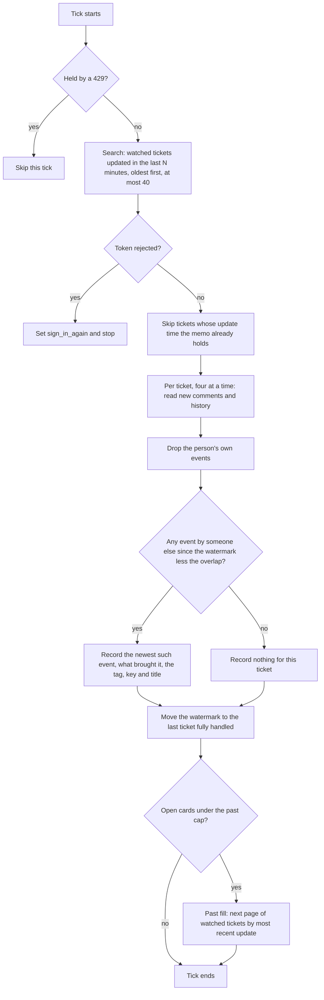
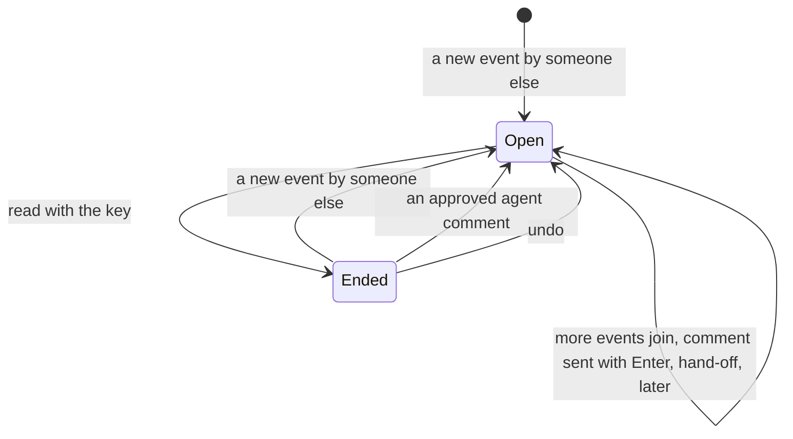
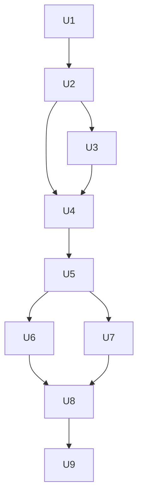

# Jira in the Inbox - Plan

## Goal Capsule

- **Objective:** Every event on a Jira ticket the person watches reaches them once, as a card in the Inbox, and stays there until they have read it.
- **Means:** Jira Cloud as a third account provider on the existing account, thread-record and card code (KTD1).
- **Product authority:** The Product Contract below, confirmed by the person on 2026-11-10. Where the Planning Contract and the Product Contract disagree on behaviour, the Product Contract wins. It extends the unified Inbox of `docs/plans/2026-11-04-067-feat-unified-inbox-plan.md`, which deferred issue trackers.
- **Stop conditions:** Stop and ask when a Jira behaviour listed under Open Questions turns out to break a requirement, or when a change would alter what a Gmail or Slack card does.
- **Execution profile:** Code, in dependency order U1 to U9, on one branch, with every repo check passing before each push.
- **Who finishes:** The implementer builds and checks U1 to U9; the person runs the real-site check in the Verification Contract with their own token, raises the PR and merges.
- **Open blockers:** None.

---

## Product Contract

Product Contract preservation: changed on the person's confirmation of 2026-11-10. R17, R18, R21, R23 and R24 gained one qualifier each, R26 to R28 are new, and the four questions deferred to planning are answered in the Planning Contract. No requirement was removed or weakened.

### Summary

A Jira Cloud site becomes a third kind of account, beside a Gmail mailbox and a Slack workspace. Each watched ticket with something new is one Inbox card: the ticket is the thread and its events are the messages. The person can comment from the card, and only ⌘] ends it.

### Problem Frame

Jira activity reaches the person through side channels today: the Jira app in Slack and Jira's notification emails. The same event arrives more than once, mixed into Slack and mail cards, and neither channel is the ticket itself. The person lives in the Inbox and wants it to be the one place where what waits on them shows up. They will remove the Slack Jira app and switch off Jira's emails, which leaves nothing bringing Jira to them unless loki does.

### Key Decisions

- **A ticket is the thread, an event is a message.** The Slack card is the model the person named. Governs R6, R10, R12.
- **Watching decides what comes.** Jira's own watcher list is the only rule, so there is one place to change it. (session-settled: user-directed — chosen over rules of loki's own such as assigned or mentioned tickets: the person asked for all events on watched tickets.) Governs R6, R7, R9.
- **Comment is the only move that writes to Jira.** (session-settled: user-directed — chosen over also changing status, reassigning and unwatching from the card: those stay in Jira for this version.) Governs R17, R20.
- **Only ⌘] ends a Jira card.** (session-settled: user-directed — chosen over a comment also ending the card, as a reply does on a Slack card: a comment should not mark the ticket read.) Governs R16, R17, R18, R19.
- **An API token connects a site; Atlassian sign-in comes later.** (session-settled: user-directed — chosen over shipping a shared Atlassian app now: the token path needs no app to register or keep approved.) Governs R1, R3.
- **The person switches off Jira's emails and removes the Slack Jira app.** (session-settled: user-directed — chosen over loki archiving Jira's notification mails: loki should not guess which mail is from Jira or act on mail by itself.) Governs R25.
- **Agents never post.** An approved agent comment waits in the card's comment box for the person to send, because Jira has no drafts. (session-settled: user-approved — chosen over posting on approval: it keeps the rule that agents never send.) Governs R23.
- **No event filter in this version.** Sprint, rank and label edits count like comments, which may be noisy on busy tickets. (session-settled: user-approved — chosen over filtering field edits: the person asked for all events.) Governs R7.
- **loki keeps the read mark alone.** Jira offers no per-ticket read state to write to or read from. (session-settled: user-approved — chosen over mirroring Jira's notification bell: nothing there is reachable.) Governs R20.
- **The past fill has no age limit.** (session-settled: user-approved — chosen over stopping at open tickets or a date: it matches how mail and Slack fill.) Governs R11.
- **No new preference for Jira's later time.** (session-settled: user-approved — chosen over a Jira row in Preferences › Inbox: one fewer setting.) Governs R18.

### Actors

- A1. The person: connects a Jira site, reads its cards, comments.
- A2. The owning agent: the one agent a Jira site belongs to; it receives hand-offs and may propose comments.
- A3. Jira Cloud: where tickets, their watchers and their events live, and where a comment is posted.

### Requirements

**Connecting a site**

- R1. The person can connect any number of Jira Cloud sites in Preferences › Accounts, each with its site address, their account email and an API token.
- R2. A Jira site is an account like the others: it has exactly one owning agent chosen at connect, lives on one Mac, keeps its token only in the keychain, and can be moved or disconnected.
- R3. When Jira rejects the token, including a token that has expired, the account shows as disconnected with the reason and a way to reconnect with a new token.
- R4. Connecting a Jira site is not limited to macOS.
- R5. A site address or token that does not work is refused at connect with the reason, and no account is created.

**What becomes a card**

- R6. A ticket on the person's Jira watcher list becomes a card when it gets a new event.
- R7. Every event in the ticket's history counts: a comment, a status change and any field edit.
- R8. An event the person made themselves never brings a card and never counts as new.
- R9. A ticket the person does not watch brings no card, even when it is assigned to them or mentions them.
- R10. There is one card per ticket; events that arrive while the card is open join it instead of making another.
- R11. On connect, a site fills from the past under the existing past cap, most recently updated watched tickets first; new events always come past the cap.
- R27. An edit to an existing comment is not an event.

**The card**

- R12. The card shows the ticket's key and title, its events from oldest to newest with who made each and when, and which events are new since the person last read it.
- R13. The card carries one tag saying why it is there: "mentioned you", "assigned to you" or "watching", the most direct that applies.
- R14. The card opens the ticket in Jira from a link.
- R15. A Jira card ranks like any outside card with something new.

**Moves**

- R16. ⌘] ends the card; it comes back only when the ticket gets a new event.
- R17. A comment typed on the card and sent with Enter posts to the ticket as the person, as plain text, and leaves the card in place and unread; ⌘] with text in the box posts it and then ends the card.
- R18. ⌘[ keeps the card unread and brings it back after the later time set for Slack cards, or sooner when a new event comes.
- R19. ⌘E and labels do nothing on a Jira card, and a hand-off to the owning agent leaves the card in place.
- R20. Nothing loki does changes a ticket other than posting the person's comment, and reading the ticket in Jira does not end its card.
- R21. On the phone a Jira card shows the same events and new-event marks and takes the same moves as other outside cards: right swipe for ⌘], left swipe for ⌘[, and the comment box; like every card there, it shows no tag.
- R22. Each move on a Jira card is written to the Inbox ledger like a move on any outside card.
- R26. Handing the same ticket off again after new events sends the owning agent the newer state.

**Agents**

- R23. The owning agent can propose a comment on a ticket of its site; once the person approves it, the ticket's card comes back if it had ended, the text fills the card's comment box, and the person sends it.
- R24. Only the owning agent has the account tools for a Jira site, which list and read its tickets, and ticket text reaches agents fenced as content from its authors.
- R28. A comment proposal for a ticket that has never had a card is refused with the reason.

**Manual**

- R25. The manual covers connecting a Jira site and says to remove the Slack Jira app and switch off Jira's email notifications so events are not doubled.

### Key Flows

- F1. Connect a site
  - **Trigger:** The person picks Jira under Connect an account.
  - **Actors:** A1, A3
  - **Steps:** They enter the site address, email and token and pick the owning agent; loki checks the token with Jira; the account appears; cards fill from the past.
  - **Covered by:** R1, R2, R5, R11
- F2. An event becomes a card and ends
  - **Trigger:** Someone else comments on, or edits, a ticket the person watches.
  - **Actors:** A1, A3
  - **Steps:** loki sees the event on its next check; the ticket's card comes up with the event marked new; the person reads it and presses ⌘]; the card is gone until the next event.
  - **Covered by:** R6, R7, R10, R12, R16
- F3. Comment and stay
  - **Trigger:** The person types in the card's comment box.
  - **Actors:** A1, A3
  - **Steps:** They send the comment; it posts to the ticket; the card stays where it is, still unread; their own comment does not count as new; ⌘] ends the card when they choose.
  - **Covered by:** R8, R17, R16

### Acceptance Examples

- AE1. **Covers R8, R17.** Given an open card for a watched ticket, when the person posts a comment from the card, then the comment appears on the ticket in Jira, the card stays in the Inbox unread, and no new-event mark appears for their own comment.
- AE2. **Covers R10, R12.** Given a watched ticket whose card is open with one new comment, when a status change and a second comment arrive before the person reads it, then there is still one card and all three events are marked new.
- AE3. **Covers R16, R6.** Given the person ended a ticket's card with ⌘], when the ticket gets a new comment from someone else, then the card comes back with only that comment marked new.
- AE4. **Covers R9.** Given a ticket assigned to the person that they do not watch, when someone comments on it, then no card appears.
- AE5. **Covers R20.** Given an open card with a new event, when the person reads the ticket in Jira's own site, then the card stays in the Inbox until they press ⌘].
- AE6. **Covers R3.** Given a connected site whose token has expired, when loki next checks it, then the account shows as disconnected with the reason, its open cards stay, and reconnecting with a new token resumes the events.
- AE7. **Covers R23.** Given the owning agent proposes a comment, when the person approves it, then nothing is posted until the person sends the text from the card's comment box.
- AE8. **Covers R19.** Given an open Jira card, when the person presses ⌘E or hands it off, then the card stays in the Inbox.
- AE9. **Covers R23.** Given a ticket whose card the person ended, when they approve the owning agent's proposed comment, then the card comes back with the proposed text in its comment box.
- AE10. **Covers R27.** Given an open or ended card, when someone edits a comment that was already on the ticket, then nothing on the card changes and no card comes back.

### Success Criteria

- With the Slack Jira app removed and Jira's emails off, the person misses no event on a watched ticket, and each event reaches them once.
- A Jira card reads and moves like the Slack card it is modelled on, apart from the differences this plan names in R17, R19 and R20.
- Gmail and Slack cards behave exactly as before.

### Scope Boundaries

**Deferred for later**

- Sign in with Atlassian through a shared app, picked up only if the token step proves a real obstacle.
- Jira Data Center and Server.
- Changing status, reassigning and unwatching from the card.
- A filter for noisy events such as sprint, rank and label edits.
- An @mention picker and rich text in comments.
- Cards for tickets that are assigned to the person or mention them but that they do not watch.
- Search over a Jira site for the owning agent.
- The reach tag on the phone, for any kind of card.

**Outside this product's identity**

- A Jira client in loki: boards, search, creating tickets and editing fields stay in Jira.
- loki acting on Jira's notification mail by itself.

**Considered and not built**

- Scoped API tokens. They need a different address that rests on an identifier Jira does not document as supported; classic tokens cover R1. Revisit if Atlassian retires classic tokens.
- A token-specific disconnect cause. An older build drops an account record whose cause it does not know, and the existing "sign in again" state with Jira wording says the same thing.
- A retry when posting a comment times out. A retry could post twice; the person sees the failure and sends again.
- The New line on Slack cards on the phone. The generic message list could draw it for every provider, which would change Slack on the phone without being asked.
- Fetching Jira avatars. Initials serve, as they do for mail.

### Dependencies / Assumptions

- Jira Cloud's REST API v3, with an API token, lists watched tickets, returns each ticket's history and comments, and posts a comment. Atlassian's published API description confirms this; it was not tried against a real site.
- Atlassian API tokens expire within a year, by Atlassian's own account of the rule.
- Events arrive on loki's existing account check, about once a minute, and Jira's search can trail a change by seconds to minutes, so a card can trail its event by a little more than a minute.
- A ticket the person stops watching brings no further events; a card already open for it stays until ⌘]. This is an assumption the person has not confirmed.
- A ticket the person starts watching, or one created already assigned to them, brings a card at its next event, not at once.

### Sources / Research

- `docs/plans/2026-11-04-067-feat-unified-inbox-plan.md`: the account model, the owner rule and the deferral of issue trackers.
- `docs/plans/2026-11-05-070-feat-inbox-endings-plan.md`: when each card kind is done, and the ⌘], ⌘[ and ⌘E moves.
- `docs/plans/2026-11-08-077-feat-slack-card-window-plan.md`: the Slack card's window around what is new.
- `docs/plans/2026-11-09-078-feat-inbox-past-cap-plan.md`: the past cap of 20 open cards for each account.
- `glossary.md`: Account, Owner, Outside card, Done, Later, Inbox ledger, Hand-off, Reply proposal.
- Jira Cloud platform REST API v3, Atlassian's OpenAPI description: `search/jql`, `issue/{id}/comment`, `issue/{id}/changelog`, `myself`, `serverInfo`.
- Atlassian's notes on API token expiry, on rate limits for token traffic, and change notice CHANGE-2046 on the retired search endpoint.

---

## Planning Contract

### Key Technical Decisions

- KTD1. **Jira is a third `AccountProvider`, on the existing code paths.** The account record, thread record, watcher, outside card, moves, ledger and tools all gain a Jira arm; nothing runs beside them. Extends R2, R10, R15, R22.
- KTD2. **Every provider branch a Jira account reaches becomes exhaustive.** About 25 tests of the form "not gmail" or "not slack" would silently give Jira the other service's behaviour; each one touched becomes a switch or a `Record` over the provider, so the typecheck names the next gap. The worst are listed in U1.
- KTD3. **A classic API token with basic auth against the site's own API host.** The secret is one JSON string holding site, email and token under the account's existing keychain key; the token rides in the connect frame, as the "own Google app" secret does, and the frame stays off the phone. Instantiates the token decision governing R1 and R3. (session-settled: user-directed — chosen over shipping a shared Atlassian app now: the token path needs no app to register or keep approved.)
- KTD4. **The account id is `jira:<API host>:<Atlassian account id>`, and the host comes from Jira.** The host is taken from the site's own answer about its base address, so a custom domain and its `atlassian.net` name make one account. The row shows the host as the account's address.
- KTD5. **One request wrapper decides "rejected", "wait" and "failed".** A 401, Jira's failed-login header on any answer, or a profile answer without an account id sets the existing `sign_in_again` cause. A 429 holds the account until the time Jira names and never counts toward `temporarily_failing`. Anything else fails the tick, and three failed ticks set `temporarily_failing` as Gmail's sync does. Serves R3, R5.
- KTD6. **The sync asks Jira for watched tickets updated in the last N minutes.** N is the minutes since the watermark plus a ten-minute overlap, written as a relative time so the person's Jira time zone never matters. One tick examines at most 40 tickets, oldest change first, four at a time, and moves the watermark to the last ticket fully handled, after its events are recorded. A small memo of each ticket's last seen update time skips tickets the overlap brings back unchanged. Serves R6, R7.
- KTD7. **The thread id is Jira's numeric issue id.** The key and title ride in the card's place and subject and are refreshed on each event, so a ticket moved to another project keeps its card. Tools accept a key and resolve it. Serves R10, R12.
- KTD8. **An event is a comment or a history entry, with an id that sorts by time.** The id is the event's creation time in UTC to the millisecond, then `c` or `h`, then the zero-padded Jira id, because the thread record compares ids as strings. Only creation counts, which gives R27. Serves R7, R12.
- KTD9. **Own events are dropped before anything is recorded.** The sync records the newest event by someone else, and names as "what brought it" the other-person events created since the watermark less the overlap that sit after the card's dealt mark. A ticket whose only fresh events are the person's own records nothing. Serves R8, AE1, AE2, AE3.
- KTD10. **The Jira write-back writes nothing to Jira.** Read answers "ended", later answers "not ended", undo is a no-op, and archive and labels refuse. It is registered once at boot, as Gmail's is, so ⌘] and undo work while the token is rejected. Unread follows Slack's rule, loki's own seen mark against the newest event. Serves R16, R18, R20, AE5, AE6.
- KTD11. **A Jira comment uses the "stay" follow-up that plan 083 added, without the dealt mark.** `docs/plans/2026-11-10-083-feat-reply-sends-alone-plan.md` already makes Enter and the phone's Send post alone and keep the card on every outside card; a Slack or mail reply still marks the card dealt with, and a Jira comment does not, so its events stay marked new. On a Jira card ⌘] with text is "read" and ⌘[ with text is "later". A failed post is reported and never retried, and the `@` people list of plan 082 is not offered. Instantiates the decision governing R16 and R17. (session-settled: user-directed — chosen over a comment also ending the card, as a reply does on a Slack card: a comment should not mark the ticket read.)
- KTD12. **⌘E is refused before the card leaves the deck.** The desktop deck and the phone's commit check refuse it the way "main chats stay" does, the archive buttons are not drawn on a Jira card, and the refusing write-back of KTD10 is the backstop. Serves R19, AE8.
- KTD13. **A Jira hand-off sends the thread and changes nothing else.** It skips the handed-off state and the archive write, the client keeps the card, and the send id carries the newest event id so a later hand-off after new events sends again. Serves R19, R26, AE8.
- KTD14. **The card reads through one Jira thread reader, and the generic message list draws the New line for Jira.** The reader pages comments and history from the end, merges them by event id and marks events after the dealt mark as unread; the desktop and the phone both draw Jira through the generic list, which gains a New line for Jira cards only. It opens on the new events plus five before, with twenty more per "earlier" load, reusing the Slack window's constants and its `more_before` field. Serves R12, R21.
- KTD15. **Text is converted in one module, both ways.** Jira's document format becomes plain lines covering paragraphs, line breaks, lists, code, links and mention names; a history entry becomes one line naming the field and its old and new values; an outgoing comment becomes paragraphs with line breaks. Serves R12, R17.
- KTD16. **Two new reach values, placed on the existing scale.** `assigned` sits at level 3 beside "your thread" and `watching` at level 4 beside "your group"; "mentioned you" is the existing `mention` at level 2. The tag is worked out over every event that brought the card plus the ticket's current assignee, so a mention is not lost to a later field edit. Serves R13.
- KTD17. **A Jira card rests as the Slack kind.** `cardKindOf` names it explicitly instead of letting it fall to email, so read has no rest of its own and later uses the Slack later time; the stored return times keep their shape. Instantiates the decision governing R18. (session-settled: user-approved — chosen over a Jira row in Preferences › Inbox: one fewer setting.)
- KTD18. **An approved comment is a seed on the thread record.** Approval writes the text and the proposal's id onto the record, reopens an ended record, and counts a pending seed as unread so the card comes up; the card adds each seed to its box once, after any text already there. Sending a comment or withdrawing the proposal clears the seed. The proposal's "drafted" state is reused with Jira wording and no link. Instantiates the decision governing R23. (session-settled: user-approved — chosen over posting on approval: it keeps the rule that agents never send.)
- KTD19. **The past fill pages watched tickets by most recent update.** It tops a site up to the past cap of open, unresting cards, keeps paging past tickets with no event by someone else, records each as from the past with its newest other-person event as what brought it, and keeps its page position beside the watermark. Serves R11.
- KTD20. **The mark is a plain glyph with its own colour token.** Like `#` and `✉`, it is a sign and not Atlassian's logo, with `--loki-mark-jira` defined for each colour family and side on the desktop and the phone. Serves R12.

### High-Level Technical Design

One sync tick for a Jira site:

The life of one Jira card:

Later keeps the card open and unread and only rests it; ⌘E never applies.

### Sequencing

U1 is the base for everything. U2 and U3 give a connected account, U4 makes cards appear, U5 makes them readable, U6 and U7 give the moves and the comment, U8 adds the agent's side, and U9 writes the manual.

### Risks

- **Unconfirmed Jira behaviour.** Four facts rest on community reports, not Atlassian's documents; they are listed under Open Questions and checked by hand in the Verification Contract. The one that matters is whether rank and sprint moves change a ticket's update time: if not, those events arrive late, with the ticket's next change.
- **Older paired Macs.** A paired Mac on an older build drops a provider it does not know, so its duplicate-connect and delete-agent checks do not see a Jira account held here until it updates.
- **A downgrade loses the account record.** An older build drops the record on read; the keychain entry stays, and reconnecting after upgrading restores the account.
- **Noise.** R7 counts every field edit; a busy board can bring many cards. The deferred filter is the answer if it proves too much.
- **A long gap or a large watch list.** KTD6's cap of 40 tickets a tick and its watermark rule keep a tick bounded and let it resume; catching up after days away takes several ticks.

### Open Questions

**Deferred to implementation** (each is checked on a real site in the Verification Contract)

- Whether a rank or sprint move changes a ticket's update time.
- Whether the relative-minutes search accepts a large N, such as a week of minutes.
- The name of the list in a ticket's history answer, which the reader should accept under either known name.
- The exact answer Jira gives for an expired token, as against a revoked one.

---

## Implementation Units

### U1. Provider, reach and rest foundations

**Goal:** `jira` is a known provider everywhere a provider is named, with no behaviour of its own yet and none borrowed by accident.

**Requirements:** R2, R13, R15, R18; KTD1, KTD2, KTD4, KTD16, KTD17, KTD20.

**Dependencies:** none.

**Files:**

- `core/frame-types.ts`, `core/analytics.ts`, `core/outside-reach.ts`, `core/attention/rest.ts`, `core/attention/model.ts`
- `mod/accounts.ts`, `mod/account-threads.ts`, `mod/inbox-ledger.ts`
- `app/src/desk/card-head.tsx`, `app/src/chat/chat.css`, `app/src/kit/tokens.css`, `app/src/phone/phone.css`
- `test/accounts.test.ts`, `test/rest.test.ts`, `test/card-head.test.ts`, `test/account-threads.test.ts`, `test/fixtures/outside-item.ts`

**Approach:**

1. Add `jira` to `AccountProvider`, to `PROVIDERS`, to the restated union in `core/analytics.ts`, and a Jira arm to `accountIdOf` and `accountLabel` per KTD4.
2. Add `assigned` and `watching` to `OutsideReach` with their levels and labels per KTD16.
3. Make `cardKindOf` name each provider per KTD17, and state the unread rule in `outsideItem` per provider instead of "gmail, else".
4. Replace the "gmail, else Slack" branches in `mod/account-threads.ts` (error text, sender address, reach fallback) with explicit ones.
5. Add the Jira mark: a `CardMark` value, its glyph, class and aria label, and the `--loki-mark-jira` token in each family and side per KTD20.
6. Update doc comments that say "a Gmail mailbox or a Slack workspace".

**Patterns to follow:** `REACH_LEVEL` and `REACH_LABEL` as full `Record`s; `MARK_GLYPH` in `app/src/desk/card-head.tsx`; the mark tokens in `app/src/kit/tokens.css`.

**Test scenarios:**

- A Jira account id is built from host and account id, starts with `jira:`, and its label shows the host with the service named.
- A stored account record with provider `jira` survives a read; one with an unknown provider is still dropped.
- `cardKindOf` of a Jira card is the Slack kind; of a mail card, email; of a Slack card, Slack.
- A Jira card with a seen mark older than its newest event is unread; with a newer seen mark, read.
- `assigned` and `watching` have a level and a label, and a stored record carrying either keeps it.
- The Jira mark renders its glyph, class and "from Jira" label.

**Verification:** The typecheck passes with the new provider, and the remaining failures it reports are the union and `Record` sites the later units fill.

### U2. Jira client and text conversion

**Goal:** One client that talks to a Jira Cloud site and one module that converts its text, with no call but the comment able to write.

**Requirements:** R3, R5, R7, R12, R17, R20; KTD3, KTD5, KTD8, KTD15.

**Dependencies:** U1.

**Files:**

- `mod/jira.ts` (new), `mod/jira-text.ts` (new)
- `test/jira.test.ts` (new), `test/jira-text.test.ts` (new), `test/fixtures/jira.ts` (new)

**Approach:**

1. The client takes the secret, an injected `fetch` and a clock, and offers: who am I, the site's base and display addresses, a watched-ticket search, a ticket's comments, a ticket's history, and post a comment.
2. Every call goes through the one wrapper of KTD5; a rejection calls the account's status setter as Gmail's client does.
3. Comment and history readers page from the end and return events with the ids of KTD8.
4. `mod/jira-text.ts` holds the three conversions of KTD15 as pure functions.
5. `test/fixtures/jira.ts` is a fake Jira site over a fake `fetch`: tickets, watchers, comments, history, a token it accepts, and switches for 401, the failed-login header and 429.

**Patterns to follow:** `mod/slack.ts` for per-method holds and the thin `fetch` client; `mod/gmail.ts` `disconnect(cause)` for setting a cause; `test/fixtures/gmail.ts` for a fake service; the write-method guard in `test/slack.test.ts`.

**Test scenarios:**

- A search sends the watcher clause with the relative minutes given and asks for the fields the sync needs; it follows the page token to the end.
- The search uses the current search endpoint and never the retired one.
- A 401 sets `sign_in_again` once and throws.
- A 200 answer carrying the failed-login header sets `sign_in_again`, although the body is empty.
- A profile answer without an account id is a rejection.
- A 429 with a wait time holds every call until then without a request, and the account stays connected.
- A ticket the person cannot see answers "not found" and the client reports it as a per-ticket refusal, not an account failure.
- An event's id sorts by creation time across comments and history, including two events in the same millisecond and creation times given with a `+0530` offset.
- A history answer is read under either known list name.
- Posting a comment sends paragraphs with line breaks and returns the new comment's id.
- The only client method whose name suggests writing is the comment.
- A document with paragraphs, a hard break, a bullet list, a code block, a link and a mention becomes the expected plain lines, with the mention as its name.
- A history entry for a status change reads as the field with its old and new values; an entry with several items gives one line each.
- An unknown node type in a document keeps its text and does not throw.

**Verification:** The client's tests pass against the fake site with no real network, and the guard test shows one writing method.

### U3. Connecting a Jira site

**Goal:** The person can connect, reconnect and disconnect a Jira site from Preferences › Accounts.

**Requirements:** R1, R2, R3, R4, R5; F1; KTD3, KTD4, KTD5.

**Dependencies:** U2.

**Files:**

- `core/frames.ts`, `core/daemon-calls.ts`
- `mod/frames/accounts.ts`, `mod/index.ts`, `mod/handoff.ts`
- `app/src/settings/accounts.tsx`, `app/src/settings/pages.ts`, `app/src/desk/outside-card.tsx`
- `test/frames-accounts.test.ts`, `test/frames.test.ts`, `test/settings-accounts.test.ts`, `test/accounts.test.ts`

**Approach:**

1. Add a desktop-only `account_connect_jira` frame carrying owner, site, email and token.
2. The handler normalises the site, asks Jira who the token belongs to and for its base address, and only then adds the account with its secret, or sets an existing disconnected one to connected with the new secret.
3. A reconnect refuses a token that belongs to another Atlassian account, with the reason.
4. Preferences gains a "connect jira" control and a form of three fields, the token masked, with errors shown in the page's notice line; the row's reconnect opens the same form for that site.
5. Give the Jira service a name in every `SERVICE` table and Jira wording for each disconnect cause in `causeWords` and `disconnectedText`.

**Patterns to follow:** The Slack connect handler in `mod/frames/accounts.ts` for validate, then add or reconnect; the "Use your own Google app" fold in `app/src/settings/accounts.tsx` for typed, masked fields; `Accounts.add(input, secret)` for keychain first.

**Test scenarios:**

- Covers F1. A good site, email and token create a connected account owned by the chosen agent, with the secret in the keychain and no token text in the state file.
- A bad token is refused with Jira's reason and no account or keychain entry is made.
- A site address given as a full URL, with a path or in mixed case connects as the same account as its bare host.
- A site reached by its custom domain and by its `atlassian.net` name is one account.
- Connecting without an owner, or with an agent that does not exist, is refused.
- Covers AE6. A disconnected account reconnected with a new token is connected again with the same owner and watermark.
- A reconnect with another Atlassian user's token is refused and the account stays as it was.
- The connect frame is not in the phone's frame list.
- `connectState` for Jira is ready on every OS.
- The page's reconnect for a Jira row opens Jira's form and never starts Slack's.
- Disconnect forgets the account and its keychain entry.

**Verification:** Against the fake site, a Jira account can be connected, shown in the accounts list with its host and owner, reconnected and disconnected.

### U4. Sync, write-back and wiring

**Goal:** A connected site's watched tickets become cards, stay one card each, and end only by read.

**Requirements:** R6, R7, R8, R9, R10, R11, R13, R16, R18, R20, R27; F2; KTD5, KTD6, KTD7, KTD8, KTD9, KTD10, KTD16, KTD19.

**Dependencies:** U2, U3.

**Files:**

- `mod/jira-sync.ts` (new), `mod/index.ts`, `mod/account-threads.ts`
- `test/jira-sync.test.ts` (new), `test/account-watcher.test.ts`, `test/account-threads.test.ts`

**Approach:**

1. `JiraSync` implements the watcher's sync contract and follows the tick in the High-Level Technical Design.
2. Its cursor lives in the account's backfill record: the watermark, the memo of ticket update times, and the past fill's page position.
3. For each ticket it records the newest other-person event with sender, key as place, title as subject, the last lines, the tag of KTD16 and the brought ids of KTD9.
4. The write-back source of KTD10 is a pure value registered at boot beside Gmail's.
5. Register the sync factory and the client in `mod/index.ts`, filling the provider unions the typecheck named in U1.
6. A per-ticket refusal is logged and skipped; an account-wide failure fails the tick and leaves the watermark.

**Execution note:** Build the sync test-first against the fake site of U2, since the watermark, overlap and own-event rules are easy to get subtly wrong.

**Patterns to follow:** `mod/slack-sync.ts` for the source shape, `brought_ids` and the own-event filter; `mod/gmail-sync.ts` for the failure counter, the backfill record and choosing the newest event by someone else; the open-card count both syncs share.

**Test scenarios:**

- Covers F2. A comment by someone else on a watched ticket makes one open card with that comment as what brought it.
- Covers AE2. A status change and a second comment before the person reads leave one card with all three events brought.
- Covers AE3. After read ended the card, a new comment by someone else reopens the same card with only that comment brought.
- Covers AE4. A comment on a ticket the person does not watch records nothing.
- Covers AE5. Nothing the fake site reports about the person viewing a ticket ends a card.
- Covers AE10. An edit to an old comment changes the ticket's update time and records nothing.
- A ticket whose only new events are the person's own records nothing, and an open card's newest event does not change.
- A ticket with an old event by someone else, brought into the search only by the person's own edit, makes no card.
- A history entry and a comment in the same minute both arrive, in creation order.
- A ticket returned again by the overlap with the same update time is not read again.
- A mention of the person in a brought comment gives `mention`; otherwise a ticket assigned to them gives `assigned`; otherwise `watching`.
- A mention followed by a field edit in the same batch still gives `mention`.
- A ticket moved to another project keeps its card, with the new key shown.
- With 100 changed tickets, one tick handles 40 and the watermark stands at the fortieth; the next ticks finish the rest with none lost.
- A tick that fails halfway leaves the watermark at the last ticket fully handled.
- A 429 skips ticks until the wait ends and does not count toward `temporarily_failing`.
- Three failed ticks set `temporarily_failing`; a good tick clears it.
- A rejected token sets `sign_in_again`, the watcher stops ticking the account, and its open cards stay.
- A ticket the token can no longer see is skipped and logged, and the tick goes on.
- On first sync, the past fill opens the 20 most recently updated watched tickets that have an event by someone else, marked as from the past.
- The past fill pages past tickets with no event by someone else instead of stopping.
- With 20 open cards the past fill adds none; after two are read it adds two more.
- A new event comes through with 20 cards already open.
- The source's read answers ended; later answers not ended; restore does nothing; archive and labels refuse with a reason.
- Read works on an account whose status is disconnected.
- Undo after read reopens the card with the same events brought.

**Verification:** With the fake site and an injected clock, cards appear, join, end on read and return on new events exactly as the Acceptance Examples say, with no test sleeping.

### U5. Reading the ticket on the card

**Goal:** A Jira card shows the ticket's events with the new ones marked, on the desktop and the phone, and opens the ticket in Jira.

**Requirements:** R12, R13, R14, R21; KTD7, KTD14, KTD15, KTD20.

**Dependencies:** U4.

**Files:**

- `mod/jira-view.ts` (new), `mod/outside-threads.ts`, `mod/handoff.ts`, `mod/index.ts`
- `core/frame-types.ts`
- `app/src/desk/outside-card.tsx`, `app/src/desk/card-head.tsx`, `app/src/phone/inbox.tsx`
- `test/jira-view.test.ts` (new), `test/outside-threads.test.ts`, `test/inbox-card.test.ts`, `test/phone.test.ts`

**Approach:**

1. `mod/jira-view.ts` gives a whole-thread reader for the hand-off and tools, and a card view that returns the window of KTD14 with each event's unread and brought marks.
2. Register both in `mod/index.ts`; the card view answers the existing read frame's "earlier" ask.
3. `OutsideFacts` gains the ticket's browser address, built from the site's display address and the key.
4. On the desktop the header shows the mark, the sender, key and title, the tag and an "open in jira" link; the body is the generic message list with a New line before the first unread event, for Jira only.
5. The phone draws the same list and New line; its title is the key and title, and it shows no tag.
6. Give Jira its own words wherever the card says "mailbox", "workspace", "reply in the thread" or similar.

**Patterns to follow:** `mod/slack-view.ts` for a window around what is new and its constants; `MessageRow` in `app/src/desk/outside-card.tsx`; the New line in `app/src/desk/slack-thread.tsx`; `openExternal` for links.

**Test scenarios:**

- A ticket with 30 events and 3 new ones opens on the 3 new events plus the 5 before, with "earlier" offered.
- Loading earlier adds 20 older events in order and stops offering when the first event is shown.
- Events after the dealt mark are unread; with no dealt mark, only the brought events are unread.
- An event deleted in Jira after the card was dealt does not shift which events are unread.
- The person's own events show as "you" and are never unread.
- A comment shows its converted text; a status change shows its one-line form.
- The desktop card shows the Jira mark, key and title, the tag and the link to the ticket's address.
- A site with a custom domain links to that domain.
- The New line appears before the first unread event on a Jira card and not at all on a Slack card on the phone.
- The phone card shows the same events and New line, the key and title, and no tag.
- A read failure shows the card's last lines with the reason, as other outside cards do.

**Verification:** A preview of a Jira card with made-up events shows the header, tag, New line and link on the desktop, and the list and New line on the phone.

### U6. Moves that differ on a Jira card

**Goal:** ⌘E and labels do nothing, and a hand-off leaves the card and can be repeated.

**Requirements:** R19, R22, R26; KTD12, KTD13.

**Dependencies:** U5.

**Files:**

- `app/src/desk/deck-moves.ts`, `app/src/desk/outside-card.tsx`, `app/src/desk/catch-up-parts.tsx`
- `app/src/phone/deck.ts`, `app/src/phone/inbox.tsx`
- `core/attention/chat-store.ts`, `mod/handoff.ts`, `mod/account-threads.ts`
- `test/deck-keys.test.ts`, `test/phone.test.ts`, `test/handoff.test.ts`, `test/chat-store.test.ts`, `test/inbox-ledger.test.ts`

**Approach:**

1. Refuse archive on a Jira card in the deck before the card pops, with a short reason, and in the phone's commit check so the swipe springs back.
2. Draw no archive or label control on a Jira card, on either surface, and give its key legend the Jira moves only.
3. Check every caller of the store's archive for outside cards, so none can drop a Jira card.
4. In the hand-off, a Jira thread skips the handed-off state and the archive write, the store keeps the card, and the send id uses the newest event id per KTD13.
5. Word the move buttons and their titles for Jira.

**Patterns to follow:** "main chats stay" in `app/src/desk/deck-moves.ts`; `canCommit` in `app/src/phone/deck.ts`; `takesLabels`.

**Test scenarios:**

- Covers AE8. ⌘E on a Jira card leaves it on top, says why, and sends no frame.
- An archive swipe on a Jira card on the phone springs back.
- L on a Jira card does nothing.
- Covers AE8. A hand-off sends the fenced ticket to the owner's chat, and the card stays open in the record and in the store.
- A second hand-off with no new events sends nothing more; after a new event it sends again.
- A hand-off on a disconnected Jira account is refused, as on other accounts.
- A hand-off on a Gmail thread still archives it and a Slack one still marks it read.
- Read, later and hand-off on a Jira card each write a ledger line with provider `jira`.

**Verification:** On a Jira card only read, later, hand-off and the comment are offered, and no key or swipe removes the card except read.

### U7. Commenting from the card

**Goal:** The person's comment posts to the ticket, and the card stays unless they send it with ⌘].

**Requirements:** R8, R17, R20, R21, R22; F3; KTD11, KTD15.

**Dependencies:** U5.

**Files:**

- `core/frame-types.ts`, `core/frames.ts`, `core/attention/chat-store.ts`, `core/attention/use-attention.ts`
- `mod/outside-threads.ts`, `mod/inbox-ledger.ts`, `mod/index.ts`
- `app/src/desk/deck-moves.ts`, `app/src/desk/outside-card.tsx`, `app/src/desk/use-deck-actions.ts`, `app/src/phone/inbox.tsx`
- `test/outside-threads.test.ts`, `test/attention.test.ts`, `test/deck-keys.test.ts`, `test/phone.test.ts`, `test/frames.test.ts`, `test/inbox-ledger.test.ts`

**Approach:**

1. Keep plan 083's `stay` as it is for the frame, the deck and the phone; a Jira card sends with Enter, as a Slack card does.
2. Give the send path a Jira arm that posts the comment through the client and skips the dealt mark per KTD11, whatever follow-up was asked.
3. Let the ledger's `after_reply` accept `stay` if a reply sent alone is to be logged; plan 083 logs no decision for it, so follow that.
4. Refuse the people search of plan 082 for a Jira account, so no `@` list shows.
5. After a comment is sent, read the thread again so the person's comment shows on the card.
6. Word the box for Jira: its place, its hint and its send title.
7. Add the comment method to the guard that allows only `mod/outside-threads.ts` to call a sending method.

**Patterns to follow:** `sendNow` and `follow` in `mod/outside-threads.ts`; `sendThen` in `app/src/desk/deck-moves.ts`; the answered-not-thrown `then_error` of the reply result.

**Test scenarios:**

- Covers F3 / AE1. Enter with text on a Jira card posts the comment, the card stays on top and unread, and its new marks are unchanged.
- The posted comment appears on the card as "you" after the send, and the next sync does not mark it new.
- ⌘] with text posts the comment and then ends the card.
- ⌘[ with text posts the comment and rests the card unread.
- A post that fails leaves the text in the box, reports the reason and sends nothing twice.
- A post that times out is not retried.
- A comment on a disconnected account is refused before any request.
- An empty comment and one past the length limit are refused, as replies are elsewhere.
- A comment of two paragraphs with a line break arrives in Jira as two paragraphs with a line break.
- On the phone, sending a comment leaves the card in place.
- A Slack reply still sends and ends its card on Enter, and a mail reply still holds for ten seconds.
- The ledger line for a comment carries `after_reply: stay`.
- The reply frame accepts `stay` and still refuses an unknown value.
- Only `mod/outside-threads.ts` calls the Jira comment method.

**Verification:** Against the fake site, a comment sent with Enter is on the ticket and the card is unchanged; the same text sent with ⌘] ends the card.

### U8. The owning agent: tools and proposed comments

**Goal:** The owner can list and read its site's tickets and propose a comment that waits in the card's box.

**Requirements:** R23, R24, R28; KTD7, KTD18.

**Dependencies:** U6, U7.

**Files:**

- `mod/account-tools.ts`, `mod/reply-proposals.ts`, `mod/account-threads.ts`, `mod/index.ts`
- `core/frame-types.ts`, `core/attention/model.ts`, `core/attention/chat-store.ts`
- `app/src/desk/reply-proposal-card.tsx`, `app/src/desk/outside-card.tsx`, `app/src/desk/use-deck-actions.ts`, `app/src/phone/inbox.tsx`
- `test/account-tools.test.ts`, `test/reply-proposals.test.ts`, `test/account-threads.test.ts`, `test/attention-model.test.ts`, `test/inbox-card.test.ts`

**Approach:**

1. `account_read` gains a Jira arm over the whole-thread reader of U5, accepts a key or an issue id, and fences the text; `account_search` answers that search is not available for Jira; tool and prompt text name Jira.
2. Stored proposals accept provider `jira`, and `propose` refuses a ticket with no thread record per R28.
3. The Jira arm of the proposal's write step sets the seed of KTD18 on the thread record and reopens an ended record.
4. The thread record parses and keeps the seed, and carries it through every later event; `OutsideFacts` exposes it.
5. The unread rule counts a pending seed as unread, and a resting card with a new seed stops resting.
6. The card adds each seed to its comment box once, after any text already there, on the desktop and the phone.
7. Sending a comment or withdrawing the proposal clears the seed.
8. The approval card and the notice to the agent say the comment is waiting on the card for the person to send.

**Patterns to follow:** `ReplyProposals.write` and its result shape; `AccountThreads.reopen`; how `observe` carries `dealt_message_id` across events; `fenceThread` and `inert`.

**Test scenarios:**

- `account_read` by key and by id returns the same fenced ticket, oldest first, with comments converted to text.
- Ticket text containing a system-reminder tag reaches the agent with the tag made inert.
- `account_read` from an agent that does not own the site is refused.
- `account_search` on a Jira site answers that search is not available.
- `account_list` shows a Jira site's open tickets with key, title and state.
- Covers AE7. An approved proposal sets the seed and calls no posting method.
- Covers AE9. Approving a proposal for an ended card reopens it, unread, with the seed.
- A proposal for a ticket with no record is refused with the reason.
- A proposal approved while the account is disconnected is refused with the cause, as for other accounts.
- A new event on the ticket after approval keeps the seed on the record.
- A resting card whose proposal is approved comes back at once.
- The card's box shows the seed; with text already typed, the seed is added after it; the same seed is not added twice.
- Sending the comment clears the seed; withdrawing the proposal clears it and the box is left as it was.
- A stored proposal with provider `jira` survives a restart.
- A Gmail proposal still becomes a draft in Gmail and a Slack one a draft in Slack.

**Verification:** With the fake site, an agent's approved comment appears in the reopened card's box and reaches Jira only when the person sends it.

### U9. Manual, glossary and architecture

**Goal:** The documents describe Jira accounts and cards as built.

**Requirements:** R25.

**Dependencies:** U8.

**Files:**

- `docs/manual.md`, `glossary.md`, `docs/architecture.md`

**Approach:**

1. In the manual, widen "Email and Slack" to cover Jira: connecting a site with a token, what becomes a card, the moves that differ, commenting, the tag, the lapsed token, and the owner's tools and proposed comments.
2. State R25's two steps where connecting is described: remove the Slack Jira app and switch off Jira's email notifications.
3. Update the Preferences › Accounts line and the Inbox key list for the moves a Jira card does not take.
4. In the glossary, update Account, Outside card, Done, Later, Hand-off and Reply proposal for Jira's rules.
5. In the architecture notes, add the Jira modules to the mod's tour and the token to the keychain paragraph.

**Patterns to follow:** The existing "Connecting Gmail" and "Connecting Slack" paragraphs and the numbered "What becomes a card" list in `docs/manual.md`.

**Test scenarios:** Test expectation: none -- documents only; the repo's format and word checks cover them.

**Verification:** A reader of the manual can connect a Jira site and predict what each key does on its cards without reading code.

---

## Verification Contract

Run with CI's toolchain: the newest Node 22 with its npm 10, and `SHELL=/bin/bash`.

- `npm run format:check`: every unit.
- `npm run lint`: every unit.
- `npm run typecheck`: every unit; after U1 it lists the provider sites still to fill, and it passes from U4 on.
- `npm test`: every unit; the new files are `test/jira.test.ts`, `test/jira-text.test.ts`, `test/jira-sync.test.ts` and `test/jira-view.test.ts`.
- `npm run test:node`: every unit.
- `npm run build:app`, `npm run build:mod`, `npm run smoke`: before each push.
- `PR_TITLE="feat(inbox): bring watched jira tickets in as cards" node --experimental-strip-types scripts/check-pr-title.ts`: before the PR is opened.

Tests inject the clock, the file root and `fetch`, use `memorySecrets()` for the keychain, and reach no real network, home or keychain.

**By hand, by the person, against a real Jira site** (an agent does not enter the person's token):

1. Connect the site in Preferences › Accounts; confirm a wrong token is refused.
2. Have someone comment on a watched ticket; confirm one card with the comment marked new, the tag and the link.
3. Have a rank or sprint move made on a watched ticket; note whether a card comes within a few minutes.
4. Comment from the card with Enter; confirm it is on the ticket and the card stayed.
5. Press ⌘]; confirm the card ends and returns on the next event.
6. Leave loki closed for a day with activity on watched tickets; confirm it catches up.
7. Revoke the token in Atlassian; confirm the account shows as disconnected, then reconnect with a new one.
8. On the phone, after `npm run build:app`, confirm the card, the New line and the swipes.
9. Screenshots of the desktop card and the Preferences form for the PR, from a throwaway daemon with made-up tickets.

Results of steps 3 and 7 answer the Open Questions; a result that breaks a requirement is a stop condition.

---

## Definition of Done

- Every requirement R1 to R28 is met, and each Acceptance Example AE1 to AE10 is enforced by a named test.
- Every command in the Verification Contract passes locally and in the PR's CI, Windows included.
- Gmail and Slack tests pass unchanged except where a provider table gained a Jira entry.
- No client or tool can write to Jira except the person's comment, and a guard test says so.
- The manual, glossary and architecture notes describe Jira as built.
- The by-hand list is done by the person, or its open steps are named in the PR body as not checked.
- No abandoned attempt, commented-out code or unused export is left in the diff.
- Per unit: its files carry doc comments on every export, its test scenarios exist as tests, and its Verification line holds.
