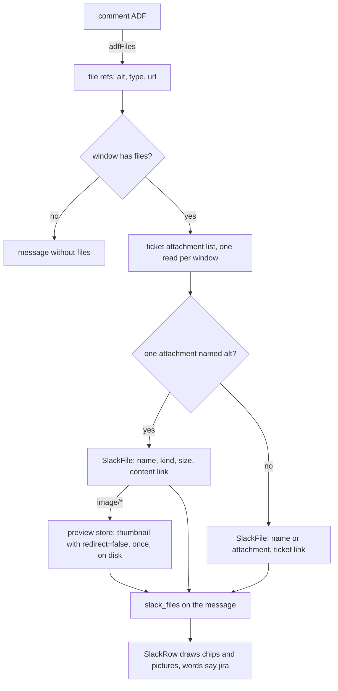

# Jira comment files - Plan

Plan 092 · follows plan 091 (Jira comments drawn as Slack messages) and plan 080 (Slack files)

---

## Goal Capsule

- **Objective:** A file shared in a Jira comment is visible and openable on its card. Its name, kind and size show under
  the comment, a picture shows as itself, and pressing it opens the file on the Jira site, as a Slack message's files
  do.
- **Means:** the comment's file nodes are matched to the ticket's attachment list on the home Mac, then drawn by the
  Slack card's file chips and previews (KTD1, KTD4).
- **Authority:** this plan's Requirements, then its KTDs, then the units. Plan 080's file chips and preview store are
  reused, not redesigned.
- **Stop conditions:** stop and ask if Jira's attachment list or thumbnail endpoint behaves unlike the research below on
  a real site (redirects with no `redirect=false`, thumbnails not images), or if reusing the Slack preview store needs a
  change to how saved pictures are named or served.
- **Execution profile:** one branch, one PR, units in order. The person raises and merges the PR.

---

## Product Contract

### Summary

On the desktop, each file in a Jira comment shows under that comment as Slack's file chip, with name, kind and size, and
pressing it opens the file on the Jira site. A picture shows as a preview, fetched once by the account's Mac and kept
with the Slack thumbnails. The plain text names the file instead of "[attachment]", so the phone, a hand-off and the
card's lines name it too.

### Problem Frame

Plan 091 drew a Jira card's comments as Slack messages but left a comment's files as the words "[attachment]". In Jira
the most common comment file is a pasted screenshot, so a comment that is only a picture reads as "[attachment]" and the
person must open Jira to see what was shared. Slack's files already show on its cards as chips and pictures (plan 080),
so a Jira card falls short of the Slack card it now looks like.

### Requirements

**Files on the desktop card**

- R1. Each file in a Jira comment shows under the comment as a chip with its name, its kind (from its type, as "PNG" or
  "PDF") and its size, in the comment's place among Slack-style rows.
- R2. Pressing a chip opens the file on the Jira site in the browser, where the person's own Jira sign-in reaches it.
  loki downloads no file except a picture's thumbnail (R4).
- R3. A file that cannot be matched to one of the ticket's attachments still shows as a chip with its name (or
  "attachment" when it has none) and opens the ticket instead.
- R4. A picture shows as itself, fitted into 360 by 240 pixels with its name under it, as a Slack picture does. A
  picture whose thumbnail cannot be had stays a chip.
- R5. Chips and pictures on a Jira card say "jira" where Slack's say "Slack" ("open shot.png in jira").

**Plain text**

- R6. A comment's plain text names each file as `file: <name>` on its own line, as a Slack message's does, so the phone,
  a hand-off and the card's last lines name a comment that is only a file. A file with no name reads `file: attachment`.

**Safety**

- R7. Fetching a thumbnail sends the Jira token only to the account's own Jira site and never follows a redirect to
  another host. A refused or failed thumbnail never marks the account signed out.

### Key Decisions

- **Previews included.** The person chose chips and pictures over chips alone, accepting that the Mac fetches each
  picture's thumbnail once with the Jira token. Governs R4, R7.
- **Open in the browser, not in loki.** As with Slack, the file lives where the person's own sign-in reaches it. Governs
  R2.

### Scope Boundaries

- Files attached to the ticket but not referenced in any comment are not shown.
- Files in the ticket's description keep "[attachment]" in the description text.
- The phone shows no chips or pictures, as for Slack. It gets the plain-text names (R6).
- Sending a file from loki's comment box is not built.
- **Considered and not built:** matching a file by its Jira media id through the attachment content endpoint's redirect.
  It is undocumented and costs a request per file. Name matching (KTD1) covers the usual case. Build it only if
  duplicate names prove common on real tickets.
- **Considered and not built:** pruning old thumbnails. Slack's previews have no pruning either (plan 080, Decision 4).
  One shared pruning step belongs to its own plan.

### Success Criteria

- A comment that is only a pasted screenshot shows the screenshot on the desktop card and reads `file: <name>` on the
  phone.

### Sources / Research

- Slack files end to end: `core/frame-types.ts` (`SlackFile`), `mod/slack-markup.ts` (`slackFileParts`, `filePlain`),
  `mod/slack-view.ts` (`withPreviews`), `mod/slack.ts` (`fileThumb`), `mod/slack-previews.ts`,
  `app/src/desk/slack-thread.tsx` (`SlackFiles`, `SlackPreview`), `mod/index.ts` wiring.
- `SlackRow` already draws `m.slack_files` for Jira rows, and `mod/outside-threads.ts` passes `slack_files` through for
  any provider.
- Jira REST v3: an ADF `media` node's `id` is a Media Services id, not the REST attachment id. No documented endpoint
  maps one to the other. `attrs.alt` usually holds the file name (Atlassian community; JRACLOUD-96384 is open).
  `GET /rest/api/3/attachment/thumbnail/{id}?redirect=false` returns the image bytes; without `redirect=false` it
  answers 303 to a media host with a token in the URL. `/rest/api/3/attachment/content/{id}` opens in a signed-in
  browser; `/secure/attachment/...` is deprecated.

---

## Planning Contract

### Key Technical Decisions

- KTD1. **Match by file name.** A comment's file node is matched to the ticket attachment whose filename equals the
  node's `alt`, when exactly one attachment has that name. No `alt`, no match, or two attachments with the name leave
  the file unmatched (R3). Media ids cannot be mapped without an undocumented call (Scope Boundaries).
- KTD2. **The attachment list is read only when a window has a file.** When any comment in the window being drawn has a
  file node, the home Mac reads the ticket's attachment list once (`GET /rest/api/3/issue/{key}?fields=attachment`).
  This covers the opening read, loads of earlier comments and the older merged log alike. A window without files costs
  no extra request. A failed read leaves every file unmatched rather than failing the card.
- KTD3. **Thumbnails fetched with `redirect=false` and `redirect: "manual"`.** The Jira client gets a binary read of its
  own for `https://<site>/rest/api/3/attachment/thumbnail/<id>?redirect=false`, built from the attachment id, never from
  a URL Jira gave. It keeps an answer only when it is a 2xx `image/*` of at most 1 MB. A 3xx, a refusal or a 401 yields
  no thumbnail and does not mark the account rejected (R7). It honours the client's rate-limit hold. Only attachments
  whose `mimeType` is `image/*` are asked for.
- KTD4. **One preview store for both providers.** The store in `mod/slack-previews.ts` moves to
  `mod/outside-previews.ts` and gains a provider-neutral key and an extension supplied by its caller, so Jira thumbnails
  are named `sha256("jira:<account>:<attachment id>")` and saved in `~/.loki/chat-images/` beside Slack's, served by the
  same route. The extension comes from the answer's content type, with `jpeg` written as `jpg`, because Jira's thumbnail
  address has none and the served names allow only `png|jpg|gif|webp|heic`.
- KTD5. **Links.** A matched file opens `https://<site>/rest/api/3/attachment/content/<id>`, on the Atlassian site even
  when the account has a custom `link_host`, because the REST path is served there. An unmatched file opens the ticket
  (`jiraTicketUrl`, which honours `link_host`). An `external` media node opens its own `url` when it is `https://`.
- KTD6. **Files leave the comment's blocks.** A `media` node no longer draws as text in `body`. Its file goes in the
  comment's `slack_files`, under the comment as Slack draws them. A `mediaSingle` caption stays as text. The plain text
  writes `file: <name>` (R6) where "[attachment]" was.
- KTD7. **The Slack file type is reused as-is.** Jira files ride on `OutsideMessage.slack_files` with the existing
  `SlackFile` shape. Only its doc comment widens, as plan 091 did for `body`. The app learns the provider word through
  the `jira` flag `SlackThread` already has.

### High-Level Technical Design



### Risks

- Jira's thumbnail endpoint behaviour comes from community answers and a docs mirror, not a live site. If
  `redirect=false` still redirects, every picture stays a chip. That is the safe failure (R4), and the stop condition in
  the Goal Capsule asks for a check on a real ticket.
- `alt` may be missing on files pasted by some clients or apps. Those files fall back to ticket chips (R3).

---

## Implementation Units

### U1. File nodes in Jira's document

- **Goal:** read a comment's files from its document, write them as `file: <name>` in plain text, and drop them from the
  drawn blocks.
- **Requirements:** R6; KTD6.
- **Dependencies:** none.
- **Files:** `mod/jira-text.ts`, `test/jira-text.test.ts`.
- **Approach:**
  1. Add a reader that lists a document's file nodes in order: `media` (with `alt`, `type`, and `url` for `external`)
     and `mediaInline`, inside `mediaSingle` or `mediaGroup`.
  2. `adfText` writes `file: <alt>` (or `file: attachment`) for each, each on its own line.
  3. `adfBlocks` draws no block for a media node and keeps a `mediaSingle` caption as a text block.
- **Patterns to follow:** `filePlain` in `mod/slack-markup.ts`; the existing `adfText`/`adfBlocks` walkers.
- **Test scenarios:**
  - A comment that is only a `mediaSingle` with `alt: "shot.png"` lists one file and reads `file: shot.png`.
  - A `mediaGroup` of two files lists both in order and reads two lines.
  - A media node without `alt` reads `file: attachment`.
  - An `external` media node carries its `url`.
  - Words, then a picture, then words: the blocks hold the two paragraphs and no "[attachment]"; the text has the file
    line between them.
  - A `mediaSingle` with a caption keeps the caption's words as a block.
  - Mentions in the same document are still collected.
- **Verification:** no "[attachment]" remains for a node with a name, in text or blocks.

### U2. The Jira client reads attachments and thumbnails

- **Goal:** read a ticket's attachment list and fetch one picture's thumbnail safely.
- **Requirements:** R7; KTD2, KTD3.
- **Dependencies:** none.
- **Files:** `mod/jira.ts`, `test/fixtures/jira.ts`, `test/jira.test.ts`.
- **Approach:**
  1. `attachments(ticket)` reads `fields=attachment` and returns each one's id, filename, mimeType and size, skipping
     malformed entries.
  2. `thumbnail(id)` asks the KTD3 address with the account's basic auth, `redirect: "manual"`, the client's timeout and
     rate-limit hold, and returns `{ data, type }` or null. It never calls the rejected path.
  3. The fake gains attachments on a ticket, the issue's `attachment` field, a thumbnail route that answers bytes with
     an image type, and a switch to answer 303, 401 or a non-image.
- **Patterns to follow:** `SlackClient.fileThumb` in `mod/slack.ts` (type check, 1 MB cap, no sign-out); `request()` in
  `mod/jira.ts` for auth and holds.
- **Test scenarios:**
  - The attachment list returns id, name, type and size for each attachment, and nothing for a ticket without any.
  - A thumbnail answers the bytes and type for a 200 `image/png`.
  - The request goes to the account's site with `redirect=false` and basic auth, and to no other host.
  - A 303 answer gives no thumbnail, and nothing is asked of the redirect's host.
  - A 401 gives no thumbnail and the account stays connected.
  - A non-image answer or one over 1 MB gives none.
  - While the client is rate-limited, no thumbnail request is sent.
- **Verification:** `test/jira.test.ts` proves the token reaches only the site.

### U3. One preview store for Slack and Jira

- **Goal:** let the store that saves Slack thumbnails save Jira's too.
- **Requirements:** R4; KTD4.
- **Dependencies:** none.
- **Files:** `mod/slack-previews.ts` renamed to `mod/outside-previews.ts` (it now serves two providers), `mod/index.ts`,
  `test/slack-previews.test.ts` renamed to `test/outside-previews.test.ts`.
- **Approach:** the store takes a key (provider, account, thing) and a fetch that returns bytes plus their content type,
  and names the file from the key with the extension from the type (`image/jpeg` → `jpg`). Slack keeps its names, so
  saved Slack thumbnails are still found. The log key loses "slack".
- **Patterns to follow:** the existing store's once-only fetch, pending map and atomic write.
- **Test scenarios:**
  - A Slack thumbnail is still named exactly as before for the same account and address, so one saved earlier is found
    without a fetch.
  - A Jira thumbnail answered as `image/jpeg` is saved as a `.jpg` name matching the served-name pattern.
  - An answer with an image type outside the served set gives no preview.
  - Two reads of one Jira picture fetch once.
  - The same attachment id on two accounts saves two files.
- **Verification:** existing Slack preview tests pass unchanged apart from the store's new construction.

### U4. A Jira card's comments carry their files

- **Goal:** the card view matches files to attachments and puts them on each comment's message.
- **Requirements:** R1, R2, R3, R4; KTD1, KTD2, KTD5, KTD7.
- **Dependencies:** U1, U2, U3.
- **Files:** `mod/jira-view.ts`, `mod/index.ts`, `core/frame-types.ts` (doc comments only), `test/jira-view.test.ts`,
  `test/outside-threads.test.ts`.
- **Approach:**
  1. `jiraCardView` takes a `preview` function as the Slack view does, wired in `mod/index.ts` to the shared store and
     the client's `thumbnail`.
  2. When the window's comments hold any file node, it reads the attachment list once (KTD2).
  3. `commentLook` adds `slack_files`: the name, a kind from the type's subtype in capitals, the size, the link (KTD5),
     and a preview for a matched picture.
  4. The merged log's comments get the same.
- **Patterns to follow:** `withPreviews` in `mod/slack-view.ts`; `jiraTicketUrl` for the ticket link.
- **Test scenarios:**
  - A comment with `alt: "shot.png"` on a ticket with one `shot.png` attachment (image/png, 48 KB) carries a file named
    `shot.png`, kind `PNG`, size 48000, link to `/rest/api/3/attachment/content/<id>` on the site, and a preview.
  - A PDF is matched with no preview asked for.
  - Two attachments named `shot.png`: the file is unmatched and links to the ticket's browse address on `link_host` when
    set.
  - A window without files makes no attachment-list request.
  - A failed attachment-list read leaves the comment's files as ticket chips and the card still reads.
  - A load of earlier comments with a file reads the list and matches it.
  - The comment's `text` reads `file: shot.png`, and the hand-off text names it.
  - The message reaches the app's thread with its `slack_files` (`test/outside-threads.test.ts`).
- **Verification:** a ticket whose only comment is a screenshot gives a message with one file and a preview.

### U5. The app's words for Jira files

- **Goal:** chips and pictures on a Jira card say "jira".
- **Requirements:** R1, R4, R5; KTD7.
- **Dependencies:** U4 for the end-to-end render, though the change itself stands alone.
- **Files:** `app/src/desk/slack-thread.tsx`, `test/outside-threads.test.ts`, `test/slack-view.test.ts`.
- **Approach:** `SlackFiles` and `SlackPreview` take the provider word from `SlackRow`'s `jira` flag ("jira", lowercase
  on the desktop; "Slack" unchanged). The no-link wording follows the same word.
- **Patterns to follow:** `SlackRow`'s existing `jira` gates.
- **Test scenarios:**
  - A Jira card's comment with a PDF draws a chip titled `open report.pdf in jira`, with its kind and size.
  - A Jira picture draws the preview image and its name, and its press title says jira.
  - A Slack card's chip still says `open invoice.pdf in Slack`.
- **Verification:** no "in Slack" appears on a Jira card's render.

### U6. Manual and security notes

- **Goal:** say what the person sees and what loki fetches.
- **Requirements:** R2, R4, R7.
- **Dependencies:** U4.
- **Files:** `docs/manual.md`, `docs/SECURITY.md`.
- **Approach:** the Jira comments item in the manual gains a sentence on files and pictures. SECURITY.md's list of what
  loki reads from Jira gains each ticket's attachment list and picture thumbnails, fetched once and kept with the Slack
  thumbnails, with no redirect followed.
- **Test expectation:** none, documentation only.
- **Verification:** both documents name the new reads.

---

## Verification Contract

Run with CI's toolchain (newest Node 22, npm 10, `SHELL=/bin/bash`), all passing:

```bash
npm run format:check && npm run lint && npm run typecheck && npm test && npm run test:node
npm run build:app && npm run build:mod && npm run smoke
```

The tests named in each unit prove the plan. By hand: a preview from the real components with made-up data, desktop
light and dark, showing a comment with a picture and one with a PDF. A check against a real Jira ticket with a pasted
screenshot is the person's, and it settles the Risks above.

---

## Definition of Done

- Every unit's test scenarios exist and pass, and every check above passes.
- No "[attachment]" remains for a named file in a Jira comment's text or blocks.
- A Jira card never shows "in Slack".
- `docs/manual.md` and `docs/SECURITY.md` describe the files and the thumbnail fetch.
- No abandoned-attempt code is left in the diff.
