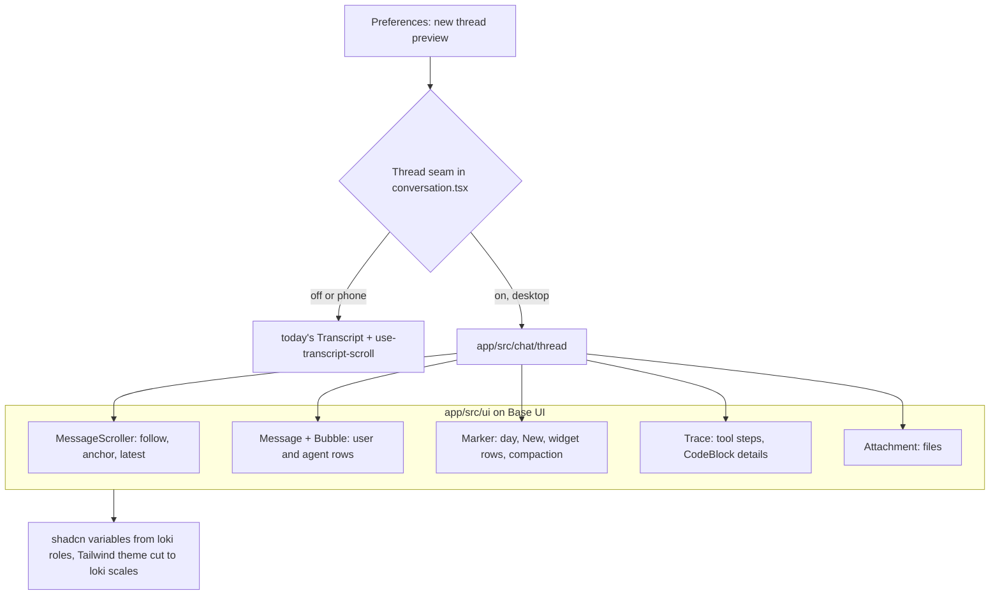

# shadcn foundation and the thread on it - Plan

Plan 094 · first step of the component overhaul in `docs/research/2026-11-11-design-language.md`, on the choices in
`docs/research/2026-11-11-shadcn-inventory.md` · replaces, for the desktop thread, the Slack anatomy of plans 012 and 013

---

## Goal Capsule

- **Objective:** loki gains shadcn/ui on Base UI as its component library, wired to loki's tokens and rules, and the
  desktop thread is rebuilt on shadcn's chat components behind a preference, so the person can switch between the old
  thread and the new one on real chats.
- **Means:** shadcn's source in `app/src/ui/` under a new `@/` alias (KTD1), shadcn's variables defined from loki's roles
  (KTD3), Tailwind's theme cut to loki's scales (KTD4), and a second thread that composes MessageScroller, Message,
  Bubble, Marker, Trace, Attachment and CodeBlock (KTD7).
- **Authority:** this plan's Requirements, then its KTDs, then the units. The research notes are background, not
  requirements.
- **Stop conditions:** stop and ask if (1) `shadcn init` wants to replace `app/src/styles.css` or `tokens.css` wholesale
  rather than add to them; (2) a shadcn chat component cannot keep a behaviour R6 lists without forking it beyond
  styling; (3) the new thread redraws more than the old one on the render measurement (Verification), or the app's
  JavaScript grows by more than 120 KB gzipped; (4) before U6, the person has not yet picked an anatomy on the rendered
  U5 result. Condition (3)'s weight was met on 2026-11-11, when the thread moved to Vercel's AI Elements: the shared
  chunk grew 296 → 408 KB gzipped, mostly streamdown, +158 KB JavaScript in all. The person chose to accept it over
  drawing markdown with loki's own renderer.
- **Execution profile:** one branch (`feat/shadcn-thread`) in its own worktree off fresh `main`, units in order, one PR
  the person raises and merges. Each unit lands as its own commit, so a unit can be reverted alone.

---

## Product Contract

### Summary

A preference, "new thread (preview)", swaps the desktop chat's message list for one built on shadcn. Everything else
in the chat (header, composer, approval and question cards, Canvas) stays as it is. The new thread starts in shadcn's
own chat anatomy on loki's colours and type; after the person has used it, one anatomy pass shapes it toward the
direction they pick from the example pages (Turns, Console or Briefing).

### Problem Frame

The person wants a component-level overhaul with a library of loki's own, and chose shadcn on Base UI as its root.
loki's thread is the most hand-built surface: about 1,700 lines across `transcript.tsx`, `conversation.tsx`,
`use-transcript-scroll.ts`, `tool-steps.tsx` and a 2,310-line `chat.css`, with its own scroll following, anchoring and
windowing. shadcn's chat components cover much of that, so the thread is where the library proves itself first. The
2026-10-18 redesign failed by changing everything at once from descriptions; this plan changes one surface, behind a
switch, and decides its look on the rendered result.

### Requirements

**Foundation**

- R1. shadcn/ui is set up on the Base UI base with Lucide icons, its source in `app/src/ui/`, importable as
  `@/ui/<component>`; `npm run lint`, `typecheck`, `test` and both builds pass with it in place.
- R2. shadcn's colour variables follow loki's: day and night, both palettes (loki's own and Tokyo Night) and the phone's
  scope, switched by loki's existing `data-theme` and `data-palette` with no `.dark` class. Every foreground and
  background pair shadcn uses meets AA on both sides of both palettes.
- R3. loki's own source uses only loki's scales through Tailwind: its colours, radii, type sizes, shadows and layers by
  name, and the tokens test fails anything else. Tailwind's defaults stay for the agents' widgets (KTD4).
- R4. shadcn's components follow loki's rules for focus (the flash that settles), motion (transform and opacity, nothing
  animated from the keyboard, short fades under reduced motion), layers (`LAYER`) and hover (pointer only).

**The new thread**

- R5. Preferences gains "new thread (preview)", off by default, saved per Mac. On, the desktop chat pane and the Flow
  card draw their messages with the new thread; off, they draw today's. Switching needs no restart and keeps the draft,
  the scroll position's message and the open chat.
- R6. The new thread keeps every behaviour of today's: follows the bottom only while the reader is there; the "latest"
  button with the count of what is new; loads older pages at the top with the message being read held in place; holds
  the message being read when something above it changes height; the day markers, the "New" line before the first
  unseen message, widget rows with the live widget under the latest one, compaction markers; tool steps as one closed
  line with failed steps named under it, opening into the full list with filters past 8 steps and each step's detail;
  copy as markdown on each message; a streaming reply's words fading in and arriving rows rising; "thinking" while the
  agent works; queued messages with cancel; an error with retry; a failed older load with retry; find (⌘F) reaching
  every message.
- R7. The new thread's words on screen follow loki's rules (lowercase desktop controls, sentence-case headings, no
  exclamation marks) and its icons are Lucide.
- R8. The phone, and every other surface, is unchanged by this plan.

### Key Decisions (the person's, 2026-11-11)

- **shadcn/ui as the root library, on Base UI, not Radix.** Governs R1, KTD1, KTD6.
- **Lucide icons.** loki's own icon set retires surface by surface. Governs R7.
- **The shadcn folder is exempt from the doc-comment rule,** so upstream updates diff and merge cleanly. Governs KTD2.
- **The thread moves first.** Governs scope.
- **The thread's pieces are Vercel's AI Elements** (Message, MessageResponse, MessageActions, ChainOfThought), on top of
  shadcn, with streamdown drawing the agent's markdown; the bundle weight that brings is accepted (2026-11-11).
- **Phone bottom sheets take shadcn's Drawer as it is.** Not in this plan (R8); recorded here so the phone's plan
  inherits it.

### Scope Boundaries

- The composer, model picker, permission mode, approval, question and suggestion cards stay as they are, drawn around
  the new thread. Each moves in a later plan.
- The phone's thread stays on today's code (R8); it moves with the phone's own plan, which also brings Drawer.
- Toasts stay on Sonner until `Notices` moves; shadcn's Base UI toast arrives then.
- The sidebar, Flow's deck chrome, Agents, Learn, Preferences' own pages and the shell are not touched beyond the one
  preference row.
- Retiring today's thread is not done here. It goes once the person has used the new one and says so, in its own
  change.
- **Considered and not built:** porting today's Slack anatomy onto shadcn first, then redesigning. It would build one
  anatomy only to throw it away; shadcn's stock anatomy is the neutral start instead.

### Success Criteria

- With the preference on, the person reads, scrolls, finds, opens tool steps and loads history on a long real chat with
  nothing missing that today's thread does.
- The person picks an anatomy on the rendered new thread, and U6 lands it.

### Sources / Research

- `docs/research/2026-11-11-shadcn-inventory.md`: the inventory, the fit table and the rule clashes this plan resolves.
- `docs/research/2026-11-11-design-language.md`: the overhaul, the lessons from 2026-10-18, the process.
- The example pages artifact (Turns, Console, Briefing) for U6's choice.
- shadcn: the `@shadcn` registry lists `message`, `message-scroller` and `marker`; `trace` and `code-block` have Base UI
  docs at `ui.shadcn.com/docs/components/base/<name>`. The chat components are new in shadcn and their API may move.
- Today's thread: `app/src/chat/transcript.tsx`, `conversation.tsx` (`Thread`), `use-transcript-scroll.ts`,
  `transcript-window.ts`, `tool-steps.tsx`, `find-bar.tsx`, `use-inline-widgets.tsx`, `chat.css`.

---

## Planning Contract

### Key Technical Decisions

- KTD1. **Where shadcn lives.** `components.json` at the repo root: style on the Base UI base, icon library `lucide`,
  CSS `app/src/styles.css`, aliases `@/ui` → `app/src/ui`, `@/lib/utils` → `app/src/lib/utils.ts` (`cn()`), hooks
  `@/hooks` → `app/src/hooks`. `@/*` → `app/src/*` is added to `tsconfig.json` and `app/vite.config.ts`. Nothing of
  shadcn goes under `@loki/kit`, which stays the agents' widget kit.
- KTD2. **Lint and format.** The jsdoc rule's `ignores` gains `app/src/ui/**`; every other rule (no `any`, no `x!`, no
  floating promises, named exports) still applies, and a file that breaks one is fixed in place. Prettier formats
  `app/src/ui/` like the rest. AGENTS.md and `docs/style.md` state the exemption and why.
- KTD3. **One set of roles, shadcn's names on top.** In `tokens.css`, shadcn's variables are defined once from loki's:
  `--background: var(--loki-bg)`, `--foreground: var(--loki-fg)`, `--card` and `--popover` from `--loki-panel`,
  `--primary` from `--loki-accent`, `--muted-foreground` from `--loki-muted`, `--destructive` from `--loki-negative`,
  `--border` from `--loki-border`, `--input` from `--loki-control-border`, `--ring` from `--loki-accent`, the
  `--sidebar-*` and `--chart-*` sets likewise, with `-foreground` pairs from the matching `--loki-on-*` or `--loki-fg`.
  Because they read loki's variables, every palette, side and the phone's scope follow with no second definition. A
  `@custom-variant dark` matches `[data-theme="dark"]`, so shadcn's few `dark:` classes work.
- KTD4. **The fence is the tokens test, not a stripped theme** (revised in U2). The agents' widgets are told
  "Tailwind classes work" and receive the app's stylesheet, so resetting Tailwind's default theme would break widgets
  already written. The defaults stay; `@theme inline` adds loki's names: shadcn's colours as KTD3, radii `sm 6 · md 8
  · lg 12` (and `xl` as 12, which shadcn's cards use), text `micro 9.5 · fine 10.5 · tag 11 · meta 12 · body 13.5 ·
  row 15 · card 17 · display 22 · hero 28`, shadows `sheet · float · panel · low`, the sans and mono faces, and
  `z-panel` … `z-toast` utilities from `LAYER`. `test/tokens.test.ts` then fails any string in loki's source that
  uses a default palette colour, a default text size, an arbitrary size, radius, layer or weight, a numbered layer,
  tracking, a weight other than 400 · 600 · 700, a default shadow or an off-scale radius. shadcn's component classes
  are rewritten to loki's names where they use others. Overriding `--radius-sm/md/lg/xl` and `--font-sans` does reach
  the widgets: their corners and face become loki's.
- KTD5. **shadcn's components bend to loki's rules on the way in.** Each added file is reviewed (the shadcn skill's
  review step) and changed for: focus (no `focus-visible:ring-*`; loki's global focus rule in `tokens.css` draws it),
  motion (overlay `animate-in`/`animate-out` keyframes take loki's spring curves and durations; nothing animates when
  opened by a key, read from a `data-keyboard` attribute the shell already knows how to set), layers (`z-50` becomes the
  matching `--z-*`), tracking and uppercase (removed). These are local edits to shadcn source, which is ours by design.
- KTD6. **Base UI conventions.** Triggers and closes take `render={<Button />}`; a `render` to a non-button adds
  `nativeButton={false}`. `tw-animate-css` is kept only if KTD5's spring rewrite can sit on its classes; otherwise
  loki's own keyframes in `styles.css` replace it.
- KTD7. **The new thread is a second implementation, chosen at one seam.** `Thread` in `conversation.tsx` is the seam:
  it renders today's `Transcript` or the new `app/src/chat/thread/` (`thread.tsx`, `thread-row.tsx`, `thread-steps.tsx`,
  `thread-markers.tsx`) by the preference. Both take the same props (rows, status, older, loadFailed, cancel, retry), so
  the chat pane and the Flow card switch together and the phone, which renders `Thread` too, is pinned to today's by a
  prop until its own plan.
- KTD8. **Scrolling moves to MessageScroller.** Following, anchoring and jump-to-latest come from MessageScroller;
  loading older pages and the mounted window (`transcript-window.ts`) are kept by feeding MessageScroller's top-reached
  and anchor hooks, not by a second scroll handler. If MessageScroller cannot hold the message being read while older
  rows arrive, that is stop condition (2).
- KTD9. **Tool steps on Trace.** One Trace per stretch of work between two messages, the closed line ("worked 14 min ·
  10 background tasks, 3 commands, 11 tools · 1 failed") as its summary, a TraceLine per step, TraceCollapsible for a
  step's detail with CodeBlock for commands and output. The filter row past 8 steps is a ToggleGroup. The wording comes
  from `shared/tool-steps.ts`, unchanged.
- KTD10. **The preference** is a saved app setting beside the others in Preferences' layout page (`settings/layout.tsx`),
  read through the existing settings hook, never a build flag, so it can ship in a nightly and be turned off.

### High-Level Technical Design



### Risks

- shadcn's chat components are new; their API may change between CLI versions. The CLI's `--diff` keeps updates
  mergeable, and KTD2 keeps the files close to upstream.
- Tailwind v4 targets Safari 16.4 (macOS 13.3). U1 raises loki's floor from 13.0 to 13.3; a person on 13.0 to 13.2
  would need to update macOS.
- Base UI and the React Compiler: both are recent; a component that misbehaves under the compiler takes the compiler's
  `"use no memo"` opt-out with a comment saying why.
- MessageScroller and loki's windowing (KTD8) may not fit; stop condition (2) names the way out.
- Weight: Base UI, Lucide and the utilities add JavaScript and CSS. Stop condition (3) sets the limit.

---

## Implementation Units

### U1. Set up shadcn

- **Goal:** shadcn on Base UI with Lucide, under `@/ui`, with every check passing and no visible change.
- **Requirements:** R1; KTD1, KTD2, KTD6.
- **Dependencies:** none.
- **Files:** `components.json`, `tsconfig.json`, `app/vite.config.ts`, `app/src/lib/utils.ts`, `app/src/styles.css`,
  `package.json`, `package-lock.json`, `eslint.config.mjs`, `AGENTS.md`, `docs/style.md`,
  `src-tauri/tauri.conf.json` (macOS floor 13.3).
- **Approach:**
  1. Pull `main` into the worktree first.
  2. `npx shadcn@latest init` with the Base UI base and Lucide, reviewing the CSS it writes against the stop condition;
     keep loki's imports and `@theme inline` block.
  3. Add the `@/*` alias to TypeScript and Vite; `cn()` in `app/src/lib/utils.ts` with its doc comment.
  4. Exempt `app/src/ui/**` from the jsdoc rule; write the exemption into AGENTS.md and `docs/style.md`.
  5. Raise `minimumSystemVersion` to 13.3 and run the cargo checks CONTRIBUTING lists.
- **Patterns to follow:** the shadcn skill's `cli.md`; existing alias `@loki/kit` for how paths are declared.
- **Test scenarios:**
  - `npm run build:app` succeeds and the built app renders as before (smoke).
  - A file under `app/src/ui/` without doc comments passes lint; one elsewhere still fails.
- **Verification:** every check in the Verification Contract passes; the app looks unchanged.

### U2. loki's tokens behind shadcn's names, and the theme fence

- **Goal:** shadcn's variables read loki's roles in every palette and side; Tailwind knows only loki's scales.
- **Requirements:** R2, R3; KTD3, KTD4.
- **Dependencies:** U1.
- **Files:** `app/src/kit/tokens.css`, `app/src/styles.css`, `app/src/phone/phone.css` (only if a phone role is missing
  a shadcn pair), `test/tokens.test.ts`.
- **Approach:**
  1. Define shadcn's variables from loki's in `tokens.css` (KTD3); the dark variant on `data-theme`.
  2. Reset Tailwind's defaults and declare loki's scales and layers in `@theme` (KTD4).
  3. Extend `test/tokens.test.ts`: every shadcn variable is defined; each shadcn foreground/background pair meets AA in
     both palettes and sides (the test's existing contrast helper); the theme has no default palette left; no
     `tracking-`, `uppercase` or off-scale arbitrary value (`text-[13px]`, `rounded-[5px]`, `z-[…]`) in any class string
     under `app/src`.
- **Patterns to follow:** the existing palette and AA checks in `test/tokens.test.ts`.
- **Test scenarios:**
  - `--primary` resolves to the accent and `--primary-foreground` meets AA on it, in loki's and Tokyo Night's day and
    night.
  - A class `bg-blue-500` in a test fixture string is reported; `bg-primary` is not.
  - A class `text-[13px]` is reported; `text-base` is not.
- **Verification:** the tokens test passes with the new checks; no visible change.

### U3. Add the components the thread needs, bent to loki's rules

- **Goal:** the shadcn components for the thread, each reviewed and adapted.
- **Requirements:** R4, R7; KTD5, KTD6.
- **Dependencies:** U2.
- **Files:** `app/src/ui/` (message-scroller, message, bubble, marker, trace, attachment, code-block, button, badge,
  card, toggle-group, tooltip, spinner, kbd, and what they pull in), `app/src/styles.css` (keyframes if KTD6 needs them).
- **Approach:**
  1. `npx shadcn@latest add` the list; read every added file (the skill's review step).
  2. Apply KTD5 to each: focus, motion, layers, tracking; rewrite class names to the KTD4 scale.
  3. Fix anything the repo's lint rules other than jsdoc refuse.
- **Patterns to follow:** the shadcn skill's critical rules (`gap-*` not `space-*`, `size-*`, `data-icon`, `cn()`).
- **Test scenarios:**
  - A button opened menu, opened by a key, shows no motion; opened by a click, it grows on loki's spring.
  - Under reduced motion, an overlay fades in 150 ms with no movement.
  - Tab onto a Button shows loki's flash and settles on the muted ring.
- **Verification:** lint, typecheck, tokens test pass; a scratch render of each component in day and night looks right.

### U4. The preference and the seam

- **Goal:** "new thread (preview)" switches the desktop thread between two implementations.
- **Requirements:** R5, R8; KTD7, KTD10.
- **Dependencies:** U1.
- **Files:** `app/src/settings/layout.tsx`, the settings store it saves through, `app/src/chat/conversation.tsx`,
  `app/src/phone/inbox.tsx` (pin to today's), `app/src/chat/thread/thread.tsx` (a stub that renders today's until U5),
  tests beside them.
- **Approach:** add the setting with its row ("new thread (preview)", help: "try the thread on loki's new components;
  turn it off to go back"); branch in `Thread` on it; the phone passes a prop that always picks today's.
- **Test scenarios:**
  - Off by default; on, the chat pane renders the new thread's root; off again, today's, with the draft kept.
  - The phone's thread renders today's whatever the setting says.
- **Verification:** the switch works on a running app with the stub.

### U5. The thread on shadcn

- **Goal:** the new thread, in shadcn's stock anatomy on loki's tokens, with every behaviour of today's.
- **Requirements:** R6, R7; KTD7, KTD8, KTD9.
- **Dependencies:** U3, U4.
- **Files:** `app/src/chat/thread/thread.tsx`, `thread-row.tsx`, `thread-steps.tsx`, `thread-markers.tsx`, tests in
  `test/` beside today's transcript tests; helpers shared with today's thread (`runStarts`, `useArrivedFrom`,
  `rehypeWords`, `suggestedSource`, `transcript-window.ts`) are imported, not copied.
- **Approach:**
  1. MessageScroller around the rows, wired to `older`, the window and find (KTD8).
  2. Message and Bubble for the user's and the agent's rows, with copy as markdown; markdown rendering and the word
     fade reuse today's pipeline.
  3. Marker for the day, the "New" line, widget rows, compaction; the live widget card under a widget's latest row.
  4. Trace for each stretch of work (KTD9).
  5. Attachment for files; thinking, queued with cancel, error with retry, failed older load with retry.
- **Patterns to follow:** today's `Transcript` for every behaviour in R6; the shadcn skill's `rules/chat.md`.
- **Test scenarios:**
  - Rows of a fixture conversation render as messages with the right speaker, and a widget row as a marker with the
    widget under its latest row.
  - A stretch with 3 commands and a failed step renders one closed line naming the failure; opening it lists the steps;
    past 8 steps the filters appear and "Failed" shows only the failed step.
  - Scrolled up, a new streamed row does not move the message being read, and the latest button shows a count of 1.
  - Reaching the top calls `older` once; the rows it adds keep the message being read in place.
  - The "New" line sits before the first unseen message.
  - Find for a word in a message outside the mounted window reveals and selects it.
  - A queued message shows cancel; pressing it calls `onCancelQueued` with its text.
- **Verification:** with the preference on, a long real chat reads with nothing missing (R6's list checked by hand);
  the render measurement and bundle check (Verification Contract) are within stop condition (3).

### U6. The anatomy pass

- **Goal:** the new thread takes the anatomy the person picks on the rendered U5 result.
- **Requirements:** R6, R7; the person's pick.
- **Dependencies:** U5 and the person's choice (stop condition 4).
- **Files:** `app/src/chat/thread/*`, `app/src/ui/message.tsx`, `bubble.tsx`, `trace.tsx` (variants, not forks).
- **Approach:** show the person U5 on the demo daemons (made-up chats), day and night, next to the example pages; apply
  the chosen direction (Turns, Console, Briefing, or a mix they name) as variants of the shadcn components; show again
  and adjust once.
- **Test scenarios:** the U5 scenarios still pass; any new structure (a turn header, a status pill) has its own.
- **Verification:** the person says yes on the rendered result.

### U7. Docs

- **Goal:** the design spec, the manual and the architecture say what changed.
- **Requirements:** R1–R7.
- **Dependencies:** U6.
- **Files:** `docs/design.md`, `docs/manual.md`, `docs/architecture.md`, `glossary.md` if a word is new.
- **Approach:** `docs/design.md` gains the shadcn foundation (Base UI, Lucide, the theme fence, how components bend to
  loki's rules) and the new thread's anatomy, with the Slack thread anatomy under "Tried and dropped" once it retires;
  the manual gains the preference; the architecture gains `app/src/ui/`, `@/` and the thread seam.
- **Test expectation:** none, documentation only.
- **Verification:** each document names what it should.

---

## Verification Contract

Run with CI's toolchain (newest Node 22, npm 10, `SHELL=/bin/bash`), all passing:

```bash
npm run format:check && npm run lint && npm run typecheck && npm test && npm run test:node
npm run build:app && npm run build:mod && npm run smoke
```

And the cargo lines in `docs/CONTRIBUTING.md` for U1's `src-tauri` change.

By hand:

1. **Rendered review:** the new thread on the two demo daemons with made-up chats, desktop day and night, both palettes;
   screenshots in the PR. Never real chats.
2. **Render measurement:** the redraw count of today's thread and the new one on the same scripted session (throwaway
   daemon, fake ACP engine, `chat_model` set before the first message), within stop condition (3).
3. **Weight:** `build:app` output sizes before U1 and after U5, gzipped, in the PR.
4. **Windows:** the PR's CI on Windows read before calling it done.

---

## Definition of Done

- Every unit's test scenarios exist and pass, and every check above passes.
- With the preference off, the app is unchanged; with it on, the desktop thread is the new one with every R6 behaviour.
- The phone is unchanged.
- No shadcn file uses a colour, radius, size, tracking or layer off loki's scales, and the tokens test proves it.
- `docs/design.md`, `docs/manual.md` and `docs/architecture.md` describe the foundation, the preference and the seam.
- No abandoned-attempt code is left in the diff.
