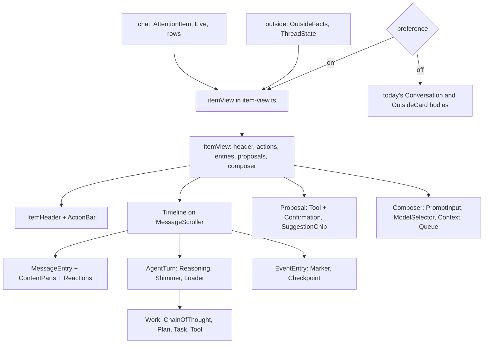

# The chat pane as one item, on AI Elements - Plan

Plan 097 · second step of the component overhaul in `docs/research/2026-11-11-design-language.md`, building on plan 096
(shadcn and the new thread) · replaces, for the desktop chat pane and Flow's cards, the Slack view and layout

---

## Goal Capsule

- **Objective:** the desktop chat pane draws every item (an agent chat, a Slack thread, an email, a Jira ticket) with
  one set of twelve components built on Vercel's AI Elements and shadcn, behind the preview preference plan 096 added,
  so the person reads and acts on all four the same way.
- **Means:** one pure adapter turns a chat or an outside thread into the same item view (KTD2); twelve components in
  `app/src/item/` draw it (KTD1); AI Elements supplies their pieces (KTD3); what loki has no data for yet is left out,
  not faked (KTD8).
- **Authority:** this plan's Requirements, then its KTDs, then the units. The item components page (a private artifact,
  2026-11-11) shows the intended look; it is reference, not requirement.
- **Stop conditions:** stop and ask if (1) the app's JavaScript grows by more than 80 KB gzipped over plan 096's build;
  (2) an AI Elements piece cannot keep a behaviour R9 or R12 lists without forking it beyond styling; (3) the new pane
  redraws more than today's on the render measurement; (4) a unit needs data the daemon or mod does not keep and this
  plan does not list in U9; (5) before U8, the person has not looked at U3–U7 rendered on the demo daemons. Condition
  (1) was met in U1 on 2026-11-11: every piece pulled in at once adds 113 KB gzipped (PromptInput alone 80 KB,
  ModelSelector 36 KB, the other fifteen 57 KB, sharing much). The person accepted 113 KB as the new cap.
- **Execution profile:** continues on `feat/shadcn-thread`, since plan 096 is not merged and the pane builds on its
  thread; units in order, each its own commit. The person decides when to raise the one PR.

---

## Product Contract

### Summary

The chat pane stops being a Slack thread with an agent in it. It becomes an **item**: a header saying what it is and
where it stands, a timeline of what happened, and one place to write. The same twelve components draw an agent chat,
a Slack thread, an email and a Jira ticket; each source fills the parts it has. The agent's work, its requests and its
drafts look the same wherever they come from.

### Problem Frame

loki now carries four kinds of thing: chats with agents, Slack threads, emails and Jira tickets. Each grew its own
view: `transcript.tsx` for chats, `slack-thread.tsx`, `mail-thread.tsx` and `jira-ticket.tsx` for outside cards, with
`approval-card.tsx`, `question-card.tsx`, `suggestion-card.tsx`, `reply-proposal-card.tsx` and `quick-replies.tsx`
around them, about 2,800 lines before `chat.css`. They share a look (Slack's) but not parts, so a reply drafted for Slack and an
approval in a chat are different things on screen, and every new source repeats the work. The person wants one
interface for all of them, built from AI Elements and the common features of Slack, email and Jira. Plan 096 proved
the pieces on the chat thread; this plan cuts the whole pane into components by capability and draws all four sources
with them.

### The twelve components

| #   | Component    | What it is                                                                                         |
| --- | ------------ | -------------------------------------------------------------------------------------------------- |
| 1   | ItemHeader   | One-line title, then properties as chips (editable ones open a menu), then flags when set         |
| 2   | ActionBar    | Under the box: the verb that finishes the item, named; the other moves before it, with their keys  |
| 3   | Brief        | The agent's read of the item, with citations to the entries it came from                          |
| 4   | Timeline     | Every entry in order, three kinds: message, agent turn, event                                      |
| 5   | MessageEntry | A message from a person or from you; yours is the block across the column with where it went      |
| 6   | AgentTurn    | Header (name, time worked, state), reasoning folded, Work as one line, then the words              |
| 7   | Work         | The agent's steps opened: plan, steps, tasks; a step opens to its tool's input and output          |
| 8   | EventEntry   | Something that changed, not something said; a checkpoint is one you can go back to                 |
| 9   | ContentParts | What an entry carries: markdown, mentions, files, images, links, widgets, quotes                   |
| 10  | Reactions    | An entry's emoji, yours outlined, with a picker; only where the source has them                    |
| 11  | Proposal     | Anything the agent asks you to decide: approval, question, reply, move, suggestion                 |
| 12  | Composer     | The one place to write: a target, a voice (as you, or ask the agent), inputs                       |

### Requirements

**The item**

- R1. With "new chat pane (preview)" on, the desktop chat pane and Flow's cards draw every item with the twelve
  components; off, they draw today's. The phone and every other surface are unchanged.
- R2. An agent chat, a Slack thread, an email and a Jira ticket each map to one item view (KTD2) with no component
  knowing which source it draws, except through the parts and properties the view carries.
- R3. ItemHeader's title is always one line, cut with an ellipsis, the whole of it on hover. A Slack thread's title is
  its channel, or the person's name for a DM; an email's its subject; a Jira ticket's its key and summary; a chat's its
  name.
- R4. Flags show only when set, and only the ones loki knows: unread (every source), mentions you (Slack and Jira, from
  `reach`), changed since you looked (Jira). Starred and watching wait until the mod carries them (U9).

**Entries and work**

- R5. The Timeline keeps every behaviour plan 096's R6 lists for the chat thread, and the outside cards' own: a Jira
  ticket opens at its top; a Slack or email card follows its newest message; "could not read the whole thread" with
  the last lines while a thread loads or fails.
- R6. MessageEntry draws a person's message with an avatar, name, time, ContentParts and Reactions, and yours as the
  block across the column with a status line: the time and where it went (in thread, to whom, internal or public,
  queued with take back).
- R7. AgentTurn and Work keep everything plan 096's Turns do: the status badge, "worked X", the closed line naming a
  failure, the filters past 8 steps, a step's detail. A step's detail is AI Elements' Tool (state badge, input,
  output). A running turn shimmers its header and running step.
- R8. EventEntry draws widget, compaction, join, folder and status changes as one quiet line each. A compaction is a
  Checkpoint; it shows no restore until loki can restore (U9).

**Decisions and writing**

- R9. Proposal draws, with one component and its kinds: an approval (a Tool row paused at "awaiting approval" with
  Confirmation inside, keeping approve, always here and deny, and keys A and D in Flow), a question (`user_ask`, every
  question and option kind `question-card.tsx` handles, and the link card), a reply proposal (send, edit, not this),
  a move, and a suggestion (send now, save as draft, change chat, reject). Quick replies are AI Elements Suggestion
  chips. One key for yes and one for no wherever a Proposal shows.
- R10. Edit on a reply proposal and save as draft on a suggestion put the text in the Composer, with its target set and
  a mark saying where it came from; no Proposal holds a second editor.
- R11. Composer keeps everything `chat-input.tsx` does: Enter sends and Shift+Enter breaks, the box grows to about six
  lines, images by paste, drop or "+", dictation (the mic and ⌘D), the slash palette, the saved draft, the model and
  permission pickers. It adds the Queue above it (each queued message with take back) and Context (tokens by kind and
  the chat's cost).
- R12. On an outside item the Composer has a target line (Slack: in thread, also to channel; email: reply, reply all,
  recipients; Jira: internal or public) and a voice: "as you" writes as today's reply boxes do; "ask <agent>" sends the
  words to the item's owner agent as an instruction, and what comes back is a reply proposal, never a post.
- R13. ActionBar's main verb is the move that finishes the item (archive for a chat or an email, mark read for Slack
  and Jira), with Flow's read, later and archive and their keys unchanged.

**Words and look**

- R14. Words on screen follow loki's rules: lowercase desktop controls, sentence-case headings, no exclamation marks;
  icons are Lucide; every class stays on loki's scales (the tokens test).

### Key Decisions (the person's, 2026-11-11)

- **Strip the chat pane of the Slack view and layout; build on AI Elements** with the general features of Slack, email
  and Jira, toward one interface.
- **The chat pane only.** The rail, the chat list, Flow's deck chrome (lanes, the queue, the keys hint) stay.
- **Example pages first,** then this plan: the twelve components and the AI Elements map on the item components page.
- **The second cut of the set:** Marks split into Reactions and the header's flags; PersonEntry and YourEntry merged
  into MessageEntry; Work split out of AgentTurn; Proposal's kinds named as loki's glossary names them; editing goes
  to the Composer.
- **Use AI Elements wherever one fits** (20 of its 30); Conversation and CodeBlock left out for the reasons in KTD3.

### Scope Boundaries

- **Brief is designed but not built.** No agent writes a read of an outside item today, and "since you left" for a chat
  needs one too. Who writes it, when and at what cost is its own plan; until then the slot stays empty (KTD8).
- **The agent's turns on outside items** (the work it did about a Slack thread or a ticket) live in the hand-off chat
  today. Drawing them inside the outside item's Timeline needs the two joined; not here.
- **Reasoning and Plan show only after U9** gives the daemon what they draw.
- The phone keeps today's views (R1). Its own plan brings these components with shadcn's Drawer.
- Retiring today's views, `chat.css` and the outside thread files is a later change, once the person says so.
- **Considered and not built:** one component per source (SlackEntry, MailEntry, JiraComment). That is today's shape
  and the thing this plan removes.

### Success Criteria

- With the preference on, the person handles a day of Flow (chats, Slack, email, Jira) in the new pane with nothing
  missing that today's does, and the four sources read as one interface.
- An approval, a question, a reply proposal and a suggestion are recognisably the same component.

### Sources / Research

- The item components page (private artifact): the twelve components drawn for four sources, and the AI Elements map.
- `docs/research/2026-11-11-design-language.md`, `docs/research/2026-11-11-shadcn-inventory.md`, plan 096.
- AI Elements registry `https://registry.ai-sdk.dev/{name}.json`, configured as `@ai-elements` in `components.json`.
- Today's code: `app/src/chat/` (`conversation.tsx`, `chat-input.tsx`, the cards, `thread/`), `app/src/desk/`
  (`catch-up.tsx`, `catch-up-parts.tsx`, `outside-card.tsx`, `slack-thread.tsx`, `mail-thread.tsx`, `jira-ticket.tsx`,
  `slack-reactions.tsx`, `reply-proposal-card.tsx`), `core/frame-types.ts` (`OutsideFacts`), `core/attention/model.ts`.
- The glossary's Flow, Suggestion, Reply proposal and Chat link entries, whose words the components use.

---

## Planning Contract

### Key Technical Decisions

- KTD1. **Where the components live.** `app/src/item/`, one kebab-case file per component (`item-header.tsx`,
  `action-bar.tsx`, `brief.tsx`, `timeline.tsx`, `message-entry.tsx`, `agent-turn.tsx`, `work.tsx`,
  `event-entry.tsx`, `content-parts.tsx`, `reactions.tsx`, `proposal.tsx`, `composer.tsx`) and `item-view.ts` for
  the adapter. Plan 096's `app/src/chat/thread/` moves here: `thread-turn.tsx` becomes `agent-turn.tsx`,
  `thread-steps.tsx` becomes `work.tsx`, `thread-row.tsx` splits between `message-entry.tsx` and `agent-turn.tsx`,
  `thread-markers.tsx` becomes `event-entry.tsx`, and `entries.ts` becomes part of `item-view.ts`.
- KTD2. **One item view, built by a pure adapter.** `itemView(source)` takes either a chat (its `AttentionItem`, `Live`
  and thread rows) or an outside thread (`OutsideFacts` and the read `ThreadState`) and returns `ItemView`: `header`
  (title, properties, flags), `actions`, `entries` (message, agent turn with its work, event, each with its parts and
  reactions), `proposals`, and `composer` (targets, voices, what it may attach). Components read only `ItemView`.
  The adapter is where source differences live, and it is unit-tested per source without rendering.
- KTD3. **AI Elements where they fit, and why not elsewhere.** Added and adapted as plan 096 did (focus, motion, layers,
  type scale): Confirmation, Tool (already in), Reasoning, Shimmer, Loader, Plan, Task, Checkpoint, InlineCitation,
  Sources, Artifact, Image, WebPreview, PromptInput, ModelSelector, Context, Queue, Suggestion. Not used: Conversation
  (it loses the reader's place when older history loads; MessageScroller keeps it), CodeBlock (it brings back shiki,
  the weight plan 096 cut; streamdown's code blocks stay), and the React Flow set and OpenInChat (not chat).
- KTD4. **Two meanings of "suggestion".** loki's Suggestion (a message for another chat) keeps the word in the UI and
  the code; AI Elements' Suggestion component is imported as `SuggestionChip` where it draws quick replies, so the two
  are never confused in a file.
- KTD5. **The Composer wraps PromptInput around today's behaviour, not the reverse.** `use-draft`, `use-dictation`,
  `use-slash-palette`, attachments and the pickers are reused as they are; PromptInput supplies the field, its toolbar
  and submit. If PromptInput's own submit or attachment handling fights them, its parts are used without its form
  (stop condition 2 if even that fails).
- KTD6. **The approval is a step.** An approval row is the pending tool call itself: Work's Tool in the
  `approval-requested` state with Confirmation inside, shown where the step is and pinned above the Composer while
  it waits, so it is found either way. After a decision the same row reads approved or denied.
- KTD7. **One preference, renamed.** Plan 096's `loki.thread-preview` key is kept; its label becomes "new chat pane
  (preview)" with help "try the chat pane on loki's new components; turn it off to go back". The seam moves up from
  `Thread` to the pane: `Conversation` (chat items) and `OutsideCard` (outside items) each choose between today's body
  and `app/src/item/` by it.
- KTD8. **No fake data.** A component whose data loki does not have draws nothing for it: no Brief, no Reasoning line,
  no Plan, no restore, no starred or watching flag. Each appears when U9's data lands, with no change to the component.
- KTD9. **Keys.** Flow's deck keys (`use-deck-keys.ts`) keep their meaning; ActionBar and Proposal show them with
  `Kbd`. Inside a focused Composer, keys go to the field, as today.

### High-Level Technical Design



### Risks

- Weight: PromptInput, ModelSelector (cmdk) and the rest add JavaScript on top of plan 096's +158 KB. Stop condition
  (1) caps it; U1 measures before anything is drawn with them.
- The Composer is the most used control in loki; KTD5 keeps its behaviour in loki's own hooks so the swap is visual.
- Outside threads load in windows with their own controls (`ThreadControls`, `stays` for Jira); the adapter must keep
  them, and U7's scenarios name each.
- AI Elements components are young and their APIs move; `shadcn add --diff` keeps updates mergeable, as in plan 096.

---

## Implementation Units

### U1. Add the AI Elements pieces

- **Goal:** the pieces KTD3 lists, in `app/src/ui/ai-elements/`, adapted to loki's rules, with the weight measured.
- **Requirements:** R14; KTD3, KTD4.
- **Dependencies:** none.
- **Files:** `app/src/ui/ai-elements/*`, any shadcn components they pull in (`app/src/ui/`), `package.json`,
  `package-lock.json`.
- **Approach:**
  1. `npx shadcn@latest add @ai-elements/<name>` for each, declining overwrites of adapted files; read every file.
  2. Apply plan 096's KTD5 to each (focus, motion, layers, type scale); `cn` from `cn`; no `ai` runtime import, only
     types.
  3. Build and compare gzipped sizes with plan 096's; stop at condition (1).
- **Test scenarios:** the tokens test passes with the new files; a render of each piece in day and night (scratch,
  not committed) looks right.
- **Verification:** lint, typecheck, tokens test, `build:app`; sizes recorded for the PR.

### U2. The item view

- **Goal:** `itemView` turns all four sources into one `ItemView`.
- **Requirements:** R2, R3, R4; KTD2, KTD8.
- **Dependencies:** none.
- **Files:** `app/src/item/item-view.ts` (taking in `app/src/chat/thread/entries.ts`), `test/item-view.test.ts`.
- **Approach:** types first (`ItemView`, `Entry`, `Part`, `ProposalView`, `ComposerTarget`); then a builder per source
  feeding one shape; `threadEntries` and `threadTurns` move in unchanged.
- **Test scenarios:**
  - A chat with a widget row, a compaction and a failed step gives message, agent turn (with work and one failure)
    and event entries in order; its header's title is the chat's name and its first property the agent and state.
  - A Slack thread in `#web-launch` with a mention of the person gives the title "#web-launch", the flags unread and
    mentions you, and reactions on the entries that have them.
  - An email gives its subject as the title, the sender as the first property, quoted text as a quote part.
  - A Jira ticket gives "KEY · summary", its status, assignee and priority as editable properties, comments as
    messages and status changes as events.
  - A source with no reactions, no Brief and no reasoning gives none: the fields are empty, not invented.
- **Verification:** the tests pass with no rendering.

### U3. Timeline, MessageEntry, ContentParts, Reactions, EventEntry

- **Goal:** the entries drawn from `ItemView`, for chats first.
- **Requirements:** R5, R6, R8, R14.
- **Dependencies:** U1, U2.
- **Files:** `app/src/item/timeline.tsx`, `message-entry.tsx`, `content-parts.tsx`, `reactions.tsx`,
  `event-entry.tsx`, `test/item-entries.test.ts`; `app/src/chat/thread/*` moved per KTD1.
- **Approach:** the Timeline is plan 096's `ThreadBody` reading `ItemView`; MessageEntry joins today's user row and a
  person's message; ContentParts draws a widget as Artifact (copy, open on the Canvas, download), an agent's image as
  Image, a link with a preview as WebPreview, and the rest as plan 096 does; EventEntry draws a compaction as a
  Checkpoint with no action.
- **Test scenarios:**
  - Every plan 096 thread scenario still passes against the moved code.
  - Your queued message shows "queued · take back", and take back calls the cancel it was given.
  - A widget row draws an Artifact titled with the widget's name; "open on the Canvas" switches to the Canvas tab.
  - A message with 👍 2 (one yours) draws the yours outlined; an entry with none draws no footer.
- **Verification:** the demo daemon's chats read as before with the preference on.

### U4. AgentTurn and Work

- **Goal:** the agent's turns and steps on Reasoning, Shimmer, Loader, Plan, Task and Tool.
- **Requirements:** R7, R14; KTD8.
- **Dependencies:** U3.
- **Files:** `app/src/item/agent-turn.tsx`, `work.tsx`, `test/item-work.test.ts`.
- **Approach:** `StepDetail` gives way to Tool (header with the step's name and state, input, output or error);
  background tasks and sub-agent steps group under Task; the running header and step shimmer, the badge carries a
  Loader; Reasoning and Plan render only when their data exists (empty until U9).
- **Test scenarios:**
  - A running turn's header and last step carry the shimmer; under reduced motion they are still text.
  - Opening a failed step shows Tool with the error state and the output in the negative colour.
  - A turn with background tasks groups them under one Task each, with the files touched as chips.
  - A turn with no reasoning data draws no Reasoning line.
- **Verification:** the demo's "chart" turn reads right, running and done, day and night.

### U5. Proposal

- **Goal:** approval, question, reply proposal, move and suggestion as one component.
- **Requirements:** R9, R10; KTD4, KTD6, KTD9.
- **Dependencies:** U4.
- **Files:** `app/src/item/proposal.tsx`, `test/item-proposal.test.ts`; reads the same sources as `approval-card.tsx`,
  `question-card.tsx`, `link-card.tsx`, `suggestion-card.tsx`, `reply-proposal-card.tsx`, `quick-replies.tsx`.
- **Approach:** one frame (a label naming the kind and where it applies, the content, buttons naming what yes does)
  with a body per kind; the approval inside Work's Tool row and pinned above the Composer (KTD6); quick replies as
  `SuggestionChip`s; edit and save as draft hand the text to the Composer's seed (R10).
- **Test scenarios:**
  - A pending approval shows in its step as "awaiting approval" and above the Composer; approve calls the same action
    `ApprovalCard` does; after it, the step reads approved.
  - A `user_ask` with a single-choice and a free-text question renders both and answers with the same payload
    `QuestionCard` sends.
  - Edit on a reply proposal seeds the Composer with its text and target and marks it "from <agent>'s reply".
  - A suggestion's four actions call the same handlers `SuggestionCard` does; the first answer wins.
  - In Flow, A and D answer an approval as today.
- **Verification:** every kind on the demo daemon, by hand.

### U6. Composer

- **Goal:** PromptInput around today's message box behaviour, with Queue and Context.
- **Requirements:** R11; KTD5.
- **Dependencies:** U1.
- **Files:** `app/src/item/composer.tsx`, `test/item-composer.test.ts`; reuses `use-draft`, `use-dictation`,
  `use-slash-palette`, `attachments.ts`, `model-picker.tsx`, `permission-mode.tsx`.
- **Approach:** PromptInput's field and toolbar; ModelSelector replaces the model pill's menu; Context reads the turn's
  usage the daemon already sends; Queue above the field for messages typed mid-turn.
- **Test scenarios:**
  - Enter sends, Shift+Enter breaks a line; the field grows to six lines, then scrolls.
  - A pasted image attaches; "/" opens the slash palette; ⌘D starts dictation where it works.
  - A draft typed, the chat left and reopened, is still there.
  - Two messages sent mid-turn show in the Queue; take back on one removes it and leaves the other.
- **Verification:** the same session typed in today's box and the new one behaves the same.

### U7. Outside items

- **Goal:** Slack threads, emails and Jira tickets drawn with the same components.
- **Requirements:** R1, R3–R6, R12, R13; KTD7, KTD9.
- **Dependencies:** U2–U6.
- **Files:** `app/src/desk/outside-card.tsx` (the seam), `app/src/item/composer.tsx` (targets and voices),
  `test/item-outside.test.ts`.
- **Approach:** the seam in `OutsideCard` picks `app/src/item/` when the preference is on; the Composer gains the target
  line and "as you" / "ask <agent>" (R12), sending through today's `useMailCompose` and Slack and Jira reply paths;
  Reactions take today's Slack reactions and quick reacts; an email's body keeps `mail-html.tsx` inside ContentParts;
  a Jira ticket keeps opening at its top (`stays`); seeds (approved Jira comments) fill the Composer as today.
- **Test scenarios:**
  - A Slack card's header reads "#channel", its Composer targets the thread, and "also to channel" sends to both.
  - An email's reply all fills the recipients as today's compose does.
  - A Jira card opens at its top; an approved comment seed waits in the Composer.
  - "ask friday" on a Slack card sends to the owner agent and never posts to Slack.
  - A thread that failed to load shows the failure with its last lines.
- **Verification:** each source on the demo daemons with made-up accounts, never real ones.

### U8. ItemHeader and ActionBar, then the person's look

- **Goal:** the header and actions for every item, then one pass on the rendered whole.
- **Requirements:** R3, R4, R13, R14; KTD9; stop condition (5).
- **Dependencies:** U7.
- **Files:** `app/src/item/item-header.tsx`, `action-bar.tsx`; `app/src/desk/catch-up.tsx` and `desk-pane.tsx` where
  the header is placed; `test/item-header.test.ts`.
- **Approach:** ItemHeader on top and the ActionBar in the row under the box, beside the reply it sends with (the
  person's call, 2026-11-12: the moves stay where plan 073 put them, not in the header); properties from `ItemView`, the editable ones through today's
  label, folder and Jira pickers; ActionBar's main verb per R13 with its key; then show the person every source, day
  and night, and adjust once.
- **Test scenarios:**
  - A 200-character subject renders one line with an ellipsis and its whole text in the title attribute.
  - The unread flag shows only while unread; marking read from the ActionBar removes it.
  - ⌘E archives from a chat and from an email card as today.
- **Verification:** the person says yes on the rendered pane.

### U9. What the daemon and mod must keep

- **Goal:** the data that lets Reasoning, Plan, Checkpoint's restore and the starred and watching flags show.
- **Requirements:** KTD8; stop condition (4) for anything else.
- **Dependencies:** U4, U8.
- **Files:** `daemon/acp/chats.ts` (thought chunks kept as a row kind; plan entries kept whole beside today's text
  step), `core/attention/transcript.ts` (the row kinds), the mod's Gmail and Jira readers for starred and watching,
  `core/frame-types.ts` if a frame changes; tests beside each.
- **Approach:** each is additive and old clients ignore it; restore is designed with the person before it is built
  (what a restore keeps, and that it cannot be undone), so this unit may end with restore still absent.
- **Test scenarios:**
  - An ACP session sending thought chunks produces a reasoning row; Reasoning folds it to "Thought for Ns".
  - A `plan` update with three entries, one done, draws a Plan with "1 of 3".
  - A starred Gmail thread's card carries the flag; unstarring in Gmail clears it on the next read.
- **Verification:** `npm run test:node` and the demo daemon with the fake ACP engine sending both.

### U10. Docs

- **Goal:** the design spec, manual, architecture and glossary say what changed; plan 096's U7 is folded in here.
- **Requirements:** R1–R14.
- **Dependencies:** U8 (U9 if it lands).
- **Files:** `docs/design.md`, `docs/manual.md`, `docs/architecture.md`, `glossary.md`.
- **Approach:** `docs/design.md` gains the shadcn and AI Elements foundation and the twelve components; the manual the
  preference and the Composer's voices; the architecture `app/src/ui/`, `app/src/item/` and the two seams; the
  glossary **Item** (one thing in the chat pane: a chat, a Slack thread, an email or a Jira ticket) and **Brief**
  (designed, not built), with Catch-up avoided for it since Flow was once called Catch Up.
- **Test expectation:** none, documentation only.
- **Verification:** each document names what it should.

---

## Verification Contract

Run with CI's toolchain (newest Node 22, npm 10, `SHELL=/bin/bash`), all passing:

```bash
npm run format:check && npm run lint && npm run typecheck && npm test && npm run test:node
npm run build:app && npm run build:mod && npm run smoke
```

And plan 096's cargo lines for its `src-tauri` change, still owed.

By hand:

1. **Rendered review:** every source on the two demo daemons with made-up chats and accounts, desktop day and night,
   both palettes; screenshots in the PR. Never real chats or accounts.
2. **Render measurement:** today's pane and the new one on the same scripted session, within stop condition (3).
3. **Weight:** `build:app` sizes after plan 096 and after U1 and U8, gzipped, in the PR.
4. **History and find:** older history loading and ⌘F in a long thread, which plan 096 has not yet checked by hand.
5. **Windows:** the PR's CI on Windows read before calling it done.

---

## Definition of Done

- Every unit's test scenarios exist and pass, and every check above passes.
- With the preference off, the app is unchanged; on, the desktop chat pane and Flow's cards draw all four sources with
  the twelve components and keep every behaviour R5–R13 list.
- No component knows its source except through `ItemView`; no component draws data loki does not have.
- The phone is unchanged.
- The docs and glossary describe the components, the preference and the seams.
- No abandoned-attempt code is left in the diff.

---

## Decided Questions (the person's, 2026-11-11)

1. U9 (daemon and mod data) goes on this branch, in the same PR.
2. Brief is planned after this lands.
3. The visual language (colours, type, density, the rail and chat list) is redesigned after this plan, in its own plan
   and from rendered example pages. This plan builds on today's tokens, so its pane keeps Slack's colours until then.
