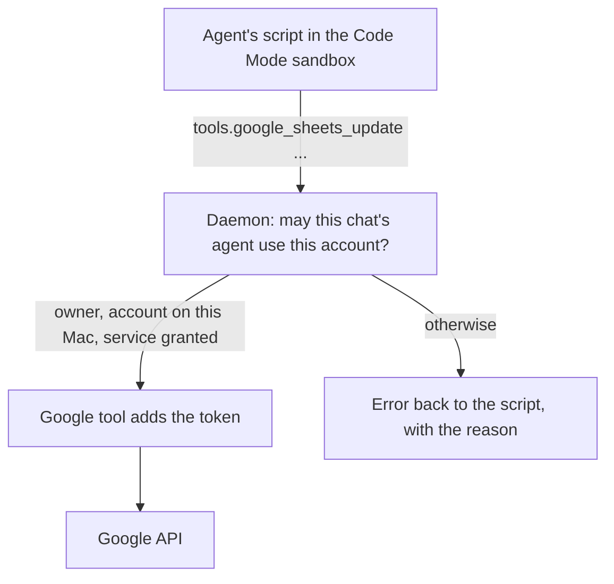
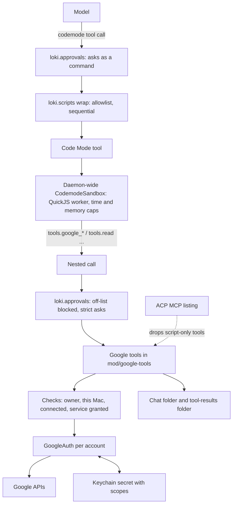
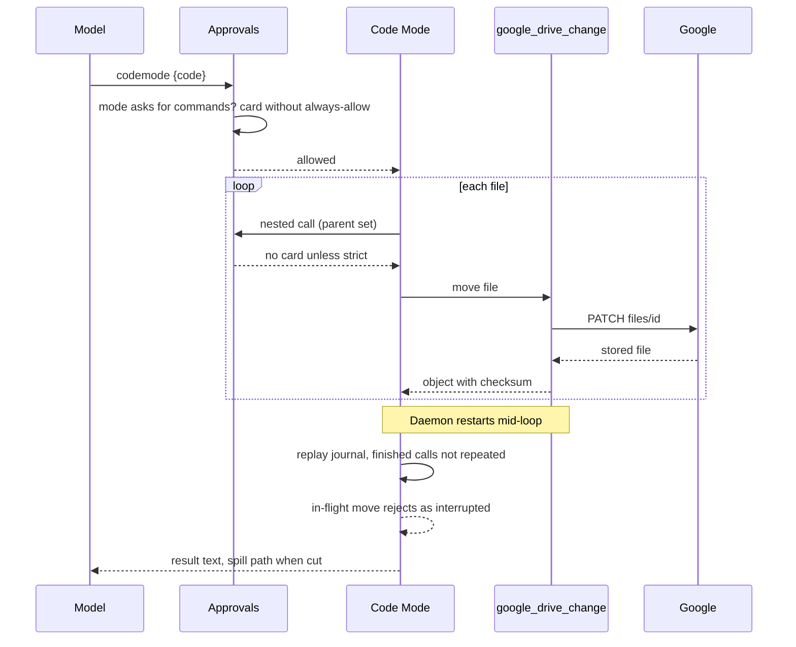
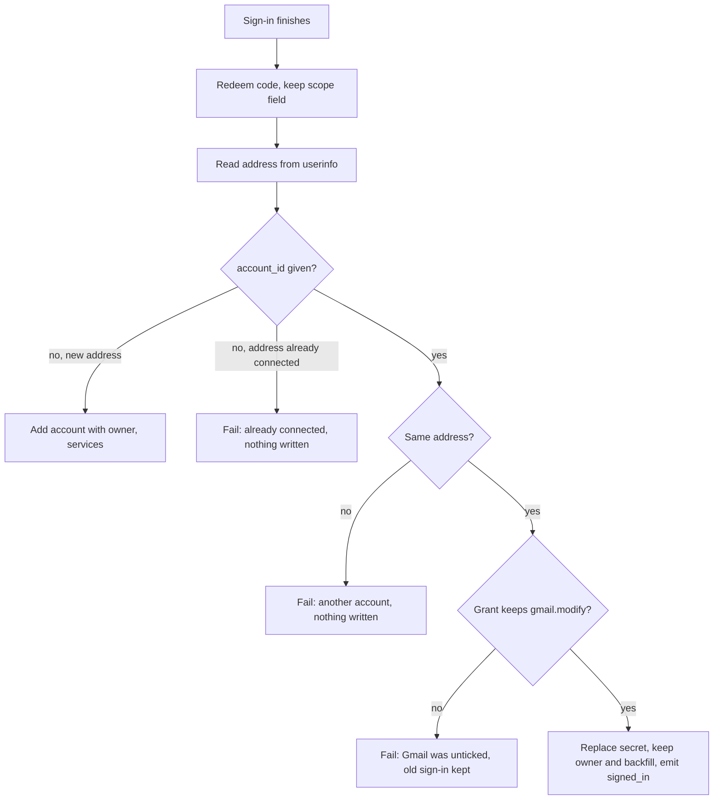
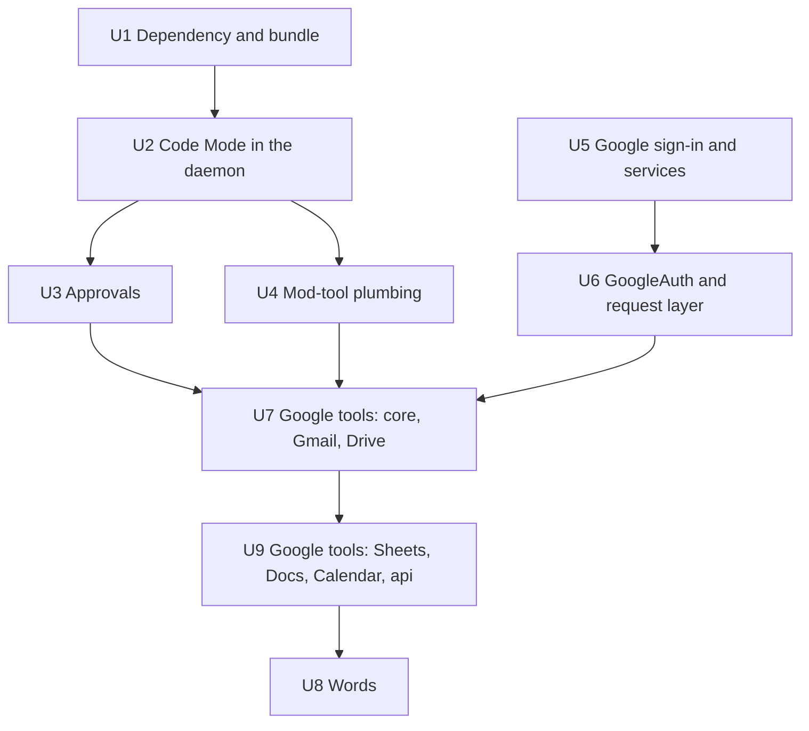

# Scripts and Google tools - Plan

## Goal Capsule

- **Objective:** Agents do Google Workspace work from their chats (update a sheet, sort Drive files, read a doc, book a meeting, pull an attachment) without driving a browser, at a small, fixed cost in context and with no extra processes. Any later service can be added the same way.
- **Means:** pi-durable's Code Mode, which loki's harness already ships: the agent writes JavaScript that runs in a sandbox and calls tools. Google's services become script-only tools, offered to scripts and never to the model directly.
- **Product authority:** The Product Contract below, confirmed by the person on 2026-11-11. It reverses plan 067's "loki never sends" (R18 of `docs/plans/2026-11-04-067-feat-unified-inbox-plan.md`) for scripts, and takes up the calendar source plan 067 deferred. Moving other services behind scripts is not active scope (see How This Work Fits Together).
- **Authority order:** The Product Contract's Requirements win on behaviour; the Planning Contract's KTDs win on mechanism within them; a unit overrides neither.
- **Execution profile:** Nine units in four stages (see Sequencing). Each stage leaves `main`-ready code with its checks passing. Tests use injected fetch, clock, file root and an inline sandbox, with no real Google, network or keychain.
- **Stop conditions:** Stop and ask the person when Code Mode cannot be confined to the allowlist in KTD2 without changing pi-durable, when the release bundle cannot load the sandbox (U1), or when measurement puts the prompt cost past twice the 1,000-token target.
- **Who finishes:** An agent implements and runs the checks. The person signs in a real Google account for the by-hand checks in the Verification Contract, raises the PR and merges it.
- **Open blockers:** None.

---

## Product Contract

### Summary

Chats on loki's own engine get pi-durable's Code Mode: the agent writes a short JavaScript program, and it runs in a sandbox that can only call tools. A new set of script-only Google tools gives an agent Gmail, Drive, Sheets, Docs and Calendar for each Google account it owns. Changes and sends happen directly, and the agent reads them back to confirm.

### Problem Frame

Agents used the gog command-line tool for Workspace work until it was uninstalled on 2026-11-05, when loki's own Gmail connection shipped. Loki's sign-in asks Google only for Gmail (`mod/google-signin.ts`), and the owning agent's tools only read mail and propose replies. Everything else now goes through a browser. Updating one Google Sheet, which an agent once did in one gog call, became a Playwright session: slow, fragile, and impossible to check cell by cell. A second work mailbox that gog held is not reachable at all.

Two obvious fixes cost too much. A tool for each Workspace action would put thirty or more definitions, about 8k tokens, in an owning agent's prompt on every turn. A command the agent runs in its shell would start a process on every call. The person wants neither.

### Key Decisions

- **Scripts over per-action tools.** One script tool keeps context flat however many services join, and bulk work (paging, batches, read-backs) happens in one call. (session-settled: user-directed — chosen over a `loki google` command, rejected for starting a process per call, and over one generic `google` tool, which the person asked to generalise beyond Google.) Loki's MCP servers already load tools on demand through `mcp_search`. That alternative came up after the choice and was not taken, because each call would still go through the model. Governs R1, R10, R11.
- **pi-durable's Code Mode is the runtime.** It is already in loki's pinned harness. Its sandbox has no file, network or process access, so secrets cannot reach a script, and a script resumes after a daemon restart. It uses memory only while a script runs. The cost is that scripts keep no live variables between calls. (session-settled: user-directed — chosen over a Node worker thread of loki's own that would keep variables alive, after comparing both with example scripts: the home-made thread could not be a sandbox and loses its script on restart.) Governs R2, R5, R8.
- **Capability lives in tools, not scripts.** What a script cannot do itself (page through results, write files, check bytes) becomes an option of a Google tool, checked in the daemon. Governs R19, R20, R21.
- **Scripts may not call the shell.** Scripts call script-only tools and loki's file tools, but not bash, which keeps the person's "no extra processes" aim. The agent can still run commands one at a time with bash. Governs R3.
- **Changes happen directly, then the agent reads them back.** (session-settled: user-directed — chosen over an approval card for each change and over splitting changes by risk: Workspace work is often bulk, and gog worked this way.) Governs R15.
- **Agents may send email and calendar invites directly.** This ends "loki never sends" for scripts. Reply cards in Flow keep their approve-to-draft flow. (session-settled: user-directed — chosen over keeping never-sends and over allowing invites only, after the reversal of plan 067's rule was named.) Governs R15, R23.
- **Every Google account asks for every service.** (session-settled: user-directed — chosen over choosing services per account at connect: one sign-in is simplest.) Governs R16, R17.
- **Scripts ask for approval as commands do.** The chat's permission mode decides. (session-settled: user-directed — chosen over exempting scripts from approval like the reply tools.) Governs R7.
- **One plan: scripts, with Google as the first set of script-only tools.** (session-settled: user-directed — chosen over planning the runtime alone first.)
- **No sending limit of loki's own.** Google's quotas are the only cap on how much a script sends. (session-settled: user-approved — the person confirmed the summary where this was called out.) Governs R15.
- **Loki's own engine first.** Claude Code and other ACP chats keep what they have. Code Mode is part of loki's engine, and on the ACP path output neither streams nor survives a restart. Governs R1.
- **A script's Gmail changes are outside changes to Flow.** Cards follow them, and the person's own picks stay the only input to focus learning. Governs R22.

### Requirements

**Scripts**

- R1. A chat on loki's own engine gets the script tool when its agent has at least one script-only tool. Claude Code and other ACP chats, subagents and hidden passes (reflection, Learn) do not.
- R2. A script runs in Code Mode's sandbox, with no file, network or process access of its own. It reaches anything outside only by calling tools.
- R3. Scripts may call script-only tools and loki's file tools, and not bash or background runs.
- R4. A script has a time limit and a memory cap. Reaching either ends the script, and the agent is told which limit it hit.
- R5. A script keeps what later scripts need with Code Mode's per-chat store. No live variables carry over between scripts.
- R6. The model gets the script's return value and printed text. Text past the output budget is cut, and the model gets the path of a file holding all of it.
- R7. Running a script asks for approval exactly when the chat's permission mode asks for a command, and "always allow" never covers the script tool.
- R8. A script cut off by a daemon restart resumes where it was, without repeating its finished calls. A Google call that was in flight at the restart fails in the script with a restart reason, so the script can check and retry.
- R9. A chat runs one script at a time.

**Script-only tools**

- R10. Any part of loki can register a tool as script-only, grouped under a namespace. The model is never offered it directly.
- R11. The prompt lists the script-only tools a chat's agent may use within a fixed token budget. Scripts find the rest by searching and describing tools.
- R12. Every call is checked in the daemon at the time of the call. No tool returns a token or other secret.
- R13. A failed call rejects in the script with the service's own reason.

**Google tools**

- R14. An agent that owns at least one Google account on this Mac gets Google tools for Gmail, Drive, Sheets, Docs and Calendar. They reach only that agent's accounts on this Mac.
- R15. Through them, scripts read, change and send directly: write cells and formulas, upload, move and delete files, edit docs, create events and invite guests, and send mail.
- R16. Signing in a Google account asks Google for all five services.
- R17. Loki records which services each account granted. A call to a service the account has not granted fails with "sign in again", naming the service, and the account's row offers the sign-in.
- R18. A connected Google account can sign in again to grant more. It keeps its owner and its place in Flow, the new sign-in must be the same address, and a cancelled or failed sign-in leaves the old one working.
- R19. A tool that lists can fetch every page in one call, save the full result to a file, and return the file's path with a compact copy.
- R20. Downloads (mail attachments, Drive files, exported docs and sheets) are saved to a path in the chat's folder, and uploads read from a path. A mail attachment can go straight to Drive. File contents never pass through the script or the model.
- R21. A write returns what Google stored, and an upload, copy or move reports its checksum against the source.

**Flow**

- R22. A script's Gmail changes (archive, label, mark read, send) update cards as outside changes do, and are never recorded as the person's own picks.

**Words**

- R23. The manual and the glossary stop saying loki never sends, no agent sends, and the owner's account tools are all reads, and say that what scripts read also reaches the model provider. They say instead that scripts may send while reply cards still draft. The glossary gains "script" and "script-only tool".

### Acceptance Examples

- AE1. **Covers R14, R15, R21.** **Given** an agent that owns the person's Google account, **when** asked to set a formula in one sheet cell and confirm it, **then** one script writes the cell, reads back that cell and its neighbours, and returns both. No browser opens, and no process starts.
- AE2. **Covers R1, R14.** **Given** an agent that owns no Google account and has no other script-only tool, **when** its chat starts a turn, **then** its prompt has neither the script tool nor any Google tool.
- AE3. **Covers R12, R13.** **Given** an agent that owns one Google account, **when** a script names another agent's account, **then** the call rejects saying the account is not this agent's, and nothing is read.
- AE4. **Covers R14.** **Given** an agent whose Google account was connected on a paired Mac, **when** its chat on this Mac runs a script that names the account, **then** the call rejects saying the account lives on the other Mac.
- AE5. **Covers R17, R18.** **Given** a mailbox connected before this change, **when** a script asks Drive for a file list, **then** the call rejects with "sign in again" for Drive, the account's row offers it, and after signing in the same script works with the owner and Flow cards unchanged.
- AE6. **Covers R2, R3.** **Given** any script, **when** it calls `fetch`, `require` or `tools.bash`, **then** the call fails: the sandbox has no `fetch` or `require`, and bash is not among its tools.
- AE7. **Covers R4.** **Given** a script stuck in a loop, or one building a list past the memory cap, **when** it reaches the limit, **then** it ends, the agent is told which limit, and other chats keep working.
- AE8. **Covers R8.** **Given** a script halfway through moving 200 Drive files, **when** the daemon restarts, **then** the script resumes with the next file, and the move in flight at the restart fails in the script with a restart reason.
- AE9. **Covers R7.** **Given** a chat in the mode that asks before commands, **when** the agent runs a script, **then** an approval card shows it, the card offers no "always allow", and the script runs only on approval. In the mode that runs commands without asking, the same script runs at once.
- AE10. **Covers R19, R20.** **Given** a mailbox with forty invoices, **when** a script moves their PDF attachments into a Drive folder, **then** the files go from Gmail to Drive inside the daemon, the script gets each file's name and checksum, and no file contents appear in its output.
- AE11. **Covers R22.** **Given** a thread with a card in Flow, **when** a script archives it, **then** the card follows as it would after archiving in Gmail, and focus learning records nothing.

### Success Criteria

- The sheet update from the Problem Frame takes one script call and no browser.
- The script tool and the Google tools' prompt listing cost an owning agent under 1,000 tokens per turn, and AE1's whole task, tool lookups included, is measured and reported. Both figures are estimates the plan replaces with measurements.
- Code Mode's memory while a script runs is measured on loki's daemon before R4's cap is set.

### Scope Boundaries

**Deferred for later**

- Google Tasks, Contacts, Slides and Forms.
- Scripts in Claude Code and other ACP chats.
- Moving the Gmail, Slack and Jira account tools behind scripts.
- MCP servers and loki's own tools (memory, history search, the Canvas) behind scripts.
- An account that only scripts can reach, without Flow cards.
- Choosing a Google account's services one by one.
- A sending limit of loki's own.
- Reaching an account on a paired Mac.

**Outside this work's identity**

- Scripts with direct access to files, the network, processes or npm packages.

<!-- ce-section: work-relationships -->
### How This Work Fits Together

This plan covers scripts and the first set of script-only tools, Google's. The areas below are the current understanding, not a committed roadmap.

- Gmail, Slack and Jira account tools as script-only tools, replacing today's six account tools in the prompt. Depends on this plan's scripts.
- MCP servers behind scripts, through Code Mode's namespaces. Depends on this plan's scripts. Still to decide whether it beats today's `mcp_search` loading.
- Loki's own tools behind scripts. Depends on this plan's scripts. Can proceed independently of the account and MCP work.
- Scripts in Claude Code chats. Depends on this plan's scripts, and on a way to stream and resume over loki's MCP server.
- More Google services (Tasks, Contacts, Slides, Forms). Shares the Google tools and their sign-in.

### Dependencies / Assumptions

- Code Mode ships in pi-durable 1.4.0 with pi-codemode 1.4.0, both already installed. A script running across a pi-durable upgrade that changes Code Mode fails instead of resuming.
- Code Mode's sandbox is QuickJS, which is slower than Node at heavy computation. Work that waits on Google barely notices, and heavy work such as hashing belongs in tools (R21).
- Full Drive access is a restricted Google scope. On loki's unverified shared app it adds to Google's warning screen and stays within the app's 100-user lifetime cap. The person's own Google app remains the fallback.
- A company's Workspace admin may block the new services. The existing "admin blocks this app" handling and the own-app fallback cover that case.
- Google's consent screen lets a person untick services. R17 covers a partial grant.

### Sources / Research

- pi-durable's README, section "Code Mode", and `@earendil-works/pi-codemode`'s README: the sandbox, `tools.*`, `store`/`load`, restart replay, `inlineBudget`, `namespaces`, and a tool's `callers: ["tools"]`, which makes it script-only.
- `mod/google-signin.ts` asks Google only for `gmail.modify`, `openid` and `userinfo.email`. `mod/accounts.ts` refuses a second sign-in on a connected account. `app/src/settings/accounts.tsx` offers reconnect only when an account is disconnected.
- `mod/account-tools.ts` and `mod/reply-proposals.ts` hold the owner's six account tools and their gate. `mod/gmail.ts` already fetches attachments, but only for forwards.
- `daemon/approvals.ts` asks by tool kind against the permission mode. A mod tool without a read-only annotation counts as a command.
- `daemon/mcp/index.ts` and `daemon/mcp/search.ts` show on-demand tool loading. `daemon/tool-results.ts` and `daemon/mcp/results.ts` show large output going to a file.
- `docs/plans/2026-11-04-067-feat-unified-inbox-plan.md` defines accounts, owners and "loki never sends". `docs/plans/2026-11-10-1451-feat-jira-inbox-plan.md` is the precedent for adding a source to the account code.
- `docs/plans/2026-10-31-062-feat-history-search-plan.md` and github.com/mainplane-ai/mainplane: mainplane's `run` tool sends code to an interpreter that stays up for the session, spills large output to a file, and lists four tools in all.

---

## Planning Contract

### Key Technical Decisions

**Scripts in the daemon**

- KTD1. **Code Mode is installed once, as a built-in, with `models: false`.** `createCodemodeExtension` from `@earendil-works/pi-durable/codemode` goes in after the built-ins in `daemon/main.ts` (after line 150). It runs on one daemon-wide `CodemodeSandbox` from `@earendil-works/pi-codemode`, which becomes a direct dependency pinned at `1.4.0` in step with pi-durable. `models: false` keeps paid model calls out of scripts and keeps `test/extensions.test.ts`'s rule that every built-in tool declares a kind. The sandbox is closed before `stores.closeAll()` (`daemon/main.ts:431`), so a script cut off by shutdown counts as undecided and replays (R8). Governs R2, R8.
- KTD2. **A loki extension, `loki.scripts`, confines scripts to an allowlist.** Code Mode offers scripts every enabled tool that sets no `callers`, bash and `subagent` included, and it has no filter hook. The extension wraps the `codemode` tool so the api its `execute` sees returns `callable` filtered to script-only tools plus `read`, `write`, `edit`, `ls`, `find` and `grep`. It delegates through a Proxy, because the api has getters a spread would lose. A second wrap on the `codemode` section lists the same set. An allowlist is chosen over marking bash and the rest `callers: ["model"]`, because a tool added later would otherwise leak into scripts. The approval hook blocks any nested call off the list as a backstop (KTD4). Governs R3, R10.
- KTD3. **The script tool is offered only where it can do something.** After `mods.prepare` in `LokiEngine.ready()` (`daemon/loki-engine.ts:172-175`), `loki.scripts` adds `codemode` to the chat's `tools.remove` when no script-only tool is left for the agent. The section wrap renders nothing unless `codemode` is among the tools offered, which keeps it out of reflection and Learn passes whose tool list is fixed (`daemon/passes.ts:457-475`). Subagents drop both extensions where `daemon/subagents.ts:38` already removes one. ACP chats never run the harness, so only KTD5's leak needs closing there. Governs R1.
- KTD4. **One approval covers a script; strict mode still asks per call.** `codemode` declares the kind `command`, so it asks exactly where a command asks (R7). A nested call (`call.parent` set) is not asked about again in standard or "accept edits" mode, since its script was already allowed. A forty-file move would otherwise raise forty cards. Strict mode asks for each nested call, as it asks for everything by choice. "Always allow" is refused for `codemode` in four places: `decide()`, the `alwaysAllowed` shortcut in `decideCall()` (`daemon/approvals.ts:236`), `setAlways()`, and the approval card on desktop and phone, which hides the button for it. A nested `write` keeps honouring an "always allow" the person gave `write`. Governs R7.
- KTD5. **Mod tools can be script-only, replay-safe and typed.** `ModTool`, `LokiTool`, `ChatTool` and `piTool` gain optional `callers`, `replay: "safe"` and an output schema, passed through to pi-durable's `defineTool`. A tool with an output schema returns structured data, so a script gets an object instead of text to parse. `ToolContext` gains the chat's `cwd`, read in `piTool` from `api.agent(context).cwd`. The ACP tool listing (`daemon/acp/loki-tools.ts:139`) drops tools whose `callers` lack `"model"`, which would otherwise hand Claude Code chats every Google tool. Governs R1, R10, R12.
- KTD6. **Reads replay after a restart; writes do not.** Read-only Google tools set `replay: "safe"` and a read-only annotation. Write and send tools set neither, so one in flight at a restart comes back to the script as interrupted (pi-durable `harness/tool.js:104-122`), and the script decides whether to retry. Governs R8.
- KTD7. **Limits are visible constants in `daemon/scripts.ts`, set from measurement.** The starting values are a 10-minute wall-clock limit per script, a 64 MB sandbox memory cap, Code Mode's default 10,000-token output budget, and four scripts running at once across all chats. The last is enforced with the sandbox's `acquireWorker`, which refuses a fifth script with a reason instead of queueing it. U2 measures a running script's memory and time on loki's daemon and adjusts the values before they ship. Output past the budget is cut by Code Mode itself, which writes the complete text to a file and gives its path (R6). `executionMode: "sequential"` on the wrapped tool keeps two scripts in one model round from running side by side (R9). Governs R4, R6, R9.

**Google sign-in and access**

- KTD8. **One `GoogleAuth` per account owns the token.** It holds load, refresh, granted services, disconnect and a request layer. `GmailClient` and the new Google tools both use it, from one map in `mod/index.ts` that is cleared on `accounts.onChange` like today's Gmail clients (`mod/index.ts:299-340`). Two holders refreshing separately would race on the keychain secret. The request layer adds PUT, PATCH and DELETE, multipart and resumable uploads, binary downloads, empty 204 answers, and a longer timeout for transfers. A 403 `insufficientPermissions` becomes R17's "sign in again", naming the service. Governs R12, R13, R17.
- KTD9. **Granted services are read from Google's token answer and kept with the account.** Sign-in asks for `gmail.modify`, `drive`, `spreadsheets`, `documents` and `calendar`, plus `openid` and `userinfo.email`, with `include_granted_scopes=true`. The token answer's `scope` field is saved in the keychain secret (`GmailSecret.scopes`, parsed in `parseGmailSecret`). The services derived from it go on the account record and `AccountView` as `services`. A record without the field means Gmail only. `refresh()` keeps the field current. A missing service is not an `AccountDisconnectCause`, because a disconnect stops Gmail's watcher and turns the row red. Governs R16, R17.
- KTD10. **Re-sign-in of a connected account follows Jira's reconnect.** `account_connect_gmail` gains an optional `account_id`, as `account_connect_jira` has (`core/frames.ts:1506-1515`). The address is read from Google's userinfo instead of the Gmail profile, so a sign-in that leaves Gmail unticked still names its address. A sign-in for another address, or one that would drop `gmail.modify` from an account that had it, fails before anything is written. A successful one replaces the secret, keeps the owner and backfill, and emits a new `signed_in` account change, so cached clients read the new token. The row offers "sign in again for drive, sheets…" when services are missing. Governs R18.
- KTD11. **Hand-written tools for the common work, plus one request tool for the rest.** The hand-written tools handle what a script cannot do itself: paging, files, checksums and read-backs. `google_api` covers anything else on the five services, such as `batchUpdate` in Sheets and Docs. It takes a method, a path on one of the five services' API hosts, query and JSON body, and returns JSON. It never accepts a full URL or a host outside the five, and it never returns the token. Generating tools from Google's API descriptions was considered and rejected: it adds hundreds of tools to search through, and the hard parts (files, paging) are not in the descriptions. Every tool takes an `account` address, which may be left out when the agent owns one Google account. The namespace is `google`, and its prompt listing is held under the budget by a small `inlineBudget`, so scripts call `describeTool()` for argument details. Governs R11, R14, R15.
- KTD12. **Every call is checked in the daemon at the moment it runs.** Four checks run in this order, each with its own error. The account must belong to the calling chat's agent. It must be held on this Mac, not a paired one (`mod/accounts.ts:170`). It must be connected. Its granted services must include the one called. The tools are registered with a `forAgent` gate on `ownedBy(agentId)` for Google records (`mod/account-tools.ts:140`), so an agent without one never sees them. Governs R12, R14.
- KTD13. **Files stay inside the chat's folder and the daemon.** Download and upload paths resolve against the chat's `cwd` (KTD5) and are refused when they resolve outside it. Full listings (R19) are saved under `<loki>/tool-results/<chat>/` through `toolResultsDir` (`daemon/tool-results.ts:16-24`), the same place MCP spills go. An attachment sent to Drive is fetched and uploaded inside the daemon. Checksums are MD5, compared with Drive's `md5Checksum`. A Google-native file, which has no checksum, reports `checksum: null` with the reason. Governs R19, R20, R21.

**Flow and guards**

- KTD14. **Google tools never touch Flow's own paths.** Script Gmail changes go straight through `GoogleAuth`, never through `AccountThreads` or the `account_thread_*` frames. `GmailSync` sees them on the next watcher tick, as it sees a change made in Gmail, and nothing reaches the inbox ledger or focus learning (`mod/frames/accounts.ts:278-292`, `core/attention/focus.ts`). A script's send does not mark its card waiting; only the person's own reply does (`mod/outside-threads.ts:394`). Mail is composed with `mod/mail-compose.ts`, so replies thread as the person's do. Governs R22.
- KTD15. **The send guards change shape, not purpose.** `test/gmail.test.ts:294-313` and `test/outside-threads.test.ts:864-875` assert that nothing but the person's reply sends. They become: send calls come only from `mod/outside-threads.ts` and the Gmail tool file in `mod/google-tools/`. `test/google-signin.test.ts:146-158`, which asserts a connected mailbox cannot sign in again, becomes the same-address re-sign-in test. Governs R15, R18.

### High-Level Technical Design

These sketches show the intended shape for review. They are not implementation specifications.

**Components**

**A script run with approval and a restart**

**When a call asks**

| Chat mode | The `codemode` call | A nested call on the allowlist | A nested call off the list |
|---|---|---|---|
| strict | asks | asks | blocked |
| standard | asks | runs | blocked |
| accept edits | asks | runs | blocked |
| unrestricted | runs | runs | blocked |

"Always allow" is never offered for `codemode`. A turn started by another chat's message uses the stricter of the two modes, as today.

**Signing a Google account in**

### Sequencing

U5 and U6 do not depend on the script units and can be built alongside U1 to U4. Each unit leaves the checks passing, so the work can land as one PR or be stopped between units without leaving a half-built path.

### Risks and Dependencies

| Risk | Mitigation |
|---|---|
| Code Mode's api shape changes in a pi-durable upgrade, breaking KTD2's wrap. | pi-durable and pi-codemode are pinned together. U2's tests fail if a nested call reaches `bash`. |
| The release bundle cannot find the sandbox's worker or `quickjs.wasm`. | U1 passes both paths explicitly and adds a smoke check that runs a one-line script from the built bundle. |
| Re-sign-in asks for the restricted Drive scope on the shared unverified app, so Google shows a stronger warning. | The manual says so. The person's own Google app remains the fallback, and a re-sign-in of an existing user does not count again toward the 100-user cap. |
| A person unticks a service on Google's consent screen. | KTD9 records what was granted. The tools name the missing service, and the row offers the sign-in. |
| A script sends mail the person did not expect. | Scripts ask as commands in every mode but unrestricted, and the card shows the script's code. The manual says what scripts may send. |
| What a script reads reaches the model provider. | R23's words in the manual and SECURITY.md. |

### System-Wide Impact

- **Prompt context:** an owning agent's prompt gains the `codemode` tool and a short `google` listing; other agents gain nothing (AE2). Measured in U9.
- **Approvals:** a new rule that nested calls inherit their script's approval outside strict mode. A new exception to "always allow".
- **Agent and tool parity:** Claude Code chats keep their tools and do not gain Google's; the ACP listing filters script-only tools.
- **Security posture:** loki now sends mail and deletes Drive files when a script asks. SECURITY.md's "Agents never send" and "only labels" sections are rewritten in U8.
- **Accounts:** a new account change kind (`signed_in`), a new `services` field on `AccountView`, and an `account_id` on `account_connect_gmail`. Older paired Macs that read a view without `services` treat it as Gmail only.

---

## Implementation Units

### U1. Dependency and bundle

- **Goal:** Code Mode's sandbox loads in development and from the release bundle.
- **Requirements:** R2.
- **Dependencies:** None.
- **Files:** `package.json`, `package-lock.json`, `scripts/build-mod.ts`, `scripts/smoke.ts`, `test/build-mod.test.ts`.
- **Approach:** Add `@earendil-works/pi-codemode` at `1.4.0`. In `scripts/build-mod.ts`, add a second esbuild entry for `@earendil-works/pi-codemode/worker` and copy `quickjs-wasi/quickjs.wasm` beside `daemon.mjs`, as the keyring binding is copied (`scripts/build-mod.ts:65-68`). `daemon/scripts.ts` (U2) passes `workerUrl` and `wasm` paths that resolve beside the bundle when built, and from `node_modules` otherwise.
- **Execution note:** Prove the bundle first. Build it and run the smoke check before writing U2's wrap, since a bundle that cannot load the sandbox stops the plan.
- **Test scenarios:**
  - `test/build-mod.test.ts`: the built output contains the worker file and `quickjs.wasm`.
  - Smoke: the built daemon runs a script returning `1 + 1` and gets `2`.
- **Verification:** `npm run build:mod && npm run smoke` pass.

### U2. Code Mode in the daemon

- **Goal:** Chats on loki's engine whose agent has a script-only tool get the `codemode` tool, confined to the allowlist and limits.
- **Requirements:** R1, R2, R3, R4, R5, R6, R9, R10, R11; KTD1, KTD2, KTD3, KTD7.
- **Dependencies:** U1.
- **Files:** new `daemon/scripts.ts`; `daemon/main.ts`, `daemon/loki-engine.ts`, `daemon/subagents.ts`; new `test/scripts.test.ts`; `test/extensions.test.ts`.
- **Approach:** `daemon/scripts.ts` owns the sandbox, the constants of KTD7, the `codemode` extension and the `loki.scripts` wrap extension, and a `prepare(agentId)` that hides `codemode` when the agent has no script-only tool. Install it after the built-ins and close the sandbox before the stores. Add both extensions to the subagent's remove list. Measure memory and wall time of a 200-call script on the daemon, and record the figures in the constants' comment.
- **Patterns to follow:** `daemon/mods/registry.ts:216-235` for writing `tools.remove`; `test/daemon-tools.test.ts:20-50` for a faux-provider chat that captures the system prompt; `InlineCodemodeSandbox` from `@earendil-works/pi-codemode` in tests, so no worker starts.
- **Test scenarios:**
  - An agent with a script-only test tool gets `codemode` and a `codemode` section listing that tool; an agent without one gets neither (AE2).
  - A script calling `tools.bash`, `tools.subagent` or `tools.background_run` fails with "not a function", and `fetch`/`require` are undefined (AE6).
  - A script calling `tools.read` on a file in the chat's folder gets its text.
  - A script that loops forever ends at the time limit, and the result names the limit. A script that grows an array past the memory cap ends naming that limit, and another chat's script still runs (AE7).
  - With four scripts running in other chats, a fifth is refused with a reason.
  - Two `codemode` calls in one model round run one after the other.
  - `store()` in one script is read by `load()` in the next script of the same chat (R5).
  - A script printing more than the output budget returns cut text and a path to the full text (R6).
  - A subagent of an agent with Google tools has no `codemode`; a reflection pass's prompt has no `codemode` section.
  - Restart: a script makes three nested calls; the store is reopened on the same `MemoryStorage`; the script finishes without repeating the finished calls (R8).
- **Verification:** `npm test -- test/scripts.test.ts test/extensions.test.ts` pass.

### U3. Approvals for scripts

- **Goal:** A script asks as a command once, its nested calls follow KTD4's table, and "always allow" never covers it.
- **Requirements:** R7; KTD2, KTD4.
- **Dependencies:** U2.
- **Files:** `daemon/approvals.ts`, `daemon/extensions.ts` (the declared kind), `core/attention/model.ts` if the approval event carries the flag, `app/src/chat/conversation.tsx`, `app/src/phone/conversation-screen.tsx`; `test/approvals.test.ts`.
- **Approach:** In the `beforeTool` hook, a call with `parent` set is blocked when off the allowlist, asked about only in strict mode, and otherwise allowed. Refuse always-allow for `codemode` at the four points of KTD4. The cards hide the button by tool name.
- **Patterns to follow:** `test/approvals.test.ts:44-125`, including always-allow surviving a restart.
- **Test scenarios:**
  - Standard mode: `codemode` raises one card with no always-allow; on approval its nested `write` runs with no second card (AE9).
  - Unrestricted mode: the same script runs without a card (AE9).
  - Strict mode: each nested call raises its own card.
  - An `always: true` answer on a `codemode` card allows that run but adds nothing to the always-allowed list, and the next script asks again.
  - A nested call to a tool off the allowlist is blocked with a reason, even in unrestricted mode.
  - Strict mode with `write` always-allowed: a nested `write` still asks, because strict ignores always-allow today.
  - Desktop and phone approval cards show no always-allow button for `codemode` and keep it for `write`.
- **Verification:** `npm test -- test/approvals.test.ts` and the app's card tests pass.

### U4. Mod-tool plumbing

- **Goal:** Any part of loki can register a script-only, replay-safe, typed tool that sees the chat's folder, and Claude Code chats never receive one.
- **Requirements:** R1, R10, R12; KTD5.
- **Dependencies:** U2.
- **Files:** `daemon/mods/api.ts`, `daemon/mods/registry.ts`, `daemon/chat-tools.ts`, `mod/tools.ts`, `daemon/acp/loki-tools.ts`; `test/mod-registry.test.ts`, `test/acp-loki-tools.test.ts`.
- **Approach:** Add the optional fields at each layer and pass them to `defineTool`. Return `structuredOutput` when a tool declares a schema. Read `cwd` in `piTool` and pass it into `ToolContext`; the ACP path leaves it undefined.
- **Test scenarios:**
  - A mod tool with `callers: ["tools"]` is callable from a script and absent from the model's tool list.
  - The same tool is absent from the ACP MCP listing, while a tool without `callers` is still listed (extends `test/acp-loki-tools.test.ts:155`).
  - A tool with an output schema gives the script an object.
  - A mod tool's context carries the chat's `cwd`.
- **Verification:** `npm test -- test/mod-registry.test.ts test/acp-loki-tools.test.ts` pass.

### U5. Google sign-in and granted services

- **Goal:** A Google sign-in asks for all five services, records what was granted, and a connected account can sign in again.
- **Requirements:** R16, R17, R18; KTD9, KTD10.
- **Dependencies:** None.
- **Files:** `mod/google-signin.ts`, `mod/google-app.ts`, `mod/accounts.ts`, `core/frame-types.ts`, `core/frames.ts`, `core/daemon-calls.ts`, `mod/frames/accounts.ts`, `app/src/settings/accounts.tsx`, `app/src/desk/outside-words.ts`; `test/google-signin.test.ts`, `test/accounts.test.ts`, `test/frames.test.ts`, `test/frames-accounts.test.ts`, `test/settings-accounts.test.ts`, `test/fixtures/gmail.ts`.
- **Approach:** Replace `GMAIL_SCOPES` with the five services' scopes and add `include_granted_scopes`. Keep `scope` from `redeem()`. Read the address from userinfo. Add `account_id` to the pending sign-in and the frame. Add the connected-account branch to `connect()` and the `signed_in` change kind. Add `services` to the record, `accountView` and `parseView`. The fake token endpoint gains a `scope` field.
- **Patterns to follow:** the Jira reconnect in `mod/frames/accounts.ts:161-162` and `test/frames-accounts.test.ts:466`.
- **Test scenarios:**
  - A new sign-in's URL asks for all seven scopes and `include_granted_scopes=true`.
  - A token answer granting Gmail and Drive only stores `services: ["gmail", "drive"]`.
  - A record without `services` reads as Gmail only.
  - Re-sign-in with the account's own `account_id` and same address replaces the secret, keeps the owner and backfill, and emits `signed_in` (AE5).
  - Re-sign-in that returns another address fails with a message naming both, and the old secret still works.
  - Re-sign-in whose grant lacks `gmail.modify` fails, and the old secret is kept.
  - A cancelled sign-in leaves the account as it was.
  - The `GmailClient` cached before a `signed_in` change is dropped, and the next call uses the new token.
  - A connected row with services missing shows "sign in again for drive, sheets…", and clicking it sends `account_connect_gmail` with the row's `account_id` and owner.
- **Verification:** the listed tests pass.

### U6. GoogleAuth and the request layer

- **Goal:** One holder per account refreshes and adds the token for Gmail and every new Google client.
- **Requirements:** R12, R13, R17; KTD8.
- **Dependencies:** U5.
- **Files:** new `mod/google-auth.ts`; `mod/gmail.ts`, `mod/index.ts`; new `test/google-auth.test.ts`; `test/gmail.test.ts`.
- **Approach:** Lift `load`, `accessToken`, `refresh` and `disconnect` out of `GmailClient` (`mod/gmail.ts:485-557`) into `GoogleAuth`, keeping the refresh-on-401 and `admin_policy_enforced` handling. Add `request()` with the methods and bodies of KTD8 and per-call timeouts. `GmailClient` keeps its public calls and delegates the token. Keep the clients map in `mod/index.ts` keyed by account and cleared on change.
- **Execution note:** Characterization first. Run the existing Gmail and Flow tests before and after the move; they must pass unchanged except the send guard (U7).
- **Test scenarios:**
  - A 401 refreshes once and retries; a second 401 surfaces the error.
  - `invalid_grant` on refresh disconnects with `sign_in_again`, as today.
  - A refresh answer with a new `scope` updates the stored services.
  - A 403 `insufficientPermissions` from a Drive call becomes "sign in again for Drive", and the account stays connected.
  - A resumable upload sends the session POST, then the bytes, and returns the stored file.
  - A binary download writes the exact bytes; a 204 DELETE resolves with no body.
  - A hanging transfer ends at its timeout with the injected clock.
  - Gmail and a Drive client on one account share one refresh when both see an expired token.
- **Verification:** `npm test -- test/google-auth.test.ts test/gmail.test.ts test/gmail-sync.test.ts` pass.

### U7. Google tools: core, Gmail and Drive

- **Goal:** Scripts read, change and send in Gmail and Drive for the agent's own accounts on this Mac, through the shared checks and file handling every Google tool uses.
- **Requirements:** R12, R13, R14, R15, R19, R20, R21, R22; KTD6, KTD11, KTD12, KTD13, KTD14, KTD15.
- **Dependencies:** U3, U4, U6.
- **Files:** new `mod/google-tools/` with `index.ts` (registration, namespace, account resolution, the four checks), `files.ts` (paths, listings, checksums), `gmail.ts` and `drive.ts`; `mod/index.ts`; new `test/google-tools.test.ts`; a new `test/fixtures/google.ts` beside `test/fixtures/gmail.ts`; `test/gmail.test.ts`, `test/outside-threads.test.ts`.
- **Approach:** Register the tools in the `google` namespace, all `callers: ["tools"]`, gated per KTD12. This unit builds the first eleven rows below and U9 the rest; the implementer may merge or split tools as the APIs suggest:

  | Tool | Does |
  |---|---|
  | `google_accounts` | The agent's Google accounts on this Mac and their services |
  | `google_gmail_search` | Search threads, every page on request, full list to a file |
  | `google_gmail_read` | A thread or message, with its attachments listed |
  | `google_gmail_modify` | Labels, archive and read state on many messages |
  | `google_gmail_send` | New mail or a reply, attachments from paths |
  | `google_gmail_attachment` | Save an attachment to a path, or straight to a Drive folder |
  | `google_drive_list` | Files by query, every page on request |
  | `google_drive_download` | A file or an export to a path |
  | `google_drive_upload` | A path to a folder, with checksum |
  | `google_drive_change` | Create a folder, rename, move, copy, trash, delete |
  | `google_sheets_read` | Ranges as values and formulas |
  | `google_sheets_write` | Ranges, returning what is stored |
  | `google_docs_read` | A document as text or as structure with indexes |
  | `google_calendar_list` | Events in a range, every page on request |
  | `google_calendar_change` | Create, update or delete an event, invite guests |
  | `google_api` | Any other call on the five services (KTD11) |

  Update the two send guards (KTD15).
- **Patterns to follow:** `mod/account-tools.ts` for the owner gate and per-call ownership check; `mod/mail-compose.ts` for MIME; `daemon/mcp/results.ts:67-89` for listing files and their names; `test/account-tools.test.ts:160-175` for per-agent gating.
- **Test scenarios:**
  - AE3: a script naming another agent's account rejects with "not this agent's account", and the fake saw no request.
  - AE4: an account held on a paired Mac rejects with "lives on <device>".
  - AE5: a Gmail-only account calling `google_drive_list` rejects with "sign in again for Drive".
  - AE10: forty attachments go to a Drive folder; the fake saw forty uploads; each result has a name and a matching checksum; the script's output holds no file bytes.
  - AE11: `google_gmail_modify` archiving a carded thread leaves the inbox ledger and focus weights unchanged, and the next `GmailSync` run marks the card gone.
  - A script's `google_gmail_send` reply in a carded thread does not mark the card waiting.
  - `google_gmail_search` with every page on 120 fake results returns a compact copy and a file under the chat's tool-results folder holding all 120.
  - A download path outside the chat's folder is refused, and nothing is written.
  - No tool result contains the access or refresh token (scan every result in the suite).
  - A Google error such as 404 rejects in the script with Google's message.
  - An agent with no Google account sees no `google_*` tool and no `codemode` (AE2).
  - The send guards pass with the Gmail tool file as the second allowed caller.
  - Read tools are `replay: "safe"`; a write in flight at a store reopen rejects as interrupted (AE8).
- **Verification:** `npm test -- test/google-tools.test.ts test/gmail.test.ts test/outside-threads.test.ts` pass.

### U8. Words

- **Goal:** The manual, glossary, architecture notes and security notes describe scripts and what they may do.
- **Requirements:** R23.
- **Dependencies:** U9.
- **Files:** `docs/manual.md` (lines near 916-923, 1171-1175, 1182, 1191-1200), `glossary.md` (168-171, 199-203, and new entries "script" and "script-only tool"), `docs/architecture.md` (463-464, 478-479, 485, and a section for `daemon/scripts.ts` and `mod/google-tools/`), `docs/SECURITY.md` (165-181, 204-208), and the header comments of `mod/gmail.ts` (6-9) and `mod/account-tools.ts` (14-21).
- **Approach:** Rewrite each "never sends" and "all reads" line to say scripts may send while reply cards still draft. Add the re-sign-in for more services, the stronger warning screen for Drive, the missing-service state, and that what scripts read reaches the model provider. Plan 067 stays as written; it is a record of its time.
- **Test expectation:** none, because the unit changes words only. `npm run format:check` covers its formatting.
- **Verification:** a search for "never send", "no agent sends" and "all reads" in `docs/`, `glossary.md` and `mod/` finds only lines that are still true.

### U9. Google tools: Sheets, Docs, Calendar and the request tool

- **Goal:** Scripts read and change sheets, docs and calendars, and reach any other call on the five services, with the prompt cost measured.
- **Requirements:** R11, R14, R15, R21; KTD6, KTD11, KTD12; Success Criteria.
- **Dependencies:** U7.
- **Files:** `mod/google-tools/sheets.ts`, `docs.ts`, `calendar.ts`, `api.ts`; `test/google-tools.test.ts`; `test/fixtures/google.ts`.
- **Approach:** Build the last five rows of U7's table on U7's checks. `google_sheets_write` reads the written ranges back as both formulas and values. `google_api` maps its path to a service for the granted-service check, and refuses full URLs and other hosts. Then measure the `codemode` tool plus the `google` listing in an owning agent's prompt, and AE1's whole run with its tool lookups, and tune `inlineBudget` to the 1,000-token target.
- **Test scenarios:**
  - AE1: a script writes `=SUM(A1:A3)` to one cell, reads that cell and its neighbours back, and the fake Sheets API saw one write and one read.
  - `google_docs_read` returns plain text, and with structure returns the indexes a `batchUpdate` needs.
  - `google_calendar_change` creating an event with two guests sends Google `sendUpdates=all` and returns the stored event.
  - `google_calendar_list` over three pages returns every event.
  - `google_api` with a host outside the five, or a full URL, is refused; a Sheets `batchUpdate` goes through; a Calendar path on a Gmail-only account rejects with "sign in again for Calendar".
  - An owning agent's prompt with `codemode` and the `google` listing stays under the measured budget; the test pins the figure U9 measured.
- **Verification:** `npm test -- test/google-tools.test.ts` passes; the prompt measurement and AE1's total tokens are recorded in the PR.

---

## Verification Contract

| When | Command or check | Proves |
|---|---|---|
| Each unit | `npm test -- <the unit's test files>` | The unit's scenarios |
| Before push | `npm run format:check && npm run lint && npm run typecheck && npm test && npm run test:node` | Whole suite, with CI's toolchain (newest Node 22, npm 10, `SHELL=/bin/bash`) |
| Before push | `npm run build:app && npm run build:mod && npm run smoke` | The bundle loads the sandbox and runs a script (U1) |
| PR title | `PR_TITLE="feat(mod): ..." node --experimental-strip-types scripts/check-pr-title.ts` | Title and scope pass CI |
| After push | The PR's CI, Windows included | Paths and the bundle on every platform |

By hand, by the person with a real Google account, on a dev daemon:

1. Sign an existing Gmail-only account in again from its row; Google's screen lists all five services; the row keeps its owner and Flow cards.
2. Ask the owning agent to set a formula in a real sheet and confirm it (AE1). No browser opens.
3. Ask it to copy one real attachment into a Drive folder and report the checksum (AE10, one file).
4. In standard mode, see one approval card with no always-allow; in unrestricted, see none (AE9).
5. Restart the daemon during a script listing a large Drive folder; the script finishes (AE8).
6. Open a Claude Code chat with the same agent and check that no `google_` tool is listed.

Measurements reported in the PR: an owning agent's added prompt tokens, AE1's total tokens, and a running script's daemon memory and wall time.

---

## Definition of Done

- Every unit's scenarios pass, and the whole Verification Contract command set passes with CI's toolchain.
- Every acceptance example AE1 to AE11 has a passing test, and the by-hand list has been run by the person.
- The measured prompt cost is under 1,000 tokens, or the person has accepted the measured figure.
- KTD7's limits carry the measured figures in their comment.
- No test or doc still claims that agents never send, and the two send guards assert the new rule.
- No personal names, addresses or machines appear in code, tests, fixtures or docs.
- Every new export has a doc comment, and every new file is kebab-case, per AGENTS.md.
- Code from abandoned approaches is removed from the diff.
- Per unit: U1, the smoke check runs a script from the bundle. U2, nothing outside the allowlist is callable from a script. U3, no path adds `codemode` to the always-allowed list. U4, no script-only tool reaches the ACP listing. U5, a re-sign-in never loses the owner or Gmail access. U6, Gmail's existing tests pass unchanged. U7, no tool result carries a token. U9, the prompt cost is measured and pinned. U8, the words match the behaviour.
