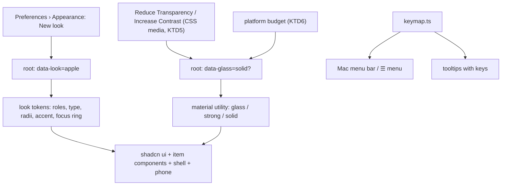

# loki on Apple's Human Interface Guidelines - Plan

## Goal Capsule

- **Objective:** loki looks, reads and is driven like a native Apple app, so on a Mac it sits beside Mail, Notes and Messages as one of them, in day and night, and is no slower or heavier than today.
- **Means:** a new visual language built to Apple's Human Interface Guidelines with Liquid Glass, as the canvas's frame D shows, brought onto every surface one screen at a time.
- **Product authority:** this Product Contract. Frame D of the canvas "loki glass directions" (a private artifact, 2026-11-12) is the reference look; it is directional, not a pixel spec. How an item behaves across sources and what it shows when (plan 098, the uniform item shape) are not active scope here.
- **Open blockers:** none.
- **Stop conditions:** stop and ask if (1) a screen misses R17's budget with glass and the solid look-alike alike; (2) WebKit reports neither Reduce Transparency nor Increase Contrast and native code would be needed (KTD5); (3) the person has not approved the previous screen rendered (R18); (4) a unit needs the old look changed rather than the new one added beside it.
- **Execution profile:** continues on `feat/shadcn-thread`, by the person's choice (2026-11-12): they run main day to day and do not want this branch merged until the new look is done, so the look builds on plans 096 and 097 here; units in order, each its own commit; the person raises the PR.
- **Product Contract preservation:** Product Contract unchanged.

---

## Product Contract

### Summary

loki takes Apple's design language in place of Slack's. Liquid Glass goes on the layer you steer with, content stays solid, words and keys follow Apple's conventions, and every surface moves over, desktop, phone and the Windows and Linux previews. Where glass would cost too much, the same shapes are drawn solid.

### Problem Frame

loki has worn Slack's look since 2026-09-23. On 2026-11-11 the person said they were fed up with it: loki borrows another product's identity and has none of its own. A full redesign on 2026-10-18 was built across the whole app at once from written directions, judged worse, and deleted; descriptions did not predict how the result felt, and moving everything together left nothing to keep. Plans 096 and 097 have since rebuilt the chat pane's components on shadcn and AI Elements, still on Slack's tokens, which leaves the look itself as the open problem.

The person likes the apps Apple designs, chose Liquid Glass over a merely Apple-like restraint or a native-only treatment, and asked that loki be designed as a head of design at Apple would, all in on the Human Interface Guidelines.

### Key Decisions

- **The Human Interface Guidelines are the authority for the look, words and keyboard.** Where loki's own rules disagree, the guidelines win, except where a decision below keeps a loki rule. (session-settled: user-directed — chosen over keeping loki's own conventions with Apple-like polish: "go all in on the human interface guidelines")
- **Liquid Glass, on the steering layer only.** Reverses PRODUCT.md's "no glass panels". Governs R1, R2. (session-settled: user-directed — chosen over a native-Mac look without glass and over Apple-like restraint, with the "no glass panels" reversal shown)
- **Frame D is the direction.** Chosen over A (floating glass on a loki-styled pane), B (a fully frosted window) and C (a solid app with glass only on transient pieces). Governs R1–R12. (session-settled: user-directed — chosen over frames A, B and C after seeing all four rendered)
- **Apple's title case on controls, and the approval as a question.** "Mark as Read", "Allow", "Allow friday to edit notes.txt?". Reverses loki's lowercase desktop controls and the phone's sentence case (docs/style.md) and plan 097's labelled approval card. Governs R7. (session-settled: user-directed — chosen over keeping loki's lowercase words, offered as "D, keep loki's words")
- **Keys live in the menu bar and in tooltips, not on buttons.** Reverses plan 097 KTD9, which shows Flow's keys on each button. Governs R9, R10. (session-settled: user-directed — accepted with frame D, where the reversal was named)
- **Return answers an approval only while the composer is empty.** Governs R11. (session-settled: user-directed — chosen over ⌘Return, which avoids an accidental approval but is less Apple-like)
- **Every surface, including the phone and the Windows and Linux previews.** Governs R13–R16. (session-settled: user-directed — chosen over desktop only)
- **Outside content and widgets are restyled too.** Governs R14. (session-settled: user-directed — chosen over keeping their own styling inside new-look cards)
- **Solid look-alike as the fallback.** Governs R3. (session-settled: user-directed — chosen over glass everywhere and over a glass preference)
- **Tokyo Night is retired; loki has one palette on Apple's roles.** Governs R4. (session-settled: user-directed — chosen over keeping Tokyo Night remapped onto Apple's roles)
- **One switch, and the week starts at the end.** Governs R18. (session-settled: user-directed — chosen over one switch per screen)
- **The look comes before item behaviour.** The 2026-11-11 research said to settle the paint last, on finished components; the person chose the look first. Plan 098 and the uniform item shape follow, cut onto this look. (session-settled: user-directed — chosen over item behaviour first and over both together, with the trade shown)
- **One Mac sidebar replaces the labelled rail; chats stay grouped by agent.** The first cut kept the rail; the 2026-11-12 critique found it the strongest Slack signal left, and the person chose to replace it (U12). Chats, Flow, Agents and Learn are the sidebar's top rows; Preferences leaves the window for ⌘, and the menu bar. (session-settled: user-directed, reversing the earlier keep-the-rail decision)
- **The accent follows the Mac's accent colour, blue by default, at a shade that passes AA.** Apple's stock blue under 13 pt white text falls below PRODUCT.md's AA floor; loki keeps AA. Governs R4.
- **Apple's focus ring replaces loki's focus flash.** One focus treatment, the one Mac users expect. Governs R12.
- **One icon set at one stroke on every platform, drawn in the SF Symbols manner.** SF Symbols' licence does not cover Windows, Linux or a bundled web app; real SF Symbols appear only in the native macOS menus. Governs R8.

### Requirements

**Materials and colour**

- R1. Liquid Glass is used only on what floats over content and steers: the sidebar, toolbar control groups, menus and popovers, sheets, the approval and other decisions, and the composer. Messages, turns, cards and pages are solid.
- R2. Content extends under the glass: the thread scrolls beneath the toolbar and composer, softened at the top edge, as macOS 26 windows do.
- R3. Where glass cannot meet the speed budget (R17), or the system's Reduce Transparency or Increase Contrast is on, the same surfaces draw solid with the same shapes, sizes and layout; under Increase Contrast their edges are stronger as well.
- R4. Colour uses Apple's semantic roles (label, secondary label, separators, fills, the accent) in one palette, day and night, and meets WCAG AA for text and controls; red stays a dot or badge for what waits on the person.
- R5. The saved light, dark or system appearance choice stays, with system as the default.
- R6. Under Reduce Motion, glass does not morph or slide and the scroll-edge softening is static; motion follows docs/design.md's existing reduced-motion rules.

**Type, shape and icons**

- R7. Type is San Francisco (the system font) on Apple platforms and the current fallbacks elsewhere (Inter, Segoe UI, Roboto), sized to the guidelines' macOS and iOS scales; controls use Apple's title case and Apple's words for common commands on every platform, the phone included.
- R8. Shapes follow the guidelines: capsule controls in glass groups, rounded corners concentric with the window, and one icon set at one stroke.

**Keyboard and commands**

- R9. Every command a screen offers is in the menu bar under a fitting menu with its key equivalent; on Windows and Linux the same commands sit in loki's ☰ menu in the title strip, which draws the same menus.
- R10. A control's key shows in its tooltip, not on its face; Escape dismisses where the guidelines say.
- R11. An approval's keys: Return allows while the composer is empty and sends the reply when it holds text; ⌘⌫ denies; Always Allow has no key and asks to confirm; Flow keeps A and D.
- R12. Every move on every desktop screen is reachable by keyboard alone, with Apple's focus ring.

**Coverage**

- R13. Every desktop screen moves: the chat pane, sidebar and rail, Flow, Agents, Learn, Preferences, ⌘K search, the Canvas tab, sheets, dialogs and menus.
- R14. Content from outside (mail HTML, Slack and Jira text) and agents' widgets are restyled to the new look as far as their content allows.
- R15. The paired phone view takes iOS's Liquid Glass conventions: tab bar, navigation bars, sheets and touch targets of at least 44 pt.
- R16. The Windows and Linux previews draw the same look, with glass where the budget allows and the solid look-alike (R3) where it does not.

**Speed and rollout**

- R17. Each screen that moves keeps scrolling a long thread and streaming a turn at 60 fps on the person's Mac, with CPU and memory within 5% of the old look, measured before and after on the demo daemons with the fake agent engine (the existing render-measurement setup).
- R18. One switch in Preferences › Appearance turns on every screen moved so far, shared chrome included; each screen is built on the real app and approved by the person rendered before the next starts, and the old look stays until the last screen has moved.

### Acceptance Examples

- AE1. **Covers R3.** Given Reduce Transparency is on in macOS, when the person opens a chat, the sidebar, toolbar groups and composer are opaque with the same shapes and positions as with glass.
- AE2. **Covers R3, R16, R17.** Given Linux, where the blur measures over budget, the window draws the solid look-alike; given a Windows machine that measures within budget, it draws glass.
- AE3. **Covers R10, R11.** Given an approval is waiting and the composer is empty, when the person presses Return, the step is allowed and hovering Allow shows a tooltip naming Return. Given the composer holds text, Return sends it as the reply and the approval stays open.
- AE4. **Covers R9, R12.** Given the chat pane, every action in its toolbar, approval and the moves under the box appears in the Chat menu with its key, and each can be done without a pointer.

### Success Criteria

- Beside Mail, Notes and Messages on the person's Mac, loki looks like it belongs, in day and night.
- No screen is slower or heavier than before it moved (R17).
- Once the last screen has moved, the person uses the new look for a week without switching back.

### Scope Boundaries

- How an item behaves across Slack, Gmail, Jira and chats, and what shows when: plan 098 and the uniform item brainstorm, after this.
- The phone's interaction model beyond its look (navigation structure, gestures).
- A new logo or app icon.
- Moving the item's moves into the toolbar, as Mail does: the moves stay under the box (decided 2026-11-12 in plan 097); the guidelines' placement can be raised again on its own.

### Dependencies / Assumptions

- loki's macOS shell builds a native menu bar (`src-tauri/src/menu.rs`) and Windows and Linux draw the same menus from loki's ☰; both read `app/src/shell/keymap.ts`, so R9 grows the keymap to every command.
- The desktop draws in the system web view (WebKit on macOS); glass is CSS backdrop blur unless planning finds native window materials cheaper.
- The phone runs the built app bundle, not a native iOS app, so R15 is iOS's look in the web view.
- Frame D lives in a private canvas artifact; planning works from this contract and the screenshots it commits beside the plan.

### Outstanding Questions

**Deferred to Planning**

- Which surfaces get native macOS window materials versus CSS blur, decided by measurement against R17.
- The order screens move in, after the chat pane and sidebar.
- How the docs carrying the reversed rules change: PRODUCT.md (brand, anti-references), docs/style.md (words on screen, desktop and phone), docs/design.md (the spec, its sentence-case lines included), AGENTS.md (its short form).

### Sources / Research

- docs/research/2026-11-11-design-language.md — what makes loki read as Slack, the 2026-10-18 lessons, the top-down then bottom-up method.
- docs/design.md "Tried and dropped" — the drafting table, the glass veil, opacity-dimmed text.
- docs/plans/2026-11-11-097-feat-item-components-plan.md — the twelve item components this look paints, and KTD9 (keys on buttons) reversed here.
- docs/plans/2026-11-12-098-feat-progressive-disclosure-plan.md — what shows when, to be re-cut onto this look.
- Apple Human Interface Guidelines, https://developer.apple.com/design/human-interface-guidelines

---

## Planning Contract

### Key Technical Decisions

- KTD1. **The new look is a layer beside the old one, switched by one attribute.** `data-look="apple"` on the root selects a separate token file; the Slack tokens and Tokyo Night keep working untouched until U11 deletes them. One switch, so the person can compare and turn back at any point (R18).
- KTD2. **The new look paints only the new components.** Turning it on turns on the new chat pane (plans 096/097); the old Slack thread is never repainted and leaves with the old look in U11. Repainting both would double the work for code that is going away. Governs R13.
- KTD3. **Glass is one material utility with three states: glass, strong glass, solid.** Every glass surface uses it, never its own blur. The root's `data-glass="solid"` turns every one opaque at once; it is set by the system's Reduce Transparency or Increase Contrast, and by the platform budget (KTD6). Governs R1, R3.
- KTD4. **Glass blurs loki's own content, not the desktop.** No transparent window: Tauri's transparent macOS windows need its private-API mode, which costs speed and rules out the App Store. Sidebar glass shows the thread and canvas beneath it. Native window materials return only if measurement shows them cheaper (Outstanding Questions). Governs R1, R2.
- KTD5. **The web view first, native code only where it cannot answer.** The accent is WebKit's system-accent colour keyword, mixed darker until white text passes AA; Reduce Transparency, Increase Contrast and Reduce Motion come from CSS media queries. If WebKit on macOS 13.3+ does not report one of them, a small native bridge sets the matching root attribute instead. Governs R3, R4, R6.
- KTD6. **Glass on Linux starts solid; Windows and macOS start glass.** The measured budget (R17) can move a platform either way; the result is a constant in one place, not a runtime probe on every launch. Governs R16, R17.
- KTD7. **Menus and tooltips both read the keymap.** `app/src/shell/keymap.ts` already feeds the Mac menu bar (`src-tauri/src/menu.rs`) and the ☰ menu; it grows to every command (R9), and a tooltip that names a key reads the same binding, so a key is written once. Governs R9, R10, R11.
- KTD8. **A dev-only workbench comes before any screen.** It draws every primitive and item component in day, night, solid and increased contrast with made-up data, so the foundation is approved by looking (R18), and the same page carries the contrast and screenshot checks.
- KTD9. **Words change screen by screen, with the screen.** Each unit moves its screen's words to Apple's title case (R7); the style docs change once, in U11, when the last screen has moved.

### High-Level Technical Design

---

## Implementation Units

### U1. The look layer and its switch

**Goal:** the new tokens, the material utility and one switch, with nothing on screen changed while it is off.
**Requirements:** R3, R4, R5, R6, R7, R8, R18; KTD1, KTD3, KTD5.
**Dependencies:** none.
**Files:** `app/src/kit/look.css` (new), `app/src/styles.css`, `app/src/theme.tsx`, `app/src/settings/settings.tsx`, `app/src/item/preview.ts`, `test/tokens.test.ts`, `test/theme.test.ts`, `test/look.test.ts` (new).
**Approach:**
1. `look.css` maps Apple's semantic roles onto the shadcn variables and loki's roles for day and night, with the type scale, concentric radii and the focus ring.
2. The material utility reads `data-glass`; the media queries for Reduce Transparency and Increase Contrast set the solid state.
3. The switch sets `data-look` and turns the new chat pane on with it (KTD2).
**Patterns to follow:** `app/src/kit/tokens.css`'s day and night blocks and its `prefers-contrast` block; `createSessionValue` in `app/src/item/preview.ts`.
**Test scenarios:**
- With the switch off, the root carries no `data-look` and every existing token test passes unchanged.
- With it on, `data-look="apple"` is set and the new chat pane preview reads on.
- Every text role meets AA on its surface in day and night, the accent with white text included (`test/tokens.test.ts` extended).
- Under `prefers-reduced-transparency` or `prefers-contrast: more` the material resolves to solid.
- No colour, radius or size outside the new scales appears in `look.css`.
**Verification:** the switch toggles cleanly with no visible change while off; the token fence covers the new file.

### U2. The workbench

**Goal:** a dev-only page that draws every primitive and item component in each state, where the person approves the foundation.
**Requirements:** R18; KTD8.
**Dependencies:** U1.
**Files:** `app/src/dev/workbench.tsx` (new), the app's dev-only entry, `test/workbench.test.ts` (new).
**Approach:** made-up data shaped like real data; a strip of toggles for day, night, solid and increased contrast; sections for `app/src/ui/` primitives, the twelve item components, menus, tooltips and sheets.
**Test scenarios:**
- The workbench is absent from the production bundle.
- Each section renders in all four states without errors.
**Verification:** the person has looked at it on the demo daemons and approved the foundation.

### U3. The window shell

**Goal:** the glass sidebar with the labelled rail and grouped chats, the toolbar's title and control groups, content running under them.
**Requirements:** R1, R2, R8, R13; KTD3, KTD4.
**Dependencies:** U2.
**Files:** `app/src/shell/sidebar.tsx`, `app/src/shell/desk-sidebar.tsx`, `app/src/shell/desk-sidebar.css`, `app/src/shell/shell.tsx`, `app/src/shell/use-window-chrome.ts`, `app/src/components/index.tsx` (PaneHeader), `app/src/components/components.css`, `test/shell-look.test.ts` (new).
**Approach:** the sidebar floats inset from the window edge, its corners concentric with the window's; the traffic lights sit in it (the window already overlays its title bar); the pane header becomes the window title with a subtitle and capsule control groups.
**Test scenarios:**
- With the new look on, the sidebar, rail and toolbar groups use the material utility and nothing else blurs.
- With `data-glass="solid"` they draw opaque with the same geometry.
- The rail keeps its labels and the chats stay grouped by agent.
**Verification:** rendered on the demo daemons day and night and approved; R17 measured.

### U4. The chat pane

**Goal:** the thread, turns, approval and composer as frame D draws them.
**Requirements:** R1, R2, R7, R8, R13, R14; KTD2, KTD9.
**Dependencies:** U3.
**Files:** `app/src/item/timeline.tsx`, `app/src/item/message-entry.tsx`, `app/src/item/agent-turn.tsx`, `app/src/item/work.tsx`, `app/src/item/agent-plan.tsx`, `app/src/item/thought.tsx`, `app/src/item/proposal.tsx`, `app/src/item/composer.tsx`, `app/src/item/action-bar.tsx`, `app/src/item/item-header.tsx`, `app/src/desk/desk-pane.tsx`, `test/item-*.test.ts`.
**Approach:**
1. The thread scrolls under the toolbar and composer with a softened top edge.
2. The approval reads as a question with Deny, Always Allow… and Allow, Allow the default.
3. The moves under the box take Apple's words (Later, Mark as Read, Archive) and lose their key chips (U5 puts the keys in tooltips).
**Test scenarios:**
- The approval's heading is a question naming the agent and the step.
- Allow is the one default button; Always Allow… and Deny are plain.
- ActionBar draws no key on a button face when the new look is on.
- Messages, turns and cards carry no blur.
**Verification:** rendered and approved; R17 measured on a long thread and a streaming turn.

### U5. Keyboard: menus, tooltips, approval keys, focus

**Goal:** every command in the menus, every key in a tooltip, the approval keys, and Apple's focus ring.
**Requirements:** R9, R10, R11, R12; KTD7. Covers AE3, AE4.
**Dependencies:** U4.
**Files:** `app/src/shell/keymap.ts`, `src-tauri/src/menu.rs`, `app/src/shell/title-menu.tsx`, `app/src/ui/tooltip.tsx`, `app/src/item/proposal.tsx`, `app/src/item/composer.tsx`, `app/src/kit/look.css`, `test/keymap.test.ts`, `test/approval-keys.test.ts` (new).
**Approach:** the keymap gains every command a screen offers, sorted into menus; a tooltip wrapper names the bound key; Return allows while the composer is empty, ⌘⌫ denies, Always Allow… confirms first; the focus flash gives way to the focus ring under the new look.
**Test scenarios:**
- Covers AE3. Return with an empty composer allows; with text it sends the reply and the approval stays open.
- ⌘⌫ denies; Always Allow… opens a confirmation before granting.
- Every binding a screen uses is in a menu; no two bindings in one scope share a key.
- A tooltip for a bound control shows the same key the menu shows.
- Covers AE4. Every action in the chat pane is reachable by keyboard alone.
**Verification:** a keyboard-only walk of the chat pane; `menu.rs` builds the grown menus (cargo checks pass).

### U6. Flow

**Goal:** the deck and its chat, Gmail, Slack and Jira cards on the new look, outside content restyled.
**Requirements:** R13, R14, R7; KTD9.
**Dependencies:** U5.
**Files:** `app/src/desk/catch-up.tsx`, `app/src/desk/catch-up-parts.tsx`, `app/src/desk/outside-card.tsx`, `app/src/desk/mail-thread.tsx`, `app/src/desk/mail-html.tsx`, `app/src/desk/slack-thread.tsx`, `app/src/desk/jira-ticket.tsx`, `test/item-header.test.ts`, `test/outside-threads.test.ts`.
**Approach:** cards are solid on the page; the deck's controls sit in glass groups; mail HTML takes the new type and colours where its own styles allow, without breaking the sender's layout.
**Test scenarios:**
- A mail with its own inline colours keeps them; one without takes the new look's text colours.
- Slack and Jira text take the new type scale.
- Flow keeps A and D on an approval card.
**Verification:** rendered with made-up Gmail, Slack and Jira cards and approved.

### U7. Search, the Canvas tab and widgets

**Goal:** ⌘K search, the Canvas tab and agents' widgets on the new look.
**Requirements:** R13, R14.
**Dependencies:** U5.
**Files:** `app/src/shell/search-sheet.tsx`, `app/src/shell/search-sheet.css`, `app/src/desk/surface.tsx`, `app/src/desk/module-widget.tsx`, `app/src/desk/widget-frame.tsx`, `app/src/desk/widget-bridge.ts`, `test/desktop-search.test.ts`.
**Approach:** search is a glass sheet; the canvas chrome takes the toolbar groups; the widget frame passes the new look's role variables to widgets so their content restyles as far as it uses them.
**Test scenarios:**
- A widget that reads loki's colour variables draws in the new look's roles.
- Search results keep their keyboard order and selection.
**Verification:** rendered and approved.

### U8. Agents, Learn, Preferences, sheets and dialogs

**Goal:** the remaining desktop screens on the new look.
**Requirements:** R13, R7, R4; KTD9.
**Dependencies:** U5.
**Files:** `app/src/settings/*.tsx`, the Agents and Learn views under `app/src/shell/views.tsx`, `app/src/ui/dialog.tsx`, `app/src/ui/dropdown-menu.tsx`, related tests.
**Approach:** sheets and menus take the strong glass; form screens stay solid; the Appearance pane loses the palette choice (Tokyo Night retired, R4) and keeps light, dark and system (R5).
**Test scenarios:**
- Appearance offers light, dark and system and no palette.
- Sheets draw solid under `data-glass="solid"`.
**Verification:** rendered and approved.

### U9. The phone

**Goal:** the paired phone view on iOS's Liquid Glass conventions.
**Requirements:** R15, R7.
**Dependencies:** U2.
**Files:** `app/src/phone/phone.css`, `app/src/phone/*.tsx`, `test/phone*.test.ts`.
**Approach:** glass tab bar and navigation bars, solid content, sheets, touch targets of at least 44 pt, title case; the phone reads the same look layer and material utility.
**Test scenarios:**
- Every tappable control is at least 44 pt.
- The tab bar and navigation bars use the material utility; lists and messages do not.
**Verification:** rendered on a phone-sized viewport and the paired phone, approved.

### U10. Windows and Linux

**Goal:** the previews on the new look with the right glass state.
**Requirements:** R16, R9, R7; KTD6.
**Dependencies:** U5.
**Files:** `app/src/theme.tsx`, `app/src/shell/title-menu.tsx`, `app/src/kit/look.css`, `test/look.test.ts`.
**Approach:** the platform constant sets solid on Linux; the ☰ menu draws as a strong-glass menu (solid on Linux); fonts fall back as R7 says.
**Test scenarios:**
- Covers AE2. On Linux the root carries `data-glass="solid"`; on Windows it does not.
- The ☰ menu lists the same commands as the Mac menu bar.
**Verification:** checked on CI's Windows and Linux builds and by measurement where a machine is available.

### U11. Retire the old look and rewrite the docs

**Goal:** one look, and the docs that state the reversed rules.
**Requirements:** R4, R18; KTD1, KTD9.
**Dependencies:** U3–U10, and the person's week (Success Criteria).
**Files:** `app/src/kit/tokens.css`, `app/src/theme.tsx`, the old thread under `app/src/chat/`, `PRODUCT.md`, `docs/style.md`, `docs/design.md`, `docs/manual.md`, `AGENTS.md`, `test/tokens.test.ts`.
**Approach:** delete the Slack tokens, Tokyo Night, `data-palette`, the switch and the old thread; rewrite PRODUCT.md's brand and anti-references, style.md's words rule, design.md as the new spec with the reversals under "Tried and dropped", the manual's Appearance section and AGENTS.md's short form.
**Test scenarios:**
- No reference to `data-palette` or the old tokens remains.
- The token fence passes on the single look.
**Verification:** every check in AGENTS.md passes; the person has used the new look for a week.

### U12. One sidebar in place of the rail

**Goal:** the window's left side is one Mac source list, as Mail and Notes draw it, not a rail beside a list.
**Requirements:** R1, R13; KTD1.
**Dependencies:** U3.
**Files:** `app/src/shell/sidebar.tsx`, `app/src/shell/shell.tsx`, `app/src/shell/list-column.tsx`, `app/src/shell/use-column.ts`, `app/src/components/components.css`, `test/shell-look.test.ts`.
**Approach:** under Liquid Glass the rail draws nothing and takes no width. The list column becomes the sidebar on every section, Flow included: four place rows at its top (Chats, Flow, Agents, Learn) at 13 pt with an accent-tinted symbol and a grey trailing count, the selected row filled and never bold, then the section's own list under an 11 pt section heading. The sidebar toggle sits beside the traffic lights and stays there while the sidebar is hidden; the main pane leaves room for both. Preferences is ⌘, (and the menu bar); a quiet "Update available" row appears at the sidebar's foot only while a newer loki is out. Today's look keeps the rail.
**Test scenarios:**
- Under Liquid Glass the sections nav lists Chats, Flow, Agents and Learn as rows, with no Preferences row and no labelled rail.
- Flow's row carries the waiting count as text, not a red badge.
- Today's look still draws the rail with its five segments.
**Verification:** rendered in light and dark on demo data, with the sidebar shown and hidden.

### U13. The chat's toolbar and the sidebar's real material

**Goal:** the chat pane's top is a Mac toolbar, and the sidebar is the Mac's own translucent material rather than blur painted over a flat colour.
**Requirements:** R1, R2, R13; KTD1.
**Dependencies:** U4, U12.
**Files:** `src-tauri/Cargo.toml`, `src-tauri/tauri.conf.json`, `src-tauri/src/lib.rs`, `app/index.html`, `app/src/theme.tsx`, `app/src/styles.css`, `app/src/shell/shell.tsx`, `app/src/components/index.tsx`, `app/src/desk/desk-pane.tsx`, `app/src/components/components.css`, `test/shell-look.test.ts`, `test/chat-look.test.ts`.
**Approach:** on the Mac the window is transparent with the system's sidebar material behind it (Tauri's window effects; the private-API flag it needs is acceptable outside the App Store). The page marks the root `data-vibrant` there; under Liquid Glass the sidebar's region lets the material through and everything right of it is painted opaque, and Reduce Transparency, Increase Contrast and the solid fallback paint it solid as before. The chat's header becomes one 52 pt toolbar row: the title at 15 pt semibold with the agent and its state as a grey line under it, no avatar or Unread chip (the sidebar shows unread), and at the trailing edge the Messages / Canvas control and one glass group of the item's moves as symbols (Label, Mark as Read while unread, Archive) whose names and keys are in their tooltips. The moves leave the row under the box. Today's look and the browser keep today's header and an opaque window.
**Test scenarios:**
- On the Mac the window builder asks for transparency and the sidebar effect; elsewhere it does not.
- Under Liquid Glass with `data-vibrant`, the page ground is transparent and the content right of the sidebar is opaque; under the solid fallbacks it is opaque everywhere.
- The chat's toolbar draws Archive, Label and Mark as Read as named buttons in the header, and no ActionBar under the box.
**Verification:** the toolbar rendered on demo data in light and dark; the material checked in the real Mac window.

### U14. The thread reads as a Mac conversation with an agent

**Goal:** the thread stops reading as a Slack channel: your prompts are bubbles at the trailing edge, the agent's work is prose with no name over it, and time is told at gaps, not on every row.
**Requirements:** R1, R13; KTD1.
**Dependencies:** U4.
**Files:** `app/src/item/message-entry.tsx`, `app/src/item/agent-turn.tsx`, `app/src/item/entries.ts`, `app/src/item/timeline.tsx`, `test/chat-look.test.ts`, `test/thread-new.test.ts`.
**Approach:** under Liquid Glass, the layout of ChatGPT and Claude for Mac rather than Messages' two-sided bubbles (the critique's recommendation, which the person went ahead with):
- Your message is a bubble at the trailing edge, at most three quarters of the column, with no "You" and no time on it; its time is its tooltip, and copy shows on hover under it.
- The agent's turn has no name; its header line appears only while it says something (worked for how long, working, needs you, failed).
- Its words carry no time row; copy appears on hover.
- Time is a centred marker before your message when a quarter of an hour or more has passed, or with the day where the day changes.
- Today's look keeps its rows as they are.
**Test scenarios:**
- Under Liquid Glass your message has no "You" label and keeps its time as a tooltip; today's look keeps both on the row.
- The agent's turn names no agent under Liquid Glass and still announces itself to a screen reader by name.
- With gaps on, a message 15 minutes or more after the row before it gets a time marker; one sooner does not; the day's marker carries the time where both fall.
**Verification:** rendered on demo data in light and dark.

---

## Verification Contract

- Every unit: the checks in AGENTS.md with CI's toolchain; the cargo checks in docs/CONTRIBUTING.md whenever `src-tauri/` changes (U5).
- Every screen unit: rendered on the demo daemons with made-up data at 1440 and 900 px, in day, night, solid and increased contrast, then walked by keyboard; R17 measured with the render-measurement setup, before and after; the person's approval before the next unit starts.
- End: the Success Criteria, read beside Mail, Notes and Messages.

## Definition of Done

- Every R1–R18 holds and AE1–AE4 pass.
- Each screen was approved rendered by the person in order.
- The old look, Tokyo Night and the switch are gone, and the docs state the new rules.

---

## Planning Notes

### Scope Boundaries (planning)

- Not built: a transparent window showing the desktop (KTD4); a per-launch glass benchmark (KTD6's constant instead); repainting the old Slack thread (KTD2).

### Risks

- WebKit may not report Reduce Transparency on macOS 13.3: a small native bridge then sets the attribute (KTD5, stop condition 2).
- Mail HTML restyling can break a sender's layout: U6 restyles only what the mail leaves unstyled.
- Title case across every screen is a large copy change: per screen with that screen (KTD9) so no half-cased screen ships.

### Deferred to Implementation

- The exact accent darkening amount per system accent, from the contrast test.
- Where the workbench mounts in the dev build.
- Whether any Windows machine measures over budget.

### Sources (planning)

- `app/src/kit/tokens.css` (day/night blocks, `prefers-contrast` and reduced-motion handling, the focus flash), `app/src/shell/keymap.ts` (MENUS and KEYMAP), `src-tauri/src/menu.rs` (menus built from the keymap), `src-tauri/src/lib.rs` (overlay title bar), `app/src/item/preview.ts` (the preview switch pattern).
- Apple's Human Interface Guidelines were not fetched this session, by the person's choice; the plan follows them as known, and implementation checks each screen against them.
