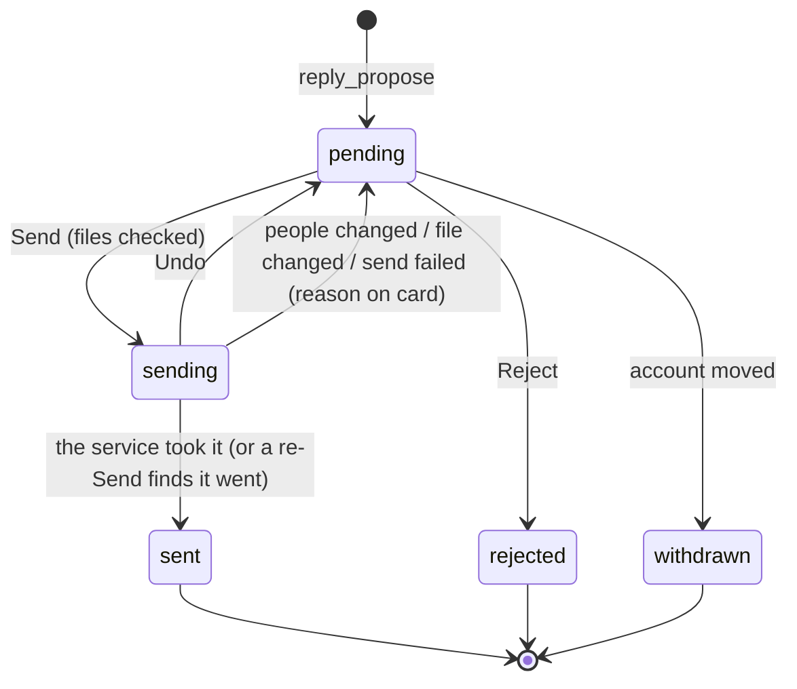

# An agent's reply sends from its card - Plan

## Goal Capsule

- **Objective:** When an agent proposes a reply in a thread, the person reads it once, presses one button, and the reply reaches the thread's people on Gmail, Slack or Jira with its files. Nothing goes anywhere, or to anyone, the card did not show.
- **Means:** Send on the agent's reply card hands the reply to the path the person's own replies take, held 10 seconds with Undo (KTD1).
- **Product authority:** the person, in the session of 2026-11-14. This plan supersedes [2026-11-14-1500-feat-reply-attachments-plan.md](2026-11-14-1500-feat-reply-attachments-plan.md) (files on Gmail drafts, built on this branch and not merged); its file checks carry over.
- **Open blockers:** none. Slack's file upload is an assumption checked by hand before merging (see Dependencies / Assumptions).
- **Stop conditions:** stop and ask the person if Slack will not take text and files as one message in a thread, or if any real send during the by-hand check would reach someone other than the person.
- **Execution profile:** one branch (`feat/reply-attachments`, to be renamed for this work), one PR; the person merges.
- **Product Contract preservation:** changed R8 (25 MB → 17 MB: Gmail's 25 MB counts the encoded message, and files grow about a third when encoded; confirmed by the person 2026-11-14). Outstanding Questions resolved into KTD2, KTD3, KTD5 and U8. After review, with the person's answers on 2026-11-14: changed the Objective's wording ("anywhere, or to anyone"), R3 (Gmail signature and quote) and R9 (Show in Finder).

---

## Product Contract

### Summary

The reply card an agent's `reply_propose` makes gets **Send** in place of Approve. Send holds the reply for 10 seconds with Undo, then sends it in its thread as the person: an email, a Slack message or a Jira comment, with its files. Drafts go away.

### Problem Frame

The person already reviews every reply an agent proposes, on its card, in the chat, in Flow or on the phone. Approving only saves a draft in Gmail or Slack, or puts a Jira comment in its card's box, so the person opens the service and sends the same words a second time. The card was the review; the second step adds nothing.

Files make it worse. An agent asked to answer a thread with an invoice could not attach it: `reply_propose` took text only, and its prompt forbids sending any other way. Slack and Jira both take files in their own apps, so leaving them out of an agent's reply has no reason the person sees.

### Key Decisions

- **Send replaces drafts on all three services.** The card is the review, so the draft round-trip goes. (session-settled: user-directed — chosen over keeping drafts in Gmail and Slack and the Jira comment box: "I am already reviewing things on loki, I might as well send them".) Governs R1, R2.
- **The card sends; it does not fill the thread's reply box in Flow.** One press works from a chat, Flow or the phone, and a handed-off thread need not come back to Flow. (session-settled: user-approved — chosen over having approve fill the thread's reply box in Flow: two steps, and handed-off threads have left Flow.) Governs R1.
- **Every send is held 10 seconds with Undo, on all three services.** A mis-tap, on the phone above all, costs nothing. (session-settled: user-approved — chosen over holding only Gmail as the person's own replies do, and over no hold.) Governs R4, R5, R6.
- **New people stop the send.** (session-settled: user-approved — chosen over sending to the people the card showed, and over sending to the thread's new people.) Governs R7.
- **On the card the person edits the text and can take files off; not the recipients.** Who a reply goes to stays the thread's people; to add someone, the person replies themselves. (session-settled: user-approved — chosen over text only, and over editing To and Cc as the person's own reply box does.) Governs R3, R9.
- **Files on all three services in this work.** (session-settled: user-approved — chosen over Gmail now and Slack and Jira later.) Governs R8, R11.
- **The agent still cannot send.** Only the person's press sends; the safety rule moves from "only a draft" to "only on the person's Send". Governs R14.

### Actors

- A1. The person: reads the card, edits it, presses Send, Undo or Reject.
- A2. The agent that owns the account: proposes the reply with `reply_propose` and hears what became of it.
- A3. The thread's people on Gmail, Slack or Jira: receive the reply.

### Requirements

**Sending**

- R1. An agent's reply card offers Send and Reject wherever it shows (the chat, Flow, the phone); Send sends the reply in its thread as the person, and no draft is written anywhere.
- R2. A reply goes where its draft went before: on Gmail, reply-all to the thread's newest message; on Slack, the same conversation and thread; on Jira, a comment on the ticket.
- R3. The words sent are the card's text as the person last edited it; a Gmail reply goes as the person's own replies from Flow do, with their signature and the quoted message under it, and the card says so.

**Hold and undo**

- R4. After Send, the reply waits 10 seconds before it goes, on every service, and the card says it is sending and offers Undo.
- R5. Undo stops the reply; it returns to the card waiting, with the person's edits and file removals kept.
- R6. A reply still waiting when loki quits goes when loki starts again, within the same lateness limit the person's own mail replies have; past that limit it waits on the card for the person.

**Who it reaches**

- R7. When the people a Gmail reply would reach at the moment it goes differ from those the card showed, it does not go; the card shows the new To and Cc with the change marked, and the person presses Send again.

**Files**

- R8. `reply_propose` takes files from the chat's folder on Gmail, Slack and Jira alike: at most 10, and 17 MB together.
- R9. The card names each file with its size, lets the person show it in Finder on the Mac before Send, and lets them take any of them off; the phone card shows names and sizes only.
- R10. A file that changed or is gone since the reply was proposed stops the send, and the card says which file.
- R11. Files go as each service carries them: attached to the email; uploaded with the message in the Slack conversation or thread; attached to the Jira ticket, with the comment naming them.

**What the agent hears**

- R12. The agent is told when its reply went (where, to whom, with which files) and when the person rejected it; a reply waiting or undone tells it nothing.
- R13. A send that fails says why on the card and waits for the person to Send again or Reject; it is never sent again by itself, so nothing reaches a thread twice.

**Rules and words**

- R14. Only the person's Send sends an agent's reply, in every permission mode; every place that says a reply proposal is only ever a draft (the tool's description, the agent's prompt, the manual, the glossary, SECURITY.md) says this instead.
- R15. Sending makes no other move on the thread: it is not marked read, put off or archived (as plan 083 has for the person's own replies).

### Key Flows

- F1. Send
  - **Trigger:** The person presses Send on an agent's reply card.
  - **Actors:** A1, A2, A3
  - **Steps:** The card checks the files (R10); the reply waits 10 seconds with Undo (R4); at the end the people are checked again (R7); the reply goes with its files (R11); the agent is told (R12).
  - **Outcome:** The reply is in the thread; the card leaves.
  - **Covered by:** R1-R4, R7, R10-R12
- F2. Undo
  - **Trigger:** The person presses Undo while the reply waits.
  - **Steps:** Nothing goes; the card waits again with the edits kept (R5).
  - **Covered by:** R5, R12

### Acceptance Examples

- AE1. **Covers R7.** **Given** an agent proposed a reply to Grace and Alan, cc Bob, **when** Carol writes in the thread and the person presses Send, **then** nothing goes, the card shows Carol added to the reply, and a second Send reaches Grace, Alan, Bob and Carol.
- AE2. **Covers R4, R5.** **Given** a Slack reply on its card, **when** the person presses Send and then Undo four seconds later, **then** nothing is posted and the card waits with the person's edited text.
- AE3. **Covers R10.** **Given** a Gmail reply carrying `invoice.pdf`, **when** the file is edited in the chat's folder and the person presses Send, **then** nothing goes and the card says `invoice.pdf` changed since the reply was proposed.
- AE4. **Covers R9, R11.** **Given** a Jira comment carrying two files, **when** the person takes one off and presses Send, **then** the ticket gets one attachment and the comment names it.
- AE5. **Covers R6, R12.** **Given** the person pressed Send, **when** loki quits three seconds later and starts again within the lateness limit, **then** the reply goes and the agent is told once.
- AE6. **Covers R13.** **Given** a Jira comment whose post fails, **when** the failure comes back, **then** the card says why and waits, and nothing posts until the person presses Send again.

### Scope Boundaries

**Deferred for later**

- Editing To, Cc or the subject on the card, and adding people.
- Files in a Claude Code (ACP) chat: its tool calls carry no chat folder, so they stay refused there, as a script's mail files are today.
- Images shown inline in a Jira comment; files stay in the ticket's attachments.
- An agent proposing what happens to the thread after its reply (read, archive).

**Not this work**

- A "Save as Draft" choice on the card; drafts go away.
- Any way for the agent to send without the person's press; scripts' own `google_gmail_send` is unchanged.

### Dependencies / Assumptions

- Slack lets loki upload a file into a conversation or thread as the person, through the signed-in session loki already uses. Unverified: it is checked on a real workspace before shipping, and if it fails the person decides what happens rather than Slack shipping without files.
- The person's Jira account may attach files to the tickets it comments on.

### Sources / Research

- [docs/SECURITY.md](../SECURITY.md) lines 207-212 and 293-296: the "only a draft" rules this work rewrites.
- [mod/outside-threads.ts](../../mod/outside-threads.ts) `reply` and `sendNow`: the person's own send path (Gmail held, Slack and Jira at once).
- [mod/mail-outbox.ts](../../mod/mail-outbox.ts): the 10-second hold, undo, the keychain seal, and the lateness limit after a restart.
- [mod/reply-proposals.ts](../../mod/reply-proposals.ts) `write`: recomputes Gmail's people at approve time, which R7 guards.
- [mod/slack.ts](../../mod/slack.ts) `draftsCreate` (`file_ids: []`) and [mod/jira.ts](../../mod/jira.ts) `attachments`, `postComment`: no upload exists on either yet.
- Plans 067 (KTD9), 071, 076, 083, 096 and 2026-11-10-1451 (KTD11: a Jira comment posts once, never retried).
- Research for this plan: Slack's upload flow (`files.getUploadURLExternal`, upload to the returned URL, `files.completeUploadExternal`; `files.upload` retired 2025-11-12), Jira Cloud's `POST /rest/api/3/issue/{key}/attachments` (multipart field `file`, header `X-Atlassian-Token: no-check`), and Gmail's media upload for `messages.send` (the JSON `raw` route stops near 5 MB).

---

## Planning Contract

### Key Technical Decisions

- KTD1. **Agent replies send through `OutsideThreads` and its outbox, the path the person's own replies take.** One held-send path keeps one keychain seal, one lateness rule and one failure record; a second sender inside `ReplyProposals` would duplicate all three. The person's own Slack and Jira replies keep going at once; only agent replies are held on those services. Governs R1, R2, R4, R6. Implements the Key Decision that the card sends.
- KTD2. **The outbox's held entry becomes service-neutral.** It gains the Slack thread, the files (path, name, size, MD5) and an optional proposal key (agent, chat, proposal id); the seal signs every field, and `stay` is accepted as a move (fixing today's drop of held `stay` mail replies on restart). Governs R4, R6.
- KTD3. **`reply_decide` answers at once; the reply's fate arrives by push.** Send moves a proposal from pending to sending and returns; sent, refused and undone reach every client through the existing `reply_proposals` chat event. Undo is a new `reply_decide` action routed by chat, so it reaches the Mac that holds the reply. Statuses become pending, sending, sent, rejected, withdrawn; a stored `drafting` still reads as pending and a stored `drafted` as a settled record. Governs R4, R5, R12.
- KTD4. **The Gmail recipient check runs when the reply actually goes.** At the end of the hold the send reads the thread, takes reply-all of the newest message, and compares its bare addresses with the proposal's To and Cc as sets; a difference stops the send and puts the proposal back to pending with the new people and who was added or removed. Governs R7.
- KTD5. **Files are checked by MD5 at the press and again when the hold ends, on the bytes that are sent.** At the end of the hold each file is read once, its MD5 checked against those bytes, and the same bytes handed to the Gmail, Slack or Jira send, so a file swapped after the check cannot go out. Nothing but the path, name, size and MD5 is stored, in the proposal or the outbox. Governs R8, R10.
- KTD6. **A Gmail reply with files goes through Gmail's media upload route** as raw RFC 822; one without files keeps today's JSON send. Governs R8, R11.
- KTD7. **Slack: text and files go as one message.** With files, the text rides as the upload's comment in the same conversation and thread, escaped and with mentions turned into Slack's form as `postReply` does; without files, `postReply` as today. The two upload methods join the client's allow-list by name, and the byte upload goes to files.slack.com with the host check `fileThumb` uses. Governs R11.
- KTD8. **Jira: files are attached to the ticket first, then the comment posts naming them in plain text.** A comment that fails after the files went leaves them on the ticket, and the card says so; the proposal records which files are attached, and a later Send attaches only the rest before posting the comment. An attach that times out is reported as "the files may be on the ticket: check before sending again". Neither step is retried by itself. Governs R11, R13.
- KTD9. **Nothing reaches a thread twice, through a failure, a second Send or a restart.**
  1. A Slack or Jira send found mid-post after a restart is recorded as failed with "it may have gone: check the thread before sending again"; Gmail keeps its outbox-header check.
  2. An outbox entry with a proposal key is removed only after `ReplyProposals` has saved its outcome; until then it stays, marked with that outcome, and a restart reports it again.
  3. A failed entry is reported to its proposal once and then removed; the proposal keeps the failed send's outbox id. The next Send of a Gmail proposal first asks whether that id went out: if so, the proposal settles as sent and nothing new is held.
  4. A proposal stored as sending that the outbox no longer holds, with no saved outcome, goes back to pending with the "may have gone" reason; on Gmail the thread is read for its header first.
  Governs R12, R13.
- KTD10. **Approving no longer puts a Jira comment in the card's box.** Comments approved before this change keep showing there; the code that only serves them is removed once a release has shipped them out (as with the pending migrations removal). Governs R1.
- KTD11. **File uploads get a timeout that grows with their size,** at least 120 seconds at the 17 MB cap, on Gmail's upload route, the Slack byte upload and the Jira attach; other requests keep their 20 seconds. Governs R8, R11.

### High-Level Technical Design

A proposal's states:



Who calls whom on Send:

```mermaid
sequenceDiagram
    participant Card as Reply card (desktop, phone)
    participant RP as ReplyProposals
    participant OT as OutsideThreads + outbox
    participant Svc as Gmail / Slack / Jira
    Card->>RP: reply_decide send (text, files kept)
    RP->>RP: check files (MD5), status sending
    RP->>OT: hold(entry with proposal key)
    RP-->>Card: answered at once (sending)
    Note over OT: 10 s; Undo -> reply_decide undo -> OT.unsend -> pending
    OT->>OT: re-check files; Gmail: re-read people
    OT->>Svc: send with files
    OT-->>RP: sent / refused (by proposal key)
    RP-->>Card: reply_proposals push; agent notice on sent
```

### Assumptions

- Slack accepts `files.completeUploadExternal` with a comment and a thread from the desktop session loki signs in with; the by-hand check settles it before merging.

### Sequencing

U1 first; U2, U3 and U4 depend on nothing but U1's entry shape and can go in any order; U5 joins them; U6 builds on U5; U7 on U6; U8 last.

---

## Implementation Units

### U1. The outbox holds any service's reply

**Goal:** The outbox holds, seals, resumes, undoes and records failures for Gmail, Slack and Jira replies alike, the person's and an agent's.

**Requirements:** R4, R5, R6, R13; KTD2, KTD9.

**Dependencies:** none.

**Files:**
- `mod/mail-outbox.ts`
- `core/frame-types.ts` (the held entry's new fields, if it lives there)
- `test/mail-reply.test.ts`

**Approach:**
1. Extend the held entry with the Slack thread, files and the optional proposal key; add each to the seal.
2. Accept `stay` in the entry check.
3. Let `wentOut` answer per service; Slack and Jira answer "unknown", which records the failure KTD9 words instead of resending.
4. Report failures and sends with the entry, so `onNotSent` and a new on-sent callback can route by proposal key.
5. Keep an entry with a proposal key, marked with its outcome, until its proposal acknowledges it; report a failure once and then remove it (KTD9).

**Patterns to follow:** the existing seal, resume and `fail` code in `mod/mail-outbox.ts`.

**Test scenarios:**
- A held `stay` mail reply survives a restart and goes when due.
- An entry whose Slack thread, file list or proposal key was edited on disk fails its seal and is dropped.
- A Slack entry found mid-send after a restart is recorded failed with the "may have gone" reason and is not sent.
- A Gmail entry found mid-send whose header is in the thread is treated as sent.
- Unsend before the hold ends removes the entry and nothing is sent.
- A failed entry carrying a proposal key is reported once with that key, and not again after a restart once acknowledged.
- A sent entry with a proposal key whose acknowledgement never came (loki stopped between) is reported sent again after a restart, and nothing is sent twice.

**Verification:** every existing outbox test passes unchanged, and the new scenarios pass.

### U2. Gmail sends files through its upload route and checks the people

**Goal:** A Gmail reply with files reaches Gmail up to the 17 MB cap, and a reply whose people changed does not go.

**Requirements:** R7, R8, R11; KTD4, KTD6.

**Dependencies:** U1.

**Files:**
- `mod/gmail.ts`
- `mod/reply-proposals.ts` (`replyAllOf` reused for the comparison)
- `test/mail-reply.test.ts`

**Approach:**
1. Send with files through the media upload URL with the RFC 822 body and the upload timeout (KTD11); keep the JSON route without files.
2. Expose the comparison of reply-all against the proposal's people for U5 to call when the hold ends.

**Test scenarios:**
- A reply with a 3 MB file is sent through the upload route with `Content-Type: message/rfc822` and the file as an attachment part.
- A reply without files is sent as JSON, as today.
- Covers AE1. A thread that gained Carol since the proposal yields "changed: added carol@…", and the same people in another order yield no change.
- A display-name-only change ("Grace H." for the same address) is not a change.

**Verification:** the fake Gmail receives the upload request and the comparison reports exactly the added and removed addresses.

### U3. Slack uploads files with the message

**Goal:** loki can post a message with files into a Slack conversation or thread as the person.

**Requirements:** R11; KTD7.

**Dependencies:** U1.

**Files:**
- `mod/slack.ts`
- `test/slack.test.ts`

**Approach:**
1. Add `files.getUploadURLExternal` and `files.completeUploadExternal` to the allow-list.
2. Upload each file's bytes, as handed in (KTD5), to the returned URL after checking its host is files.slack.com, with the upload timeout (KTD11).
3. Complete with the channel, the thread when there is one, and the text prepared as `postReply` prepares it.

**Patterns to follow:** `fileThumb` for the direct files.slack.com request; `postReply` for escaping and mentions.

**Test scenarios:**
- Two files and a thread: two upload URLs asked for, two uploads, one completion carrying channel, thread and the escaped text with mentions converted.
- An upload URL on another host is refused and nothing is completed.
- A failed completion reports Slack's error and is not retried.
- The test that lists every Slack method and path loki calls lists the two new methods and the upload host, and still finds no other sending method.

**Verification:** the fake Slack records the three-step flow, and the allow-list test passes with the new names added on purpose.

### U4. Jira attaches files to a ticket

**Goal:** loki can attach files to a ticket and then post a comment naming them.

**Requirements:** R11, R13; KTD8.

**Dependencies:** U1.

**Files:**
- `mod/jira.ts`
- `test/jira.test.ts`

**Approach:**
1. Add a multipart request with the `file` field and `X-Atlassian-Token: no-check`, the content type left to the multipart body, taking bytes as handed in (KTD5) and the upload timeout (KTD11).
2. Return the attached names for the comment text and for the proposal's record of attached files (KTD8).

**Test scenarios:**
- Two files attach in one request with the header and field name, and the comment posted after names both.
- A failed attach posts no comment and reports Jira's error.
- An attach that times out reports that the files may be on the ticket.
- The test that `postComment` is the only write becomes "`postComment` and the attach call are the only writes".

**Verification:** the fake Jira records the multipart request and the comment, in that order.

### U5. Agent replies take the person's send path

**Goal:** `OutsideThreads` sends a held agent reply with its files, checks Gmail's people when the hold ends, makes no move after it, and reports its fate to the proposal.

**Requirements:** R2, R6, R7, R10, R11, R13, R15; KTD1, KTD4, KTD5, KTD9.

**Dependencies:** U1, U2, U3, U4.

**Files:**
- `mod/outside-threads.ts`
- `mod/index.ts`
- `test/outside-threads.test.ts`

**Approach:**
1. Accept a held reply carrying a proposal key, files and a Slack thread, and send it with `stay`.
2. Before sending, read each file once and check its MD5 (KTD5) and, on Gmail, the people (KTD4); either difference refuses the send with its reason. The bytes checked are the bytes sent.
3. Route sent and refused entries with a proposal key to `ReplyProposals`, others to the thread card as today.
4. In `mod/index.ts`, resume the outbox only after `ReplyProposals` exists, so a resumed agent reply can report back.

**Test scenarios:**
- A held agent Gmail reply with a file goes after 10 seconds to the proposal's people with the file attached, the person's signature and the quoted message, and the thread is not marked read.
- A Slack agent reply goes into the thread with its files as one message.
- A Jira agent reply attaches its files and posts its comment.
- Covers AE3. A file edited during the hold refuses the send with its name.
- Covers AE1. A new person in the Gmail thread during the hold refuses the send with the new people.
- Covers AE5. An agent reply held when loki stops goes after a restart within the lateness limit and reports sent to the proposal.
- Covers AE6. A Jira post that fails is reported with its reason and not posted again.
- A Jira comment that failed after its files attached, then a second Send: one set of attachments and one comment on the ticket.
- The test of who may call the send methods now allows the outbox's send for an agent reply and nothing else.

**Verification:** the fakes show one send per reply, and each refusal names its cause.

### U6. Send, Undo and the agent's notices

**Goal:** A proposal moves through pending, sending and sent by the person's Send and Undo, and the agent hears only what happened.

**Requirements:** R1, R3, R4, R5, R8, R9, R10, R12, R14; KTD3, KTD5, KTD10.

**Dependencies:** U5.

**Files:**
- `mod/reply-proposals.ts`
- `mod/frames/replies.ts`
- `core/frames.ts`
- `core/frame-types.ts`
- `core/attention/chat-store.ts`
- `core/attention/use-attention.ts`
- `test/reply-proposals.test.ts`

**Approach:**
1. `decide` gains send (text and the files kept) and undo; send checks files, sets sending and hands the reply to the outbox; undo unsends and returns it to pending with edits kept.
2. A sent report sets sent and leaves the agent its notice; a refusal sets pending with the reason, and for people that changed, the new To and Cc and who changed.
3. After a restart, a proposal stored as sending stays sending when the outbox still holds it; one the outbox no longer holds takes its saved outcome, or else follows KTD9 step 4.
4. A Send after a failed Gmail send first checks the failed outbox id (KTD9 step 3); a Jira re-Send attaches only the files not yet attached (KTD8).
5. Take out the draft writing and the Jira seeding (KTD10); the files' cap becomes 17 MB (R8).
6. The tool's description and the prompt line say the person reviews and sends it; nothing in the tool lets the agent send.

**Test scenarios:**
- Send answers at once with sending, and the push reports sent once the fake service took it.
- Covers AE2. Undo within the hold leaves nothing posted and the proposal pending with the edited text.
- A file taken off before Send is not sent, and the agent's notice lists only the files that went.
- Covers AE1. Changed people bring the proposal back to pending with Carol marked as added, and a second Send reaches all four.
- A second Send while sending is refused as "already sending".
- Covers AE3. A file edited before the press refuses Send at the press, names the file, and nothing is held.
- A Gmail send that timed out but went, then Send again: nothing new is sent and the proposal settles as sent.
- A proposal stored as sending with no outbox entry and no saved outcome comes back pending with "it may have gone: check the thread before sending again".
- A stored `drafted` proposal from before still reads, and a stored `drafting` one reads as pending.
- Reject still sends nothing and tells the agent.
- In every permission mode, `reply_propose` still asks nothing and nothing goes before the person's Send.

**Verification:** the reply proposals tests pass with "calls no send" rewritten as "sends only on the person's Send".

### U7. The card sends

**Goal:** The reply card on the desktop and the phone offers Send, Undo while sending, file removal, and marks changed people.

**Requirements:** R1, R3, R4, R5, R7, R9; F1, F2.

**Dependencies:** U6.

**Files:**
- `app/src/item/proposal.tsx`
- `app/src/desk/reply-proposal-card.tsx`
- `test/reply-proposals.test.ts` (card rendering)

**Approach:**
1. Approve becomes Send; while sending, the card says it is sending and offers Undo; the words under the buttons say it sends from the person's account.
2. Each file has Show in Finder (on the Mac, through the app's existing opener) and a control to take it off; the kept files go with Send. Under Send, a Gmail card says it goes with the person's signature.
3. Added and removed people are marked in the To and Cc line after a refusal, in words ("added", "removed"), not by colour alone.
4. Pressing Send moves focus to Undo; "Sending" is announced as a status, a refusal's reason as an alert.
5. When the push reports sent, the card says "Sent" with where it went for a moment before it leaves; a refused reply returns to the top of the chat's cards and its Inbox card.
6. When the Mac that holds the reply is out of reach (the phone's existing banner), Undo is disabled and the card says the reply will still go when the hold ends.

**Patterns to follow:** the person's own held reply and its Undo in the Flow reply box (`app/src/desk/deck-moves.ts`); Apple's words for controls (title case, no keys on buttons).

**Test scenarios:**
- A pending Gmail card shows Send and Reject, its files with sizes, Show in Finder and a remove control on each, and says it goes with the person's signature.
- The phone card shows file names and sizes without Show in Finder.
- A sending card shows that it is sending and Undo, and no Send.
- A card refused for changed people marks the added person.
- The phone card shows the same controls at touch size.
- After Send, focus is on Undo and the sending line has a status role.
- A sent card shows "Sent" before it leaves.
- With the Mac out of reach, Undo is disabled with the reason, and the card says the reply will still go.

**Verification:** both card components render the states above, and the app looks right by hand on the desktop and the phone.

### U8. Words and records

**Goal:** Every place that says an agent's reply is only a draft says it sends on the person's Send, and the superseded files plan is folded in.

**Requirements:** R14.

**Dependencies:** U6.

**Files:**
- `docs/SECURITY.md`
- `docs/manual.md`
- `glossary.md`
- `docs/architecture.md`
- `docs/plans/2026-11-14-1500-feat-reply-attachments-plan.md` (removed)
- files citing plan 2026-11-14-1500 (repointed to this plan)

**Approach:**
1. Rewrite the "only a draft" passages to the new rule.
2. In `docs/SECURITY.md`, also rewrite: "nothing an agent writes is posted to Slack or Jira"; the list of what loki calls in Slack (add the two upload methods and the files.slack.com upload); what loki calls in Jira and "it writes one thing" (add attachments, and the outbox as a caller of `postComment` and `postReply`); "an agent's proposed comment, once you approve it, waits in the card's box"; and "an approved agent draft still goes to the thread's own people".
3. Add to SECURITY.md's residual risks: mail can steer an account's agent to attach any file it can read, under any name, so show a file in Finder before sending a reply that carries it.
4. Remove the superseded plan and repoint its citations.

**Test expectation:** none -- words only; the words test in `test/words.test.ts` still runs over changed UI strings.

**Verification:** a search for "only as a draft", "saved as a draft", "nothing an agent writes is posted", "writes one thing" and "2026-11-14-1500" finds nothing stale.

---

## Verification Contract

- With Node 22, npm 10 and `SHELL=/bin/bash`: `npm run format:check`, `npm run lint`, `npm run typecheck`, `npm test`, `npm run test:node`, `npm run build:app`, `npm run build:mod`, `npm run smoke`.
- By hand on the person's regular daemon with a temporary test agent, in the current UI, each real send only after the person agrees to it, and each only to the person's own address, DM or a test ticket:
  1. A Gmail reply with a PDF, sent, then one undone.
  2. A Slack reply with a file in a thread with the person alone, checked by seeing the message and its file in the thread in Slack, not only by the call's answer.
  3. A Jira comment with a file on a ticket the person chooses.
  4. The phone card's Send and Undo.

---

## Definition of Done

- Every R1-R15 holds, shown by the tests named in U1-U7 and the by-hand checks.
- No agent path sends without the person's Send; the safety tests say so.
- No draft-writing or Jira-seeding code for new replies remains, and no abandoned attempt is left in the diff.
- Docs, glossary and the manual describe sending; the superseded plan is gone.

