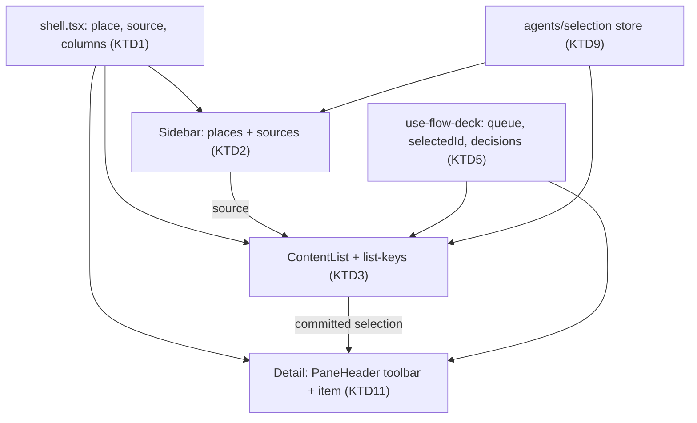
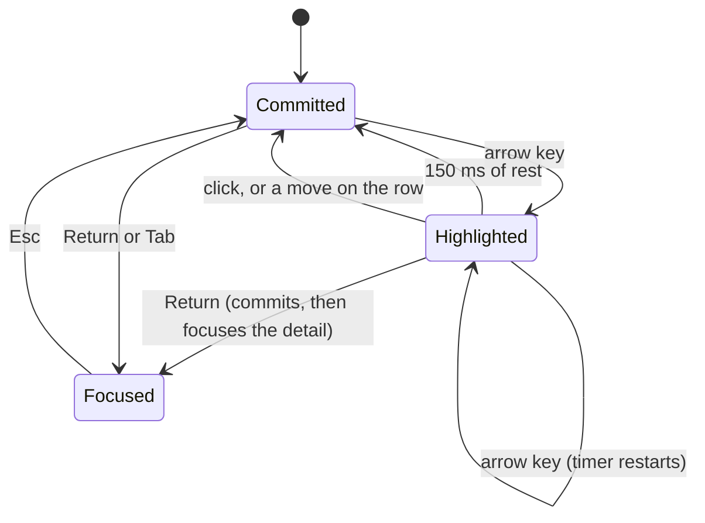
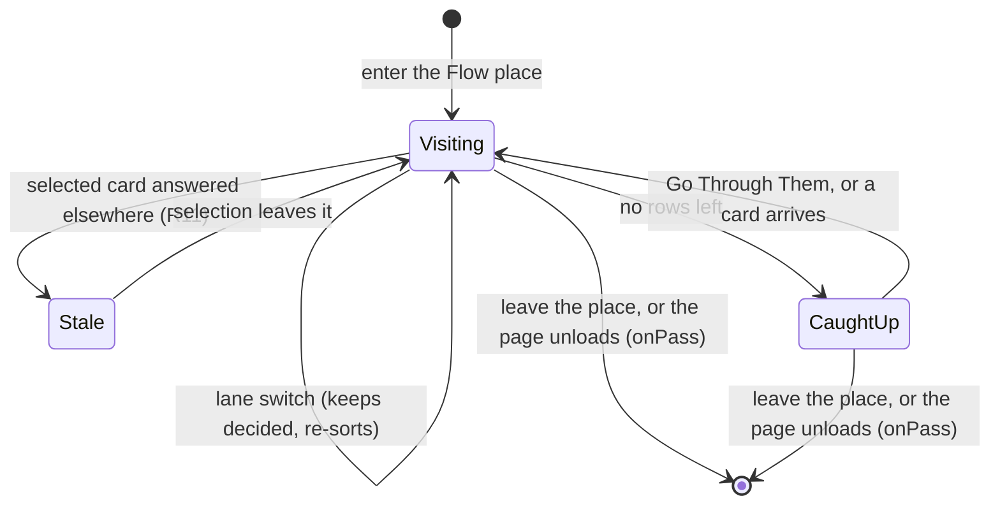
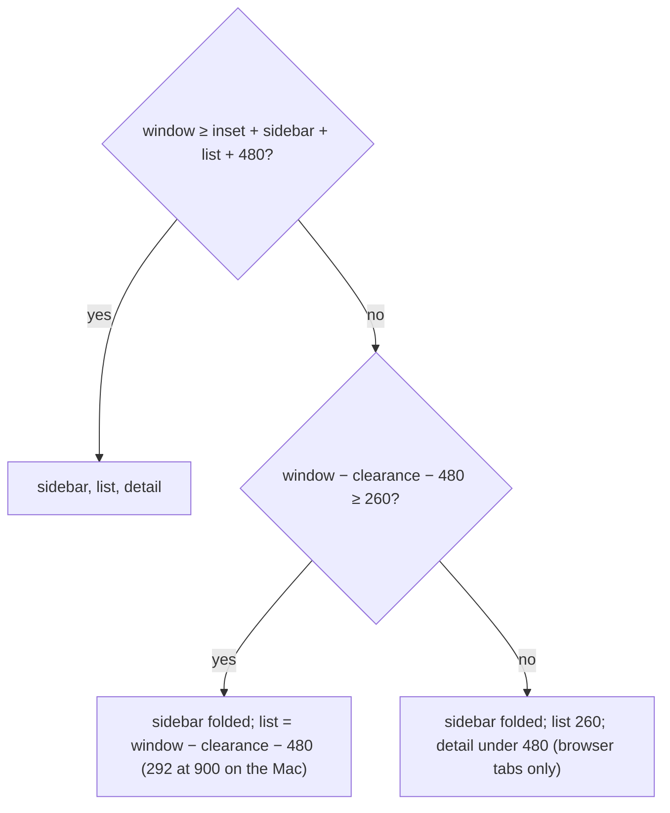

# One three-column window, as Mail's - Plan

---

## Goal Capsule

- **Objective:** on the Mac, every place in loki works as Mail does. You pick a source in the sidebar, scan a list, and read and act on the item beside it. The layout and keys are the same in Chats, Flow, Agents and Learn.
- **Means:** a sidebar of sources, a shared list column, and a detail pane (KTD1, KTD3). Flow's deck becomes a selected card in a list (KTD5).
- **Authority:**
  1. The Product Contract's Requirements.
  2. Then the Key Technical Decisions.
  3. Then the units.

  The review behind this plan is `.impeccable/critique/2026-11-14T13-00-00Z__layout-and-components.md`, and Apple's guidance is in the `apple-hig` skill (Sidebars, Split views, Toolbars, Layout). Both are reference, not requirement.
- **Stop conditions.** Stop and ask if:
  1. Flow's change needs any edit to scoring in `core/attention/priority.ts`.
  2. A place cannot keep a detail of at least 480 at the Mac window's minimum width of 900 with the sidebar folded.
  3. Arrowing a list reconnects the mod socket more than once per committed selection.
  4. The phone (`app/src/phone`) needs any change.
  5. Before U7, the person has not looked at U3 to U6 running on the demo daemon.
- **Execution profile:** desktop UI with a core change in `core/attention/queue.ts` (U5). Each unit lands as one or more commits. The units ship as four PRs, each leaving the app whole:
  - PR 1: U1 to U4
  - PR 2: U5 and U6
  - PR 3: U7 and U8
  - PR 4: U9

  This plan document ships in PR 1. The work it plans spans all four PRs: each PR is done when its units' Verification holds, and the plan is done when the Definition of Done holds after PR 4.
- **Who finishes:** `ce-work` implements on branch `docs/three-column-layout-plan`, renamed for PR 1. The person checks each PR in the running app, light and dark, before merging.

---

## Product Contract

### Summary

The Mac window becomes three columns in every place:
- a sidebar of sources, at most two levels deep
- a list of the chosen source's items
- the chosen item, with its actions as toolbar symbols

Flow's one-card deck becomes a list with a reading pane, and keeps its order, keys and visits. Chats keeps its one-line rows. Agents move into the sidebar, so their pages' lists become the middle column. The phone is unchanged.

### Problem Frame

The page-by-page HIG review of 2026-11-14 found the window built three different ways:

- **The sidebar does three jobs.** In Chats it holds the places, a lone "+" row, a filter and every chat grouped by agent: three levels where the HIG's Sidebars page allows two. Its lower half then becomes a different list in each place.
- **Each place has its own layout.** Chats has two columns and Agents three. Flow is one bordered card filling the pane, with its moves in a bar along the window's bottom edge. Layout › macOS says controls don't belong there.

Mail, Notes and Finder share one shape: sources, a list, the item. loki's own `PRODUCT.md` asks for "one interaction vocabulary across chats, inbox, settings, and phone".

### Key Decisions

- **Three columns in every place, as Mail's.** Governs R1, R2, R3. (session-settled: user-approved — chosen over keeping today's two-column window where the sidebar holds every list: the HIG's two-level sidebar rule and Mail's shape)
- **Chat rows stay one line.** Governs R5. (session-settled: user-directed — chosen over two-line rows with the last thing said: the person kept today's density)
- **Agents are sources in the sidebar; their page's items fill the list.** Governs R13. (session-settled: user-directed — chosen over agents filling the list, which gives four columns on Memory, Changes, Reflection and Skills, and over moving those pages' lists into a pop-up)

### Requirements

**Structure**

- R1. The sidebar lists the places (Chats, Flow, Agents, Learn), each with its sources under it, at most two levels deep. It shows the same rows in every place: changing place moves only the selection, and each place keeps its folds.
- R2. A list column sits between the sidebar and the detail in every place. Its toolbar holds the source's name, a grey count, and the place's New and Search.
- R3. The detail shows the chosen item under a toolbar: its name over a grey line, tab views centred, and its moves as symbols at the trailing edge.

**Chats**

- R4. Chats' sources are Pinned, one per agent, and Archived. The Chats row itself means every chat, and that list keeps agent headings so each "Main chat" stays distinct.
- R5. A chat row is one line: the name, then at the trailing edge one of the waiting count, the live dot, the ring, or the time.
- R6. Search in the list toolbar filters the chosen source's rows as "Find a chat…" does today, `label:` included. New Chat sits in the list toolbar, and an agent source's New Chat starts a chat with that agent.
- R7. Opening a chat from outside the list (⌘K, launch, a notification, a label chip, Flow's Open) keeps the current source if it holds the chat. Otherwise the source switches to Pinned for a pinned chat, to Archived for an archived one, or else to the chat's agent, and the row is selected and scrolled into view.

**Flow**

- R8. Flow's list shows the lane's cards in the deck's order. Within a visit the rows never reorder: removals close the gap, and an arriving card is placed by score but never above the selected row.
- R9. Every move (Read, Later, Archive, Label, Approve, Deny, Reply, Open, Undo, with today's keys) acts on the selected card. After a move the row below is selected, or the row above when it was the last. Undo and a refused move select the card they bring back.
- R10. A card's moves are toolbar symbols in the detail, with Archive the one prominent item, Approve and Deny on approval and question cards, and Sign In… where an account needs mending. Nothing sits at the window's bottom edge.
- R11. A selected card that stops being actionable elsewhere (answered on the phone, archived on another Mac) stays selected and visible, marked "Answered elsewhere", with its moves disabled, until the selection leaves it.
- R12. With nothing left, the list says "You're caught up" with **Go Through Them**, and the detail shows the visit's summary. A visit ends when the person leaves the Flow place; switching lanes stays within the visit, and Esc no longer leaves Flow.

**Agents and Learn**

- R13. Agents' sources are the agents. The middle list is the chosen page's items: memory files, changes, skills, reflections. Profile has no items, so its form fills list and detail. The pages are a tab view centred in the detail toolbar, and New Agent sits in the list toolbar.
- R14. Learn's sources are Review, Leads, All Cards and Deleted. The list shows the view's cards or leads, with Deleted as two sections. Review keeps its keys (↓ Space Return reveal, ← → grade) while the detail has focus, and choosing a row reviews that card next. All Cards edits a card in the detail.

**Keyboard, focus and widths**

- R15. In every list, ↑↓ moves the selection and shows the item without moving focus. Return or Tab moves focus into the detail, and a click selects. The selection is the accent with white text while the list has focus, and grey when it doesn't.
- R16. ⌥⌘F focuses the list's Search. In Chats and Agents, ⌘[ ⌘] step through the rows the list shows; in Flow they keep Later and Read, and in Learn they keep stepping the views. Tab and ⇧Tab move between sidebar, list and detail.
- R17. The sidebar folds when the window can't keep the detail at 480 or more. Below that, the list narrows before anything else folds. ⌃⌘S shows a folded sidebar over the window, and View › Hide List folds the list (for a wider Canvas), each kept per window.
- R18. The update notice no longer covers content. A small Update button sits at the detail toolbar's trailing edge until taken or dismissed, and Settings keeps saying it.

### Acceptance Examples

- AE1. **Covers R8, R9.**
  - **Given** Flow shows cards A, B, C with B selected
  - **When** a new card D scores above A
  - **Then** D lands directly under B and the rows above B don't move. Read on B then selects D.
- AE2. **Covers R9, R11.**
  - **Given** approval card B is selected
  - **When** it is approved on the phone
  - **Then** B stays selected, says "Answered elsewhere", and its moves are dimmed. Pressing ↓ selects the next row, and B leaves the list.
- AE3. **Covers R7.**
  - **Given** Chats shows Pinned
  - **When** ⌘K opens an unpinned chat of Ira's
  - **Then** the sidebar selects Ira, the list shows Ira's chats with that one selected, and the thread shows.
- AE4. **Covers R15.**
  - **Given** focus in Flow's list
  - **When** the person presses ↓ then E
  - **Then** ↓ selects and shows the next card without focusing its reply box, and E archives that card.

### Scope Boundaries

- The phone keeps its own navigation and one-card deck. Split views are for regular widths, and this plan is the Mac's (assumption; see Assumptions).
- Deck scoring, resting, the return ladder and lanes' rules are unchanged; only how the deck is drawn and selected changes.
- The Mac window's minimum size (900×600, `src-tauri/src/lib.rs`) is unchanged, so no Rust change is planned.

**Considered and not built:**
- **A listbox role for lists.** `test/list-row.test.ts` pins `<li><button aria-current>`, and a roving tab stop gives the same keyboard model. Revisit if VoiceOver testing shows rows aren't announced as a list.
- **A second confirmation before leaving Flow mid-visit.** Leaving already ends a visit today, and undo history only ever lasted a visit.
- **A single-pane layout, with Back, for very narrow windows.** The Mac window can't be narrower than 900, where three columns fit (KTD1). Only a browser tab under about 792 squeezes the detail. Revisit if the Mac's minimum width is lowered.

### Deferred to Follow-Up Work

- Settings as a toolbar of panes (layout review, section 5).
- The presentation and control fixes in the layout review, sections 6 and 7:
  - the Labels popover
  - sheets that ignore outside clicks
  - Cancel in confirmations
  - equal segments
  - switches
  - field labels
- What ⌘[ ⌘] should mean app-wide (the HIG lists them as alignment keys).
- Memory's files as an outline with disclosure triangles (layout review, section 4). U7 keeps them as flat rows.

### Sources

- The layout and components review: `.impeccable/critique/2026-11-14T13-00-00Z__layout-and-components.md`.
- The HIG, read in full on 2026-11-14 (the `apple-hig` skill):
  - Sidebars: two levels
  - Split views: selection persists in each pane
  - Toolbars: symbols over text
  - Layout › macOS: no controls at the bottom
  - Tab views: at most six tabs
  - Focus and selection: the focused list takes the accent
- Repo research for this plan, consolidated into the KTDs below. Today's shell is `app/src/shell/shell.tsx` with `list-column.tsx`, `column.ts`, `use-column.ts` and `sidebar-model.ts`. The deck is `app/src/desk/catch-up.tsx`, `deck-moves.ts`, `use-deck-queue.ts` and `core/attention/queue.ts`.

---

## Planning Contract

### Key Technical Decisions

- KTD1. **One pure column model, with the fold computed from the widths.**
  - `app/src/shell/columns.ts` replaces `column.ts` and holds both columns' widths, folds, peek, and the fold rule:
    - the sidebar folds when the window is narrower than `inset + sidebar + list + 480`, which is about 1016 at the defaults
    - with the sidebar folded, the list starts after a clearance, which `columns.ts` takes as an input: 128 on the Mac, for the traffic lights and toggle (today's `paneLeft`), and 52 in a browser
    - the list's width then clamps to `window − clearance − 480`, never below 260; at the Mac's 900 minimum that gives a list of 292 and a detail of 480
    - the list never folds on its own; below `clearance + 260 + 480`, which only a browser tab reaches, the detail shrinks instead
  - **Widths:**
    - sidebar 200–300 (220 by default)
    - list 260–420 (300 by default)
  - **One owner per place:** each place renders its list and its detail from one component, and the shell gives it two slots. That component owns everything both columns read:
    - Flow: `use-flow-deck`
    - Agents: the page's item selection, details and reading (KTD9)
    - Learn: the view, its search and the card being edited

    It is mounted while its place shows. Only Chats' list stays mounted across place switches, to keep its scroll.
  - **Saved settings:** `loki.desktop.column` keeps today's `{width, collapsed}` as the sidebar and gains `list`. Old widths up to 420 are clamped, not trusted.
- KTD2. **Sources and rows split in the sidebar model.** `app/src/shell/sidebar-model.ts`'s `sidebarModel()` becomes:
  - a sources function: Pinned, agents including those with no live chats, Archived, each with its waiting count
  - a rows-for-a-source function, which carries the filter and `label:`, and agent headings for the "all" source

  The folds in `loki.desktop.sidebar` stay with the sources. The scroll moves to the list. The filter no longer opens every fold (R4, R6).
- KTD3. **One list component and one key model.**
  - `app/src/shell/content-list.tsx` draws the list toolbar and rows on today's `ListRow`/`ListSection`.
  - `app/src/shell/list-keys.ts` (pure) owns selection:
    - arrows highlight at once and commit after 150 ms of rest (clock injected for tests)
    - a click or Return commits at once
    - any key or click that acts on the selection (a Flow move, Return, a context-menu item) first commits a pending highlight, then acts on that row
    - one roving tab stop sits on the selected row
  - The list element handles its own keys (↑ ↓ Return Tab) and stops their propagation, not only their default. The shell's keymap is a bubbling window listener that ignores `defaultPrevented` (`shell/use-shell-keys.ts`), so without this, ↓ in Learn's Review list would also reveal the card, and → would grade it.
  - **Empty states:** `ContentList` always draws one.
    - An empty source shows one plain sentence, with the place's New where it has one.
    - A Search with no match says "No Results".
    - The detail with nothing selected shows the place's "No … Selected" pane, as "No Chat Selected" does today.

    Each place's sentence is written in its unit.
- KTD4. **Selecting a chat previews it; committing opens it.** A committed arrow selection switches the desk scope without `setFocusChat`, so focus stays in the list and the socket reconnects once per commit, not per arrow. Return or Tab then focuses the composer as today's open does.
- KTD5. **Flow's deck selects by id.**
  - **A shared deck:** `app/src/desk/use-flow-deck.ts` lifts the queue, decisions, flash and reply state out of `CatchUpDeck`, so the list and the detail share one deck.
  - **Selection by id:** it follows `recall/use-deck-pass.ts`: a `selectedId` that falls back to the first row.
  - **Moves:** in `desk/deck-moves.ts` they take the selected card and remove it by id instead of `popHead`.
  - **The queue:** `core/attention/queue.ts`'s `mergeQueue` pins the selected id rather than index 0, and places arrivals per R8. It re-sorts only on entry, a lane switch, or Go Through Them.
  - Scoring (`priority.ts`) is untouched.
- KTD6. **A visit is the time spent in the Flow place.**
  - The Flow deck is kept from entering the Flow place until leaving it.
  - Leaving the place, or the page unloading (`pagehide`, so a quit still reports), ends the visit and fires today's `onPass`. Hiding or minimising the window does not, as it doesn't today.
  - Lane switches keep `decided`, as `switchLane` does today.
- KTD14. **Esc is the same in every place.** Esc in the detail (when not typing, or in Flow's reply box) moves focus to the list. Esc in the list does nothing. This replaces Flow's close-the-deck (`desk/use-deck-keys.ts`) and the shell's Agents and Learn branch that goes to Chats (`shell/use-shell-keys.ts`).
- KTD7. **Selection never moves focus.** Flow stops focusing the reply box for each new card on the Mac. Chats' commit skips `setFocusChat` (KTD4). Only a committed selection loads history and counts as shown, so `onPass`'s shown count keeps its meaning.
- KTD8. **Opening from outside chooses the source (R7).** `switchDesk` in `app/src/shell/shell.tsx` asks the sidebar model which source holds the chat, then:
  - switches the source when the current one doesn't hold it
  - clears a filter that hides the chat
  - selects the row

  ⌘[ ⌘] step the list's visible rows instead of `stepDesk`'s global list (R16).
  - **Choosing another source** keeps the open item in the detail and selects its row when the new list holds it. Otherwise the detail shows the place's "No … Selected" pane, and nothing commits until the person picks a row. Flow and Learn's Review keep their fallback to the first row.
- KTD9. **Agents in the sidebar, page items in the list (R13).** `agents/selection.ts` keeps its store, and the sidebar's Agents sources read it. `AgentsView` (`agents/agents.tsx`) is the place's owner (KTD1). It lifts the file path, the commit shown, the skill shown and Reflection's runs out of the pages, so the list and the detail read the same state. Each page's inner list moves into `ContentList`:
  - Memory's files (`agents/memory-page.tsx`)
  - Changes' commits
  - Skills
  - Reflection's runs

  The page then draws only its item. Profile has no items, so its form spans the list and detail columns (R13), and the list column comes back on the other pages.
- KTD10. **Learn on the list (R14).**
  - `recall/views.ts` views become sidebar sources.
  - `CardList`, `LeadList` and the Deleted lists become `ContentList` rows.
  - `CardList`'s own search merges into the list's Search.
  - The `WorkerStrip` becomes the list toolbar's grey line.
  - Review's keys stay in the keymap; the list's arrows act only while the list has focus (KTD3).
- KTD11. **One toolbar band.**
  - **Centred tabs:** `PaneHeader` (`app/src/components`) gains centred tab views.
  - **The list toolbar:** it carries `data-tauri-drag-region`, and when the sidebar is folded it takes today's `paneLeft` clearance of the traffic lights and toggle (128 on the Mac).
  - **Outside cards' moves:** `OutsideItemActions` (`desk/outside-card.tsx`) moves from `item/action-bar.tsx` onto `ToolbarGroup`, as chat cards already are.
  - **Update:** the update notice becomes an Update button.
- KTD12. **Menus and keys from the keymap.**
  - View › Hide List (⌃⌘L, with a substitute off the Mac where ⌘L is Focus Message Box) and the list's ⌥⌘F are `KEYMAP` rows, so the menu bar needs no Rust change.
  - Flow's moves keep their items.
- KTD13. **Landmarks and focus order.** The sidebar is `<nav aria-label="Sidebar">`, the list `<section aria-label="{source}">`, and the detail stays the one `<main>`.
  - Tab order runs sidebar, then the list (one roving stop), then the detail's toolbar, then the detail's content.
  - Within a region, Tab moves through its controls, and leaving a region's end moves to the next.
  - That is how R15's "Tab into the detail" and R16's region cycling agree, and the detail's toolbar symbols stay reachable from the keyboard.

### High-Level Technical Design

The window's composition and who owns state:

A selection in any list:

Only `Committed` loads the item, switches the chat socket, and counts as shown (KTD4, KTD7).

A Flow visit and its selected card:

What folds, by window width (KTD1):

### Assumptions

- The phone keeps its one-card deck and navigation, since this plan is the Mac's. Whether the phone should follow is a separate question, not raised here.
- Canvas keeps the list, and Hide List folds it, rather than Canvas folding the list on its own.
- Agents with no chats appear as sources under Chats too, so New Chat with them has a home.

### Risks

| Risk | Mitigation |
|---|---|
| Lifting the deck changes when a visit ends, which shifts Flow analytics (`onPass`) | KTD6 fixes the boundary. U5's tests pin "leave the place ends the visit", and "lane switch doesn't". |
| `mergeQueue`'s pin moves from index 0 to an id, and a card answered elsewhere could linger | AE2's stale state; `test/queue.test.ts` rewritten around the selected id. |
| Source-reading tests break on renames (`test/shell-look.test.ts`, `test/desk-pane.test.ts:64-70`) | U1 updates them with the rename rather than deleting the checks. |
| The vibrancy ring (`components/components.css`) assumes one panel at the left | U1 keeps the glass panel as the sidebar only. The list sits on the opaque ground, as Mail's does. |
| A 480 detail squeezes Canvas's inset chat | Checked by hand at 1016 in U9. Hide List is the escape (R17). |

---

## Implementation Units

### U1. The column model and the three-column shell

- **Goal:** the window lays out sidebar, list and detail with the widths and folds of R17, before any place uses the list.
- **Requirements:** R1, R2, R17.
- **Dependencies:** none.
- **Files:**
  - `app/src/shell/columns.ts` (new, replaces `column.ts`)
  - `app/src/shell/use-column.ts`
  - `app/src/shell/shell.tsx`
  - `app/src/shell/sidebar.tsx`
  - `app/src/agents/agents.tsx` (import)
  - `app/src/components/components.css`
  - tests: `test/shell-column.test.ts` renamed to `test/shell-columns.test.ts`, `test/shell-look.test.ts`, `test/desk-pane.test.ts`
- **Approach:**
  1. Write `columns.ts` per KTD1, migrating `loki.desktop.column` defensively as `loadColumn` does today.
  2. In `shell.tsx`, replace the single `paneLeft` with the list's left edge and the detail's left edge. The glass panel stays the sidebar only.
  3. Give the shell two slots per place, for the place's one owner component (KTD1). Until U3, U6, U7 and U8 move a place onto it, that place keeps today's sidebar body and has no list column, so no place shows four columns between PRs.
- **Patterns to follow:** `column.ts`, `use-column.ts`, and `test/shell-column.test.ts`.
- **Test scenarios:**
  - At 1440 with the defaults, the sidebar is 220 and the list 300, and the detail starts after both.
  - At 1000, the sidebar is folded, the list starts after the 128 clearance, and the detail is at least 480.
  - At 900 on the Mac, the list is 292 and the detail 480.
  - With a browser clearance of 52 at 700, the list stays at 260, and nothing folds.
  - A saved `{width: 400, collapsed: false}` loads as a sidebar of 300, with the default list.
  - A malformed saved value loads as the defaults, and a blocked store never throws.
  - Toggling at a narrow width peeks without changing the saved fold.
- **Verification:** the source-reading tests pass against the new names, and the app runs at 1440, 1016 and 900 with no overlap.

### U2. ContentList and list keys

- **Goal:** one list component with Mail's keyboard and selection, which every place uses.
- **Requirements:** R2, R15, R16.
- **Dependencies:** U1.
- **Files:**
  - `app/src/shell/content-list.tsx` (new)
  - `app/src/shell/list-keys.ts` (new)
  - `app/src/components/components.css`
  - `app/src/shell/keymap.ts` (⌥⌘F)
  - tests: `test/list-keys.test.ts` (new), `test/list-row.test.ts`
- **Approach:**
  - `list-keys.ts` is pure: given the rows, the selection and a key, it returns the next highlight and whether to commit, with the 150 ms rest per KTD3.
  - `ContentList` renders the toolbar (title, grey count, New, Search) and the rows, with a roving tab stop.
  - The CSS adds the focused-accent selection on `[data-current]` within `:focus-within`, and keeps today's grey otherwise.
- **Patterns to follow:**
  - `onRowsKey` in `shell/desk-sidebar.tsx`
  - `ListRow` and `ListSection` in `components/index.tsx`
  - the injected clock in existing tests
- **Test scenarios:**
  - ↓ on the last row stays put, and ↑ on the first stays put.
  - Three ↓ in 100 ms commit once, 150 ms after the last.
  - Return on a highlighted row commits at once and asks for focus in the detail.
  - An action on a highlighted row within the 150 ms commits that row first, then acts on it.
  - A key the list handles (↓, Return) does not reach a window keydown listener.
  - Rows replaced while one is selected keep the selection by id.
  - An empty source shows its sentence, an empty Search shows "No Results", and nothing selected shows the detail's "No … Selected" pane.
  - A selected row that leaves the rows stays until the selection moves (R11's rule, generalised).
  - Row markup stays `<li><button aria-current>`.
- **Verification:** the keyboard works in the dev workbench with fixture rows, and the tokens test passes for the new selection colour.

### U3. Sidebar sources and Chats on the list

- **Goal:** Chats is sources in the sidebar, one-line chats in the list, and the thread in the detail.
- **Requirements:** R1, R4, R5, R6, R7, R15, R16.
- **Dependencies:** U1, U2.
- **Files:**
  - `app/src/shell/sidebar-model.ts`
  - `app/src/shell/desk-sidebar.tsx`, split into sources and rows
  - `app/src/shell/sidebar.tsx` (Places with sources)
  - `app/src/shell/shell.tsx` (`switchDesk`, `showLabel`, ⌘[ ⌘])
  - `app/src/desk/use-desk-socket.ts`
  - `app/src/shell/landing.ts`
  - `docs/design.md` (Shell)
  - `docs/manual.md` (The window, Chats)
  - tests: `test/desk-sidebar.test.ts`, `test/landing.test.ts`, `test/native-menu.test.ts`
- **Approach:**
  1. Split `sidebarModel` per KTD2.
  2. Move `ChatRow`, the filter, the "Needs you" pills, scroll, the drafting row, the dialogs and the context menus into the Chats list.
  3. Commit a selection per KTD4, and open from outside per KTD8.
  4. Landing picks the source of the chat it lands on.
- **Patterns to follow:** `sidebarModel` and its tests, and `rowMenuEntries`.
- **Test scenarios:**
  - Sources list Pinned, each agent with its waiting count, and Archived. An agent with no chats appears.
  - The "all" rows group under agent headings, and an agent's rows have none.
  - `label:infra` in Search filters the chosen source's rows only.
  - Covers AE3: an unpinned chat opened while Pinned shows switches the source to its agent.
  - Opening an archived chat selects Archived, and opening a pinned chat while an agent source shows selects Pinned.
  - Choosing a source that holds the open chat keeps it and selects its row. Choosing one that doesn't shows "No Chat Selected" and reconnects nothing.
  - ⌘] steps to the next visible row, skipping rows the filter hides.
  - Landing on a chat selects its agent source.
- **Verification:** arrowing 20 chats on the demo daemon reconnects the socket once, after the arrows stop. Focus stays in the list until Return.

### U4. The detail toolbar band and the Update button

- **Goal:** one toolbar band: centred tab views, symbols at the trailing edge, and the update notice out of the content.
- **Requirements:** R3, R18.
- **Dependencies:** U1.
- **Files:**
  - `app/src/components/index.tsx` (`PaneHeader`)
  - `app/src/item/toolbar.tsx`
  - `app/src/desk/desk-pane.tsx` (Messages | Canvas centred)
  - `app/src/shell/shell.tsx` (`announceOnce`)
  - `docs/design.md`
  - test: `test/shell-look.test.ts`
- **Approach:**
  - `PaneHeader` gains a centred tab slot.
  - Messages | Canvas move to it.
  - The once-per-version notice becomes a trailing Update button with a Later item in its menu. Settings › loki is unchanged.
- **Patterns to follow:** `ToolbarTitle` and `ToolbarGroup` in `item/toolbar.tsx`.
- **Test scenarios:**
  - A newer version shows the Update button once per version, and Later hides it until the next version.
  - With no update, there is no button.
- **Verification:** at 1440 and 1016, the toolbar's centred tabs don't collide with the title or symbols. Light and dark screenshots for PR 1.

### U5. Flow's deck selects by id

- **Goal:** the deck acts on a selected card and keeps a stable order within a visit, with scoring untouched.
- **Requirements:** R8, R9, R11, R12.
- **Dependencies:** none (core and hooks); U6 draws it.
- **Files:**
  - `core/attention/queue.ts`
  - `app/src/desk/use-flow-deck.ts` (new, lifted from `desk/catch-up.tsx`)
  - `app/src/desk/deck-moves.ts`
  - `app/src/desk/use-deck-queue.ts`
  - `app/src/desk/use-deck-keys.ts`
  - tests: `test/queue.test.ts`, `test/deck-keys.test.ts`, `test/flow-lanes-deck.test.ts`
- **Execution note:** characterise today's moves on "the card on top" in `test/deck-keys.test.ts` before changing them, then move each case to "the selected card".
- **Approach:**
  1. Change `mergeQueue` and placement per KTD5.
  2. Make the moves remove by id and select per R9.
  3. Set the visit boundary per KTD6, Flow's Esc per KTD14, and focus per KTD7.
- **Patterns to follow:** `recall/use-deck-pass.ts` (`currentId` with fallback, `advance`).
- **Test scenarios:**
  - Covers AE1: an arrival that outscores everything lands directly under the selection.
  - A removal closes the gap, and the rows above the selection keep their places.
  - Read on the last row selects the row above.
  - A refused Archive brings the card back selected, at its old place.
  - Undo selects the card it restores, in the active lane.
  - Covers AE2: a selected approval answered elsewhere stays selected and is marked not actionable, and ↓ drops it.
  - A lane switch keeps `decided` and re-sorts.
  - Leaving the place fires `onPass` once, with the committed count.
  - Hiding and showing the window fires no `onPass`, and keeps `decided` and the selection.
  - Covers AE4: E pressed within 150 ms of ↓ archives the newly highlighted card.
  - Esc in the list does not leave Flow.
- **Verification:** no edit in `core/attention/priority.ts`, and the phone's tests are unchanged and passing.

### U6. Flow's list and reading pane

- **Goal:** Flow draws its cards as rows and the selected card as the detail, with its moves as toolbar symbols.
- **Requirements:** R8, R10, R11, R12, R15.
- **Dependencies:** U2, U3 (sidebar sources), U4, U5.
- **Files:**
  - `app/src/desk/catch-up.tsx`
  - `app/src/desk/catch-up-parts.tsx` (`DeckHeader` into the list toolbar, `CaughtUp` into the empty state and summary)
  - `app/src/desk/flow-column.tsx` (lanes as sources)
  - `app/src/desk/outside-card.tsx` (`OutsideItemActions` onto `ToolbarGroup`)
  - `app/src/item/action-bar.tsx`, removed if unused, or kept for `dev/workbench.tsx`
  - `docs/manual.md` (Flow)
  - `docs/design.md`
  - tests: `test/flow-column.test.ts`, `test/flow-lanes-deck.test.ts`, `test/deck-pass.test.ts`
- **Approach:**
  - Rows show sender or chat, subject, one line of preview, a kind icon, and a muted "Sign In" mark where needed.
  - The card loses its box and sits at the thread's readable width (`max-w-3xl`).
  - The lane menu in the title goes, since lanes are sources.
- **Patterns to follow:** chat cards' existing `ToolbarGroup` in `catch-up-parts.tsx`.
- **Test scenarios:**
  - A lane source selects that lane, and its rows match `laneItems`.
  - An approval card's toolbar shows Approve and Deny, and a mail card's shows Archive, Later, Label, Mark as Read and Hand Off.
  - A card whose account needs a sign-in shows Sign In… in the detail, and Read, Later and Archive still work.
  - With no rows left, the list shows "You're caught up" with Go Through Them, and the detail shows the summary.
- **Verification:** the person runs a keyboard pass through Flow on the demo daemon, before and after, and the same keys do the same things. Nothing sits at the window's bottom edge.

### U7. Agents in the sidebar

- **Goal:** agents are sources, and each page's items are the list.
- **Requirements:** R13.
- **Dependencies:** U2, U3, U4 (the centred tab slot).
- **Files:**
  - `app/src/agents/agents-column.tsx` (rows become sources)
  - `app/src/agents/agents.tsx`
  - `app/src/agents/memory-page.tsx`, `changes-page.tsx`, `skills-page.tsx`, `reflection-page.tsx` (inner lists into `ContentList`)
  - `app/src/agents/selection.ts`
  - `docs/manual.md` (Agents)
  - test: `test/agents-pages.test.ts`
- **Approach:**
  - Per KTD9: the pages' tabs move to the centred slot from U4, and New Agent goes to the list toolbar.
  - Memory's files are flat rows, as the page lists them today (an outline is deferred).
- **Patterns to follow:** `agentsSelection` and `shownAgent`.
- **Test scenarios:**
  - Choosing an agent source keeps the page that was showing.
  - The Memory list shows the agent's files, and choosing one shows it in the detail.
  - Profile's form spans the list and detail columns, and the list returns on Memory.
  - Deleting the selected agent selects the first remaining one.
- **Verification:** no Agents page shows more than three columns at 1440.

### U8. Learn on the list

- **Goal:** Learn's views are sources, its cards are rows, and Review keeps its keys.
- **Requirements:** R14.
- **Dependencies:** U2, U3 (sidebar sources).
- **Files:**
  - `app/src/recall/learn-column.tsx`
  - `app/src/recall/recall.tsx`
  - `app/src/recall/recall-parts.tsx` (`CardList`, `LeadList`, Deleted lists, `WorkerStrip`)
  - `app/src/recall/use-deck-pass.ts`
  - `docs/manual.md` (Learn)
  - test: `test/recall.test.ts`
- **Approach:** per KTD10. In Review, the list mirrors the due queue and highlights the current card; focus starts in the detail.
- **Test scenarios:**
  - In Review with the detail focused, ↓ reveals and → grades, as today.
  - In Review with the list focused, ↓ moves the highlight without revealing, and → does not grade.
  - Choosing a row in Review makes it the next card, and the rest keep their order.
  - All Cards' Search filters rows, and choosing one opens its editor in the detail.
  - Deleted shows rejected cards and dismissed leads as two sections.
- **Verification:** `test/keymap.test.ts` still finds no shared key within the `learn` scope.

### U9. Folding, Hide List and landmarks

- **Goal:** narrow windows and keyboard and VoiceOver users get a coherent three-column window.
- **Requirements:** R16, R17.
- **Dependencies:** U1 to U8.
- **Files:**
  - `app/src/shell/columns.ts`
  - `app/src/shell/shell.tsx`
  - `app/src/shell/keymap.ts` (View › Hide List)
  - `app/src/shell/use-shell-keys.ts` (Esc per KTD14)
  - `docs/manual.md` (The window)
  - `docs/design.md`
  - tests: `test/shell-columns.test.ts`, `test/keymap.test.ts`, `test/title-strip.test.ts`
- **Approach:**
  - Add Hide List per KTD12, the landmarks and focus order per KTD13, and Esc per KTD14.
  - With the sidebar folded, the list toolbar clears the traffic lights.
- **Test scenarios:**
  - Hide List folds the list and is kept per window, and showing it restores its width.
  - Off the Mac, Hide List's key doesn't collide with Focus Message Box.
  - Esc from Learn's detail and from an Agents page moves focus to the list and stays in the place.
  - Tab from the list reaches the detail's toolbar symbols before its content.
  - The Windows and Linux title strip still draws its ☰ and window buttons with the list beside the sidebar.
- **Verification:**
  - Screenshots at 1440, 1016 and 900, light and dark.
  - VoiceOver's landmark rotor lists Sidebar, the source's name, and the main region.

---

## Verification Contract

| Gate | Command or check | Applies |
|---|---|---|
| Format, lint, types, tests | `npm run format:check && npm run lint && npm run typecheck && npm test && npm run test:node` on CI's toolchain (newest Node 22, npm 10, `SHELL=/bin/bash`) | every PR |
| Builds and smoke | `npm run build:app && npm run build:mod && npm run smoke` | every PR |
| PR title | `PR_TITLE="…" node --experimental-strip-types scripts/check-pr-title.ts` (scopes: `shell`, `desk`, `agents`, `learn`) | every PR |
| CI | Read the PR's checks, Windows included, before calling it done | every PR |
| By hand | The demo daemon (not the person's own), light and dark, at 1440, 1016 and 900; keyboard through each place | every PR |
| Flow parity | The same keyboard pass through Flow before and after, by the person | PR 2 |
| Review | `ce-code-review` on each PR's diff | every PR |

---

## Definition of Done

- Every R1 to R18 is met in the running Mac app, and AE1 to AE4 hold as tests or by hand.
- `docs/design.md` (Shell) and `docs/manual.md` (The window, Chats, Flow, Agents, Learn) describe the new window in the PR that changes each.
- No file in `app/src/phone` or `core/attention/priority.ts` changed.
- Tests that read source were updated to the new names, not deleted.
- Code from abandoned approaches is removed from the diff.
- Each unit's Verification holds.
