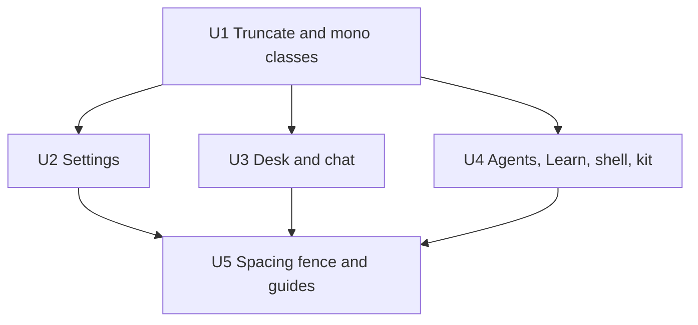

# Layout and text styles in the design system - Plan

---

## Goal Capsule

- **Objective:** someone writing or reviewing a loki screen has one way to lay it out and one spacing scale to pick from, and `npm test` catches a gap that leaves the scale. The app looks the same afterwards, except for gaps that were off the scale and snap to its nearest step.
- **Means:** fixed layout moves from inline style objects to Tailwind classes (KTD1). Truncation and mono text each get one loki class (KTD3). The token test fences spacing the way it already fences type and radii (KTD4).
- **Authority:**
  1. The Product Contract's Requirements.
  2. Then the Key Technical Decisions.
  3. Then the units.

  `docs/design.md` and `docs/style.md` are what this plan changes, so they follow it and do not override it.
- **Stop conditions.** Stop and ask if:
  1. A change would alter how anything looks beyond the gap snapping in R3.
  2. Any file in `app/src/phone` or `app/src/ui` needs a change.
  3. A Tailwind class cannot win over a loki class on an element and no rule in KTD2 covers it.
- **Execution profile:** front-end only, many files, no behaviour change. It ships as one PR (`refactor/layout-and-text-classes`), and this plan ships in it.

---

## Product Contract

### Summary

Give the desktop app a named spacing scale and fence it in the token test. Write fixed layout as Tailwind classes on that scale everywhere outside the phone and shadcn's files. Replace the hand-set truncation and mono styles with one class each, and rewrite the design and style guides to match.

### Problem Frame

Type, radii and colour each have a scale that `test/tokens.test.ts` checks, but spacing has none. Inline gaps use fifteen values (8 is set 68 times, 6 31 times, 10 21 times, then 4, 2, 12, 14, 16, 24, 28, 18, 20, 5, 1 and 0). The Tailwind classes in `app/src/item/` use another set (`gap-2`, `gap-1.5`, `gap-2.5`, `gap-5`, `gap-10`). Layout is written two ways: about 300 inline style objects in 58 files across settings, desk, agents, chat, Learn and the shell, and Tailwind classes in the chat items. Truncation and mono text are written out by hand each time. Reviewers have no rule to hold a new screen to, and `docs/design.md` says outright that the desktop has no spacing scale.

### Requirements

**Spacing**
- R1. The desktop spacing scale is 0, 1, 2, 4, 6, 8, 12, 16 and 24 px, which is Tailwind's `0`, `px`, `0.5`, `1`, `1.5`, `2`, `3`, `4` and `6` steps.
- R2. `npm test` fails when an inline gap in a desktop `.tsx` file, or a gap or space class in a string outside `app/src/ui`, leaves the scale. A gap set from the phone's `var(--phone-space-*)` passes.
- R3. Gaps off the scale snap to the nearest step: 18 to 16 and 28 to 24. 5, 10, 14 and 20 sit between two steps (4 or 6, 8 or 12, 12 or 16, 16 or 24), and the step that matches the element's siblings wins.

**Layout**
- R4. Fixed layout in desktop `.tsx` files outside `app/src/ui` and `app/src/phone` is written as Tailwind classes, not inline style. Layout here covers display, flex and grid direction, alignment, gap, flex sizing, `min-width: 0`, wrapping and grid columns.
- R5. A layout value that depends on state or props stays inline, and so do the elements KTD2 names.
- R6. Moving layout to classes changes nothing on screen beyond R3.

**Text**
- R7. One class truncates text to a single line with an ellipsis, and every hand-set copy of the overflow, ellipsis and no-wrap trio in desktop `.tsx` files uses it. A stylesheet rule that does nothing but truncate is replaced by the class too.
- R8. One class sets the mono face, and every inline `fontFamily: "var(--loki-mono)"` in desktop `.tsx` files uses it.

**Guides**
- R9. `docs/design.md` names the spacing scale, its check, and the two classes. `docs/style.md` says fixed layout is Tailwind classes and inline style is for computed values.

### Key Decisions

- **Layout is written as Tailwind classes** (session-settled: user-directed — chosen over new Stack and Inline layout components: the chat items already write layout this way, so it adds no component API and the token test can read the class strings). Governs R4, R5.
- **The scale is Tailwind's steps, with one step set to 4px** (session-settled: user-directed — chosen over pixel classes such as `gap-[8px]` and over keeping layout inline: one line of configuration puts the whole app on one 4px grid). loki's root is 15px, so Tailwind's default step was 3.75px. The chat items and shadcn widgets, already on Tailwind classes, grow by the same 1/15. 10 and 14, about 27 places, snap to a neighbour; the user accepted this when confirming scope. Governs R1, R3, R6.

### Scope Boundaries

- Gaps in the desktop stylesheets (`components/components.css`, `chat/chat.css`, `shell/*.css`) stay as they are and are not fenced. Fencing them would move `.loki-row`'s 10px gap and so every list row.
- One-off margins and paddings stay inline. They are not repeated enough to extract.
- The shared components' existing rules (U1 only adds two classes to `components.css`), shadcn's files in `app/src/ui`, and the phone and its `--phone-space-*` scale are untouched.
- Considered and not built: a `--spacing-*` naming layer in `@theme`. Tailwind's numbered steps already say the size, and the test, not configuration, holds the scale. A second designer asking for named steps would change that.

#### Deferred to Follow-Up Work

- Snapping and fencing the desktop stylesheets' gaps (10px ×7, 3px ×2, 5px ×1 off the scale), which changes every list row's gap.

---

## Planning Contract

### Key Technical Decisions

- KTD1. **Layout classes are Tailwind's stock utilities**, joined with `cn` (`app/src/lib/utils.ts`) where a class depends on state, as in `app/src/item/composer.tsx`. Grid columns use arbitrary values (`grid-cols-[auto_1fr]`), which the token test already allows. A style object that mixes layout with other keys keeps the other keys inline. Applies the layout Key Decision; governs R4.
- KTD2. **Where a loki class already sets the property, the inline style stays.** Loki's stylesheets are not in a cascade layer and Tailwind's utilities are, so any `.loki-*` rule beats a utility class whatever the specificity. These elements keep their inline layout:
  - six `<Row>` elements whose `.loki-row` sets flex, centre and a 10px gap: `chat/permission-mode.tsx`, `chat/slash-palette.tsx`, `desk/handoff-picker.tsx`, `desk/return-picker.tsx`, `desk/new-desk.tsx` and `settings/mcp.tsx`
  - the `<Sheet>` in `shell/welcome.tsx`, whose `.loki-sheet-card` sets flex and column

  Their inline gaps still snap to the scale under R3. The `<Button>` in `recall/recall.tsx` only repeats `.loki-btn`'s centring, so that inline style is deleted. Putting loki's stylesheets in `@layer components` would let classes win everywhere, but it changes precedence for every element that already mixes the two, such as `item/composer.tsx`, and that is out of proportion here. Governs R5, R6.
- KTD3. **Truncation and mono are loki classes, `loki-truncate` and `loki-mono`**, in `components/components.css` after `.loki-meta`. Tailwind's `truncate` and `font-mono` are layered, so they would lose to `.loki-meta`, which sets the sans and already truncates. Eight mono elements sit on `.loki-meta`. A plain loki class of equal specificity placed after it wins by order. `loki-mono` sets the family only, and `loki-truncate` sets the trio plus `min-width: 0`, as `.loki-phone-ellipsis` does. The few `truncate` and `font-mono` uses in `app/src/item/` move to the loki classes, so each job has one class. Inline truncation on `<Meta>` or `.loki-meta` is deleted outright, because the meta line already truncates. Governs R7, R8.
- KTD4. **The fence follows the type and radius checks in `test/tokens.test.ts`.** It adds a `SPACE` set and an inline check over desktop `.tsx` files for `gap`, `rowGap` and `columnGap`. That check strips `var(...)` before reading numbers, because the existing `numbers()` helper would read the 2 in `--phone-space-2`. It also adds an `OFF_SCALE` entry for `gap-*`, `gap-x-*`, `gap-y-*` and `space-x/y-*` classes off the scale, exempting `app/src/ui` for that entry only. The inline check reads `.tsx` files only, so `afterScroll(gap, …)` in `chat/use-transcript-scroll.ts` is not misread. Governs R2.
- KTD5. **The kit's six objects move too.** `kit/index.tsx` renders inside the widget frame, which receives the page's stylesheets by message (`frame/main.tsx`), so Tailwind's utilities reach it. One kit widget is checked by hand. Governs R4, R6.

- KTD7. **`--spacing: 4px` in `app/src/styles.css`'s `@theme`.** Tailwind sizes a step as 0.25rem and `app/index.html` sets the root to 15px, so without it every converted gap shrinks by 1/16 (`gap-3` drew 11.25px). It lands as its own commit before the move to classes, so its effect on the chat items is reviewable apart from the move. Applies the spacing Key Decision; governs R1, R6.
- KTD6. **Snap first, then convert.** In each of U2 to U4, the R3 snaps land first, as their own commit with the values still inline, and the unit's baseline screenshots are taken after it. The move to classes then has to match that baseline exactly. Snapping and converting in one edit would let a real regression hide among the dozens of expected gap changes, such as a class losing to a loki rule or a dropped `min-width: 0`. Governs R6.

### Sequencing

U1 adds the two classes, and the folder units use them. U2 to U4 are independent of each other and each leaves the app whole. U5 turns the fence on last, once nothing fails it, and rewrites the guides.

---

## Implementation Units

### U1. Truncate and mono classes

- **Goal:** one class for each text job, used everywhere it is hand-set today.
- **Requirements:** R7, R8 (KTD3)
- **Dependencies:** none
- **Files:**
  - `app/src/components/components.css`
  - `app/src/chat/chat.css` (`.loki-steps-failure span`, `.loki-steps-target`)
  - the 28 mono and 10 truncation sites the research lists, in `agents/`, `chat/`, `desk/`, `kit/`, `recall/` and `settings/`
  - `app/src/item/` uses of `truncate` and `font-mono`
  - `app/src/chat/chat.css` `.loki-suggestion-hit-title` (used in `chat/suggestion-card.tsx`), which sets only the trio and `min-width: 0`
  - `test/tokens.test.ts`
- **Approach:**
  1. Add `.loki-truncate` and `.loki-mono` after `.loki-meta`. The test that keeps mono for code, data and keys allows only `code`, `pre`, `kbd` and `--mono` selectors, so it also accepts `.loki-mono`, and its comment names the class as the one mono class.
  2. Replace each inline mono family with the class. `settings/layout.tsx`'s ternary becomes a conditional class through `cn`.
  3. Replace each inline truncation trio with the class, and delete the four on `<Meta>` or `.loki-meta`.
  4. The three chat.css rules that only truncate are removed, and their elements take the class. The shared components' own truncating rules in `components.css`, such as `.loki-list-row-name`, stay as they are (Scope Boundaries).
- **Patterns to follow:** `.loki-meta` and its modifiers. `.loki-phone-ellipsis` in `phone/phone.css`.
- **Test scenarios:**
  - The existing "every loki-* class a component names has a rule" check passes with the two new classes.
  - The "keep mono for code, data and keys" test passes with `.loki-mono` in `components.css`, and still fails a mono family on any other new selector.
  - Add an inline check in `test/tokens.test.ts`: no `fontFamily: "var(--loki-mono)"` literal remains outside `phone/`, `ui/` and the face-test exemption, and no `textOverflow: "ellipsis"` remains in desktop `.tsx`.
- **Verification:** in the browser, a mono path on a meta line (Settings › Macs) renders in SF Mono. A long label in the slash palette still ends in an ellipsis.

### U2. Settings layout to classes

- **Goal:** settings' fixed layout is written as classes on the scale.
- **Requirements:** R3, R4, R5, R6 (KTD1, KTD2)
- **Dependencies:** U1
- **Files:** `app/src/settings/*.tsx` (102 objects, busiest `mcp.tsx`, `settings.tsx`, `providers.tsx`, `phone.tsx`, `macs.tsx`), including the `KIND_GRID` const in `settings.tsx`
- **Approach:** the snaps land first, then the conversion (KTD6).
  1. A layout-only object becomes `className`. A mixed object splits, with layout to the class and the rest staying in `style`.
  2. Off-scale gaps snap per R3. That covers 28 in `settings.tsx`, 18 in `phone.tsx`, and the 10s. The two 1px gaps are on the scale and become `gap-px` unchanged.
  3. The `<Row>` in `mcp.tsx` keeps its inline grid (KTD2), with its gap snapped.
- **Patterns to follow:** `app/src/item/composer.tsx` and `app/src/item/work.tsx`.
- **Test expectation:** none, because this is styling only. U5's fence proves the scale, and the browser check proves the look.
- **Verification:** screenshots of each Preferences pane at 1440 in light and dark, taken after the snap commit, match the converted screens exactly. The before-snap and after-snap pairs differ only at the snapped gaps.

### U3. Desk and chat layout to classes

- **Goal:** Flow's cards, the desk widgets and the chat pane write fixed layout as classes.
- **Requirements:** R3, R4, R5, R6 (KTD1, KTD2)
- **Dependencies:** U1
- **Files:** `app/src/desk/*.tsx` (62 objects, busiest `outside-card.tsx`) and `app/src/chat/*.tsx` (31)
- **Approach:**
  1. Convert as in U2.
  2. The touch ternaries that use `var(--phone-space-*)` stay inline: `handoff-picker.tsx`, `jira-ticket.tsx`, `mail-address.tsx` and the four in `outside-card.tsx`.
  3. The alignment in `chat/transcript.tsx`, which depends on the message's role, stays inline. So do the spread or computed objects in `desk/widget-frame.tsx`, `desk/agent-chip.tsx` and `chat/conversation.tsx`, though `agent-chip.tsx`'s 5px gap snaps per R3.
  4. The `<Row>` elements named in KTD2 keep inline layout.
- **Patterns to follow:** as U2.
- **Test expectation:** none, because this is styling only, as U2.
- **Verification:** screenshots of Flow, with a mail card, a Jira card and a question card, and of a chat with a permission prompt and the slash palette open, show no change beyond snapped gaps. The desk cards also render on the phone at 375 unchanged.

### U4. Agents, Learn, shell, kit and shared layout to classes

- **Goal:** the remaining folders write fixed layout as classes.
- **Requirements:** R3, R4, R5, R6 (KTD1, KTD2, KTD5)
- **Dependencies:** U1
- **Files:**
  - `app/src/agents/*.tsx` (39)
  - `app/src/recall/*.tsx` (28, including the `DETAIL` and `MOVES` consts in `recall-parts.tsx`)
  - `app/src/shell/*.tsx` (27)
  - `app/src/kit/index.tsx` (6)
  - `app/src/shared/*.tsx` (4)
  - `app/src/components/index.tsx` (3)
  - the off-scale classes in `app/src/item/message-entry.tsx` (`gap-x-2.5`), `app/src/item/timeline.tsx` (`gap-5`) and `app/src/dev/workbench.tsx` (`gap-10`)
- **Approach:**
  1. Convert as in U2.
  2. The 14s in `agents/` and `recall-parts.tsx`, the 28 in `profile-page.tsx` and the 20 in `recall-parts.tsx` snap per R3.
  3. The `<Sheet>` in `shell/welcome.tsx` keeps inline layout (KTD2), with its 18 snapped to 16.
  4. `components/index.tsx`'s `Switch` keeps its computed style.
  5. `recall/recall.tsx`'s redundant `<Button>` centring is deleted.
- **Patterns to follow:** as U2.
- **Test expectation:** none, because this is styling only, as U2.
- **Verification:** screenshots show no change beyond snapped gaps for these screens:
  - each Agents page
  - Learn's Review, All Cards and Deleted
  - the welcome sheet
  - one kit widget on a canvas

### U5. Spacing fence and guides

- **Goal:** the scale is checked, and the guides say how to lay out a screen.
- **Requirements:** R1, R2, R9 (KTD4)
- **Dependencies:** U2, U3, U4
- **Files:**
  - `test/tokens.test.ts`
  - `docs/design.md` (Tokens, the paragraph on what `tokens.test.ts` checks, and Primitives' one-off sentence)
  - `docs/style.md` (the review bullet on styles)
- **Approach:**
  1. Add the `SPACE` set, the inline gap check and the `OFF_SCALE` entry per KTD4.
  2. Update the class fence's header comment.
  3. In `design.md`, replace "The desktop has no spacing scale to check" with the scale and the check. Add both classes, and say a loki class beats a Tailwind class on the same element.
  4. In `style.md`, say fixed layout is Tailwind classes on the spacing scale, and inline style is for values computed from state or props.
- **Patterns to follow:** the font-size test (`FONT_SCALE`) and the radius test in `test/tokens.test.ts`, and its "the fence catches what it should" cases.
- **Test scenarios:**
  - `style={{ gap: 10 }}` in a desktop `.tsx` fails the inline check, and `gap: 8` passes.
  - `gap: touch ? "var(--phone-space-2)" : 8` passes, because the `var(...)` is stripped and 8 is on the scale.
  - A file under `phone/` with `gap: 10` is not read.
  - `"flex gap-5"` and `"gap-x-2.5"` fail the class entry, and `"gap-1.5"`, `"gap-px"` and `"space-y-2"` pass.
  - `"gap-2.5"` in a file under `ui/` passes.
- **Verification:** `npm test` passes with the fence on. Re-adding one `gap: 10` locally makes it fail, naming the file.

---

## Verification Contract

| Check | When | Done signal |
|---|---|---|
| `npm run lint:fast`, `npm run typecheck` | while working on each unit | clean |
| `npm test` (includes `test/tokens.test.ts`) | each unit, and U5's fence | passes. The new cases fail when their bad input is restored |
| `npm run format:check && npm run lint && npm run typecheck && npm test && npm run test:node` | before pushing, with CI's toolchain (newest Node 22, npm 10, `SHELL=/bin/bash`) | all pass |
| `npm run build:app && npm run build:mod && npm run smoke` | before pushing | all pass |
| Browser screenshots against the sandbox daemon | before any change, after each unit's snap commit, and after its conversion (KTD6) | the same screens at 1440 in light and dark, and the phone at 375 for desk cards. Converted screens match the post-snap baseline with no difference, and the post-snap screens differ from the originals only at the snapped gaps |
| PR CI, Windows included | after pushing | green |

---

## Definition of Done

- Every unit's verification holds, and the Verification Contract's checks pass.
- `rg 'style=\{\{[^}]*display: "(flex|grid)"' app/src --glob '!ui/**' --glob '!phone/**'` finds only the elements KTD2 and R5 keep inline.
- `docs/design.md` and `docs/style.md` describe the scale, the classes and the layout rule. No guide still says the desktop has no spacing scale.
- No abandoned attempt, stray screenshot or scratch file is left in the diff. This plan is in the PR.
- The PR body lists the gaps that snapped and shows before and after screenshots.

---

## Appendix

### Sources

- The repository research for this plan counted 302 inline layout objects in 58 files, 28 mono sites and 10 truncation sites. It found the cascade-layer conflict behind KTD2 and KTD3 by matching each element's loki classes against the desktop CSS.
- `app/src/styles.css`: Tailwind 4.3.3 with `@theme inline`, no `--spacing` override and `--font-mono: var(--loki-mono)`. One step is 4px.
- `test/tokens.test.ts`: `FONT_SCALE`, the radius test, `OFF_SCALE` and `offScale()`, and the class-rule check.
