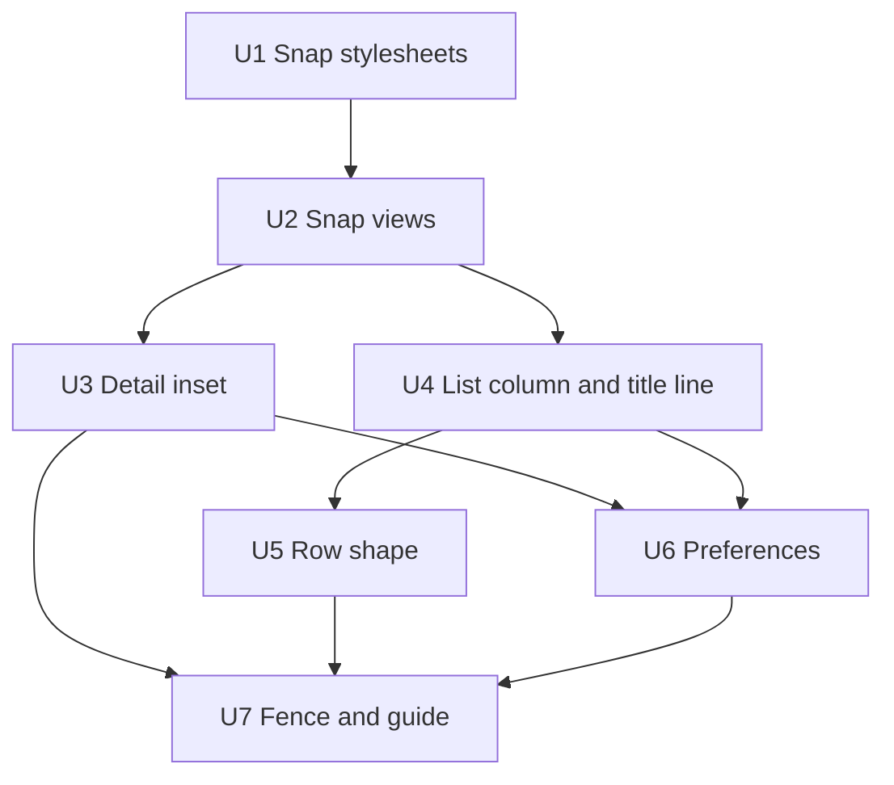

# Uniform spacing across the desktop app - Plan

---

## Goal Capsule

- **Objective:** in every place in the desktop app, content lines up with its header and rows of the same kind have the same shape. Spacing comes from one scale, and `npm test` fails a padding, margin or gap that leaves it.
- **Means:**
  - Each detail pane uses the 20px inset its title already has (KTD2).
  - The list column has one text edge and one title line shared with the detail pane (KTD4, KTD5).
  - Flow uses one row shape (KTD6).
  - The stylesheets and views snap onto the 4px scale (KTD1, KTD7).
  - The token test fences padding and margin as it already fences gaps (KTD8).
- **Authority:**
  1. The Product Contract's Requirements.
  2. Then the Key Technical Decisions.
  3. Then the units.

  `docs/design.md` follows this plan.
- **Stop conditions.** Stop and ask if:
  1. A change would move or resize something by more than its snap or its new inset, such as a row changing order. A field or button that grows or shrinks by a snapped padding is expected.
  2. A file in `app/src/phone` or `app/src/ui`, or `phone.css`, needs a change.
  3. A loki rule and a Tailwind class fight over the same property and KTD2 of the 2026-11-14-2004 plan does not settle it.
- **Execution profile:** front-end only, CSS and view files, no behaviour change. It ships as one PR (`fix/uniform-spacing`), and this plan ships in it.

---

## Product Contract

### Summary

Give every pane in the desktop app one left inset, shared by its header and its content. Reading columns keep their width but start at that edge. Learn's review card and empty states stay centred. Line up the list column's text and its title with the detail pane's title. Give Flow one row shape, and give Preferences one edge per column. Move every padding, margin and gap in loki's desktop stylesheets and views onto the 4px scale, and extend the token test to hold them there.

### Problem Frame

An impeccable layout pass on main (`bcaf4b35`), measured at 1440px against the sandbox daemon, found that every place sets its own edges:
- The detail pane's title sits 20px from the pane edge everywhere (x=556), but content starts at 564 in an agent's memory file, at 608 and 633 in Learn, and at 652 in the chat transcript, its empty state and an email body.
- Flow's list mixes 53px email rows and 39px chat rows, and puts the time halfway down a row. The Chats list puts it on the name line.
- Preferences has three left edges in its nav column (231, 241, 242) and four in its pane (431, 449, 448, 463).
- The list column's title sits at y=16 and the detail title at y=8.

Underneath, loki's desktop stylesheets use 23 spacing values (10px alone 55 times, plus 3, 5, 7, 9, 13, 14, 18, 22, 28, 36 and 44). #267 named a scale and fenced gaps in views, but not padding, margin or the stylesheets, so drift has nothing to stop it.

Apple's HIG asks apps to align elements so they are easy to scan, because people read aligned items as related and indented items as subordinate ([Layout › Visual hierarchy](https://developer.apple.com/design/human-interface-guidelines/layout)). Mail keeps a message's body on its header's edge.

### Requirements

**Detail pane**
- R1. In every desktop place, a detail pane's content starts at the same 20px left edge as its title. Indentation that shows hierarchy, such as a mail body under its sender's face, starts from that edge.
- R2. The chat transcript, the composer, the new-chat notice and an outside item's body (mail, Slack, Jira) keep their maximum width, but start at that edge instead of being centred.
- R3. Learn's review deck and its welcome card, the empty canvas hint and the empty-pane states stay centred.

**List column**
- R4. In the list column, the title, its grey line, the search field's text and the rows' text share one left edge. The search field's box and the row highlight share another.
- R5. The list column's title and the detail pane's title share one top line in every place, whether either has a second line or not.

**Rows**
- R6. Every Flow row has the same three-line shape and height: name, subject, preview. When there is no preview, the third line stays empty.
- R7. In a list row with more than one line, the time sits on the name line. This covers Flow, Agents and Learn.

**Preferences**
- R8. Preferences' nav column has one left edge for its title, search text and page names. Its pane has one left edge for its title, tabs and cards, and the cards' contents sit at one inset inside them. The pane's edge is the 20px of R1.

**Scale and fence**
- R9. Every padding, margin and gap in loki's desktop stylesheets and views is one of 0, 1, 2, 4, 6, 8, 12, 16, 20, 24, 32, 40 or 48 px. Exceptions are a value computed from the window, such as safe-area or `calc` with the titlebar, and an indent whose terms are each on the scale.
- R10. `npm test` fails an off-scale padding, margin or gap in a desktop stylesheet, an inline style or a Tailwind class outside `app/src/ui`. The phone's files are not checked.
- R11. `docs/design.md` names the scale with 20, the shared inset and when content may be centred.

**Unchanged**
- R12. Nothing moves except by its snap or its new edge. The phone, shadcn's components in `app/src/ui` and the agents' canvas widgets do not change.

### Key Decisions

- **Reading columns start at the header's edge.** (session-settled: user-directed — chosen over keeping them centred: aligned content scans as one with its header, as in Mail.) Governs R2.
- **The shared inset is 20px, the titles' existing edge.** Content moves to the title, and the title stays put. (session-settled: user-approved — chosen over moving titles to a new edge: 20 is already the toolbar's padding in every place.) Governs R1, R8.
- **Focus and empty states stay centred.** (session-settled: user-approved — chosen over aligning everything: Apple centres focus and empty states.) Governs R3.
- **Flow rows always have three lines.** (session-settled: user-approved — chosen over letting chat rows be two lines: one height keeps the list's rhythm.) Governs R6.

### Scope Boundaries

- The phone (`app/src/phone`, `phone.css`, `--phone-space-*`) keeps its own scale.
- shadcn's files in `app/src/ui` and the agents' canvas widgets are out of scope.
- Widths, heights, `top`/`left` offsets and sizes are not spacing and are not snapped. One exception: the list bar's 48px height becomes 52 in KTD4.
- No new spacing tokens. As in the 2026-11-14-2004 plan, a `--loki-space-*` layer stays rejected.
- Considered and not built: a pixel screenshot test in CI. vitest runs in Node and the repo has no visual tooling. The sandbox screenshot comparison in the Verification Contract covers this PR. Repeated drift after this fence lands would justify one.

#### Deferred to Follow-Up Work

- Mail's face indent (`MAIL_INDENT` = 36) and the outside-card toolbar's 36px face (title at 68) differ. Aligning a mail body with the toolbar title is a separate design call.
- The canvas tray and connection label sit 16px from the canvas edge. They float over the canvas and are not pane content.

---

## Planning Contract

### Key Technical Decisions

- KTD1. **20 joins the scale as Tailwind step 5.** The scale becomes 0, 1, 2, 4, 6, 8, 12, 16, 20, 24, 32, 40, 48 px, so `SPACE` and `SPACE_STEPS` in `test/tokens.test.ts` gain 20 and `5`. The inset is the scale's own step, not a token, because 20 already appears in 14 declarations and in `test/chat-look.test.ts`'s thread padding.
- KTD2. **Reading columns drop their centring and sit 20px from the pane edge.** Every reading column keeps `max-w-3xl` and loses `mx-auto`. How each gets its 20 depends on whether a gutter already wraps it:
  1. The timeline (`item/timeline.tsx`) sits inside the chat viewport's 20px gutter (`chat/conversation.tsx`), so it drops `px-6` and takes no side padding.
  2. The dock's columns have no gutter, because `.loki-dock` is absolutely placed at `left: 0; right: 0`. These are the composer (`item/composer.tsx`), the Proposals and slash-palette columns in `chat/conversation.tsx`, and `.loki-new-chat-notice`. They replace `px-6` or 24px with 20 (`px-5`).
  3. `desk/outside-card.tsx`'s thread and reply columns have no gutter either. Their inline 24px side padding becomes 20.
  4. Panes with their own padding take 20: the agents' `Pane` and its siblings (28 to 20), and Learn's scroll body (24 to 20). Instantiates the reading-column and inset Key Decisions, governs R1 and R2. Conflict call-out: your own messages are right-aligned inside the 720px column, so on a wide window they end mid-pane rather than at the pane's right edge. Check this in the screenshots. If it reads wrong, raise it rather than widening the column.
- KTD3. **Learn's centring splits by view.** `recall/recall.tsx` centres one 760px column for every view. The review deck and the welcome card keep that centring. The notices banner and the All, Leads and Deleted item views start at the edge. Governs R1, R3.
- KTD4. **All three title bars top-align their titles at one padding.** The detail pane uses two bars today: `.loki-pane-header-line`, which is 48px (52 when it holds a toolbar title) and centred with no vertical padding, and `.loki-card-toolbar`, which is 52px with 6px vertical padding. The list bar (`.loki-content-list-bar`) is 48px and centred. All three take a 52px minimum height and put their title stack at the top with one shared top padding. That padding is 8px, the offset the detail title has today, so the detail titles stay where they are and the list title moves up to them. The bars' buttons stay vertically centred in the 52px bar. The list's grey line moves into the bar's stack, and Preferences' pane header follows the same rule. Top alignment beats centring because a one-line and a two-line stack cannot share a top line when both are centred. Governs R5.
- KTD5. **The list column's text edge is 16 and its box edge is 4.** The bar and line already use 16. Today the rows reach 16 as 6+10, but 10 is off the scale. So the rows' container (`.loki-content-list-rows`) and the search wrapper (`.loki-content-list-search`) take 4px side padding, and `.loki-list-row` takes 12. The list's search field pads `calc(12px - 1px)` inside its 1px border, so its text also lands at 16. U1 records these as the tie choices for those rules. Governs R4.
- KTD6. **ListRow puts the time in its title line, and Flow always renders the third line.** Moving `.loki-list-row-time` into `.loki-list-row-title` puts it on the name line for every ListRow with a preview. One-line rows (Chats) look the same as today. `desk/flow-column.tsx` always renders the preview line, empty when there is none, so every Flow row is three lines. Governs R6, R7.
- KTD7. **The snap rule is #267's.** An off-scale value moves to the nearer step. A tie (3, 5, 7, 10, 14, 18, 22, 28, 36, 44) goes to the step its siblings in the same rule or component use, so one control keeps one rhythm. An indent that is a face plus a gap is written as those two on-scale terms. Snapping happens in its own commits before the alignment work, so each screenshot diff has one cause. Governs R9.
- KTD8. **The fence copies the radius and font CSS tests.** It extends `test/tokens.test.ts` in three ways:
  1. A stylesheet test reads `padding*`, `margin*`, `gap`, `row-gap` and `column-gap` declarations in the desktop CSS (`kit/tokens.css`, `components/components.css`, `chat/chat.css`, `shell/*.css`, not `phone/phone.css`). It fails a px term off the scale. `auto`, `0`, negatives of on-scale values, percentages, `var()` and `env()` pass.
  2. The inline test extends from `gap` to `padding*` and `margin*`. It strips `var()`, keeps the existing handling for the phone's ternaries, and copes with commas inside template literals.
  3. `offSpacing` adds `p*-` and `m*-` classes, keeping `mx-auto` and other `auto` values allowed. `classStrings` scans every string literal, so a padding or margin class matches only when its step looks like a step: a number, `px`, `auto` or a bracketed value. A trailing `!` is stripped before the lookup. A host name such as `my-macbook-pro.local` or a template head such as `` m-${id} `` is never read as a class.

  Each part gets fence cases that fail on a bad input. Governs R10.
- KTD9. **Titlebar clearance is a computed value, not a literal.** The windowed Settings nav's 52px top padding clears the traffic lights and matches the 52px toolbar. It is written from the same named height the toolbar uses, so it falls under R9's computed exception rather than snapping to 48. Governs R9.

### Sequencing

U1 starts by writing U7's scale sets and fence checks and running them locally. Their failures are the worklist for U1 and U2. The checks are committed with U2's last snap, so no commit is red. U1 and U2 snap first, so their screenshots differ from the baseline only at snapped values. U3 to U6 then change edges, one place at a time. U7 adds the guide.

---

## Implementation Units

### U1. Snap the desktop stylesheets

**Goal:** every padding, margin and gap in loki's desktop CSS sits on the scale.

**Requirements:** R9, R12

**Dependencies:** none

**Files:**
- `app/src/components/components.css`
- `app/src/chat/chat.css`
- `app/src/shell/search-sheet.css` and any other `app/src/shell/*.css`
- `test/chat-look.test.ts` and other look tests whose asserted values change

**Approach:**
1. Write U7's scale sets and the three fence checks with their self-tests, and run them locally. Their failures are the worklist for U1 and U2. The research inventory found 23 distinct values in the stylesheets, and `tokens.css` has none.
2. Snap each stylesheet value by KTD7. Write face-plus-gap indents, such as `.loki-inline-widget`'s 44, as their on-scale terms. Take KTD5's values for the list rows and the list search.
3. Leave widths, heights, offsets and `phone.css` alone.

**Patterns to follow:** #267's snap commit, which recorded each tie's choice in the PR body.

**Test scenarios:**
- Look tests that assert a snapped value are updated to the new value, and still fail when the old value is restored.

**Verification:** a scan of the files finds no off-scale term outside the R9 exceptions. Screenshots differ from the baseline only where a value snapped.

### U2. Snap the views

**Goal:** inline padding and margin in desktop `.tsx` files, and their classes, sit on the scale.

**Requirements:** R9, R12

**Dependencies:** U1

**Files:**
- About 25 desktop `.tsx` files with 48 off-scale inline values, found by the fence checks written in U1. They include `settings/settings.tsx`, `settings/mcp.tsx`, `settings/providers.tsx`, `recall/recall.tsx`, `recall/recall-parts.tsx`, `agents/profile-page.tsx` and `desk/surface.tsx`.
- `test/tokens.test.ts` (committed with this unit's last snap)

**Approach:**
1. Snap each value by KTD7.
2. Write the windowed Settings nav's top padding by KTD9.
3. Leave the 28 insets that U3 and U6 change to 20 for those units, so each commit has one reason.
4. Leave `app/src/phone` and `app/src/ui` alone.
5. Commit the fence checks with the last snap, once they pass.

**Test scenarios:** Test expectation: none -- a spacing change with no behaviour. U7's fence holds it, and the screenshots verify it.

**Verification:** screenshots differ from U1's only at the snapped values.

### U3. One detail inset

**Goal:** every detail pane's content starts at the title's 20px edge, except the centred states of R3.

**Requirements:** R1, R2, R3 (KTD2, KTD3)

**Dependencies:** U2

**Files:**
- `app/src/item/timeline.tsx`, `app/src/item/composer.tsx`, `app/src/chat/conversation.tsx`
- `app/src/desk/outside-card.tsx`, including the comment that calls the body "centred"
- `app/src/components/components.css` (`.loki-new-chat-notice`)
- `app/src/agents/bits.tsx`, `app/src/agents/profile-page.tsx`, `app/src/agents/new-agent.tsx`
- `app/src/recall/recall.tsx`, `app/src/recall/recall-parts.tsx`
- `test/chat-look.test.ts`

**Approach:**
1. Change the reading columns in the four groups KTD2 lists.
2. Set the agents' panes and Learn's scroll body to 20.
3. Split Learn's column by KTD3: centred for the review deck and the welcome card, at the edge for the rest.
4. Keep the empty canvas hint and `EmptyPane` centred.
5. Leave mail's face indent (`MAIL_INDENT`, the 28px face plus an 8px gap) as it is. It is an indent from the 20px edge, and it is a named constant, not a literal.

**Patterns to follow:** the agents' pages already left-align a 760px reading width (`Prose` in `agents/bits.tsx`).

**Test scenarios:**
- The timeline's content markup has `max-w-3xl` and no `mx-auto`.
- The composer's column has 20px leading padding and no `mx-auto`.
- The outside card's body column renders without `mx-auto` and with 20px side padding.
- The Learn review deck still centres, and the All Cards view does not.

**Verification:** measured at 1440 and 1000:
- Content text in Chats, the composer, every Agents page and Learn's item views starts at x=556.
- In an outside item (mail, Slack, Jira), the thread's faces start at x=556, under the toolbar's face. A mail body starts at x=556 plus the mail indent.
- Learn's review card and the empty states are still centred.

### U4. The list column's edges and the shared title line

**Goal:** the list column has one text edge and one box edge, and its title shares a top line with the detail title.

**Requirements:** R4, R5 (KTD4, KTD5)

**Dependencies:** U2

**Files:**
- `app/src/components/components.css` (`.loki-content-list-bar`, `-title`, `-line`, `-search`, `.loki-pane-header-line`, `.loki-card-toolbar`, `.loki-toolbar-title`)
- `app/src/shell/content-list.tsx` (move the line into `ListBar`, keeping `data-tauri-drag-region="deep"`)
- `test/shell-columns.test.ts` or a new `test/list-column-look.test.ts`

**Approach:**
1. Give the three bars in KTD4 the 52px height, top alignment and 8px top padding, keeping their buttons centred.
2. Check that the list rows and search already sit on KTD5's 4 plus 12 after U1.

**Test scenarios:**
- `.loki-content-list-bar`, `.loki-pane-header-line` and `.loki-card-toolbar` have the same minimum height and the same top padding, and all three align their title to the start.
- `ListBar` renders the grey line inside the bar and keeps its drag region.
- The search wrapper's side padding equals the rows container's (4), and the row's equals 12.

**Verification:** in Chats, Flow (a chat card and an outside card), Agents and Learn, the list title's top and the detail title's top have the same y, and list text starts at one x.

### U5. One row shape

**Goal:** Flow rows are all three lines at one height, and multi-line rows show their time on the name line.

**Requirements:** R6, R7 (KTD6)

**Dependencies:** U4

**Files:**
- `app/src/components/index.tsx` (`ListRow`)
- `app/src/components/components.css` (`.loki-list-row*`, `.loki-flow-row-*`)
- `app/src/desk/flow-column.tsx`
- `test/list-row.test.ts`, `test/flow-column.test.ts`

**Approach:**
1. Render the time inside the row's title line. The name truncates first, and the time and any mark (such as Sign In) keep their width.
2. Always render Flow's preview line, keeping its height when it is empty.

**Test scenarios:**
- A ListRow with a time renders it inside `.loki-list-row-title`.
- A Flow chat row whose last assistant text is null still renders a third line.
- The existing `flowRows` text assertions still hold for rows that have a preview.
- A one-line row (Chats) renders the same markup, apart from the time's position.

**Verification:** every Flow row measures the same height, and in Flow, Agents and Learn the time's top lines up with the name's top.

### U6. Preferences

**Goal:** Preferences has one edge per column and the 20px pane inset.

**Requirements:** R8 (KTD4)

**Dependencies:** U3, U4

**Files:**
- `app/src/settings/settings.tsx`, `app/src/settings/page-list.tsx`, `app/src/settings/layout.tsx`
- `app/src/components/components.css` (`.loki-settings-block`, `.loki-nav` as used in Preferences)
- `test/settings-*.test.ts` where they assert padding

**Approach:**
1. In the nav column, line up the title, the search text and the page names on the page names' edge.
2. In the pane, set the header and body to 20, and line the tab track's leading edge up with it.
3. Top-align the pane header's title by KTD4.
4. Keep the cards' inner inset one value.

**Test scenarios:**
- The pane's header and body padding are both 20 on the left.
- The nav title's left padding puts it on the page names' text edge.

**Verification:** measured in the sheet and the windowed Settings, the nav column has one text x and the pane has one edge x for title, tabs and cards.

### U7. The fence and the guide

**Goal:** `npm test` holds padding, margin and gap to the scale, and the design guide says so.

**Requirements:** R9, R10, R11 (KTD1, KTD8)

**Dependencies:** the fence checks are written in U1 and committed in U2. The guide follows U3 to U6.

**Files:**
- `test/tokens.test.ts`
- `docs/design.md`

**Approach:**
1. Add 20 and step `5` to the scale sets.
2. Add the three fence parts in KTD8, each with self-tests.
3. In `docs/design.md`'s spacing paragraph, name the scale and the shared 20px inset. Say that the only centred content is Learn's review deck and welcome card, the empty canvas hint and the empty-pane states.

**Patterns to follow:** the radius and font CSS tests and `offSpacing` in `test/tokens.test.ts`.

**Test scenarios:**
- The stylesheet check fails on `padding: 10px` and on `margin: 0 14px`.
- It passes `margin: 0 auto`, `padding: calc(var(--loki-header-height) + 20px)` and `env(safe-area-inset-left)`.
- The inline check fails on `padding: "14px 28px"` and passes `padding: 20`.
- The class check fails on `p-2.5` and `mt-7`, and passes `mx-auto`, `px-5`, `py-5` and `px-4!`.
- The class check ignores `"my-macbook-pro.local"` and a `` m-${id} `` template head.
- `phone.css` and `app/src/phone` files are not scanned.
- Each new check fails when its bad fixture is restored.

**Verification:** `npm test` passes on the finished tree, and each fence case fails on its bad input.

---

## Verification Contract

| Check | When | Done signal |
|---|---|---|
| `npm run lint:fast`, `npm run typecheck` | while working on each unit | clean |
| `npm test` | each unit, and U7's fence | passes. The new cases fail when their bad input is restored |
| `npm run format:check && npm run lint && npm run typecheck && npm test && npm run test:node` | before pushing, with CI's toolchain (newest Node 22, npm 10, `SHELL=/bin/bash`) | all pass |
| `npm run build:app && npm run build:mod && npm run smoke` | before pushing | all pass |
| Sandbox screenshots and edge measurement | before any change, after U1–U2, and after each of U3–U6 | the same Mac places at 1440 and 1000, light and dark. Snap commits differ from the baseline only at snapped values. Each alignment unit's text edges measure as its Verification says |
| PR CI, Windows included | after pushing | green |

---

## Definition of Done

- Every unit's verification holds, and the Verification Contract's checks pass.
- In Chats, Flow, Agents, Learn and Preferences, measured text edges match R1, R4, R5 and R8, with the R3 exceptions centred.
- `docs/design.md` describes the scale with 20, the shared inset and the centring rule.
- No abandoned attempt, screenshot or scratch file is left in the diff. This plan is in the PR.
- The PR body lists the ties KTD7 resolved, shows before and after screenshots, and names what was not checked by hand (the phone, the Mac app window, Windows).

---

## Appendix

### Sources

- The layout pass's measurements on `bcaf4b35`: the detail title at x=556 everywhere, content at 564, 608, 633 and 652, list title at y=16, detail title at y=8, and Flow rows of 53 and 39px.
- `chat/conversation.tsx`: the viewport's `calc(20px + …)` gutter. `item/timeline.tsx`: `mx-auto w-full max-w-3xl gap-4 px-6 py-5`.
- `components.css`:
  - `.loki-pane-header-line` (20px leading padding, 48px and centred, 52px with a toolbar title) and `.loki-card-toolbar` (20px leading padding, 52px, 6px vertical padding)
  - `.loki-dock` (absolutely placed, no side padding)
  - `.loki-content-list-bar` (48px, 16px)
  - `.loki-content-list-search` (10px)
  - `.loki-list-row` (centred flex)
- `recall/recall.tsx`: one centred 760px column for every view. `agents/bits.tsx`: `Pane` padding `14px 28px 24px`.
- `settings/settings.tsx`: nav padding 10, title padding 10, pane padding 28. `.loki-settings-block` padding 14.
- `test/tokens.test.ts`: `SPACE`, `SPACE_STEPS`, the inline gap test, `offSpacing` and `offScale`.
- Apple HIG, Layout › Visual hierarchy: align elements to make them easier to scan, and use indentation to convey hierarchy.
