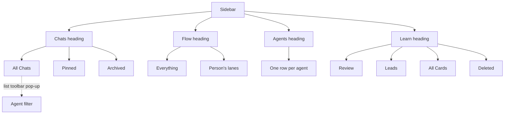
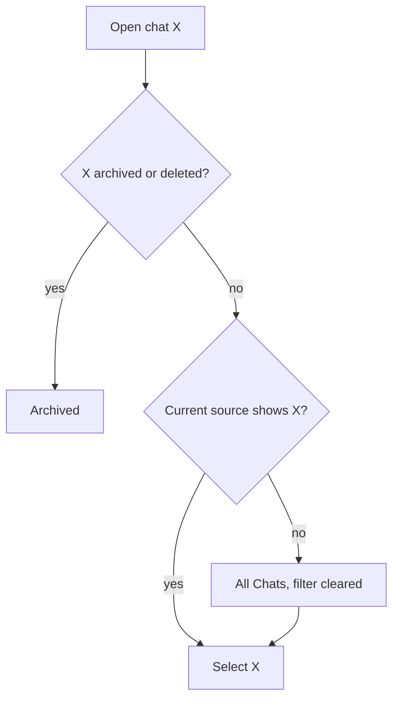

# A native Apple feel on shadcn - Plan

---

## Goal Capsule

- **Objective:** on the Mac, every loki window reads and behaves like Mail, Notes and System Settings: the same buttons, search fields, lists, sidebar and settings rows a Mac user already knows, in day and night.
- **Means:** loki's own controls become thin wrappers over shadcn components on Base UI with Apple variants, then the sidebar, the Settings window, Learn and Agents, and the thread are reshaped one at a time (KTD1, KTD2).
- **Authority:**
  1. The Product Contract's Requirements.
  2. Then the Key Technical Decisions.
  3. Then the units.

  Apple's apps (the screenshots reviewed on 2026-11-15) and [glasscn](https://glasscn.app) are visual reference, not requirement (KTD3).
- **Stop conditions.** Stop and ask if:
  1. The phone (`app/src/phone`) needs a visible change.
  2. A wrapper cannot keep its current props without changing more than a handful of call sites.
  3. A Base UI component needed here is missing from the installed `@base-ui/react`.
  4. Before starting a phase, the person has not looked at the previous phase running, light and dark.
- **Execution profile:** desktop UI across `app/src/components`, `app/src/ui`, `app/src/shell`, `app/src/settings`, `app/src/recall`, `app/src/agents`, `app/src/item`, plus one Rust menu change (`src-tauri/src/menu.rs`). Four PRs, each leaving the app whole:
  - PR 1: U1 to U3 (controls)
  - PR 2: U4 and U5 (sidebar)
  - PR 3: U6 and U7 (Settings and updates)
  - PR 4: U8 and U9 (Learn, Agents, thread)

  This plan ships in PR 1. Each PR is done when its units' Verification holds; the plan is done when the Definition of Done holds after PR 4.
- **Who finishes:** `ce-work` implements on branch `feat/native-feel`, renamed per PR. The person checks each PR in the running app, light and dark, before merging.

---

## Product Contract

### Summary

loki's own controls (buttons, symbol buttons, chips, text and search fields, list rows, switches, segmented controls, tab rows and popovers) are rebuilt on shadcn with Apple variants, and their hand-made CSS goes.
Then four screens change, each shown rendered before the next:
- the sidebar, with grey section headings and each agent listed once, under Agents
- the Settings window, in System Settings' form
- Learn and Agents, without the key strip and outlined buttons
- the thread's developer marks

The phone and the agents' Canvas widgets are unchanged.

### Problem Frame

A review on 2026-11-15 set Mail, Messages, Notes, Music, TV, Contacts, Stocks, Weather and System Settings beside loki's own screens.
The frame already matches: the floating sidebar, two-line headers, the Messages composer, grey counts.
The controls do not:
- buttons are outlined pills where Apple fills them grey
- search fields are bordered rectangles with no magnifier
- a selected row in a focused list draws a ring on top of its blue fill
- every sidebar icon is blue, and each agent appears three times
- the Settings window has a sidebar and tabs, long paragraphs above each group, and durations as rows of segments
- a monospace strip of keys sits under Learn's card, and "Update…" sits in every toolbar

Two vocabularies cause most of it. The chat pane and Flow's cards are shadcn (plans 096, 097); everything else is about 2,200 lines of `loki-*` CSS in `app/src/components/components.css` behind `app/src/components/index.tsx`, so each fix lands twice or not at all.

### Key Decisions

- **Controls first, then screens one at a time.** Governs R1, R13. (session-settled: user-approved — chosen over moving each screen and its controls together: one vocabulary lands everywhere before screens build on it)
- **The sidebar takes Apple's layout: grey headings that are not rows, each item once, only the selection tinted.** Governs R5, R6, R7. (session-settled: user-approved — chosen over keeping plan 2026-11-14-1330's place rows and repeated agents: Mail and Music list each source once under headings)
- **Agents live under Agents only.** Governs R6, R8, R9. (session-settled: user-approved — chosen over agents as Chats filters only, and over keeping them in all three places: Chats filters by agent from its list toolbar instead)
- **Settings takes System Settings' form.** Governs R10, R11, R12. (session-settled: user-approved — chosen over restyling today's groups and tabs: one page per sidebar row is what a Mac user expects)
- **The key strip and the Update button leave the screen.** Governs R14, R15. (session-settled: user-approved — chosen over keeping either: design.md already puts keys in menus and tooltips, and Apple shows updates in the app menu)

### Requirements

**Controls**
- R1. Every button in loki draws as one of four Apple kinds: push (filled grey), default (filled accent), destructive (red ink or fill), or plain (accent text, no fill).
- R2. Search fields are filled capsules with a leading magnifier and no border.
- R3. A selected row in a focused list shows focus by its accent fill alone; any other focused row shows the focus ring.
- R4. Labels that open a follow-up end in the ellipsis character "…", never three periods.

**Sidebar**
- R5. The sidebar shows Chats, Flow, Agents and Learn as small grey headings that cannot be selected, each with its sources under it.
- R6. Chats' sources are All Chats, Pinned and Archived. Flow's are Everything and the person's own lanes. Agents' are the agents. Learn's are Review, Leads, All Cards and Deleted.
- R7. Sidebar icons are drawn in the label colour; only the selected row's icon and label take the accent.
- R8. All Chats groups its chats under agent headings, Pinned first, and a pop-up in the list toolbar shows one agent's chats or all of them.
- R9. ⌘K, a notification, or any Open the Chat lands on that chat in the Chats list, clearing an agent filter that would hide it.

**Settings**
- R10. The Settings sidebar lists one row per page, each with a coloured icon, and choosing a row shows that page with no tabs.
- R11. Settings pages draw their options as inset grouped rows with at most one short grey note under a group.
- R12. Choices of a duration are pop-up menus.

**Screens**
- R13. Learn's card, Agents' pages and the thread use the same controls as the rest of the app.
- R14. No strip of key hints appears on screen; each key is in its menu item and its control's tooltip.
- R15. Updates are offered from the loki menu (☰ on Windows and Linux) and Settings › loki, not the toolbar.
- R16. The thread marks tool runs with a work symbol rather than the terminal prompt (">_"), and a failure the agent recovered from is drawn in grey, not red.

**Constraints**
- R17. The phone looks and works as before.
- R18. Every change holds in day and night, under Reduce Transparency and Increase Contrast, and on Windows and Linux.

### Acceptance Examples

- AE1. Covers R3. Given the Flow list has focus and a row is selected, the row is accent-filled with no ring; pressing ↓ moves the fill, and Tab out then back shows the fill again without a ring.
- AE2. Covers R3. Given the list has focus and no row is selected, the focused row shows the ring.
- AE3. Covers R8, R9. Given All Chats is filtered to friday, when a notification for an optimus chat is opened, the filter clears and the optimus chat is selected.
- AE4. Covers R6. Given this Mac was last in friday's agent lane, Flow opens on Everything with Everything selected.
- AE5. Covers R15. Given a newer stable version, the loki menu shows "Update to 2026.11.20…"; given none, it shows "Check for Updates…".

### Scope Boundaries

- The phone, its CSS and its agent lanes stay as they are.
- The agents' Canvas widgets and the kit they use (`app/src/kit`) are not restyled.
- Colour tokens, glass rules and type scale in `docs/design.md` do not change.
- Considered and not built: a persisted agent filter in Chats. Today's Chats source lives for the session only; persisting the filter would be the first persisted list state, and nobody asked for it.
- Considered and not built: a sidebar on the Settings window that remembers a page across launches. It is sessionStorage today; System Settings remembers, but nothing here depends on it.

### Deferred to Follow-Up Work

- Inlining the wrappers into their call sites, so screens import `@/ui` directly.
- Replacing loki's own Sheet with shadcn's Dialog and Sheet, which needs the phone's bottom-sheet path first.

### Sources

- `docs/plans/2026-11-14-1330-feat-three-column-layout-plan.md`: R1, R4, R13 and R18 there are the sidebar sources and Update button this plan changes.
- `docs/design.md` "Primitives" and "The chat pane and Flow's cards (shadcn and AI Elements)".
- glasscn's Grouped list, Search field, Segmented control and Sidebar, at `https://glasscn.app/docs`.

---

## Planning Contract

### Key Technical Decisions

- KTD1. **The wrappers keep their names and props and render shadcn inside.** `Button`, `IconButton`, `Chip`, `Field`, `TextArea`, `Switch`, `Segmented`, `TabRow`, `Popover` and `ListRow` stay exported from `app/src/components/index.tsx`, so about 95 importing files and `test/words.test.ts` (which finds buttons by the name `Button`) keep working. (session-settled: user-approved — chosen over rewriting every call site at once: the call sites move in a later follow-up)
- KTD2. **Tones map onto Apple kinds.** `quiet` and `paper` become push, `positive` becomes default, `negative` becomes destructive, and `brass` becomes plain. `bare` is plain without padding. Sizes map 28 → `sm`, 36 → `default`, 44 → `touch` (phone only). Governs R1.
- KTD3. **glasscn is a reference, not a dependency.** It is built on Radix and puts glass on inputs and cards; loki is on Base UI and keeps glass for what floats. Where a glasscn piece shows the Apple shape (Grouped list, Search field, Segmented control, Sidebar), port the shape onto Base UI and loki tokens, and keep its MIT notice in any file that copies code. (session-settled: user-approved — chosen over installing its registry: a second primitive library and glass on content)
- KTD4. **Missing shadcn pieces come from the registry.** `shadcn add` brings switch, popover, label and field (base-nova) into `app/src/ui`, bent to loki's rules as plans 096 and 097 did. Tabs and sidebar are not added: `TabRow` stays on the existing toggle-group, and the sidebar stays loki's `Places`.
- KTD5. **The phone keeps its CSS hooks.** Wrappers keep emitting `loki-btn`, `loki-chip`, `loki-field` and `loki-sheet-card` with their modifiers, and the rules in `components.css` that only the phone and `chat.css` read stay. Desktop rules that the new classes replace are deleted. Governs R17.
- KTD6. **The focused selection hides its ring with a transparent outline.** `tokens.test.ts` forbids `outline: none`; the rule is `outline: 2px solid transparent` on the current row inside a list with focus, so Windows High Contrast still draws it. Governs R3.
- KTD7. **No switch back to the old look.** Each phase replaces the old one in its PR; review happens on the running branch. (session-settled: user-approved — chosen over a Preferences switch like the 2026-11-12 redesign: the old look is not kept)
- KTD8. **Settings keeps its 15 page ids.** `loki.settingsPage` already stores page ids, so deep links, ⌘K page words and `pageAfterKey` keep working; the groups become sidebar headings. ↑↓ step pages and stop at the ends, and a pick shows at once. ⌘[ ⌘] keep stepping pages.
- KTD9. **An agent lane reads as Everything on the desktop.** `resolveLane` on the desktop maps `agent:<id>` to Everything; the phone keeps its agent lanes. Governs R6.
- KTD10. **The update item lives in the Rust menu.** `src-tauri/src/menu.rs` gains "Check for Updates…", retitled "Update to <version>…" when one waits, wired by an id like `app.settings` (`app/src/shell/use-shell-keys.ts`). Skip This Version moves to Settings › loki. Nightly and dev builds never show it as waiting. Governs R15.

### High-Level Technical Design

The sidebar after U4:

Routing a chat into view (R9):

### Assumptions

- `@base-ui/react` in `node_modules` already ships switch, popover, field and select, so `shadcn add` needs no new dependency.
- Agents with no chats remain reachable for New Chat through the agent filter pop-up, which lists every agent.

### Risks

- **The phone breaks silently.** It reads the primitives' classes 61 times in `phone.css`. Mitigation: KTD5, plus the phone tests (`test/phone-router.test.ts`, `test/reply-proposals.test.ts`) and a look at the phone build before PR 1 merges.
- **Many look-tests pin today's CSS.** `shell-look`, `list-row`, `chat-look`, `list-column-look`, `settings-look`, `label-picker-look`, `inbox-card` and `preferences` read rules that move. Each unit updates the tests it moves rather than deleting their intent.
- **The Rust menu change needs the cargo checks** in `docs/CONTRIBUTING.md`, which PR 3 must run.

---

## Implementation Units

### U1. Apple variants in `app/src/ui`

- **Goal:** shadcn's button, input group, switch, popover and field carry the Apple kinds loki needs.
- **Requirements:** R1, R2, R18.
- **Dependencies:** none.
- **Files:**
  - `app/src/ui/button.tsx` (variants push, default, destructive, plain; size `touch`)
  - `app/src/ui/input-group.tsx` (search capsule)
  - `app/src/ui/switch.tsx`, `app/src/ui/popover.tsx`, `app/src/ui/label.tsx`, `app/src/ui/field.tsx` (new, via `shadcn add`)
  - `app/src/kit/tokens.css` (a `--loki-push` fill per theme if `--loki-hover` fails 3:1 against the ground)
  - `test/tokens.test.ts`
- **Approach:**
  1. Add the four upstream components (KTD4) and bend them: loki's focus flash, LAYER for overlays, sizes on Tailwind's four text steps.
  2. Push is a filled grey with a hairline edge, default is `--loki-affirm`, destructive is `--loki-negative`, plain is accent text (KTD2).
  3. The search capsule is an InputGroup with a leading magnifier addon, rounded full, filled with `--loki-well`, no border.
- **Patterns to follow:** the bends recorded in `docs/design.md` "The chat pane and Flow's cards"; `app/src/ui/toggle-group.tsx`; glasscn Button and Search field for shape (KTD3).
- **Test scenarios:**
  - Each button variant's fill and ink pass AA in day and night (extend the per-surface contrast check in `test/tokens.test.ts`).
  - The push fill is at least 3:1 against `--loki-bg` and `--loki-panel` in both themes.
  - The new `ui/` files pass the existing fences: no `outline-none`, shadows only the four names, layers by LAYER.
- **Verification:** every variant renders in a scratch view on the worktree's Vite, light and dark, and `npm run lint` and the token test pass.

### U2. The primitives on shadcn

- **Goal:** loki's own controls render the U1 components with their props unchanged.
- **Requirements:** R1, R4, R17.
- **Dependencies:** U1.
- **Files:**
  - `app/src/components/index.tsx`
  - `app/src/settings/layout.tsx` (`Segmented`)
  - `app/src/components/components.css` (delete the desktop rules each control no longer uses)
  - `test/shell-look.test.ts`, `test/chat-look.test.ts`, `test/list-row.test.ts`, `test/label-picker-look.test.ts`, `test/inbox-card.test.ts`, `test/preferences.test.ts`, `test/tokens.test.ts`
- **Approach:**
  1. `Button` and `IconButton` render `ui/button` with the KTD2 mapping, keep `kbd` (tooltip and `aria-keyshortcuts`), and keep the `loki-btn` hooks (KTD5).
  2. `Chip` renders `ui/badge` when static and `ui/toggle` when it toggles; `Field` and `TextArea` render `ui/input` and `ui/textarea`, with `type="search"` taking the capsule.
  3. `Switch` renders `ui/switch`; `Segmented` and `TabRow` render `ui/toggle-group` in its segmented look; `Popover` renders `ui/popover`.
  4. Add a fence that fails "..." in a `Button` or menu label string (R4).
- **Patterns to follow:** `app/src/item/proposal.tsx` (shadcn buttons in loki); KTD1.
- **Test scenarios:**
  - A `Button tone="negative"` renders the destructive variant and still carries `loki-btn` for the phone.
  - A `Button kbd="⌘S"` still names the key in its tooltip and `aria-keyshortcuts`.
  - `Segmented` keeps `role="group"` and `aria-pressed`, so `test/preferences.test.ts` finds the duration controls until U6.
  - A label "Add Provider..." fails the new fence; "Add Provider…" passes.
- **Verification:** every screen renders with no outlined button on the desktop; the phone build looks unchanged next to `main`.

### U3. Lists and search fields

- **Goal:** lists show focus the Apple way and every search field is the capsule.
- **Requirements:** R2, R3.
- **Dependencies:** U2.
- **Files:**
  - `app/src/components/components.css` (focused-selection rules)
  - `app/src/shell/content-list.tsx`, `app/src/shell/desk-sidebar.tsx`, `app/src/settings/page-list.tsx` (search fields)
  - `app/src/agents/agents.tsx` (the Memory list's second highlight)
  - `test/list-column-look.test.ts`, `test/shell-look.test.ts`
- **Approach:**
  1. In a list with focus, the current row's ring is a transparent outline (KTD6); every other focused row keeps the ring.
  2. The list and Settings search fields take the capsule; the list's search keeps its edges as `list-column-look` pins them.
  3. The Memory list draws hover as hover, not as a second selection.
- **Test scenarios:**
  - Covers AE1. The focused current row's computed outline colour is transparent.
  - Covers AE2. With no current row, the focused row's outline is the accent.
  - A row under the pointer in the Memory list never takes the selection fill.
- **Verification:** the Flow and Memory lists show one highlight each, by keyboard and pointer.

### U4. The sidebar's headings and sources

- **Goal:** the sidebar is Apple's: grey headings, each source once, only the selection tinted.
- **Requirements:** R5, R6, R7, R9.
- **Dependencies:** U3.
- **Files:**
  - `app/src/shell/sidebar.tsx` (`Places`)
  - `app/src/shell/sidebar-model.ts` (`openIn`, `sourceFor`)
  - `app/src/shell/shell.tsx` (sources)
  - `app/src/shared/active-lane.ts` (KTD9)
  - `app/src/components/components.css` (`.loki-place*`)
  - `test/shell-look.test.ts`, `test/desk-sidebar.test.ts`, `test/flow-column.test.ts`, `test/agents-pages.test.ts`, `test/recall.test.ts`, `test/keymap.test.ts`
- **Approach:**
  1. Headings are text, not buttons; each place's first source carries what the place row meant (All Chats, Everything).
  2. Chats' per-agent sources and Flow's agent lanes leave the sidebar on the desktop; the phone's `sidebarModel` sections stay.
  3. `openIn` sends a live chat to All Chats when the current source would hide it (R9).
  4. Icons take the label colour; the selected row takes the accent.
- **Patterns to follow:** Mail's sidebar (Favourites, Smart Mailboxes) in the 2026-11-15 screenshots; glasscn Sidebar for shape.
- **Test scenarios:**
  - The sidebar renders four headings with no button role.
  - Chats lists All Chats, Pinned and Archived, and no agent.
  - Covers AE4. A saved `agent:friday` lane opens Flow on Everything on the desktop.
  - The phone's Home still groups chats by agent (`test/phone-home-groups.test.ts` unchanged).
  - ⌘[ ⌘] still step sources within a place.
- **Verification:** every place opens from its first source; folds still persist in `loki.desktop.sidebar`.

### U5. The agent filter in Chats

- **Goal:** All Chats groups by agent and can show one agent's chats.
- **Requirements:** R8, R9.
- **Dependencies:** U4.
- **Files:**
  - `app/src/shell/desk-sidebar.tsx` (list toolbar pop-up)
  - `app/src/shell/shell.tsx` (filter state, New Chat's agent)
  - `test/desk-sidebar.test.ts`
- **Approach:**
  1. A pop-up (shadcn `Select`) in the list toolbar lists All Agents then every agent, including those with no chats.
  2. The filter lives for the session, as `chatSource` does today.
  3. New Chat starts with the filter's agent, else the default agent.
- **Test scenarios:**
  - Choosing friday shows only friday's chats, Pinned ones under Pinned.
  - Covers AE3. Opening an optimus chat from a notification clears a friday filter and selects the chat.
  - An agent with no chats appears in the pop-up, and New Chat under it starts a chat with that agent.
- **Verification:** filtering and clearing by keyboard and pointer both work, and the list title says which agent shows.

### U6. Settings in System Settings' form

- **Goal:** the Settings window has one sidebar row per page and grouped rows inside.
- **Requirements:** R10, R11, R12.
- **Dependencies:** U2.
- **Files:**
  - `app/src/settings/settings.tsx`, `app/src/settings/page-list.tsx`, `app/src/settings/pages.ts`, `app/src/settings/layout.tsx`
  - the pages under `app/src/settings/` that use `TabRow`, `Block`, `Setting` or `Segmented` for durations
  - `test/preferences.test.ts`, `test/settings-look.test.ts`, `test/settings-window.test.ts`, `test/settings-lanes.test.ts`
- **Approach:**
  1. `page-list.tsx` draws the six groups as headings and the 15 pages as rows, each with a coloured squircle icon (KTD8).
  2. The page title is the page's name; `TabRow` goes from Settings.
  3. `Block` becomes an inset grouped list with hairlines between rows; help text becomes one short grey note under the group.
  4. Read's and Later's durations become `Select` pop-ups; the Flow page drops its `Kbd` hints.
- **Patterns to follow:** System Settings › General in the 2026-11-15 screenshots; glasscn Grouped list.
- **Test scenarios:**
  - ↓ from the last page of a group moves to the next group's first page, and stops at the last page.
  - A deep link to `providers` opens Providers with its row selected.
  - Choosing 30 Min in Read's pop-up saves `read_first` as before.
  - No Settings page renders a tablist.
- **Verification:** each of the 15 pages opens from its row, light and dark, at the window's 680 minimum width.

### U7. Updates in the menu

- **Goal:** the toolbar's Update button goes; the loki menu and Settings offer updates.
- **Requirements:** R15.
- **Dependencies:** U6.
- **Files:**
  - `src-tauri/src/menu.rs`
  - `app/src/shell/use-shell-keys.ts`, `app/src/shell/use-loki-update.ts`, `app/src/shell/title-menu.tsx`
  - `app/src/shell/update-button.tsx` (removed) and `app/src/shell/shell.tsx`
  - `app/src/settings/settings.tsx` (`LokiVersionFact`, Skip This Version)
  - `test/shell-look.test.ts`, `test/update-check.test.ts`, `test/native-menu.test.ts`, `test/title-strip.test.ts`
- **Approach:**
  1. The Rust menu carries "Check for Updates…" after About, retitled while a stable update waits (KTD10).
  2. The ☰ menu on Windows and Linux shows the same item.
  3. Settings › loki keeps the version and gains Skip This Version.
  4. The toolbar drops the button and the room kept for it.
- **Test scenarios:**
  - Covers AE5. With a newer stable version the item reads "Update to <version>…"; with none, "Check for Updates…".
  - On the nightly channel the item never reads as waiting.
  - Skip This Version hides the waiting title until a later version appears.
- **Verification:** the cargo checks pass, and the item works in the Mac app and the ☰ menu.

### U8. Learn and Agents

- **Goal:** Learn's card and Agents' pages use the new controls and show no key strip.
- **Requirements:** R13, R14.
- **Dependencies:** U2.
- **Files:**
  - `app/src/recall/recall.tsx`, `app/src/recall/recall-parts.tsx` (`RecallKeys`)
  - `app/src/agents/memory-page.tsx`
  - `test/recall.test.ts`, `test/agents-pages.test.ts`
- **Approach:**
  1. Remove `RecallKeys`; each deck key stays on its button's tooltip and in the Learn menu.
  2. Show Answer is the default button; Delete is destructive and sits apart from Edit and Open the Chat.
  3. "Ask {name} to Update This" becomes a push button.
- **Test scenarios:**
  - Learn's review renders no element with the key legend text.
  - Show Answer's tooltip names Space; Delete's names X.
  - The deck keys still act (`holdDeckKeys` in `app/src/recall/learn-list.ts`).
- **Verification:** a review session runs by keyboard alone with no strip on screen.

### U9. The thread's leftovers

- **Goal:** the thread drops its developer marks.
- **Requirements:** R16.
- **Dependencies:** U2.
- **Files:**
  - `app/src/item/work.tsx`, `app/src/item/timeline.tsx` (the tool-run line and failure line)
  - `test/chat-look.test.ts`
- **Approach:**
  1. The finished tool-run line leads with a quieter Lucide symbol than `TerminalIcon` (`work.tsx` already uses `WrenchIcon` while running).
  2. A failed step inside a turn that went on to finish draws in muted ink; a turn that ended in failure stays red.
- **Test scenarios:**
  - A turn with a failed step and a final reply renders the step in muted ink.
  - A turn that ends on the failure renders it in `--loki-negative`.
- **Verification:** a long chat with tool runs reads with no terminal prompt symbol and red only where work stopped.

---

## Verification Contract

| When | Command or check |
|---|---|
| While working | `npm run lint:fast`, `npm run typecheck`, `bun test test/tokens.test.ts` |
| Before each push | `npm run format:check && npm run lint && npm run typecheck && npm test && npm run test:node`, then `npm run build:app && npm run build:mod && npm run smoke` |
| PR 3 (U7) | the cargo checks in `docs/CONTRIBUTING.md` |
| Each PR, by hand | the worktree's own Vite with the dev token, light and dark, Reduce Transparency on and off; the phone build beside `main` |
| After push | the PR's CI, Windows included |

`test/scripts-prompt.test.ts` fails on `main` today (prompt cost per turn); it is not this plan's to fix and must fail the same way, no worse.

---

## Definition of Done

- R1 to R18 hold in the running Mac app, light and dark.
- `docs/design.md` describes one control vocabulary ("the rest of the app keeps the primitives above" is gone), the new sidebar, Settings and update item, with the reversed forms under "Tried and dropped".
- `docs/manual.md` describes the sidebar, Settings, the update item and Learn's keys as they now are.
- `docs/architecture.md` describes `components/` as wrappers over `ui/`.
- The CSS each phase replaced is deleted; no rule in `components.css` is unused (the token test's "every class has a rule" check runs both ways for the classes touched).
- No abandoned attempt remains in the diff.
