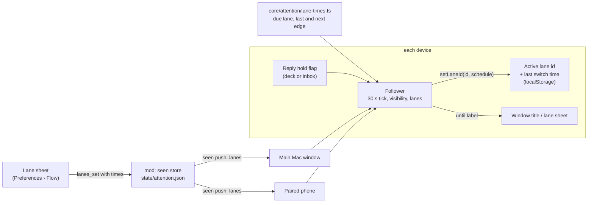
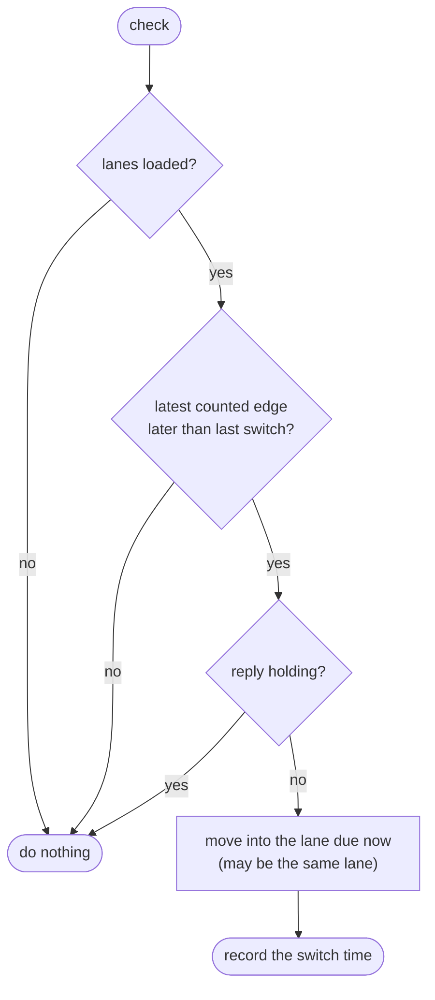

# Lane Schedules - Plan

---

## Goal Capsule

- **Objective:** at the times the person has planned (short blocks for mail and Slack, personal work in the evening), Flow is already in the right lane on every Mac and the phone, and they switch by hand only for sessions they did not plan.
- **Means:** switching times on a lane, followed by each device on its own clock (KTD1, KTD3), the automatic switching plan 087 deferred, by time of day and weekday only.
- **Product authority:** this Product Contract, then the Key Technical Decisions; plan 087 (`docs/plans/2026-11-10-087-feat-flow-lanes-plan.md`) and the lanes table plan (`docs/plans/2026-11-15-2359-feat-lanes-table-plan.md`) for everything about lanes this plan does not change. Switching by network or location is not active scope.
- **Stop conditions:** stop and ask if the work needs the mod or the daemon to do more than keep a lane's `times` as it keeps the rest of the lane, would rename a stored key, frame or analytics event, would change the Mac's sidebar rows, or would let a card from another lane through.
- **Execution profile:** one branch, `feat/lane-schedules`, units in order; core rules first, then the device follower, the reply hold, what is shown, the editor, the manual. One PR with scope `inbox`.
- **Who finishes:** `ce-work` builds and checks it; the person checks the Mac and the phone by hand (Verification Contract) and merges.
- **Open blockers:** none.

---

## Product Contract

Product Contract preservation: changed R13 and AE2; R6 reworded with no change in meaning, so a start shared by two windows follows R7 as AE1 shows. R13 now names where "until" shows, because the Mac's lane switcher is the sidebar, whose rows the person chose to leave as they are, and shows it whenever the active lane is the lane due. AE2 uses one of the person's own lanes, because the Mac never holds an agent's lane. Everything else is unchanged.

### Summary

A lane can carry switching times: windows of weekdays with a start and an end. When a window starts, every device moves into its lane; when it ends, into whatever window still covers that moment, or Everything. A switch by hand holds until the next start or end.

### Problem Frame

Since lanes shipped, the person switches them at the same moments most days: into a lane of mail and Slack for a short block of communication, at set times and also whenever they decide to, and into a personal lane once they are home in the evening. Each of those is a switch to remember on each device, and a forgotten one leaves work cards in the evening deck or chats in a block meant for mail. Apple's Focus solves the same problem by schedule; loki's lanes switch only by hand.

### Key Decisions

- **Time and weekday only.** A fixed evening time is close enough for the person, and reading the Wi‑Fi name on a current Mac needs Location Services, which the phone's web page cannot read in the background anyway. (session-settled: user-directed — chosen over detecting home by Wi‑Fi or location: the evening arrival is regular enough for a clock) Governs R1, R11.
- **The times live on the lane.** They sit in the lane's sheet beside what the lane shows, and go away with the lane. (session-settled: user-directed — chosen over one weekly timetable of blocks and over loki learning the pattern and suggesting: nested windows like Comms inside Work read naturally on the lane, and a timetable has to split them) Governs R1, R4, R5.
- **Every device follows the times.** The times are shared with the lane; each device moves itself into the lane due, so the active lane stays per device (plan 087 KTD4). (session-settled: user-directed — chosen over Macs only and over choosing the devices per window) Governs R6.
- **A window's end goes to the lane due then, not back to the lane before.** (session-settled: user-approved — chosen over returning to the lane the device was in when the window started: a device needs to know only the times, never a remembered lane that may have been deleted meanwhile) Governs R7.
- **A switch waits while a reply is being typed.** (session-settled: user-approved — chosen over switching on time with the draft kept for the session) Governs R10.
- **A switch by hand holds until the next start or end, as Focus does.** (session-settled: user-approved — chosen over a hand switch that holds for good or for the rest of the day: the schedule keeps working the next time without the person turning it back on) Governs R8.
- **The times are edited in the open and shown out of the way.** The sheet lays every window out at once, the table gives the times a line of their own, and Flow's header, the phone's title and the Mac's sidebar rows stay as they are. (session-settled: user-directed — chosen from sketches over summary rows with a popover, times on the row's one line, an "until" capsule or subtitle in Flow's header, and "until" or times on the sidebar rows; then, once the Mac's window title turned out to be hidden, over a capsule in Flow's header or a tooltip on the sidebar row) Governs R4, R5, R13.
- **Saving times is not a switch.** An edit or a deletion takes effect at the next start or end; a deleted lane a device is in reads as Everything, as today (plan 087 KTD4). Governs R4.
- **Plan 087's rules hold for scheduled switches**: the word is "lane", lanes and now their times are edited only on a Mac, and nothing from another lane breaks through. Governs R4, R12.

### Requirements

**Times on a lane**

- R1. A lane the person made can carry switching times: one or more windows, each a set of weekdays with a start time and an end time, to the minute.
- R2. A window may run past midnight and belongs to the weekday it starts on; a window whose start equals its end, or with no weekday, is refused.
- R3. Agents' built-in lanes and Everything carry no times.
- R4. Times are set in the lane's sheet in Preferences › Flow on a Mac, every window open as a row of weekdays, a start and an end, with Add Time and a way to remove each; they are saved and shared with the rest of the lane (plan 087), and deleted with it.
- R5. Each row of the lanes table says when its lane runs on a line of its own, under what it shows; a lane without times has no such line.

**Switching**

- R6. When a window starts or ends, every device moves into the lane due at that moment (R7).
- R7. The lane due at a moment is that of the window covering it that started latest; on a tie, the one that ends soonest; on a further tie, the lane listed first; with no window covering it, Everything.
- R8. A switch by hand on a device holds on that device until the next start or end of any window, after which R6 applies again.
- R9. A device that was closed or asleep when a window started or ended moves into the lane due as soon as it opens or wakes, unless it was switched by hand since that start or end.
- R10. A switch that comes due while the person has a reply with text on the card in front of them in Flow on that device waits until the reply is sent, the card is left or the reply is emptied, and then goes to the lane due at that moment.
- R11. Each device reads the times by its own clock and time zone.
- R12. A scheduled switch changes exactly what a switch by hand changes (plan 087): the deck and that device's badges, never the chat list or search, and it moves no card.

**Showing it**

- R13. While a device's active lane is the lane its times make due, the phone's lane sheet says when the next switch is and shows each other lane's times. The Mac shows it nowhere in its own window: only the system window title, which appears in Mission Control and the Window menu, reads "Flow · Comms · until 16:30 · 3 waiting". Flow's header, the phone's title and the Mac's sidebar rows stay as they are.
- R14. `inbox_filtered` keeps its name and fires for scheduled switches too, saying the switch was scheduled rather than by hand.

### Acceptance Examples

Work runs Mon–Fri 9:00–18:00, Comms Mon–Fri 9:00–9:30 and 16:00–16:30, Personal Mon–Fri 19:00–23:30, and Reading has no times.

- AE1. **Covers R6, R7.** On a Tuesday, every device is in Comms at 9:00 (both start, Comms ends sooner), Work at 9:30, Comms at 16:00, Work at 16:30, Everything at 18:00 and Personal at 19:00.
- AE2. **Covers R8.** At 15:50 the person picks Reading on the Mac; at 16:00 the Mac moves into Comms. At 16:10 they pick Everything; the Mac stays in Everything until 16:30, then moves into Work. The phone, untouched, follows AE1 throughout.
- AE3. **Covers R9.** The phone is closed from 17:00 and opened at 19:40: it opens in Personal. The person picks Everything at 19:45; reopened at 19:50, it stays in Everything.
- AE4. **Covers R10.** At 16:00 the person is halfway through a reply on a chat card; the deck stays as it is. They send at 16:02, and the device moves into Comms.
- AE5. **Covers R2, R7.** Personal on Fridays runs 19:00–01:00: at 00:30 on Saturday the device is in Personal, and at 01:00 it moves into Everything.
- AE6. **Covers R4.** At 10:00 the person adds a Tuesday 10:00–11:00 window to Comms and saves: no device moves until the next start or end, which is 11:00, when they go to Work.

### Success Criteria

- For someone with lane times, switches by hand per day fall against the weeks before, read from `inbox_filtered` (R14).
- Few switches by hand come within 10 minutes after a scheduled switch; many would mean the times are wrong or the switch is unwelcome.

### Scope Boundaries

Deferred for later:

- Switching by network (Wi‑Fi name or IP) or by location.
- loki learning when the person switches and suggesting times or a switch.
- Windows that move only some devices.
- Setting times on the phone, or switching the schedule off on one device.
- Exceptions that let a card through from outside the lane (deferred by plan 087).
- A notice or animation when a scheduled switch happens.

Considered and not built:

- A guard in the mod that keeps a lane's times when a Mac on the previous release saves the lane without them. The loss needs an edit on a Mac nobody has updated, the manual says to update every Mac, and the guard would need a merge rule for lists that disagree at the same time; real reports of lost times would change this.
- Treating a last switch later than now, after the clock was set back, as now. Clocks go back by seconds in practice, and a switch by hand clears it; reports of a device that stopped following after a clock change would change this.
- A limit on how long a reply can hold a switch. A held switch shows no "until", so the device never claims a lane it is not following; a draft left for hours holding a switch would change this.

### Sources / Research

- `docs/plans/2026-11-10-087-feat-flow-lanes-plan.md`: Deferred for later lists this work; KTD4 (the active lane per device) and KTD11 (`inbox_filtered` on a switch).
- `docs/plans/2026-11-15-2359-feat-lanes-table-plan.md`: the lanes table and its sheet, where the times go.
- `test/flow-lanes-deck.test.ts` ("the lanes are sources, not a menu in the title") and `docs/manual.md` "Lanes": the Mac switches lanes from the sidebar.

---

## Planning Contract

### Key Technical Decisions

- KTD1. **A lane's times are an optional list on the lane, saved as the lane is.** `Lane` gains `times`, a list of windows, each `{ days, start, end, since }`: `days` the weekdays as numbers (0 is Sunday), `start` and `end` as `"HH:MM"` on a 24-hour clock, `since` the ISO time the window was added or last changed. No `times` means none. The parser keeps a lane whose times are bad and drops only the bad windows, as it keeps the rest of the list when one lane is bad. The mod and the Mac-to-Mac merge keep whole lane objects already (`mod/seen.ts`, `parseLanes`), so they carry `times` without change. Governs R1, R2, R4.
- KTD2. **The switching rules are pure functions over the lanes and a `Date`.** A new `core/attention/lane-times.ts` works out the lane due at a moment, the latest and the next start or end, and the "until" moment, reading weekday, hour and minute from the `Date`'s local fields so each device uses its own zone (R11). Daylight saving follows what the platform does with a local time: a start in the spring gap moves forward by the gap's length, and a start in the repeated autumn hour takes its first occurrence. Governs R6, R7, R11.
- KTD3. **Each device follows by comparing the latest start or end with its last switch.** Beside the active lane id, each device keeps the time of its last switch, written by every switch, by hand or scheduled, even into the lane it was already in. On each check the device finds the latest start or end that has passed, counting only those at or after their window's `since`. If that moment is later than the last switch, nothing holds and the lanes have loaded, it moves into the lane due now and records the switch. One rule gives R6, R8 and R9. `since` keeps a saved edit from switching anyone (Key Decision "Saving times is not a switch") while a device that opens late still catches up. A device with no recorded switch counts as switched before every edge, so it moves only once a counted start or end has passed and never on the first launch after updating. Governs R6, R8, R9.
- KTD4. **One follower per device, in the main Mac window and the paired phone.** The Settings window also runs the shell's attention hook and shares the desktop lane key, so the follower is mounted in `app/src/shell/shell.tsx` and in `Paired` in `app/src/phone/phone.tsx`, not in `useAttention` or `useShellAttention`; the Settings window follows through the storage event. The follower checks every 30 seconds whether the page is visible or not, and again when the page becomes visible or focused and when the lanes change. Governs R6, R9, R14.
- KTD5. **A reply holds the switch through a small shared flag.** Flow's deck on the Mac and the phone's inbox each raise a flag while the card in front of them has a reply with text typed this session, the phone from its existing `typed`, the Mac from the drafts store's own entry for the card or its outside reply, never from the reply box's focus or a saved draft shown from the chat listing. The follower reads the flag; when it drops, the next check moves the device into the lane due then. Governs R10.
- KTD6. **Scheduled switches go through the one setter, marked as scheduled.** `setLaneId` takes how the switch happened, hand by default, records the switch time, and sends `inbox_filtered` with `by: "hand" | "schedule"` beside the existing `kind` and `agent`. The breakdown property stays `kind`. Governs R12, R14.
- KTD7. **"until" is the next moment the due lane changes, in the device's clock format.** It shows whenever the active lane is the lane due and the due lane is not Everything, and names the next moment the due lane changes, formatted with the options every other clock in loki uses (`app/src/shared/thread.ts`), so a 12-hour Mac reads "until 4:30 PM". The follower returns it, the shell passes it to the window title, and the phone passes it to its lane sheet. Governs R13.
- KTD8. **The editor saves over the lane it opened.** `saveLane` spreads the saved lane before applying the draft, so fields a later loki adds survive an edit here, and stamps `since` on a window that is new or whose days, start or end changed. Weekday chips are `Chip`s with `aria-pressed`; start and end are native time inputs, which give `"HH:MM"` whatever the display format. Governs R4.

### High-Level Technical Design

Where the pieces sit and which way they talk:



The follower's check, run on every tick and wake:



### Assumptions

- The Mac's hidden window keeps a 30-second timer running, perhaps late under App Nap; the rule in KTD3 makes a late check land correctly, and a quit app catches up at launch. The dock badge may lag a switch by as long as the timer is held back.

### Risks & Dependencies

- A Mac still on the previous release that edits a lane drops that lane's times on every device (see Scope Boundaries). The manual's Lanes section says to update every Mac before setting times.
- Time-zone tests set `process.env.TZ`, as `test/transcript-times.test.ts` does; check that the daylight-saving cases pass on the Windows runner, and inject the local-time reading instead if they do not.

---

## Implementation Units

### U1. Times on a lane and the rules

- **Goal:** the lane type carries times, the parser keeps good windows, and pure functions answer which lane is due, when the last and next start or end are, and what "until" names.
- **Requirements:** R1, R2, R3, R6, R7, R11; KTD1, KTD2, KTD7.
- **Dependencies:** none.
- **Files:** `core/attention/lanes.ts`, `core/attention/lane-times.ts` (new), `test/lanes.test.ts`, `test/lane-times.test.ts` (new), `test/frames.test.ts`, `test/seen-sync.test.ts`.
- **Approach:**
  1. Add the window type and the optional `times` to `Lane`, with a doc comment, since it is saved under `~/.loki` and sent in frames.
  2. Make `parseLanes` rebuild `times` from its valid windows, dropping a window with bad days, a bad time, start equal to end or no `since`.
  3. In `lane-times.ts`, generate the windows' start and end moments around a `Date` by local calendar days, never by adding 24 hours: today's and yesterday's starts for the lane due (R7), the next edge and the "until" moment, and the starts of the past eight days for the latest counted edge (KTD3's `since` rule), since the last passed edge can be a week back.
  4. Add the times label the table and the phone share: windows with the same days grouped, each group "<days>, <times joined with "and">", groups joined with "; ", days as "Every day", "Weekdays", "Weekends" or short names from Monday.
- **Patterns to follow:** `parseLanes` and `isLane` in `core/attention/lanes.ts`; local-date building in `app/src/desk/return-picker.tsx`; zone handling in tests as in `test/transcript-times.test.ts`.
- **Test scenarios:**
  - Covers AE1. With Work, Comms and Personal, the lane due on a Tuesday at 8:59, 9:00, 9:29, 9:30, 16:00, 16:30, 18:00 and 19:00 is Everything, Comms, Comms, Work, Comms, Work, Everything and Personal.
  - Covers AE5. A Friday 19:00–01:00 window makes its lane due at Saturday 00:30 and not at Saturday 01:00; the window does not cover Sunday 00:30.
  - Two lanes with the same window: the one listed first is due.
  - A window ending at 9:30 and another starting at 9:30 give one edge at 9:30.
  - The latest counted edge ignores a window's starts and ends before its `since`, and counts the same window's later ones.
  - On a Sunday at 12:00 the latest counted edge is Friday's 23:30 end of Personal.
  - The times label reads "Weekdays, 9:00–9:30 and 16:00–16:30" for Comms, and "Weekdays, 9:00–9:30; Saturday, 10:00–11:00" when a Saturday window is added.
  - The next edge after 16:10 is 16:30, and "until" is 16:30 when the active lane is Comms, nothing when it is Reading, and nothing between windows.
  - Spring forward (Europe/London, the last Sunday of March): a 01:30 start falls at 02:30 local; autumn: a 01:30 start falls on the first 01:30.
  - A lane with bad windows keeps its good ones and its sides; a lane with `times` that is not a list keeps no times; a lane without `times` parses as before.
  - `lanes_set` with times keeps them; two Macs' lane lists merge with each lane's times intact.
- **Verification:** the rules answer every example in the Acceptance Examples from a fixed clock and zone.

### U2. Each device follows the times

- **Goal:** the main Mac window and the paired phone move their own active lane at each start and end, catch up on opening, and hold after a hand switch.
- **Requirements:** R6, R8, R9, R11, R12, R14; KTD3, KTD4, KTD6.
- **Dependencies:** U1.
- **Files:** `app/src/shared/active-lane.ts`, `app/src/shared/lane-follower.ts` (new), `core/attention/lane-times.ts`, `core/attention/use-attention.ts`, `core/attention/lanes.ts`, `core/analytics.ts`, `app/src/shell/use-shell-attention.ts`, `app/src/shell/shell.tsx`, `app/src/phone/phone.tsx`, `test/active-lane.test.ts`, `test/lane-times.test.ts`, `test/flow-lanes-deck.test.ts`, `test/analytics.test.ts`.
- **Approach:**
  1. Keep each device's last switch time in a second session value beside `loki.desktop.lane` and `loki.phone.lane`, written whenever the lane is set.
  2. Add the decision as a pure function in `lane-times.ts`: given the lanes (or null), the last switch, the hold and now, the lane to move into or none.
  3. Give `setLaneId` the how and `laneEvent` the `by` property; update the event's schema text, which still says lanes are chosen in Flow's title.
  4. Write the follower hook in `app/src/shared/lane-follower.ts` over `useNow`, `pageVisibility` and `pageActivity`, returning the "until" label; mount it in `shell.tsx` and `Paired` only.
- **Patterns to follow:** `createSessionValue` in `app/src/shared/session-value.ts`; `setLaneId` in `core/attention/use-attention.ts`; `pageActivity` in `app/src/shared/page-activity.ts`; hooks kept thin with the logic tested pure.
- **Test scenarios:**
  - Covers AE2. With the last switch at 15:50 (Reading by hand), the decision at 16:00 is Comms; with it at 16:10 (Everything by hand), the decision at 16:20 is none and at 16:30 is Work.
  - Covers AE3. With the last switch at 17:00 and lanes loaded at 19:40, the decision is Personal; with the last switch at 19:45, the decision at 19:50 is none.
  - Covers AE6. A window added at 10:20 (`since` 10:20) covering 10:00–11:00 gives no decision at 10:20 and Work at 11:00.
  - With lanes not yet loaded the decision is none, and once they load it catches up.
  - A device with no recorded switch keeps its lane while no window has a counted start or end, and moves into the lane due once one has passed.
  - Covers AE3 over a weekend. A phone last switched into Personal on Friday at 19:00 and opened on Sunday at 12:00 moves into Everything.
  - A scheduled switch into the lane already active still records the switch time and sends no event.
  - `laneEvent` gives `by: "hand"` by default and `by: "schedule"` for a scheduled switch, beside `kind` and `agent`.
  - Each device's last switch is kept under its own key, and a value from the other shell is not read.
- **Verification:** on a dev build with a window two minutes ahead, the Mac moves in and out on time, the phone preview catches up when reopened, and one `inbox_filtered` fires per switch.

### U3. A reply holds the switch

- **Goal:** a switch that comes due while a reply has text on the card in front of the person waits, and happens once the reply is sent, the card is left or the reply is emptied.
- **Requirements:** R10; KTD5.
- **Dependencies:** U2.
- **Files:** `app/src/shared/reply-hold.ts` (new), `app/src/shared/lane-follower.ts`, `app/src/desk/catch-up.tsx`, `app/src/phone/inbox.tsx`, `test/reply-hold.test.ts` (new), `test/lane-times.test.ts`.
- **Approach:**
  1. A small external store with a subscribe, read by the follower and raised by the deck and the inbox while their card has a reply with text.
  2. The phone raises it from `typed`; the Mac from the drafts store's own entry for the current card or its outside reply (KTD5), not `useDraft`'s fallback to the saved draft.
  3. Releasing the flag triggers a check, so the switch does not wait for the next tick.
- **Patterns to follow:** `typed` in `app/src/phone/inbox.tsx`; `drafts` and `outsideReplies` in `app/src/shared/`; the hold-while-drafting precedent in `app/src/phone/update-bar.tsx`.
- **Test scenarios:**
  - Covers AE4. With the hold raised at 16:00 the decision is none; with it dropped at 16:02 the decision is Comms.
  - A hold raised across 16:00 and 16:30 and dropped at 16:40 moves the device into Work, the lane due then, not Comms.
  - A focused but empty reply box does not hold.
  - A card whose only text is a draft saved earlier in the chat does not hold.
  - Two holders (the deck and the inbox) hold until both drop; a holder that unmounts drops its hold.
- **Verification:** with a reply typed on the Mac and on the phone preview across a start, the deck stays put until the reply is sent.

### U4. "until" in the window title and the phone's lane sheet

- **Goal:** the Mac's window title and the phone's lane sheet say when the next switch is, and the phone's sheet shows other lanes' times.
- **Requirements:** R13; KTD7.
- **Dependencies:** U2.
- **Files:** `app/src/shell/use-window-chrome.ts`, `app/src/shell/shell.tsx`, `app/src/phone/lane-sheet.tsx`, `app/src/phone/deck.ts`, `core/attention/lane-times.ts`, `test/window-title.test.ts`, `test/phone-lanes.test.ts`, `test/lane-times.test.ts`.
- **Approach:**
  1. Add the "until" label to `lane-times.ts` in the device's clock format, beside U1's times label.
  2. Pass "until" into the window title between the lane and the waiting count.
  3. Give each phone lane row with times a second line under its name, in secondary text that wraps rather than truncates: "Until 16:30" on the active lane while it is due, the times label on the others; the check stays in its trailing place.
- **Patterns to follow:** the title in `app/src/shell/use-window-chrome.ts`; `CLOCK` and `clockLabel` in `app/src/shared/thread.ts`; `LaneSheet` rows in `app/src/phone/lane-sheet.tsx`.
- **Test scenarios:**
  - The title reads "Flow · Comms · until 16:30 · 3 waiting" in a scheduled lane, "Flow · Reading · 3 waiting" in a lane picked by hand, and "Flow · 3 waiting" in Everything.
  - In an en-US 12-hour locale the title reads "until 4:30 PM".
  - The phone's sheet shows "Until 16:30" under the active scheduled lane, "Weekdays, 9:00–18:00" under Work, and no second line under Reading or Everything.
  - Flow's header and the phone's title render as before (existing snapshots unchanged).
- **Verification:** the phone preview's sheet reads as above, and the Mac's Window menu shows the title.

### U5. The times in the lane's sheet and the lanes table

- **Goal:** the person sets, changes and removes a lane's windows in its sheet, and the lanes table shows each lane's times on a second line.
- **Requirements:** R1, R2, R4, R5; KTD8.
- **Dependencies:** U1.
- **Files:** `app/src/settings/lanes.tsx`, `core/attention/lane-times.ts`, `app/src/dev/workbench.tsx`, `test/settings-lanes.test.ts`, `test/lane-times.test.ts`.
- **Approach:**
  1. Add the windows to the draft and a Schedule group under Mail and Slack, with the help "Every Mac and your phone switch to this lane at these times, from the first start or end after you save.": a row per window with weekday chips, start and end, and Remove, then Add Time.
  2. Add Time appends a row with Monday to Friday picked, 9:00 to 17:00. Each row's controls are named for it ("Remove time 2", "Start of time 2", "End of time 2").
  3. Validate in `saveLane`: a window needs a weekday and different start and end, and a refused window shows its message beside its row ("Pick at least one day", "Start and end must differ") with the sheet left open; spread the saved lane and stamp `since` (KTD8).
  4. Add U1's times label as a second line on each lane row with times.
  5. Fix the lanes group's help text, which still says lanes are switched from Flow's title, and give the workbench's lanes a lane with times.
- **Patterns to follow:** `LaneEditor`, `saveLane`, `draftOf` and `laneSummary` in `app/src/settings/lanes.tsx`; `Setting` and `Block` in `app/src/settings/layout.tsx`; `Chip` in `app/src/components/index.tsx`; words per `docs/design.md` (controls title case, labels sentence case).
- **Test scenarios:**
  - Saving a new window stamps `since`; saving an unchanged window keeps its `since`; changing a window's end restamps only that window.
  - Saving a lane keeps a field the editor does not know about.
  - A window with no weekday, or with start equal to end, is refused with its message beside its row and nothing is sent.
  - Add Time adds a Monday-to-Friday, 9:00–17:00 row, and each row's Remove and time inputs carry its number in their names.
  - Removing the last window saves the lane with no times.
  - The table row for Comms reads "Weekdays, 9:00–9:30 and 16:00–16:30" under its summary; Reading has no times line.
  - The editor renders a window's chips with `aria-pressed` and its two time inputs.
- **Verification:** at `?workbench` the sheet adds, edits and removes windows, the row shows the times line, light and dark.

### U6. The manual

- **Goal:** the manual's Lanes section explains switching times.
- **Requirements:** R1–R14.
- **Dependencies:** U1–U5.
- **Files:** `docs/manual.md`.
- **Approach:** add "Switching times" under "Lanes": setting windows, which lane is due when they overlap, a switch by hand holding until the next start or end, a reply holding a switch, where "until" shows, and that every Mac should be updated before times are set.
- **Test expectation:** none -- documentation.
- **Verification:** the section matches what the units built.

---

## Verification Contract

With CI's toolchain (the newest Node 22, npm 10, `SHELL=/bin/bash`):

```bash
npm run format:check && npm run lint && npm run typecheck && npm test && npm run test:node
npm run build:app && npm run build:mod && npm run smoke
```

By hand, from a dev build and `npm run phone-preview`, with made-up lanes only:

- The Mac, hidden behind another app, moves into a lane whose window starts two minutes later, and the dock badge follows within a minute.
- The phone preview, closed across a start and reopened, opens in the lane due.
- A reply typed across a start holds the switch until it is sent, on the Mac and on the phone preview.
- Screenshots of the sheet, the table row and the phone's lane sheet, light and dark, for the PR.

---

## Definition of Done

- R1–R14 hold, and every Acceptance Example passes as a test or a check by hand.
- The Verification Contract's commands pass and the PR's CI is green, Windows included.
- `docs/manual.md` describes switching times, and no stale "Flow's title" wording remains in the lanes help or the analytics schema.
- No code from abandoned attempts is left in the diff.
